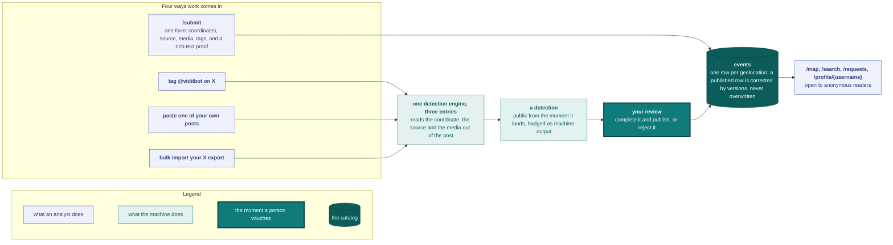

# Vidit

[](LICENSE)
[](https://vidit.app)

A web platform for OSINT/GEOINT analysts to archive, reference, and visualize geolocations of armed-conflict events. Interactive map, structured submission flow (coords + source + media + rich-text proof + tags), community requests, and analyst profiles.

Live at **[vidit.app](https://vidit.app)** (beta).

Work reaches the map through one of four doors. Three of them read an analyst's own X posts and produce machine detections; the fourth is the submit form. Nothing is published until a person vouches for it.



The detection engine is documented in [docs/ingestion.md](docs/ingestion.md), the row and its statuses in [docs/data-model.md](docs/data-model.md).

---

## Vision

- **Problem:** analysts who geolocate armed-conflict events post their work on X with no structured format and no place to centralize it, and the few dedicated tools are closed to part of the community.
- **Solution:** one open platform to reference, archive and visualize those geolocations, with a structured proof format and an interactive map.
- **Primary persona:** the OSINT/GEOINT analyst, amateur or professional, who geolocates open-source media (X, Telegram, satellite imagery) inside an international, English-speaking community on X and Discord.
- **Guiding principles:** openness (no artificial barriers), simplicity (posting a geolocation takes under two minutes), quality (an experience that matches the seriousness of the work), neutrality (geolocated facts, not political stances).

---

## Why open source

Vidit is open source under [AGPL-3.0](LICENSE). Anyone can self-host the platform; modifications deployed as a network service must publish their source under the same license. See the [future considerations epic](https://github.com/vidithq/vidit/issues/535) → *Openness and transparency*.

---

## Demo

<!-- The promo and screenshot tooling that produces this video is maintained separately. -->

https://github.com/user-attachments/assets/f314673c-d357-4468-af6d-2299c831c5fc

---

## Stack and documentation

A FastAPI + PostgreSQL/PostGIS backend and a Next.js frontend. [docs/engineering.md](docs/engineering.md) covers the tech stack, the repository layout and the CI jobs.

The technical reference lives in [`docs/`](docs/) (start at [docs/index.md](docs/index.md)) and is hosted at **[docs.vidit.app](https://docs.vidit.app)**. The roadmap lives in the [issues](https://github.com/vidithq/vidit/issues): each [epic](https://github.com/vidithq/vidit/issues?q=is%3Aissue%20state%3Aopen%20type%3AEpic) is a parent issue for one finishable outcome, with the issues that deliver it as sub-issues. Release history lives in [CHANGELOG.md](CHANGELOG.md).

---

## Getting started (local dev)

```bash
make init        # install + env + db-up + migrate (one-shot bootstrap)
make seed        # mock-admin + machine detections from the committed synthetic archive
make dev         # FastAPI :8000 + Next.js :3000 in parallel
make dev-worker  # background worker (optional; without it, queued emails, archive uploads and bot webhooks wait)
make test        # backend pytest
```

`make help` lists every target individually.

### Prerequisites

- Docker (for PostgreSQL + PostGIS; local and prod both run `postgis/postgis:16-3.4`, see [`docs/backups.md`](docs/backups.md))
- Python 3.12+ and [uv](https://github.com/astral-sh/uv)
- Node.js 20+ and npm

### Secrets

`make init` copies `.env.example` → `.env` (backend) and `.env.local.example` → `.env.local` (frontend), and gives `backend/.env` a development VAPID key pair for push notifications when it has none. Defaults are wired for `localhost`; every var is documented inline in [`backend/.env.example`](backend/.env.example) and [`frontend/.env.local.example`](frontend/.env.local.example). API docs auto-served at <http://localhost:8000/docs>.

### Bootstrap an account

`make seed` (or `make mock-admin`) creates `admin@vidit.app` / `admin` directly. To exercise the real invite + registration flow:

1. Set `ADMIN_EMAILS=<your-email>` in `backend/.env` so your account auto-promotes to admin on first login.
2. Get an invite code: sign in as the mock admin (`make mock-admin`) and mint one from the `/admin` panel.
3. Register at <http://localhost:3000/register> with the code.
4. `EMAIL_PROVIDER=console` (the local default) prints the confirmation link to **backend stdout**.

### Troubleshooting

- **Database connection failed**: ensure `docker-compose up -d` is running and nothing else holds port 5432.
- **Frontend can't reach the API**: check `NEXT_PUBLIC_API_URL` in `frontend/.env.local` is `http://localhost:8000/api/v1`.
- **"Module not found"**: re-run `uv sync --all-extras` (backend) / `npm install` (frontend), or `make install` for both.

---

## Contributing

The pull request flow, the local CI commands and the conventions live in [CONTRIBUTING.md](CONTRIBUTING.md). See also [SECURITY.md](SECURITY.md) and [CODE_OF_CONDUCT.md](CODE_OF_CONDUCT.md). Licensed under the [GNU Affero General Public License v3.0](LICENSE).

---

## Acknowledgements

The content shown in the landing video uses real geolocation work from [`@geo27752`](https://x.com/geo27752), reproduced with their consent. Thanks for letting Vidit show the platform the way analysts actually use it.
