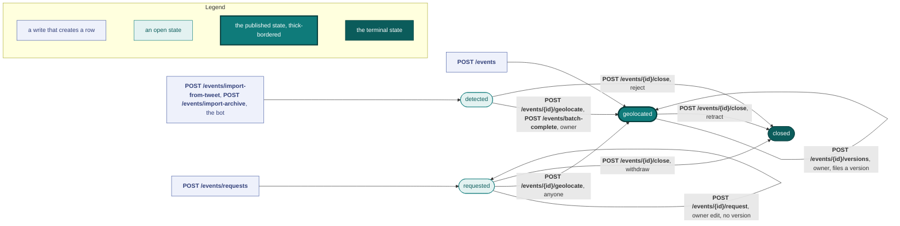
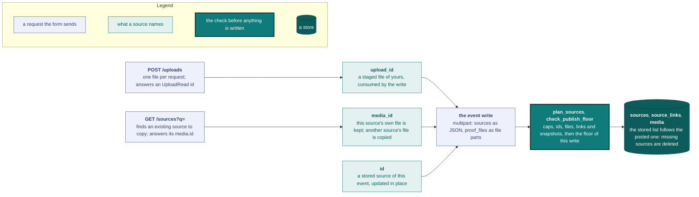
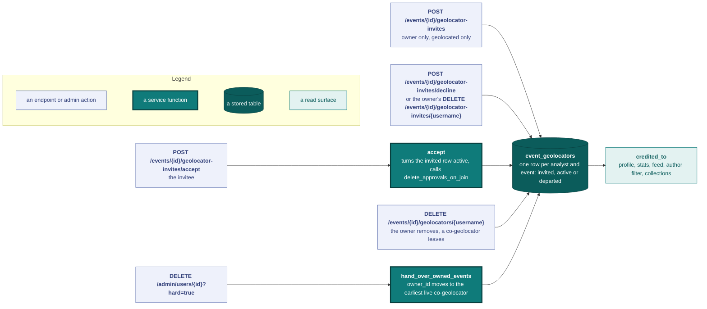
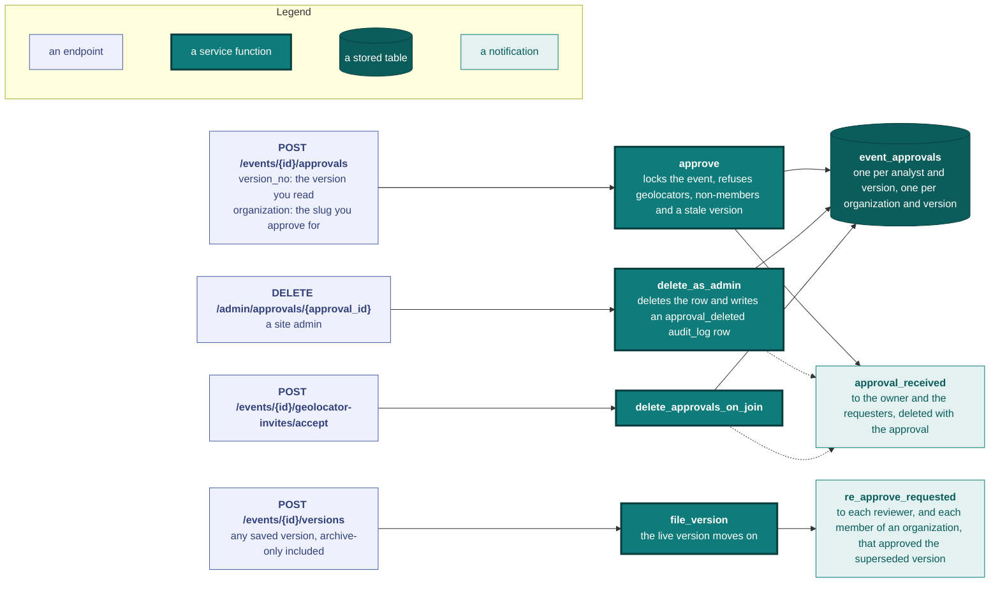
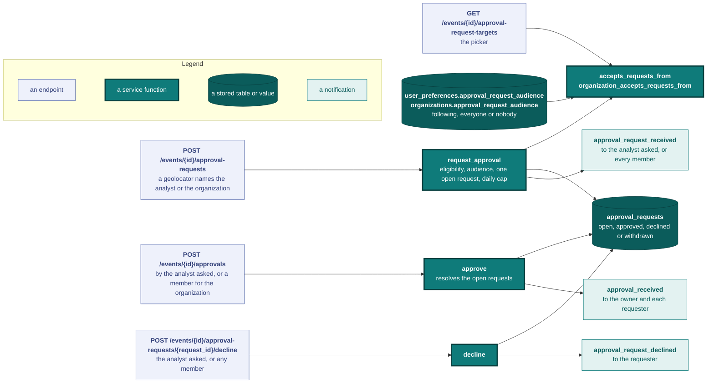
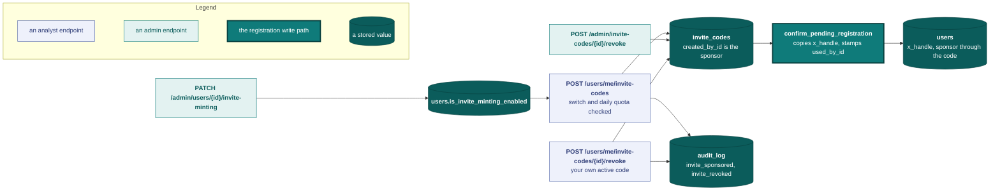
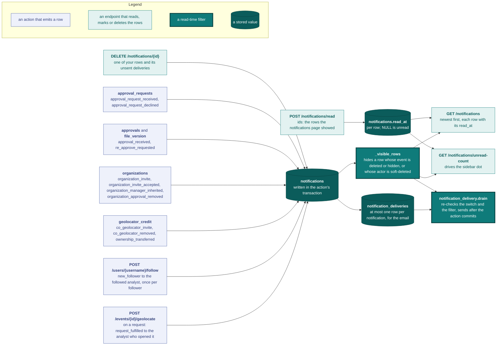
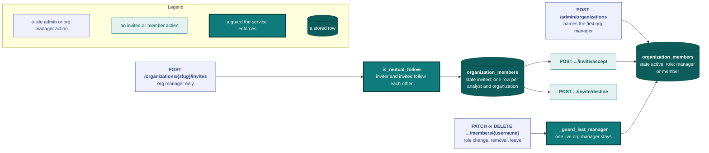

# API reference

Base URL: `/api/v1`. All responses are JSON. FastAPI also serves the generated schema at `/openapi.json`, which is what [`frontend/src/lib/api-types.ts`](../frontend/src/lib/api-types.ts) is generated from. Field names follow the [schema naming convention](engineering.md#schema-naming-convention).



```mermaid
flowchart LR
  classDef every fill:#e3f2f1,stroke:#0f7b7a,color:#0b5c5b
  classDef route fill:#eef1fb,stroke:#4a5fa5,color:#33417a
  classDef core fill:#0f7b7a,stroke:#083f3e,stroke-width:3px,color:#ffffff
  classDef exit fill:#fdf0e6,stroke:#b4632a,color:#7a3f14

  subgraph legend [Legend]
    direction LR
    l1["`runs on every request`"]:::every
    l2["`runs on the routes that declare it`"]:::route
    l3["`the handler, thick-bordered`"]:::core
    l4["`a rejection and its status`"]:::exit
    l1 ~~~ l2 ~~~ l3 ~~~ l4
  end

  subgraph mw [Middleware]
    direction LR
    rid["`**RequestIdMiddleware**
    echoes or mints X-Request-ID`"]:::every --> hsts["`**add_hsts_header**
    Strict-Transport-Security`"]:::every --> cors["`**CORSMiddleware**
    exposes Link, Retry-After, X-Request-ID`"]:::every --> csrf["`**CSRFMiddleware**
    X-CSRF-Token must equal vidit_csrf`"]:::every --> body["`**enforce_request_body_size**
    platform body cap`"]:::every
  end

  subgraph guards [Route guards]
    direction LR
    auth["`**get_current_user**, **require_admin**
    the vidit_session cookie`"]:::route --> lim["`**limiter.limit**
    per-IP table`"]:::route --> quota["`**authenticated_read_quota**
    1000 reads an hour per account`"]:::route
  end

  router["`**routers/**
  parse and validate the request`"]:::core --> service["`**services/**
  business rules, one transaction`"]:::core
  typed["`**raise_typed_error**
  detail: code + message`"]:::exit

  e403["`403 plain string`"]:::exit
  e413["`413`"]:::exit
  e401["`401 / 403`"]:::exit
  e429["`429 rate_limited, read_quota_exceeded`"]:::exit
  e422["`422 detail array`"]:::exit

  body --> auth
  quota --> router
  csrf -.-> e403
  body -.-> e413
  auth -.-> e401
  lim -.-> e429
  quota -.-> e429
  router -.-> e422
  service -.-> typed
```

Every request passes the middleware chain, then the guards its route declares, then the router and the service. Each rejection exits with the response shape [Errors](#errors) describes. The sections below cover the middleware and authentication first, then [rate limits](#rate-limits), then each router's endpoints.

**Auth.** For endpoints marked 🔒, log in first. Send the `vidit_session` cookie (set by `POST /auth/login`, `HttpOnly; Secure; SameSite=Lax`). For state-changing requests (`POST`/`PUT`/`PATCH`/`DELETE`) that carry the session cookie, also send the `X-CSRF-Token` header with the value of the JS-readable `vidit_csrf` cookie. There is no `Authorization: Bearer` flow. A 🔒 endpoint returns 401 without a session. A 🛡️ endpoint also requires `is_admin=true` on your account and returns 403 to a non-admin. The per-endpoint error tables below omit these two rows.

**Transport security.** Every response carries `Strict-Transport-Security: max-age=15768000`, except a 500 from an unhandled server error. The header carries no `includeSubDomains` or `preload` directives.

**Request id.** Every response carries an `X-Request-ID` header, a 500 included. Send your own `X-Request-ID` of 1 to 64 characters from `A-Z`, `a-z`, `0-9`, `.`, `_`, and `-`, with at least one letter or digit, and the response echoes it. The API replaces any other value with an id of its own. The backend logs every line of the request under that id, so quote it when you report a failed request.

**Auth audit log.** Each `/auth/*` endpoint writes an [`audit_log`](data-model.md#audit_log) row as a best-effort side effect. An audit failure never breaks the auth flow.

---

## Endpoints at a glance

Auth column: 🌐 anonymous, 🔒 logged-in, 🛡️ admin-only.

| Method | Path | Auth | Purpose |
|---|---|---|---|
| **Auth** | | | |
| POST | `/auth/register` | 🌐 | Stage a pending registration; sends confirmation email |
| POST | `/auth/confirm-registration` | 🌐 | Confirm a pending registration (creates user, signs in) |
| POST | `/auth/resend-confirmation` | 🌐 | Resend the confirmation email and invalidate the previous token |
| POST | `/auth/login` | 🌐 | Email + password → session + CSRF cookies |
| POST | `/auth/logout` | 🌐 | Clear session cookies (idempotent) |
| GET | `/auth/me` | 🔒 | Current user |
| POST | `/auth/forgot-password` | 🌐 | Email a single-use reset token (always 204) |
| POST | `/auth/reset-password` | 🌐 | Consume reset token, set new password |
| POST | `/auth/change-password` | 🔒 | Rotate your password (requires your current password) |
| **Events** | | | |
| GET | `/events` | 🌐 | List one lifecycle view, `located` (default) or `requested` |
| GET | `/events/points` | 🌐 | Compact map-points tuples for one viewport (`bbox` required, cached) |
| GET | `/events/possible-duplicates` | 🔒 | Soft-warning probe for the submit form |
| POST | `/events/import-from-tweet` | 🔒 | Import your own X post as detections |
| POST | `/events/import-archive/presign` | 🔒 | Mint a presigned direct-to-storage upload for your X data archive |
| POST | `/events/import-archive` | 🔒 | Enqueue your staged archive (by `upload_key`) for the backfill worker |
| GET | `/events/import-archive/{job_id}` | 🔒 | Poll your import job (status + import counts) |
| GET | `/events/{id}` | 🌐 | Full event detail, any lifecycle state |
| POST | `/events/{id}/report` | 🌐 | Report an event for moderation (anonymous allowed) |
| POST | `/uploads` | 🔒 | Stage one source file for a later event write (multipart, one file) |
| GET | `/sources` | 🔒 | Find an existing source by URL or title, to copy into an event form |
| POST | `/events` | 🔒 | Create an event born `geolocated` (multipart) |
| POST | `/events/requests` | 🔒 | Open a request (multipart); creates a `requested` event |
| POST | `/events/{id}/request` | 🔒 | Correct an open request, owner only; overwrites it in place, no version filed |
| POST | `/events/{id}/geolocate` | 🔒 | Give an event a vouched location: `requested` \| `detected` → `geolocated` |
| POST | `/events/batch-complete` | 🔒 | Publish a selection of your detections in one call (per-row verdicts) |
| POST | `/events/{id}/versions` | 🔒 | Correct a published event, owner only; files the version it supersedes |
| GET | `/events/{id}/versions` | 🌐 | The event's superseded versions, newest first |
| GET | `/events/{id}/versions/{version_no}` | 🌐 | One superseded version, by its number |
| POST | `/events/{id}/close` | 🔒 | Withdraw, reject or retract an event, owner only (→ `closed`) |
| GET | `/events/detections` | 🔒 | Your `detected` events awaiting a geolocate (paginated, filterable on readiness) |
| GET | `/events/{id}/collections` | 🔒 | Your collections, each saying whether this event is on it (credited analysts only) |
| GET | `/events/{id}/geolocator-invites` | 🔒 | Pending invitations to share the event's credit: all for the owner, yours otherwise |
| POST | `/events/{id}/geolocator-invites` | 🔒 | Invite an analyst to share a published event's credit, owner only |
| DELETE | `/events/{id}/geolocator-invites/{username}` | 🔒 | Withdraw a pending invitation, owner only |
| POST | `/events/{id}/geolocator-invites/accept` | 🔒 | Accept your invitation and join the event's geolocators |
| POST | `/events/{id}/geolocator-invites/decline` | 🔒 | Decline your invitation |
| DELETE | `/events/{id}/geolocators/{username}` | 🔒 | Remove a co-geolocator (owner), or leave as one |
| GET | `/events/{id}/approvals` | 🌐 | The approvals of one version (the live one by default), of every version (`all_versions=true`), or one analyst's across versions |
| POST | `/events/{id}/approvals` | 🔒 | Approve the live version of a published event you are not credited on, as yourself or for an organization you are a member of |
| GET | `/events/{id}/approval-requests` | 🔒 | Open approval requests: all for the event's geolocators, yours and your organizations' otherwise |
| GET | `/events/{id}/approval-request-targets` | 🔒 | The analysts and organizations you can ask to approve the event now, geolocators only |
| POST | `/events/{id}/approval-requests` | 🔒 | Ask an analyst or an organization to approve a published event you geolocated |
| POST | `/events/{id}/approval-requests/{request_id}/decline` | 🔒 | Decline an approval request addressed to you or to an organization you manage |
| **Collections** | | | |
| POST | `/collections` | 🔒 | Open a collection (title, description, and the events it holds) |
| POST | `/collections/{id}/report` | 🌐 | Report a collection for moderation (anonymous allowed) |
| GET | `/collections/{id}` | 🌐 | One collection: owner, title, description, tags, item count, date range |
| PATCH | `/collections/{id}` | 🔒 | Write your collection's title and description |
| DELETE | `/collections/{id}` | 🔒 | Drop your collection; the events it held stay |
| GET | `/collections/{id}/events` | 🌐 | Its items, oldest event first (cursor-paged) |
| PUT | `/collections/{id}/events/{event_id}` | 🔒 | Put one of your events on it (idempotent) |
| DELETE | `/collections/{id}/events/{event_id}` | 🔒 | Take one event off it (idempotent) |
| **Search** | | | |
| GET | `/search` | 🌐 | Free-text search across geolocations / requests / collections / users / organizations |
| GET | `/search/authors` | 🌐 | Username typeahead for the author filter and the co-geolocator invite |
| **Tags** | | | |
| GET | `/tags` | 🌐 | List the tags on live events or their sources |
| POST | `/tags` | 🔒 | Create a tag, or get the one already named so |
| **Conflicts** | | | |
| GET | `/conflicts` | 🌐 | List the conflict referential (`?used=true` narrows to conflicts on live events) |
| **Users** | | | |
| GET | `/users/{username}` | 🌐 | Public analyst profile |
| GET | `/users/{username}/stats` | 🌐 | Aggregated shape of an analyst's work (status split, tags, source hosts, activity) |
| PATCH | `/users/me` | 🔒 | Edit your bio and external links |
| PUT | `/users/me/avatar` | 🔒 | Upload your profile picture (multipart) |
| DELETE | `/users/me/avatar` | 🔒 | Remove your profile picture |
| GET | `/users/me/preferences` | 🔒 | Your display and notification preferences, each beside its default |
| PATCH | `/users/me/preferences` | 🔒 | Change some of your preferences |
| GET | `/users/me/x-handle` | 🔒 | The X handle an admin bound to your account |
| GET | `/users/me/invite-codes` | 🔒 | The invite codes you minted, newest first, and your daily quota |
| POST | `/users/me/invite-codes` | 🔒 | Mint a single-use invite code bound to the invitee's X handle |
| POST | `/users/me/invite-codes/{id}/revoke` | 🔒 | Revoke an active invite code you minted, keeping its row |
| GET | `/users/{username}/events` | 🌐 | List an analyst's published geolocations |
| GET | `/users/{username}/collections` | 🌐 | List an analyst's collections |
| GET | `/users/{username}/organizations` | 🌐 | List the organizations an analyst belongs to |
| POST | `/users/{username}/follow` | 🔒 | Follow (idempotent; self-follow → 400) |
| DELETE | `/users/{username}/follow` | 🔒 | Unfollow (idempotent; unknown user → 404) |
| **Notifications** | | | |
| GET | `/notifications` | 🔒 | Your notifications, newest first (cursor-paged) |
| GET | `/notifications/unread-count` | 🔒 | How many notifications you have not been shown |
| POST | `/notifications/read` | 🔒 | Mark the listed notifications read |
| DELETE | `/notifications/{id}` | 🔒 | Delete one of your notifications |
| GET/POST | `/notifications/unsubscribe` | 🌐 | Send to the confirmation page / turn off one kind of notification email, named by a signed token |
| **Organizations** | | | |
| GET | `/organizations/{slug}` | 🌐 | An organization's public profile |
| GET | `/organizations/{slug}/members` | 🌐 | Its members, org managers first |
| GET | `/organizations/{slug}/approvals` | 🌐 | The approvals placed in its name, newest first |
| GET | `/organizations/{slug}/approval-requests` | 🔒 | The open approval requests addressed to it (members) |
| PATCH | `/organizations/{slug}` | 🔒 | Edit its bio, links and approval request audience (managers) |
| PUT/DELETE | `/organizations/{slug}/avatar` | 🔒 | Replace or drop its picture (managers) |
| GET | `/organizations/{slug}/invites` | 🔒 | Pending invites (managers) |
| GET | `/organizations/{slug}/invite-candidates` | 🔒 | The mutual follows you can invite (managers) |
| POST | `/organizations/{slug}/invites` | 🔒 | Invite an analyst in mutual follow (org managers) |
| DELETE | `/organizations/{slug}/invites/{username}` | 🔒 | Withdraw a pending invite (managers) |
| POST | `/organizations/{slug}/invite/accept` | 🔒 | Accept your invite |
| POST | `/organizations/{slug}/invite/decline` | 🔒 | Decline your invite |
| PATCH | `/organizations/{slug}/members/{username}` | 🔒 | Change a member's role (managers) |
| DELETE | `/organizations/{slug}/members/{username}` | 🔒 | Remove a member, or leave |
| **Feed** | | | |
| GET | `/feed` | 🔒 | Published geolocations, open requests and machine detections, from followed analysts or everyone |
| **Webhooks** | | | |
| GET | `/webhooks/x` | 🌐 | X webhook CRC challenge (HMAC answer, no DB) |
| POST | `/webhooks/x` | 🌐 | Receive an X Account Activity delivery (signature-verified) and queue bot mentions |
| **Admin** (collapsed below) | | | |
| GET | `/admin/me` | 🛡️ | `is_admin` probe |
| GET | `/admin/detection-stats` | 🛡️ | Machine-extraction quality: reject-rate + pending missing-piece counts |
| POST/GET | `/admin/invite-codes` | 🛡️ | Mint / list invite codes |
| POST | `/admin/invite-codes/{id}/revoke` | 🛡️ | Revoke an invite code, keeping its row |
| DELETE | `/admin/invite-codes/{id}` | 🛡️ | Drop the row of an invite code no account was created from |
| GET | `/admin/users` | 🛡️ | Substring search on username/email |
| POST/GET | `/admin/organizations` | 🛡️ | Create an organization with its first org manager / list organizations, flagging those without one |
| POST | `/admin/organizations/{slug}/managers` | 🛡️ | Name a live analyst org manager of an organization |
| DELETE | `/admin/organizations/{slug}` | 🛡️ | Delete an organization with its memberships, invites, approval requests and approvals |
| DELETE | `/admin/users/{id}` | 🛡️ | Soft delete (default) or `?hard=true` GDPR erasure |
| DELETE | `/admin/users/{id}/detected-events` | 🛡️ | Purge every detection the user owns, account untouched |
| DELETE | `/admin/events/{id}` | 🛡️ | Soft delete or `?hard=true` GDPR erasure |
| PATCH | `/admin/collections/{id}/moderation` | 🛡️ | Withhold a collection from public view, or restore it (moves `hidden_at`) |
| DELETE | `/admin/collections/{id}` | 🛡️ | Withhold a collection from public view (the takedown alias of the PATCH above) |
| PATCH | `/admin/users/{id}/x-handle` | 🛡️ | Link / clear the bot-attribution X handle |
| PATCH | `/admin/users/{id}/invite-minting` | 🛡️ | Turn minting invite codes from Settings on or off for one analyst |
| DELETE | `/admin/approvals/{approval_id}` | 🛡️ | Delete one approval; its reviewer or organization can approve that version again |
| GET | `/admin/reports` | 🛡️ | The moderation queue: event and collection reports, open ones first |
| POST | `/admin/reports/{id}/resolve` | 🛡️ | Close one report with a verdict, applying it to what the report names |
| PATCH | `/admin/events/{id}/moderation` | 🛡️ | Set an event's graphic flag / takedown directly, no report behind it |
| POST | `/admin/events/{id}/versions/{version_no}/redact` | 🛡️ | Blank one filed version, keeping its number |
| POST | `/admin/maintenance/reap-*` | 🛡️ | Cron-style reapers (password reset tokens, pending registrations) |
| POST | `/admin/maintenance/send-completion-digests` | 🛡️ | Email each analyst the count of detections awaiting completion |

The admin console has no panel for the `/admin/maintenance/*` routes. Call them with an admin session cookie.

---

## Rate limits

A single shared **slowapi** limiter ([`app/ratelimit.py`](../backend/app/ratelimit.py)) enforces two layers: the per-endpoint limits in the table below, and the [per-user read quota](#per-user-read-quota). Table limits are keyed per client IP (the rightmost `X-Forwarded-For` entry; see [`engineering.md`](engineering.md#particularities-non-obvious-behavior-found-during-development)) unless a row says otherwise. An endpoint absent from the table has no limit. Buckets are per process. Set `RATE_LIMIT_ENABLED=false` to disable every limit at once, for local development.

A rejected request returns `429` with the typed envelope: code `rate_limited` for a table limit, or `read_quota_exceeded` for the read quota. Both carry a `Retry-After` header in whole seconds, counted to the exact bucket reset. Branch on `code`: a per-minute throttle clears in seconds, and the quota window is a fixed hour.

CI pins every limit on this page behaviorally: N requests succeed, and request N+1 returns `429` (see [`test_rate_limits.py`](../backend/tests/test_rate_limits.py)).

This table is the one statement of each limit. The endpoint sections do not repeat it.

| Endpoint | Limit |
|---|---|
| **Auth** | |
| `POST /auth/login` | 5/min + 30/hour |
| `POST /auth/register` | 10/hour |
| `POST /auth/confirm-registration` | 30/hour |
| `POST /auth/resend-confirmation` | 5/hour |
| `POST /auth/forgot-password` | 5/hour |
| `POST /auth/reset-password` | 10/hour |
| `POST /auth/change-password` | 10/hour (keyed per session) |
| **Events** | |
| `GET /events`, `GET /events/{id}`, `GET /events/{id}/versions`, `GET /events/{id}/versions/{version_no}`, `GET /events/detections` | 120/min |
| `GET /events/points` | 60/min |
| `GET /events/possible-duplicates` | 60/min |
| `POST /events/import-from-tweet` | 30/min |
| `POST /events/import-archive/presign` | 10/hour |
| `POST /events/import-archive` | 10/hour |
| `GET /events/import-archive/{job_id}` | 60/min |
| `POST /uploads` | 30/min |
| `GET /sources` | 60/min |
| `POST /events`, `POST /events/requests`, `POST /events/{id}/request` | 30/min |
| `POST /events/{id}/geolocate`, `POST /events/{id}/versions` | 30/min |
| `POST /events/batch-complete` | 10/min |
| `POST /events/{id}/close` | 60/min |
| `POST /events/{id}/report` | 10/hour (per IP only, anonymous allowed) |
| `GET /events/{id}/collections`, `GET /events/{id}/geolocator-invites` | 120/min |
| `POST /events/{id}/geolocator-invites`, `DELETE /events/{id}/geolocator-invites/{username}` | 30/hour |
| `POST /events/{id}/geolocator-invites/accept`, `POST /events/{id}/geolocator-invites/decline`, `DELETE /events/{id}/geolocators/{username}` | 60/min |
| `GET /events/{id}/approvals` | 120/min |
| `POST /events/{id}/approvals` | 60/min |
| `GET /events/{id}/approval-requests`, `GET /events/{id}/approval-request-targets` | 120/min |
| `POST /events/{id}/approval-requests` | 30/hour, plus the daily cap in [Approval requests](#approval-requests) |
| `POST /events/{id}/approval-requests/{request_id}/decline` | 60/min |
| **Collections** | |
| `GET /collections/{id}`, `GET /collections/{id}/events` | 120/min |
| `POST /collections`, `PATCH /collections/{id}`, `DELETE /collections/{id}` | 30/min |
| `POST /collections/{id}/report` | 10/hour (per IP only, anonymous allowed) |
| `PUT`/`DELETE /collections/{id}/events/{event_id}` | 60/min |
| **Search / Tags** | |
| `GET /search`, `GET /search/authors` | 60/min |
| `GET /tags` | 60/min |
| `POST /tags` | 30/min |
| `GET /conflicts` | 60/min |
| **Users / Feed** | |
| `GET /users/{username}`, `GET /users/{username}/stats`, `GET /users/{username}/events`, `GET /users/{username}/collections`, `GET /users/{username}/organizations`, `GET /feed` | 120/min |
| `PATCH /users/me` | 30/min |
| `PUT`/`DELETE /users/me/avatar` | 20/min |
| `POST`/`DELETE /users/{username}/follow` | 60/min |
| `GET /users/me/preferences` | 120/min |
| `PATCH /users/me/preferences` | 60/min |
| `GET /users/me/x-handle` | 120/min |
| `GET /users/me/invite-codes` | 120/min |
| `POST /users/me/invite-codes` | 30/hour, plus the daily quota in [`POST /users/me/invite-codes`](#post-usersmeinvite-codes) |
| `POST /users/me/invite-codes/{id}/revoke` | 30/hour |
| **Notifications** | |
| `GET /notifications`, `GET /notifications/unread-count` | 120/min |
| `POST /notifications/read` | 60/min |
| `DELETE /notifications/{id}` | 60/min |
| `GET`/`POST /notifications/unsubscribe` | 30/min (anonymous allowed) |
| **Organizations** | |
| `GET /organizations/{slug}`, `GET /organizations/{slug}/members`, `GET /organizations/{slug}/approvals` | 120/min |
| `PATCH /organizations/{slug}` | 30/min |
| `PUT`/`DELETE /organizations/{slug}/avatar` | 20/min |
| `GET /organizations/{slug}/invites`, `GET /organizations/{slug}/invite-candidates`, `GET /organizations/{slug}/approval-requests` | 60/min |
| `POST /organizations/{slug}/invites` | 30/hour |
| `DELETE /organizations/{slug}/invites/{username}` | 60/min |
| `POST /organizations/{slug}/invite/accept`, `POST /organizations/{slug}/invite/decline` | 30/min |
| `PATCH`/`DELETE /organizations/{slug}/members/{username}` | 60/min |
| **Admin** 🛡️ | |
| `POST /admin/invite-codes` · `POST /admin/organizations` · `POST /admin/organizations/{slug}/managers` · `DELETE /admin/organizations/{slug}` · `DELETE /admin/users/{id}` · `DELETE /admin/users/{id}/detected-events` | 30/hour |
| `POST /admin/invite-codes/{id}/revoke` · `DELETE /admin/invite-codes/{id}` · `PATCH /admin/users/{id}/x-handle` · `PATCH /admin/users/{id}/invite-minting` · `DELETE /admin/events/{id}` · `DELETE /admin/approvals/{approval_id}` | 60/hour |
| `POST /admin/reports/{id}/resolve` · `PATCH /admin/events/{id}/moderation` · `POST /admin/events/{id}/versions/{version_no}/redact` · `PATCH /admin/collections/{id}/moderation` · `DELETE /admin/collections/{id}` | 60/hour |
| `POST /admin/maintenance/reap-*` · `POST /admin/maintenance/send-completion-digests` | 30/hour |

The read-only admin probes (`GET /admin/me`, `/admin/detection-stats`, `/admin/users`, `/admin/invite-codes` list, `/admin/organizations` list, `/admin/reports` list) carry no limit. The [`/webhooks/x`](#webhooks) pair carries none either: both are HMAC-gated.

### Per-user read quota

**1000/hour per account.** One bucket is shared across these 23 read paths, not one bucket per endpoint:

`GET /events` · `/events/{id}` · `/events/{id}/versions` · `/events/{id}/versions/{version_no}` · `/events/{id}/approvals` · `/events/points` · `/events/detections` · `/events/possible-duplicates` · `/search` · `/search/authors` · `/tags` · `/conflicts` · `/users/{username}` · `/users/{username}/stats` · `/users/{username}/events` · `/users/{username}/collections` · `/users/{username}/organizations` · `/organizations/{slug}` · `/organizations/{slug}/members` · `/organizations/{slug}/approvals` · `/collections/{id}` · `/collections/{id}/events` · `/feed`

- The key is `User.id`, read from the signature-verified session cookie.
- The backend evaluates the per-IP table limit first, so a request the table rejects costs the account nothing.
- Anonymous callers are exempt and keep the per-IP limits alone. Twenty of the 23 paths answer anonymously.
- Every authenticated read absent from the list is exempt, including `GET /auth/me` and the read-only admin probes.
- `GET /events/import-archive/{job_id}` is exempt because an import polls it. It returns one job's progress counters and no catalog rows.

---

## Auth

### Password rules

A password you set through `POST /auth/register`, `POST /auth/reset-password`, or `POST /auth/change-password` must be at least 8 characters long. It must also fit in 72 bytes of UTF-8, the input limit of bcrypt. An ASCII character takes 1 byte. Every other character takes 2 to 4 bytes: `ß` and `£` take 2, `€` takes 3, and most emoji take 4. A password outside these bounds gets a 422, and the first `detail` entry's `msg` states the rule. A 422 body never echoes the submitted value.

A password you sign in with, or send as `current_password`, is never refused for being too long. One longer than 72 bytes matches no account, so it gets the same response as a wrong password. An empty `current_password` gets a 422.

### `POST /auth/register`

Stage a registration. Anonymous. **This call creates no `users` row.** The submission lives in `pending_registrations` until the user clicks the link in the confirmation email. The pending row references the invite code but does not consume it, so an abandoned signup does not burn the invite.

**Request body:**
```json
{
  "username": "kalush",
  "email": "kalush@example.com",
  "password": "••••••••",
  "invite_code": "abc123"
}
```

**Response 202:**
```json
{
  "status": "pending_confirmation",
  "email": "kalush@example.com"
}
```

The response sets no session cookie. A background task sends the confirmation email, so the success and error branches return at the same wire timing.

**Errors:**
| Code | Case |
|------|------|
| 400 | `invalid_invite`: invite code invalid, expired, revoked, or exhausted |
| 409 | `email_already_registered` / `username_already_taken`: taken by a live or soft-deleted user |
| 409 | `email_pending_confirmation` / `username_pending_confirmation`: a live pending confirmation holds it |
| 422 | `password` outside the [password rules](#password-rules) |

---

### `POST /auth/confirm-registration`

Anonymous. Consumes the token that `POST /auth/register` emailed, creates the `users` row, marks the invite consumed, and signs the user in (sets the `vidit_session` and `vidit_csrf` cookies in the same response).

**Request body:**
```json
{ "token": "Pv3oZc..." }
```

**Response 200:** `UserRead` (same shape as [`GET /auth/me`](#get-authme)).

| Status | Meaning |
|--------|---------|
| 200 | Account created; cookies set |
| 400 | `invalid_or_expired_token`: token unknown, expired, or already consumed |
| 409 | Email or username was taken between register and confirm |

---

### `POST /auth/resend-confirmation`

Anonymous. Remints the token for an outstanding pending registration and resends the confirmation email. Always returns 204, so the response never leaks which addresses are in flight. Reminting invalidates the previous token.

**Request body:**
```json
{ "email": "kalush@example.com" }
```

**Response 204** (always).

---

### `POST /auth/login`

**Request body:**
```json
{
  "email": "kalush@example.com",
  "password": "••••••••"
}
```

**Response 200:** `UserRead` (same shape as [`GET /auth/me`](#get-authme)). Sets the `vidit_session` HttpOnly cookie and the JS-readable `vidit_csrf` cookie.

**Errors:**
| Code | Case |
|------|------|
| 401 | Wrong email or password |

---

### `POST /auth/logout`

Clears your session and CSRF cookies. Not session-gated, so it is idempotent. Like any mutating request, it still requires the `X-CSRF-Token` header when a session cookie is present. **Response 204:** no body.

---

### `GET /auth/me` 🔒

Returns your user account.

**Response 200:**
```json
{
  "id": "uuid",
  "username": "kalush",
  "email": "kalush@example.com",
  "bio": null,
  "avatar_url": null,
  "external_links": {},
  "created_at": "2026-03-28T10:00:00Z"
}
```

**This shape carries no `is_admin` field.** The admin role surfaces only through [`GET /admin/me`](#get-adminme).

---

### `POST /auth/forgot-password`

Anonymous. Emails a single-use reset token if the address matches an account. Always returns 204, to avoid user enumeration. The backend logs and swallows email-send failures, for the same reason.

**Body:**
```json
{ "email": "kalush@example.com" }
```

**Response 204** (always, on success or unknown email).

---

### `POST /auth/reset-password`

Anonymous. Consumes a reset token and sets a new password. Tokens are single-use. They expire `PASSWORD_RESET_TOKEN_MINUTES` after minting (default 15; the reset email quotes the same value), and become invalid the moment a fresh `forgot-password` request is issued for the same user.

**Body:**
```json
{
  "token": "Pv3oZc...",
  "new_password": "atleasteightchars"
}
```

**Response 204** on success.

| Status | Meaning |
|--------|---------|
| 204 | Password updated |
| 400 | Token unknown, expired or already consumed, one opaque error for all three |
| 422 | `new_password` outside the [password rules](#password-rules); the token stays unconsumed |

### `POST /auth/change-password` 🔒

Rotates your password. Requires your current password, so a stolen cookie can't lock you out. Audited as `password_changed` on success. After commit, the backend sends a best-effort notice to your address (no IP or user agent; it links to `/forgot-password`). The backend logs and swallows an email-send failure; the rotation still succeeds.

**Body:**
```json
{
  "current_password": "••••••••",
  "new_password": "atleasteightchars"
}
```

**Response 204** on success. The session cookie stays valid.

| Status | Meaning |
|--------|---------|
| 400 | Current password incorrect |
| 422 | `new_password` outside the [password rules](#password-rules) |

---

## Events

A request, a geolocation and a detection are all rows of one `events` table, told apart by `status`. Every read and write in this section covers all of them.



[`GET /events`](#get-events) lists one view (`requested` is the request queue, `located` the catalog) and [`GET /events/{id}`](#get-eventsid) reads any status. `DELETE /admin/events/{id}` is the only write that removes a row.

### Event form fields

Five multipart endpoints take the event form. Each posts the whole row state at once, its sources included. This table states every field once; each endpoint section lists only its own rules.

Columns: **create** [`POST /events`](#post-events), **requests** [`POST /events/requests`](#post-eventsrequests), **request** [`POST /events/{id}/request`](#post-eventsidrequest), **geolocate** [`POST /events/{id}/geolocate`](#post-eventsidgeolocate), **versions** [`POST /events/{id}/versions`](#post-eventsidversions). Values: **req** required; **opt** optional; **floor** optional on the wire, required by the [evidence floor](#evidence-floor); **no** not accepted, ignored if sent.

| Field | Rule | create | requests | request | geolocate | versions |
|---|---|---|---|---|---|---|
| `title` | 1 to 255 characters | req | req | req | req | req |
| `lat`, `lng` | Subject point. Latitude in [-90, 90], longitude in [-180, 180]. Both or neither; on request, posting neither clears the guess | req | opt | opt | req | req |
| `sources` | JSON array of [`SourceCreate`](#sources): the event's whole source list, which replaces the stored one. Required on the wire; the floor decides what it must hold | req | req | req | req | req |
| `occurred_date` | `YYYY-MM-DD`. Blank stores NULL | opt | opt | opt | opt | opt |
| `occurred_time` | `HH:MM`, UTC. Blank stores NULL. Independent of `occurred_date` | opt | opt | opt | opt | opt |
| `proof` | An HTML string, sanitized on the [rich text](#rich-text) rules. A `placeholder://<filename>` src resolves against `proof_files`; an already-uploaded URL passes through | opt | opt | opt | opt | opt |
| `tag_ids` | JSON array of tag ids. Replaces the event's tag set. A source's tags travel in its `tag_ids` | opt | opt | opt | opt | opt |
| `conflict_ids` | JSON array of [conflict](#conflicts) ids. Replaces the conflict set | floor | opt | opt | floor | floor |
| `note` | At most 280 characters, stored on the version this edit supersedes | no | no | no | no | opt |
| `proof_files` | The proof body's inline images, matched to its `placeholder://` srcs by filename | opt | opt | opt | opt | opt |

`status`, `requested_by` and the [detection provenance](data-model.md#event_detections) (`detected_from_url` among it) accept no field on any of the five. No write moves `detected_from_url`. A source's file never travels in the event form: it uploads first, through [`POST /uploads`](#post-uploads).

#### Evidence floor

`POST /events`, `geolocate`, `versions` and [`POST /events/batch-complete`](#post-eventsbatch-complete) check the post-write state against one floor, before anything is written:

1. A `direct` or `indirect` source: none is `source_required`, and none with a file is `source_file_required`. A `context` source may be a URL only.
2. A sensor on every source that has a file, whatever its level: `sensor_required`.
3. At least one [conflict](#conflicts): `conflict_required`. The `"Other"` conflict keeps the rule satisfiable. No tag is required.
4. At least one image in the `proof` body: `proof_image_required`.

A `geolocated` row also always carries coordinates. The two request writes check only the first rule: a direct or indirect source with a file, no sensor and no conflict.

#### Archived copies

A link's `snapshot_url` is checked and stored in the same transaction as the write, on the terms [`archival.md`](archival.md) states. A rejected paste is a 400 with one of the `snapshot_*` codes, and nothing is written. A link posted without `snapshot_url` holds no copy after the write.

#### Proof-image ceiling

`max_proof_images_per_event` bounds what the final proof body displays: the already-uploaded images it still references plus the new files. An image kept only because a past version displays it does not count. Over the ceiling is a 422 `too_many_files`.

#### Rich text

An event's `proof` and a collection's `description` are HTML strings. The server sanitizes every incoming body with [`services/sanitize.py`](../backend/app/services/sanitize.py) and stores and serves the canonical result:

- **Tags:** `p`, `h2`, `h3`, `strong`, `em`, `s`, `code`, `pre`, `a`, `ul`, `ol`, `li`, `blockquote`, `hr`, `br`, and `img` in a `proof`. Any other tag is removed and its text kept. `script` and `style` are removed with their content.
- **Attributes:** `href` on `a`, `src` and `alt` on `img`. Every other attribute is removed. The server adds no `rel` or `target`; the renderer adds them.
- **Links:** an `href` must be an `http` or `https` URL with a host. A link whose `href` fails is kept as plain text.
- **Images:** a `src` must be a relative path or a URL on the configured media host (see [`engineering.md`](engineering.md#particularities-non-obvious-behavior-found-during-development)). A `placeholder://<filename>` src is accepted on the event forms only. An image whose `src` fails is removed.
- **Empty body:** every U+FFFC character is removed. A body with no text and no image is stored as `""`.
- **Caps:** at most 200,000 characters, 10,000 `<` characters, 32 levels of nested elements, and 16 distinct formatting start tags (`b`, `big`, `code`, `em`, `font`, `i`, `nobr`, `s`, `small`, `strike`, `strong`, `tt`, `u`, with or without attributes). Two formatting tags are the same when their source text is identical, so every `<strong>` counts once. A body over a cap is `invalid_proof` or `invalid_description`.

The plain-text projection (`sanitize.html_text`) measures the description cap and feeds `description_text` and search. It decodes entities and starts a new line at every `p`, `h2`, `h3`, `li`, `blockquote`, `pre`, `ul`, `ol` and `hr` boundary, at every `br`, and at every newline in the text. Each line is stripped, blank lines are dropped, and the rest join with `\n`.

At publish, the server sanitizes the body first, uploads `proof_files`, and then rewrites each `placeholder://` src to the stored URL.

### Sources

An event holds up to 10 [sources](data-model.md#sources), and none is the main one. Each is one block of the event form: a file, the URLs it was posted at, and what is known about its capture. Every event write posts the whole list as the `sources` field.



**`SourceCreate`**, one entry of the `sources` array:

```json
{
  "id": null,
  "title": "Drone footage of the strike",
  "level": "direct",
  "sensor": "drone",
  "captured_at": "2026-03-15T14:20",
  "sensor_position": { "lat": 48.12, "lng": 37.45 },
  "is_graphic": false,
  "links": [
    { "url": "https://t.me/channel/12345", "posted_at": "2026-03-15T18:05", "snapshot_url": null },
    { "url": "https://x.com/mirror_handle/status/1234567890" }
  ],
  "tag_ids": ["uuid"],
  "upload_id": "uuid",
  "media_id": null
}
```

| Field | Rule |
|---|---|
| `id` | A stored source of this event, to update in place. Omit it to create a source. An id that is not one of the event's sources, or that repeats, is `source_not_found` |
| `title` | Optional, at most 255 characters, stripped. `""` is no title |
| `level` | Required. `direct` (the act while it happens), `indirect` (its direct consequences, after the fact) or `context` (anything else). See [`data-model.md`](data-model.md#sources) |
| `sensor` | `smartphone`, `satellite`, `drone`, `static_camera`, `dashcam`, `body_cam` or `unknown`, or `null`. What captured the file; required on a source with a file at publication |
| `captured_at` | `YYYY-MM-DDTHH:MM`, read as UTC: when the media was captured. Optional |
| `sensor_position` | `{lat, lng}`: where the media was shot from. Optional; a value out of range is `invalid_coordinates` |
| `is_graphic` | `true` when the media shows death, injury or human remains. Defaults to `false`. On a stored source it only rises: `false` keeps a set flag, and only [`PATCH /admin/events/{id}/moderation`](#patch-admineventsidmoderation) clears it |
| `links` | 1 to 10 URLs, each `{url, posted_at, snapshot_url}`. `url` is at most 2000 characters; `posted_at` (`YYYY-MM-DDTHH:MM`, UTC) is when the media was posted there; `snapshot_url` is the link's [archived copy](#archived-copies). Each URL is stripped, and blanks and repeats are dropped before the count |
| `tag_ids` | The source's tags, from the catalogue events use. An unknown id is ignored |
| `upload_id` | A file you staged through [`POST /uploads`](#post-uploads). The write consumes it: the staged row becomes the source's file |
| `media_id` | A stored source file. The source's own file keeps it; another source's file, on this event or on any event that is not deleted or withheld, is copied: a new file row on the same stored object, and the new source takes that source's `is_graphic`. Find one through [`GET /sources`](#get-sources) |

A source names one file, through `upload_id` or `media_id`, or none; both is a 422. Every other field outside this table is a 422 too.

**The posted list replaces the stored one.** An entry with `id` updates that source in place, an entry without one creates a source, and a stored source the list leaves out is deleted with its links, tags and file row. Its stored object stays while a copy or a readable version names it ([`data-model.md`](data-model.md#media)). A source's links are replaced whole too, so post back each link's `snapshot_url` to keep its copy. The order is derived (level, then `captured_at`), so the posted order is not stored.

**Every source a person writes needs a URL.** A source posted with no link left after the blanks and repeats are dropped is `source_link_required`. Machine sources may lack one until they are published.

### Event write errors

The error table every event form endpoint shares. Each endpoint section names which of its rows apply and adds its own.

| Status | Code | Case |
|---|---|---|
| 400 | (plain string) | Empty or whitespace-only `title` |
| 400 | `invalid_coordinates` | A coordinate out of range, or half of a pair, on the event or a source's `sensor_position` |
| 400 | `invalid_proof` | `proof` exceeds a [rich text](#rich-text) cap |
| 400 | `proof_image_required` | No image in the final proof body |
| 400 | `conflict_required` | No conflict |
| 400 | `source_required` | No `direct` or `indirect` source |
| 400 | `source_file_required` | No `direct` or `indirect` source carries a file |
| 400 | `sensor_required` | A source with a file names no sensor |
| 400 | `source_link_required` | A source with no URL left after blanks and repeats are dropped |
| 400 | `invalid_source_url` | A source URL that is not an `http` or `https` link with a host |
| 400 | `too_many_sources` | More than 10 sources |
| 400 | `too_many_source_links` | More than 10 URLs on one source, after blanks and repeats are dropped |
| 400 | `source_not_found` | A source `id` that is not one of the event's sources, or that repeats |
| 400 | `source_media_not_found` | A `media_id` that names no file of this event or of a readable event |
| 400 | `upload_not_found` | An `upload_id` that does not exist or is not yours, or that another write already consumed |
| 400 | `upload_expired` | An `upload_id` past its `expires_at`. Upload the file again |
| 400 | `invalid_file` | A proof file of a disallowed type or size, or a proof src naming another event's image |
| 400 | `evidence_processing_failed` | A proof image the server refuses (see [File limits](#file-limits)), or a failed upload |
| 400 | `proof_files_mismatch` | A `placeholder://` src with no matching `proof_files` upload, or the reverse |
| 400 | `snapshot_url_invalid`, `snapshot_url_too_long`, `snapshot_url_not_https`, `snapshot_provider_not_allowed`, `snapshot_not_a_replay_url`, `snapshot_not_a_snapshot_code` | A rejected [archived copy](#archived-copies) |
| 403 | | You are not the owner (where the endpoint is owner-only) |
| 404 | `event_not_found` | Unknown or soft-deleted event |
| 409 | `invalid_state` | The row is not in a state this endpoint accepts |
| 413 | | The body exceeds the platform cap (`max_video_size + max_proof_images_per_event × max_image_size + 10 MB`). The middleware checks it before the body is read, and the 413 carries CORS headers |
| 422 | `too_many_files` | Over the [proof-image ceiling](#proof-image-ceiling) |
| 422 | | A missing required field, `title` over 255 characters, a malformed `occurred_date` or `occurred_time`, or a `sources` entry that fails its schema: an unknown field, a value outside `level` or `sensor`, a URL over 2000 characters, a malformed instant, or both `upload_id` and `media_id`. The `loc` of each entry starts with `["body", "sources", <index>]` |

### `POST /uploads` 🔒

Stage one source file before the event write that uses it: the first layer of the two-layer upload. Each file travels on its own request, so a request carries at most one video. A source of a later event write names the returned `id` as its `upload_id`.

**Request body (`multipart/form-data`):** one `file` part, an image or a video within the [file limits](#file-limits).

**Response 201:** an `UploadRead`.
```json
{
  "id": "uuid",
  "kind": "video",
  "sha256": "f7c3bcd13f00e8a4b2d4e9b3f1a2c5d6e7f8901234567890abcdef1234567890",
  "original_filename": "IMG_2034.MOV",
  "storage_url": "https://<cloudfront-domain>/uploads/….mp4",
  "expires_at": "2026-03-17T09:42:00Z"
}
```

`storage_url` lets the form preview the file. Only you can reference the upload. It expires 24 hours after it was staged: an event write naming it after `expires_at` is `upload_expired`, and the import worker deletes it within the hour after that. A write that takes it consumes it, so a second write naming it is `upload_not_found`.

**Errors:**
| Status | Code | Case |
|---|---|---|
| 400 | `invalid_file` | Disallowed type or size |
| 400 | `evidence_processing_failed` | An image the server refuses (see [File limits](#file-limits)), or a failed upload |
| 429 | `too_many_uploads` | You already hold 20 unexpired staged files no event uses. Submit the form that uses them, or wait for them to expire |

### `GET /sources` 🔒

The source picker: find an existing source to copy into an event form. Matches sources of events that are not deleted or withheld, whose title or one of whose URLs contains `q`, case-insensitive, newest first.

**Query params:**
| Param | Type | Description |
|-------|------|-------------|
| `q` | string, **required** | A URL or part of a title, 3 to 2000 characters |
| `limit` | int | 1 to 20, default 10 |

**Response 200:** an array of `SourcePickRead`: the [`SourceRead`](#get-eventsid) shape plus `event_id` and `event_title`, the event that holds the source.

To copy a pick, post a new source whose `media_id` is the pick's `media.id`, with the links you want on the copy. A pick with no file has no `media_id` to copy; post its URLs as a new source instead.

**Errors:**
| Code | Case |
|------|------|
| 422 | `q` shorter than 3 or longer than 2000 characters, or `limit` outside [1, 20] |

### `GET /events`

List one lifecycle view, newest or oldest first, as `EventList` cards (no full proof).

**Query params:**
| Param | Type | Description |
|-------|------|-------------|
| `view` | string | `located` (default, the catalog: `geolocated` + `detected` rows, plus a `closed` row whose `before_closed_status` was `detected`) or `requested` (the open-call queue: `requested` rows, plus a `closed` row whose `before_closed_status` was `requested`). A retraction (`closed` off `geolocated`) is in neither and is reachable by its own URL. Anything else → 422. |
| `status` | string (repeatable) | Narrows within the view, for example `?view=requested&status=closed`. Repeat to OR within the bucket. Values outside `requested` / `detected` / `geolocated` / `closed` return 422; a value the view can't contain returns an empty list. |
| `conflict` | string (repeatable) | Filter by [conflict](#conflicts) name (`conflicts.name`). OR within the bucket, AND across buckets. |
| `sensor` | string (repeatable) | Keeps an event with a source of this sensor: `smartphone`, `satellite`, `drone`, `static_camera`, `dashcam`, `body_cam` or `unknown`. Same OR / AND semantics. Any other value returns 422. |
| `level` | string (repeatable) | Keeps an event with a source of this evidence level: `direct`, `indirect` or `context`. Same OR / AND semantics. Any other value returns 422. |
| `tag` | string (repeatable) | Filter by tag name, on the event or on one of its sources. Same OR / AND semantics. |
| `bbox` | string | `south,west,north,east` (four comma-separated floats). 422 on malformed input; latitudes in [-90, 90], longitudes in [-180, 180], south ≤ north, west ≤ east. |
| `occurred_date_from` / `occurred_date_to` | date (YYYY-MM-DD) | Inclusive event-date range. Malformed values return 422. |
| `submitted_from` / `submitted_to` | date (YYYY-MM-DD) | Inclusive submission-date range. Malformed values return 422. |
| `author` | string | Exact, case-insensitive match on the username of any analyst the event credits: its owner or one of its [geolocators](#shared-credit) (pick real handles via [`GET /search/authors`](#get-searchauthors)). Restricted to `[A-Za-z0-9_-]{1,50}`; any other character returns 422. |
| `approved` | bool | `true` keeps a `geolocated` event whose live version holds an approval, an analyst's or an organization's. An approval of an earlier version does not count. See [Approvals](#approvals). |
| `approved_by` | string | Keeps a `geolocated` event that the analyst with this username (exact, case-insensitive) approved as themselves on its live version. An approval they placed for an organization does not count. Same `[A-Za-z0-9_-]{1,50}` rule as `author`. |
| `approved_by_org` | string | Keeps a `geolocated` event that the organization with this slug approved on its live version. Same character rule. |
| `has_coords` | bool | `true` keeps rows with a `coords` point (on the `requested` view, a request carrying a location guess); `false` keeps rows without one. Omit it for both. |
| `sort` | string | `newest` (default) orders by `created_at DESC, id DESC`; `oldest` orders by `created_at ASC, id ASC`. Both orders are total, so a cursor walk serves every row once. Anything else → 422. |
| `limit` | int | Rows per page. See [Pagination](#pagination). |
| `cursor` | string | Opaque cursor from the previous page's `Link: rel="next"` header. See [Pagination](#pagination). |

**Response 200:** an array of `EventList`.
```json
[
  {
    "id": "uuid",
    "title": "Strike on depot, Donetsk",
    "coords": { "lat": 48.123, "lng": 37.456 },
    "occurred_date": "2026-03-15",
    "is_graphic": false,
    "status": "geolocated",
    "before_closed_status": null,
    "requested_at": null,
    "owner": { "id": "uuid", "username": "kalush" },
    "geolocators": [{ "id": "uuid", "username": "kalush" }],
    "media": {
      "id": "uuid",
      "role": "source",
      "storage_url": "https://…/uploads/….jpg",
      "kind": "image",
      "sha256": "…",
      "original_filename": "photo.jpg"
    },
    "tags": [
      { "id": "uuid", "name": "airstrike" }
    ],
    "conflicts": [
      { "id": "uuid", "name": "Russian invasion of Ukraine", "wikidata_id": "Q110999040", "start_year": 2022, "end_year": null, "is_ongoing": true, "tier": "major" }
    ]
  }
]
```

**Response headers:** `Link: <…&cursor=…>; rel="next"` when a further page exists.

`coords` is `null` on a coordinate-less `requested` row. `geolocators` is the event's credit line, as on [`GET /events/{id}`](#get-eventsid). `requested_at` is when the row entered `requested`, and `null` on a row that was never a request; the Requests board counts a request's age from it. `is_graphic` is `true` when any of the event's sources is flagged as showing death, injury or human remains. A withheld event (`hidden_at` set, see [`GET /events/{id}`](#get-eventsid)) never appears. `media` is the card thumbnail: the file of the first source that has one, in source order, else the first proof image, else `null`; a proof video is never picked. `backend/app/services/thumbnails.py` holds that rule for every card surface. `tags` are the event's own; a card carries no source. `conflicts` uses the `ConflictRead` shape of [`GET /conflicts`](#get-conflicts).

---

### `GET /events/points`

Compact `[id, lat, lng, occurred_date, added_date, detected]` tuples for client-side clustering, with no joins and no pagination. `occurred_date` and `added_date` are ISO `YYYY-MM-DD` (`added_date` is the `created_at` calendar day); `occurred_date` is `null` when unknown. `detected` is `1` for a machine-detected row and `0` for a `geolocated` one. Located rows only, so `requested` events never appear.

`bbox` is **required**, and nothing caps its area. Unlike on `GET /events`, an empty `?bbox=` is a rejection here, not an omitted filter. The server snaps `bbox` outward onto a fixed 0.05° grid before keying and querying, so two viewports inside one cell share a cache entry and get the payload of the snapped box, which contains the box requested. Results are cached in memory for 60 s per snapped `bbox` and filter combination; the response carries `X-Cache: HIT|MISS` and `Cache-Control: public, max-age=30`.

**Query params:**

| Param | Type | Description |
|-------|------|-------------|
| `bbox` | string, **required** | Same shape and validation as on `GET /events`. Missing, empty, or malformed → 422. A box crossing the antimeridian is not modeled; widen it to the full longitude range. |
| `media` | string (repeatable) | `?media=image&media=video` matches an event carrying a source file or a proof image of a listed type. Values outside `image` / `video` → 422. |
| `conflict`, `sensor`, `level`, `tag`, `occurred_date_from`, `occurred_date_to`, `submitted_from`, `submitted_to`, `author`, `approved`, `approved_by`, `approved_by_org` | | Same semantics as on [`GET /events`](#get-events). |

| Status | Meaning |
|--------|---------|
| 200 | Points inside `bbox` |
| 422 | `bbox` missing or malformed, a malformed date filter, or a `media`, `sensor`, `level`, `author`, `approved_by` or `approved_by_org` value outside its domain |

**Response 200:**
```json
[
  ["6c1f…uuid", 48.123, 37.456, "2024-03-11", "2024-03-12", 0],
  ["a0b2…uuid", 50.450, 30.523, "2024-05-02", "2024-05-04", 1]
]
```

---

### `GET /events/possible-duplicates` 🔒

Soft-warning probe for the submit form: geolocations that might describe the same event. Advisory only; it never blocks a submission.

Match rule: within about 500 m geodesic of the proposed `(lat, lng)` **and** either a source URL on the same host or the same `occurred_date`. The host leg matches any URL of any source of an existing event. A scheme-stripped URL (`t.me/channel/12345`) still yields a host. A malformed host or date disables that leg, and no usable leg returns `[]`.

**Query params:**
| Field | Type | Required | Description |
|---|---|---|---|
| `lat` | float | yes | Latitude (-90 to 90) of the prospective submission. |
| `lng` | float | yes | Longitude (-180 to 180). |
| `source_url` | string | no | One source URL the form holds, for the host leg. |
| `occurred_date` | string (YYYY-MM-DD) | no | Compared exactly for the date leg. |

**Response 200:** up to 10 candidates, nearest first.
```json
[
  {
    "id": "uuid",
    "title": "Strike on depot, Donetsk",
    "coords": { "lat": 48.123, "lng": 37.456 },
    "occurred_date": "2026-05-01",
    "source_urls": ["https://t.me/somechannel/12345"],
    "distance_m": 55.4,
    "owner": { "id": "uuid", "username": "kalush" }
  }
]
```

---

### `POST /events/import-from-tweet` 🔒

Import one of your own X posts. The route runs the shared detection engine over the post and writes one detection, owned by you, per coordinate the post carries. The bot and the archive backfill run the same engine and write path (see [`ingestion.md`](ingestion.md#the-contract)).

**Own posts only.** The post's author must equal the X handle linked to your account (`users.x_handle`, compared case-insensitively). A post by anyone else, or a caller with no linked handle, returns `400 not_your_post`. Submit third-party footage through [`POST /events`](#post-events) with a source instead.

[`ingestion.md`](ingestion.md#what-acquisition-reads) states which posts acquisition reads. Responses from X's public syndication endpoint are cached in memory for 1 h per post id.

**Request body:**
```json
{ "url": "https://x.com/handle/status/1234567890" }
```

Accepts `x.com` and `twitter.com` (with or without `www.`), tolerates a query string and fragment, and reduces the path to `/<handle>/status/<id>`. Anything else returns 400.

**Response 200:**
```json
{
  "created": ["9a2b…"],
  "updated": [],
  "skipped": [],
  "warnings": [{ "code": "several_coordinates", "message": "Several coordinates, one detection each" }],
  "reason": null,
  "failed": 0
}
```

- `created`, `updated` and `skipped` carry event ids in engine order: new detections, open detections a re-import overwrote, and rows the import left alone. Re-importing is idempotent, and the [re-import rule](ingestion.md#re-import) decides what happens to a matched row.
- `warnings` lists `{code, message}` pairs that review still has to answer. The detections landed. [`ingestion.md`](ingestion.md#warnings) tables every code.
- `reason` names the refusal, in the same shape, when the post produced no detection, and is `null` otherwise.
- `failed` counts detections that raised mid-persist; the others are unaffected.

The engine fetches the post's own attachments and stores them with the detections. A detection whose media could not be fetched lands media-incomplete.

**Errors:**

| Code | Case |
|------|------|
| 400 | `invalid_tweet_url`: not a post URL. `not_your_post`: the post's author is not your linked X handle, or you have none; `message` names both handles |
| 404 | `post_unreadable`: deleted, protected, never existed, or readable only behind an X login |
| 502 | `upstream_unreadable`: syndication timeout or an unknown payload shape |
| 503 | `upstream_busy`: X declined to serve (its 429 or 5xx). Retry in a minute |

---

### `POST /events/import-archive/presign` 🔒

Step one of the archive import: mint a staging key and a presigned direct-to-storage upload for your browser-stripped zip. The archive never transits the API. POST a `multipart/form-data` form to `upload.url` carrying every `upload.fields` entry ahead of the file part, with no credentials. The policy pins the exact key, `application/zip`, and the 4 GB size guard, and expires after 15 minutes. Local storage serves a dev upload endpoint of the same shape.

**Request:** empty body.

**Response 200:**
```json
{
  "upload_key": "archive-imports/<user-id>/<uuid>.zip",
  "upload": {
    "url": "https://<bucket>.s3.<region>.amazonaws.com/",
    "fields": { "key": "…", "Content-Type": "application/zip", "policy": "…", "…": "…" }
  }
}
```

---

### `POST /events/import-archive` 🔒

Step two: enqueue the staged archive for the backfill worker. The upload **is the consent**: every geolocation lands `detected`, attributed to you. The job runs under the X handle linked to your account, and a job whose owner has no linked handle lands `failed`. The request checks that `upload_key` is yours, present, and under the size guard (a storage HEAD; the zip is not opened), then returns a `queued` job. The [worker](ingestion.md#archive-import-worker) runs the import and emails you the outcome. A malformed zip surfaces as a `failed` job plus a failure email, not as a 4xx.

The backend reads only the tweets allowlist (`tweets.js`, `tweets_media/`) and never reads DMs, email, account data, or `deleted-*`. Re-uploading is idempotent ([re-import](ingestion.md#re-import)). A detection with no recoverable media lands media-incomplete.

**Request:** JSON. `upload_key` comes from the presign. `estimated_post_count` (optional, ≥ 1) is a display hint for the queued job; the worker stamps the exact totals.
```json
{ "upload_key": "archive-imports/<user-id>/<uuid>.zip", "estimated_post_count": 1240 }
```

**Response 202:** an `ArchiveImportJobRead`.
```json
{
  "id": "uuid",
  "status": "queued",
  "estimated_post_count": 1240,
  "processed_detection_count": 0,
  "detection_count": null,
  "created": 0, "updated": 0, "skipped": 0, "failed": 0,
  "error": null,
  "created_at": "2026-07-17T12:00:00Z"
}
```

**Errors:**
| Code | Case |
|------|------|
| 400 | `archive_upload_invalid`: not a staging key you minted |
| 404 | `archive_upload_missing`: nothing uploaded at `upload_key` |
| 413 | `archive_too_large`: the staged object is over the size guard |

---

### `GET /events/import-archive/{job_id}` 🔒

One archive-import job. Owner only: another user's job id reads as 404. Poll it until `status` is terminal.

- `status` moves `queued` → `running` → `done` | `failed`.
- `estimated_post_count` is the enqueue-time hint. Once the worker knows the exact detection count, it stamps `detection_count` and advances `processed_detection_count` as rows land.
- `created`, `updated`, `skipped` and `failed` are final once `done`, and every detection lands in exactly one. The [re-import rule](ingestion.md#re-import) states which.
- A `failed` job keeps what landed before the failure; re-uploading skips it and continues. `error` is a terse operator-facing reason.

**Response 200:** the `ArchiveImportJobRead` of [`POST /events/import-archive`](#post-eventsimport-archive), counts filled.

---

### `GET /events/{id}`

Full detail for a single event, in any lifecycle state.

A withheld event (`hidden_at` set by an admin, directly or by resolving a [content report](#post-eventsidreport) as `hidden`) answers 404 for everyone but an admin. The payload carries no `hidden_at` field. A soft-deleted event answers 404 for every caller, admins included.

**Response 200:** an `EventRead`.
```json
{
  "id": "uuid",
  "title": "Strike on depot, Donetsk",
  "coords": { "lat": 48.123, "lng": 37.456 },
  "sources": [
    {
      "id": "uuid",
      "title": "",
      "level": "direct",
      "sensor": "drone",
      "captured_at": null,
      "sensor_position": null,
      "is_graphic": false,
      "links": [
        {
          "url": "https://t.me/channel/12345",
          "posted_at": "2026-03-14T18:05:00Z",
          "archived": {
            "url": "https://web.archive.org/web/20260316094500/https://t.me/channel/12345",
            "provider": "wayback",
            "archived_at": "2026-03-16T09:45:00Z"
          }
        },
        {
          "url": "https://x.com/mirror_handle/status/1234567890",
          "posted_at": null,
          "archived": null
        }
      ],
      "tags": [],
      "media": {
        "id": "uuid",
        "role": "source",
        "storage_url": "https://<cloudfront-domain>/uploads/….mp4",
        "kind": "video",
        "sha256": "f7c3bcd13f00e8a4b2d4e9b3f1a2c5d6e7f8901234567890abcdef1234567890",
        "original_filename": "IMG_2034.MOV"
      }
    }
  ],
  "proof": "<p>Matched the ridgeline and the pylon.</p>",
  "occurred_date": "2026-03-15",
  "occurred_time": "14:30:00",
  "created_at": "2026-03-16T09:42:00Z",
  "geolocated_at": "2026-03-16T09:42:00Z",
  "closed_at": null,
  "is_graphic": false,
  "status": "geolocated",
  "version_no": 1,
  "close_reason": null,
  "before_closed_status": null,
  "detected_from_url": null,
  "detected_via": null,
  "owner": { "id": "uuid", "username": "kalush" },
  "requested_by": null,
  "geolocators": [
    { "id": "uuid", "username": "kalush" }
  ],
  "thumbnail": { "…": "MediaRead, as in sources[].media" },
  "tags": [
    { "id": "uuid", "name": "airstrike" }
  ],
  "conflicts": [
    { "id": "uuid", "name": "Russian invasion of Ukraine", "wikidata_id": "Q110999040", "start_year": 2022, "end_year": null, "is_ongoing": true, "tier": "major" }
  ]
}
```

| Field | Meaning |
|---|---|
| `coords` | The subject point. `null` on a coordinate-less `requested` event; every `geolocated` row carries it |
| `sources` | Every source, as `SourceRead`, in the derived order: `direct`, then `indirect`, then `context`, then by `captured_at` with unknown last. Empty on a detection that declared none. A published row always carries a `direct` or `indirect` source with a file |
| `sources[].links` | The source's URLs, ordered by `posted_at` with unknown last. `archived` is the link's archived copy: `url` is the snapshot, `provider` is `wayback`, `archive_today` or `ghostarchive`, read off the snapshot's host, and `archived_at` is when it was recorded. `null` until an analyst records one (see [`archival.md`](archival.md)) |
| `sources[].media` | The source's file, `null` for a source that is only URLs. A proof image lives inline in the `proof` HTML as an `img` src |
| `sources[].media.role` | `source` for a source's file, `proof` for a proof image, derived from the row's parent. Every `MediaRead` carries it, `thumbnail` and snapshot `proof_media` included. Only a `source` image has `_hero` / `_thumb` derivatives, so read a `proof` `storage_url` as is |
| `sources[].sensor` | `null` on a source without a file, and on a machine source until review |
| `detected_from_url` | The post an imported row came from; `null` for a human submit. Read from the event's [`event_detections`](data-model.md#event_detections) row. Not a source |
| `detected_via` | The ingest entry that produced a machine detection: `bot`, `paste` or `archive`. Stamped once at creation; `null` for a human submit and for a machine row that names no entry. Read from the `event_detections` row |
| `requested_by` | The analyst who opened the request; `null` on a directly created event |
| `geolocators` | Who vouched the location, oldest first: the owner and every analyst who accepted an [invitation](#shared-credit). Empty until the first geolocate. A soft-deleted analyst is left out |
| `viewer_invite_pending` | `true` when you are signed in and hold a pending [invitation](#shared-credit) to share the event's credit; the event page shows the invitation card from it. `false` for anyone else, and on the responses of the write verbs |
| `version_no` | `1` until the owner corrects the event, then one higher per [correction](#post-eventsidversions) |
| `geolocated_at` | When the row became `geolocated`; `null` before publication |
| `close_reason`, `before_closed_status` | `null` while the event is open |
| `thumbnail` | The card thumbnail, on the rule of [`GET /events`](#get-events) |
| `is_graphic` | `true` when any source is flagged as showing death, injury or human remains. Derived from the sources; each source carries its own flag |

**Errors:**
| Code | Case |
|------|------|
| 404 | Event not found, soft-deleted, or withheld and you are not an admin |

---

### `POST /events/{id}/report` 🌐

Report an event for moderation. Anonymous allowed; a signed-in reporter is recorded as `reporter_id`.

**Request body:**
```json
{
  "reason": "graphic_not_flagged",
  "details": "Shows a body at 0:14, no graphic-content warning on the card."
}
```

`reason` is one of `illegal_content`, `graphic_not_flagged`, `copyright`, `privacy`, `other`. `details` is optional free text, capped at 2000 characters.

**Response 201:** a `ContentReportRead`.
```json
{
  "id": "uuid",
  "event_id": "uuid",
  "collection": null,
  "reason": "graphic_not_flagged",
  "details": "Shows a body at 0:14, no graphic-content warning on the card.",
  "reporter_id": null,
  "created_at": "2026-08-12T09:14:00Z",
  "resolved_at": null,
  "resolution": null
}
```

One report names one target: `event_id` here, or `collection` from [`POST /collections/{id}/report`](#post-collectionsidreport). Both land in the same [queue](#get-adminreports).

**Errors:**
| Code | Case |
|------|------|
| 404 | `event_not_found`: unknown id, soft-deleted, or already withheld, one answer for all three |

---

### `POST /events` 🔒

Create an event directly, born `geolocated`. To open a request without coordinates, use [`POST /events/requests`](#post-eventsrequests). To give an existing `requested` or `detected` event a location, use [`POST /events/{id}/geolocate`](#post-eventsidgeolocate).

**Request body (`multipart/form-data`):** the [event form](#event-form-fields), **create** column. The [evidence floor](#evidence-floor) applies.

**Response 201:** an [`EventRead`](#get-eventsid), `"status": "geolocated"`, with `requested_by: null` and you in `geolocators`.

**Errors:** the [event write errors](#event-write-errors), except the plain-string 400, `source_not_found`, 403, 404 and `invalid_state`.

---

### `GET /events/detections` 🔒

Your queue of machine-`detected` events awaiting a geolocate, newest first. Scoped to you; it never exposes another analyst's rows. Items are the full [`EventRead`](#get-eventsid), so the queue shows the evidence and what each row is missing without a per-row fetch. `requested_by` is always `null` here.

**Query params:** `page` and `per_page` (offset-paged, see [Pagination](#pagination)), and:

| Param | Type | Description |
|-------|------|-------------|
| `readiness` | string | `all` (default), `ready`, or `incomplete`. Any other value returns 422. |

**Readiness.** A detection is `ready` when it carries coordinates, a `direct` or `indirect` source with a file, no source without a URL, and a proof body with at least one image, so only a conflict and a sensor stand between it and a publish. `incomplete` is the exact complement. The filter runs in SQL over the whole queue, not over the loaded page.

**Response 200:**
```json
{
  "items": [ { "id": "uuid", "status": "detected", "sources": [], "tags": [] } ],
  "total": 248,
  "page": 1,
  "per_page": 20,
  "ready_total": 35,
  "incomplete_total": 213
}
```

`total` counts the set `readiness` selected. `ready_total` and `incomplete_total` count the whole queue whatever `readiness` is; they sum to `total` when `readiness=all`.

**Errors:**
| Code | Case |
|------|------|
| 422 | `readiness` outside `all` / `ready` / `incomplete`, or out-of-range paging |

---

### `POST /events/requests` 🔒

Open a request: create a `requested` event. A `direct` or `indirect` source with a file is required, and every source needs a URL; sensors are optional. Coordinates, tags, conflicts and the event date are optional, and the proof body may carry images or none. You are recorded as both `owner` and `requested_by`; `requested_by` survives the later geolocate.

**Request body (`multipart/form-data`):** the [event form](#event-form-fields), **requests** column.

**Response 201:** an [`EventRead`](#get-eventsid), `"status": "requested"`, with `coords` `null` unless you sent a guess.

**Errors:** the [event write errors](#event-write-errors), except `proof_image_required`, `conflict_required`, `sensor_required`, `source_not_found`, 403, 404 and `invalid_state`.

---

### `POST /events/{id}/request` 🔒

Correct an open request in place. Owner only, and only while `requested`. **No version is filed:** the row keeps its id, `requested_at`, `requested_by` and provenance columns, moves `updated_at`, and stays at `version_no` 1. Correct a published row through [`POST /events/{id}/versions`](#post-eventsidversions). Answering the request is [`POST /events/{id}/geolocate`](#post-eventsidgeolocate), which anyone may call.

**Request body (`multipart/form-data`):** the [event form](#event-form-fields), **request** column. Rules specific to this path:

- `sources` replaces the request's sources, on the floor of a request: a `direct` or `indirect` source with a file. Post each stored source's `id` to keep it, and its file's `media_id` to keep the file.
- A file the write drops is deleted with its object, unless a copy on another event still names it.

**Response 200:** an [`EventRead`](#get-eventsid), still `"status": "requested"` and `"version_no": 1`.

**Errors:** the [event write errors](#event-write-errors), except `proof_image_required`, `conflict_required` and `sensor_required`. 403 means you are not the owner. 409 `invalid_state` means the row is not `requested`.

---

### `POST /events/{id}/geolocate` 🔒

Give an event a vouched location: `requested` | `detected` → `geolocated`, writing your whole edited form in one transaction under a row lock. A concurrent geolocate on the same row serializes, and the loser gets 409. A `detected` row is owner-only, and this is the only write to it. A `requested` event is answerable by anyone, and you become its `owner` (`requested_by` keeps the original poster). When you fulfil someone else's request, the same transaction writes a `request_fulfilled` [notification](#notifications) for them.

**Request body (`multipart/form-data`):** the [event form](#event-form-fields), **geolocate** column. The [evidence floor](#evidence-floor) applies to the post-geolocate state. Rules specific to this path:

- `sources` replaces the stored sources on both row kinds. A request's sources are not locked: you correct them like any other field. Post each stored source's `id` to keep it, and its file's `media_id` to keep the file.
- A detection's sources come from the import with no sensor; the publish floor asks you for one on every source with a file, and for a URL on every source.
- A file the write drops is deleted with its object, since nothing is versioned before publication, unless a copy on another event still names it.

**Response 200:** an [`EventRead`](#get-eventsid), `"status": "geolocated"`, with you added to `geolocators`.

**Errors:** the [event write errors](#event-write-errors), except the plain-string 400. 403 means a detection you do not own. 409 `invalid_state` means the row is not `requested` or `detected`.

---

### `POST /events/batch-complete` 🔒

Publish a selection of your own detections in one call: the bulk form of the `detected` → `geolocated` transition. **JSON, not multipart**: nothing uploads and no other field is written. The call supplies only what the machine can't judge: the conflicts, once for the selection, and one sensor per row.

Each row runs in its own transaction against the [evidence floor](#evidence-floor). A row that fails rolls back alone and stays a detection; the rest still publish. A published row credits you in `event_geolocators`. Owner only: every targeted detection must be yours.

**Request body:**
```json
{
  "conflict_ids": ["3f1c…"],
  "rows": [
    { "event_id": "9a2b…", "sensor": "smartphone" },
    { "event_id": "5c04…", "sensor": "drone" }
  ]
}
```

| Field | Type | Description |
|-------|------|-------------|
| `conflict_ids` | UUID[] | 1 to 10 [conflicts](#conflicts), applied to every row, replacing the conflicts the detections held |
| `rows` | object[] | 1 to 100 rows, one per `event_id` (a repeated id is a 422). `event_id` is a `detected` row you own. `sensor` is one of the [source sensors](#sources) and goes onto every source of the detection that carries a file; a value outside the list is a 422 |

**Response 200:** verdicts in submission order.
```json
{
  "published": 1,
  "failed": 1,
  "rows": [
    { "event_id": "9a2b…", "published": true, "code": null, "message": null },
    { "event_id": "5c04…", "published": false, "code": "proof_image_required",
      "message": "At least one proof image is required" }
  ]
}
```

A `200` does not mean every row published; read `published` and `failed`. A failed row's `code`, checked in this order:

| `code` | Case |
|--------|------|
| `event_not_found` | Hard-deleted, soft-deleted or withheld by an admin |
| `invalid_state` | The row is no longer `detected` |
| `coordinates_required` | The detection carries no point |
| `proof_image_required` | The stored proof body holds no image |
| `source_link_required` | A source of the detection carries no URL |
| `source_required` | The detection carries no `direct` or `indirect` source |
| `source_file_required` | No `direct` or `indirect` source of the detection carries a file |
| `internal_error` | A database failure on that row alone. The detection is untouched and retriable as-is |

**Errors** (whole call, evaluated before any row publishes):
| Code | Case |
|------|------|
| 400 | `conflict_required`: no `conflict_ids` entry resolves to a live conflict |
| 403 | A targeted detection belongs to another analyst; nothing is published |
| 422 | Empty `conflict_ids` or `rows`, over 10 conflicts, over 100 rows, a repeated `event_id`, a malformed UUID, or a `sensor` outside the list |

---

### `POST /events/{id}/versions` 🔒

Correct a published event. Owner only, and only while `geolocated`. The write files the pre-edit state as a version, applies your form, and moves the event to the next `version_no`, in one transaction under a row lock, so two concurrent edits take their numbers in order. Before publication, edit a row through [`POST /events/{id}/request`](#post-eventsidrequest) or [`POST /events/{id}/geolocate`](#post-eventsidgeolocate).

**Request body (`multipart/form-data`):** the [event form](#event-form-fields), **versions** column. The [evidence floor](#evidence-floor) is re-checked against the post-edit state.

**Editability.** Every field the publish form wrote is editable and versioned, the sources included: the title, the coordinates, the event date and time, the tags, the conflicts, the proof body, and every source with its links, tags, sensor, capture time, sensor position, graphic flag and file. The version records each source as it stood, its file included. `detected_from_url` is the one field no write moves.

**Archived copies.** A link's `snapshot_url` archives that link without changing it. The copy lands in the version this call produces, and a save whose only change is a copy files a version like any other. See [`archival.md`](archival.md).

**Approvals.** The new version ends every current [approval](#approvals) of the event, and the same transaction writes a `re_approve_requested` notification for each analyst who approved the superseded version and for each live member of an organization that approved it.

Rules specific to this path:

- `nothing_changed` (409): the edit moves no versioned field, no source and no archived copy. Sources compare by content, not by position: their fields, their links, their tag ids and the stored file they name. `note` is not a versioned field. The check runs before any write. A new `upload_id` always counts as a change.
- `version_limit` (409): the event already carries 100 versions. A save whose only change is a link's archived copy is exempt.
- A source the edit drops, or a file it replaces, loses its row but keeps its object, which the filed version renders.

**Media and history.**

- A proof image the new body drops is deleted, row and object, unless a readable past version displays it.
- A dropped source file stays until the event is deleted or the last readable version naming it is [redacted](#post-admineventsidversionsversion_noredact), and longer while a copy on another event names it.
- An already-uploaded src in `proof` must be one of this event's own images (a proof image, a source's file, or a source file a past version names). Any other stored image is `invalid_file`.

**Response 200:** an [`EventRead`](#get-eventsid), with `version_no` one higher.

**Errors:** the [event write errors](#event-write-errors), except the plain-string 400, plus `nothing_changed` and `version_limit` above. 403 means you are not the owner. 409 `invalid_state` means the row is not `geolocated`. A `note` over 280 characters is a 422.

---

### `GET /events/{id}/versions` 🌐

The event's superseded versions, newest first. Public, like the event. The live row is the current version and is not listed, so an event nobody has corrected answers with an empty list. Cursor-paged (see [Pagination](#pagination)); `total` is the whole history, not the page.

**Query parameters:** `limit` and `cursor`, see [Pagination](#pagination).

**Response 200:** an `EventVersionList`, whose items are `EventVersionRead`.
```json
{
  "items": [
    {
      "id": "uuid",
      "version_no": 1,
      "edited_by": { "id": "uuid", "username": "kalush" },
      "note": "Coordinates were off by a block.",
      "created_at": "2026-03-18T11:20:00Z",
      "redacted": false,
      "snapshot": {
        "title": "Strike on depot, Donetsk",
        "coords": { "lat": 48.123, "lng": 37.456 },
        "occurred_date": "2026-03-15",
        "occurred_time": "14:30:00",
        "sources": [
          {
            "title": "",
            "level": "direct",
            "sensor": "drone",
            "captured_at": null,
            "sensor_position": null,
            "is_graphic": false,
            "links": [
              {
                "url": "https://t.me/channel/12345",
                "posted_at": "2026-03-14T18:05:00+00:00",
                "snapshot_url": "https://web.archive.org/web/20260316094500/https://t.me/channel/12345",
                "archived_at": "2026-03-16T09:45:00+00:00"
              }
            ],
            "tags": [],
            "media": { "…": "MediaRead, as in sources[].media on GET /events/{id}" }
          }
        ],
        "tags": [{ "id": "uuid", "name": "airstrike" }],
        "conflicts": [{ "id": "uuid", "name": "Russian invasion of Ukraine" }],
        "proof": "<p>Matched the ridgeline.</p>",
        "proof_media": [ { "…": "MediaRead" } ]
      }
    }
  ],
  "total": 1
}
```

- `version_no` is the version the row **holds**. An event at `version_no` 3 answers with snapshots 2 and 1.
- `edited_by` is the analyst whose edit superseded that version, `null` once their account is erased. `note` is their optional line, `null` when they left none. `created_at` is when the edit happened.
- `redacted` is `true` on a version an admin [blanked](#post-admineventsidversionsversion_noredact). It keeps its number, `created_at` and `edited_by`, and serves `{}` as `snapshot` with `note` `null`.
- `snapshot` carries the editable fields as they stood. Tags and conflicts carry their names beside their ids. `sources` holds each source in the order the event then read, with its links, their archived copies, its tags and its file; a source entry carries no `id`, and the snapshot stores `snapshot_url` where the live read serves `archived`. Each `media` and `proof_media` entry is carried whole, because the row may be gone.

**Errors:**
| Code | Case |
|------|------|
| 404 | Event not found, soft-deleted, or withheld (an admin still reads a withheld row's history) |
| 422 | Malformed `cursor`, or `limit` below 1 |

---

### `GET /events/{id}/versions/{version_no}` 🌐

One superseded version by its number, the read behind a `/events/{id}/vN` address. Public and visibility-gated like the list. The current version's own number answers 404; read it from [`GET /events/{id}`](#get-eventsid). A redacted version answers 200 with its blanked shape.

**Response 200:** one `EventVersionRead`, as in [`GET /events/{id}/versions`](#get-eventsidversions).

**Errors:**
| Code | Case |
|------|------|
| 404 | Event not found, soft-deleted, or withheld (an admin still reads it); or no version under that number, the current one included |

---

### `GET /events/{id}/collections` 🔒

Your collections, each saying whether this event is already on it. Only an analyst the event credits, its owner or a [co-geolocator](#shared-credit), may put it on a collection, so anyone else gets a 403. Empty collections are listed; withheld collections are not.

**Response 200:**
```json
{
  "items": [
    { "id": "uuid", "title": "Zaporizhzhia plant", "event_count": 12, "in_collection": true },
    { "id": "uuid", "title": "March strikes", "event_count": 0, "in_collection": false }
  ]
}
```

Thinner than [`CollectionRead`](#get-collectionsid): no description, mosaic or date range. `event_count` uses the same predicate as the collection reads. Unpaged, newest first, and capped at 100 rows (`MAX_POPOVER_COLLECTIONS` in [`services/collections.py`](../backend/app/services/collections.py)); older collections past the cap are absent with nothing marking the cut.

**Errors:**
| Code | Case |
|------|------|
| 403 | The event does not credit you |
| 404 | Unknown, soft-deleted or withheld event |

---

### `POST /events/{id}/close` 🔒

Close an event, owner only. The row stays publicly visible with the reason attached, and `before_closed_status` records the state it left:

| Left | Reads as | What happens to it |
|------|----------|--------------------|
| `requested` | Withdrawn ask | Stays in the `requested` view as a closed row |
| `detected` | Rejected machine reading | Stays in the `located` view; a re-import leaves it closed |
| `geolocated` | Public retraction | Leaves the published set, both read views and the map; the page, its `id`, its version history, its credits and its archives stay |

Closing is terminal, so the reason is required. Only `DELETE /admin/events/{id}` destroys a row.

**Request body:**
```json
{ "close_reason": "AI-generated image, not a real event" }
```
`close_reason` is required (1 to 2000 characters) and stays publicly visible on the closed row.

**Response 200:** an [`EventRead`](#get-eventsid), `"status": "closed"`.

**Errors:**
| Code | Case |
|------|------|
| 403 | You are not the owner |
| 404 | Event not found (including soft-deleted) |
| 409 | `invalid_state`: the row is already `closed` |
| 422 | `close_reason` missing or over 2000 characters |

---

## Shared credit



An event's geolocators are the analysts it credits. The owner is always one of them; any other is an analyst the owner invited who accepted. Credit grants no write right: editing, filing a version, closing and inviting stay with the owner. Every read that lists an analyst's work matches any credited analyst: the profile count and feed, the profile stats, the follow feed, the `author` filter of [`GET /events`](#get-events) and [`GET /search`](#get-search), the author typeahead, and the collection add check.

- **Invitation.** The owner of a `geolocated` event invites an analyst by username. The invitation waits as an `invited` row in [`event_geolocators`](data-model.md#event_geolocators), and the invitee receives a `co_geolocator_invite` [notification](#notifications). An event holds at most 10 `active` geolocators and `invited` invitations together, a soft-deleted analyst not counted (`MAX_EVENT_GEOLOCATORS` in [`services/geolocator_credit.py`](../backend/app/services/geolocator_credit.py)).
- **Answer.** Accepting turns the invitation into credit, the row `active`, in one transaction, which also deletes the invitee's [approvals](#approvals) of the event (`delete_approvals_on_join`) and deletes the open [approval requests](#approval-requests) addressed to them. Declining or a withdrawal deletes the invitation, or returns a former geolocator's row to `departed`.
- **Removal.** The owner removes a co-geolocator, who receives a `co_geolocator_removed` notification, or a co-geolocator leaves. The owner cannot leave. The removed analyst's collections drop the event in the same transaction, and the analyst's row turns `departed`: a former geolocator never [approves](#approvals) the event or receives an [approval request](#approval-requests) for it. The open approval requests the analyst sent about the event are withdrawn (`status` `withdrawn`), since only a geolocator asks for one; they keep counting toward the daily cap.
- **Erasure.** A hard delete of the owner's account hands the event, unless it is soft-deleted, to the earliest live co-geolocator; see [`DELETE /admin/users/{id}`](#delete-adminusersid).

Every write locks the event row first, so an invitation, its answer and an erasure on the same event serialize. A soft-deleted or withheld event answers 404 on every route below.

### `GET /events/{id}/geolocator-invites` 🔒

Pending invitations on the event, oldest first. The owner reads every one; anyone else reads only their own, so an empty list means you hold none. An invitee whose account is soft-deleted is left out.

**Response 200:**
```json
[
  { "user": { "id": "uuid", "username": "bo", "avatar_url": null }, "invited_at": "2026-10-15T09:00:00Z" }
]
```

---

### `POST /events/{id}/geolocator-invites` 🔒

Invite an analyst to share the event's credit. Owner only, on a `geolocated` event.

**Body:** `{ "username": "bo" }`, 1 to 50 characters, matched exactly.

**Response 201:** the new invitation, in the shape of the list above.

**Errors:**
| Code | Case |
|------|------|
| 403 | You do not own the event |
| 404 | `user_not_found`: no live analyst has that username |
| 409 | `invalid_state`: the event is not `geolocated`. `already_geolocator`: the analyst is credited already, you included. `already_invited`: an invitation is pending. `too_many_geolocators`: the event holds 10 geolocators and invitations |

---

### `DELETE /events/{id}/geolocator-invites/{username}` 🔒

Withdraw a pending invitation. Owner only.

**Response 204:** no body.

**Errors:**
| Code | Case |
|------|------|
| 403 | You do not own the event |
| 404 | `invite_not_found`: no pending invitation for that username |

---

### `POST /events/{id}/geolocator-invites/accept` 🔒

Accept your invitation: you join the event's geolocators.

**Response 204:** no body.

**Errors:**
| Code | Case |
|------|------|
| 404 | `invite_not_found`: you hold no pending invitation on the event |
| 409 | `invalid_state`: the event left `geolocated` after the invitation. The invitation stays, and declining it still works |

---

### `POST /events/{id}/geolocator-invites/decline` 🔒

Decline your invitation.

**Response 204:** no body.

**Errors:**
| Code | Case |
|------|------|
| 404 | `invite_not_found`: you hold no pending invitation on the event |

---

### `DELETE /events/{id}/geolocators/{username}` 🔒

Take a co-geolocator's credit off the event. The owner removes anyone but themselves; a co-geolocator removes only themselves.

**Response 204:** no body.

**Errors:**
| Code | Case |
|------|------|
| 403 | You do not own the event and the username is not yours |
| 404 | `geolocator_not_found`: the username is not a geolocator of the event |
| 409 | `owner_cannot_leave`: the username is the owner's |

---

## Approvals



An approval is a dated attestation that one version of a published event holds. It binds to the pair `(event_id, version_no)` and is **current** while that version is the event's live version. An approval is final. Saving a new version ends every current approval of the event without changing its row, an archive-only save included. The approval stays readable on the version it covered, and the live version shows none until someone approves it again.

- **Who approves.** Any signed-in analyst except the event's current and former geolocators: its owner, every analyst credited through [shared credit](#shared-credit), and every analyst who left the credit or was removed from it. The analyst who opened a fulfilled request is not a geolocator, so they may approve it. A closed event takes no new approval and keeps the ones it has.
- **Organization approvals.** Any member of an [organization](#organizations), whatever their role, approves in its name by sending the organization's slug. The approval records the member as its `reviewer`. A member who is or was a geolocator of the event cannot approve it for any organization. An analyst outside the organization cannot approve in its name. A member who leaves or is removed leaves the organization's past approvals as they are.
- **One approval per analyst and version.** An analyst approves a version once (409 `already_approved` afterwards). An organization approves a version once, through any of its members. An analyst's own approval and the one they place for an organization are separate.
- **Re-approval.** Each new version writes a `re_approve_requested` [notification](#notifications) for every analyst who approved the superseded version, and for every live member of an organization that approved it, with the organization on the row.
- **Deletion by a site admin.** [`DELETE /admin/approvals/{approval_id}`](#delete-adminapprovalsapproval_id) deletes one approval. The `approval_received` notifications that reported it go with it. The reviewer, or the organization, can approve that version again.
- **Joining the geolocators.** Accepting a [co-geolocator invitation](#post-eventsidgeolocator-invitesaccept) deletes every approval the invitee gave the event, on every version and for every organization.

Every write locks the event row first, so an approval, a deletion and a new version on the same event serialize.

**Approval shape (`ApprovalRead`):**
```json
{
  "id": "uuid",
  "version_no": 2,
  "reviewer": { "id": "uuid", "username": "bo", "avatar_url": null },
  "organization": { "slug": "open-source-watch", "name": "Open Source Watch", "avatar_url": null },
  "created_at": "2026-10-15T09:00:00Z",
  "current": true
}
```

| Field | Meaning |
|---|---|
| `reviewer` | The analyst who approved; for an organization's approval, the member who placed it, or `null` once that account is soft-deleted or erased, since the approval stays the organization's |
| `organization` | The organization the approval speaks for, `null` for an analyst's own approval |
| `current` | `true` while `version_no` is the live version of a `geolocated` event; a closed event keeps its approvals, none current |

The web app asks you to confirm before it sends [`POST /events/{id}/approvals`](#post-eventsidapprovals), since the approval is final.

### `GET /events/{id}/approvals`

The approvals of the event, ordered by version and then oldest first. At most 500 approvals are returned, the newest ones, so a read of every version keeps the live version's (`MAX_APPROVALS_LISTED` in [`services/approvals.py`](../backend/app/services/approvals.py)); filter by `version_no` or `reviewer` to read past it. An analyst's approval whose reviewer is soft-deleted is left out. An organization's approval stays whatever became of the member who placed it, with `reviewer` set to `null` once that account is soft-deleted or erased. Visibility as [`GET /events/{id}`](#get-eventsid).

**Query params:**

| Param | Meaning |
|---|---|
| `version_no` | Keep one version. Omitted without `reviewer` or `all_versions`, it is the live version. |
| `all_versions` | `true` lists every version's approvals. The event page reads the list this way for its approvals. |
| `reviewer` | Keep one analyst's own approvals, by username, 1 to 50 characters, without the ones they placed for an organization. Without `version_no`, every version is listed. |

**Response 200 (`ApprovalList`):**
```json
{ "items": [ { "id": "uuid", "version_no": 2, "...": "an approval shape" } ], "viewer_can_approve": true }
```

| Field | Meaning |
|---|---|
| `items` | The approval shapes |
| `viewer_can_approve` | `true` when you are signed in, the event is published, and you never held credit on it, so you may approve it as yourself or for an organization you are a member of. `false` for an anonymous caller, an unpublished event, and a current or former geolocator. Whether you already reviewed the live version reads from `items`. |

**Errors:**
| Code | Case |
|------|------|
| 404 | Unknown, soft-deleted or withheld event |

---

### `POST /events/{id}/approvals` 🔒

Approve the live version of a published event, as yourself or for an organization you are a member of. The approval is final.

**Body:** `{ "version_no": 2, "organization": "open-source-watch" }`. `version_no` is the version you read. `organization` is optional: the slug of an organization you are a member of, to approve in its name. The body rejects unknown fields.

**Response 201:** the new approval. It resolves every open [approval request](#approval-requests) its target received for the event: you, or the organization. The owner, and each geolocator whose request it resolves, receives an `approval_received` notification, with the organization on the row for an organization's approval.

**Errors:**
| Code | Case |
|------|------|
| 403 | `geolocator_cannot_approve`: you are or were a geolocator of the event. `not_organization_member`: you are not a member of `organization` |
| 404 | `organization_not_found`: no organization has that slug. Also an unknown, soft-deleted or withheld event |
| 409 | `invalid_state`: the event is not `geolocated`. `version_mismatch`: `version_no` is not the live version; reload the event. `already_approved`: your approval of this version, or the organization's, exists |
| 422 | `version_no` missing or below 1, or an unknown field |

---

## Approval requests



A geolocator of a published event asks an analyst or an [organization](#organizations) to approve its live version. The request lands in the notifications of the analyst, or of every live member of the organization, and stays open until the target approves the event or declines the request, or the requester loses their credit on the event, which withdraws it.

- **Who asks.** A geolocator of the event: its owner or an accepted co-geolocator. The event must be `geolocated`.
- **Who is asked.** An analyst who can approve the event: not one of its current or former geolocators, who have not approved the live version. An organization with a live member outside the event's current and former geolocators, which has not approved the live version.
- **The audience.** The analyst asked decides who may send them requests, with `approval_request_audience` in [`PATCH /users/me/preferences`](#patch-usersmepreferences). `following`, the default, admits the analysts they follow; following them does not count. `everyone` admits any signed-in analyst. `nobody` admits no one. An organization's org managers set the same value for the organization with [`PATCH /organizations/{slug}`](#patch-organizationsslug), where `following` admits an analyst whom any live org manager follows. A refused request returns 403 `requests_not_accepted` with one message for every audience, so the refusal never tells you which rule the target chose.
- **Limits.** One open request per requester, target and event. After the target declines, the same requester cannot ask the same target about the same event for 7 days (409 `recently_declined`). A requester sends at most `APPROVAL_REQUEST_DAILY_CAP` requests (default 20) in a trailing 24 hours, resolved ones included, so declining and asking again does not lift the cap.
- **Resolution.** An approval of the event, on any version, resolves every open request its target received for the event: an analyst's own approval resolves the requests to that analyst, and an organization's approval the requests to the organization. Each requester receives an `approval_received` notification. The analyst asked, or any org manager of the organization asked, declines the request, and the requester receives an `approval_request_declined` notification naming the org manager and the organization. Accepting a [co-geolocator invitation](#post-eventsidgeolocator-invitesaccept) deletes the open requests addressed to the new geolocator.

Every write locks the event row first, so a request, a decline and an approval on the same event serialize.

**Approval request shape (`ApprovalRequestRead`):**
```json
{
  "id": "uuid",
  "event_id": "uuid",
  "version_no": 2,
  "requester": { "id": "uuid", "username": "ana", "avatar_url": null },
  "target": { "id": "uuid", "username": "bo", "avatar_url": null },
  "target_organization": null,
  "status": "open",
  "created_at": "2026-10-15T09:00:00Z",
  "resolved_at": null
}
```

| Field | Meaning |
|---|---|
| `version_no` | The live version when the request was sent |
| `target`, `target_organization` | The analyst asked, or the organization asked as `{ "slug", "name", "avatar_url" }`; exactly one is set |
| `status` | `open`, `approved`, `declined` or `withdrawn`. `withdrawn` marks a request whose requester lost their credit on the event |
| `resolved_at` | `null` while open, set when the request leaves `open` |

### `GET /events/{id}/approval-requests` 🔒

The open approval requests on the event, oldest first. A geolocator of the event sees every one; anyone else sees those addressed to them or to an organization they are a member of. A request whose requester or analyst asked is soft-deleted is left out.

**Response 200:** a list of approval request shapes.

**Errors:**
| Code | Case |
|------|------|
| 404 | Unknown, soft-deleted or withheld event |

---

### `GET /events/{id}/approval-request-targets` 🔒

The analysts and organizations to suggest for approval of the event, at most 20 of each. Analysts: live, outside the event's current and former geolocators, who have not approved the live version, hold no open request from you on it and declined none in the last 7 days, and who follow you and take requests, or whose username is `q` exactly. Organizations: with a live org manager outside the current and former geolocators, that have not approved the live version, hold no open request from you on it and declined none in the last 7 days, and are followed by one of its org managers while it takes requests, or whose slug is `q` exactly; by name. The list never reveals an `everyone` audience: an exact match is listed whatever its audience, and asking it may still return `requests_not_accepted`. When `q` is the exact username of a live analyst, or else the exact slug of an organization, that the list leaves out, `refusal` holds the reason the request would get (a geolocator, already approved, already asked, or declined in the last 7 days); otherwise it is `null`. The audience is never a `refusal`.

**Query params:** `q`, up to 50 characters: a case-insensitive substring of the username, prefix matches first, or of the organization's name or slug.

**Response 200:** `{ "analysts": [{ "id", "username", "avatar_url" }], "organizations": [{ "slug", "name", "avatar_url" }], "refusal": null }`.

**Errors:**
| Code | Case |
|------|------|
| 403 | `not_a_geolocator`: you are not a geolocator of the event |
| 404 | Unknown, soft-deleted or withheld event |
| 409 | `invalid_state`: the event is not `geolocated` |

---

### `POST /events/{id}/approval-requests` 🔒

Ask an analyst or an organization to approve the live version of the event.

**Body:** `{ "username": "bo" }` for an analyst, or `{ "organization": "open-source-watch" }` for an organization. Exactly one of the two; both or neither is a 422.

**Response 201:** the new request. The analyst asked, or every live member of the organization asked, receives an `approval_request_received` notification, with the organization on the row. Each email counts toward the requester's per-actor daily email cap, so a request to a large organization reaches the remaining members through the notifications list alone once the cap is reached.

**Errors:**
| Code | Case |
|------|------|
| 403 | `not_a_geolocator`: you are not a geolocator of the event. `target_is_geolocator`: the analyst is a geolocator of the event, or every live member of the organization is. `requests_not_accepted`: the target's audience does not admit you |
| 404 | `user_not_found`: no live analyst with that username. `organization_not_found`: no organization has that slug. Also an unknown, soft-deleted or withheld event |
| 409 | `invalid_state`: the event is not `geolocated`. `already_approved`: the analyst or the organization already approved the live version. `already_requested`: you have an open request to this target on this event. `recently_declined`: this target declined your request on this event less than 7 days ago |
| 429 | `daily_cap_reached`: you sent the daily cap of requests |

---

### `POST /events/{id}/approval-requests/{request_id}/decline` 🔒

Decline an approval request addressed to you, or to an organization you are a member of.

**Response 200:** the declined request. The requester receives an `approval_request_declined` notification.

**Errors:**
| Code | Case |
|------|------|
| 404 | `approval_request_not_found`: no request with that id on this event addressed to you or to an organization you are a member of. Also an unknown, soft-deleted or withheld event |
| 409 | `already_resolved`: the request is no longer open (approved, declined or withdrawn) |

---

## Search

Full-text discovery across five result groups: `geolocations` (located view: `geolocated` and `detected` rows with coordinates), `requests` (`requested` rows), `collections`, `users`, and `organizations`. Matching uses the Postgres `simple` dictionary, and the response is grouped by entity. Proof content is not searched.

### `GET /search` 🌐

**Query params:**
| Param | Type | Description |
|-------|------|-------------|
| `q` | string | Free-text query. |
| `type` | enum | `all` (default), `event` (both event groups), `geolocation`, `request`, `collection`, `user`, or `organization`. Anything else → 422. |
| `limit` | int | Per-group cap. 1 ≤ `limit` ≤ 50, default 20. |
| *filter set* | | The event filters of [`GET /events`](#get-events): `status`, `conflict`, `sensor`, `level`, `tag`, `media` (repeatable), `occurred_date_from` / `occurred_date_to`, `submitted_from` / `submitted_to`, `author`, `approved`, `approved_by`, `approved_by_org`. They scope the two event groups; a `status` value a group's view can't contain empties that group. |

**Rules.**

- An empty `q` with no active filter returns empty groups.
- An empty `q` with an active filter enters **browse mode**: the filtered view, newest first, with plain titles as their own highlight.
- Any active filter empties the users and organizations groups.
- The collections group reads one filter, `author`, which narrows it to that analyst's collections. Any other active filter empties it. With an empty `q`, `author` lists the analyst's collections newest first.
- An event hit matches on its title, on a source's title, or on a source URL that contains `q` as a case-insensitive substring, so a pasted link finds the events that cite it. The title highlight and the rank read the event title only.
- A collection hit matches on its title and `description_text` together. It is the full [`CollectionRead`](#get-collectionsid) and carries no `*_highlight` field. A withheld collection, one whose owner is soft-deleted, and one holding nothing showable are absent.
- An organization hit matches on its name, slug and bio together. It carries the public fields of the [organization page](#get-organizationsslug) header: no approval request audience and no creator. `member_count` counts live members.
- Ranking is `ts_rank` descending, then `created_at` descending.
- Every group excludes soft-deleted rows.

**Highlight markers:** each event, user and organization hit carries one or more `*_highlight` fields with STX (`U+0002`) / ETX (`U+0003`) control bytes around matched fragments. JSON encodes them as `\u0002` / `\u0003`. The frontend (`lib/search.ts::splitHighlights`) splits on those bytes and wraps the inner segments in `<mark>`. No raw HTML crosses the wire.

**Response 200:**
```json
{
  "geolocations": [
    {
      "id": "uuid",
      "title": "Strike on warehouse complex, Donetsk Oblast",
      "title_highlight": "Strike on warehouse complex, Donetsk Oblast",
      "lat": 48.01, "lng": 37.80,
      "occurred_date": "2026-04-15",
      "is_graphic": false,
      "status": "geolocated",
      "owner": { "id": "uuid", "username": "osint_analyst" },
      "geolocators": [{ "id": "uuid", "username": "osint_analyst" }],
      "media": [{ "id": "uuid", "role": "source", "storage_url": "…", "kind": "image", "sha256": "…", "original_filename": null }],
      "tags": [{ "id": "uuid", "name": "airstrike" }]
    }
  ],
  "requests": [
    {
      "id": "uuid",
      "title": "Footage from Kharkiv area, can someone place it?",
      "title_highlight": "Footage from Kharkiv area, can someone place it?",
      "source_urls": ["https://twitter.com/…"],
      "status": "requested",
      "created_at": "2026-04-12T08:00:00Z",
      "is_graphic": false,
      "owner": { "id": "uuid", "username": "kharkiv_osint" },
      "media": [{ "id": "uuid", "role": "source", "storage_url": "…", "kind": "image", "sha256": "…", "original_filename": null }],
      "tags": []
    }
  ],
  "collections": [ { "…": "CollectionRead" } ],
  "users": [
    {
      "id": "uuid",
      "username": "kharkiv_osint",
      "username_highlight": "kharkiv_osint",
      "bio": "Tracking armoured movement in Eastern Ukraine.",
      "bio_highlight": null,
      "avatar_url": null
    }
  ],
  "organizations": [
    {
      "id": "uuid",
      "slug": "kharkiv-watch",
      "name": "Kharkiv Watch",
      "name_highlight": "Kharkiv Watch",
      "bio": "Open-source monitoring of the Kharkiv front.",
      "bio_highlight": null,
      "avatar_url": null,
      "member_count": 4
    }
  ],
  "total": { "geolocations": 1, "requests": 1, "collections": 1, "users": 1, "organizations": 1 },
  "query": "kharkiv",
  "type": "all"
}
```

- `media` on both event groups holds at most one row, the card thumbnail of [`GET /events`](#get-events).
- `source_urls` on a request hit lists every URL of every source of the request, in source order.
- `bio_highlight` is `null` when only the username, or an organization's name or slug, matched.
- Groups you did not request through `type` come back as empty arrays.
- `total` holds each group's match count before the `limit` cap, in browse mode too.
- `type` echoes the request.

**Errors:**
| Code | Case |
|------|------|
| 422 | `type` outside the allowed set, `limit` outside [1, 50], or a `sensor` or `level` value outside its domain |

---

### `GET /search/authors`

Username typeahead for the `author` filter, which is an exact match. Case-insensitive substring over live users credited on at least one live event, prefix matches first, then alphabetical, capped at 8. `q` takes the `[A-Za-z0-9_-]{1,50}` rule of `?author=`: empty returns an empty list, and any other character is a 422.

**Response 200:**
```json
{ "authors": ["ana-demo", "analyst2"] }
```

---

## Tags

One catalogue of free tags, shared by events and their sources. Conflicts are not tags: see [`GET /conflicts`](#get-conflicts). What captured a source's file is its `sensor`, not a tag.

### `GET /tags`

List the tags on at least one **live** event (not deleted, not withheld) or on one of its sources, ordered by name. Returned whole, not paged (see [Pagination](#pagination)). Takes no query params.

**Response 200:** an array of `TagRead`.
```json
[
  { "id": "uuid", "name": "airstrike" },
  { "id": "uuid", "name": "power grid" }
]
```

---

### `POST /tags` 🔒

Create a tag.

**Request body:**
```json
{ "name": "drone strike" }
```

`name` is stripped of surrounding whitespace, then must be 1 to 100 characters; empty or whitespace-only is a 422. Name matching is case-sensitive, like the DB unique constraint: `Drone` and `drone` are distinct tags.

**Response 201:** the new `TagRead`.

**Response 200:** a tag with this name already exists, in use or not. The response is that existing `TagRead`, and no row is created.

---

## Conflicts

### `GET /conflicts`

List the conflict referential, `is_ongoing` first, then by name. Server-managed (see [`conflicts.md`](conflicts.md)); there is no create endpoint. The default returns every row, ongoing and ended. Returned whole, not paged (see [Pagination](#pagination)).

**Query params:**
| Param | Type | Description |
|-------|------|-------------|
| `used` | bool | When `true`, return only conflicts carried by at least one live event. |

**Response 200:** an array of `ConflictRead`.
```json
[
  { "id": "uuid", "name": "Russian invasion of Ukraine", "wikidata_id": "Q110999040", "start_year": 2022, "end_year": null, "is_ongoing": true, "tier": "major" },
  { "id": "uuid", "name": "Western Sahara conflict", "wikidata_id": "Q1152920", "start_year": 1970, "end_year": null, "is_ongoing": false, "tier": null }
]
```

`start_year` and `end_year` disambiguate same-named entries. `tier` is the Wikipedia death-toll tier (`major`, `minor`, `conflict`; see [`data-model.md`](data-model.md#conflicts)), `null` for an unclassified row.

Ongoing-conflict names and dates derive from Wikipedia's "List of ongoing armed conflicts," available under [CC BY-SA 4.0](https://creativecommons.org/licenses/by-sa/4.0/). Any surface that lists them must carry that attribution.

---

## Collections

A collection is a named set of events one analyst is credited on, as owner or as a [co-geolocator](#shared-credit), shown on the owner's public profile. [`data-model.md`](data-model.md#collections) describes the storage. On the wire:

- **Title:** required, 1 to 255 characters after stripping surrounding whitespace.
- **Description:** required, an HTML string sanitized on the [rich text](#rich-text) rules. An `img` is removed.
- **Description cap:** 500 characters, measured on the plain-text projection that every read serves as `description_text`, not on the HTML.
- **`invalid_description` (400):** the body exceeds a rich text cap, its projection is empty, or its projection exceeds 500 characters. A `description` that is not a string is a 422.
- **What a collection shows:** visible events (neither soft-deleted nor withheld) in `geolocated` or `detected`. The same predicate governs the item list, the count, the date range, the mosaic, the tag union, and the add check. An event that leaves that set leaves all six with no membership write.
- **Order:** items order themselves by when their events happened; there is no manual order.

### `POST /collections` 🔒

Open a collection, holding the events you pick.

**Body:**
```json
{
  "title": "Zaporizhzhia plant",
  "description": "<p>Strikes and their aftermath at the plant, <strong>2025 to 2026</strong>.</p>",
  "event_ids": ["7c9e6679-7425-40de-944b-e07fc1f90ae7"]
}
```

`event_ids` is optional and defaults to empty. Repeated ids collapse to one membership, and more than 500 ids is a 422. Each id runs the checks of [`PUT /collections/{id}/events/{event_id}`](#put-collectionsideventsevent_id) in the same transaction: a refusal on any id fails the whole create.

**Response 201:** the new [`CollectionRead`](#get-collectionsid).

**Errors:**
| Code | Case |
|------|------|
| 400 | `invalid_description` |
| 403 | One of `event_ids` does not credit you |
| 404 | `event_not_found`: an id no event carries |
| 409 | `event_not_collectable`: an event's state is not one a collection shows |
| 422 | Title empty or over 255 characters; `description` not a string; or more than 500 `event_ids` |

---

### `POST /collections/{id}/report` 🌐

Report a collection for moderation. Same body, `reason` values and anonymous rule as [`POST /events/{id}/report`](#post-eventsidreport).

**Response 201:** a [`ContentReportRead`](#post-eventsidreport) with `event_id` `null` and `collection` set:
```json
{
  "collection": {
    "id": "uuid",
    "title": "Zaporizhzhia plant",
    "owner": { "id": "uuid", "username": "analyst", "avatar_url": "https://…/avatars/…jpg" }
  }
}
```

The report lands in the [`GET /admin/reports`](#get-adminreports) queue. A collection takes the verdicts `hidden` and `dismissed`.

**Errors:**
| Code | Case |
|------|------|
| 404 | `collection_not_found`: unknown id, already withheld, or owned by a soft-deleted account, one answer for all three. An admin gets it too |

---

### `GET /collections/{id}` 🌐

One collection's header: owner, title, description, tags, item count, and the date range its items span.

**Response 200:** a `CollectionRead`.
```json
{
  "id": "uuid",
  "owner": { "id": "uuid", "username": "analyst", "avatar_url": "https://…/avatars/…jpg" },
  "title": "Zaporizhzhia plant",
  "description": "<p>Strikes and their aftermath at the plant, 2025 to 2026.</p>",
  "description_text": "Strikes and their aftermath at the plant, 2025 to 2026.",
  "cover": [
    { "url": "https://…/uploads/…jpg", "kind": "image", "role": "source" },
    { "url": "https://…/uploads/…mp4", "kind": "video", "role": "source" }
  ],
  "tags": [
    { "id": "uuid", "name": "nuclear plant" },
    { "id": "uuid", "name": "power grid" }
  ],
  "event_count": 12,
  "first_date": "2026-03-01",
  "last_date": "2026-07-09",
  "created_at": "2026-08-01T09:12:00Z"
}
```

All computed fields are computed per read over the events the collection shows, never stored.

| Field | Meaning |
|---|---|
| `description_text` | The description's plain-text projection |
| `event_count` | How many events the collection shows |
| `first_date`, `last_date` | The smallest and largest `occurred_date` among them; both `null` when none carries a date |
| `cover` | Zero to four tiles, in item order, skipping graphic items, each the item's card media (an image preferred over a clip). `kind` is `image` or `video`. `role` is `source` for a source's file or `proof` for a proof image; a `proof` `url` has no `_hero` / `_thumb` derivatives, so read it as is |
| `tags` | The union of the tags of the items and of their sources (`TagRead`), ordered by `name`. A collection carries no tag of its own |

A withheld collection (`hidden_at`, see [`PATCH /admin/collections/{id}/moderation`](#patch-admincollectionsidmoderation)) answers 404 for everyone but an admin, its owner included. So does a collection whose owner is soft-deleted.

**Errors:**
| Code | Case |
|------|------|
| 404 | `collection_not_found`: unknown, withheld, or the owner is soft-deleted |

---

### `PATCH /collections/{id}` 🔒

Write your collection's title and description. Owner only. Both fields are required on every edit, under the rules of [Collections](#collections).

**Body:** `title` and `description`, as in [`POST /collections`](#post-collections) without `event_ids`.

**Response 200:** the updated [`CollectionRead`](#get-collectionsid).

**Errors:**
| Code | Case |
|------|------|
| 400 | `invalid_description` |
| 403 | Not your collection |
| 404 | `collection_not_found` |
| 422 | Title empty or over 255 characters, or `description` not a string |

---

### `DELETE /collections/{id}` 🔒

Drop your collection and its memberships. Owner only. The events it held are untouched.

**Response 204:** no body.

**Errors:**
| Code | Case |
|------|------|
| 403 | Not your collection |
| 404 | `collection_not_found` |

---

### `GET /collections/{id}/events` 🌐

The collection's items, in the order the events happened. Cursor-paged; [Pagination](#pagination) gives the ordering and cap.

**Query params:** `limit` and `cursor`, see [Pagination](#pagination).

**Response 200:** an array of [`EventList`](#get-events) cards.

**Errors:**
| Code | Case |
|------|------|
| 404 | `collection_not_found` |
| 422 | Malformed `cursor`, or `limit` below 1 |

---

### `PUT /collections/{id}/events/{event_id}` 🔒

Put an event that credits you on one of your collections: one you own, or one you share as a [co-geolocator](#shared-credit). Idempotent: an event already on it returns 204 and writes no second row.

Three refusals, in this order: the collection is not yours (403); the event does not credit you (403); the event's state is not one a collection shows (409). Losing your credit on an event takes it off your collections.

**Response 204:** no body.

**Errors:**
| Code | Case |
|------|------|
| 403 | The collection belongs to someone else, or the event does not credit you |
| 404 | `collection_not_found`, or `event_not_found` |
| 409 | `event_not_collectable` |

---

### `DELETE /collections/{id}/events/{event_id}` 🔒

Take one event off your collection. Owner only. Idempotent: an event the collection does not hold returns 204. Eligibility is not re-checked, so you can always clear a membership whose event has since closed or been withheld.

**Response 204:** no body.

**Errors:**
| Code | Case |
|------|------|
| 403 | Not your collection |
| 404 | `collection_not_found` |

---

## Users

### `GET /users/{username}`

Public profile of an analyst.

**Response 200:**
```json
{
  "id": "uuid",
  "username": "kalush",
  "bio": "OSINT analyst tracking armoured movement in Eastern Ukraine.",
  "avatar_url": "https://<cloudfront-domain>/avatars/<user_id>/<uuid>.jpg",
  "external_links": {
    "x": "kalush",
    "discord": null,
    "website": "https://kalush.example.com",
    "github": null
  },
  "created_at": "2026-03-28T10:00:00Z",
  "geolocations_count": 42,
  "followers_count": 17,
  "following_count": 5,
  "is_following": false
}
```

`bio` and `external_links` are set through [`PATCH /users/me`](#patch-usersme); `avatar_url` through `PUT` / `DELETE /users/me/avatar`. Defaults are `null` / `null` / `{}`. `is_following` is `true` only when you are signed in and follow this user. Email is never on this shape.

`geolocations_count` counts live rows with `status = "geolocated"` that credit the analyst, as owner or as a [co-geolocator](#shared-credit), the same set as `total` on [`GET /users/{username}/events`](#get-usersusernameevents). For all live work, detections included, read `total_events` on [`GET /users/{username}/stats`](#get-usersusernamestats).

**Errors:**
| Code | Case |
|------|------|
| 404 | User not found |

---

### `GET /users/{username}/stats`

Aggregated shape of an analyst's work, computed over existing columns.

**Response 200:**
```json
{
  "geolocated_count": 2,
  "detected_count": 1,
  "total_events": 3,
  "media_count": 2,
  "top_conflicts": [{ "name": "Russo-Ukrainian War", "count": 2 }],
  "sensors": [{ "name": "dashcam", "count": 1 }],
  "source_hosts": [{ "name": "x.com", "count": 1 }, { "name": "t.me", "count": 1 }],
  "other_hosts_count": 0,
  "no_source_count": 1,
  "activity": [{ "period": "2025-11", "count": 0 }, { "period": "2025-12", "count": 3 }]
}
```

Every field describes one population: the visible events (`deleted_at IS NULL`, `hidden_at IS NULL`) in `geolocated` or `detected` that credit the analyst, as owner or as a [co-geolocator](#shared-credit). That set is `total_events`. `requested` and `closed` rows take part in no aggregate.

- `media_count` counts the files of the set: source files and proof images.
- `top_conflicts` and `sensors` hold at most 5 entries, ordered by count descending, then name. `sensors` counts events per sensor their sources name, so an event with two sensors counts under both; `name` is the sensor value.
- `source_hosts` groups the set by the host of each event's first source URL (the first link of its first source, in source order), lowercased, with a leading `www.` removed. At most 5 entries, ordered by count descending, then host. `other_hosts_count` counts events on any further host. `no_source_count` counts events with no source URL, or one with no readable host. The five counts plus those two add up to `total_events`.
- `activity` buckets `occurred_date` by calendar month, from the analyst's earliest dated event to the latest, oldest first, zero-filled. `period` is `YYYY-MM`. An event with no `occurred_date` takes no bucket. The span covers at most the 10 most recent calendar years and then starts at January of the oldest year shown; events outside it still count in every other aggregate.

[`design.md`](design.md#public-profile) describes how the profile renders these fields.

**Errors:**
| Code | Case |
|------|------|
| 404 | User not found |

---

### `PATCH /users/me` 🔒

Edit your own bio and external account handles.

**Body** (all fields optional; an absent field leaves the column alone, and explicit `null` or an empty string clears it):
```json
{
  "bio": "OSINT analyst, Eastern Ukraine armoured movement.",
  "external_links": {
    "x": "@me",
    "discord": "me",
    "website": "https://me.example.com",
    "github": "@me"
  }
}
```

`bio` is capped at 500 characters. `external_links` is **replaced whole**, not merged: send the full set each time. Each platform validates its own shape and stores one form:

| Field | Accepted | Stored |
|-------|----------|--------|
| `x` | a handle (`ana` or `@ana`: 1 to 15 characters of `A-Za-z0-9_`), or a profile URL on `x.com` or `twitter.com` with exactly one path segment (`https://x.com/ana`, optional `www.`, optional trailing slash, no query and no fragment) | the handle alone, without the `@` |
| `github` | a user or organization name (`vidithq` or `@vidithq`: 1 to 39 characters of `A-Za-z0-9-`), or a profile URL on `github.com` with exactly one path segment | the name alone, without the `@` |
| `discord` | a username, never a link: 2 to 32 characters of `A-Za-z0-9_.`, optionally followed by the legacy `#0000` discriminator | the username, without a leading `@` |
| `website` | an http or https URL | the URL as sent, whitespace trimmed |

The three handle fields cap at 200 characters and `website` at 500. A value that fits none of the accepted forms is a 422: a status URL (`https://x.com/ana/status/1`), a product path (`https://x.com/i/flow`), a URL on another host, a scheme-less `x.com/ana`, and an `x` or `github` handle carrying a space or a dot are all rejected. A stored value can also be a full URL on the platform, so a client that reads a profile handles both forms.

The body rejects unknown fields, `avatar_url` among them. The profile picture changes only through the two endpoints below.

**Response 200:** the updated `UserRead` (same shape as [`GET /auth/me`](#get-authme)).

**Errors:**
| Code | Case |
|------|------|
| 422 | Bio too long, a non-http(s) website, a link value that is neither a handle nor a profile URL on the platform, or an unknown field |

---

### `PUT /users/me/avatar` 🔒

Upload your profile picture. The backend strips the image's metadata, resizes it so its longer edge fits 400 px, re-encodes it as JPEG, and stores one object under `avatars/{user_id}/`. It then points `users.avatar_url` at that object and deletes the picture it replaced, under the bucket's Object Lock retention (see *Media bucket* in [`engineering.md`](engineering.md#deployment)).

**Body:** `multipart/form-data` with a single `file` field. Accepts `image/jpeg`, `image/png`, and `image/webp` within the image [file limits](#file-limits), which set a lower pixel limit for a profile picture. Video types are rejected.

**Response 200:** the updated `UserRead`, carrying the new `avatar_url`.

**Errors:**
| Code | Case |
|------|------|
| 422 | `invalid_avatar`: not an accepted image type, over the size or pixel limit, content that is not JPEG, PNG or WebP, or undecodable |

---

### `DELETE /users/me/avatar` 🔒

Remove your profile picture. Clears `users.avatar_url` and deletes the stored object, under the bucket's Object Lock retention (see *Media bucket* in [`engineering.md`](engineering.md#deployment)). Idempotent: removing a picture you do not have returns 200.

**Response 200:** the updated `UserRead`, with `avatar_url` null.

---

### `GET /users/me/preferences` 🔒

Your display and notification preferences. Each value is the one in effect: your stored choice, or the default when you have none. An account that never saved a preference has no stored row and reads the defaults.

**Response 200:**
```json
{
  "display": { "palette": "rose", "theme": "light", "help_tooltips": true },
  "display_defaults": { "palette": "orange", "theme": "dark", "help_tooltips": true },
  "display_stored": { "palette": "rose", "theme": "light", "help_tooltips": null },
  "notifications": [
    { "kind": "request_fulfilled", "email": false, "default": true },
    { "kind": "new_follower", "email": false, "default": false }
  ],
  "approval_request_audience": "following"
}
```

`display_stored` holds only the display values your account has saved, `null` where it has none, so a client can tell a saved value from a default. `notifications` lists every registered notification kind, in registry order. `email` says whether Vidit emails that kind to your account address, and `default` is the value you get while you have not moved the switch. The in-app notifications list shows every kind and has no switch (see [Notifications](#notifications)).

| Field | Values |
|-------|--------|
| `display.palette` | `orange`, `blue`, `emerald`, `violet`, `rose` |
| `display.theme` | `dark`, `light` |
| `display.help_tooltips` | `true` shows the `?` field help |
| `notifications[].kind` | `request_fulfilled`, `new_follower`, `co_geolocator_invite`, `co_geolocator_removed`, `ownership_transferred`, `organization_invite`, `organization_invite_accepted`, `organization_manager_inherited`, `re_approve_requested`, `approval_received`, `approval_request_received`, `approval_request_declined`, `organization_approval_removed` |
| `approval_request_audience` | Who may send you an [approval request](#approval-requests): `following` (the default), `everyone`, `nobody` |

---

### `PATCH /users/me/preferences` 🔒

Change some of your preferences. The first write creates your stored row.

**Body** (every field optional):
```json
{
  "display": { "theme": "light", "palette": null },
  "notifications": { "request_fulfilled": false },
  "approval_request_audience": "everyone"
}
```

- In `display`, an omitted field keeps its stored value, and `null` clears it so it reads the default again.
- In `notifications`, each entry turns the email of one kind on (`true`) or off (`false`). A value equal to the kind's default drops your override, so only differences from the defaults are stored, and a later change of a default reaches you if you never moved that switch.
- `approval_request_audience` sets who may send you an approval request. Omit it or send `null` to keep the stored value.

The body rejects unknown fields, unknown kinds, non-boolean switches, and display or audience values outside the table above.

**Response 200:** the updated preferences, in the shape of [`GET /users/me/preferences`](#get-usersmepreferences).

**Errors:**
| Code | Case |
|------|------|
| 422 | An unknown field, kind, non-boolean switch, display value or audience |

---

### `GET /users/me/x-handle` 🔒

The X handle bound to your account, which the Vidit bot and the archive import use to credit posts to you. Only an admin writes the bound handle, through [`PATCH /admin/users/{id}/x-handle`](#patch-adminusersidx-handle).

**Response 200:**
```json
{ "x_handle": "osint_hawk" }
```

`x_handle` is `null` when no handle is bound.

---

### `GET /users/me/invite-codes` 🔒

The invite codes you minted, newest first, used or not, and where your daily quota stands.

**Response 200:**
```json
{
  "items": [
    {
      "id": "5b1e…",
      "code": "Zk3q…",
      "link": "https://vidit.app/register?code=Zk3q…",
      "x_handle": "osint_hawk",
      "status": "active",
      "created_at": "2026-10-18T09:00:00Z",
      "used_at": null
    }
  ],
  "minting_enabled": true,
  "daily_limit": 5,
  "minted_today": 1,
  "resets_at": "2026-10-19T00:00:00Z"
}
```

| Field | Meaning |
|-------|---------|
| `items[].link` | The register page on the app's public origin (`FRONTEND_URL`), with the code in the `code` query parameter. The register form reads it and locks the code field. |
| `items[].status` | `active`, `exhausted`, `revoked` or `expired`, computed at read time like [`GET /admin/invite-codes`](#get-admininvite-codes). |
| `minting_enabled` | `false` when an admin turned minting off for your account through [`PATCH /admin/users/{id}/invite-minting`](#patch-adminusersidinvite-minting). Settings then hides the mint form. |
| `minted_today` | The codes you minted since 00:00 UTC, revoked ones included. |
| `resets_at` | The next 00:00 UTC, when `minted_today` returns to 0. |

---

### `POST /users/me/invite-codes` 🔒

Mint a single-use invite code bound to the X handle of the analyst you invite.



The code behaves like one an admin mints through [`POST /admin/invite-codes`](#post-admininvite-codes): single use, no expiry, and redemption copies the bound handle onto the new account's `users.x_handle`. If another account or an organization holds the handle by then, the account is created without the link. The mint does not check whether another account holds the handle, so the endpoint does not reveal which handle has an account.

`invite_codes.created_by_id` records you as the sponsor. The account created from the code reads its sponsor through that row, and the admin console shows the sponsor per account and per code. You revoke an active code you minted through [`POST /users/me/invite-codes/{id}/revoke`](#post-usersmeinvite-codesidrevoke), and an admin revokes any code through [`POST /admin/invite-codes/{id}/revoke`](#post-admininvite-codesidrevoke).

You mint at most 5 codes per UTC day. Every code minted since 00:00 UTC counts, revoked or used. Each mint writes an `audit_log` row with action `invite_sponsored`, `actor_id` set to you, and target `{"invite_code_id": …, "x_handle": …}`.

**Body:**
```json
{ "x_handle": "@osint_hawk" }
```

`x_handle` is required and normalized like [`POST /admin/invite-codes`](#post-admininvite-codes): a single leading `@` stripped, lowercased, then matched against `^[a-z0-9_]{1,15}$`.

**Response 201:** the new code, in the shape of an `items` entry of [`GET /users/me/invite-codes`](#get-usersmeinvite-codes).

**Errors:**
| Code | Case |
|------|------|
| 403 `invite_minting_disabled` | An admin turned minting off for your account |
| 422 | A handle outside `^[a-z0-9_]{1,15}$` after normalization, or an unknown field |
| 429 `invite_quota_exceeded` | You already minted 5 codes since 00:00 UTC. The message states when the quota resets, and [`GET /users/me/invite-codes`](#get-usersmeinvite-codes) returns it as `resets_at` |

---

### `POST /users/me/invite-codes/{id}/revoke` 🔒

Revoke an active invite code you minted, for example one bound to the wrong handle. The endpoint sets `revoked_at` through the same service as [`POST /admin/invite-codes/{id}/revoke`](#post-admininvite-codesidrevoke). The row stays and lists as `revoked` in [`GET /users/me/invite-codes`](#get-usersmeinvite-codes).

The revoke works while an admin keeps minting off for your account. A revoked code still counts against the daily quota of the day you minted it. Each revoke writes an `audit_log` row with action `invite_revoked`, `actor_id` set to you, and target `{"invite_code_id": …}`.

**Response 200:** the revoked code, in the shape of an `items` entry of [`GET /users/me/invite-codes`](#get-usersmeinvite-codes).

**Errors:**
| Code | Case |
|------|------|
| 404 `invite_code_not_found` | No code carries that id, or another sponsor minted it |
| 409 `invite_code_not_active` | The code is used, revoked or expired. The message names its status |

---

### `GET /users/{username}/events`

An analyst's published geolocations: live rows with `status = "geolocated"` that credit them, as owner or as a [co-geolocator](#shared-credit), newest event date first. `total` counts the same set, and so does `geolocations_count` on [`GET /users/{username}`](#get-usersusername). Offset-paged; [Pagination](#pagination) gives the ordering and cap.

**Query params:** `page` and `per_page`, see [Pagination](#pagination).

**Response 200:** a `PaginatedEvents` whose `items` are the [`EventList`](#get-events) cards `GET /events` serves.

---

### `GET /users/{username}/collections`

One analyst's collections, newest first. A reader gets the collections that show at least one event; the owner gets all of theirs, empty ones included. `total` counts the same set. Withheld collections are in neither. Offset-paged (see [Pagination](#pagination)).

**Query params:** `page` and `per_page`, see [Pagination](#pagination).

**Response 200:** a `CollectionList` whose `items` are [`CollectionRead`](#get-collectionsid).

**Errors:**
| Code | Case |
|------|------|
| 404 | User not found or soft-deleted |

---

### `GET /users/{username}/organizations`

The organizations an analyst belongs to, by name, with their role in each. Anonymous callers are allowed.

**Response 200:** a list of `{ "organization": { "slug", "name", "avatar_url" }, "role": "manager" | "member", "joined_at": "…" }`.

**Errors:**
| Code | Case |
|------|------|
| 404 | User not found or soft-deleted |

---

### `POST /users/{username}/follow` 🔒

Follow another analyst. Idempotent: re-following returns 204. The first follow writes a `new_follower` [notification](#notifications) for the followed analyst; an unfollow and re-follow does not write a second one.

**Response 204:** no body.

**Errors:**
| Code | Case |
|------|------|
| 400 | Cannot follow yourself |
| 404 | Target user not found or soft-deleted |

---

### `DELETE /users/{username}/follow` 🔒

Unfollow another analyst. Idempotent. An unknown username returns 404.

**Response 204:** no body.

**Errors:**
| Code | Case |
|------|------|
| 404 | Target user not found or soft-deleted |

---

## Notifications



An action that concerns another analyst writes a [`notifications`](data-model.md#notifications) row in its own transaction, so a rolled-back action leaves no row. Nobody is notified of their own action. Every read passes the same filter: a row whose event is soft-deleted or taken down, or whose actor is soft-deleted or deactivated, is hidden from the list and the count, including when that happens after the row was written. Read state is per row: `read_at` is NULL until `POST /notifications/read` names the row, which the notifications page does for the unread rows it shows. A row whose action commits after the list was read stays unread, whatever its `created_at`. `DELETE /notifications/{id}` removes one of your rows for good.

When your email switch for the kind is on, the same transaction queues an email to your account address. The in-app list shows every kind whatever the switch says. The worker sends it after the action commits, so a provider failure never fails the action. At send time the worker skips the email if the switch is now off or the filter would hide the row. Notification email has a daily cap, in total and per recipient, and a queued email older than 48 hours is dropped. The emails an analyst sends straight at someone (`co_geolocator_invite`, `organization_invite`, `approval_request_received`) are capped per actor in a trailing 24 hours too: past the cap, the row still reaches the notifications list, but queues no email. Fan-out an action sets off, such as re-approval requests after a new version, is neither capped nor counted. The email links to the item and to Settings, and its `List-Unsubscribe` header turns that kind off by email in one click ([`POST /notifications/unsubscribe`](#post-notificationsunsubscribe)). The queue and the caps are in [`engineering.md`](engineering.md#email).

| Kind | Emitted when | `actor` | `event` | `organization` |
|------|--------------|---------|---------|----------------|
| `request_fulfilled` | Another analyst geolocates a request you opened | the fulfiller | the request | null |
| `new_follower` | An analyst follows you for the first time | the follower | null | null |
| `co_geolocator_invite` | The owner of a published event invites you to share its credit, unless an invitation to the same event reached you in the last 7 days | the owner | the event | null |
| `co_geolocator_removed` | The owner of an event removes you from its geolocators | the owner | the event | null |
| `ownership_transferred` | An event you share passes to you because its owner's account was removed or erased | null | the event | null |
| `organization_invite` | An org manager invites you to an [organization](#organizations) | the org manager | null | the organization |
| `organization_invite_accepted` | An analyst accepts your organization invite | the new member | null | the organization |
| `organization_manager_inherited` | You become org manager because the last one's account was removed | null | null | the organization |
| `re_approve_requested` | The owner saves a new version of an event whose superseded version you, or an organization you are a member of, approved; a member who holds or held credit on the event is not asked | the owner | the event | the organization, or null for your own approval |
| `approval_received` | An analyst approves your event, or an event whose approval you requested, as themselves or for an organization; the row goes when the approval is deleted | the reviewer | the event | the organization, or null |
| `approval_request_received` | A geolocator asks you, or an organization you are a member of, to approve their event; a member who holds or held credit on the event is not asked | the requester | the event | the organization asked, or null |
| `approval_request_declined` | The analyst or the organization you asked declines to approve your event | the analyst asked, or the member who declined | the event | the organization asked, or null |
| `organization_approval_removed` | A site admin deletes an organization whose approval your event held; one row per event | null | the event | null; `organization_name` names it |

A declined or withdrawn organization invite writes no row. `organization` is `{ "slug", "name", "avatar_url" }`. `organization_name` is set on an `organization_approval_removed` row only, since the organization it names no longer exists.

### `GET /notifications` 🔒

Your notifications, newest first. Cursor-paged; [Pagination](#pagination) gives the cap and the `Link` header. Listing marks nothing read.

**Query params:** `limit` and `cursor`, see [Pagination](#pagination).

**Response 200:**
```json
[
  {
    "id": "6f1c…",
    "kind": "request_fulfilled",
    "created_at": "2026-10-12T09:00:00Z",
    "actor": { "id": "a41e…", "username": "bo", "avatar_url": null },
    "event": { "id": "9b2d…", "title": "Strike on the depot" },
    "organization": null,
    "organization_name": null,
    "read_at": null,
    "approval_request_status": null
  }
]
```

`approval_request_status` is `approved` or `declined` on the newest `approval_request_received` row of a requester, target and event whose request was answered, read off the newest request of that key, and `null` on every other row, an older row of the same key included. The notifications page adds it to the row's label.

---

### `GET /notifications/unread-count` 🔒

The number of visible notifications whose `read_at` is NULL.

**Response 200:** `{ "count": 2 }`

---

### `POST /notifications/read` 🔒

Mark the listed notifications read by setting their `read_at`. Only your own rows change: an id that is another analyst's, unknown, or already read changes nothing, so a repeated call is harmless.

**Body:** `{ "ids": ["6f1c…"] }`, 1 to 100 ids, one page of the list.

**Response 204:** no body.

**Errors:**
| Code | Case |
|------|------|
| 422 | `ids` missing, empty, longer than 100, or holding a value that is not a UUID |

---

### `DELETE /notifications/{id}` 🔒

Delete one of your notifications. Its `queued` and `skipped` delivery rows go with it, so a queued email for it is never sent. A delivery that may have reached the provider (`running`, `done` or `failed`) stays with a NULL `notification_id`, so the daily email cap keeps counting it. The row leaves the list and the unread count.

**Response 204:** no body.

**Errors:**
| Code | Case |
|------|------|
| 404 | No notification with this id is yours |
| 422 | `id` is not a UUID |

---

### `POST /notifications/unsubscribe`

Turn off the email switch of one notification kind for the account a signed token names. Anonymous and exempt from the CSRF check: the token is the authorization. Every notification email carries its token in the `List-Unsubscribe` header, which a mail client posts one-click (`List-Unsubscribe-Post: List-Unsubscribe=One-Click`). The token names the account and the kind, carries no expiry, and is void once `JWT_SECRET` rotates. The other channels and kinds keep their switches. The request body is ignored.

**Query params:** `token`, required, up to 200 characters.

**Response 204:** no body. A repeated call answers the same.

**Errors:**
| Code | Case |
|------|------|
| 400 | `invalid_unsubscribe_token`: the token does not verify, or names no notification kind |

`GET` on the same URL, which a mail client without one-click support opens, changes nothing: it answers 303 to the `/unsubscribe/notifications` page, which names the kind and turns its email off once the reader confirms, so a mail scanner that opens the link turns nothing off.

---

## Organizations



An organization is a collective with its own public profile. [`data-model.md`](data-model.md#organizations) describes the storage. On the wire:

- **Creation:** a site admin creates each organization and names its first org manager, who joins without an invite.
- **Roles:** `manager` (an org manager) and `member`. The role gates the membership powers: inviting, removing and promoting members, and setting the approval request audience. Every member, whatever the role, acts in the organization's name: placing its [approvals](#approvals) and answering its [approval requests](#approval-requests).
- **Approvals and approval requests:** the organization page lists the approvals placed in its name ([`GET /organizations/{slug}/approvals`](#get-organizationsslugapprovals)) and, for its members, the open approval requests addressed to it ([`GET /organizations/{slug}/approval-requests`](#get-organizationsslugapproval-requests) 🔒). Its org managers choose who may send it a request with `approval_request_audience`.
- **Managers:** an org manager manages their organization: profile edit, pending invites, role changes and removals. A site admin manages any organization the same way. Only an org manager invites.
- **Entry:** by invitation only. An org manager invites an analyst who follows them and whom they follow, and the invitee accepts or declines.
- **Leaving:** a member leaves with `DELETE /organizations/{slug}/members/{their username}`. The last live org manager can neither leave, be removed, nor be demoted: promote another member first.
- **Soft-deleted accounts:** a soft-deleted member drops out of the member list, the member count, and the last-manager count.
- **Erasure of the last org manager:** when [`DELETE /admin/users/{id}`](#delete-adminusersid) removes, in either mode, the last live org manager of an organization that keeps a live member, the earliest-joined live member becomes org manager in the same transaction and receives an `organization_manager_inherited` notification, which names nobody. An organization with no live member left keeps no org manager, [`GET /admin/organizations`](#get-adminorganizations) flags it, and a site admin names its next org manager with [`POST /admin/organizations/{slug}/managers`](#post-adminorganizationsslugmanagers).

Organization errors use the typed envelope:

| Code | Status | Case |
|------|--------|------|
| `organization_not_found` | 404 | No organization has this slug |
| `user_not_found` | 404 | The username is unknown or soft-deleted |
| `member_not_found` | 404 | The analyst is not a member |
| `invite_not_found` | 404 | No pending invite matches |
| `not_organization_manager` | 403 | The caller is not an org manager (or, where allowed, a site admin) |
| `not_organization_member` | 403 | The caller is not a member of the organization (or, where allowed, a site admin) |
| `not_mutual_follow` | 403 | The invitee and the inviting org manager do not follow each other |
| `already_member` | 409 | The invitee already belongs to the organization |
| `already_invited` | 409 | The invitee already holds a pending invite |
| `last_manager` | 409 | The change would leave the organization without a live org manager |

### `GET /organizations/{slug}`

An organization's public profile. Anonymous callers are allowed.

**Response 200:**
```json
{
  "id": "3c0e…",
  "slug": "open-source-watch",
  "name": "Open Source Watch",
  "x_handle": "osw",
  "bio": "We geolocate strike footage.",
  "avatar_url": null,
  "external_links": { "website": "https://example.org" },
  "created_at": "2026-10-15T09:00:00Z",
  "member_count": 4,
  "approval_request_audience": "following",
  "viewer_role": "manager",
  "viewer_invited": false,
  "viewer_can_manage": true
}
```

`approval_request_audience` is who may send the organization an [approval request](#approval-requests): `following` (an analyst any live org manager follows), `everyone` or `nobody`. It is shown to the organization's org managers only, and is `null` for anyone else. `viewer_role` is your role, null when you are not a member or not signed in. `viewer_invited` is true while you hold a pending invite. `viewer_can_manage` is true for an org manager only. The `viewer_*` fields follow your own membership: being a site admin does not set them, even though the API accepts a site admin's manager requests.

---

### `GET /organizations/{slug}/members`

The members, org managers first, then by join date. Anonymous callers are allowed.

**Response 200:** a list of `{ "user": AuthorRef, "role": "manager" | "member", "joined_at": "…" }`.

---

### `GET /organizations/{slug}/approvals`

The approvals placed in the organization's name, newest first, at most 100 per page. Follow the `Link: rel="next"` cursor for the next page. An approval of an event a public reader cannot see is left out. Every other approval stays whatever became of the org manager who placed it, with `reviewer` set to `null` once that account is soft-deleted or erased. Anonymous callers are allowed.

**Query params:** `limit` (default and maximum 100), `cursor`.

**Response 200:** a list of `{ "event": { "id", "title" }, "approval": ApprovalRead }`, with the [approval shape](#approvals).

---

### `GET /organizations/{slug}/approval-requests` 🔒

The open [approval requests](#approval-requests) addressed to the organization, oldest first, on events a public reader can see. Members and site admins only; anyone else receives 403 `not_organization_member`.

**Response 200:** a list of `{ "event": { "id", "title" }, "request": ApprovalRequestRead }`, with the [approval request shape](#approval-requests).

---

### `PATCH /organizations/{slug}` 🔒

Edit the organization's `bio` and `external_links`, under the rules of [`PATCH /users/me`](#patch-usersme), and its `approval_request_audience` (`following`, `everyone` or `nobody`). Managers only. `name`, `slug` and `x_handle` are not editable here; sending one is a 422.

**Response 200:** the updated organization, as on `GET /organizations/{slug}`.

---

### `PUT /organizations/{slug}/avatar` 🔒

Replace the organization's picture, under the rules of [`PUT /users/me/avatar`](#put-usersmeavatar). The object lives under `avatars/{organization_id}/`. Managers only.

**Response 200:** the updated organization.

---

### `DELETE /organizations/{slug}/avatar` 🔒

Remove the organization's picture and its stored object. Managers only.

**Response 200:** the updated organization, with `avatar_url` null.

---

### `GET /organizations/{slug}/invites` 🔒

Pending invites, newest first. Managers only.

**Response 200:** a list of `{ "user": AuthorRef, "invited_by": AuthorRef | null, "invited_at" }`. An invite has no id: the organization and the invitee's username name it.

---

### `GET /organizations/{slug}/invite-candidates` 🔒

The analysts you can invite: in mutual follow with you, live, and neither a member nor already invited. Ordered by username. Managers only.

**Response 200:** a list of `AuthorRef`.

---

### `POST /organizations/{slug}/invites` 🔒

Invite an analyst. Org managers only. Writes an `organization_invite` [notification](#notifications) for the invitee.

**Body:** `{ "username": "ana" }`

**Response 201:** the pending invite, as on `GET /organizations/{slug}/invites`.

**Errors:** `not_organization_manager`, `user_not_found`, `already_member`, `not_mutual_follow`, `already_invited`.

---

### `DELETE /organizations/{slug}/invites/{username}` 🔒

Withdraw the pending invite of the analyst with that username. Managers only. Nobody is notified.

**Response 204:** no body. **Errors:** `not_organization_manager`, `invite_not_found` (the analyst holds no pending invite, or is unknown or soft-deleted).

---

### `POST /organizations/{slug}/invite/accept` 🔒

Accept your pending invite and join as a `member`. Writes an `organization_invite_accepted` [notification](#notifications) for the org manager who invited you.

**Response 204:** no body. **Errors:** `invite_not_found`.

---

### `POST /organizations/{slug}/invite/decline` 🔒

Decline your pending invite. Nobody is notified.

**Response 204:** no body. **Errors:** `invite_not_found`.

---

### `PATCH /organizations/{slug}/members/{username}` 🔒

Set a member's role. Managers only.

**Body:** `{ "role": "manager" }` or `{ "role": "member" }`

**Response 200:** the member, as on `GET /organizations/{slug}/members`.

**Errors:** `member_not_found`, `last_manager` on demoting the last live org manager.

---

### `DELETE /organizations/{slug}/members/{username}` 🔒

Remove a member, or leave when `username` is your own. Removing someone else takes a manager.

**Response 204:** no body.

**Errors:** `member_not_found`, `not_organization_manager`, `last_manager`.

---

## Feed

### `GET /feed` 🔒

Three kinds of row, newest first: a geolocation an analyst published, a request an analyst has open, and a machine detection. Cursor-paged (see [Pagination](#pagination)).

| Kind | Rows | Feed timestamp |
|---|---|---|
| Geolocation | `status = geolocated`, the set [`GET /users/{username}/events`](#get-usersusernameevents) serves | `geolocated_at` |
| Request | `status = requested` | `requested_at` |
| Detection | `status = detected` | `detected_at` |

A geolocation credits every geolocator: `owner` and `geolocators`. A request credits `owner`, its requester, since ownership moves only when a request is geolocated. A detection credits `owner`, the analyst whose post was imported.

A retraction, a withdrawn request and a rejected detection are in no kind. A soft-deleted or withheld event never appears, and neither does the work of a soft-deleted account. A fulfilled request leaves the request kind and a submitted detection leaves the detection kind; each enters the geolocation kind, credited to the analyst who geolocated it.

**Query params:**
| Param | Type | Description |
|-------|------|-------------|
| `scope` | string | `following` (default) keeps the geolocations crediting an analyst you follow and the requests and detections one of them owns, and is empty when you follow nobody. `all` keeps every row. Anything else returns 422. |
| `kind` | string (repeatable) | `geolocation`, `request` or `detected` keeps that kind of row. Omitted, it keeps all three. Anything else returns 422. |
| `conflict`, `sensor`, `level`, `tag` | string (repeatable) | Same semantics as on [`GET /events`](#get-events). |
| `approved`, `approved_by`, `approved_by_org` | | Same semantics as on [`GET /events`](#get-events). |
| `limit` | int | Rows per page, default 10. See [Pagination](#pagination). |
| `cursor` | string | Opaque cursor from the previous page's `Link: rel="next"` header. See [Pagination](#pagination). |

**Response 200:** an array of `FeedItemRead`: the [`EventList`](#get-events) card plus `feed_at`.
```json
[
  {
    "id": "uuid",
    "title": "Where is this bridge?",
    "coords": null,
    "occurred_date": "2026-03-15",
    "is_graphic": false,
    "status": "requested",
    "before_closed_status": null,
    "requested_at": "2026-03-16T09:14:22Z",
    "owner": { "id": "uuid", "username": "kalush" },
    "geolocators": [{ "id": "uuid", "username": "kalush" }],
    "feed_at": "2026-03-16T09:14:22Z",
    "media": null,
    "tags": [],
    "conflicts": []
  }
]
```

**Response headers:** `Link: <…&cursor=…>; rel="next"` when a further page exists.

`status` tells the three kinds apart. `feed_at` is the row's feed timestamp, `created_at` when that stamp is missing. Rows are ordered by `feed_at DESC, id DESC`, one total order across the three kinds, so a walk never repeats or skips a row.

---

## Admin

All routes below are mounted under `/admin` and gated by the `require_admin` dependency, which layers on `get_current_user`, so a deactivated admin (`is_active=false`) loses access immediately. A path naming an unknown id returns 404. Each state-changing route appends an `audit_log` row, named under its endpoint. Outside `/admin`, the `viewer_*` fields a route returns follow the caller's own role, so being a site admin does not set them.

<details>
<summary>Admin endpoints. Expand for contracts.</summary>

### `GET /admin/me` 🛡️

**Response 200:**
```json
{ "is_admin": true }
```

### `GET /admin/detection-stats` 🛡️

Quality signal on the machine-extraction pipeline. A **machine detection** is an event imported from X (the archive backfill or the bot), identified by an [`event_detections`](data-model.md#event_detections) row. Read-only, no audit row.

- **`machine_rejected`** counts machine detections dismissed before publication: closed out of `detected` (`before_closed_status = "detected"`), or soft-deleted while `detected`. That includes the pending detections of a soft-deleted account. A detection that was ever promoted to `geolocated` is not a reject.
- **`reject_rate`** is `machine_rejected / machine_total` as a 0 to 1 ratio, `0` when there are no machine detections. Both counts cover every machine row, soft-deleted or not.
- **`pending_*`** profile the live `detected` queue (`deleted_at IS NULL`, machine rows only): detections missing a file on a `direct` or `indirect` source (`pending_missing_source_media`), a proof image, or any source URL (`pending_missing_source_url`).

**Response 200:**
```json
{
  "machine_total": 420,
  "machine_rejected": 37,
  "reject_rate": 0.088,
  "pending": 61,
  "pending_missing_source_media": 4,
  "pending_missing_proof_image": 9,
  "pending_missing_source_url": 12
}
```

### `POST /admin/invite-codes` 🛡️

Mint a new invite code. Audited as `invite_created`.

**Request body:**
```json
{
  "expires_in_days": 14,
  "x_handle": "@osint_hawk"
}
```

Every code is single-use. `expires_in_days` is optional (omit or `null` for no expiry), at most `365`. `x_handle` is optional and binds the code to an X handle, normalized like [`PATCH /admin/users/{id}/x-handle`](#patch-adminusersidx-handle). Redemption copies it onto the new account; if the handle is linked elsewhere by then, the account is created without it.

**Response 201:** an `AdminInviteCodeRead`, as in the list below.

**Response 409:** `x_handle_conflict`, the handle is already linked to a user or an organization.

**Response 422:** `x_handle` outside the handle alphabet.

### `GET /admin/invite-codes` 🛡️

List invite codes, newest first, including exhausted, revoked and expired ones. Each used code nests its `redeemer` with onboarding counters. Cursor-paged (see [Pagination](#pagination)).

**Query params:** `limit` and `cursor`, see [Pagination](#pagination).

**Response 200:** an array of `AdminInviteCodeRead`.
```json
[
  {
    "id": "…", "code": "…", "status": "exhausted",
    "expires_at": null, "created_at": "…", "used_at": "…", "x_handle": "osint_hawk",
    "sponsor": { "id": "…", "username": "geo_owl", "avatar_url": null },
    "redeemer": {
      "user_id": "…",
      "username": "osint_hawk",
      "email": "hawk@example.com",
      "is_admin": false,
      "x_handle": "osint_hawk",
      "is_invite_minting_enabled": true,
      "archives_imported": 1,
      "bot_detection_count": 3,
      "detected_count": 12,
      "geolocated_count": 4,
      "last_seen_at": "…"
    }
  }
]
```

- `status` is one of `active`, `exhausted`, `revoked`, `expired`, computed at read time. `redeemer` is `null` until the code is used.
- `sponsor` is the analyst who minted the code from Settings through [`POST /users/me/invite-codes`](#post-usersmeinvite-codes). It is `null` for an admin-minted code, and once the sponsor's account is erased.
- `archives_imported` counts `done` archive-import jobs.
- `bot_detection_count` sums `bot_mentions.created_event_count` for the account's X handle (case-insensitive), a total that later deletes do not reduce.
- `detected_count` and `geolocated_count` count the live events the account owns in that status.
- `last_seen_at` is the account's most recent authenticated request, refreshed at most once per 15 minutes and stamped at sign-in. It falls back to the newest `login` row of the [`audit_log`](data-model.md#audit_log), and is `null` when neither exists.

### `POST /admin/invite-codes/{id}/revoke` 🛡️

Revoke an invite code (sets `revoked_at`), admin-minted or sponsored. The row stays and lists as `revoked`. Idempotent. Audited as `invite_revoked`.

**Response 200:** the updated `AdminInviteCodeRead`.

### `DELETE /admin/invite-codes/{id}` 🛡️

Drop the invite-code row. Active, expired and revoked codes all delete, provided no account was created from them. An unconfirmed registration started from the code goes with it. Audited as `invite_deleted`, with target `{"invite_code_id": …, "code": …}`.

**Response 204:** no body.

**Response 409:** `invite_code_used`, the code names a redeemer.

### `GET /admin/users?q=<query>` 🛡️

Case-insensitive substring match on username or email. `%` and `_` match themselves, not any characters. Empty `q` returns `[]`. Capped at 20 rows.

**Response 200:** an array of `AdminUserRead`.
```json
[
  {
    "id": "…",
    "username": "tester2",
    "email": "tester2@example.com",
    "is_admin": false,
    "x_handle": "tester2",
    "is_invite_minting_enabled": true,
    "sponsor": { "id": "…", "username": "geo_owl", "avatar_url": null },
    "created_at": "…"
  }
]
```

`sponsor` is the analyst who minted the code the account was created from, read through that `invite_codes` row. It is `null` for an account created from an admin-minted code, and once the sponsor's account is erased. `is_invite_minting_enabled` is the switch [`PATCH /admin/users/{id}/invite-minting`](#patch-adminusersidinvite-minting) moves.

### `DELETE /admin/users/{id}` 🛡️

Remove a user. Both modes invalidate the points cache. Audited as `user_soft_deleted` or `user_hard_deleted`.

- **Soft delete** (default) sets `users.deleted_at`, passes every owned live event another live analyst is credited on to the earliest of them, who receives an `ownership_transferred` notification, and soft-deletes every other live event the user owns. `transferred_events` counts the events handed over. The user can no longer log in (an opaque 401, like wrong credentials), and their profile answers 404. Idempotent: a repeat keeps the original timestamp.
- **Hard delete** (`?hard=true`, GDPR erasure) drops the user row, every event and [collection](#collections) they owned, then sweeps their storage objects (source files, proof images, the files they staged through [`POST /uploads`](#post-uploads), and the profile picture). An object a copy on another event still names stays. An owned event that credits another live analyst is kept instead: it passes to the earliest of them by credit time, with its media, versions and files, and that analyst receives an `ownership_transferred` notification that does not name the erased user. A soft-deleted co-geolocator is skipped. An event the user's soft delete hid (its `deleted_at` equals the user's) passes too and is restored; an event soft-deleted on its own is never handed over: it is deleted and swept like an uncredited one. Their own approvals go; an approval they placed for an organization stays the organization's, with `reviewer` set to `null`. Invite codes they issued or used survive with the reference set to NULL. The DB commits before the storage sweep.
- **Both modes** hand an organization's org manager role to its earliest-joined live member when the user was its last live org manager (see [Organizations](#organizations)). On a hard delete, this and the event hand-over commit in one transaction.

**Response 200:**
```json
{
  "user_id": "…",
  "username": "throwaway",
  "mode": "soft",
  "deleted_at": "2026-05-09T16:45:00Z",
  "cascaded_geolocations": 5,
  "transferred_events": 0,
  "media_count": 0
}
```

`cascaded_geolocations` counts every event the user owned, whatever its status, less the ones handed over. `transferred_events` counts the events handed to a co-geolocator, in both modes. For `mode = "hard"`, `deleted_at` is `null` and `media_count` counts the files swept.

### `DELETE /admin/users/{id}/detected-events` 🛡️

Hard-delete every detection the user owns, soft-deleted ones included (rows, media rows, and storage objects with derivatives), keeping the account, its geolocations and its requests. `closed` rows that were once detected stay. Use it to clear a bad import. Invalidates the points cache. The DB commits before the storage sweep. Audited as `detected_events_purged`.

**Response 200:**
```json
{
  "user_id": "…",
  "username": "osint_hawk",
  "deleted_events": 137,
  "media_count": 12
}
```

`media_count` counts swept storage objects, derivatives included. `deleted_events` can exceed the list's `detected_count`, which counts live rows only.

### `DELETE /admin/events/{id}` 🛡️

Remove an event. Both modes invalidate the points cache. Audited as `geolocation_soft_deleted` or `geolocation_hard_deleted`.

- **Soft delete** (default) sets `deleted_at`; rows and storage objects stay, and every public read filters the event out. Idempotent: a repeat keeps the original timestamp and appends no audit row.
- **Hard delete** (`?hard=true`, GDPR erasure) drops the row, its sources and its media rows, then deletes the storage objects, including the dropped source files its versions name. An object a copy on another event still names stays. The DB commits before the storage sweep; a per-key storage failure is logged and swallowed.

**Response 200:**
```json
{
  "geolocation_id": "…",
  "title": "Strike on depot, Donetsk",
  "mode": "soft",
  "deleted_at": "2026-05-09T16:30:00Z",
  "media_count": 0
}
```

For `mode = "hard"`, `deleted_at` is `null` and `media_count` counts the files swept.

### `PATCH /admin/collections/{id}/moderation` 🛡️

Withhold a collection, or restore it, by moving `collections.hidden_at`. `hidden: true` stamps the takedown; `hidden: false` clears it. A withheld collection answers 404 on [`GET /collections/{id}`](#get-collectionsid) for everyone but an admin, its owner included, and drops off [`GET /users/{username}/collections`](#get-usersusernamecollections). The events on it are untouched in both directions.

Idempotent: a collection already in the requested state keeps its timestamp and files no audit row. A write that takes effect is audited as `collection_hidden` or `collection_restored`.

**Request body:**
```json
{ "hidden": false }
```

**Response 200:**
```json
{ "collection_id": "uuid", "title": "Zaporizhzhia plant", "hidden_at": null }
```

`hidden_at` is `null` when the collection is live and the takedown time when it is withheld.

**Errors:** 404 `collection_not_found`.

### `DELETE /admin/collections/{id}` 🛡️

Withhold a collection: the alias of [`PATCH /admin/collections/{id}/moderation`](#patch-admincollectionsidmoderation) with `{"hidden": true}`, with the same audit row, response and idempotence. Restore through the PATCH.

**Response 200:**
```json
{ "collection_id": "uuid", "title": "Zaporizhzhia plant", "hidden_at": "2026-09-12T10:00:00Z" }
```

**Errors:** 404 `collection_not_found`.

---

### `PATCH /admin/users/{id}/x-handle` 🛡️

Link or clear the X handle the bot attributes mentions to. Registration copies an invite-bound handle; this endpoint links any other handle and repairs one that failed to link at redemption. An analyst cannot change their own handle. A non-null value is normalized (single leading `@` stripped, lowercased) and must match `^[a-z0-9_]{1,15}$`; `null` clears the link. Audited as `x_handle_linked` or `x_handle_cleared`.

**Request body:**
```json
{ "x_handle": "@osint_hawk" }
```

**Response 200:** the updated `AdminUserRead`.

**Response 409:** `x_handle_conflict`, the handle is linked to another account or an organization.

**Response 422:** value outside the handle alphabet.

**Response 404:** unknown or soft-deleted user id.

### `PATCH /admin/users/{id}/invite-minting` 🛡️

Turn minting invite codes from Settings ([`POST /users/me/invite-codes`](#post-usersmeinvite-codes)) on or off for one analyst. Codes the analyst already minted stay valid; revoke them one by one. Audited as `invite_minting_enabled` or `invite_minting_disabled`, with target `{"user_id": …}`. Setting the value the account already holds writes no audit row.

**Request body:**
```json
{ "enabled": false }
```

**Response 200:** the updated `AdminUserRead`.

**Response 404:** `user_not_found`, an unknown or soft-deleted user id.

**Response 422:** a missing or non-boolean `enabled`, or an unknown field.

### `DELETE /admin/approvals/{approval_id}` 🛡️

Delete one approval, an analyst's own or one placed for an organization. An approval is final, so a site admin deletes one that should not stand. The `approval_received` notifications that reported it go with it, and the reviewer or the organization can approve that version again. The route works on any event, a withheld one included. Audited as `approval_deleted` (target `geolocation_id`, `approval_id`, `reviewer_id`, `organization_id`, `version_no`).

**Response 204:** no body.

**Errors:**
| Code | Case |
|------|------|
| 404 | `approval_not_found`: no approval has that id |

### `POST /admin/organizations` 🛡️

Create an organization and name its first org manager, who joins at once without an invite. Audited as `organization_created`. Set the picture afterwards with [`PUT /organizations/{slug}/avatar`](#put-organizationsslugavatar).

**Request body:**
```json
{
  "name": "Open Source Watch",
  "slug": "open-source-watch",
  "x_handle": "@osw",
  "bio": "We geolocate strike footage.",
  "external_links": { "website": "https://example.org" },
  "approval_request_audience": "following",
  "manager_username": "ana"
}
```

`slug` is 2 to 50 lowercase letters, digits or inner hyphens, and never changes. `x_handle` is normalized like [`PATCH /admin/users/{id}/x-handle`](#patch-adminusersidx-handle). `bio` and `external_links` follow [`PATCH /users/me`](#patch-usersme). `approval_request_audience` is `following` (the default), `everyone` or `nobody`, as on [`PATCH /organizations/{slug}`](#patch-organizationsslug). Only `name`, `slug` and `manager_username` are required.

**Response 201:** the organization, as on [`GET /organizations/{slug}`](#get-organizationsslug).

**Errors:** 409 `slug_taken` (the slug or the X handle belongs to another organization) or `x_handle_conflict` (an analyst or another organization holds the X handle: analysts and organizations share one namespace), 404 `user_not_found` (the first org manager), 422 on a malformed field.

### `DELETE /admin/organizations/{slug}` 🛡️

Delete an organization. Site admins only. In one transaction, after locking the organization row, the service deletes the approvals given in its name, the approval requests addressed to it, its pending invites, its memberships and the organization itself; the notifications that name it go with it. The owner of each event that held an approval of the organization receives one `organization_approval_removed` notification per event, with email off by default. After the commit, the organization's picture is swept from storage. Audited as `organization_deleted` (target `organization_id`, `slug`, `name`, `approvals_removed`, `approval_requests_removed`, `members_removed`). The admin panel asks you to type the slug before it sends the request.

**Response 204:** no body.

**Errors:**
| Code | Case |
|------|------|
| 404 | `organization_not_found` |

### `GET /admin/organizations` 🛡️

Every organization with its live member and org manager counts, those without a live org manager first, then by name.

**Response 200:** a list of `{ "slug", "name", "member_count", "manager_count", "created_at" }`. `manager_count` 0 flags an organization left without an org manager.

### `POST /admin/organizations/{slug}/managers` 🛡️

Make a live analyst an org manager of the organization: the way back for one left without an org manager. A member is promoted; anyone else joins as an org manager without an invite, and a pending invite of theirs is dropped. Audited as `organization_manager_appointed` (target `organization_id`, `slug`, `user_id`). Nobody is notified.

**Request body:** `{ "username": "ana" }`

**Response 201:** the member, `{ "user", "role": "manager", "joined_at" }`.

**Errors:**
| Code | Case |
|------|------|
| 404 | `organization_not_found`, or `user_not_found` for an unknown or soft-deleted analyst |

### `GET /admin/reports` 🛡️

The moderation queue: open reports first, then newest first within each group, event and collection reports in one list. Resolved reports stay listed; a report is never deleted. Offset-paged (see [Pagination](#pagination)).

**Query params:** `page` and `per_page`, see [Pagination](#pagination).

**Response 200:** `{items, total, page, per_page}`, whose `items` are [`ContentReportRead`](#post-eventsidreport).

- `resolved_at` and `resolution` are both `null` while a report is open and both set once it is resolved. The resolving admin is recorded in `audit_log`, not on the wire.
- A row names one target. `event_id` carries the event's id. `collection` carries the collection's current title and owner, read at queue time.
- Both are `null` when the target is gone (a hard-deleted event, or a collection erased with its owner). Such a report takes only `dismissed`.

### `POST /admin/reports/{id}/resolve` 🛡️

Close one report with a verdict and apply it to the target. A report is resolved once; a second resolve is a 409. Audited as `report_resolved` (target `report_id`, `event_id`, `collection_id`, `resolution`). A verdict that changes the target also appends `event_marked_graphic`, `event_hidden` or `collection_hidden`, as the direct admin verbs do. Invalidates the points cache when the verdict hides an event.

**Request body:**
```json
{ "resolution": "hidden" }
```

`resolution` is one of:

- `marked_graphic`: sets `is_graphic` on every source of the event. Events only, since a collection holds no footage of its own.
- `hidden`: withholds the target, stamping `events.hidden_at` or `collections.hidden_at`.
- `dismissed`: closes the report and leaves the target untouched.

**Response 200:** the resolved `ContentReportRead`.

**Errors:**
| Code | Case |
|------|------|
| 404 | `report_not_found`: unknown report id |
| 409 | `report_already_resolved`: the report already carries a verdict |
| 409 | `report_target_gone`: the target was deleted; resolve as `dismissed` instead |
| 409 | `report_verdict_not_applicable`: `marked_graphic` against a collection report; the report stays open |

### `PATCH /admin/events/{id}/moderation` 🛡️

Set an event's moderation state directly, with no report behind it. The only verb that can undo a takedown or clear a graphic flag. `is_graphic` sets or clears the flag on every source of the event; an event with no source has no flag to move. Both fields are optional and independent: `null` or omitted leaves that axis as it is, and a value equal to the stored one writes nothing and appends no audit row. Audited as `event_marked_graphic`, `event_unmarked_graphic`, `event_hidden` or `event_unhidden`, one row per axis that changed. Invalidates the points cache when `hidden` changes.

**Request body:**
```json
{ "is_graphic": null, "hidden": true }
```

**Response 200:**
```json
{
  "id": "uuid",
  "is_graphic": false,
  "hidden_at": "2026-08-12T09:20:00Z"
}
```

`hidden_at` is `null` when the event is live and the takedown time when it is withheld.

**Errors:**
| Code | Case |
|------|------|
| 404 | `event_not_found`: unknown or soft-deleted event |

### `POST /admin/events/{id}/versions/{version_no}/redact` 🛡️

Blank one filed version. [`event_versions`](data-model.md#event_versions) is append-only and a version number is a public address, so redaction sets `snapshot` to `{}` and `note` to `null` and keeps the row, `version_no`, `created_at` and `edited_by`. [`GET /events/{id}/versions`](#get-eventsidversions) keeps listing it with `redacted: true`.

A redacted version holds no evidence alive. A proof image that no readable version and no current proof body references is deleted, row and object. So is the storage object of a source file this version alone named, unless a `media` row still names it. Audited as `event_version_redacted`.

Idempotent: redacting an already-redacted version returns it unchanged and appends no audit row.

**Response 200:** one `EventVersionRead`, as in [`GET /events/{id}/versions`](#get-eventsidversions), with `redacted: true`.

**Errors:**
| Code | Case |
|------|------|
| 403 | Not an admin, the event's owner included |
| 404 | `geolocation_not_found`: unknown or soft-deleted event. `version_not_found`: no version under that number |

### `POST /admin/maintenance/reap-password-reset-tokens` 🛡️

Drop expired and old consumed `password_reset_tokens` rows. Audited as `maintenance_reap_password_reset_tokens`.

**Response 200:**
```json
{ "expired": 12, "old_consumed": 3 }
```

### `POST /admin/maintenance/reap-pending-registrations` 🛡️

Drop expired `pending_registrations` rows that the inline cleanup on `/auth/register` did not reach. Audited as `maintenance_reap_pending_registrations`.

**Response 200:**
```json
{ "pending_registrations_deleted": 7 }
```

### `POST /admin/maintenance/send-completion-digests` 🛡️

Email every analyst holding unpublished detections one message with the count and a link to their detections queue, where [`POST /events/batch-complete`](#post-eventsbatch-complete) publishes them.

- Selection: live detections only, owned by a live, active account with an address.
- Ordered by backlog size and cut at 200 analysts per call; call again to cover the rest.
- A provider failure on one address is counted, not raised.
- Audited as `maintenance_send_completion_digests`.

**Response 200:** `detections_pending` counts the detections the delivered messages covered, so a failed send adds to `digest_send_failures` only.
```json
{ "analysts_notified": 4, "detections_pending": 137, "digest_send_failures": 0 }
```

</details>

---

## Webhooks

The X Account Activity webhook, the bot's mention delivery (see [`ingestion.md`](ingestion.md#the-bot)). **Unauthenticated by design**: X calls it, and the HMAC signature with the app's consumer secret is the gate.

### `GET /webhooks/x`

X's Challenge-Response Check (CRC), sent at registration and then hourly; a wrong or slow answer deactivates the webhook. Answered in-request, no DB.

**Query:** `crc_token` (required), matching `^[A-Za-z0-9_-]{1,200}$`. The answer is the HMAC construction the POST verifies, and no JSON webhook body fits that charset, so the endpoint cannot sign a forged body.

**Response 200:**
```json
{ "response_token": "sha256=<base64(HMAC-SHA256(consumer_secret, crc_token))>" }
```

**Response 400:** `crc_token` outside the URL-safe shape.

**Response 503:** the X credentials are not configured on this deployment.

### `POST /webhooks/x`

One Account Activity delivery.

- The `x-twitter-webhooks-signature` header must carry `sha256=<base64(HMAC-SHA256(consumer_secret, raw_body))>`, compared in constant time. A mismatch is a 401.
- A body over 512 KiB is a 413, before the body is read.
- A valid signature always answers 200, because a non-2xx makes X retry and eventually deactivate the webhook. A foreign `for_user_id`, a non-mention event, and the bot's own posts are ignored.
- Mentions are queued as `queued` rows in [`bot_mentions`](data-model.md#bot_mentions), with `ON CONFLICT (mention_post_id) DO NOTHING`; the import worker runs the pipeline. A redelivered mention, or one the hourly catch-up already queued, adds no row.

**Response 200:**
```json
{ "queued": 1 }
```

`queued` counts the mentions newly inserted by this delivery.

**Response 503:** the consumer secret or the bot user id is not configured.

---

## General conventions

### Pagination

**Every paged list response is capped at 100 rows**, whatever `limit` or `per_page` you request. A larger value is clamped, not rejected: `?limit=500` answers 200 with 100 rows. A value below 1 or non-numeric returns 422, and so does a malformed `cursor`. [`services/pagination.py`](../backend/app/services/pagination.py) holds the cap and the cursor.

| Endpoint | Scheme | Order | Default | Max |
|---|---|---|---|---|
| [`GET /events`](#get-events) | cursor | `created_at DESC, id DESC`; `created_at ASC, id ASC` with `sort=oldest` | 100 | 100 |
| `GET /admin/invite-codes` | cursor | `created_at DESC, id DESC` | 100 | 100 |
| [`GET /events/{id}/versions`](#get-eventsidversions) | cursor | `version_no DESC` | 50 | 100 |
| [`GET /notifications`](#get-notifications) | cursor | `created_at DESC, id DESC` | 100 | 100 |
| [`GET /feed`](#get-feed) | cursor | `feed_at DESC, id DESC` | 10 | 100 |
| [`GET /organizations/{slug}/approvals`](#get-organizationsslugapprovals) | cursor | `created_at DESC, id DESC` | 100 | 100 |
| [`GET /collections/{id}/events`](#get-collectionsidevents) | cursor | `occurred_date, occurred_time, created_at, id` ascending; a missing date or time sorts last | 100 | 100 |
| [`GET /users/{username}/events`](#get-usersusernameevents) | offset | `occurred_date DESC`, then `created_at DESC, id DESC` | 20 | 100 |
| [`GET /users/{username}/collections`](#get-usersusernamecollections) | offset | newest first | 20 | 100 |
| [`GET /events/detections`](#get-eventsdetections) | offset | `created_at DESC` | 20 | 100 |
| `GET /admin/reports` | offset | open first, then newest | 20 | 100 |
| [`GET /search`](#get-search) | per-group `limit`, no paging | `ts_rank DESC, created_at DESC` | 20 | 50 |
| [`GET /events/{id}/collections`](#get-eventsidcollections) | none | newest first | | 100 |
| [`GET /events/{id}/approvals`](#get-eventsidapprovals) | none | version, then oldest first; the newest are kept | | 500 |
| [`GET /tags`](#get-tags), [`GET /conflicts`](#get-conflicts) | none, returned whole | see endpoint | | 2000 (referential ceiling) |

[`GET /events/points`](#get-eventspoints) takes no cursor; the required `bbox` bounds its payload.

**Cursor-paged lists.** Send `limit` and `cursor`. A page whose next page holds at least one row carries a `Link` header:

```
Link: <https://<api-host>/api/v1/events?view=requested&cursor=WyIyMDI2LTA4LTExVDA5OjE0OjIyKzAwOjAwIiwiOWY0…Il0>; rel="next"
```

The URL carries the whole query the page was minted under, so a walk stays inside one filter set. No header means no further rows. CORS exposes the header to browser clients. The cursor is opaque: it encodes the position of the page's last row in a total ordering, so rows inserted mid-walk never cause a repeat or a skip. A cursor that decodes cleanly is honored whoever minted it; it carries no authorization, and every filter on the request still applies. A cursor-paged list returns a bare array, except `GET /events/{id}/versions`, which returns `{items, total}`.

**Offset-paged lists.** Send `page` (default 1) and `per_page`. The response is this envelope, `total` being the match count before the cap:
```json
{
  "items": [],
  "total": 0,
  "page": 1,
  "per_page": 20
}
```

`GET /events/detections` adds `ready_total` and `incomplete_total`.

### Errors

A non-2xx response carries one of three shapes on its `detail` field. The frontend `apiFetch` helper ([`frontend/src/lib/api.ts`](../frontend/src/lib/api.ts)) normalizes all three.

| Shape | Example | Raised by |
|---|---|---|
| Plain string | `{"detail": "Invite code not found"}` | A direct `HTTPException` in a router or middleware |
| Validation array | `{"detail": [{"loc": [...], "msg": "...", "type": "..."}]}` | A request-body or query-string validation failure (422). The entries never echo the submitted value |
| Typed envelope | `{"detail": {"code": "<stable_id>", "message": "<human prose>"}}` | A business-rule error from the service layer |

Branch on `code`, not on `message`: `code` is the stable contract, and each endpoint section lists its codes. The `429` responses of the [rate limiter](#rate-limits) use the typed envelope (`rate_limited`, `read_quota_exceeded`). Any endpoint that touches the database answers `409` with code `lock_timeout` when a statement waits longer than the [lock timeout](engineering.md#request-concurrency) for a lock another transaction holds; retry the request.

### File limits

| Type | Extensions | Max size | Max pixels |
|------|------------|----------|------------|
| Image | jpg, png, webp | 10 MB | 60 megapixels; 25 megapixels for a profile picture |
| Video | mp4, webm | 95 MiB | |

The server decodes each image before it stores it. The content must be JPEG, PNG or WebP, whatever the declared `Content-Type`, and the server stores the image re-encoded in the declared type: a PNG sent as `image/jpeg` is stored as a JPEG. The server refuses an image when:

- Its content is not a readable JPEG, PNG or WebP file, either another format or a damaged file. The error message names the accepted formats.
- The width times the height in its header exceeds the pixel limit. The check runs before any pixel is decoded.
- It is animated. Upload it as a video instead.

`POST /uploads` and an event write's proof images return 400 `evidence_processing_failed` for a refused image, and `PUT /users/me/avatar` returns 422 `invalid_avatar`.
