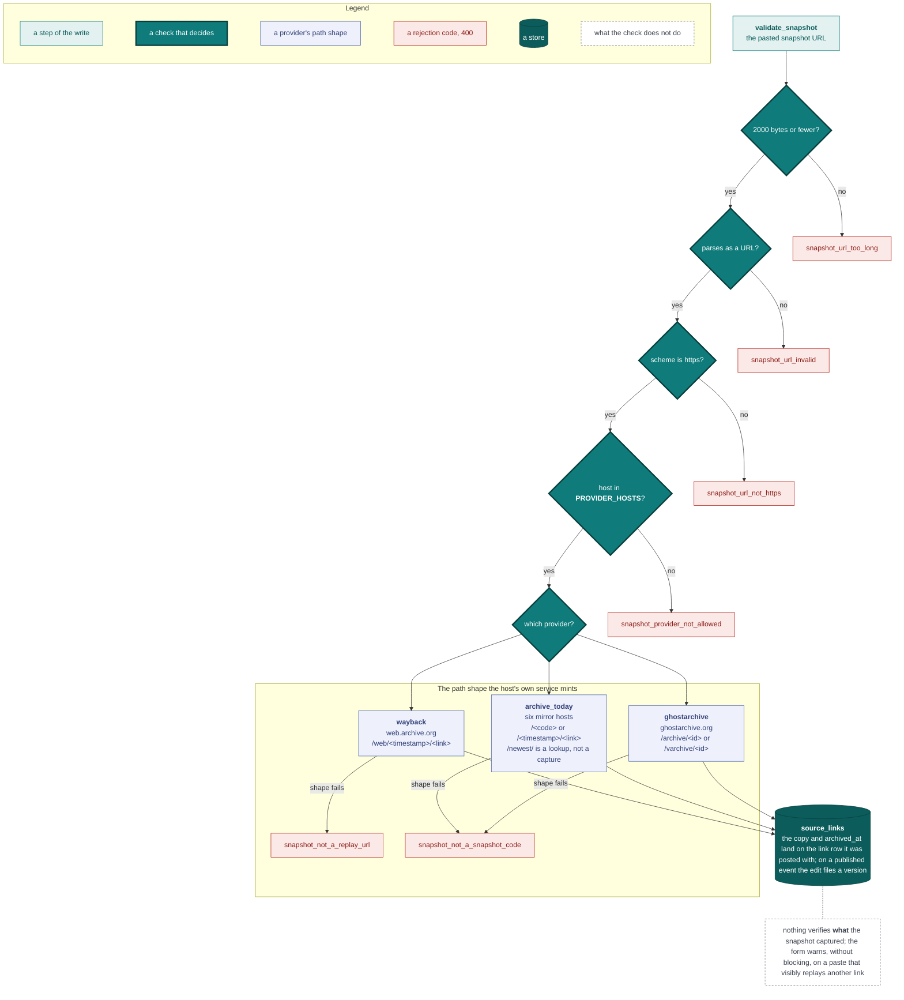

# Source archival

Posts get deleted and accounts get suspended, which destroys exactly the evidence the catalog preserves. An archived copy keeps a dead original readable. Each copy sits on one URL of one [source](data-model.md#sources), and the analyst who writes the event's sources is who records it.

```mermaid
flowchart LR
  classDef spec fill:#eef1fb,stroke:#4a5fa5,color:#33417a
  classDef shared fill:#e3f2f1,stroke:#0f7b7a,color:#0b5c5b
  classDef core fill:#0f7b7a,stroke:#083f3e,stroke-width:3px,color:#ffffff
  classDef store fill:#0b5c5b,stroke:#083f3e,color:#ffffff

  subgraph legend [Legend]
    direction LR
    l1["`what happens in the analyst's browser`"]:::spec
    l2["`a step of the write`"]:::shared
    l3["`the check that decides`"]:::core
    l4[("`a store`")]:::store
    l1 ~~~ l2 ~~~ l3 ~~~ l4
  end

  links["`**a source's links**
  every URL of every source block in the event form`"]:::shared
  mark["`**ArchiveBox**
  the archive box in the row holding the URL`"]:::spec
  save["`**web.archive.org/save/&lt;link&gt;**
  opened prefilled, in the analyst's own browser; another provider is opened by hand`"]:::spec
  paste["`**ArchiveSnapshotField**
  the snapshot pasted back under that row`"]:::spec
  post["`**the event write**
  sources[].links[].snapshot_url, beside the URL it archives`"]:::shared
  check["`**validate_snapshot**
  https, a host on PROVIDER_HOSTS, that provider's path shape; a rejection is a 400 and nothing is written`"]:::core
  row[("`**source_links**
  snapshot_url and archived_at on the link row: one copy per link`")]:::store
  version["`**file_version**
  on a published row: files the superseded version; a save that only archives is exempt from the ceiling`"]:::shared
  read["`**ArchivedCopies**
  accent where a copy exists and it opens it, grey and inert where none does; provider read off the host`"]:::spec

  links --> mark --> save --> paste --> post --> check --> row
  post --> version
  row --> read
```

Each paragraph below takes one region of the diagram: why the capture runs in the browser, which links are in scope, which writes carry a paste, what the check accepts, and what a reader sees.

**The capture happens in the analyst's browser, not on the server.** Save Page Now refuses `x.com`, the host of most sources, from a server, and archive.today has no API and bans a host that submits in bursts; both work from a browser. The form opens `https://web.archive.org/save/<link>` prefilled, because its replay URL names the captured link and so lets the paste field warn about a mis-paste, and the paste field takes a snapshot from every host in the table below.

**Scope.** Every URL of every source of the event, whatever the source's [level](data-model.md#sources): each [`source_links`](data-model.md#source_links) row can hold one copy. The post a machine detection was imported from (`detected_from_url`) and the links inside the proof body are not sources, so they carry no copy. Analyst profile external links are out of scope too, since they represent identity rather than evidence.

**One copy per link, from whichever service produced it.** The link row holds one `snapshot_url` and the `archived_at` it was recorded at; `ck_source_links_archive_stamp` keeps the two together. Two snapshots of one link is redundancy nobody reads back, and a new paste replaces the stored one, which is how a wrong paste is corrected. The provider is not stored: the read derives it from the snapshot's host (`source_archive.provider_of`). There is no queue state and no attempt counter: a copy exists because an analyst recorded it.

**A copy is recorded through the event forms, and only through them.** There is no standalone archive endpoint. The paste is the `snapshot_url` of a link in the `sources` list, which every event write posts whole: [`POST /events`](api.md#post-events), the two request writes and [`POST /events/{id}/versions`](api.md#post-eventsidversions), which publishes and corrects. Because the write posts the whole list, a link posted without its `snapshot_url` loses its copy, so a form posts back the copy each link already holds. **A `closed` row has no archive path**, since it takes no further write.

**On a published event, recording a copy is a tracked change.** Which of a `geolocated` record's links are archived is part of what that record says, so the edit carrying the paste files the superseded version as an [`event_versions`](data-model.md#event_versions) row and moves `version_no` on. Each version's snapshot carries every link's `snapshot_url` and `archived_at`, so `/events/{id}/vN` renders the copies as they stood. A re-paste of the copy a link already carries moves nothing and files nothing, and keeps its `archived_at`: the comparison folds the two URLs through `same_snapshot`, dropping the scheme, the host case, a leading `www.` and a trailing slash, so a spelling picked up in a browser is not read as a correction. A save whose only change is a link's copy is exempt from the [version ceiling](data-model.md#event_versions), so an original that dies while the row sits at 100 versions stays archivable. Below publication (`requested`, `detected`) nothing is versioned, so the copy is stored on its own.

**Archival starts at the submit form, not after publication.** A link is most archivable while the analyst still has it open, so every link row of every source block carries the archive box ([`design.md`](design.md#source-blocks) describes the UI). Each pasted snapshot runs `validate_snapshot` and lands on its link row in the same transaction as the event. A rejected paste writes nothing: the analyst fixes it and submits the same form again. The field is optional and sits in no publish floor.

**A copy stays on the link it was pasted with.** The copy is a column of the link row, so no write can leave a copy describing a link the event no longer declares. A write that drops a link, or the source holding it, drops its copy with it, and on a published event the version that write files keeps the copy readable. A link whose URL changes is a new link and starts without a copy unless the same write pastes one.

**What counts as a snapshot.** The server checks where a snapshot lives, not what it captured. The byte ceiling matches the 2000-character cap on a source URL. The host is also what names the provider on the read.

| Provider | Hosts | Path shape |
|---|---|---|
| `wayback` | `web.archive.org` | `/web/<timestamp>/<original link>` |
| `archive_today` | `archive.today`, `archive.ph`, `archive.is`, `archive.md`, `archive.li`, `archive.vn` | `/<code>` or `/<timestamp>/<original link>` |
| `ghostarchive` | `ghostarchive.org` | `/archive/<id>` or `/varchive/<id>` |

archive.today serves one set of snapshots under six interchangeable domains, so all six read as one provider. A `/newest/<link>` lookup fails the shape check, because it resolves to whatever the service holds today rather than to one fixed capture.

**Which link a snapshot archives is the analyst's to get right.** The short-code and id forms embed nothing, so an archive.today code and a Ghostarchive id give the server nothing to compare. The replay forms carry the captured link in the spelling the platform used at capture time (`youtu.be`, `twitter.com`, `t.me/s/`), so a string comparison would refuse correct snapshots, and fetching archive.today from a server gets the deployment banned. So the paste is trusted: it comes from the authenticated analyst writing the event, whose own catalog entry a wrong link degrades, and the host allowlist plus the path shape is what bounds the abuse.

**The forms warn before they post.** A pasted snapshot that visibly replays a link other than the one it sits under raises an amber line under the paste field naming both URLs ([`lib/snapshots.ts`](../frontend/src/lib/snapshots.ts) → `snapshotArchivesAnotherLink`). It reads both path forms that embed an original, `web.archive.org/web/<timestamp>/<link>` and `archive.today/<timestamp>/<link>`. The comparison folds the scheme, the host case, a leading `www.`, a trailing slash, the platform spellings above and X's `s` and `t` share parameters. It blocks nothing, which is what lets it be loose: a wrong warning costs a sentence the analyst ignores.

**Treat an archive.today snapshot as a convenience link rather than integrity-bearing evidence.** English Wikipedia deprecated links to the service in February 2026, citing evidence that it tampers with archived pages ([guidance](https://en.wikipedia.org/wiki/Wikipedia:Archive.today_guidance), [background](https://en.wikipedia.org/wiki/Archive.today)). The Wayback Machine is the provider the affordance prefills for that reason.

Every rejection is a 400 carrying the code the diagram names for the failed check.

**Read surface.** Each link of a [`SourceRead`](api.md#get-eventsid) carries `archived`: `{url, provider, archived_at}` once a copy is recorded, `null` before. The event detail surfaces render it through [`ArchivedCopies`](../frontend/src/components/ui/ArchivedCopies.tsx) beside each link of each source block, read-only for every reader including the owner ([`design.md`](design.md#source-blocks)).

## See also

- [`api.md`](api.md#sources) for the write contract, and [`GET /events/{id}`](api.md#get-eventsid) for the read shape.
- [`data-model.md`](data-model.md#source_links) for the `source_links` columns.
