# Data model

One `events` row carries a geolocation for its whole life. The status it holds says how far along it is, four writes move or correct it, and the tables below hang off it rather than copy it.

```mermaid
flowchart LR
  classDef spec fill:#eef1fb,stroke:#4a5fa5,color:#33417a
  classDef shared fill:#e3f2f1,stroke:#0f7b7a,color:#0b5c5b
  classDef core fill:#0f7b7a,stroke:#083f3e,stroke-width:3px,color:#ffffff
  classDef store fill:#0b5c5b,stroke:#083f3e,color:#ffffff

  subgraph legend [Legend]
    direction LR
    l1["`a write that moves the row`"]:::spec
    l2["`where the row comes from`"]:::shared
    l3["`a status the one row holds`"]:::core
    l4[("`a table that hangs off it`")]:::store
    l1 ~~~ l2 ~~~ l3 ~~~ l4
  end

  ask["`**POST /events/requests**
  an open call to geolocate`"]:::shared
  submit["`**POST /events**
  a finished geolocation, born published`"]:::shared
  engine["`**persist_detections**
  the ingest engine: bot, paste or archive`"]:::shared

  requested["`**requested**
  requested_at; a coordinate is optional, so the ask may carry a guess`"]:::core
  detected["`**detected**
  detected_at; source_url optional, public from the moment it lands`"]:::core
  geolocated["`**geolocated**
  geolocated_at; ck_events_coords_status and ck_events_source_url_status make the coordinate and the source NOT NULL here`"]:::core
  closed["`**closed**
  closed_at, close_reason, and before_closed_status: withdrawn, rejected or retracted`"]:::core

  amend["`**update_request**
  the owner corrects the open question: overwritten in place, no version filed`"]:::spec
  vouch["`**services/events.geolocate**
  a person vouches: coordinate, source_url, one proof image. owner_id moves to the fulfiller`"]:::spec
  version["`**POST /events/{id}/versions**
  every later correction; refused past 100 versions`"]:::spec
  close["`**close**
  the owner takes the row back, from any live status`"]:::spec

  credit[("`**event_geolocators**
  durable credit, owner included`")]:::store
  invite["`**POST /events/{id}/geolocator-invites**
  the owner invites; the invitee accepts into event_geolocators`"]:::spec
  versions[("`**event_versions**
  the superseded state, as version_no moves on`")]:::store
  approve["`**POST /events/{id}/approvals**
  an analyst outside the credit attests one version`"]:::spec
  approvals[("`**event_approvals**
  current only on the live version`")]:::store
  ask_review["`**POST /events/{id}/approval-requests**
  a geolocator asks an analyst to approve the row`"]:::spec
  approval_requests[("`**approval_requests**
  open until approved, declined or withdrawn`")]:::store
  leave["`**DELETE /events/{id}/geolocators/{username}**
  the owner removes a co-geolocator, or one leaves`"]:::spec
  departures[("`**event_geolocator_departures**
  who held the credit and lost it; they never approve the row`")]:::store
  orgs[("`**organizations**
  an approval, or a request for one, may be placed in its name`")]:::store
  reports[("`**content_reports**
  any viewer, signed in or not; a row names an event or a collection`")]:::store
  shelve["`**PUT /collections/{id}/events/{event_id}**
  a credited analyst puts the row on one of their named shelves`"]:::spec
  shelves[("`**collections** + **collection_events**
  which curated sets the row is on`")]:::store

  ask --> requested
  engine --> detected
  submit --> vouch
  requested --> amend --> requested
  requested --> vouch
  detected --> vouch
  vouch --> geolocated --> version --> geolocated
  vouch --> credit
  geolocated --> invite --> credit
  credit --> leave --> departures
  leave --> approval_requests
  approvals -.-> orgs
  approval_requests -.-> orgs
  version --> versions
  geolocated --> approve --> approvals
  geolocated --> ask_review --> approval_requests
  approve --> approval_requests
  requested --> close
  detected --> close
  geolocated --> close
  close --> closed
  geolocated --> reports
  geolocated --> shelve
  detected --> shelve
  shelve --> shelves
```



The three entries on the left are the three ways a row is born: a request and a direct submit come from [`POST /events/requests` and `POST /events`](api.md#post-events), and a machine detection comes from the [ingest engine](ingestion.md). The four statuses and the constraints that pin them are [`events`](#events). The four writes are `update_request`, `geolocate`, `save_version` and `close`, all in [`api.md`](api.md). Two of them correct a row rather than move it, and they differ on what the row is: `update_request` overwrites an open question, while `save_version` files what it supersedes, because a published row is a vouched claim. The tables on the right exist because a write happened: [`event_geolocators`](#event_geolocators) records who vouched, the owner and every analyst who accepted an invitation ([`event_geolocator_invites`](#event_geolocator_invites)), [`event_versions`](#event_versions) holds what a correction superseded, [`event_geolocator_departures`](#event_geolocator_departures) holds who lost the credit, [`event_approvals`](#event_approvals) holds who attested which version, [`approval_requests`](#approval_requests) holds who was asked to (a departure withdraws the open requests its analyst sent), an [organization](#organizations) can stand behind an approval or a request in place of one analyst, [`content_reports`](#content_reports) holds what a viewer flagged, and [`collections`](#collections) with [`collection_events`](#collection_events) holds the curated sets a credited analyst puts the row on.

## Schema overview

```mermaid
erDiagram
    users {
        UUID id PK
        VARCHAR username
        VARCHAR email "nullable, legacy credential-less rows"
        VARCHAR password_hash "nullable, legacy credential-less rows"
        VARCHAR x_handle "nullable, UNIQUE, admin-linked bot-attribution handle"
        BOOLEAN is_active
        BOOLEAN is_admin
        TIMESTAMPTZ email_verified_at "nullable"
        TIMESTAMPTZ last_seen_at "nullable, throttled activity stamp"
        TIMESTAMPTZ deleted_at "nullable, soft-delete"
        INTEGER token_version "session-invalidation counter"
        TEXT bio "nullable, profile blurb"
        TEXT avatar_url "nullable"
        JSONB external_links "default {}, linktree-style"
        BOOLEAN invite_minting_enabled "admin switch over sponsored invites"
        TIMESTAMPTZ created_at
    }

    admin_events {
        UUID id PK
        UUID actor_id FK "nullable"
        TEXT action
        JSON target "nullable"
        TIMESTAMPTZ created_at
    }

    auth_events {
        UUID id PK
        UUID user_id FK "nullable"
        TEXT event
        TIMESTAMPTZ created_at
    }

    auth_tokens {
        UUID id PK
        UUID user_id FK
        TEXT token_hash
        TEXT purpose "password_reset"
        TIMESTAMPTZ expires_at
        TIMESTAMPTZ consumed_at "nullable"
        TIMESTAMPTZ created_at
    }

    invite_codes {
        UUID id PK
        VARCHAR code
        UUID used_by FK "nullable, audit-only"
        TIMESTAMPTZ used_at "nullable, redemption stamp"
        TIMESTAMPTZ expires_at "nullable"
        TIMESTAMPTZ revoked_at "nullable"
        VARCHAR x_handle "nullable, bound handle copied at redemption"
        UUID created_by FK "nullable, the sponsor"
        TIMESTAMPTZ created_at
    }

    pending_registrations {
        UUID id PK
        VARCHAR email UK
        VARCHAR username UK
        VARCHAR password_hash
        UUID invite_code_id FK
        TEXT token_hash UK
        TIMESTAMPTZ product_updates_consented_at "nullable, consent carried to the account"
        TIMESTAMPTZ expires_at
        TIMESTAMPTZ created_at
    }

    events {
        UUID id PK
        UUID owner_id FK "edit-rights owner, moves to geolocator"
        UUID requested_by_id FK "nullable, who opened the request"
        VARCHAR title
        GEOMETRY event_coords "nullable, the subject; required at geolocated"
        GEOMETRY capture_source_coords "nullable, the camera position"
        TEXT source_url "nullable, required at requested/geolocated"
        BIGINT detected_from_tweet_id "nullable, detection provenance id"
        BIGINT_ARRAY detected_thread_tweet_ids "nullable, the thread's post ids"
        TEXT detected_from_url "nullable, detection provenance link"
        VARCHAR detected_via "nullable, bot | paste | archive"
        TEXT proof "sanitized HTML"
        DATE event_date "nullable"
        TIME event_time "nullable, optional UTC hour"
        TIMESTAMPTZ source_posted_at "nullable, when the source posted (UTC)"
        TIMESTAMPTZ detected_post_at "nullable, analyst's X post time"
        TIMESTAMPTZ requested_at "nullable, entered requested"
        TIMESTAMPTZ detected_at "nullable, entered detected"
        TIMESTAMPTZ geolocated_at "nullable, entered geolocated"
        TIMESTAMPTZ closed_at "nullable, entered closed"
        VARCHAR status "requested | detected | geolocated | closed"
        TEXT close_reason "nullable, free-text"
        VARCHAR before_closed_status "nullable, requested | detected | geolocated"
        TIMESTAMPTZ deleted_at "nullable, admin soft-delete"
        TIMESTAMPTZ hidden_at "nullable, admin takedown"
        BOOLEAN is_graphic "death, injury or human remains"
        INTEGER version_no "which version the live row is, from 1"
        TIMESTAMPTZ created_at
        TIMESTAMPTZ updated_at
    }

    event_versions {
        UUID id PK
        UUID event_id FK
        INTEGER version_no "the version this row holds"
        UUID edited_by_id FK "nullable, who superseded it"
        TEXT note "nullable, capped at 280 chars by the schema"
        JSONB snapshot "the editable fields as they stood, blank once redacted"
        TIMESTAMPTZ created_at "when the edit happened"
        TIMESTAMPTZ redacted_at "nullable, when an admin blanked it"
        UUID redacted_by_id FK "nullable, which admin did"
    }

    content_reports {
        UUID id PK
        UUID event_id FK "nullable, NULL once the event is hard-deleted"
        UUID collection_id FK "nullable, the other target; never set with event_id"
        VARCHAR reason "illegal_content | graphic_not_flagged | copyright | privacy | other"
        TEXT details "nullable, capped at 2000 chars by the schema"
        UUID reporter_user_id FK "nullable, anonymous reports leave this NULL"
        TIMESTAMPTZ created_at
        TIMESTAMPTZ resolved_at "nullable"
        VARCHAR resolution "nullable, marked_graphic | hidden | dismissed"
        UUID resolved_by FK "nullable"
    }

    event_geolocators {
        UUID event_id FK
        UUID user_id FK
        TIMESTAMPTZ created_at
    }

    event_geolocator_invites {
        UUID event_id FK
        UUID user_id FK "the invitee"
        TIMESTAMPTZ created_at
    }

    event_geolocator_departures {
        UUID event_id FK
        UUID user_id FK "the former geolocator"
        TIMESTAMPTZ created_at "the first departure"
    }

    event_approvals {
        UUID id PK
        UUID event_id FK
        INT version_no "the version attested"
        UUID reviewer_id FK "the analyst, or the acting member; nullable"
        UUID organization_id FK "nullable, the organization approving"
        VARCHAR verdict "approve"
        TEXT note "nullable"
        TIMESTAMPTZ created_at
        TIMESTAMPTZ revoked_at "nullable"
        UUID revoked_by_id FK "nullable"
        TEXT revoke_reason "nullable, public, optional"
        VARCHAR revoked_as "nullable: reviewer, organization_member, site_admin"
    }

    approval_requests {
        UUID id PK
        UUID event_id FK
        INT version_no "live when sent"
        UUID requester_id FK
        UUID target_user_id FK "nullable, the analyst asked"
        UUID target_organization_id FK "nullable, the organization asked"
        VARCHAR status "open, approved, declined, withdrawn"
        TIMESTAMPTZ created_at
        TIMESTAMPTZ resolved_at "nullable"
    }

    event_source_links {
        UUID event_id FK
        INT position
        TEXT url
    }

    media {
        UUID id PK
        UUID event_id FK
        VARCHAR role "source | proof"
        TEXT storage_url
        VARCHAR media_type
        VARCHAR sha256 "nullable, hex-encoded SHA-256 of uploaded bytes"
        TEXT original_filename "nullable, client-supplied filename"
        TIMESTAMPTZ created_at
    }

    tags {
        UUID id PK
        VARCHAR name
        VARCHAR category "capture_source | free"
    }

    event_tags {
        UUID event_id FK
        UUID tag_id FK
    }

    conflicts {
        UUID id PK
        VARCHAR name "UNIQUE"
        VARCHAR wikidata_id "nullable, UNIQUE, sync/seed natural key"
        INT start_year "nullable"
        INT end_year "nullable"
        BOOLEAN ongoing
        TIMESTAMPTZ last_seen_at "nullable, last sync sighting"
        VARCHAR tier "nullable, major | minor | conflict"
        VARCHAR source "sync | seed | manual"
    }

    event_conflicts {
        UUID event_id FK
        UUID conflict_id FK
    }

    collections {
        UUID id PK
        UUID owner_id FK "the one owner"
        VARCHAR title
        TEXT description "what the collection holds, sanitized HTML"
        TEXT description_text "its plain-text projection"
        TIMESTAMPTZ hidden_at "nullable, admin takedown"
        TIMESTAMPTZ created_at
        TIMESTAMPTZ updated_at
    }

    collection_events {
        UUID collection_id FK
        UUID event_id FK
        TIMESTAMPTZ added_at
    }

    follows {
        UUID follower_id FK
        UUID followed_id FK
        TIMESTAMPTZ created_at
    }

    notifications {
        UUID id PK
        UUID user_id FK "the recipient"
        VARCHAR kind "one value of NOTIFICATION_KINDS"
        UUID actor_id FK "nullable, who acted"
        UUID event_id FK "nullable, what it concerns"
        UUID organization_id FK "nullable, the organization it concerns"
        VARCHAR organization_name "nullable, a deleted organization's name"
        UUID approval_id FK "nullable, the approval an approval_received row reports"
        TIMESTAMPTZ created_at
        TIMESTAMPTZ read_at "nullable, NULL is unread"
    }

    organizations {
        UUID id PK
        VARCHAR slug UK "the URL key, fixed once set"
        VARCHAR name
        VARCHAR x_handle "nullable, UNIQUE, verified by a site admin"
        TEXT bio "nullable"
        TEXT avatar_url "nullable"
        JSONB external_links "default {}"
        VARCHAR approval_request_audience "following, everyone, nobody"
        UUID created_by_id FK "nullable, the site admin"
        TIMESTAMPTZ created_at
    }

    organization_members {
        UUID organization_id PK "FK"
        UUID user_id PK "FK"
        VARCHAR role "manager | member"
        TIMESTAMPTZ joined_at
    }

    organization_invites {
        UUID id PK
        UUID organization_id FK
        UUID user_id FK "the invitee"
        UUID invited_by_id FK "nullable"
        TIMESTAMPTZ created_at
    }

    notification_deliveries {
        UUID id PK
        UUID notification_id FK
        VARCHAR channel "email | push"
        VARCHAR status "queued | sending | sent | failed | skipped"
        INTEGER attempts "provider refusals"
        TIMESTAMPTZ created_at
        TIMESTAMPTZ claimed_at "nullable"
        TIMESTAMPTZ sent_at "nullable"
    }

    push_subscriptions {
        UUID id PK
        UUID user_id FK
        TEXT endpoint "UNIQUE, bearer URL"
        VARCHAR p256dh
        VARCHAR auth
        VARCHAR user_agent "nullable"
        TIMESTAMPTZ created_at
        TIMESTAMPTZ last_success_at "nullable"
        INT refusals "refusals since the last accepted push"
    }

    revoked_push_endpoints {
        UUID user_id FK
        VARCHAR endpoint_sha256 "hash of a revoked endpoint"
        TIMESTAMPTZ revoked_at
    }

    product_update_consents {
        UUID id PK
        UUID user_id FK
        VARCHAR source "sign_up | settings"
        TIMESTAMPTZ granted_at
        TIMESTAMPTZ withdrawn_at "nullable, NULL while current"
    }

    product_updates {
        UUID id PK
        VARCHAR label UK "MAJOR.MINOR.0"
        VARCHAR title
        TEXT body
        TEXT link_url "nullable"
        UUID sent_by FK "nullable"
        INTEGER recipient_count
        TIMESTAMPTZ created_at
    }

    product_update_deliveries {
        UUID id PK
        UUID product_update_id FK
        UUID user_id FK
        VARCHAR status "queued | sending | sent | failed | skipped"
        INTEGER attempts "provider refusals"
        TIMESTAMPTZ created_at
        TIMESTAMPTZ claimed_at "nullable"
        TIMESTAMPTZ sent_at "nullable"
    }

    x_handle_requests {
        UUID id PK
        UUID user_id FK "UNIQUE, the requester"
        VARCHAR x_handle "the handle asked for"
        TEXT reason "nullable"
        VARCHAR status "pending | declined"
        TEXT decline_reason "nullable"
        TIMESTAMPTZ created_at
        TIMESTAMPTZ decided_at "nullable"
    }

    user_preferences {
        UUID user_id PK
        JSONB notification_overrides "per-kind, per-channel overrides only"
        JSONB display "palette, theme, help_tooltips"
        VARCHAR approval_request_audience "following, everyone, nobody"
        TIMESTAMPTZ updated_at
    }

    bot_mentions {
        UUID id PK
        VARCHAR mention_tweet_id "UNIQUE, X snowflake"
        VARCHAR author_handle
        VARCHAR outcome
        INTEGER events_created
        VARCHAR reply_tweet_id "nullable"
        TIMESTAMPTZ processed_at
    }

    bot_webhook_events {
        UUID id PK
        JSONB mention
        VARCHAR status "queued | processing | done | failed"
        INTEGER attempts
        TIMESTAMPTZ created_at
    }

    archive_import_jobs {
        UUID id PK
        UUID owner_id FK
        TEXT zip_key
        VARCHAR status "queued | running | done | failed"
        INTEGER attempts
        INTEGER post_estimate "nullable"
        INTEGER progress_done
        INTEGER progress_total "nullable"
        INTEGER created_count
        INTEGER updated_count
        INTEGER skipped_count
        INTEGER failed_count
        TEXT error "nullable"
        TIMESTAMPTZ created_at
        TIMESTAMPTZ started_at "nullable"
        TIMESTAMPTZ finished_at "nullable"
    }

    source_archives {
        UUID id PK
        UUID event_id FK
        TEXT original_url
        VARCHAR origin "source_url | secondary_source | detected_from | proof_link"
        TEXT snapshot_url
        VARCHAR provider "wayback | archive_today | ghostarchive"
        TIMESTAMPTZ created_at
    }

    users |o--o{ invite_codes : "used_by"
    users |o--o{ invite_codes : "created_by"
    invite_codes ||--o{ pending_registrations : "invite_code_id"
    users ||--o{ auth_tokens : "user_id"
    users |o--o{ admin_events : "actor_id"
    users |o--o{ auth_events : "user_id"
    users ||--o{ events : "owner_id"
    users |o--o{ events : "requested_by_id"
    events ||--o{ media : "event_id"
    events ||--o{ event_tags : "event_id"
    tags ||--o{ event_tags : "tag_id"
    events ||--o{ event_conflicts : "event_id"
    conflicts ||--o{ event_conflicts : "conflict_id"
    events ||--o{ event_geolocators : "event_id"
    users ||--o{ event_geolocators : "user_id"
    events ||--o{ event_geolocator_invites : "event_id"
    users ||--o{ event_geolocator_invites : "user_id"
    events ||--o{ event_geolocator_departures : "event_id"
    users ||--o{ event_geolocator_departures : "user_id"
    events ||--o{ event_approvals : "event_id"
    users |o--o{ event_approvals : "reviewer_id"
    users |o--o{ event_approvals : "revoked_by_id"
    events ||--o{ approval_requests : "event_id"
    users ||--o{ approval_requests : "requester_id"
    users |o--o{ approval_requests : "target_user_id"
    events ||--o{ event_source_links : "event_id"
    events ||--o{ event_versions : "event_id"
    users |o--o{ event_versions : "edited_by_id"
    users |o--o{ event_versions : "redacted_by_id"
    events |o--o{ content_reports : "event_id"
    collections |o--o{ content_reports : "collection_id"
    users |o--o{ content_reports : "reporter_user_id"
    users |o--o{ content_reports : "resolved_by"
    users ||--o{ collections : "owner_id"
    collections ||--o{ collection_events : "collection_id"
    events ||--o{ collection_events : "event_id"
    users ||--o{ follows : "follower_id"
    users ||--o{ follows : "followed_id"
    users ||--o{ notifications : "user_id"
    users |o--o{ notifications : "actor_id"
    events |o--o{ notifications : "event_id"
    notifications ||--o{ notification_deliveries : "notification_id"
    users ||--o| user_preferences : "user_id"
    users ||--o{ push_subscriptions : "user_id"
    users ||--o{ revoked_push_endpoints : "user_id"
    users ||--o{ product_update_consents : "user_id"
    users |o--o{ product_updates : "sent_by"
    product_updates ||--o{ product_update_deliveries : "product_update_id"
    users ||--o{ product_update_deliveries : "user_id"
    users ||--o| x_handle_requests : "user_id"
    organizations |o--o{ notifications : "organization_id"
    event_approvals |o--o{ notifications : "approval_id"
    organizations ||--o{ organization_members : "organization_id"
    users ||--o{ organization_members : "user_id"
    organizations ||--o{ organization_invites : "organization_id"
    organizations |o--o{ event_approvals : "organization_id"
    organizations |o--o{ approval_requests : "target_organization_id"
    users ||--o{ organization_invites : "user_id"
    users |o--o{ organization_invites : "invited_by_id"
    users |o--o{ organizations : "created_by_id"
    users ||--o{ archive_import_jobs : "owner_id"
    events ||--o{ source_archives : "event_id"
```



---

## Tables

In the Constraints column, `default X` is the value the application sets on insert, and `server_default X` is a SQL `DEFAULT` the database applies.

### `users`

| Column | Type | Constraints |
|--------|------|-------------|
| `id` | `UUID` | PK, default `uuid4()` |
| `username` | `VARCHAR(50)` | UNIQUE, NOT NULL |
| `email` | `VARCHAR(255)` | UNIQUE, nullable. NULL only on legacy credential-less rows; every path that creates an account sets it. |
| `password_hash` | `VARCHAR(255)` | nullable, on the same legacy rows as `email`. |
| `x_handle` | `VARCHAR(50)` | UNIQUE, nullable. The X handle the bot attributes mentions to (lowercase, no `@`). The system sets it at registration from an invite-bound handle, or an admin links it through `PATCH /admin/users/{id}/x-handle` or by approving an [`x_handle_requests`](#x_handle_requests) row. Analysts cannot self-serve this field, and the bot never creates rows for it. It differs from `external_links["x"]`, a display handle the owner sets and nobody verifies. |
| `is_active` | `BOOLEAN` | NOT NULL, default `true` |
| `is_admin` | `BOOLEAN` | NOT NULL, default `false`. The system flips this to `true` automatically on login or registration if the email matches `ADMIN_EMAILS`. |
| `email_verified_at` | `TIMESTAMPTZ` | nullable. Written once by the registration confirmation (to `created_at`). Every account the registration flow creates carries it. [Notification email](#notification_deliveries) goes only to an account that carries it, so an older account with NULL here receives none. |
| `last_seen_at` | `TIMESTAMPTZ` | nullable. The instant of the account's most recent authenticated request. `dependencies.get_current_user` rewrites it once the stored value is older than `LAST_SEEN_THROTTLE` (15 minutes), so a session costs one UPDATE per window. `POST /auth/login` and `POST /auth/confirm-registration` stamp it when they issue cookies. The admin onboarding table reads it as the account's activity, falling back to the newest `login` auth event while it is NULL. |
| `deleted_at` | `TIMESTAMPTZ` | nullable. A non-NULL value marks the user as soft-deleted: login is rejected, the profile returns 404, and public reads filter the row out. Soft-deleting a user passes every owned event another live analyst is credited on to the earliest of them, then soft-deletes every other event they own with the user's own timestamp. Hard-delete, the GDPR escape hatch, drops the user row, the events only they are credited on, and their contributor rows, and sweeps S3. An owned event with another live geolocator passes to the earliest of them instead, files included, and so does an event the user's soft delete hid (its `deleted_at` equals the user's), which is restored. An event soft-deleted on its own is purged. Because the owner is always among an event's geolocators, hard-delete never leaves a `geolocated` event with zero geolocators. |
| `token_version` | `INTEGER` | NOT NULL, default `0`. A monotonic session-invalidation counter. The session JWT embeds this value as a `tv` claim, and `get_current_user` returns 401 on a mismatch. The system bumps this counter on logout, password change, password reset, and soft-delete, which invalidates every outstanding JWT for the user at once. A JWT with no `tv` claim also returns 401. |
| `bio` | `TEXT` | nullable. A short plain-text blurb shown on the public profile. Analysts edit it through `PATCH /users/me`. The API layer caps it at 500 characters. There is no database constraint, so changing the cap does not require a migration. |
| `avatar_url` | `TEXT` | nullable. The public URL of the analyst's profile picture, always an object on the media host. The server mints the value: `PUT /users/me/avatar` stores one metadata-stripped 400 px JPEG under `avatars/{user_id}/` and writes its URL here, `DELETE /users/me/avatar` clears the column and the object, and `PATCH /users/me` rejects the field, so the avatar cannot become a beacon that collects readers' IP addresses and User-Agents. |
| `external_links` | `JSONB` | NOT NULL, default `'{}'::jsonb`. A Linktree-style object keyed by platform (`x`, `discord`, `website`, `github`), each value validated and normalised on the way in (see [`api.md`](api.md#patch-usersme)). The default `{}` means the value is never NULL, so the read path always gets a dict. `PATCH /users/me` replaces the whole column. A partial merge would conflict with the whole-panel form submit. |
| `invite_minting_enabled` | `BOOLEAN` | NOT NULL, default `true`, server_default `true`. Whether the analyst can mint [sponsored invite codes](#invite_codes) from Settings. An admin moves it through `PATCH /admin/users/{id}/invite-minting`. Codes already minted stay valid when it turns off. |
| `created_at` | `TIMESTAMPTZ` | NOT NULL, default `now()` |

Indexes:

- `users_x_handle_key`: UNIQUE on `(x_handle)`. Enforces one account per X handle. Postgres allows unlimited NULLs, so handle-less rows are unaffected.
- `ix_users_live`: partial index on `(created_at) WHERE deleted_at IS NULL`. Admin search and the auth path both filter on `deleted_at IS NULL`.
- `ix_users_search_fts`: GIN index on `to_tsvector('simple', coalesce(username, '') || ' ' || coalesce(bio, ''))`. Backs `GET /search` (the analyst branch). `bio` is part of the indexed expression so `ts_headline` can return a fragment highlight.

---

### `auth_tokens`

Password-reset tokens. Each token is single-use.

| Column | Type | Constraints |
|--------|------|-------------|
| `id` | `UUID` | PK, default `uuid4()` |
| `user_id` | `UUID` | FK → `users.id` ON DELETE CASCADE, NOT NULL |
| `token_hash` | `TEXT` | UNIQUE, NOT NULL. `sha256(secret)`. The plaintext token exists only in the email link. |
| `purpose` | `TEXT` | NOT NULL, CHECK in `('password_reset')`. `consume` matches on it, so a token minted for one purpose can never be redeemed for another. |
| `expires_at` | `TIMESTAMPTZ` | NOT NULL |
| `consumed_at` | `TIMESTAMPTZ` | nullable. A non-null value means the token was already redeemed. |
| `created_at` | `TIMESTAMPTZ` | NOT NULL, default `now()` |

Indexes:

- `ix_auth_tokens_user_id` on `(user_id)`. Supports cascade delete and per-user revocation lookups.
- `ix_auth_tokens_user_purpose` on `(user_id, purpose)`. Checks whether a live reset already exists for a user before minting a new one.
- `ix_auth_tokens_live_expires_at`: partial index on `(expires_at) WHERE consumed_at IS NULL`. Keeps the reaper scan cheap as consumed rows accumulate.

Lifecycle: `mint` creates a token, `consume` redeems it, and `revoke_all_live_for_user` force-revokes prior tokens on a fresh same-purpose mint. Cleanup runs on demand through `POST /admin/maintenance/reap-auth-tokens` (`services/maintenance.py::reap_auth_tokens`). It deletes live-but-expired rows immediately and drops consumed rows older than 30 days.

---

### `invite_codes`

| Column | Type | Constraints |
|--------|------|-------------|
| `id` | `UUID` | PK, default `uuid4()` |
| `code` | `VARCHAR(64)` | UNIQUE, NOT NULL |
| `used_by` | `UUID` | FK → `users.id` ON DELETE SET NULL, nullable, **audit-only**. Records the user who redeemed the code. The FK is set to NULL on user hard-delete. |
| `used_at` | `TIMESTAMPTZ` | nullable. Stamped at redemption. Every code is single-use, so a non-NULL value is what spends it. Unlike `used_by`, it survives the redeemer's hard-delete. |
| `expires_at` | `TIMESTAMPTZ` | nullable |
| `revoked_at` | `TIMESTAMPTZ` | nullable. The admin page sets this. A non-null value invalidates the code immediately. |
| `x_handle` | `VARCHAR(50)` | nullable. The X handle the code binds, normalized to lowercase with no `@`. Redemption copies it onto the new account's `users.x_handle`, the bot-attribution link. If the handle got linked elsewhere between mint and redemption, redemption fails soft. |
| `created_by` | `UUID` | FK → `users.id` ON DELETE SET NULL, nullable. The analyst who minted the code from Settings (`POST /users/me/invite-codes`), its sponsor. NULL for an admin-minted code, and once the sponsor's account is erased. A sponsored code always binds an `x_handle`. |
| `created_at` | `TIMESTAMPTZ` | NOT NULL, default `now()` |

Indexes:

- `ix_invite_codes_created_by_created_at` on `(created_by, created_at)`. Supports the sponsor's daily quota count and the sponsor's own list.

A code is valid exactly when `revoked_at IS NULL AND used_at IS NULL AND (expires_at IS NULL OR expires_at > now())`. `used_by` is not part of the validity check: it is nulled when the redeemer's account is erased, while `used_at` stays.

An account created from a sponsored code reaches its sponsor through the code row: `used_by` names the account and `created_by` the sponsor. The `User.sponsor` relationship in [`models/user.py`](../backend/app/models/user.py) reads that pair, so the link has one home and needs no column on `users`. Redemption therefore carries the sponsor without a change to `pending_registrations`, which already references the code.

A sponsor mints at most 5 codes per UTC day (`DAILY_MINT_LIMIT` in [`services/sponsored_invites.py`](../backend/app/services/sponsored_invites.py)). The count covers every row with that `created_by` and a `created_at` since 00:00 UTC, revoked or used. The mint locks the sponsor's `users` row, so two concurrent mints cannot both pass the count.

`DELETE /admin/invite-codes/{id}` drops a row whose `used_by` is NULL, the cleanup for codes that were minted and never used. A row naming a redeemer is refused: it is that account's origin record. The `admin_events` row for the deletion carries the `code` value, so the trail names what left the table.

---

### `pending_registrations`

| Column | Type | Constraints |
|--------|------|-------------|
| `id` | `UUID` | PK, default `uuid4()` |
| `email` | `VARCHAR(255)` | UNIQUE, NOT NULL. Holds the address until the user confirms or the row expires. |
| `username` | `VARCHAR(50)` | UNIQUE, NOT NULL. Plays the same role as `email`, reserving the username until confirmation or expiry. |
| `password_hash` | `VARCHAR(255)` | NOT NULL. A bcrypt hash. The system transfers it directly into `users.password_hash` at confirmation. |
| `invite_code_id` | `UUID` | FK → `invite_codes.id` ON DELETE CASCADE, NOT NULL. The invite is referenced but **not consumed** until confirmation. |
| `token_hash` | `TEXT` | UNIQUE, NOT NULL. `sha256(secret)`. The plaintext token exists only in the email link. |
| `expires_at` | `TIMESTAMPTZ` | NOT NULL. Set to 24 hours after mint. |
| `product_updates_consented_at` | `TIMESTAMPTZ` | nullable. The time of the request when the sign-up form's product update switch was on, NULL when it was off. Confirmation copies it into a [`product_update_consents`](#product_update_consents) row with `source = 'sign_up'`. |
| `created_at` | `TIMESTAMPTZ` | NOT NULL, default `now()` |

Indexes:

- `ix_pending_registrations_expires_at` on `(expires_at)`. Supports the reaper sweep.

Why UNIQUE on `email` and `username` instead of a partial index? Partial-index predicates must be IMMUTABLE in Postgres, and `expires_at > now()` is STABLE. The plain UNIQUE constraint keeps race-window protection without a predicate. The `/auth/register` path deletes expired rows inline before its INSERT, and the admin Maintenance reaper sweeps the rest. As a result, a recently expired pending row does not permanently reserve its address.

Lifecycle: `POST /auth/register` inserts a row through `services/registration.py::create_pending_registration`. `POST /auth/confirm-registration` consumes it through `confirm_pending_registration`, which creates the `users` row, copies a bound `invite_codes.x_handle` onto it if the handle is still free, stamps `invite_codes.used_at`, and deletes the pending row. `POST /auth/resend-confirmation` re-mints the token on the same row and invalidates the previous link. Cleanup runs through `services/registration.py::reap_pending_registrations`, exposed in the admin Maintenance panel.

---

### `auth_events`

An append-only audit log for auth-relevant events. The auth router populates it synchronously on `login`, `failed_login`, `logout`, `register_pending`, `register_resent`, `register_confirmed`, `password_reset_requested`, `password_reset_completed`, and `password_changed`. Writes happen inside a SAVEPOINT (`db.begin_nested()`), so an INSERT failure rolls back only the audit row and the caller's transaction stays usable.

| Column | Type | Constraints |
|--------|------|-------------|
| `id` | `UUID` | PK, default `uuid4()` |
| `user_id` | `UUID` | FK → `users.id` ON DELETE SET NULL, nullable. NULL when the email didn't match a live user: `failed_login`, the `password_reset_requested` no-op branch, `register_pending`, both branches of `register_resent`, and anonymous logout. This prevents the row from doubling as a probe-able email-to-existence oracle. |
| `event` | `TEXT` | NOT NULL. A plain string, not a database enum, so adding a new event kind doesn't require a migration. |
| `created_at` | `TIMESTAMPTZ` | NOT NULL, default `now()` |

Indexes:

- `ix_auth_events_user_id_created_at` on `(user_id, created_at)`. Supports the forensics query "what did this user do, latest first".
- `ix_auth_events_event_created_at` on `(event, created_at)`. Supports the query "did event X spike recently".

The table stores no IP address or User-Agent. Vidit drops them for privacy; network context lives only at the Cloudflare edge. There is no retention policy.

---

### `admin_events`

An append-only audit log for admin actions taken through the `/admin` page, and for sponsored invite mints. It is a sibling to the `auth_events` table above.

| Column | Type | Constraints |
|--------|------|-------------|
| `id` | `UUID` | PK, default `uuid4()` |
| `actor_id` | `UUID` | FK → `users.id` ON DELETE SET NULL, nullable. The admin, or the sponsor on an `invite_sponsored` row and on an `invite_revoked` row for a code the sponsor revoked. |
| `action` | `TEXT` | NOT NULL, for example `invite_created`, `invite_revoked`, `invite_deleted`, `invite_sponsored`, `invite_minting_enabled` and `invite_minting_disabled` |
| `target` | `JSON` | nullable. Free-form context: target IDs and parameters. |
| `created_at` | `TIMESTAMPTZ` | NOT NULL, default `now()` |

Indexes:

- `ix_admin_events_actor_id` on `(actor_id)`. Supports the query "what did this admin do?".
- `ix_admin_events_created_at` on `(created_at)`. Supports chronological scans.

---

### `events`

One row represents one event across its whole lifecycle. `status` tracks the lifecycle. `event_coords` is an independent nullable field tied to `status` by a CHECK constraint. A request is a `requested` event on this table, with no coordinates required yet. Fulfilling a request is a single `UPDATE status='geolocated', event_coords=...` on the same row plus an `event_geolocators` insert. It never copies the row into a new one.

| Column | Type | Constraints |
|--------|------|-------------|
| `id` | `UUID` | PK, default `uuid4()` |
| `owner_id` | `UUID` | FK → `users.id`, NOT NULL. The edit-rights owner. For a `requested` event, this is the poster. It moves to the fulfiller at the `geolocated` transition, so permission checks stay a single-owner check across the lifecycle. A hard delete of the owner's account moves it to the earliest live co-geolocator. The owner is always among the event's geolocators; see `event_geolocators`. |
| `requested_by_id` | `UUID` | FK → `users.id` ON DELETE SET NULL, nullable. Records who opened the request. This is preserved across fulfilment so the identity of the requester is not erased. NULL for a directly submitted geolocation. |
| `title` | `VARCHAR(255)` | NOT NULL |
| `event_coords` | `GEOMETRY(Point, 4326)` | nullable. The subject: what the footage shows. Tied to `status` by `ck_events_coords_status`: required for `geolocated`, optional otherwise. A `requested` request may carry an approximate guess. Each event has one subject point. |
| `capture_source_coords` | `GEOMETRY(Point, 4326)` | nullable. The camera position: where the footage was shot from. Always optional, one per event. |
| `source_url` | `TEXT` | nullable. Where the footage was first published. Tied to `status` by `ck_events_source_url_status`: required for `requested` and `geolocated`, optional for `detected`. A machine detection may declare no source; see [`ingestion.md`](ingestion.md). |
| `detected_from_tweet_id` | `BIGINT` | nullable. The ID of the post a machine detection was imported from. It anchors the display link and is the post-ID leg of the re-import match: one post spells its URL several ways, so the ID keeps two spellings on one detection. NULL for human submits. Indexed with `owner_id`, partial on the populated cohort. |
| `detected_thread_tweet_ids` | `BIGINT[]` | nullable. Every post ID of the thread the detection was read from, the anchor included. The [re-import](ingestion.md#re-import) match reads it: a detection matches a row when their post-ID sets intersect. Written once at creation, like the other provenance columns. NULL for human submits; some machine rows carry their anchor ID alone. GIN-indexed, partial on the populated cohort. |
| `detected_from_url` | `TEXT` | nullable. The post a machine detection was imported from, as a link an analyst can open: the display value, written from `detected_from_tweet_id` at the engine's exit. A provenance link, distinct from `source_url`. NULL for human submits. |
| `detected_via` | `VARCHAR(20)` | nullable, `ck_events_detected_via_valid`: `'bot'`, `'paste'` or `'archive'`, the ingest entry that produced the row (see [`ingestion.md`](ingestion.md)). Stamped once at creation by the shared write path and never moved, so a re-import through another entry does not rewrite where the row first came from. Read-only on `EventRead`. NULL for human submits and on some machine rows. This and the three `detected_from_*` columns above are stamped on a `requested` row the bot opened as well as on a detection, which is what lets a second tag on the same post recognise it. |
| `proof` | `TEXT` | NOT NULL. Sanitized HTML, on the [rich text](api.md#rich-text) rules. A human submit carries the analyst's write-up, and a machine detection carries the tweet or thread text, one `p` per line, followed by its proof images as `img`. A submission with no proof body, or a body with no text and no image, stores `''`, not NULL. |
| `event_date` | `DATE` | nullable in every status. When the depicted event happened. NULL when unknown: the footage doesn't always establish the date, and it renders as *Unknown*. For a machine detection, this is provisionally the originating tweet's post date; the owner corrects it at submit. |
| `event_time` | `TIME` | nullable. An optional time of day for `event_date`, in UTC. NULL when the hour is unknown. |
| `source_posted_at` | `TIMESTAMPTZ` | nullable. When the original source posted the media: a real post instant, so a full UTC timestamp when known. Distinct from `event_date` (when the event happened), `detected_post_at` (when the analyst posted the geolocation), and `created_at` (when the row was submitted). A human submit or a machine detection with a quoted source always sets it. A machine detection with only a footage link and no quote leaves it `NULL`, because the link carries no date, except a Telegram footage link whose public embed was chased. That case carries the post's own date; see [`ingestion.md`](ingestion.md#archive-formats). |
| `detected_post_at` | `TIMESTAMPTZ` | nullable. When the analyst published this on X: the post time of `detected_from_url`, whether the row is a detection or a request the bot opened. This is the precedence input for the "who geolocated it first" claim/dispute pipeline. The system captures it at import, because the tweet may later be deleted. NULL for human submits. |
| `requested_at` | `TIMESTAMPTZ` | nullable. Stamped when the event entered `requested`. |
| `detected_at` | `TIMESTAMPTZ` | nullable. Stamped when a machine produced it, entering `detected`. |
| `geolocated_at` | `TIMESTAMPTZ` | nullable. Stamped when a person vouched for it and published it, entering `geolocated`. |
| `closed_at` | `TIMESTAMPTZ` | nullable. Stamped when the event entered the terminal `closed` state. |
| `status` | `VARCHAR(20)` | NOT NULL, `server_default 'geolocated'`. The lifecycle runs `requested` (an open call to geolocate) → `detected` (a machine detection, marked on every surface, immutable until vouched) → `geolocated` (a person vouched for it and published it; always has a location, and every later correction is a version) → `closed` (the owner took the row back, from any of the three live states). It is a plain string, not a native enum, and `ck_events_status_valid` pins the value domain. The default keeps a direct human submit correct without setting the value explicitly; the requested and detected paths pass `status` explicitly. The `update_request`, `geolocate`, `save_version` and `close` writes are documented in [`api.md`](api.md). |
| `close_reason` | `TEXT` | nullable. A free-text reason the event was closed, such as AI image, bot bug, or withdrawn. Required by the close endpoint and kept visible for transparency, which is what makes a closed row read as a decision rather than a disappearance. |
| `before_closed_status` | `VARCHAR(20)` | nullable. The status held just before `closed`: `requested` means withdrawn, `detected` means rejected, `geolocated` means retracted. Drives the status badge and the read views: a rejected detection stays in the located catalog, a withdrawn request in the requested queue, and a retraction is in neither. |
| `deleted_at` | `TIMESTAMPTZ` | nullable. A non-NULL value marks an admin soft-delete: the row and its media stay in place, but every public read filters it out, admins included. |
| `hidden_at` | `TIMESTAMPTZ` | nullable. A non-NULL value marks a takedown: the row is withheld from every public read the same way `deleted_at` is, but an admin still reads it (judging the [content report](#content_reports) that led to the takedown means seeing what was withheld), and the state is reversible, which is what separates it from `deleted_at`. Set by `POST /admin/reports/{id}/resolve` (`resolution = "hidden"`) or directly by `PATCH /admin/events/{id}/moderation`; cleared only by the latter. |
| `version_no` | `INTEGER` | NOT NULL, `server_default 1`. Which version of the event the live row is. It starts at 1 and moves forward one step per correction, which files the superseded state in [`event_versions`](#event_versions). Only a `geolocated` row can move past 1, because saving a version is the published-row correction path; see [`POST /events/{id}/versions`](api.md#post-eventsidversions). An open request is corrected in place by [`POST /events/{id}/request`](api.md#post-eventsidrequest) and stays at 1: a version supersedes a vouched claim, and a request is a question. |
| `is_graphic` | `BOOLEAN` | NOT NULL, default `false`. `TRUE` when the footage shows death, injury or human remains. The author sets it on the create / edit forms; an admin can override it, directly (`PATCH /admin/events/{id}/moderation`) or by resolving a report as `marked_graphic`. Public column, carried by every event read schema: the frontend covers a flagged event's media behind [`GraphicContentGate`](design.md#components) until the viewer confirms they want to see it. |
| `created_at` | `TIMESTAMPTZ` | NOT NULL, default `now()` |
| `updated_at` | `TIMESTAMPTZ` | NOT NULL, default `now()` |

**Check constraints:**
- `ck_events_status_valid`: `status IN ('requested', 'detected', 'geolocated', 'closed')`. Pins the value domain at the database. The column is a plain `VARCHAR`, not a native enum, so this constraint rejects a bad write at the Postgres level, not only at the app-layer `Literal`.
- `ck_events_detected_via_valid`: `detected_via IS NULL OR detected_via IN ('bot', 'paste', 'archive')`. The same reason as the status domain, for the ingest entry. NULL is in-domain: a human submit names no entry.
- `ck_events_coords_status`: `status <> 'geolocated' OR event_coords IS NOT NULL`. A `geolocated` event always has a subject coordinate. The other states leave it free, so a `requested` request may carry an approximate guess.
- `ck_events_source_url_status`: `status NOT IN ('requested', 'geolocated') OR source_url IS NOT NULL`. A `requested` or `geolocated` event always has a source URL. A detection may carry none; see [`ingestion.md`](ingestion.md). The promotion to `geolocated` enforces the same rule in `services/events.geolocate` before the row can violate this CHECK.
- `ck_events_closed_stamp` (`status <> 'closed' OR closed_at IS NOT NULL`) and `ck_events_geolocated_stamp` (`status <> 'geolocated' OR geolocated_at IS NOT NULL`). These tie the terminal stamps to status. An app path that forgets to stamp is rejected at write time, not stored as silent bad data.
- `ck_events_before_closed_status`: `(status = 'closed' AND before_closed_status IS NOT NULL AND before_closed_status IN ('requested', 'detected', 'geolocated')) OR (status <> 'closed' AND before_closed_status IS NULL)`. The field is non-NULL and in-domain exactly when `closed`, and NULL otherwise. The explicit `IS NOT NULL` clause is required: `NULL IN (...)` evaluates to unknown, not false, so without it a `closed` row could keep a NULL discriminator and slip through.

**Temporal fields: four kinds of time.** A geolocation carries several timestamps. Each marks a different point on the path from an event to a Vidit row. They are distinct by design:

```
event happens ──▶ source posts the media ──▶ analyst posts the geoloc on X ──▶ imported to Vidit
 event_date           source_posted_at            detected_post_at                 created_at
 (+ event_time)       (UTC instant)               (UTC instant, machine path)      (UTC instant)
```

| Field | Meaning | Filled by | Null? |
|---|---|---|---|
| `event_date` (+ `event_time`) | when the depicted event happened | analyst, or detection (tweet date) | date nullable in every status: NULL when the footage doesn't establish it. Time optional: the hour is often unknown. |
| `source_posted_at` | when the source posted the media | analyst, or detection (a quoted source's date) | nullable. `NULL` on a `detected` row whose source is a footage link with no date, or whose source is undeclared. |
| `detected_post_at` | when the analyst posted it on X | machine-written rows only (the imported post's time) | NULL for human submits |
| `created_at` | when it was submitted to Vidit | system | NOT NULL |

`event_date` is *editorial*: a real-world event, often known only to the day, with no canonical time zone. It stores a bare date plus an optional UTC hour. `source_posted_at` and `detected_post_at` are *post instants*: known to the minute when present, and always UTC, so they store full timestamps. All entered times follow the UTC convention.

**Indexes:**
- `GIST(event_coords)`. Required for geospatial queries: bounding-box filtering and proximity sort. `capture_source_coords` is not indexed, because no spatial read consumes it.
- `(owner_id)`. Supports profile lookup.
- `(event_date)` and `(created_at)`. Support time-based queries.
- `(owner_id, created_at DESC)`. A composite index for profile listing. Single-author reads key on `owner_id`.
- `ix_events_live`: partial index on `(created_at) WHERE deleted_at IS NULL`. Every public read filters on `deleted_at IS NULL`, and the partial index keeps it tight.
- `ix_events_status_created_at` on `(status, created_at)`. The requested view, the map, and the detections queue all filter on `status`, newest first.
- `ix_events_created_at_id` on `(created_at, id)`. Backs the keyset that the capped list endpoints page on. `GET /events` and `GET /events/detections` order by `created_at DESC, id DESC` and cut each page with a row comparison over that pair; see [`api.md`](api.md#pagination).
- `ix_events_timeline_at_id` on `(feed_at, id)`, where `feed_at` is `coalesce(CASE WHEN status = 'requested' THEN requested_at ELSE geolocated_at END, created_at)`. Partial: visible (`deleted_at` and `hidden_at` NULL) `geolocated` and `requested` rows. Backs the keyset of [`GET /feed`](api.md#get-feed), which orders by `feed_at DESC, id DESC`, so a page reads the index in order instead of sorting. The expression matches `models/event.feed_at` exactly; the planner ignores the index on any difference.
- `ix_events_detected_from_url`: partial index on `(detected_from_url) WHERE detected_from_url IS NOT NULL`. Backs the admin machine-detection cohort scans, which count the rows carrying a provenance link at all. Human rows are always NULL here.
- `ix_events_owner_detected_from_tweet_id`: partial index on `(owner_id, detected_from_tweet_id) WHERE detected_from_tweet_id IS NOT NULL`. Backs the post-id leg of the re-import match, one lookup per detection during a backfill, scoped to the importer's own rows.
- `ix_events_detected_thread_tweet_ids`: partial GIN index on `(detected_thread_tweet_ids) WHERE detected_thread_tweet_ids IS NOT NULL`. Backs the array-overlap leg of the re-import match, one lookup per detection during a backfill.
- `ix_events_search_fts`: GIN index on `to_tsvector('simple', coalesce(title, ''))`. Backs `GET /search`; both the located and requested views run through it. The `simple` configuration, not `english`, keeps matching predictable for the corpus of place names and analyst handles. Soft-delete is filtered at query time. `source_url` is not in the indexed expression, because Postgres' simple parser tokenizes URLs as host and path units.

> `event_coords` and `capture_source_coords` are PostGIS points in WGS84 (SRID 4326, standard GPS coordinates). GeoAlchemy2 exposes them as `.lat` and `.lng` through `WKBElement`, or as `ST_X` and `ST_Y` in raw SQL.

---

### `event_geolocators`

Durable credit for the geolocation: who vouched for the location. `owner_id` is always among these rows. The system writes at least one row at the `geolocate` transition, and one more each time an invited analyst accepts (see [`event_geolocator_invites`](#event_geolocator_invites)). Credit grants no write right: every write still checks `owner_id`. Every read that lists an analyst's work matches an event on `owner_id` or on these rows (`services/event_filters.credited_to`).

| Column | Type | Constraints |
|--------|------|-------------|
| `event_id` | `UUID` | FK → `events.id` ON DELETE CASCADE |
| `user_id` | `UUID` | FK → `users.id` ON DELETE CASCADE |
| `created_at` | `TIMESTAMPTZ` | NOT NULL, default `now()` |

Composite PK: `(event_id, user_id)`. Makes the credit idempotent.

**Indexes:**
- `ix_event_geolocators_user_created_at` on `(user_id, created_at)`. Supports the reverse query, a user's geolocations, for the profile page.

The composite PK's leading `event_id` serves the forward read, who geolocated event X. A row is deleted when the owner removes a co-geolocator or a co-geolocator leaves; the owner's own row stays. `hard_delete_user` hands each owned event that has another live geolocator to the earliest of them by `created_at`, and deletes the rest, so erasing a user never leaves a `geolocated` event with zero geolocators.

---

### `event_geolocator_invites`

A pending invitation to share an event's credit. The owner of a `geolocated` event writes the row; the invitee answers it through [`/events/{id}/geolocator-invites`](api.md#shared-credit). Accepting deletes the row and inserts the `event_geolocators` row in one transaction; declining or a withdrawal deletes it. A row exists only while the invitation is pending.

| Column | Type | Constraints |
|--------|------|-------------|
| `event_id` | `UUID` | FK → `events.id` ON DELETE CASCADE |
| `user_id` | `UUID` | FK → `users.id` ON DELETE CASCADE. The invitee. |
| `created_at` | `TIMESTAMPTZ` | NOT NULL, default `now()` |

Composite PK: `(event_id, user_id)`: one pending invitation per analyst and event. Its leading `event_id` serves the event's invitation list.

**Indexes:**
- `ix_event_geolocator_invites_user_id` on `(user_id)`. Backs the cascade when an invitee's account is erased.

The service caps geolocators plus pending invitations at 10 per event (`MAX_EVENT_GEOLOCATORS`).

---

### `event_geolocator_departures`

An analyst who held an event's credit and lost it: the owner removed them, or they left. [`services/geolocator_credit.remove`](../backend/app/services/geolocator_credit.py) writes the row in the transaction that deletes the `event_geolocators` row. A former geolocator neither approves the event nor receives an approval request for it, as a current one.

| Column | Type | Constraints |
|--------|------|-------------|
| `event_id` | `UUID` | FK → `events.id` ON DELETE CASCADE |
| `user_id` | `UUID` | FK → `users.id` ON DELETE CASCADE. The former geolocator. |
| `created_at` | `TIMESTAMPTZ` | NOT NULL. The first departure; a later one leaves the row unchanged. |

Composite PK: `(event_id, user_id)`. Its leading `event_id` serves the eligibility checks.

**Indexes:**
- `ix_event_geolocator_departures_user_id` on `(user_id)`. Backs the cascade when the analyst's account is erased.

---

### `event_approvals`

An analyst's attestation, or an organization's through any of its members, that one version of a published event holds, written through [`/events/{id}/approvals`](api.md#approvals). A row is current while `version_no` equals `events.version_no` and `revoked_at` is NULL, so a new version ends it without a write and the row stays readable on the version it covered. Revocation stamps the row; nothing deletes it short of the event's, the reviewer's or the organization's hard delete.

| Column | Type | Constraints |
|--------|------|-------------|
| `id` | `UUID` | PK, default `uuid4()` |
| `event_id` | `UUID` | FK → `events.id` ON DELETE CASCADE, NOT NULL |
| `version_no` | `INTEGER` | NOT NULL. The live `events.version_no` when the approval was placed. |
| `reviewer_id` | `UUID` | FK → `users.id` ON DELETE SET NULL, nullable. The analyst who approved: for an organization's approval, the member who placed it. An erasure deletes the analyst's own approvals first ([`admin.hard_delete_user`](../backend/app/services/admin.py)), so only an organization's approval loses its reviewer; `ck_event_approvals_reviewer` refuses a NULL reviewer on a row without an organization. |
| `organization_id` | `UUID` | FK → `organizations.id` ON DELETE CASCADE, nullable. The organization the approval speaks for; NULL for an analyst's own approval. |
| `verdict` | `VARCHAR(20)` | NOT NULL, default `'approve'`, CHECK in `('approve')` (constraint `ck_event_approvals_verdict_valid`). `ApprovalVerdict` in [`models/approval.py`](../backend/app/models/approval.py) lists the same values. |
| `note` | `TEXT` | nullable. The reviewer's note; the API caps it at 280 characters. |
| `created_at` | `TIMESTAMPTZ` | NOT NULL, default `now()` |
| `revoked_at` | `TIMESTAMPTZ` | nullable. Set when the reviewer, a member of the organization, a site admin, or a co-geolocator acceptance revokes the approval. |
| `revoked_by_id` | `UUID` | FK → `users.id` ON DELETE SET NULL, nullable. Who revoked it. |
| `revoke_reason` | `TEXT` | nullable. The optional public reason. `ck_event_approvals_revoke_reason` keeps it NULL while `revoked_at` is NULL; a revoked approval may carry none. |
| `revoked_as` | `VARCHAR(20)` | nullable, CHECK in `('reviewer', 'organization_member', 'site_admin')` (constraint `ck_event_approvals_revoked_as_valid`). The role the revoker acted in, stamped at revocation because roles change later. `ck_event_approvals_revoked_as` sets it exactly when `revoked_at` is set. `ApprovalRevoker` in [`models/approval.py`](../backend/app/models/approval.py) lists the same values. |

`uq_event_approvals_analyst`: unique partial index on `(event_id, version_no, reviewer_id) WHERE organization_id IS NULL AND revoked_at IS NULL`. One standing approval per analyst and version. Only the live version takes a new approval, so this also allows one current approval per analyst and event. A revoked row stays as history; whether its reviewer may approve the version again is the service's rule (`services/approvals.closes_review`). The leading `(event_id, version_no)` serves the per-version read.

`uq_event_approvals_organization`: unique partial index on `(event_id, version_no, organization_id) WHERE organization_id IS NOT NULL AND revoked_at IS NULL`. One standing approval per organization and version; after a revocation by one of its members, any member can approve the version again. An analyst's own approval and the approval they place for an organization are separate rows.

**Indexes:**
- `ix_event_approvals_reviewer_id` on `(reviewer_id)`. Backs the delete and the SET NULL when a reviewer's account is erased.
- `ix_event_approvals_revoked_by_id`: partial index on `(revoked_by_id) WHERE revoked_by_id IS NOT NULL`. Backs the SET NULL when a revoker's account is erased.
- `ix_event_approvals_organization_created_at`: partial index on `(organization_id, created_at) WHERE organization_id IS NOT NULL`. Serves the organization page's approvals, newest first, and backs the cascade when an organization is deleted.

---

### `approval_requests`

A geolocator's request that an analyst or an organization approve an event, written through [`/events/{id}/approval-requests`](api.md#approval-requests). A row is open until the target approves the event, on any version, or declines it, or until the requester loses their credit on the event, and stays once resolved. Accepting a co-geolocator invitation deletes the open rows addressed to the new geolocator.

| Column | Type | Constraints |
|--------|------|-------------|
| `id` | `UUID` | PK, default `uuid4()` |
| `event_id` | `UUID` | FK → `events.id` ON DELETE CASCADE, NOT NULL |
| `version_no` | `INTEGER` | NOT NULL. The live `events.version_no` when the request was sent. |
| `requester_id` | `UUID` | FK → `users.id` ON DELETE CASCADE, NOT NULL. The geolocator who asked. |
| `target_user_id` | `UUID` | FK → `users.id` ON DELETE CASCADE, nullable. The analyst asked. |
| `target_organization_id` | `UUID` | FK → `organizations.id` ON DELETE CASCADE, nullable. The organization asked. `ck_approval_requests_one_target` (`num_nonnulls(target_user_id, target_organization_id) = 1`) sets exactly one of the two targets. |
| `status` | `VARCHAR(20)` | NOT NULL, default `'open'`, CHECK in `('open', 'approved', 'declined', 'withdrawn')` (constraint `ck_approval_requests_status_valid`). `withdrawn` marks a request whose requester lost their credit on the event. `ApprovalRequestStatus` in [`models/approval_request.py`](../backend/app/models/approval_request.py) lists the same values. |
| `created_at` | `TIMESTAMPTZ` | NOT NULL, default `now()` |
| `resolved_at` | `TIMESTAMPTZ` | nullable. `ck_approval_requests_resolved` sets it exactly when `status` is not `open`. |

`uq_approval_requests_open`: unique partial index on `(event_id, target_user_id, requester_id) WHERE status = 'open'`. One open request per requester, analyst and event; a resolved row does not block a new request. `uq_approval_requests_open_organization` on `(event_id, target_organization_id, requester_id) WHERE status = 'open' AND target_organization_id IS NOT NULL` holds the same rule for an organization.

**Indexes:**
- `ix_approval_requests_target_user_id` on `(target_user_id, status)`. Serves the analyst's open requests and backs the cascade when their account is erased.
- `ix_approval_requests_requester_created_at` on `(requester_id, created_at)`. Serves the daily cap and backs the cascade when a requester's account is erased.
- `ix_approval_requests_target_organization_id`: partial index on `(target_organization_id, status) WHERE target_organization_id IS NOT NULL`. Serves the organization's open requests and backs the cascade when an organization is deleted.

---

### `event_versions`

One superseded version of a published event. Correcting a `geolocated` row must not silently rewrite the record, so the pre-edit state is filed here before the edit lands and `events.version_no` moves on. A version number is a public address, so a filed row is never removed and never renumbered while its event lives: nothing reuses a number, nothing reorders the history, and `/events/{id}/vN` means the same thing forever. Redaction is the one write a filed row takes (below), and the cascade with its event is the one delete.

Read it as "the snapshots, then the live row": an event at `version_no` 3 carries rows 1 and 2 here, and the live row is version 3. Publication writes nothing here, so version 1 is the published row itself.

One write files a version, through `services/versions.file_version`: the owner's edit ([`POST /events/{id}/versions`](api.md#post-eventsidversions)), which is also where an [archived copy](#source_archives) of one of the row's links is recorded, since that is a change to what the published record says about its own evidence. The number is taken under the event's row lock.

An event carries at most 100 versions (`services/versions.MAX_VERSIONS_PER_EVENT`); a save whose only change is archived copies is exempt. [`api.md`](api.md#post-eventsidversions) states the refusal. A version has to differ from the row it supersedes, so a save that moves no versioned field and no archived copy files nothing.

Redaction is that one write, and it is still not a delete: an admin blanks `snapshot` and `note` in place and stamps `redacted_at` / `redacted_by_id`, so the row, its number and its byline stay. See [`POST /admin/events/{id}/versions/{version_no}/redact`](api.md#post-admineventsidversionsversion_noredact).

| Column | Type | Constraints |
|--------|------|-------------|
| `id` | `UUID` | PK, default `uuid4()` |
| `event_id` | `UUID` | FK → `events.id` ON DELETE CASCADE, NOT NULL |
| `version_no` | `INTEGER` | NOT NULL. The version this row **holds**, not the one that replaced it. |
| `edited_by_id` | `UUID` | FK → `users.id` ON DELETE SET NULL, nullable. The analyst whose edit superseded this version. NULL once that account is erased: an event legitimately outlives an editor who is not its owner. |
| `note` | `TEXT` | nullable. The editor's own words about the edit. Bounded to 280 characters by the schema, not the column, which stays unbounded `TEXT`. |
| `snapshot` | `JSONB` | NOT NULL. The editable fields as they stood: `title`, `source_url`, `source_media`, `event_coords`, `capture_source_coords`, `event_date`, `event_time`, `source_posted_at`, `is_graphic`, `secondary_source_urls`, `tags`, `conflicts`, `proof` (the HTML string, as `events.proof` stores it), `proof_media`, and `archives`. `source_media` and `proof_media` carry each [media](#media) whole (`id`, `role`, `storage_url`, `media_type`, `sha256`, `original_filename`); `proof_media` holds the images this version's own proof body referenced, not every `proof` row the event holds. `archives` carries the version's [archived copies](#source_archives) (`original_url`, `origin`, `snapshot_url`, `provider`, `created_at`), sorted by `original_url` so a stored list never reshuffles between versions. Tags and conflicts carry their names alongside their ids, so a version stays readable after a referential row is renamed. `{}` on a redacted version. |
| `created_at` | `TIMESTAMPTZ` | NOT NULL. When the edit that superseded this version happened. |
| `redacted_at` | `TIMESTAMPTZ` | nullable. When an admin blanked this version's content. NULL on every ordinary row. |
| `redacted_by_id` | `UUID` | FK → `users.id` ON DELETE SET NULL, nullable. Which admin redacted it. NULL once that account is erased; the readable trail is the `admin_events` row the same write files. |

**Unique constraint:** `uq_event_versions_event_no` on `(event_id, version_no)`. The writer takes the number off the locked event row, so a duplicate is a bug Postgres rejects rather than a second history entry for one version.

There is no secondary index: the only read is "this event's history, by version", served by the unique constraint's leading `event_id`.

**Media rows are not versioned; the files they name outlive them.** A `media` row a readable snapshot's `proof_media` points at is never hard-deleted, so a past version stays renderable after the current proof body drops the image. The shared intake checks this before it deletes a proof row; see `services/versions.referenced_media_urls`.

The `source` media cannot take that route: [`uq_media_source_per_event`](#media) allows one per event, so a correction that swaps the anchor deletes the row it replaces. The snapshot carries that media whole instead, and its S3 object is left in place, which is what keeps `/vN` renderable; `services/versions.referenced_source_media` is what resolves those objects for the sweeps that would otherwise orphan or delete them. A redacted version displays nothing, so it holds nothing alive: redacting the last version that showed a proof image deletes that image, row and object, and the last one that named a superseded source frees its file.

---

### `event_source_links`

An event's ordered secondary source links: mirrors of the same footage on another network, or another post from the same point of view. The primary source stays the scalar `events.source_url`, which a `requested` row protects from its fulfiller; these rows are optional extras with no such protection. See [`api.md`](api.md#post-events).

| Column | Type | Constraints |
|--------|------|-------------|
| `event_id` | `UUID` | FK → `events.id` ON DELETE CASCADE |
| `position` | `INTEGER` | list index, `0`-based |
| `url` | `TEXT` | NOT NULL |

Composite PK: `(event_id, position)`. `position` sits in the key, so the stored order is the read order, and Postgres rejects a duplicate slot.

There is no secondary index: every read is "this event's links, in order", served by the PK's leading `event_id`. `MAX_SECONDARY_SOURCE_LINKS = 10` (`backend/app/models/event.py`) caps how many rows an event carries. The write forms normalize and enforce this cap before insert: they strip whitespace, drop blanks, drop duplicates, and drop the entry equal to `source_url`, preserving order.

The system writes this list wholesale, not row by row. A create sets the full ordered list once, and every later write replaces the whole list with whatever the form submits: the requester's own edit of an open request, and the geolocate, including for requested events. Unlike `source_url`, there is no requester protection here. Hard-deleting the event cascades to the rows.

---

### `content_reports`

One viewer's report against one event or one collection. Open to anonymous viewers: a takedown request must not require an account, since the people a piece of footage harms are rarely the people who hold one. Rows accumulate rather than dedupe: several viewers may report the same target, and each report is resolved on its own. A report is never deleted, only resolved, so the table is an audit trail of what was reported and what was decided.

One row names one target, through `event_id` or `collection_id`. Two real foreign keys rather than a `(target_type, target_id)` pair, so the database is what keeps a report pointing at a row that exists and what empties the pointer when that row is destroyed.

| Column | Type | Constraints |
|--------|------|-------------|
| `id` | `UUID` | PK, default `uuid4()` |
| `event_id` | `UUID` | FK → `events.id` ON DELETE SET NULL, nullable. NULL once the reported event is hard-deleted: the report is the record that a complaint was filed and how it was answered, so it outlives the event. NULL too on a report filed against a collection. An orphaned report accepts only the `dismissed` verdict; every other verdict mutates a row that is gone, and answers 409 `report_target_gone`. |
| `collection_id` | `UUID` | FK → `collections.id` ON DELETE SET NULL, nullable. The other target, on the same terms as `event_id` above and NULL for a report filed against an event. It empties when the collection goes, which a collection only does with its owner's account (`collections.owner_id` cascades), and the report survives that erasure the way it survives an event's. |
| `reason` | `VARCHAR(30)` | NOT NULL, CHECK in `('illegal_content', 'graphic_not_flagged', 'copyright', 'privacy', 'other')`. `illegal_content` is the legal escalation (material whose hosting is itself unlawful); `graphic_not_flagged` says the footage shows death, injury or human remains without the author's `events.is_graphic` declaration; `copyright` and `privacy` are third-party rights claims; `other` keeps the form answerable when none of the four fits, with `details` carrying the story. |
| `details` | `TEXT` | nullable. The reporter's own words. Bounded to 2000 characters by the schema, not the column, which stays unbounded `TEXT`. |
| `reporter_user_id` | `UUID` | FK → `users.id` ON DELETE SET NULL, nullable. NULL for an anonymous report, and again once the reporter's account is erased (the report outlives the account, including a GDPR erasure). |
| `created_at` | `TIMESTAMPTZ` | NOT NULL. The application stamps it on insert; the column carries no server default, so a raw `INSERT` must supply it. |
| `resolved_at` | `TIMESTAMPTZ` | nullable. Non-NULL exactly when `resolution` is (`ck_content_reports_resolution_stamp`), so `resolved_at IS NULL` is the single-column test for an open report. |
| `resolution` | `VARCHAR(30)` | nullable, CHECK in `('marked_graphic', 'hidden', 'dismissed')` when set. `marked_graphic` sets `events.is_graphic`, `hidden` withholds the target from every public read via `events.hidden_at` or `collections.hidden_at`, `dismissed` closes the report and leaves the target untouched. `marked_graphic` is an event verdict only: the flag is a column on the event, so a collection report answering it is a 409 `report_verdict_not_applicable` rather than a verdict that changed nothing. There is no re-resolve: a report already carrying a verdict answers a second resolve attempt with 409. |
| `resolved_by` | `UUID` | FK → `users.id` ON DELETE SET NULL, nullable. The admin who resolved it, NULL until then and again after a GDPR erasure of that admin's account. |

**Check constraints:**
- `ck_content_reports_reason_valid`: pins the `reason` domain at the database, mirroring the `ContentReportReason` alias so a bad write is rejected by Postgres, not only by the app-layer `Literal`.
- `ck_content_reports_resolution_valid`: pins the `resolution` domain the same way, mirroring `ContentReportResolution`.
- `ck_content_reports_resolution_stamp`: `(resolution IS NULL AND resolved_at IS NULL) OR (resolution IS NOT NULL AND resolved_at IS NOT NULL)`. The verdict and its timestamp travel together in both directions: a resolved row can't forget what was decided, and an open row can't carry a stale verdict.
- `ck_content_reports_one_target`: `num_nonnulls(event_id, collection_id) <= 1`. One report names one thing, so no queue row can describe two at once. The test is "never both" rather than "exactly one" because both columns are `SET NULL`: a report whose target is destroyed ends up naming neither, and that orphan row has to stay legal. Exactly one is set at insert, which the two report routes hold by each naming one target.

**Indexes:**
- `ix_content_reports_event_id` on `(event_id)`. Backs the FK's ON DELETE SET NULL sweep and a per-event report lookup.
- `ix_content_reports_collection_id` on `(collection_id)`. The same pair of reads for the other target.
- `ix_content_reports_queue`: expression index on `((resolved_at IS NOT NULL), created_at DESC, id DESC)`. Backs the admin queue's read, open reports first then newest first, with the id breaking ties so the offset walk is total. The index repeats the query's `ORDER BY` expression for expression, so Postgres walks it instead of sorting the table. Change the sort and you change this index.

---

### `follows`

Directed follow edges between analysts. Drives the `following` scope of `GET /feed` and the `followers_count`, `following_count`, and `is_following` fields on `GET /users/{username}`.

| Column | Type | Constraints |
|--------|------|-------------|
| `follower_id` | `UUID` | FK → `users.id` ON DELETE CASCADE, NOT NULL |
| `followed_id` | `UUID` | FK → `users.id` ON DELETE CASCADE, NOT NULL |
| `created_at` | `TIMESTAMPTZ` | NOT NULL, default `CURRENT_TIMESTAMP` |

Composite PK: `(follower_id, followed_id)`. The pair is the natural identity, so there is no surrogate id. The PK alone gives uniqueness, so the schema ships no separate UNIQUE constraint.

Self-follow is rejected at two layers. The router returns `400 Cannot follow yourself`, and `CHECK (follower_id <> followed_id)` (constraint `ck_follows_no_self_follow`) refuses the INSERT even if a code path skips the router. The 400 response gives the UI a clean error, and the CHECK is the durable invariant.

Indexes:
- `ix_follows_followed_id` on `(followed_id)`. The PK indexes the forward direction, who is X following, on its leading column. Without this index, the reverse direction, who follows X, the query that powers `followers_count` on every profile load, would full-scan.

`ON DELETE CASCADE` applies to both FKs. Hard-deleting an analyst drops every edge on either side, so a deleted user cannot keep ghost followers or ghost followings. Soft-deleted users (`users.deleted_at IS NOT NULL`) keep their edges. The public profile returns 404 regardless, and restoring the account restores its graph.

---

### `notifications`

One thing that happened to an analyst, listed at [`GET /notifications`](api.md#notifications). The action that causes it writes the row in its own transaction.

| Column | Type | Constraints |
|--------|------|-------------|
| `id` | `UUID` | PK, default `uuid4()` |
| `user_id` | `UUID` | FK → `users.id` ON DELETE CASCADE, NOT NULL. The recipient. |
| `kind` | `VARCHAR(40)` | NOT NULL, CHECK in `('request_fulfilled', 'new_follower', 'x_handle_request_approved', 'x_handle_request_declined', 'co_geolocator_invite', 'co_geolocator_removed', 'ownership_transferred', 'organization_invite', 'organization_invite_accepted', 'organization_manager_inherited', 're_approve_requested', 'approval_received', 'approval_revoked', 'approval_request_received', 'approval_request_declined', 'organization_approval_removed')` (constraint `ck_notifications_kind_valid`). The kind registry `NOTIFICATION_KINDS` in [`models/notification.py`](../backend/app/models/notification.py) lists the same values with their per-channel defaults. |
| `actor_id` | `UUID` | FK → `users.id` ON DELETE CASCADE, nullable. Who acted: the fulfiller, the follower, the owner who invited or removed you or saved a new version, the reviewer who approved, the reviewer whose approval was revoked, the geolocator who requested an approval, the analyst who declined one, the inviting org manager, or the analyst who accepted an organization invite. NULL on the X handle request outcomes, which name no admin, on `ownership_transferred` and `organization_manager_inherited`, which must not name the erased analyst, and on `organization_approval_removed`, which a site admin's deletion sets off. |
| `event_id` | `UUID` | FK → `events.id` ON DELETE CASCADE, nullable. The event the row concerns; NULL for a kind that names none. |
| `organization_id` | `UUID` | FK → `organizations.id` ON DELETE CASCADE, nullable. The organization an `organization_*` row concerns. |
| `organization_name` | `VARCHAR(100)` | nullable. The name of the deleted organization on an `organization_approval_removed` row, which outlives the organization it names; NULL on every other kind. |
| `approval_id` | `UUID` | FK → `event_approvals.id` ON DELETE CASCADE, nullable. The approval an `approval_received` row reports; the list and the count hide the row once that approval is revoked. NULL on every other kind. |
| `created_at` | `TIMESTAMPTZ` | NOT NULL, default `now()`. Orders the list. |
| `read_at` | `TIMESTAMPTZ` | nullable. Set by `POST /notifications/read` on the rows the notifications page showed; NULL is unread. Read state is per row because `created_at` is stamped at flush: an action that flushes its row and commits after a slow upload would land behind a single read marker already moved past it. |

Indexes:

- `ix_notifications_user_created_at` on `(user_id, created_at, id)`. Backs the list's keyset walk.
- `ix_notifications_user_unread`: partial index on `(user_id) WHERE read_at IS NULL`. Backs the unread count.
- `ix_notifications_actor_id` on `(actor_id)`, `ix_notifications_event_id` on `(event_id)` and `ix_notifications_organization_id` on `(organization_id)`. Back the cascades when an actor, an event or an organization is hard-deleted.
- `ix_notifications_approval_id`: partial index on `(approval_id) WHERE approval_id IS NOT NULL`. Backs the revoked-approval filter and the cascade when an approval is deleted.

Every foreign key cascades, so a hard-deleted recipient, actor, event, organization or approval takes its rows with it. A soft delete or a takedown keeps the row and hides it at read time: the list and the count skip a row whose event has `deleted_at` or `hidden_at` set, whose actor has `deleted_at` set, or whose approval has `revoked_at` set. Undoing the takedown shows the row again.

`new_follower` is written once per follower: an unfollow and re-follow finds the earlier row and writes none.

---

### `notification_deliveries`

The delivery queue for notifications: one row per notification and channel, drained by the always-on worker ([`engineering.md`](engineering.md#email)). The transaction that writes the notification writes this row too, when the recipient's switch for the kind and channel is on and the recipient can receive on the channel: an address that carries `email_verified_at` for `email`, at least one [`push_subscriptions`](#push_subscriptions) row for `push`.

| Column | Type | Constraints |
|--------|------|-------------|
| `id` | `UUID` | PK, default `uuid4()` |
| `notification_id` | `UUID` | FK → `notifications.id` ON DELETE SET NULL, nullable. Deleting a notification deletes its `queued` and `skipped` rows first; the rows that may have reached the provider stay with NULL here, so the daily email cap keeps counting them. |
| `channel` | `VARCHAR(20)` | NOT NULL, CHECK in `('email', 'push')` (constraint `ck_notification_deliveries_channel_valid`). UNIQUE with `notification_id` (constraint `uq_notification_deliveries_channel`). |
| `status` | `VARCHAR(10)` | NOT NULL, default `queued`, CHECK in `('queued', 'sending', 'sent', 'failed', 'skipped')` (constraint `ck_notification_deliveries_status_valid`). See the lifecycle below. |
| `attempts` | `INTEGER` | NOT NULL, default `0`. Provider refusals so far. The third sets `failed`. |
| `created_at` | `TIMESTAMPTZ` | NOT NULL, default `now()`. The claim order, oldest first. A row still `queued` 48 hours after it becomes `skipped`. |
| `claimed_at` | `TIMESTAMPTZ` | nullable. The latest claim. A row `sending` for an hour past it becomes `failed`. A refused row waits 5 minutes past it before the next claim. |
| `sent_at` | `TIMESTAMPTZ` | nullable. When the provider accepted the message. For `push`, when at least one device's push service accepted it. The email daily caps count `sent` email rows by this column. |

Indexes:

- `ix_notification_deliveries_queued` on `(created_at)` where `status = 'queued'`. Backs the claim.
- `ix_notification_deliveries_sent_at` on `(sent_at)` where `status = 'sent'`. Backs the daily cap counts.

| Status | Meaning |
|--------|---------|
| `queued` | Waiting for the worker, or for the next try after a refusal |
| `sending` | Claimed and committed before the provider call. Never retried: the provider may have accepted it. |
| `sent` | The provider accepted it |
| `failed` | Refused three times, or stale in `sending` |
| `skipped` | Dropped unsent: the switch is off, the address is gone or unverified, no push device is left or a development server has no VAPID keys, the recipient is soft-deleted or inactive, the filter would hide the notification, or the row aged out in the queue |

---

### `push_subscriptions`

One browser or installed app an analyst registered for Web Push, through [`POST /users/me/push-subscriptions`](api.md#post-usersmepush-subscriptions). The worker sends each `push` delivery to every row of the recipient ([`engineering.md`](engineering.md#web-push)).

| Column | Type | Constraints |
|--------|------|-------------|
| `id` | `UUID` | PK, default `uuid4()` |
| `user_id` | `UUID` | FK → `users.id` ON DELETE CASCADE, NOT NULL. Indexed (`ix_push_subscriptions_user_id`). |
| `endpoint` | `TEXT` | NOT NULL, UNIQUE (constraint `uq_push_subscriptions_endpoint`). The push service URL. It is a bearer URL: no log line, error report or API response carries it. A browser that registers again under another account moves the row to that account. |
| `p256dh` | `VARCHAR(128)` | NOT NULL. The browser's base64url P-256 public key, which the payload is encrypted for. |
| `auth` | `VARCHAR(64)` | NOT NULL. The browser's base64url 16-byte authentication secret. |
| `user_agent` | `VARCHAR(512)` | nullable. The `User-Agent` of the registering request. |
| `created_at` | `TIMESTAMPTZ` | NOT NULL, default `now()` |
| `last_success_at` | `TIMESTAMPTZ` | nullable. The last push the push service accepted. |
| `refusals` | `INTEGER` | NOT NULL, default `0`. Rejections (a 400 or 403 answer) since the last accepted push or registration. |

The worker deletes a row when its push service answers 404 or 410, the answer for a subscription that is gone for good, and at its third rejection in a row (`MAX_REFUSALS` in [`services/push.py`](../backend/app/services/push.py)). An analyst holds at most 10 rows (`MAX_DEVICES_PER_USER`): registering one more deletes the oldest by `created_at`.

---

### `revoked_push_endpoints`

A push device its analyst revoked, kept by the SHA-256 of its endpoint so the browser cannot register it again by itself. A registration with `resync` refuses a recorded endpoint; an explicit registration, which enabling push sends, deletes the row ([`services/push.py`](../backend/app/services/push.py)).

| Column | Type | Constraints |
|--------|------|-------------|
| `user_id` | `UUID` | FK → `users.id` ON DELETE CASCADE |
| `endpoint_sha256` | `VARCHAR(64)` | The hex SHA-256 of the endpoint. The endpoint itself is a bearer URL and is not kept. |
| `revoked_at` | `TIMESTAMPTZ` | NOT NULL |

Composite PK: `(user_id, endpoint_sha256)`.

---

### `product_update_consents`

The consent record for product update emails ([`engineering.md`](engineering.md#product-update-emails)). Each grant is one row. A withdrawal stamps `withdrawn_at`, and a later grant adds a new row, so no change overwrites an earlier grant or withdrawal.

| Column | Type | Constraints |
|--------|------|-------------|
| `id` | `UUID` | PK, default `uuid4()` |
| `user_id` | `UUID` | FK → `users.id` ON DELETE CASCADE, NOT NULL |
| `source` | `VARCHAR(10)` | NOT NULL, CHECK in `('sign_up', 'settings')` (constraint `ck_product_update_consents_source_valid`). Where the grant was given. |
| `granted_at` | `TIMESTAMPTZ` | NOT NULL. For a sign-up grant, the time of the registration request, not of the confirmation. |
| `withdrawn_at` | `TIMESTAMPTZ` | nullable. Set by the Settings switch or the unsubscribe link. NULL while the grant is current. |

Indexes:

- `uq_product_update_consents_current` UNIQUE on `(user_id)` where `withdrawn_at IS NULL`. At most one current grant per analyst; a grant while one is current writes nothing.

---

### `product_updates`

One major release announcement, written when the admin sends it.

| Column | Type | Constraints |
|--------|------|-------------|
| `id` | `UUID` | PK, default `uuid4()` |
| `label` | `VARCHAR(20)` | UNIQUE, NOT NULL. The release, `MAJOR.MINOR.0`. The UNIQUE constraint sends each label once. |
| `title` | `VARCHAR(120)` | NOT NULL. The heading; the subject reads `Vidit <label>: <title>`. |
| `body` | `TEXT` | NOT NULL. Plain text: a blank line starts a paragraph, and a paragraph of lines that start with `- ` is a list. |
| `link_url` | `TEXT` | nullable. An http or https URL, the email's one action. |
| `sent_by` | `UUID` | FK → `users.id` ON DELETE SET NULL, nullable. The admin who sent it. |
| `recipient_count` | `INTEGER` | NOT NULL. The delivery rows the send queued. |
| `created_at` | `TIMESTAMPTZ` | NOT NULL, default `now()`. When it was sent. |

---

### `product_update_deliveries`

The email queue for product updates: one row per announcement and recipient, written by the send for every analyst with a current consent, a verified address and a live active account. The worker drains it under its own daily cap ([`engineering.md`](engineering.md#product-update-emails)).

| Column | Type | Constraints |
|--------|------|-------------|
| `id` | `UUID` | PK, default `uuid4()` |
| `product_update_id` | `UUID` | FK → `product_updates.id` ON DELETE CASCADE, NOT NULL. UNIQUE with `user_id` (constraint `uq_product_update_deliveries_user`). |
| `user_id` | `UUID` | FK → `users.id` ON DELETE CASCADE, NOT NULL. The recipient. |
| `status`, `attempts`, `created_at`, `claimed_at`, `sent_at` | | As in [`notification_deliveries`](#notification_deliveries), except that a `queued` row never ages out: a large audience takes several days. The status CHECK is `ck_product_update_deliveries_status_valid`. `skipped` means the recipient withdrew consent, lost the verified address, or left since the send. |

Indexes:

- `ix_product_update_deliveries_user_id` on `(user_id)`. Backs the cascade of a hard-deleted recipient.
- `ix_product_update_deliveries_queued` on `(created_at)` where `status = 'queued'`. Backs the claim.
- `ix_product_update_deliveries_sent_at` on `(sent_at)` where `status = 'sent'`. Backs the daily cap count.

---

### `organizations`

A collective with its own public profile at `/organizations/{slug}`. Only a site admin creates a row ([`POST /admin/organizations`](api.md#post-adminorganizations)), which keeps a name from being squatted and verifies `x_handle` by hand.

| Column | Type | Constraints |
|--------|------|-------------|
| `id` | `UUID` | PK, default `uuid4()` |
| `slug` | `VARCHAR(50)` | NOT NULL, UNIQUE. Lowercase letters, digits and inner hyphens, 2 to 50 characters. No endpoint changes it, so a shared link keeps resolving. |
| `name` | `VARCHAR(100)` | NOT NULL |
| `x_handle` | `VARCHAR(50)` | nullable, UNIQUE. Lowercased without `@`, the same normalization as `users.x_handle`. |
| `bio` | `TEXT` | nullable. Same rules as `users.bio`. |
| `avatar_url` | `TEXT` | nullable. Server-minted under `avatars/{organization_id}/`, like `users.avatar_url`. |
| `external_links` | `JSONB` | NOT NULL, default `'{}'::jsonb`. Same keys and rules as `users.external_links`. |
| `approval_request_audience` | `VARCHAR(20)` | NOT NULL, default `'following'`, CHECK in `('following', 'everyone', 'nobody')` (constraint `ck_organizations_approval_request_audience`). Who may send the organization an [approval request](#approval_requests), set by its org managers: `following` admits an analyst whom any live org manager follows. Same values as `user_preferences.approval_request_audience`. |
| `created_by_id` | `UUID` | FK → `users.id` ON DELETE SET NULL, nullable. The site admin who created it. |
| `created_at` | `TIMESTAMPTZ` | NOT NULL |

- `ix_organizations_search_fts`, a GIN over `to_tsvector('simple', coalesce(name, '') || ' ' || coalesce(slug, '') || ' ' || coalesce(bio, ''))`. Backs the organizations group of [`GET /search`](api.md#get-search). The expression has to stay identical to `services/search._ORGANIZATION_TSVECTOR`, or the planner drops the index and scans the table.

---

### `organization_members`

One analyst's membership in one organization. An analyst can belong to several organizations.

| Column | Type | Constraints |
|--------|------|-------------|
| `organization_id` | `UUID` | FK → `organizations.id` ON DELETE CASCADE, NOT NULL |
| `user_id` | `UUID` | FK → `users.id` ON DELETE CASCADE, NOT NULL |
| `role` | `VARCHAR(20)` | NOT NULL, CHECK in `('manager', 'member')` (constraint `ck_organization_members_role_valid`). `manager` is an org manager, who holds the membership powers. Every member acts in the organization's name on approvals and approval requests. |
| `joined_at` | `TIMESTAMPTZ` | NOT NULL |

Composite PK: `(organization_id, user_id)`, so an analyst holds one role per organization. `ix_organization_members_user_id` on `(user_id)` backs the list of an analyst's organizations.

Every organization keeps at least one live org manager. The service enforces it rather than a constraint: a demotion, a removal or a leave locks the `organizations` row, then refuses to take away the last org manager whose account is not soft-deleted. An admin soft delete or erasure of that last org manager promotes the earliest-joined live member instead (`services/organizations.hand_over_manager_roles`), in the transaction that also hands the erased analyst's events to their co-geolocators; with no live member left, the organization keeps no org manager.

---

### `organization_invites`

A pending invitation. Accepting turns the row into an `organization_members` row with the `member` role, and declining or withdrawing deletes it, so a row exists only while the invitee has not answered.

| Column | Type | Constraints |
|--------|------|-------------|
| `id` | `UUID` | PK, default `uuid4()` |
| `organization_id` | `UUID` | FK → `organizations.id` ON DELETE CASCADE, NOT NULL |
| `user_id` | `UUID` | FK → `users.id` ON DELETE CASCADE, NOT NULL. The invitee. |
| `invited_by_id` | `UUID` | FK → `users.id` ON DELETE SET NULL, nullable. The org manager who invited. |
| `created_at` | `TIMESTAMPTZ` | NOT NULL |

`uq_organization_invites_pair` on `(organization_id, user_id)` keeps one pending invite per analyst and organization. `ix_organization_invites_user_id` on `(user_id)` backs the invitee's lookups.

---

### `user_preferences`

One analyst's stored preferences, read and written through [`/users/me/preferences`](api.md#get-usersmepreferences). The first write creates the row, and a missing row reads as the defaults.

| Column | Type | Constraints |
|--------|------|-------------|
| `user_id` | `UUID` | PK, FK → `users.id` ON DELETE CASCADE |
| `notification_overrides` | `JSONB` | NOT NULL, default `'{}'::jsonb`. `{kind: {channel: bool}}`, holding only the values that differ from the kind's default in `NOTIFICATION_KINDS`. A write equal to the default removes the key, so a changed default reaches every analyst who never moved that switch. |
| `display` | `JSONB` | NOT NULL, default `'{}'::jsonb`. `palette`, `theme` and `help_tooltips`, each present once written. A missing key reads as the default in `schemas/preferences.DISPLAY_DEFAULTS`. |
| `approval_request_audience` | `VARCHAR(20)` | NOT NULL, default `'following'`, CHECK in `('following', 'everyone', 'nobody')` (constraint `ck_user_preferences_approval_request_audience`). Who may send the analyst an [approval request](#approval_requests). `ApprovalRequestAudience` in [`models/user_preferences.py`](../backend/app/models/user_preferences.py) lists the same values. |
| `updated_at` | `TIMESTAMPTZ` | NOT NULL, stamped on every write |

A stored value the API no longer accepts, such as a retired kind or palette, reads as its default.

---

### `x_handle_requests`

An analyst's request that an admin bind a new X handle to their account, filed through [`PUT /users/me/x-handle-request`](api.md#put-usersmex-handle-request). An analyst holds at most one row.

| Column | Type | Constraints |
|--------|------|-------------|
| `id` | `UUID` | PK, default `uuid4()`. A new request replaces the row under a new `id`, so an admin decision names the request the admin read. |
| `user_id` | `UUID` | FK → `users.id` ON DELETE CASCADE, UNIQUE, NOT NULL. The requester. |
| `x_handle` | `VARCHAR(50)` | NOT NULL. The handle asked for, normalized like `users.x_handle`. |
| `reason` | `TEXT` | nullable. The requester's note to the admin. The API caps it at 500 characters. |
| `status` | `VARCHAR(20)` | NOT NULL, CHECK in `('pending', 'declined')` (constraint `ck_x_handle_requests_status_valid`). |
| `decline_reason` | `TEXT` | nullable. The admin's reason, shown to the requester in Settings. |
| `created_at` | `TIMESTAMPTZ` | NOT NULL, default `now()` |
| `decided_at` | `TIMESTAMPTZ` | nullable. When an admin declined the request. |

`ck_x_handle_requests_decision_stamp` holds `decline_reason` and `decided_at` set exactly when `status` is `declined`. An approval writes `users.x_handle` through `admin.set_user_x_handle` and deletes the row in the same transaction, so no row records an approval; the `x_handle_linked` audit row does.

---

### `collections`

A named, curated set of events one analyst is credited on, as owner or as a co-geolocator, shown on the owner's public profile: a spatial dossier or an operation reconstruction. Personal, with exactly one owner and no collaborators. Two written fields say what it is, the title and a required description, and the items order themselves by when their events happened, so the table carries no manual position, no denormalized count and no version history.

| Column | Type | Constraints |
|--------|------|-------------|
| `id` | `UUID` | PK, default `uuid4()` |
| `owner_id` | `UUID` | FK → `users.id` ON DELETE CASCADE, NOT NULL. The one owner. Cascades, unlike `events.owner_id`: a collection is one analyst's own shelf and nothing on it outlives their account, so a GDPR hard delete passes straight through and leaves no stored object behind, a collection holding no file of its own. |
| `title` | `VARCHAR(255)` | NOT NULL. The same width as `events.title`, from the shared `TITLE_MAX_LENGTH` in [`models/event.py`](../backend/app/models/event.py), so one cap governs an event title and a collection title alike. The API floor is 1 character. |
| `description` | `TEXT` | NOT NULL. What the collection holds, written by the owner on the create and on every edit as sanitized HTML, the same sanitizer [`events.proof`](#events) takes, minus images. |
| `description_text` | `TEXT` | NOT NULL. The plain-text projection of `description`, written beside it on every write from `services/sanitize.html_text`. Stored rather than derived per read because the collections search index is a GIN over it: a `to_tsvector` over the HTML would index tag names and entities instead of the words the owner wrote. It is also what a surface with no room for rich text prints, and what the API caps at 500 characters, the figure [`users.bio`](#users) takes for the same class of body; there is no database constraint, so changing the cap does not require a migration. The API floor is 1 character after whitespace is stripped. |
| `hidden_at` | `TIMESTAMPTZ` | nullable. Takedown: NULL = visible, timestamp = withheld from every read but an admin's, the owner's included. The same reversible axis [`events.hidden_at`](#events) carries. Set by `DELETE /admin/collections/{id}`, by `PATCH /admin/collections/{id}/moderation` with `hidden: true`, or by resolving a [content report](#content_reports) filed against the collection as `hidden`. Cleared only by `PATCH /admin/collections/{id}/moderation` with `hidden: false`. |
| `created_at` | `TIMESTAMPTZ` | NOT NULL |
| `updated_at` | `TIMESTAMPTZ` | NOT NULL, SQLAlchemy `onupdate` stamp |

**Indexes:**
- `ix_collections_owner_created_at` on `(owner_id, created_at)`. Backs the profile section's only read, this analyst's collections newest first.
- `ix_collections_search_fts`, a GIN over `to_tsvector('simple', coalesce(title, '') || ' ' || coalesce(description_text, ''))`. Backs the collections group of [`GET /search`](api.md#get-search). The expression has to stay identical to the one `services/search._collection_tsvector` builds, config name included, or the planner drops the index and scans the table.

**The description is HTML, and its projection is a column.** The pair is written together in `services/collections`, on the create and on every edit, which is also where the HTML is sanitized and judged, so nothing can store a description whose stored projection describes different words. See [`api.md`](api.md#rich-text) for the tag and attribute allowlist, and [`api.md`](api.md#collections) for what a refused description answers.

**What a collection shows is one predicate, not a column.** `services/event_filters.collectable_events` is a visible event (`deleted_at IS NULL AND hidden_at IS NULL`) in one of the two worked statuses, `geolocated` or `detected`. The item list, the item count, the date range, the card mosaic and the eligibility check the add verb runs all read it, so an event that later closes or is taken down leaves all five at once with no write to `collection_events`. A `requested` row is an ask rather than an answer; a `closed` row is one the owner rejected or retracted, and a curated shelf must not go on presenting it as work that stands.

**Counts and the date range are computed per read.** `event_count` is the number of showable items, `first_date` and `last_date` the smallest and largest `event_date` among them. Nothing is stored, so no write path can leave a stale figure behind.

**The card mosaic is computed, not stored.** A collection carries no cover column and no cover object. The `cover` field of the read is up to four tiles taken off the items themselves: walk the showable items in chronological order, skip one flagged `is_graphic`, take each remaining item's card media (`services/thumbnails.pick_thumbnail`, preferring an image over a clip on an item carrying both), and stop at four. A graphic item is skipped rather than ending the walk, so a card never shows death or injury to a reader who did not open the item. The list is empty when no item qualifies. See [`api.md`](api.md#get-collectionsid).

**The credit invariant lives in the service.** An event joins only the collections of an analyst it credits (`services/event_filters.credited_to`), which spans three tables and so is no CHECK: `services/collections.ensure_collectable` enforces it, and an attempt to shelve an event that does not credit you is a 403. Removing a co-geolocator deletes that analyst's memberships of the event in the same transaction. See [`api.md`](api.md#collections).

---

### `collection_events`

One membership: this event is on this collection.

| Column | Type | Constraints |
|--------|------|-------------|
| `collection_id` | `UUID` | FK → `collections.id` ON DELETE CASCADE |
| `event_id` | `UUID` | FK → `events.id` ON DELETE CASCADE |
| `added_at` | `TIMESTAMPTZ` | NOT NULL. When the owner put the event on the collection. Not a read key: the list orders by when the events happened, not by when they were shelved. |

Composite PK: `(collection_id, event_id)`. The pair is the identity, so adding an event twice is the same row and the add verb is idempotent without a read-then-write.

**Indexes:**
- `ix_collection_events_event_id` on `(event_id)`. The PK's leading `collection_id` serves the forward read, what is on this collection; this covers the reverse, which of my collections hold this event, behind `GET /events/{id}/collections`.

Both foreign keys cascade, so neither a hard-deleted event nor a hard-deleted collection leaves a membership pointing at nothing. Dropping a collection removes its memberships and touches no event: a collection is a view over the analyst's published record, so removing the view is not a judgement on any geolocation.

---

### `media`

Every uploaded file for an event, source footage and proof-body images alike, split by `role`. Each row has one `event_id` owner. A request is a `requested` event, so all evidence lives on one table, and fulfilling a request never moves media.

| Column | Type | Constraints |
|--------|------|-------------|
| `id` | `UUID` | PK, default `uuid4()` |
| `event_id` | `UUID` | FK → `events.id` ON DELETE CASCADE, NOT NULL. Always set. Files upload at publish, so there is no unattached staging row; see Upload timing below. |
| `role` | `VARCHAR(10)` | NOT NULL, CHECK in `('source', 'proof')` (constraint `ck_media_role_valid`). `'source'` for the footage, at most one per event, enforced by a partial unique index, or `'proof'` for inline images referenced from the proof body, with no per-event limit. |
| `storage_url` | `TEXT` | NOT NULL. An S3 or CloudFront URL. |
| `media_type` | `VARCHAR(10)` | NOT NULL, `'image'` or `'video'`. The stored MIME type is not a column: an analyst's upload keeps the accepted type it arrived as, and a machine-imported photo is re-encoded to one format at ingest whichever entry read the post; see [`ingestion.md`](ingestion.md#the-contract). |
| `sha256` | `VARCHAR(64)` | nullable. Hex-encoded SHA-256 of the uploaded bytes, captured at upload time. A stable content fingerprint that survives storage-class changes and copies, unlike the S3 ETag, which is an MD5 for non-multipart uploads and is not stable across copies. **The hash is computed on the bytes that land on S3, for images after the EXIF strip, so an auditor downloading the public URL can independently verify it.** |
| `original_filename` | `TEXT` | nullable. The client-supplied filename, for example `IMG_1234.jpg`. Surfaced on the public read API so investigators can trace evidence back to a source post by filename. |
| `created_at` | `TIMESTAMPTZ` | NOT NULL, default `now()` |

`uploaded_ip` and `uploaded_user_agent` are **not stored**. Vidit drops them for privacy; network context lives only at the Cloudflare edge.

**Indexes:**
- `ix_media_sha256` on `(sha256) WHERE sha256 IS NOT NULL`: a partial index for "find every row with this content hash" audit and dedup queries. Covers only the rows that carry a hash.
- unique `uq_media_source_per_event` on `(event_id) WHERE role = 'source'`. Enforces the "at most one source media per event" cap.

Each request and each `geolocated` event requires at least one `source` media row. The `geolocate` transition requires at least one `proof` image. A `requested` event carries the poster's evidence from the start.

**Upload timing.** Persistence happens only at publish. While the analyst writes, the proof editor holds local previews. Submit uploads every file, source and proof, through the same evidence intake, in one transaction. As a result, `event_id` is always set: there is no staging table, no `event_id IS NULL` orphan, and no proof-image reaper.

---

### `tags`

| Column | Type | Constraints |
|--------|------|-------------|
| `id` | `UUID` | PK, default `uuid4()` |
| `name` | `VARCHAR(100)` | UNIQUE, NOT NULL |
| `category` | `VARCHAR(20)` | NOT NULL, `'capture_source'` or `'free'` |

Tags with category `capture_source` describe the original "lens" that captured the media: `Smartphone`, `Satellite`, `Drone`, `Static camera`, `Dashcam`, `Body / helmet cam`, plus an `Unknown` escape value. The [baseline migration](engineering.md#migration-house-style) seeds them, since the category is required on the submit form and the options must exist on a fresh database.
Tags with category `free` are user-created and free-form.

Conflicts are not a tag category. They live in the dedicated [`conflicts`](#conflicts) table and link to events through [`event_conflicts`](#event_conflicts).

`capture_source` is **curated**, server-managed and not user-creatable, and **required**: a submission must carry at least one `capture_source` tag and at least one conflict; see [`api.md`](api.md) → `POST /events`. The API layer enforces this rule, not a database constraint. Both domains ship an escape value: `capture_source` has `"Unknown"`, and conflict has `"Other"`. `name` is globally UNIQUE across both categories, so a `capture_source` tag cannot share a name with a `free` tag.

---

### `event_tags`

Many-to-many junction table between `events` and `tags`.

| Column | Type | Constraints |
|--------|------|-------------|
| `event_id` | `UUID` | FK → `events.id` ON DELETE CASCADE |
| `tag_id` | `UUID` | FK → `tags.id` ON DELETE CASCADE |

Composite PK: `(event_id, tag_id)`

---

### `conflicts`

The conflict referential: one row per armed conflict, externally synced. Three writers feed it, discriminated by `source`: the daily Wikipedia ongoing-conflicts sync (`sync`), the one-shot Wikidata historical seed (`seed`), and operator rows (`manual`), which include the `Other` escape value. See [`conflicts.md`](conflicts.md) for the sync mechanics.

| Column | Type | Constraints |
|--------|------|-------------|
| `id` | `UUID` | PK, default `uuid4()` |
| `name` | `VARCHAR(200)` | UNIQUE, NOT NULL. 200 characters, longer than the tags table's 100, because Wikipedia page names run long. |
| `wikidata_id` | `VARCHAR(20)` | UNIQUE, nullable. The Wikidata item id, for example `Q131569`. The natural key that the sync and seed writers upsert on. NULL on `manual` rows. |
| `start_year` | `INTEGER` | nullable. The sync fills it only where it is NULL ([`conflicts.md`](conflicts.md)). |
| `end_year` | `INTEGER` | nullable |
| `ongoing` | `BOOLEAN` | NOT NULL, default `false`. Mirrors presence on the Wikipedia ongoing-conflicts page, with a 14-day grace period. No row is ever deleted. |
| `tier` | `VARCHAR(10)` | nullable. `'major'`, `'minor'`, or `'conflict'`: the Wikipedia death-toll tier table the sync last saw the row in ([`conflicts.md`](conflicts.md) lists the bands). NULL for rows the sync has never seen. |
| `last_seen_at` | `TIMESTAMPTZ` | nullable. The last time the sync saw the row on the page. NULL for rows the sync has never seen: `manual` rows and never-listed `seed` rows. Those rows are immune to the grace-period deactivation. |
| `source` | `VARCHAR(20)` | NOT NULL, `'sync'`, `'seed'`, or `'manual'` |

The sync upserts by `wikidata_id`, so a rename updates `name` in place. Mechanics: [`conflicts.md`](conflicts.md).

---

### `event_conflicts`

Many-to-many junction table between `events` and `conflicts`, same shape as `event_tags`.

| Column | Type | Constraints |
|--------|------|-------------|
| `event_id` | `UUID` | FK → `events.id` ON DELETE CASCADE |
| `conflict_id` | `UUID` | FK → `conflicts.id` ON DELETE CASCADE |

Composite PK: `(event_id, conflict_id)`

---

### `bot_mentions`

The bot's idempotency ledger: one row per processed @-mention of the bot, whatever the outcome, so a mention is processed, and billed, at most once. The webhook and the reconciliation poll share it. See [`ingestion.md`](ingestion.md#the-bot) for the pipeline.

| Column | Type | Constraints |
|--------|------|-------------|
| `id` | `UUID` | PK, default `uuid4()` |
| `mention_tweet_id` | `VARCHAR(25)` | UNIQUE, NOT NULL. The tagged tweet's id: an X snowflake, stored as a numeric string. |
| `author_handle` | `VARCHAR(50)` | NOT NULL. The tagging analyst's handle, normalized to lowercase with no leading `@`. Stored for forensics, not as a FK. Attribution resolves through the admin-linked `users.x_handle`. |
| `outcome` | `VARCHAR(20)` | NOT NULL, `'created'`, `'updated'` (no row created, an open detection overwritten with the newer parse, which earns the success reply as a creation does), `'requested'` (no coordinate, so a `requested` row was opened over the thread's footage instead, which earns its own success reply; see [`ingestion.md`](ingestion.md#the-bot)), `'inherited'` (the author never typed the tag, X's reply prefix carried it over from the parent, so nothing was acquired and nothing answered), `'no_detection'`, `'no_account'` (no live account carries the tagged author's admin-linked `x_handle`, so nothing is created and no reply is sent), `'skipped'` (a match the pass moved nothing on), `'self'` (the bot's own post, ledgered so the cursor advances past it), or `'failed'`. A `failed` row retries only when an operator deletes it. |
| `events_created` | `INTEGER` | NOT NULL, default 0. Detections only: a mention that opened a request counts 0 here and is told apart by its `outcome`. |
| `reply_tweet_id` | `VARCHAR(25)` | nullable. The bot's in-thread reply: on success, an event reference plus warnings; on failure, the refusal the engine named, sent only to linked authors (see [`ingestion.md`](ingestion.md#the-bot)). NULL when no reply was earned, reply credentials are absent, or the post failed. The detection stays durable either way. |
| `processed_at` | `TIMESTAMPTZ` | NOT NULL |

---

### `bot_webhook_events`

The queue between the X Account Activity webhook endpoint ([`POST /webhooks/x`](api.md#post-webhooksx)), which must answer X fast and therefore only inserts, and the import worker, which drains the queue through the shared mention pipeline. Idempotency lives in [`bot_mentions`](#bot_mentions), not here: a redelivered or poll-raced mention processes once. See [`ingestion.md`](ingestion.md#the-bot).

| Column | Type | Constraints |
|--------|------|-------------|
| `id` | `UUID` | PK, default `uuid4()` |
| `mention` | `JSONB` | NOT NULL. The internal `Mention` shape: `tweet_id`, `author_id`, `author_handle`, `text`, `in_reply_to_user_id`, `in_reply_to_status_id`. Carries everything the pipeline needs, so a drain never re-reads, and never re-bills, the paid API. |
| `status` | `VARCHAR(10)` | NOT NULL. `'queued'` → `'processing'` → `'done'` \| `'failed'`. `processing` marks a claimed row so a concurrent worker skips it. An exception re-queues the row; a hard worker crash strands it, and the reconciliation poll re-delivers the mention. `done` means the pipeline ran; the per-mention outcome, including a ledgered `failed`, lives in `bot_mentions`. `failed` means the attempt budget is spent or the payload was malformed. A composite index on `(status, created_at)` matches the claim query. |
| `attempts` | `INTEGER` | NOT NULL, default 0. A claim counter. When it reaches the budget, the row lands `failed`, a poison-pill guard. |
| `created_at` | `TIMESTAMPTZ` | NOT NULL |

---

### `archive_import_jobs`

The durable queue behind `POST /events/import-archive`. The endpoint stages the uploaded zip to storage and inserts a row. The worker service claims rows with `FOR UPDATE SKIP LOCKED`, runs the backfill, stamps the import counts, and emails the owner. See [`ingestion.md`](ingestion.md#archive-import-worker) for the pipeline and recovery semantics.

| Column | Type | Constraints |
|--------|------|-------------|
| `id` | `UUID` | PK, default `uuid4()` |
| `owner_id` | `UUID` | FK → `users.id`, ON DELETE CASCADE, NOT NULL, indexed. The uploader. Every resulting row lands `detected` under this owner. |
| `zip_key` | `TEXT` | NOT NULL. The storage key of the staged upload (`archive-imports/<id>.zip`). The object is deleted when the job reaches a terminal state. |
| `status` | `VARCHAR(10)` | NOT NULL, indexed. `'queued'` → `'running'` → `'done'` \| `'failed'`. A `running` row whose `started_at` is past the stale window is reclaimable, because the worker died mid-job. |
| `attempts` | `INTEGER` | NOT NULL, default 0. A claim counter. When it reaches the budget, the job lands `failed` instead of looping, a poison-pill guard. |
| `post_estimate` | `INTEGER` | nullable. A volume hint from zip metadata, stamped at enqueue: the declared `tweets.js` size divided by a per-record average. Display only. |
| `progress_done` / `progress_total` | `INTEGER` | NOT NULL default 0, and nullable, respectively. The worker's live scan position, updated every few rows once the parse has the exact detection count. |
| `created_count` / `updated_count` / `skipped_count` / `failed_count` | `INTEGER` | NOT NULL, default 0. The import counts, final once `done`, disjoint. |
| `error` | `TEXT` | nullable. A terse, operator-facing failure reason. The owner gets the full story by email. |
| `created_at` | `TIMESTAMPTZ` | NOT NULL |
| `started_at` / `finished_at` | `TIMESTAMPTZ` | nullable |

---

### `source_archives`

One row per link an analyst has recorded an archived copy for: the event's `source_url`, its [`event_source_links`](#event_source_links) mirrors, its `detected_from_url`, or an `http(s)` href in the proof body's HTML. A row exists because a copy exists, so there is no queue state and no attempt counter. The capture happens in the analyst's own browser, and the write forms are where the snapshot URL comes back: `source_snapshot_url`, `secondary_snapshot_urls` and, on [`POST /events/{id}/versions`](api.md#post-eventsidversions), `detected_from_snapshot_url`. See [`archival.md`](archival.md) for the flow and the validation.

| Column | Type | Constraints |
|--------|------|-------------|
| `id` | `UUID` | PK, default `uuid4()` |
| `event_id` | `UUID` | FK → `events.id`, ON DELETE CASCADE, NOT NULL, indexed |
| `original_url` | `TEXT` | NOT NULL. The link exactly as stored on the event. It is never normalized, because it is half the row's identity and what the read surface matches against `events.source_url`. |
| `origin` | `VARCHAR(20)` | NOT NULL, `ck_source_archives_origin_valid`: `'source_url'` (the event's declared footage source), `'secondary_source'` (a row of [`event_source_links`](#event_source_links)), `'detected_from'` (the event's `detected_from_url`, the post a machine detection came from), or `'proof_link'` (an href inside the proof body). A link reachable from several of these is stored once, under the first of them it appears in. |
| `snapshot_url` | `TEXT` | NOT NULL. The archived copy, checked for provider and path shape before it is stored (see [`archival.md`](archival.md)). |
| `provider` | `VARCHAR(20)` | NOT NULL, `ck_source_archives_provider_valid`: `'wayback'`, `'archive_today'` or `'ghostarchive'`. Inferred from the snapshot's host at write time, and what the read surface names the copy from. |
| `created_at` | `TIMESTAMPTZ` | NOT NULL |

`UNIQUE (event_id, original_url)` is one copy per link. It is also the owner's correction path: pasting a second snapshot for a link overwrites the row rather than adding a competing one.

The table holds the copies as they stand. On a `geolocated` event, the edit that writes one also files an [`event_versions`](#event_versions) row, whose `archives` fragment is what the copies were at that version, so the history reads them back after a correction overwrites the live row.

---

## Design decisions

### Why HTML for `proof` and `description`?
The rich editor reads and writes HTML, so the column stores the sanitized HTML it sends and the renderer reads it back without a conversion. The sanitizer serializes a canonical form, so two writes of the same body compare equal, and SQL can test for an image with a pattern: the [detections readiness filter](api.md#get-eventsdetections) walks the attribute tokens of each `img` in `events.proof` for a `src` (`services/events/readiness.py`), the verdict `sanitize.extract_image_srcs` gives in Python.

### Why `event_tags` and not an array column on `events`?
This is a many-to-many relationship: a geolocation can carry several tags, and a tag can appear on many geolocations. The `event_tags` junction table is the standard solution. It supports efficient filtering (`WHERE tag_id = X`) and indexing on both sides. The alternative, a `tag_ids[]` array on `events`, would make filters more complex and less performant at scale.

### Why a single `tags` table with a category?
Capture-source and free-form tags share the same mechanics: filtering and many-to-many association. A single table plus a `category` field avoids duplicating the logic. The distinction stays queryable: `WHERE category = 'capture_source'`.

### Why `GEOMETRY` instead of two `lat` / `lng` columns?
PostGIS enables native geospatial queries: bounding-box filtering, distance computation, and clustering. GeoAlchemy2 exposes those types directly to SQLAlchemy.

### Why an `event_geolocators` table and not an id array?
The table is read from both sides: an event's geolocators, and a user's geolocations on the profile page. A junction table indexes both directions and carries a per-row `created_at`. An id array on `events` would force a GIN scan for the reverse query and store no timestamp.

### Why full snapshots in `event_versions` and not a per-field change log?
A version has to be readable on its own: `/events/{id}/v2` renders the whole event as it stood, which a change log answers only by replaying every entry from the beginning. A snapshot answers it with one row, and the fields it stores are exactly the fields an edit can write, so a snapshot plus the live row is a complete history. The cost is bounded: an edit that changes nothing files nothing, and an event stops at 100 versions. What changed between two versions is a diff of adjacent snapshots, computed at read time.
