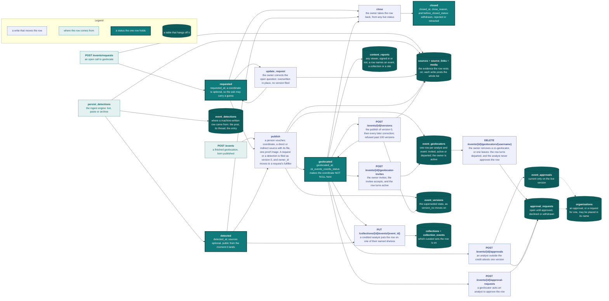
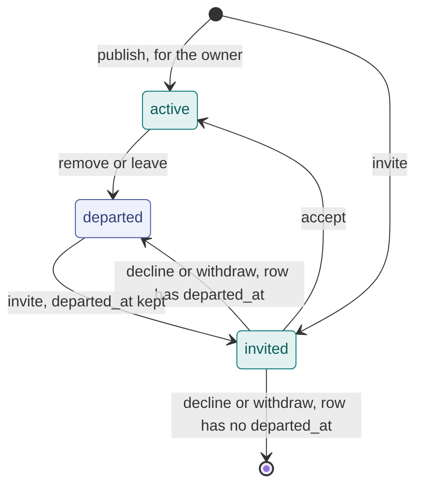
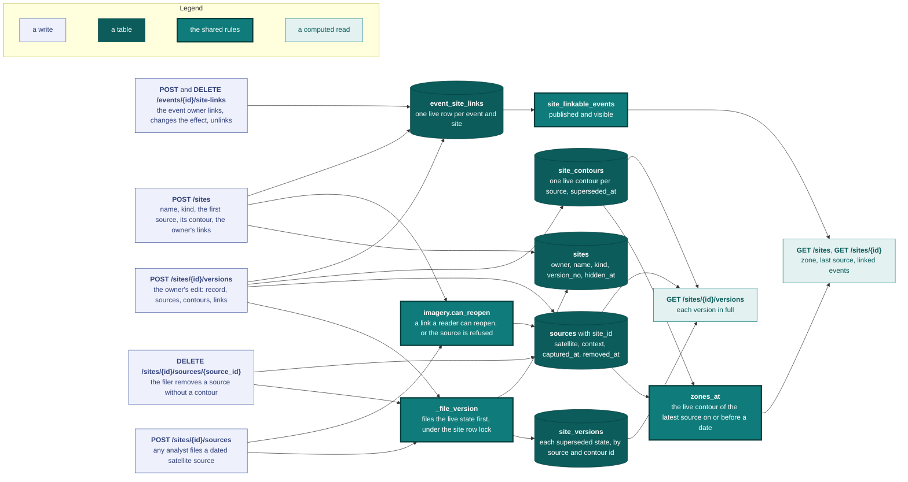
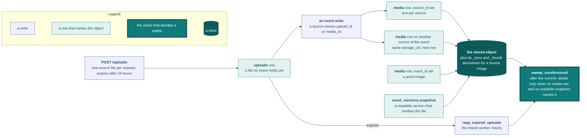

# Data model

One `events` row carries a geolocation for its whole life. The status it holds says how far along it is, three writes move or correct it, and the tables below hang off it rather than copy it.



The three entries on the left are the three ways a row is born: a request and a direct submit come from [`POST /events/requests` and `POST /events`](api.md#post-events), and a machine detection comes from the [ingest engine](ingestion.md). The four statuses and the constraints that pin them are [`events`](#events). The three writes are `update_request`, `save_version` and `close`, all in [`api.md`](api.md), plus the batch form of the publish. A request or a detection is version 0. `update_request` lets the requester overwrite an open question in place, at version 0. `save_version` publishes a request or a detection, filing it as version 0, and corrects a published row, filing what each correction supersedes, because a published row is a vouched claim. [`sources`](#sources), with their [`source_links`](#source_links) and files in [`media`](#media), hold the evidence the row rests on: every write but `close` posts the whole list, and the floor a status demands is in [`api.md`](api.md#evidence-floor). The tables on the right exist because a write happened: [`event_geolocators`](#event_geolocators) records who vouched (the owner and every analyst who accepted an invitation), who is invited and who lost the credit, [`event_detections`](#event_detections) records where an imported row came from, [`event_versions`](#event_versions) holds what a correction superseded, [`event_approvals`](#event_approvals) holds who attested which version, [`approval_requests`](#approval_requests) holds who was asked to (a departure withdraws the open requests its analyst sent), an [organization](#organizations) can stand behind an approval or a request in place of one analyst, [`content_reports`](#content_reports) holds what a viewer flagged, and [`collections`](#collections) with [`collection_events`](#collection_events) holds the curated sets a credited analyst puts the row on.

## Schema overview

```mermaid
erDiagram
    users {
        UUID id PK
        VARCHAR username
        VARCHAR email
        VARCHAR password_hash
        VARCHAR x_handle "nullable, UNIQUE, admin-linked bot-attribution handle"
        BOOLEAN is_active
        BOOLEAN is_admin
        TIMESTAMPTZ last_seen_at "nullable, throttled activity stamp"
        TIMESTAMPTZ deleted_at "nullable, soft-delete"
        INTEGER token_version "session-invalidation counter"
        TEXT bio "nullable, profile blurb"
        TEXT avatar_url "nullable"
        JSONB external_links "default {}, linktree-style"
        BOOLEAN is_invite_minting_enabled "admin switch over sponsored invites"
        TIMESTAMPTZ created_at
    }

    audit_log {
        UUID id PK
        UUID actor_id FK "nullable, the acting account"
        TEXT action
        JSON target "nullable, NULL for an action on one's own account"
        TIMESTAMPTZ created_at
    }

    password_reset_tokens {
        UUID id PK
        UUID user_id FK
        TEXT token_hash
        TIMESTAMPTZ expires_at
        TIMESTAMPTZ consumed_at "nullable"
        TIMESTAMPTZ created_at
    }

    invite_codes {
        UUID id PK
        VARCHAR code
        UUID used_by_id FK "nullable, audit-only"
        TIMESTAMPTZ used_at "nullable, redemption stamp"
        TIMESTAMPTZ expires_at "nullable"
        TIMESTAMPTZ revoked_at "nullable"
        VARCHAR x_handle "nullable, bound handle copied at redemption"
        UUID created_by_id FK "nullable, the sponsor"
        TIMESTAMPTZ created_at
    }

    pending_registrations {
        UUID id PK
        VARCHAR email UK
        VARCHAR username UK
        VARCHAR password_hash
        UUID invite_code_id FK
        TEXT token_hash UK
        TIMESTAMPTZ expires_at
        TIMESTAMPTZ created_at
    }

    events {
        UUID id PK
        UUID owner_id FK "edit-rights owner, moves to geolocator"
        UUID requested_by_id FK "nullable, who opened the request"
        VARCHAR title
        GEOMETRY coords "nullable, the subject; required at geolocated"
        TEXT proof "sanitized HTML"
        DATE occurred_date "nullable"
        TIME occurred_time "nullable, optional UTC hour"
        TIMESTAMPTZ requested_at "nullable, entered requested"
        TIMESTAMPTZ detected_at "nullable, entered detected"
        TIMESTAMPTZ geolocated_at "nullable, entered geolocated"
        TIMESTAMPTZ closed_at "nullable, entered closed"
        VARCHAR status "requested | detected | geolocated | closed"
        TEXT close_reason "nullable, free-text"
        VARCHAR before_closed_status "nullable, requested | detected | geolocated"
        TIMESTAMPTZ deleted_at "nullable, admin soft-delete"
        TIMESTAMPTZ hidden_at "nullable, admin takedown"
        INTEGER version_no "which version the live row is: 0 until published"
        TIMESTAMPTZ created_at
        TIMESTAMPTZ updated_at
    }

    event_versions {
        UUID id PK
        UUID event_id FK
        INTEGER version_no "the version this row holds"
        UUID edited_by_id FK "nullable, who superseded it"
        TEXT note "nullable, capped at 280 chars by the schema"
        JSONB snapshot "the editable fields as they stood, blank once redacted"
        TIMESTAMPTZ created_at "when the edit happened"
        TIMESTAMPTZ redacted_at "nullable, when an admin blanked it"
        UUID redacted_by_id FK "nullable, which admin did"
    }

    content_reports {
        UUID id PK
        UUID event_id FK "nullable, NULL once the event is hard-deleted"
        UUID collection_id FK "nullable, a second target"
        UUID site_id FK "nullable, a third target; one target per row"
        VARCHAR reason "illegal_content | graphic_not_flagged | copyright | privacy | other"
        TEXT details "nullable, capped at 2000 chars by the schema"
        UUID reporter_id FK "nullable, anonymous reports leave this NULL"
        TIMESTAMPTZ created_at
        TIMESTAMPTZ resolved_at "nullable"
        VARCHAR resolution "nullable, marked_graphic | hidden | dismissed"
        UUID resolved_by_id FK "nullable"
    }

    event_detections {
        UUID event_id PK, FK
        VARCHAR via "nullable, bot | paste | archive"
        TEXT from_url "the post the row was imported from"
        BIGINT from_post_id "nullable, the re-import match anchor"
        BIGINT_ARRAY thread_post_ids "nullable, the thread's post ids"
        TIMESTAMPTZ post_at "nullable, analyst's X post time"
    }

    event_geolocators {
        UUID event_id PK, FK
        UUID user_id PK, FK
        VARCHAR state "invited | active | departed"
        TIMESTAMPTZ invited_at "nullable, set while invited"
        TIMESTAMPTZ joined_at "nullable, set while active"
        TIMESTAMPTZ departed_at "nullable, the first departure"
    }

    event_approvals {
        UUID id PK
        UUID event_id FK
        INT version_no "the version attested"
        UUID reviewer_id FK "the analyst, or the acting member; nullable"
        UUID organization_id FK "nullable, the organization approving"
        TIMESTAMPTZ created_at
    }

    approval_requests {
        UUID id PK
        UUID event_id FK
        INT version_no "live when sent"
        UUID requester_id FK
        UUID target_user_id FK "nullable, the analyst asked"
        UUID target_organization_id FK "nullable, the organization asked"
        VARCHAR status "open, approved, declined, withdrawn"
        TIMESTAMPTZ created_at
        TIMESTAMPTZ resolved_at "nullable"
    }

    sources {
        UUID id PK
        UUID event_id FK "nullable, the event it supports"
        UUID site_id FK "nullable, the site that holds it"
        UUID author_id FK "nullable, a site source's analyst"
        TEXT note "nullable, a site source's note"
        TIMESTAMPTZ removed_at "nullable, a site source out of the live state"
        VARCHAR title "empty string for none"
        VARCHAR level "direct | indirect | context"
        VARCHAR kind "where the source comes from"
        TIMESTAMPTZ captured_at "nullable, when the media was captured"
        GEOMETRY capture_position "nullable, where a capture was shot from"
        BOOLEAN is_graphic "death, injury or human remains"
        TIMESTAMPTZ created_at
        TIMESTAMPTZ updated_at
    }

    source_links {
        UUID id PK
        UUID source_id FK
        TEXT url "UNIQUE per source"
        TIMESTAMPTZ posted_at "nullable, when the media was posted there"
        TEXT snapshot_url "nullable, the archived copy"
        TIMESTAMPTZ archived_at "nullable, set with snapshot_url"
        TIMESTAMPTZ created_at
    }

    source_tags {
        UUID source_id FK
        UUID tag_id FK
    }

    uploads {
        UUID id PK
        UUID uploader_id FK
        TEXT storage_key
        VARCHAR kind "image | video"
        VARCHAR sha256
        TEXT original_filename "nullable"
        TIMESTAMPTZ created_at
        TIMESTAMPTZ expires_at "24 hours after created_at"
    }

    media {
        UUID id PK
        UUID source_id FK "nullable, UNIQUE, a source's file"
        UUID event_id FK "nullable, a proof image's event"
        TEXT storage_url
        VARCHAR kind
        VARCHAR sha256 "hex-encoded SHA-256 of uploaded bytes"
        TEXT original_filename "nullable, client-supplied filename"
        TIMESTAMPTZ created_at
    }

    tags {
        UUID id PK
        VARCHAR name
        TIMESTAMPTZ created_at
    }

    event_tags {
        UUID event_id FK
        UUID tag_id FK
    }

    conflicts {
        UUID id PK
        VARCHAR name "UNIQUE"
        VARCHAR wikidata_id "nullable, UNIQUE, sync/seed natural key"
        INT start_year "nullable"
        INT end_year "nullable"
        BOOLEAN is_ongoing
        TIMESTAMPTZ last_seen_at "nullable, last sync sighting"
        VARCHAR tier "nullable, major | minor | conflict"
        VARCHAR origin "sync | seed | manual"
        TIMESTAMPTZ created_at
    }

    event_conflicts {
        UUID event_id FK
        UUID conflict_id FK
    }

    collections {
        UUID id PK
        UUID owner_id FK "the one owner"
        VARCHAR title
        TEXT description "what the collection holds, sanitized HTML"
        TEXT description_text "its plain-text projection"
        TIMESTAMPTZ hidden_at "nullable, admin takedown"
        TIMESTAMPTZ created_at
        TIMESTAMPTZ updated_at
    }

    collection_events {
        UUID collection_id FK
        UUID event_id FK
        TIMESTAMPTZ added_at
    }

    sites {
        UUID id PK
        UUID owner_id FK "the creator"
        VARCHAR name "versioned"
        VARCHAR kind "versioned"
        INTEGER version_no "the live state's version"
        TIMESTAMPTZ hidden_at "nullable, admin takedown"
        TIMESTAMPTZ created_at
        TIMESTAMPTZ updated_at
    }

    site_versions {
        UUID id PK
        UUID site_id FK
        INTEGER version_no "the version this row holds"
        UUID edited_by_id FK "nullable, SET NULL"
        JSONB snapshot "name, kind, each source and its contour"
        TIMESTAMPTZ created_at "when the write superseded it"
    }

    site_contours {
        UUID id PK
        UUID site_id FK
        UUID source_id FK "the site source that shows it"
        UUID author_id FK "nullable, SET NULL"
        GEOMETRY zone "POLYGON 4326, GIST"
        TIMESTAMPTZ created_at
        TIMESTAMPTZ superseded_at "nullable, NULL while live"
    }

    event_site_links {
        UUID id PK
        UUID event_id FK
        UUID site_id FK
        VARCHAR effect
        TIMESTAMPTZ linked_at
    }

    follows {
        UUID follower_id FK
        UUID followed_id FK
        TIMESTAMPTZ created_at
    }

    notifications {
        UUID id PK
        UUID user_id FK "the recipient"
        VARCHAR kind "one value of NOTIFICATION_KINDS"
        UUID actor_id FK "nullable, who acted"
        UUID event_id FK "nullable, what it concerns"
        UUID organization_id FK "nullable, the organization it concerns"
        VARCHAR organization_name "nullable, a deleted organization's name"
        UUID approval_id FK "nullable, the approval an approval_received row reports"
        TIMESTAMPTZ created_at
        TIMESTAMPTZ read_at "nullable, NULL is unread"
    }

    organizations {
        UUID id PK
        VARCHAR slug UK "the URL key, fixed once set"
        VARCHAR name
        VARCHAR x_handle "nullable, UNIQUE, verified by a site admin"
        TEXT bio "nullable"
        TEXT avatar_url "nullable"
        JSONB external_links "default {}"
        VARCHAR approval_request_audience "following, everyone, nobody"
        UUID created_by_id FK "nullable, the site admin"
        TIMESTAMPTZ created_at
    }

    organization_members {
        UUID organization_id PK "FK"
        UUID user_id PK "FK"
        UUID invited_by_id FK "nullable, the org manager who invited"
        VARCHAR state "invited | active"
        VARCHAR role "manager | member"
        TIMESTAMPTZ invited_at "nullable, set while invited"
        TIMESTAMPTZ joined_at "nullable, set while active"
    }

    notification_deliveries {
        UUID id PK
        UUID notification_id FK
        VARCHAR status "queued | running | done | failed | skipped"
        INTEGER attempt_count "provider refusals"
        TIMESTAMPTZ created_at
        TIMESTAMPTZ claimed_at "nullable"
        TIMESTAMPTZ sent_at "nullable"
    }

    user_preferences {
        UUID user_id PK
        JSONB notification_overrides "per-kind email overrides only"
        JSONB display "palette, theme, help_tooltips"
        VARCHAR approval_request_audience "following, everyone, nobody"
        TIMESTAMPTZ updated_at
    }

    bot_mentions {
        UUID id PK
        BIGINT mention_post_id "UNIQUE, X snowflake"
        VARCHAR author_x_handle
        JSONB payload "nullable, cleared once done"
        VARCHAR status "queued | running | done | failed"
        INTEGER attempt_count
        VARCHAR outcome "nullable, set when done"
        INTEGER created_event_count
        BIGINT reply_post_id "nullable"
        TIMESTAMPTZ created_at
        TIMESTAMPTZ processed_at "nullable"
    }

    archive_import_jobs {
        UUID id PK
        UUID owner_id FK
        TEXT zip_key
        VARCHAR status "queued | running | done | failed"
        INTEGER attempt_count
        INTEGER estimated_post_count "nullable"
        INTEGER processed_detection_count
        INTEGER detection_count "nullable"
        INTEGER created_count
        INTEGER updated_count
        INTEGER skipped_count
        INTEGER failed_count
        TEXT error "nullable"
        TIMESTAMPTZ created_at
        TIMESTAMPTZ started_at "nullable"
        TIMESTAMPTZ finished_at "nullable"
    }

    users |o--o{ invite_codes : "used_by_id"
    users |o--o{ invite_codes : "created_by_id"
    invite_codes ||--o{ pending_registrations : "invite_code_id"
    users ||--o{ password_reset_tokens : "user_id"
    users |o--o{ audit_log : "actor_id"
    users ||--o{ events : "owner_id"
    users |o--o{ events : "requested_by_id"
    events |o--o{ sources : "event_id"
    sites |o--o{ sources : "site_id"
    users |o--o{ sources : "author_id"
    sources ||--o{ source_links : "source_id"
    sources ||--o{ source_tags : "source_id"
    tags ||--o{ source_tags : "tag_id"
    sources ||--o| media : "source_id"
    events ||--o{ media : "event_id"
    users ||--o{ uploads : "uploader_id"
    events ||--o{ event_tags : "event_id"
    tags ||--o{ event_tags : "tag_id"
    events ||--o{ event_conflicts : "event_id"
    conflicts ||--o{ event_conflicts : "conflict_id"
    events ||--o{ event_geolocators : "event_id"
    users ||--o{ event_geolocators : "user_id"
    events ||--o| event_detections : "event_id"
    events ||--o{ event_approvals : "event_id"
    users |o--o{ event_approvals : "reviewer_id"
    events ||--o{ approval_requests : "event_id"
    users ||--o{ approval_requests : "requester_id"
    users |o--o{ approval_requests : "target_user_id"
    events ||--o{ event_versions : "event_id"
    users |o--o{ event_versions : "edited_by_id"
    users |o--o{ event_versions : "redacted_by_id"
    events |o--o{ content_reports : "event_id"
    collections |o--o{ content_reports : "collection_id"
    sites |o--o{ content_reports : "site_id"
    users |o--o{ content_reports : "reporter_id"
    users |o--o{ content_reports : "resolved_by_id"
    users ||--o{ collections : "owner_id"
    collections ||--o{ collection_events : "collection_id"
    events ||--o{ collection_events : "event_id"
    users ||--o{ sites : "owner_id"
    sites ||--o{ site_versions : "site_id"
    users |o--o{ site_versions : "edited_by_id"
    sites ||--o{ site_contours : "site_id"
    sources ||--o{ site_contours : "source_id"
    users |o--o{ site_contours : "author_id"
    sites ||--o{ event_site_links : "site_id"
    events ||--o{ event_site_links : "event_id"
    users ||--o{ follows : "follower_id"
    users ||--o{ follows : "followed_id"
    users ||--o{ notifications : "user_id"
    users |o--o{ notifications : "actor_id"
    events |o--o{ notifications : "event_id"
    notifications ||--o{ notification_deliveries : "notification_id"
    users ||--o| user_preferences : "user_id"
    organizations |o--o{ notifications : "organization_id"
    event_approvals |o--o{ notifications : "approval_id"
    organizations ||--o{ organization_members : "organization_id"
    users ||--o{ organization_members : "user_id"
    organizations |o--o{ event_approvals : "organization_id"
    organizations |o--o{ approval_requests : "target_organization_id"
    users |o--o{ organization_members : "invited_by_id"
    users |o--o{ organizations : "created_by_id"
    users ||--o{ archive_import_jobs : "owner_id"
```



---

## Tables

Table and column names follow the [schema naming convention](engineering.md#schema-naming-convention).

In the Constraints column, `default X` is the value the application sets on insert, and `server_default X` is a SQL `DEFAULT` the database applies.

### `users`

| Column | Type | Constraints |
|--------|------|-------------|
| `id` | `UUID` | PK, default `uuid4()` |
| `username` | `VARCHAR(50)` | UNIQUE, NOT NULL |
| `email` | `VARCHAR(255)` | UNIQUE, NOT NULL. [Notification email](#notification_deliveries) goes to this address. |
| `password_hash` | `VARCHAR(255)` | NOT NULL. |
| `x_handle` | `VARCHAR(50)` | UNIQUE, nullable. The X handle the bot attributes mentions to (lowercase, no `@`). The system sets it at registration from an invite-bound handle, or an admin links it through `PATCH /admin/users/{id}/x-handle`. Analysts cannot self-serve this field, and the bot never creates rows for it. It differs from `external_links["x"]`, a display handle the owner sets and nobody verifies. |
| `is_active` | `BOOLEAN` | NOT NULL, default `true` |
| `is_admin` | `BOOLEAN` | NOT NULL, default `false`. The system flips this to `true` automatically on login or registration if the email matches `ADMIN_EMAILS`. |
| `last_seen_at` | `TIMESTAMPTZ` | nullable. The instant of the account's most recent authenticated request. `dependencies.get_current_user` rewrites it once the stored value is older than `LAST_SEEN_THROTTLE` (15 minutes), so a session costs one UPDATE per window. `POST /auth/login` and `POST /auth/confirm-registration` stamp it when they issue cookies. The admin onboarding table reads it as the account's activity, falling back to the newest `login` auth event while it is NULL. |
| `deleted_at` | `TIMESTAMPTZ` | nullable. A non-NULL value marks the user as soft-deleted: login is rejected, the profile returns 404, and public reads filter the row out. Soft-deleting a user passes every owned event another live analyst is credited on to the earliest of them, then soft-deletes every other event they own with the user's own timestamp. Hard-delete, the GDPR escape hatch, drops the user row, the events only they are credited on, and their contributor rows, and sweeps S3. An owned event with another live geolocator passes to the earliest of them instead, files included, and so does an event the user's soft delete hid (its `deleted_at` equals the user's), which is restored. An event soft-deleted on its own is purged. Because the owner is always among an event's geolocators, hard-delete never leaves a `geolocated` event with zero geolocators. |
| `token_version` | `INTEGER` | NOT NULL, default `0`. A monotonic session-invalidation counter. The session JWT embeds this value as a `tv` claim, and `get_current_user` returns 401 on a mismatch. The system bumps this counter on logout, password change, password reset, and soft-delete, which invalidates every outstanding JWT for the user at once. A JWT with no `tv` claim also returns 401. |
| `bio` | `TEXT` | nullable. A short plain-text blurb shown on the public profile. Analysts edit it through `PATCH /users/me`. The API layer caps it at 500 characters. There is no database constraint, so changing the cap does not require a migration. |
| `avatar_url` | `TEXT` | nullable. The public URL of the analyst's profile picture, always an object on the media host. The server mints the value: `PUT /users/me/avatar` stores one metadata-stripped 400 px JPEG under `avatars/{user_id}/` and writes its URL here, `DELETE /users/me/avatar` clears the column and the object, and `PATCH /users/me` rejects the field, so the avatar cannot become a beacon that collects readers' IP addresses and User-Agents. |
| `external_links` | `JSONB` | NOT NULL, default `'{}'::jsonb`. A Linktree-style object keyed by platform (`x`, `discord`, `website`, `github`), each value validated and normalised on the way in (see [`api.md`](api.md#patch-usersme)). The default `{}` means the value is never NULL, so the read path always gets a dict. `PATCH /users/me` replaces the whole column. A partial merge would conflict with the whole-panel form submit. |
| `is_invite_minting_enabled` | `BOOLEAN` | NOT NULL, default `true`, server_default `true`. Whether the analyst can mint [sponsored invite codes](#invite_codes) from Settings. An admin moves it through `PATCH /admin/users/{id}/invite-minting`. Codes already minted stay valid when it turns off. |
| `created_at` | `TIMESTAMPTZ` | NOT NULL, default `now()` |

Indexes:

- `users_x_handle_key`: UNIQUE on `(x_handle)`. Enforces one account per X handle. Postgres allows unlimited NULLs, so handle-less rows are unaffected.
- `ix_users_live`: partial index on `(created_at) WHERE deleted_at IS NULL`. Admin search and the auth path both filter on `deleted_at IS NULL`.
- `ix_users_search_fts`: GIN index on `to_tsvector('simple', coalesce(username, '') || ' ' || coalesce(bio, ''))`. Backs `GET /search` (the analyst branch). `bio` is part of the indexed expression so `ts_headline` can return a fragment highlight.

---

### `password_reset_tokens`

Password-reset tokens. Each token is single-use.

| Column | Type | Constraints |
|--------|------|-------------|
| `id` | `UUID` | PK, default `uuid4()` |
| `user_id` | `UUID` | FK → `users.id` ON DELETE CASCADE, NOT NULL |
| `token_hash` | `TEXT` | UNIQUE, NOT NULL. `sha256(secret)`. The plaintext token exists only in the email link. |
| `expires_at` | `TIMESTAMPTZ` | NOT NULL |
| `consumed_at` | `TIMESTAMPTZ` | nullable. A non-null value means the token was already redeemed. |
| `created_at` | `TIMESTAMPTZ` | NOT NULL, default `now()` |

Indexes:

- `ix_password_reset_tokens_user_id` on `(user_id)`. Supports cascade delete and per-user revocation lookups.
- `ix_password_reset_tokens_live_expires_at`: partial index on `(expires_at) WHERE consumed_at IS NULL`. Keeps the reaper scan cheap as consumed rows accumulate.

Lifecycle: `mint` creates a token, `consume` redeems it, and `revoke_all_live_for_user` force-revokes the user's prior tokens on a fresh mint. Cleanup runs on demand through `POST /admin/maintenance/reap-password-reset-tokens` (`services/maintenance.py::reap_password_reset_tokens`). It deletes live-but-expired rows immediately and drops consumed rows older than 30 days.

---

### `invite_codes`

| Column | Type | Constraints |
|--------|------|-------------|
| `id` | `UUID` | PK, default `uuid4()` |
| `code` | `VARCHAR(64)` | UNIQUE, NOT NULL |
| `used_by_id` | `UUID` | FK → `users.id` ON DELETE SET NULL, nullable, **audit-only**. Records the user who redeemed the code. The FK is set to NULL on user hard-delete. |
| `used_at` | `TIMESTAMPTZ` | nullable. Stamped at redemption. Every code is single-use, so a non-NULL value is what spends it. Unlike `used_by_id`, it survives the redeemer's hard-delete. |
| `expires_at` | `TIMESTAMPTZ` | nullable |
| `revoked_at` | `TIMESTAMPTZ` | nullable. The admin page sets this. A non-null value invalidates the code immediately. |
| `x_handle` | `VARCHAR(50)` | nullable. The X handle the code binds, normalized to lowercase with no `@`. Redemption copies it onto the new account's `users.x_handle`, the bot-attribution link. If the handle got linked elsewhere between mint and redemption, redemption fails soft. |
| `created_by_id` | `UUID` | FK → `users.id` ON DELETE SET NULL, nullable. The analyst who minted the code from Settings (`POST /users/me/invite-codes`), its sponsor. NULL for an admin-minted code, and once the sponsor's account is erased. A sponsored code always binds an `x_handle`. |
| `created_at` | `TIMESTAMPTZ` | NOT NULL, default `now()` |

Indexes:

- `ix_invite_codes_created_by_id_created_at` on `(created_by_id, created_at)`. Supports the sponsor's daily quota count and the sponsor's own list.

A code is valid exactly when `revoked_at IS NULL AND used_at IS NULL AND (expires_at IS NULL OR expires_at > now())`. `used_by_id` is not part of the validity check: it is nulled when the redeemer's account is erased, while `used_at` stays.

An account created from a sponsored code reaches its sponsor through the code row: `used_by_id` names the account and `created_by_id` the sponsor. The `User.sponsor` relationship in [`models/user.py`](../backend/app/models/user.py) reads that pair, so the link has one home and needs no column on `users`. Redemption therefore carries the sponsor without a change to `pending_registrations`, which already references the code.

A sponsor mints at most 5 codes per UTC day (`DAILY_MINT_LIMIT` in [`services/sponsored_invites.py`](../backend/app/services/sponsored_invites.py)). The count covers every row with that `created_by_id` and a `created_at` since 00:00 UTC, revoked or used. The mint locks the sponsor's `users` row, so two concurrent mints cannot both pass the count.

`DELETE /admin/invite-codes/{id}` drops a row whose `used_by_id` is NULL, the cleanup for codes that were minted and never used. A row naming a redeemer is refused: it is that account's origin record. The `audit_log` row for the deletion carries the `code` value, so the trail names what left the table.

---

### `pending_registrations`

| Column | Type | Constraints |
|--------|------|-------------|
| `id` | `UUID` | PK, default `uuid4()` |
| `email` | `VARCHAR(255)` | UNIQUE, NOT NULL. Holds the address until the user confirms or the row expires. |
| `username` | `VARCHAR(50)` | UNIQUE, NOT NULL. Plays the same role as `email`, reserving the username until confirmation or expiry. |
| `password_hash` | `VARCHAR(255)` | NOT NULL. A bcrypt hash. The system transfers it directly into `users.password_hash` at confirmation. |
| `invite_code_id` | `UUID` | FK → `invite_codes.id` ON DELETE CASCADE, NOT NULL. The invite is referenced but **not consumed** until confirmation. |
| `token_hash` | `TEXT` | UNIQUE, NOT NULL. `sha256(secret)`. The plaintext token exists only in the email link. |
| `expires_at` | `TIMESTAMPTZ` | NOT NULL. Set to 24 hours after mint. |
| `created_at` | `TIMESTAMPTZ` | NOT NULL, default `now()` |

Indexes:

- `ix_pending_registrations_expires_at` on `(expires_at)`. Supports the reaper sweep.

Why UNIQUE on `email` and `username` instead of a partial index? Partial-index predicates must be IMMUTABLE in Postgres, and `expires_at > now()` is STABLE. The plain UNIQUE constraint keeps race-window protection without a predicate. The `/auth/register` path deletes expired rows inline before its INSERT, and the admin Maintenance reaper sweeps the rest. As a result, a recently expired pending row does not permanently reserve its address.

Lifecycle: `POST /auth/register` inserts a row through `services/registration.py::create_pending_registration`. `POST /auth/confirm-registration` consumes it through `confirm_pending_registration`, which creates the `users` row, copies a bound `invite_codes.x_handle` onto it if the handle is still free, stamps `invite_codes.used_at`, and deletes the pending row. `POST /auth/resend-confirmation` re-mints the token on the same row and invalidates the previous link. Cleanup runs through `services/registration.py::reap_pending_registrations`, exposed in the admin Maintenance panel.

---

### `audit_log`

An append-only log of the actions that change an account or that a site admin or sponsor takes. [`services/audit.log_auth_event`](../backend/app/services/audit.py) writes the account actions: the auth router calls it synchronously on `login`, `failed_login`, `logout`, `register_pending`, `register_resent`, `register_confirmed`, `password_reset_requested`, `password_reset_completed` and `password_changed`. The write runs inside a SAVEPOINT (`db.begin_nested()`), so an INSERT failure rolls back only the audit row and the caller's transaction stays usable. [`services/admin.log_admin_event`](../backend/app/services/admin.py) writes the admin actions and the sponsored invite mints in the caller's transaction.

| Column | Type | Constraints |
|--------|------|-------------|
| `id` | `UUID` | PK, default `uuid4()` |
| `actor_id` | `UUID` | FK → `users.id` ON DELETE SET NULL, nullable. The acting account: the site admin, the sponsor on an `invite_sponsored` row and on an `invite_revoked` row for a code the sponsor revoked, or the account itself for an account action. NULL for a `failed_login`, a `password_reset_requested` no-op, a `register_pending` and a `register_resent` whose email matches no live account, and for an anonymous logout. This keeps the table from becoming a probe-able email-to-existence oracle. NULL again once the account is erased. |
| `action` | `TEXT` | NOT NULL. A plain string, not a database enum, so a new action needs no migration. For example `login`, `failed_login`, `invite_created`, `invite_revoked`, `invite_deleted`, `invite_sponsored`, `invite_minting_enabled` and `invite_minting_disabled`. |
| `target` | `JSON` | nullable. What the action touched: target IDs and parameters. NULL for an action on one's own account. |
| `created_at` | `TIMESTAMPTZ` | NOT NULL, default `now()` |

Indexes:

- `ix_audit_log_actor_id_created_at` on `(actor_id, created_at)`. Supports the forensics query "what did this account do, latest first".
- `ix_audit_log_action_created_at` on `(action, created_at)`. Supports the query "did action X spike recently".

The table stores no IP address or User-Agent: Vidit stores neither, for privacy. There is no retention period.

---

### `events`

One row represents one event across its whole lifecycle. `status` tracks the lifecycle. `coords` is an independent nullable field tied to `status` by a CHECK constraint. A request is a `requested` event on this table, with no coordinates required yet. Fulfilling a request is a single `UPDATE status='geolocated', coords=...` on the same row plus an `event_geolocators` insert. It never copies the row into a new one.

| Column | Type | Constraints |
|--------|------|-------------|
| `id` | `UUID` | PK, default `uuid4()` |
| `owner_id` | `UUID` | FK → `users.id`, NOT NULL. The edit-rights owner. For a `requested` event, this is the poster. It moves to the fulfiller at the `geolocated` transition, so permission checks stay a single-owner check across the lifecycle. A hard delete of the owner's account moves it to the earliest live co-geolocator. The owner is always among the event's geolocators; see `event_geolocators`. |
| `requested_by_id` | `UUID` | FK → `users.id` ON DELETE SET NULL, nullable. Records who opened the request. This is preserved across fulfilment so the identity of the requester is not erased. NULL for a directly submitted geolocation. |
| `title` | `VARCHAR(255)` | NOT NULL |
| `coords` | `GEOMETRY(Point, 4326)` | nullable. The subject: what the footage shows. Tied to `status` by `ck_events_coords_status`: required for `geolocated`, optional otherwise. A `requested` request may carry an approximate guess. Each event has one subject point. |
| `proof` | `TEXT` | NOT NULL. Sanitized HTML, on the [rich text](api.md#rich-text) rules. A human submit carries the analyst's write-up, and a machine detection carries the tweet or thread text, one `p` per line, followed by its proof images as `img`. A submission with no proof body, or a body with no text and no image, stores `''`, not NULL. |
| `occurred_date` | `DATE` | nullable in every status. When the depicted event happened. NULL when unknown: the footage doesn't always establish the date, and it renders as *Unknown*. For a machine detection, this is provisionally the originating post's date; the owner corrects it at submit. |
| `occurred_time` | `TIME` | nullable. An optional time of day for `occurred_date`, in UTC. NULL when the hour is unknown. |
| `requested_at` | `TIMESTAMPTZ` | nullable. Stamped when the event entered `requested`. |
| `detected_at` | `TIMESTAMPTZ` | nullable. Stamped when a machine produced it, entering `detected`. The provenance of an imported row is its [`event_detections`](#event_detections) row. |
| `geolocated_at` | `TIMESTAMPTZ` | nullable. Stamped when a person vouched for it and published it, entering `geolocated`. |
| `closed_at` | `TIMESTAMPTZ` | nullable. Stamped when the event entered the terminal `closed` state. |
| `status` | `VARCHAR(20)` | NOT NULL, `server_default 'geolocated'`. The lifecycle runs `requested` (an open call to geolocate) → `detected` (a machine detection, marked on every surface, immutable until vouched) → `geolocated` (a person vouched for it and published it; always has a location, and every later correction is a version) → `closed` (the owner took the row back, from any of the three live states). It is a plain string, not a native enum, and `ck_events_status_valid` pins the value domain. The default keeps a direct human submit correct without setting the value explicitly; the requested and detected paths pass `status` explicitly. The `update_request`, `save_version` and `close` writes are documented in [`api.md`](api.md). |
| `close_reason` | `TEXT` | nullable. A free-text reason the event was closed, such as AI image, bot bug, or withdrawn. Required by the close endpoint and kept visible for transparency, which is what makes a closed row read as a decision rather than a disappearance. |
| `before_closed_status` | `VARCHAR(20)` | nullable. The status held just before `closed`: `requested` means withdrawn, `detected` means rejected, `geolocated` means retracted. Drives the status badge and the read views: a rejected detection stays in the located catalog, a withdrawn request in the requested queue, and a retraction is in neither. |
| `deleted_at` | `TIMESTAMPTZ` | nullable. A non-NULL value marks an admin soft-delete: the row and its media stay in place, but every public read filters it out, admins included. |
| `hidden_at` | `TIMESTAMPTZ` | nullable. A non-NULL value marks a takedown: the row is withheld from every public read the same way `deleted_at` is, but an admin still reads it (judging the [content report](#content_reports) that led to the takedown means seeing what was withheld), and the state is reversible, which is what separates it from `deleted_at`. Set by `POST /admin/reports/{id}/resolve` (`resolution = "hidden"`) or directly by `PATCH /admin/events/{id}/moderation`; cleared only by the latter. |
| `version_no` | `INTEGER` | NOT NULL, `server_default 1`. Which version of the event the live row is. A request or a detection is version 0, open or closed; the ORM sets 0 when it inserts one (`models/event._initial_version`). Publishing it files version 0 in [`event_versions`](#event_versions) and the row becomes version 1; a row created published starts at 1. Each later correction moves it forward one step and files the superseded state; see [`POST /events/{id}/versions`](api.md#post-eventsidversions). The requester's correction of an open request, [`POST /events/{id}/request`](api.md#post-eventsidrequest), overwrites it in place at version 0. A [re-import](ingestion.md#re-import) writes onto a detection only at version 0. |
| `created_at` | `TIMESTAMPTZ` | NOT NULL, default `now()` |
| `updated_at` | `TIMESTAMPTZ` | NOT NULL, default `now()` |

The evidence is not on this row. An event's footage, its URLs and the capture position are its [`sources`](#sources), and `Event.is_graphic` is derived from them: `true` when any source is graphic. In Python it reads the loaded sources; in SQL it is an `EXISTS` over `sources`, so a filter can use it. Every event read schema carries it, and the frontend covers a graphic source behind [`GraphicContentGate`](design.md#components) until the viewer confirms they want to see it.

**Check constraints:**
- `ck_events_status_valid`: `status IN ('requested', 'detected', 'geolocated', 'closed')`. Pins the value domain at the database. The column is a plain `VARCHAR`, not a native enum, so this constraint rejects a bad write at the Postgres level, not only at the app-layer `Literal`.
- `ck_events_coords_status`: `status <> 'geolocated' OR coords IS NOT NULL`. A `geolocated` event always has a subject coordinate. The other states leave it free, so a `requested` request may carry an approximate guess.
- `ck_events_closed_stamp` (`status <> 'closed' OR closed_at IS NOT NULL`) and `ck_events_geolocated_stamp` (`status <> 'geolocated' OR geolocated_at IS NOT NULL`). These tie the terminal stamps to status. An app path that forgets to stamp is rejected at write time, not stored as silent bad data.
- `ck_events_version_published`: `(version_no = 0) = (COALESCE(before_closed_status, status) IN ('requested', 'detected'))`. A row that was never published is version 0, and a published row, retracted or not, is version 1 or more.
- `ck_events_before_closed_status`: `(status = 'closed' AND before_closed_status IS NOT NULL AND before_closed_status IN ('requested', 'detected', 'geolocated')) OR (status <> 'closed' AND before_closed_status IS NULL)`. The field is non-NULL and in-domain exactly when `closed`, and NULL otherwise. The explicit `IS NOT NULL` clause is required: `NULL IN (...)` evaluates to unknown, not false, so without it a `closed` row could keep a NULL discriminator and slip through.

**Temporal fields: five kinds of time.** A geolocation carries several timestamps. Each marks a different point on the path from an event to a Vidit row. They are distinct by design:

```
event happens ──▶ media captured ──▶ media posted at a URL ──▶ analyst posts the geoloc on X ──▶ imported to Vidit
 occurred_date     sources.          source_links.posted_at    event_detections.post_at         created_at
 (+ occurred_time)  captured_at      (UTC instant)             (UTC instant, machine path)      (UTC instant)
```

| Field | Meaning | Filled by | Null? |
|---|---|---|---|
| `occurred_date` (+ `occurred_time`) | when the depicted event happened | analyst, or detection (post date) | date nullable in every status: NULL when the footage doesn't establish it. Time optional: the hour is often unknown. |
| `sources.captured_at` | when one source's media was captured | analyst | nullable. A machine source carries none. |
| `source_links.posted_at` | when the media was posted at one URL | analyst, or detection (a quoted source's date) | nullable. `NULL` on a machine source whose link carries no date. |
| `event_detections.post_at` | when the analyst posted it on X | machine-written rows only (the imported post's time) | no row for a human submit |
| `created_at` | when it was submitted to Vidit | system | NOT NULL |

`occurred_date` is *editorial*: a real-world event, often known only to the day, with no canonical time zone. It stores a bare date plus an optional UTC hour. `captured_at`, `posted_at` and `event_detections.post_at` are *instants*: known to the minute when present, and always UTC, so they store full timestamps. All entered times follow the UTC convention.

**Indexes:**
- `GIST(coords)`. Required for geospatial queries: bounding-box filtering and proximity sort.
- `(owner_id)`. Supports profile lookup.
- `(occurred_date)` and `(created_at)`. Support time-based queries.
- `(owner_id, created_at DESC)`. A composite index for profile listing. Single-author reads key on `owner_id`.
- `ix_events_live`: partial index on `(created_at) WHERE deleted_at IS NULL`. Every public read filters on `deleted_at IS NULL`, and the partial index keeps it tight.
- `ix_events_status_created_at` on `(status, created_at)`. The requested view, the map, and the detections queue all filter on `status`, newest first.
- `ix_events_created_at_id` on `(created_at, id)`. Backs the keyset that the capped list endpoints page on. `GET /events` and `GET /events/detections` order by `created_at DESC, id DESC` and cut each page with a row comparison over that pair; see [`api.md`](api.md#pagination).
- `ix_events_timeline_at_id` on `(feed_at, id)`, where `feed_at` is `coalesce(CASE WHEN status = 'requested' THEN requested_at WHEN status = 'detected' THEN detected_at ELSE geolocated_at END, created_at)`. Partial: visible (`deleted_at` and `hidden_at` NULL) `geolocated`, `requested` and `detected` rows. Backs the keyset of [`GET /feed`](api.md#get-feed), which orders by `feed_at DESC, id DESC`, so a page reads the index in order instead of sorting. The expression matches `models/event.feed_at` exactly; the planner ignores the index on any difference.
- `ix_events_search_fts`: GIN index on `to_tsvector('simple', coalesce(title, ''))`. Backs `GET /search`; both the located and requested views run through it. The `simple` configuration, not `english`, keeps matching predictable for the corpus of place names and analyst handles. Soft-delete is filtered at query time. Source titles have their own index, [`ix_sources_search_fts`](#sources). Source URLs are matched by substring rather than through a text index, because Postgres' simple parser tokenizes URLs as host and path units.

> `coords` and `sources.capture_position` are PostGIS points in WGS84 (SRID 4326, standard GPS coordinates). GeoAlchemy2 exposes them as `.lat` and `.lng` through `WKBElement`, or as `ST_X` and `ST_Y` in raw SQL.

---

### `event_detections`

Where a machine-written row came from: the post it was imported from, the thread that post sits in and the ingest entry that read it. One row per imported event, whether the event is a `detected` row or a `requested` row the bot opened. A human submit has no row. [`services/events/request.stamp_provenance`](../backend/app/services/events/request.py) writes the row once at creation, and [`Event.detection`](../backend/app/models/event.py) reads it. `Event.is_machine_detection` is true when the row exists and `requested_at` is NULL.

| Column | Type | Constraints |
|--------|------|-------------|
| `event_id` | `UUID` | PK, FK → `events.id` ON DELETE CASCADE |
| `via` | `VARCHAR(20)` | nullable, `ck_event_detections_via_valid`: `'bot'`, `'paste'` or `'archive'`, the ingest entry that produced the row (see [`ingestion.md`](ingestion.md)). Stamped once at creation by the shared write path and never moved, so a re-import through another entry does not rewrite where the row first came from. NULL on some machine rows. Read-only on `EventRead` as `detected_via`. |
| `from_url` | `TEXT` | NOT NULL. The post the row was imported from, as a link an analyst can open: the display value, written from `from_post_id` at the engine's exit. A provenance link, not a source: the event's [sources](#sources) are the footage it rests on. Read on `EventRead` as `detected_from_url`. |
| `from_post_id` | `BIGINT` | nullable. The ID of the post. It anchors the display link and is the post-ID leg of the re-import match: one post spells its URL several ways, so the ID keeps two spellings on one detection. |
| `thread_post_ids` | `BIGINT[]` | nullable. Every post ID of the thread the detection was read from, the anchor included. The [re-import](ingestion.md#re-import) match reads it: a detection matches a row when their post-ID sets intersect. Some machine rows carry their anchor ID alone. |
| `post_at` | `TIMESTAMPTZ` | nullable. When the analyst published the geolocation on X: the post time of `from_url`. This is the precedence input for the "who geolocated it first" claim and dispute pipeline. The system captures it at import, because the post may later be deleted. A re-import updates this column and no other. |

**Indexes:**
- `ix_event_detections_from_post_id`: partial index on `(from_post_id) WHERE from_post_id IS NOT NULL`. Backs the post-ID leg of the re-import match, one lookup per detection during a backfill.
- `ix_event_detections_thread_post_ids`: partial GIN index on `(thread_post_ids) WHERE thread_post_ids IS NOT NULL`. Backs the array-overlap leg of the re-import match, one lookup per detection during a backfill.

The match joins to `events` to scope itself to the importer's own rows. The admin machine-detection cohort tests whether the row exists, through the primary key.

---

### `event_geolocators`

One analyst's standing on one event's credit, one row per pair. A row is `invited` while the owner's invitation waits, `active` while the analyst holds the credit, and `departed` once they held it and lost it. The `active` rows are the credit: who vouched for the location. `owner_id` is always among them on a `geolocated` event. The system writes the owner's `active` row at the publish, and a row turns `active` each time an invited analyst accepts. Credit grants no write right: every write still checks `owner_id`. Every read that lists an analyst's work matches an event on `owner_id` or on an `active` row (`services/event_filters.credited_to`).



In the diagram, a green state counts toward the cap of 10 per event (`MAX_EVENT_GEOLOCATORS` in [`services/geolocator_credit.py`](../backend/app/services/geolocator_credit.py)), counting only analysts whose account is live. A blue state is a former geolocator. `[*]` is no row.

| Column | Type | Constraints |
|--------|------|-------------|
| `event_id` | `UUID` | PK, FK → `events.id` ON DELETE CASCADE |
| `user_id` | `UUID` | PK, FK → `users.id` ON DELETE CASCADE |
| `state` | `VARCHAR(20)` | NOT NULL, `ck_event_geolocators_state_valid`: `'invited'`, `'active'` or `'departed'`. |
| `invited_at` | `TIMESTAMPTZ` | nullable. When the owner sent the latest invitation. NOT NULL while `invited`. |
| `joined_at` | `TIMESTAMPTZ` | nullable. When the analyst took the credit. NOT NULL while `active`. Orders `Event.geolocators`, the earliest first. |
| `departed_at` | `TIMESTAMPTZ` | nullable. The first departure; a later one leaves it unchanged, and a new invitation keeps it. NOT NULL while `departed`. |

Composite PK: `(event_id, user_id)`. It allows one row per analyst and event, and its leading `event_id` serves both the forward read, who geolocated event X, and the event's invitation list. `ck_event_geolocators_state_stamp` requires the stamp of the current state: `invited_at` for `invited`, `joined_at` for `active`, `departed_at` for `departed`.

**Indexes:**
- `ix_event_geolocators_user_id_joined_at` on `(user_id, joined_at) WHERE state = 'active'`. Supports the reverse query, a user's geolocations, for the profile page.
- `ix_event_geolocators_user_id` on `(user_id)`. Backs the cascade when an analyst's account is erased.

[`services/geolocator_credit`](../backend/app/services/geolocator_credit.py) moves a row between states, locking the event first:

- An invitation inserts an `invited` row, or turns a `departed` row `invited`.
- Accepting turns the row `active`, stamps `joined_at`, and deletes the invitee's [approvals](#event_approvals) of the event, on every version, in one transaction.
- Declining or a withdrawal returns a former geolocator's row to `departed` and deletes any other row.
- A removal or a leave turns an `active` row `departed`.

An analyst is *ever credited* on an event when they are its owner, hold a row that is not `invited`, or hold an `invited` row that keeps `departed_at`. A former geolocator is no more independent of the work than a current one, so an ever-credited analyst neither approves the event nor receives an approval request for it. `hard_delete_user` hands each owned event that has another live `active` geolocator to the earliest of them by `joined_at`, and deletes the rest, so erasing a user never leaves a `geolocated` event with zero geolocators.

---

### `event_approvals`

An analyst's attestation, or an organization's through any of its members, that one version of a published event holds, written through [`/events/{id}/approvals`](api.md#approvals). A row is current while `version_no` equals `events.version_no`, so a new version ends it without a write and the row stays readable on the version it covered. An approval is final. Three paths delete a row: the reviewer accepts a co-geolocator invitation for the event (every version, including the approvals the reviewer placed for an organization), a site admin calls [`DELETE /admin/approvals/{approval_id}`](api.md#delete-adminapprovalsapproval_id), or the event, the reviewer or the organization is hard-deleted. The `approval_received` notifications that reported the row go with it.

| Column | Type | Constraints |
|--------|------|-------------|
| `id` | `UUID` | PK, default `uuid4()` |
| `event_id` | `UUID` | FK → `events.id` ON DELETE CASCADE, NOT NULL |
| `version_no` | `INTEGER` | NOT NULL. The live `events.version_no` when the approval was placed. |
| `reviewer_id` | `UUID` | FK → `users.id` ON DELETE SET NULL, nullable. The analyst who approved: for an organization's approval, the member who placed it. An erasure deletes the analyst's own approvals first ([`admin.hard_delete_user`](../backend/app/services/admin.py)), so only an organization's approval loses its reviewer; `ck_event_approvals_reviewer` refuses a NULL reviewer on a row without an organization. |
| `organization_id` | `UUID` | FK → `organizations.id` ON DELETE CASCADE, nullable. The organization the approval speaks for; NULL for an analyst's own approval. |
| `created_at` | `TIMESTAMPTZ` | NOT NULL, default `now()` |

`uq_event_approvals_analyst`: unique partial index on `(event_id, version_no, reviewer_id) WHERE organization_id IS NULL`. One approval per analyst and version. Only the live version takes a new approval, so this also allows one current approval per analyst and event. After a site admin deletes the row, the analyst can approve that version again. The leading `(event_id, version_no)` serves the per-version read.

`uq_event_approvals_organization`: unique partial index on `(event_id, version_no, organization_id) WHERE organization_id IS NOT NULL`. One approval per organization and version; after a site admin deletes the row, any member can approve the version again. An analyst's own approval and the approval they place for an organization are separate rows.

**Indexes:**
- `ix_event_approvals_reviewer_id` on `(reviewer_id)`. Backs the delete and the SET NULL when a reviewer's account is erased.
- `ix_event_approvals_organization_created_at`: partial index on `(organization_id, created_at) WHERE organization_id IS NOT NULL`. Serves the organization page's approvals, newest first, and backs the cascade when an organization is deleted.

---

### `approval_requests`

A geolocator's request that an analyst or an organization approve an event, written through [`/events/{id}/approval-requests`](api.md#approval-requests). A row is open until the target approves the event, on any version, or declines it, or until the requester loses their credit on the event, and stays once resolved. Accepting a co-geolocator invitation deletes the open rows addressed to the new geolocator.

| Column | Type | Constraints |
|--------|------|-------------|
| `id` | `UUID` | PK, default `uuid4()` |
| `event_id` | `UUID` | FK → `events.id` ON DELETE CASCADE, NOT NULL |
| `version_no` | `INTEGER` | NOT NULL. The live `events.version_no` when the request was sent. |
| `requester_id` | `UUID` | FK → `users.id` ON DELETE CASCADE, NOT NULL. The geolocator who asked. |
| `target_user_id` | `UUID` | FK → `users.id` ON DELETE CASCADE, nullable. The analyst asked. |
| `target_organization_id` | `UUID` | FK → `organizations.id` ON DELETE CASCADE, nullable. The organization asked. `ck_approval_requests_one_target` (`num_nonnulls(target_user_id, target_organization_id) = 1`) sets exactly one of the two targets. |
| `status` | `VARCHAR(20)` | NOT NULL, default `'open'`, CHECK in `('open', 'approved', 'declined', 'withdrawn')` (constraint `ck_approval_requests_status_valid`). `withdrawn` marks a request whose requester lost their credit on the event. `ApprovalRequestStatus` in [`models/approval_request.py`](../backend/app/models/approval_request.py) lists the same values. |
| `created_at` | `TIMESTAMPTZ` | NOT NULL, default `now()` |
| `resolved_at` | `TIMESTAMPTZ` | nullable. `ck_approval_requests_resolved` sets it exactly when `status` is not `open`. |

`uq_approval_requests_open`: unique partial index on `(event_id, target_user_id, requester_id) WHERE status = 'open'`. One open request per requester, analyst and event; a resolved row does not block a new request. `uq_approval_requests_open_organization` on `(event_id, target_organization_id, requester_id) WHERE status = 'open' AND target_organization_id IS NOT NULL` holds the same rule for an organization.

**Indexes:**
- `ix_approval_requests_target_user_id` on `(target_user_id, status)`. Serves the analyst's open requests and backs the cascade when their account is erased.
- `ix_approval_requests_requester_created_at` on `(requester_id, created_at)`. Serves the daily cap and backs the cascade when a requester's account is erased.
- `ix_approval_requests_target_organization_id`: partial index on `(target_organization_id, status) WHERE target_organization_id IS NOT NULL`. Serves the organization's open requests and backs the cascade when an organization is deleted.

---

### `event_versions`

One superseded version of an event. Publishing a request or a detection, or correcting a `geolocated` row, must not silently rewrite the record, so the pre-edit state is filed here before the edit lands and `events.version_no` moves on. A version number is a public address, so a filed row is never removed and never renumbered while its event lives: nothing reuses a number, nothing reorders the history, and `/events/{id}/vN` means the same thing forever. Redaction is the one write a filed row takes (below), and the cascade with its event is the one delete.

Read it as "the snapshots, then the live row": an event at `version_no` 3 carries rows 1 and 2 here, and the live row is version 3. An event published from a request or a detection also carries row 0: the request or the detection as the requester or the import left it. An event created published (`POST /events`) has no row 0, and neither has one published before the publish filed version 0; `services/versions.version_zero` reads which case applies.

Two writes file a version, through `services/versions.file_version`: [`POST /events/{id}/versions`](api.md#post-eventsidversions), the publish of version 0 and the owner's later edits, which is also where an [archived copy](#source_links) of one of the row's links is recorded, since that is a change to what the published record says about its own evidence; and the batch publish, [`POST /events/batch-complete`](api.md#post-eventsbatch-complete), which files each detection as version 0. The number is taken under the event's row lock.

An event carries at most 100 versions (`services/versions.MAX_VERSIONS_PER_EVENT`); a save whose only change is a link's archived copy is exempt. [`api.md`](api.md#post-eventsidversions) states the refusal. A version has to differ from the row it supersedes, so a save that moves no versioned field and no archived copy files nothing.

Redaction is that one write, and it is still not a delete: an admin blanks `snapshot` and `note` in place and stamps `redacted_at` / `redacted_by_id`, so the row, its number and its byline stay. See [`POST /admin/events/{id}/versions/{version_no}/redact`](api.md#post-admineventsidversionsversion_noredact).

| Column | Type | Constraints |
|--------|------|-------------|
| `id` | `UUID` | PK, default `uuid4()` |
| `event_id` | `UUID` | FK → `events.id` ON DELETE CASCADE, NOT NULL |
| `version_no` | `INTEGER` | NOT NULL. The version this row **holds**, not the one that replaced it. |
| `edited_by_id` | `UUID` | FK → `users.id` ON DELETE SET NULL, nullable. The analyst whose edit superseded this version; on version 0, the analyst who published it. NULL once that account is erased: an event legitimately outlives an editor who is not its owner. |
| `note` | `TEXT` | nullable. The editor's own words about the edit. Bounded to 280 characters by the schema, not the column, which stays unbounded `TEXT`. |
| `snapshot` | `JSONB` | NOT NULL. The editable fields as they stood (`services/versions.build_snapshot`): `title`, `coords`, `occurred_date`, `occurred_time`, `sources`, `tags`, `conflicts`, `proof` (the HTML string, as `events.proof` stores it), and `proof_media`. `sources` lists each [source](#sources) in the event's source order (`services/versions.source_entry`): `title`, `level`, `kind`, `captured_at`, `capture_position`, `is_graphic`, `links` (each `url`, `posted_at`, `snapshot_url`, `archived_at`), `tags`, and `media`, its file or `null`. A source entry carries no id: a source is filed by its content, not its row. `media` and each `proof_media` entry carry the [media](#media) row whole (`id`, `storage_url`, `kind`, `sha256`, `original_filename`); `proof_media` holds the images this version's own proof body referenced, not every proof image the event holds. Tags and conflicts carry their names alongside their ids, so a version stays readable after a referential row is renamed. `{}` on a redacted version. |
| `created_at` | `TIMESTAMPTZ` | NOT NULL. When the edit that superseded this version happened. |
| `redacted_at` | `TIMESTAMPTZ` | nullable. When an admin blanked this version's content. NULL on every ordinary row. |
| `redacted_by_id` | `UUID` | FK → `users.id` ON DELETE SET NULL, nullable. Which admin redacted it. NULL once that account is erased; the readable trail is the `audit_log` row the same write files. |

**Unique constraint:** `uq_event_versions_event_no` on `(event_id, version_no)`. The writer takes the number off the locked event row, so a duplicate is a bug Postgres rejects rather than a second history entry for one version.

There is no secondary index: the only read is "this event's history, by version", served by the unique constraint's leading `event_id`.

**Media rows are not versioned; the files they name outlive them.** A `media` row a readable snapshot's `proof_media` points at is never hard-deleted, so a past version stays renderable after the current proof body drops the image. The shared intake checks this before it deletes a proof row; see `services/versions.referenced_media_urls`.

A source's file cannot take that route: a correction that drops a source, or replaces its file, deletes the `media` row with it. The snapshot carries the source whole instead, its file included, and the stored object stays while a readable snapshot names it, which is what keeps `/vN` renderable. The [reference-counted sweep](#media) reads the snapshots for that reason, and `services/versions.referenced_source_media` resolves those objects for the hard deletes. A redacted version displays nothing, so it holds nothing alive: redacting the last version that showed a proof image deletes that image, row and object, and the last one that named a dropped source's file frees it, unless a `media` row still names it.

---

### `sources`

One piece of evidence: at most one file, the URLs that file was posted at, and what is known about its capture. A source has one owner, an event or a site (`ck_sources_one_owner`). An event's sources are the evidence the event rests on: an event holds up to 10 (`MAX_SOURCES_PER_EVENT` in [`models/source.py`](../backend/app/models/source.py)), and none is the main one. A site's sources are dated satellite captures of the site (see [Sites](#sites)). [`api.md`](api.md#sources) states the write contract of an event's sources, and [`api.md`](api.md#post-sitesidsources) the one of a site's source.

| Column | Type | Constraints |
|--------|------|-------------|
| `id` | `UUID` | PK, default `uuid4()` |
| `event_id` | `UUID` | FK → `events.id` ON DELETE CASCADE, nullable, indexed. The event the source supports; NULL on a site source. |
| `site_id` | `UUID` | FK → `sites.id` ON DELETE CASCADE, nullable, indexed. The site that holds the source; NULL on an event's source. |
| `author_id` | `UUID` | FK → `users.id` ON DELETE SET NULL, nullable. The analyst who filed a site source: any signed-in analyst files one. NULL on an event's source, whose analyst is the event's owner, and once that account is erased. |
| `note` | `TEXT` | nullable. A site source's plain-text note on what the source shows, up to 500 characters at the API. NULL on an event's source. |
| `removed_at` | `TIMESTAMPTZ` | nullable. When the analyst who filed a site source removed it from the site's live state. The row stays, so every [site version](#site_versions) that names the source stays readable. NULL on an event's source. |
| `title` | `VARCHAR(255)` | NOT NULL, server_default `''`. An optional label; `''` is no title. Searched by `GET /search` through `ix_sources_search_fts`. |
| `level` | `VARCHAR(10)` | NOT NULL, CHECK in `('direct', 'indirect', 'context')` (constraint `ck_sources_level_valid`). The evidence level: how close the source stands to the act. See the table below. |
| `kind` | `VARCHAR(20)` | NOT NULL, CHECK in `('smartphone', 'camera', 'static_camera', 'drone', 'aircraft', 'satellite', 'dashcam', 'body_cam', 'article', 'official_statement', 'other', 'unknown')` (constraint `ck_sources_kind_valid`). Where the source comes from, on every source, a file-less one included: what captured it (`camera` is a handheld or press camera, `static_camera` a CCTV or a webcam, `aircraft` a plane or a helicopter, historical aerial photos included) or the kind of document it is. A `satellite` or `aircraft` source is checked against the [imagery providers](imagery.md). Whether its file is a photo or a video is the file's own [`media.kind`](#media). A machine source is `unknown` until a review names it, and `unknown` keeps the choice satisfiable for a source of uncertain provenance. |
| `captured_at` | `TIMESTAMPTZ` | nullable. When the media was captured (UTC). Distinct from the event's `occurred_date` and from a link's `posted_at`. |
| `capture_position` | `GEOMETRY(Point, 4326)` | nullable. Where a capture was shot from; a document has none. Not indexed, because no spatial read consumes it. |
| `is_graphic` | `BOOLEAN` | NOT NULL, default `false`. `TRUE` when the media shows death, injury or human remains. An event is graphic when any of its sources is (`Event.is_graphic`). |
| `created_at` | `TIMESTAMPTZ` | NOT NULL, default `now()` |
| `updated_at` | `TIMESTAMPTZ` | NOT NULL, default `now()`, moved on every update |

| Level | What the source shows | Supports a publication |
|---|---|---|
| `direct` | The act while it happens | yes |
| `indirect` | The direct consequences of the act, after the fact | yes |
| `context` | Anything else: an image from before, a portrait that identifies a victim, an article or a statement without media | no |

The `kind` and `level` value domains have one home, the `SourceKind` and `SourceLevel` aliases in [`models/source.py`](../backend/app/models/source.py). The column CHECKs, the schemas, the `source_kind` and `level` filters and the generated frontend types derive from them; the frontend owns the display labels.

**Check constraints:**
- `ck_sources_one_owner`: `num_nonnulls(event_id, site_id) = 1`. A source supports one event or sits on one site, never both and never neither.
- `ck_sources_site_capture`: a site source is a `satellite` source of level `context` with a `captured_at`. It shows a state of the site, not an act, so it never supports a publication.
- `ck_sources_site_fields`: `author_id`, `note` and `removed_at` stay NULL on an event's source.

**Indexes:**
- `ix_sources_event_id` on `(event_id)`. Serves "this event's sources" and the cascade.
- `ix_sources_site_id` on `(site_id)`. Serves a site's sources and the cascade.
- `ix_sources_author_id` on `(author_id)` `WHERE author_id IS NOT NULL`. Serves the `ON DELETE SET NULL` of an account erasure; only site sources set `author_id`, so the index skips every event source.
- `ix_sources_search_fts`: GIN index on `to_tsvector('simple', coalesce(title, ''))`. Backs the source-title leg of event search ([`GET /search`](api.md#get-search)), on the same `simple` configuration as `ix_events_search_fts`.

**The order is derived, not stored.** An event's sources read by level (`direct`, then `indirect`, then `context`), then by `captured_at` with unknown last, then by `created_at` and `id` (`models/source.source_order`). There is no position column, so no write reorders a list by hand.

**A write posts the whole list.** Every event write posts the event's full source list, and the stored sources follow it (`services/events/sources.apply_sources`): an entry naming a stored source's `id` updates that source in place, an entry without one creates a source, and a stored source the list leaves out is deleted, its links, tags and `media` row with it. The source's file outlives its row while another `media` row or a readable version names it (see [`media`](#media)). A request's sources are not locked: the analyst who publishes a request rewrites them like any other field.

**The graphic flag only rises from the forms.** A posted `false` leaves a stored source's `is_graphic` set. Only an admin clears it, through [`PATCH /admin/events/{id}/moderation`](api.md#patch-admineventsidmoderation), which sets or clears the flag on every source of the event; resolving a report as `marked_graphic` sets it on every source.

**A file shared within an event.** A source may name the file of another source of the same event: the write adds a `media` row on the same stored object, and the source takes that source's graphic flag. The stored object stays until no `media` row names it.

**Versioned with the event.** A source is part of what an event says, so an edit to a source on a `geolocated` event files a version like any other edit, and the snapshot keeps each source whole ([`event_versions`](#event_versions)).

**A site source is never edited.** `services/events/sources.file_source` writes it with its links and file, through the same link cleaning, snapshot check and upload intake as an event's source. Every read of an event's source covers only rows with `event_id` set: the event joins, search, tags and profile stats never see a site source.

---

### `source_links`

One URL a source's media was posted at: the same media is often posted in several places. A source carries 1 to 10 links (`MAX_LINKS_PER_SOURCE`); an analyst's write refuses a source with none, and a machine source may carry none until it is published.

| Column | Type | Constraints |
|--------|------|-------------|
| `id` | `UUID` | PK, default `uuid4()` |
| `source_id` | `UUID` | FK → `sources.id` ON DELETE CASCADE, NOT NULL |
| `url` | `TEXT` | NOT NULL. The API caps input at 2000 characters (`SOURCE_URL_MAX_LENGTH`). |
| `posted_at` | `TIMESTAMPTZ` | nullable. When the media was posted at this URL (UTC). NULL unless known. |
| `snapshot_url` | `TEXT` | nullable. The archived copy an analyst recorded for this URL, checked for provider and path shape before it is stored (see [`archival.md`](archival.md)). |
| `archived_at` | `TIMESTAMPTZ` | nullable. When that copy was recorded. |
| `created_at` | `TIMESTAMPTZ` | NOT NULL, default `now()` |

**Constraints:**
- `uq_source_links_source_url` on `(source_id, url)`. One row per URL on a source. Its leading `source_id` also serves "this source's links", so the table has no other index.
- `ck_source_links_archive_stamp`: `(snapshot_url IS NULL) = (archived_at IS NULL)`. A copy and its stamp travel together.

A source's links read by `posted_at` with unknown last, then `created_at` and `id`. A write replaces a source's links whole: it strips each URL, drops blanks and repeats, and checks each pasted snapshot. A re-posted snapshot that names the stored copy (`services/source_archive.same_snapshot`) keeps its `archived_at`; any other paste is stamped at the write. The archive provider (`wayback`, `archive_today` or `ghostarchive`) is not a column: the read derives it from the snapshot URL's host (`services/source_archive.provider_of`).

---

### `source_tags`

Many-to-many junction table between `sources` and `tags`, same shape as [`event_tags`](#event_tags). Events and sources share one tag catalogue.

| Column | Type | Constraints |
|--------|------|-------------|
| `source_id` | `UUID` | FK → `sources.id` ON DELETE CASCADE |
| `tag_id` | `UUID` | FK → `tags.id` ON DELETE CASCADE |

Composite PK: `(source_id, tag_id)`. `ix_source_tags_tag_id` on `(tag_id)` backs the tag deletion cascade and the list of tags in use ([`GET /tags`](api.md#get-tags)).

---

### `content_reports`

One viewer's report against one event, one collection or one site. Open to anonymous viewers: a takedown request must not require an account, since the people a piece of footage harms are rarely the people who hold one. Rows accumulate rather than dedupe: several viewers may report the same target, and each report is resolved on its own. A report is never deleted, only resolved, so the table is an audit trail of what was reported and what was decided.

One row names one target, through `event_id`, `collection_id` or `site_id`. Real foreign keys rather than a `(target_type, target_id)` pair, so the database is what keeps a report pointing at a row that exists and what empties the pointer when that row is destroyed.

| Column | Type | Constraints |
|--------|------|-------------|
| `id` | `UUID` | PK, default `uuid4()` |
| `event_id` | `UUID` | FK → `events.id` ON DELETE SET NULL, nullable. NULL once the reported event is hard-deleted: the report is the record that a complaint was filed and how it was answered, so it outlives the event. NULL too on a report filed against a collection or a site. An orphaned report accepts only the `dismissed` verdict; every other verdict mutates a row that is gone, and answers 409 `report_target_gone`. |
| `collection_id` | `UUID` | FK → `collections.id` ON DELETE SET NULL, nullable. A second target, on the same terms as `event_id` above and NULL for a report filed against anything else. It empties when the collection is erased, and the report survives that erasure the way it survives an event's. An open report holds back the owner's delete: the collection is only marked [`collections.deleted_at`](#collections) until its last open report is resolved. An account erasure (`collections.owner_id` cascades) does not wait. |
| `site_id` | `UUID` | FK → `sites.id` ON DELETE SET NULL, nullable. A third target, on the same terms as `event_id` above and NULL for a report filed against anything else. It empties when the site goes with its owner's account. |
| `reason` | `VARCHAR(30)` | NOT NULL, CHECK in `('illegal_content', 'graphic_not_flagged', 'copyright', 'privacy', 'other')`. `illegal_content` is the legal escalation (material whose hosting is itself unlawful); `graphic_not_flagged` says the footage shows death, injury or human remains without its source's `is_graphic` flag; `copyright` and `privacy` are third-party rights claims; `other` keeps the form answerable when none of the four fits, with `details` carrying the story. |
| `details` | `TEXT` | nullable. The reporter's own words. Bounded to 2000 characters by the schema, not the column, which stays unbounded `TEXT`. |
| `reporter_id` | `UUID` | FK → `users.id` ON DELETE SET NULL, nullable. NULL for an anonymous report, and again once the reporter's account is erased (the report outlives the account, including a GDPR erasure). |
| `created_at` | `TIMESTAMPTZ` | NOT NULL. The application stamps it on insert; the column carries no server default, so a raw `INSERT` must supply it. |
| `resolved_at` | `TIMESTAMPTZ` | nullable. Non-NULL exactly when `resolution` is (`ck_content_reports_resolution_stamp`), so `resolved_at IS NULL` is the single-column test for an open report. |
| `resolution` | `VARCHAR(30)` | nullable, CHECK in `('marked_graphic', 'hidden', 'dismissed')` when set. `marked_graphic` sets `is_graphic` on every source of the event, `hidden` withholds the target from every public read via `events.hidden_at`, `collections.hidden_at` or `sites.hidden_at`, `dismissed` closes the report and leaves the target untouched. Any verdict on the last open report of a collection its owner deleted then erases that collection. `marked_graphic` is an event verdict only: the flag lives on an event's sources, so a collection or site report answering it is a 409 `report_verdict_not_applicable` rather than a verdict that changed nothing. There is no re-resolve: a report already carrying a verdict answers a second resolve attempt with 409. |
| `resolved_by_id` | `UUID` | FK → `users.id` ON DELETE SET NULL, nullable. The admin who resolved it, NULL until then and again after a GDPR erasure of that admin's account. |

**Check constraints:**
- `ck_content_reports_reason_valid`: pins the `reason` domain at the database, mirroring the `ContentReportReason` alias so a bad write is rejected by Postgres, not only by the app-layer `Literal`.
- `ck_content_reports_resolution_valid`: pins the `resolution` domain the same way, mirroring `ContentReportResolution`.
- `ck_content_reports_resolution_stamp`: `(resolution IS NULL AND resolved_at IS NULL) OR (resolution IS NOT NULL AND resolved_at IS NOT NULL)`. The verdict and its timestamp travel together in both directions: a resolved row can't forget what was decided, and an open row can't carry a stale verdict.
- `ck_content_reports_one_target`: `num_nonnulls(event_id, collection_id, site_id) <= 1`. One report names one thing, so no queue row can describe two at once. The test is "at most one" rather than "exactly one" because every target column is `SET NULL`: a report whose target is destroyed ends up naming none, and that orphan row has to stay legal. Exactly one is set at insert, which the three report routes hold by each naming one target.

**Indexes:**
- `ix_content_reports_event_id` on `(event_id)`. Backs the FK's ON DELETE SET NULL sweep and a per-event report lookup.
- `ix_content_reports_collection_id` on `(collection_id)` and `ix_content_reports_site_id` on `(site_id)`. The same pair of reads for the other targets.
- `ix_content_reports_queue`: expression index on `((resolved_at IS NOT NULL), created_at DESC, id DESC)`. Backs the admin queue's read, open reports first then newest first, with the id breaking ties so the offset walk is total. The index repeats the query's `ORDER BY` expression for expression, so Postgres walks it instead of sorting the table. Change the sort and you change this index.

---

### `follows`

Directed follow edges between analysts. Drives the `following` scope of `GET /feed` and the `followers_count`, `following_count`, and `is_following` fields on `GET /users/{username}`.

| Column | Type | Constraints |
|--------|------|-------------|
| `follower_id` | `UUID` | FK → `users.id` ON DELETE CASCADE, NOT NULL |
| `followed_id` | `UUID` | FK → `users.id` ON DELETE CASCADE, NOT NULL |
| `created_at` | `TIMESTAMPTZ` | NOT NULL, default `CURRENT_TIMESTAMP` |

Composite PK: `(follower_id, followed_id)`. The pair is the natural identity, so there is no surrogate id. The PK alone gives uniqueness, so the schema ships no separate UNIQUE constraint.

Self-follow is rejected at two layers. The router returns `400 Cannot follow yourself`, and `CHECK (follower_id <> followed_id)` (constraint `ck_follows_no_self_follow`) refuses the INSERT even if a code path skips the router. The 400 response gives the UI a clean error, and the CHECK is the durable invariant.

Indexes:
- `ix_follows_followed_id` on `(followed_id)`. The PK indexes the forward direction, who is X following, on its leading column. Without this index, the reverse direction, who follows X, the query that powers `followers_count` on every profile load, would full-scan.

`ON DELETE CASCADE` applies to both FKs. Hard-deleting an analyst drops every edge on either side, so a deleted user cannot keep ghost followers or ghost followings. Soft-deleted users (`users.deleted_at IS NOT NULL`) keep their edges. The public profile returns 404 regardless, and restoring the account restores its graph.

---

### `notifications`

One thing that happened to an analyst, listed at [`GET /notifications`](api.md#notifications). The action that causes it writes the row in its own transaction.

| Column | Type | Constraints |
|--------|------|-------------|
| `id` | `UUID` | PK, default `uuid4()` |
| `user_id` | `UUID` | FK → `users.id` ON DELETE CASCADE, NOT NULL. The recipient. |
| `kind` | `VARCHAR(40)` | NOT NULL, CHECK in `('request_fulfilled', 'new_follower', 'co_geolocator_invite', 'co_geolocator_removed', 'ownership_transferred', 'organization_invite', 'organization_invite_accepted', 'organization_manager_inherited', 're_approve_requested', 'approval_received', 'approval_request_received', 'approval_request_declined', 'organization_approval_removed')` (constraint `ck_notifications_kind_valid`). The kind registry `NOTIFICATION_KINDS` in [`models/notification.py`](../backend/app/models/notification.py) lists the same values with their email defaults. |
| `actor_id` | `UUID` | FK → `users.id` ON DELETE CASCADE, nullable. Who acted: the fulfiller, the follower, the owner who invited or removed you or saved a new version, the reviewer who approved, the geolocator who requested an approval, the analyst who declined one, the inviting org manager, or the analyst who accepted an organization invite. NULL on `ownership_transferred` and `organization_manager_inherited`, which must not name the erased analyst, and on `organization_approval_removed`, which a site admin's deletion of the organization sets off. |
| `event_id` | `UUID` | FK → `events.id` ON DELETE CASCADE, nullable. The event the row concerns; NULL for a kind that names none. |
| `organization_id` | `UUID` | FK → `organizations.id` ON DELETE CASCADE, nullable. The organization an `organization_*` row concerns. |
| `organization_name` | `VARCHAR(100)` | nullable. The name of the deleted organization on an `organization_approval_removed` row, which outlives the organization it names; NULL on every other kind. |
| `approval_id` | `UUID` | FK → `event_approvals.id` ON DELETE CASCADE, nullable. The approval an `approval_received` row reports; the row goes when the approval is deleted. NULL on every other kind. |
| `created_at` | `TIMESTAMPTZ` | NOT NULL, default `now()`. Orders the list. |
| `read_at` | `TIMESTAMPTZ` | nullable. Set by `POST /notifications/read` on the rows the notifications page showed; NULL is unread. Read state is per row because `created_at` is stamped at flush: an action that flushes its row and commits after a slow upload would land behind a single read marker already moved past it. |

Indexes:

- `ix_notifications_user_created_at` on `(user_id, created_at, id)`. Backs the list's keyset walk.
- `ix_notifications_user_unread`: partial index on `(user_id) WHERE read_at IS NULL`. Backs the unread count.
- `ix_notifications_actor_id` on `(actor_id)`, `ix_notifications_event_id` on `(event_id)` and `ix_notifications_organization_id` on `(organization_id)`. Back the cascades when an actor, an event or an organization is hard-deleted.
- `ix_notifications_approval_id`: partial index on `(approval_id) WHERE approval_id IS NOT NULL`. Backs the cascade when an approval is deleted.

Every foreign key cascades, so a hard-deleted recipient, actor, event, organization or approval takes its rows with it. A soft delete or a takedown keeps the row and hides it at read time: the list and the count skip a row whose event has `deleted_at` or `hidden_at` set, or whose actor has `deleted_at` set. Undoing the takedown shows the row again.

`new_follower` is written once per follower: an unfollow and re-follow finds the earlier row and writes none.

---

### `notification_deliveries`

The delivery queue for notifications: at most one row per notification, drained by the always-on worker ([`engineering.md`](engineering.md#email)). The transaction that writes the notification writes this row too, when the recipient's email switch for the kind is on. The in-app feed shows every notification whatever the switch says.

| Column | Type | Constraints |
|--------|------|-------------|
| `id` | `UUID` | PK, default `uuid4()` |
| `notification_id` | `UUID` | FK → `notifications.id` ON DELETE SET NULL, nullable. Deleting a notification deletes its `queued` and `skipped` rows first; the rows that may have reached the provider stay with NULL here, so the daily email cap keeps counting them. UNIQUE (constraint `uq_notification_deliveries_notification_id`), so a notification has at most one delivery. |
| `status` | `VARCHAR(10)` | NOT NULL, default `queued`, CHECK in `('queued', 'running', 'done', 'failed', 'skipped')` (constraint `ck_notification_deliveries_status_valid`). See the lifecycle below. |
| `attempt_count` | `INTEGER` | NOT NULL, default `0`. Provider refusals so far. The third sets `failed`. |
| `created_at` | `TIMESTAMPTZ` | NOT NULL, default `now()`. The claim order, oldest first. A row still `queued` 48 hours after it becomes `skipped`. |
| `claimed_at` | `TIMESTAMPTZ` | nullable. The latest claim. A row `running` for an hour past it becomes `failed`. A refused row waits 5 minutes past it before the next claim. |
| `sent_at` | `TIMESTAMPTZ` | nullable. When the provider accepted the message. The daily email caps count `done` rows by this column. |

Indexes:

- `ix_notification_deliveries_queued` on `(created_at)` where `status = 'queued'`. Backs the claim.
- `ix_notification_deliveries_sent_at` on `(sent_at)` where `status = 'done'`. Backs the daily cap counts.

| Status | Meaning |
|--------|---------|
| `queued` | Waiting for the worker, or for the next try after a refusal |
| `running` | Claimed and committed before the provider call. Never retried: the provider may have accepted it. |
| `done` | The provider accepted it |
| `failed` | Refused three times, or stale in `running` |
| `skipped` | Dropped unsent: the switch is off, the address is gone, the recipient is soft-deleted or inactive, the filter would hide the notification, or the row aged out in the queue |

---

### `organizations`

A collective with its own public profile at `/organizations/{slug}`. Only a site admin creates a row ([`POST /admin/organizations`](api.md#post-adminorganizations)), which keeps a name from being squatted and verifies `x_handle` by hand.

| Column | Type | Constraints |
|--------|------|-------------|
| `id` | `UUID` | PK, default `uuid4()` |
| `slug` | `VARCHAR(50)` | NOT NULL, UNIQUE. Lowercase letters, digits and inner hyphens, 2 to 50 characters. No endpoint changes it, so a shared link keeps resolving. |
| `name` | `VARCHAR(100)` | NOT NULL |
| `x_handle` | `VARCHAR(50)` | nullable, UNIQUE. Lowercased without `@`, the same normalization as `users.x_handle`. |
| `bio` | `TEXT` | nullable. Same rules as `users.bio`. |
| `avatar_url` | `TEXT` | nullable. Server-minted under `avatars/{organization_id}/`, like `users.avatar_url`. |
| `external_links` | `JSONB` | NOT NULL, default `'{}'::jsonb`. Same keys and rules as `users.external_links`. |
| `approval_request_audience` | `VARCHAR(20)` | NOT NULL, default `'following'`, CHECK in `('following', 'everyone', 'nobody')` (constraint `ck_organizations_approval_request_audience_valid`). Who may send the organization an [approval request](#approval_requests), set by its org managers: `following` admits an analyst whom any live org manager follows. Same values as `user_preferences.approval_request_audience`. |
| `created_by_id` | `UUID` | FK → `users.id` ON DELETE SET NULL, nullable. The site admin who created it. |
| `created_at` | `TIMESTAMPTZ` | NOT NULL |

- `ix_organizations_search_fts`, a GIN over `to_tsvector('simple', coalesce(name, '') || ' ' || coalesce(slug, '') || ' ' || coalesce(bio, ''))`. Backs the organizations group of [`GET /search`](api.md#get-search). The expression has to stay identical to `services/search._ORGANIZATION_TSVECTOR`, or the planner drops the index and scans the table.

---

### `organization_members`

One analyst's standing in one organization, one row per pair: a pending invitation, or a membership with its role. An analyst can belong to several organizations. An org manager's invitation inserts an `invited` row with the `member` role, and accepting turns it `active`. Declining, a withdrawal and leaving delete the row, so a row is `invited` only while the invitee has not answered.

| Column | Type | Constraints |
|--------|------|-------------|
| `organization_id` | `UUID` | PK, FK → `organizations.id` ON DELETE CASCADE, NOT NULL |
| `user_id` | `UUID` | PK, FK → `users.id` ON DELETE CASCADE, NOT NULL |
| `invited_by_id` | `UUID` | FK → `users.id` ON DELETE SET NULL, nullable. The org manager who invited. NULL for an org manager a site admin appointed, and once the inviter's account is erased. |
| `state` | `VARCHAR(20)` | NOT NULL, `ck_organization_members_state_valid`: `'invited'` or `'active'`. |
| `role` | `VARCHAR(20)` | NOT NULL, CHECK in `('manager', 'member')` (constraint `ck_organization_members_role_valid`). `manager` is an org manager, who holds the membership powers. Every member acts in the organization's name on approvals and approval requests. An `invited` row holds `member`. |
| `invited_at` | `TIMESTAMPTZ` | nullable. When the invitation was sent. NOT NULL while `invited`. |
| `joined_at` | `TIMESTAMPTZ` | nullable. When the analyst joined. NOT NULL while `active`. |

Composite PK: `(organization_id, user_id)`, so an analyst holds one row, and one role, per organization. `ck_organization_members_state_stamp` requires `invited_at` while `invited` and `joined_at` while `active`. `ix_organization_members_user_id` on `(user_id)` backs the list of an analyst's organizations and the invitee's lookups. Only `active` rows count as members: the member list, the member count, the org manager rule below and the approval powers read `state = 'active'`.

Every organization keeps at least one live org manager. The service enforces it rather than a constraint: a demotion, a removal or a leave locks the `organizations` row, then refuses to take away the last org manager whose account is not soft-deleted. An admin soft delete or erasure of that last org manager promotes the earliest-joined live member instead (`services/organizations.hand_over_manager_roles`), in the transaction that also hands the erased analyst's events to their co-geolocators; with no live member left, the organization keeps no org manager.

---

### `user_preferences`

One analyst's stored preferences, read and written through [`/users/me/preferences`](api.md#get-usersmepreferences). The first write creates the row, and a missing row reads as the defaults.

| Column | Type | Constraints |
|--------|------|-------------|
| `user_id` | `UUID` | PK, FK → `users.id` ON DELETE CASCADE |
| `notification_overrides` | `JSONB` | NOT NULL, default `'{}'::jsonb`. `{kind: bool}`, whether the kind is emailed, holding only the values that differ from the kind's default in `NOTIFICATION_KINDS`. A write equal to the default removes the key, so a changed default reaches every analyst who never moved that switch. |
| `display` | `JSONB` | NOT NULL, default `'{}'::jsonb`. `palette`, `theme` and `help_tooltips`, each present once written. A missing key reads as the default in `schemas/preferences.DISPLAY_DEFAULTS`. |
| `approval_request_audience` | `VARCHAR(20)` | NOT NULL, default `'following'`, CHECK in `('following', 'everyone', 'nobody')` (constraint `ck_user_preferences_approval_request_audience_valid`). Who may send the analyst an [approval request](#approval_requests). `ApprovalRequestAudience` in [`models/user_preferences.py`](../backend/app/models/user_preferences.py) lists the same values. |
| `updated_at` | `TIMESTAMPTZ` | NOT NULL, stamped on every write |

A stored value the API no longer accepts, such as a retired kind or palette, reads as its default.

---

### `collections`

A named, curated set of events one analyst is credited on, as owner or as a co-geolocator, shown on the owner's public profile: a spatial dossier or an operation reconstruction. Personal, with exactly one owner and no collaborators. Two written fields say what it is, the title and a required description, and the items order themselves by when their events happened, so the table carries no manual position, no denormalized count and no version history.

| Column | Type | Constraints |
|--------|------|-------------|
| `id` | `UUID` | PK, default `uuid4()` |
| `owner_id` | `UUID` | FK → `users.id` ON DELETE CASCADE, NOT NULL. The one owner. Cascades, unlike `events.owner_id`: a collection is one analyst's own shelf and nothing on it outlives their account, so a GDPR hard delete passes straight through and leaves no stored object behind, a collection holding no file of its own. |
| `title` | `VARCHAR(255)` | NOT NULL. The same width as `events.title`, from the shared `TITLE_MAX_LENGTH` in [`models/event.py`](../backend/app/models/event.py), so one cap governs an event title and a collection title alike. The API floor is 1 character. |
| `description` | `TEXT` | NOT NULL. What the collection holds, written by the owner on the create and on every edit as sanitized HTML, the same sanitizer [`events.proof`](#events) takes, minus images. |
| `description_text` | `TEXT` | NOT NULL. The plain-text projection of `description`, written beside it on every write from `services/sanitize.html_text`. Stored rather than derived per read because the collections search index is a GIN over it: a `to_tsvector` over the HTML would index tag names and entities instead of the words the owner wrote. It is also what a surface with no room for rich text prints, and what the API caps at 500 characters, the figure [`users.bio`](#users) takes for the same class of body; there is no database constraint, so changing the cap does not require a migration. The API floor is 1 character after whitespace is stripped. |
| `hidden_at` | `TIMESTAMPTZ` | nullable. Takedown: NULL = visible, timestamp = withheld from every read but an admin's, the owner's included. The same reversible axis [`events.hidden_at`](#events) carries. Set by `DELETE /admin/collections/{id}`, by `PATCH /admin/collections/{id}/moderation` with `hidden: true`, or by resolving a [content report](#content_reports) filed against the collection as `hidden`. Cleared only by `PATCH /admin/collections/{id}/moderation` with `hidden: false`. |
| `deleted_at` | `TIMESTAMPTZ` | nullable. Pending erasure: the owner deleted the collection while an open [content report](#content_reports) named it. Withheld from every read but an admin's, the owner's included, and never cleared. Resolving the last open report erases the row. |
| `created_at` | `TIMESTAMPTZ` | NOT NULL |
| `updated_at` | `TIMESTAMPTZ` | NOT NULL, SQLAlchemy `onupdate` stamp |

**Indexes:**
- `ix_collections_owner_created_at` on `(owner_id, created_at)`. Backs the profile section's only read, this analyst's collections newest first.
- `ix_collections_search_fts`, a GIN over `to_tsvector('simple', coalesce(title, '') || ' ' || coalesce(description_text, ''))`. Backs the collections group of [`GET /search`](api.md#get-search). The expression has to stay identical to the one `services/search._collection_tsvector` builds, config name included, or the planner drops the index and scans the table.

**The description is HTML, and its projection is a column.** The pair is written together in `services/collections`, on the create and on every edit, which is also where the HTML is sanitized and judged, so nothing can store a description whose stored projection describes different words. See [`api.md`](api.md#rich-text) for the tag and attribute allowlist, and [`api.md`](api.md#collections) for what a refused description answers.

**What a collection shows is one predicate, not a column.** `services/event_filters.collectable_events` is a visible event (`deleted_at IS NULL AND hidden_at IS NULL`) in one of the two worked statuses, `geolocated` or `detected`. The item list, the item count, the date range, the card mosaic and the eligibility check the add verb runs all read it, so an event that later closes or is taken down leaves all five at once with no write to `collection_events`. A `requested` row is an ask rather than an answer; a `closed` row is one the owner rejected or retracted, and a curated shelf must not go on presenting it as work that stands.

**Counts and the date range are computed per read.** `event_count` is the number of showable items, `first_date` and `last_date` the smallest and largest `occurred_date` among them. Nothing is stored, so no write path can leave a stale figure behind.

**The card mosaic is computed, not stored.** A collection carries no cover column and no cover object. The `cover` field of the read is up to four tiles taken off the items themselves: walk the showable items in chronological order, skip one flagged `is_graphic`, take each remaining item's card media (`services/thumbnails.pick_thumbnail`, preferring an image over a clip on an item carrying both), and stop at four. A graphic item is skipped rather than ending the walk, so a card never shows death or injury to a reader who did not open the item. The list is empty when no item qualifies. See [`api.md`](api.md#get-collectionsid).

**An open report holds back the owner's delete.** `services/collections.delete_collection` erases the row, its memberships with it, unless an open [content report](#content_reports) names the collection. Then it only stamps `deleted_at`, so the moderators keep the evidence and the owner cannot erase reported content to repeat it. `services/reports.resolve_report` erases the row once the last open report on it is resolved, whatever the verdict. Both lock the collection row before they count the open reports, so a delete and a verdict that race never leave a deleted collection with no open report. The owner's write verbs answer 404 on a collection pending erasure, an admin's included.

**The credit invariant lives in the service.** An event joins only the collections of an analyst it credits (`services/event_filters.credited_to`), which spans three tables and so is no CHECK: `services/collections.ensure_collectable` enforces it, and an attempt to shelve an event that does not credit you is a 403. Removing a co-geolocator deletes that analyst's memberships of the event in the same transaction. See [`api.md`](api.md#collections).

---

### `collection_events`

One membership: this event is on this collection.

| Column | Type | Constraints |
|--------|------|-------------|
| `collection_id` | `UUID` | FK → `collections.id` ON DELETE CASCADE |
| `event_id` | `UUID` | FK → `events.id` ON DELETE CASCADE |
| `added_at` | `TIMESTAMPTZ` | NOT NULL. When the owner put the event on the collection. Not a read key: the list orders by when the events happened, not by when they were shelved. |

Composite PK: `(collection_id, event_id)`. The pair is the identity, so adding an event twice is the same row and the add verb is idempotent without a read-then-write.

**Indexes:**
- `ix_collection_events_event_id` on `(event_id)`. The PK's leading `collection_id` serves the forward read, what is on this collection; this covers the reverse, which of my collections hold this event, behind `GET /events/{id}/collections`.

Both foreign keys cascade, so neither a hard-deleted event nor a hard-deleted collection leaves a membership pointing at nothing. Dropping a collection removes its memberships and touches no event: a collection is a view over the analyst's published record, so removing the view is not a judgement on any geolocation.

---

### Sites

A site is a named area of interest that analysts monitor through dated satellite imagery, such as a base, a depot or a radar. Five tables carry it. Its live state is the `sites` row, its sources not removed and their live contours, and every read derives the zone and the last source from them. Each write that changes the live state files the state it supersedes as one version.



**Every change to the state files one version.** Filing a source, removing one and the owner's edit each take the site row lock, file the live state in [`site_versions`](#site_versions), move `sites.version_no` on and then write, in one transaction (`services/sites._file_version`). A site carries at most 100 versions, the event ceiling (`services/versions.MAX_VERSIONS_PER_EVENT`). The owner's edit applies the name, the kind, the added and removed sources and the contour changes together and files one version for all of them. A link files none.

**A version names its rows, and no row it names is deleted.** A snapshot lists each source of the version by id, with the id of the contour it carried. A removed source keeps its `sources` row with `removed_at` set, and a redrawn or dropped contour keeps its `site_contours` row with `superseded_at` set. Only an erasure removes them, through the foreign key cascades.

**A site source is a row of [`sources`](#sources)** with `site_id` set: a `satellite` source of level `context` with a capture time, its links, their archived copies and an optional file, plus its analyst (`author_id`) and an optional `note`. It states no effect and is never edited. `services/sites` files it through `services/events/sources.file_source` and refuses it when no link lets a reader reopen it (`services/imagery.can_reopen`): a link to a reopenable [imagery provider](imagery.md), or to an unlisted publication with an archived copy. It then carries the same imagery warnings as an event's satellite source. A source with the same provider (`services/imagery.image_provider`) and the same UTC capture day as a live source of the site is flagged on the write, not refused. Only the analyst who filed a source removes it, and only once it carries no contour.

**Each source carries at most one contour.** The owner draws a contour on any live source of the site, whoever filed it, and the contour holds from that source's capture date. A redraw supersedes the source's live contour. The site keeps at least one source with a contour, so a contour moves to another source before its own source is removed.

**The zone valid on a date is computed.** It is the live contour whose source has the latest `captured_at` on or before the date (`services/sites.zones_at`). The current zone is the one valid now. A site has no zone before the capture day of its earliest live contour's source, so several dated contours record how the site changes on the ground. A linked event is measured against the zone valid on its `occurred_date`: the earliest contour when the event predates them all, and the current one when the event has no date.

**The rest of the state is computed too.** The last source is the latest captured live source, with the provider of its links. The latest link effect is the effect of the linked event with the latest `occurred_date`. Both read at the request's date. No column stores an active or current status. Every computed read counts links to events in `services/event_filters.site_linkable_events` (not soft-deleted, not withheld, `geolocated`), so a closed or withheld event drops out with no write to `event_site_links`.

**Links have no history.** A link row is live state: an effect change rewrites `effect`, and an unlink deletes the row.

**A withheld site leaves every public read.** `hidden_at` drops the site out of the map, the event's site links, the suggestions, the overlap check, its own page and its versions; an admin still reads it. [`content_reports`](#content_reports) takes a site as its third target.

---

### `sites`

| Column | Type | Constraints |
|--------|------|-------------|
| `id` | `UUID` | PK, default `uuid4()` |
| `owner_id` | `UUID` | FK → `users.id` ON DELETE CASCADE, NOT NULL. The analyst who created the site, the one who edits it. Cascades like `collections.owner_id`, so an erasure takes the site, its sources, contours, versions and links with it; the erasure sweeps the source files first. |
| `name` | `VARCHAR(255)` | NOT NULL. The width of `events.title`, from the shared `TITLE_MAX_LENGTH`. Versioned. |
| `kind` | `VARCHAR(30)` | NOT NULL, CHECK `ck_sites_kind_valid` in `('airbase', 'military_base', 'depot', 'port', 'air_defence_position', 'artillery_position', 'radar', 'fortification', 'unknown', 'other')`, mirroring the `SiteKind` alias in [`models/site.py`](../backend/app/models/site.py). Versioned. |
| `version_no` | `INTEGER` | NOT NULL, default 1. The version the live state is. Each write that changes the state files the state it supersedes in `site_versions` and moves it on. |
| `hidden_at` | `TIMESTAMPTZ` | nullable. Takedown: NULL = visible, timestamp = withheld from every read but an admin's. The same reversible axis [`collections.hidden_at`](#collections) carries. Set by `PATCH /admin/sites/{id}/moderation` with `hidden: true` or by resolving a site report as `hidden`, cleared by the same PATCH with `hidden: false`. |
| `created_at` | `TIMESTAMPTZ` | NOT NULL |
| `updated_at` | `TIMESTAMPTZ` | NOT NULL, SQLAlchemy `onupdate` stamp |

A site whose owner is soft-deleted reads as not found, like a collection.

**Indexes:**
- `ix_sites_owner_id` on `(owner_id)`. Backs the owner cascade.

---

### `site_versions`

One superseded state of a site, on the pattern of [`event_versions`](#event_versions): read it as "the snapshots, then the live state". A site at `version_no` 3 carries rows 1 and 2 here.

| Column | Type | Constraints |
|--------|------|-------------|
| `id` | `UUID` | PK, default `uuid4()` |
| `site_id` | `UUID` | FK → `sites.id` ON DELETE CASCADE, NOT NULL |
| `version_no` | `INTEGER` | NOT NULL. The version this row holds. |
| `edited_by_id` | `UUID` | FK → `users.id` ON DELETE SET NULL, nullable. The analyst whose write superseded this version: the owner's edit, or any analyst's filing or removal of a source. |
| `snapshot` | `JSONB` | NOT NULL. `schemas/site.SiteSnapshot`: `{"name", "kind", "sources": [{"id", "contour_id"}]}`, the sources oldest capture first, each with the contour it carried or `null`. |
| `created_at` | `TIMESTAMPTZ` | NOT NULL. When the write superseded this version. |

**Unique constraint:** `uq_site_versions_site_no` on `(site_id, version_no)`. The writer takes the number off the locked site row. An owner's edit that changes nothing files nothing, and a site carries at most 100 versions.

---

### `site_contours`

One zone the site's owner drew on a site source.

| Column | Type | Constraints |
|--------|------|-------------|
| `id` | `UUID` | PK, default `uuid4()` |
| `site_id` | `UUID` | FK → `sites.id` ON DELETE CASCADE, NOT NULL |
| `source_id` | `UUID` | FK → `sources.id` ON DELETE CASCADE, NOT NULL. The site source it is drawn on, a live source of the same site when it is drawn; `services/sites.save_version` checks it. Its `captured_at` is the date the contour holds from. |
| `author_id` | `UUID` | FK → `users.id` ON DELETE SET NULL, nullable. The owner who drew it. |
| `zone` | `GEOMETRY(POLYGON, 4326)` | NOT NULL. Every vertex passes the event coordinate bounds (`services/events.validate_coordinates`), and the polygon must be valid with a non-zero area. The API caps it at 1000 vertices. |
| `created_at` | `TIMESTAMPTZ` | NOT NULL |
| `superseded_at` | `TIMESTAMPTZ` | nullable. NULL while the contour is in the live state. Set by the write that redraws the source's contour or drops it. |

The first contour comes with the site and its first source. A contour may sit on a source older than the current zone's: it then holds from that source's capture date, and the current zone stays the contour of the latest source.

**Indexes:**
- `idx_site_contours_zone`, GeoAlchemy2's default GIST index on `zone`.
- `ix_site_contours_site_id` on `(site_id)`. Backs the pick of the zone valid on a date.
- `ix_site_contours_source_id` on `(source_id)`. Backs the source cascade.
- `uq_site_contours_live_source`, unique on `(source_id)` WHERE `superseded_at IS NULL`. One live contour per source.

---

### `event_site_links`

One event linked to a site, with the effect it shows there. A link is semantic, not spatial: the event may lie outside the zone. The table holds the live links only.

| Column | Type | Constraints |
|--------|------|-------------|
| `id` | `UUID` | PK, default `uuid4()` |
| `event_id` | `UUID` | FK → `events.id` ON DELETE CASCADE, NOT NULL |
| `site_id` | `UUID` | FK → `sites.id` ON DELETE CASCADE, NOT NULL |
| `effect` | `VARCHAR(20)` | NOT NULL, CHECK `ck_event_site_links_effect_valid` in `('damage', 'destruction', 'activity', 'other')`. What the event shows at the site. `activity` is the neutral effect: activity observed, such as a column leaving or a launch. An effect change rewrites it. |
| `linked_at` | `TIMESTAMPTZ` | NOT NULL, server_default `now()`. When the event was linked. |

Only the event owner links or unlinks, and only a `geolocated`, visible event can be linked. An event links to several sites, once each. An unlink deletes the row. The event row lock serializes the link writes on one event.

**Indexes:**
- `uq_event_site_links_event_site`, unique on `(event_id, site_id)`. One link per event and site; its leading column backs the event's link list and the event cascade.
- `ix_event_site_links_site_id` on `(site_id)`. Backs the site reads.

---

### `media`

One stored file: a source's file, or an inline image of an event's proof body. A row hangs off exactly one parent: a [source](#sources) through `source_id`, or an event through `event_id` for a proof image.



| Column | Type | Constraints |
|--------|------|-------------|
| `id` | `UUID` | PK, default `uuid4()` |
| `source_id` | `UUID` | FK → `sources.id` ON DELETE CASCADE, nullable. The source this file belongs to. UNIQUE (`uq_media_source_id`): one file per source. |
| `event_id` | `UUID` | FK → `events.id` ON DELETE CASCADE, nullable, indexed. The event whose proof body displays this image. |
| `storage_url` | `TEXT` | NOT NULL. An S3 or CloudFront URL. Several rows may hold the same value: see Reference counting below. |
| `kind` | `VARCHAR(10)` | NOT NULL, CHECK in `('image', 'video')` (constraint `ck_media_kind_valid`). The stored MIME type is not a column: an analyst's upload keeps the accepted type it arrived as, and a machine-imported photo is re-encoded to one format at ingest whichever entry read the post; see [`ingestion.md`](ingestion.md#the-contract). |
| `sha256` | `VARCHAR(64)` | NOT NULL. Hex-encoded SHA-256 of the uploaded bytes, captured at upload time. A stable content fingerprint that survives storage-class changes and copies, unlike the S3 ETag, which is an MD5 for non-multipart uploads and is not stable across copies. **The hash is computed on the bytes that land on S3, for images after the EXIF strip, so an auditor downloading the public URL can independently verify it.** |
| `original_filename` | `TEXT` | nullable. The client-supplied filename, for example `IMG_1234.jpg`. Surfaced on the public read API so investigators can trace evidence back to a source post by filename. |
| `created_at` | `TIMESTAMPTZ` | NOT NULL, default `now()` |

`uploaded_ip` and `uploaded_user_agent` are **not stored**: Vidit stores no IP address or User-Agent, for privacy.

**Check constraints:**
- `ck_media_one_parent`: `num_nonnulls(source_id, event_id) = 1`. A row is a source's file or a proof image, never both and never neither.

**Indexes:**
- `ix_media_sha256` on `(sha256)`: backs "find every row with this content hash" audit and dedup queries.
- `ix_media_storage_url` on `(storage_url)`: backs the reference count below, "every row naming this object".
- `uq_media_source_id` on `(source_id)`, and the index on `(event_id)`: serve each parent's read and its cascade.

The model reads a row's role off the foreign key that is set (`Media.role`: `source` or `proof`). Only a source image has `_hero` and `_thumb` derivatives, so the API serves the role on every `MediaRead` and cover tile for clients to pick a derivative.

**Two upload paths.** A source file uploads on its own request before the event write, through [`POST /uploads`](api.md#post-uploads), which stores the object and records an [`uploads`](#uploads) row; the event write names that row in a source's `upload_id` and turns it into the source's `media` row. Keeping every request to one file keeps a video within the request size limit. Proof images still travel inside the event write, as `proof_files` matched to the proof body's `placeholder://` srcs, and become rows with `event_id` set in the same transaction.

**Reference counting.** Two sources of one event may share a stored object through two `media` rows, and a readable [version snapshot](#event_versions) may name an object no row holds any more. A write therefore never deletes an object outright: after the commit, `services/evidence_intake.sweep_unreferenced` deletes the objects that no `media` row and no readable version snapshot names. The event and user hard deletes, the detection purge, a redaction, the detection re-import and the upload reaper all go through the same check. A sweep deletes an image's `_hero` and `_thumb` keys with it whatever its role, so an erasure leaves no derivative behind.

---

### `uploads`

A source file stored ahead of the event write that references it: the first layer of the two-layer upload. A row is a file no event holds yet. The event write that takes it creates the source's `media` row and deletes the `uploads` row ([`services/uploads.py`](../backend/app/services/uploads.py)).

| Column | Type | Constraints |
|--------|------|-------------|
| `id` | `UUID` | PK, default `uuid4()`. What a source names as `upload_id`. |
| `uploader_id` | `UUID` | FK → `users.id` ON DELETE CASCADE, NOT NULL, indexed. Only the uploader may reference the row. |
| `storage_key` | `TEXT` | NOT NULL. The object's key, under `uploads/`. |
| `kind` | `VARCHAR(10)` | NOT NULL, CHECK in `('image', 'video')` (constraint `ck_uploads_kind_valid`). |
| `sha256` | `VARCHAR(64)` | NOT NULL. As on [`media`](#media), carried onto the `media` row. |
| `original_filename` | `TEXT` | nullable. The sanitized client filename, carried onto the `media` row. |
| `created_at` | `TIMESTAMPTZ` | NOT NULL, default `now()` |
| `expires_at` | `TIMESTAMPTZ` | NOT NULL. 24 hours after `created_at` (`UPLOAD_TTL` in [`models/upload.py`](../backend/app/models/upload.py)). A write naming the row after this instant is refused with `upload_expired`. |

**Indexes:**
- `ix_uploads_uploader_id` on `(uploader_id)`. Serves the per-account count and the erasure.
- `ix_uploads_expires_at` on `(expires_at)`. Backs the reaper.

An account holds at most 20 unexpired rows (`MAX_PENDING_UPLOADS_PER_USER`); the 21st upload is refused with `too_many_uploads`. The import worker runs `reap_expired_uploads` once when it starts and then every hour, on the bot catch-up cadence, whether or not the bot is configured: it deletes the expired rows, then sweeps their objects through the reference count. The hard delete of a user sweeps the account's staged objects, and the foreign key cascade drops the rows.

---

### `tags`

One catalogue of free tags, shared by events ([`event_tags`](#event_tags)) and their sources ([`source_tags`](#source_tags)). Analysts create them through [`POST /tags`](api.md#post-tags).

| Column | Type | Constraints |
|--------|------|-------------|
| `id` | `UUID` | PK, default `uuid4()` |
| `name` | `VARCHAR(100)` | UNIQUE, NOT NULL. Matching is case-sensitive, like the constraint. |
| `created_at` | `TIMESTAMPTZ` | NOT NULL |

Conflicts are not tags: they live in the dedicated [`conflicts`](#conflicts) table and link to events through [`event_conflicts`](#event_conflicts). Where a source comes from is not a tag either: it is the source's [`kind`](#sources).

No tag is required on any write. The publish floor asks for a conflict, and every source names its kind; see [`api.md`](api.md#evidence-floor).

---

### `event_tags`

Many-to-many junction table between `events` and `tags`.

| Column | Type | Constraints |
|--------|------|-------------|
| `event_id` | `UUID` | FK → `events.id` ON DELETE CASCADE |
| `tag_id` | `UUID` | FK → `tags.id` ON DELETE CASCADE |

Composite PK: `(event_id, tag_id)`

---

### `conflicts`

The conflict referential: one row per armed conflict, externally synced. Three writers feed it, discriminated by `origin`: the daily Wikipedia ongoing-conflicts sync (`sync`), the one-shot Wikidata historical seed (`seed`), and operator rows (`manual`), which include the `Other` escape value. See [`conflicts.md`](conflicts.md) for the sync mechanics.

| Column | Type | Constraints |
|--------|------|-------------|
| `id` | `UUID` | PK, default `uuid4()` |
| `name` | `VARCHAR(200)` | UNIQUE, NOT NULL. 200 characters, longer than the tags table's 100, because Wikipedia page names run long. |
| `wikidata_id` | `VARCHAR(20)` | UNIQUE, nullable. The Wikidata item id, for example `Q131569`. The natural key that the sync and seed writers upsert on. NULL on `manual` rows. |
| `start_year` | `INTEGER` | nullable. The sync fills it only where it is NULL ([`conflicts.md`](conflicts.md)). |
| `end_year` | `INTEGER` | nullable |
| `is_ongoing` | `BOOLEAN` | NOT NULL, default `false`. Mirrors presence on the Wikipedia ongoing-conflicts page, with a 14-day grace period. No row is ever deleted. |
| `tier` | `VARCHAR(10)` | nullable, CHECK in `('major', 'minor', 'conflict')` when set (constraint `ck_conflicts_tier_valid`): the Wikipedia death-toll tier table the sync last saw the row in ([`conflicts.md`](conflicts.md) lists the bands). NULL for rows the sync has never seen. |
| `last_seen_at` | `TIMESTAMPTZ` | nullable. The last time the sync saw the row on the page. NULL for rows the sync has never seen: `manual` rows and never-listed `seed` rows. Those rows are immune to the grace-period deactivation. |
| `origin` | `VARCHAR(20)` | NOT NULL, CHECK in `('sync', 'seed', 'manual')` (constraint `ck_conflicts_origin_valid`). |
| `created_at` | `TIMESTAMPTZ` | NOT NULL |

The sync upserts by `wikidata_id`, so a rename updates `name` in place. Mechanics: [`conflicts.md`](conflicts.md).

---

### `event_conflicts`

Many-to-many junction table between `events` and `conflicts`, same shape as `event_tags`.

| Column | Type | Constraints |
|--------|------|-------------|
| `event_id` | `UUID` | FK → `events.id` ON DELETE CASCADE |
| `conflict_id` | `UUID` | FK → `conflicts.id` ON DELETE CASCADE |

Composite PK: `(event_id, conflict_id)`

---

### `bot_mentions`

The bot's queue and ledger: one row per @-mention of the bot. The webhook endpoint ([`POST /webhooks/x`](api.md#post-webhooksx)), which must answer X fast and therefore only inserts, and the hourly catch-up both insert a `queued` row with `ON CONFLICT (mention_post_id) DO NOTHING`. The import worker claims the queued rows and runs them through the shared mention pipeline, then leaves the row as the ledger of what happened, so a mention is processed, and billed, at most once. See [`ingestion.md`](ingestion.md#the-bot) for the pipeline.

| Column | Type | Constraints |
|--------|------|-------------|
| `id` | `UUID` | PK, default `uuid4()` |
| `mention_post_id` | `BIGINT` | UNIQUE, NOT NULL. The tagged post's id: an X snowflake. The idempotency key, and the catch-up derives its `since_id` cursor from the highest value. |
| `author_x_handle` | `VARCHAR(50)` | NOT NULL. The tagging analyst's handle, normalized to lowercase with no leading `@`. Stored for forensics, not as a FK. Attribution resolves through the admin-linked `users.x_handle`. |
| `payload` | `JSONB` | nullable. The internal `Mention` shape: `tweet_id`, `author_id`, `author_handle`, `text`, `in_reply_to_user_id`, `in_reply_to_status_id`. Carries everything the pipeline needs, so a drain never re-reads, and never re-bills, the paid API. The worker clears it once the row is `done`. |
| `status` | `VARCHAR(10)` | NOT NULL, default `'queued'`, CHECK in `('queued', 'running', 'done', 'failed')` (constraint `ck_bot_mentions_status_valid`). The row moves `queued` → `running` → `done` \| `failed`. `running` marks a claimed row so a concurrent worker skips it. A row left `running` for more than an hour is claimed again, since its worker died. An exception outside the pipeline puts the row back to `queued`. `done` means the pipeline ran; the per-mention result, including `failed`, is the `outcome`. `failed` means the attempt budget is spent or the payload was malformed. |
| `attempt_count` | `INTEGER` | NOT NULL, default 0. A claim counter. When it reaches the budget (3), the row lands `failed`, a poison-pill guard. |
| `outcome` | `VARCHAR(20)` | nullable, CHECK in the values below (constraint `ck_bot_mentions_outcome_valid`). Set exactly when `status` is `done` (constraint `ck_bot_mentions_outcome_done`). Values: `'created'`, `'updated'` (no row created, an open detection overwritten with the newer parse, which earns the success reply as a creation does), `'requested'` (no coordinate, so a `requested` row was opened over the thread's footage instead, which earns its own success reply; see [`ingestion.md`](ingestion.md#the-bot)), `'inherited'` (the author never typed the tag, X's reply prefix carried it over from the parent, so nothing was acquired and nothing answered), `'no_detection'`, `'no_account'` (no live account carries the tagged author's admin-linked `x_handle`, so nothing is created and no reply is sent), `'skipped'` (a match the pass moved nothing on), `'self'` (the bot's own post, recorded so the cursor advances past it), or `'failed'`. A row with the outcome `failed` retries only when an operator deletes it. |
| `created_event_count` | `INTEGER` | NOT NULL, default 0. Detections only: a mention that opened a request counts 0 here and is told apart by its `outcome`. |
| `reply_post_id` | `BIGINT` | nullable. The bot's in-thread reply: on success, an event reference plus warnings; on failure, the refusal the engine named, sent only to linked authors (see [`ingestion.md`](ingestion.md#the-bot)). NULL when no reply was earned, reply credentials are absent, or the post failed. The detection stays durable either way. |
| `created_at` | `TIMESTAMPTZ` | NOT NULL. When the mention was queued. |
| `processed_at` | `TIMESTAMPTZ` | nullable. The worker's latest claim while `running`, and its finish once `done` or `failed`. |

A partial index `ix_bot_mentions_claim` on `created_at`, for rows whose `status` is `queued` or `running`, matches the claim query.

---

### `archive_import_jobs`

The durable queue behind `POST /events/import-archive`. The endpoint stages the uploaded zip to storage and inserts a row. The worker service claims rows with `FOR UPDATE SKIP LOCKED`, runs the backfill, stamps the import counts, and emails the owner. See [`ingestion.md`](ingestion.md#archive-import-worker) for the pipeline and recovery semantics.

| Column | Type | Constraints |
|--------|------|-------------|
| `id` | `UUID` | PK, default `uuid4()` |
| `owner_id` | `UUID` | FK → `users.id`, ON DELETE CASCADE, NOT NULL, indexed. The uploader. Every resulting row lands `detected` under this owner. |
| `zip_key` | `TEXT` | NOT NULL. The storage key of the staged upload (`archive-imports/<id>.zip`). The object is deleted when the job reaches a terminal state. |
| `status` | `VARCHAR(10)` | NOT NULL, indexed, CHECK in `('queued', 'running', 'done', 'failed')` (constraint `ck_archive_import_jobs_status_valid`). The row moves `queued` → `running` → `done` or `failed`. A `running` row whose `started_at` is past the stale window is reclaimable, because the worker died mid-job. |
| `attempt_count` | `INTEGER` | NOT NULL, default 0. A claim counter. When it reaches the budget, the job lands `failed` instead of looping, a poison-pill guard. |
| `estimated_post_count` | `INTEGER` | nullable. A volume hint from zip metadata, stamped at enqueue: the declared `tweets.js` size divided by a per-record average. Display only. |
| `processed_detection_count` / `detection_count` | `INTEGER` | NOT NULL default 0, and nullable, respectively. The worker's live scan position, updated every few rows once the parse has the exact detection count. |
| `created_count` / `updated_count` / `skipped_count` / `failed_count` | `INTEGER` | NOT NULL, default 0. The import counts, final once `done`, disjoint. |
| `error` | `TEXT` | nullable. A terse, operator-facing failure reason. The owner gets the full story by email. |
| `created_at` | `TIMESTAMPTZ` | NOT NULL |
| `started_at` / `finished_at` | `TIMESTAMPTZ` | nullable |

---

## Design decisions

### Why HTML for `proof` and `description`?
The rich editor reads and writes HTML, so the column stores the sanitized HTML it sends and the renderer reads it back without a conversion. The sanitizer serializes a canonical form, so two writes of the same body compare equal, and SQL can test for an image with a pattern: the [detections readiness filter](api.md#get-eventsdetections) walks the attribute tokens of each `img` in `events.proof` for a `src` (`services/events/readiness.py`), the verdict `sanitize.extract_image_srcs` gives in Python.

### Why `event_tags` and not an array column on `events`?
This is a many-to-many relationship: a geolocation can carry several tags, and a tag can appear on many geolocations. The `event_tags` junction table is the standard solution. It supports efficient filtering (`WHERE tag_id = X`) and indexing on both sides. The alternative, a `tag_ids[]` array on `events`, would make filters more complex and less performant at scale.

### Why is the source kind a column and not a tag?
A kind is one closed value per source, required on every source, and filtered on as a domain of its own. A column with a CHECK holds all three, and the value domain generates into the frontend types. A tag holds none of them: tags are free, many per row, and shared by events and sources.

### Why do several `media` rows share one stored object?
A source that takes the file of another source of its event gets its own row, so each source keeps a file it can drop on its own. Sharing the object and not the bytes keeps one file for one piece of footage, which keeps its `sha256` and its storage cost single. The price is the reference count: an object is deleted only when no row and no readable version names it.

### Why `GEOMETRY` instead of two `lat` / `lng` columns?
PostGIS enables native geospatial queries: bounding-box filtering, distance computation, and clustering. GeoAlchemy2 exposes those types directly to SQLAlchemy.

### Why an `event_geolocators` table and not an id array?
The table is read from both sides: an event's geolocators, and a user's geolocations on the profile page. A junction table indexes both directions and carries a per-row state and stamps. An id array on `events` would force a GIN scan for the reverse query and store no state or timestamp.

### Why full snapshots in `event_versions` and not a per-field change log?
A version has to be readable on its own: `/events/{id}/v2` renders the whole event as it stood, which a change log answers only by replaying every entry from the beginning. A snapshot answers it with one row, and the fields it stores are exactly the fields an edit can write, so a snapshot plus the live row is a complete history. The cost is bounded: an edit that changes nothing files nothing, and an event stops at 100 versions. What changed between two versions is a diff of adjacent snapshots, computed at read time.
