# Design principles and decisions

Every surface composes the same primitives, and two reader preferences repaint all of them at once. This page holds the decisions the code does not state: the principles, the palette, the layout, one primitive per job, and per surface the choices a contributor must keep. The props, sizes and demos of each primitive live in its file under [`components/ui/`](../frontend/src/components/ui) and in its `/palette` entry.

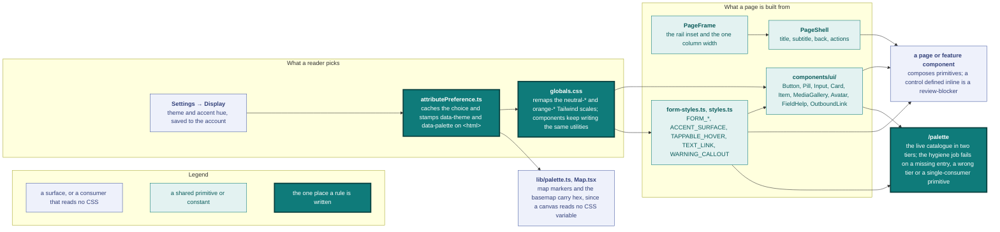

Each region of the diagram has a section below. What a reader picks is [Theme](#theme) and the [accent](#accent). What a page is built from is [Components](#components), whose class constants are named in the [accent recipe](#accent-recipe) and whose frame is [Page chrome](#page-chrome). [`/palette`](../frontend/src/app/palette/page.tsx) is the live catalogue, one file per category, in two tiers: Low level holds what two or more other shared components reuse, and High level holds what surfaces assemble. A component, constant or variant that one other component uses and no surface does lives in that component. The exceptions decided once are [Sanctioned one-offs](#sanctioned-one-offs).

## Philosophy

The interface is spare by default and reveals complexity on demand. It stays legible to first-time visitors, and advanced filters and tools appear only when needed. The design avoids a cluttered dashboard look and a dark-ops aesthetic.

1. **Progressive disclosure**: the default view is a map and points. Filters, detail, and tools appear on demand.
2. **Clarity over aesthetics**: every visual element serves a function.
3. **Neutral and professional**: the tone is sober, with no military-tech or hacker-dashboard tropes.
4. **Controlled density**: the reader moves from map, to points, to detail panel, to full proof, and picks the depth.

## Theme

The interface is dark by default, with light available on demand. It uses a uniform background, opaque panels, and one warm accent for contrast. Dark reads better for long, data-dense sessions, so it stays the default.

Theme and accent share one mechanism, [`attributePreference.ts`](../frontend/src/lib/attributePreference.ts): it caches the choice in `localStorage`, stamps a data attribute on `<html>`, and [`globals.css`](../frontend/src/app/globals.css) remaps a Tailwind scale under that attribute. Every utility repaints with no per-component change. Two consumers read no CSS variable and carry hex instead: the basemap and the map markers (see [Map](#map)).

Both preferences, and the help tooltip switch, are saved to the account ([`PATCH /users/me/preferences`](api.md#patch-usersmepreferences)), so they follow a signed-in analyst across devices. A value the account has saved wins over the browser's. The browser cache records which account wrote it, so one analyst's choices never reach another account on a shared browser.

Light applies as `data-theme="light"`; dark carries no attribute. Light remaps the `neutral-*` scale and the semantic `red` and `amber` scales, and sets `color-scheme`, so native widgets track the theme. The accent is not theme-adjusted.

## Colour palette

### Foundation

The dark roles below are the default. The light theme re-points the same `neutral-*` scale to a soft ramp: a warm grey canvas with warm off-white cards on it, and dark grey text (`neutral-100` = `#232323`, not black). Like the dark scale, it avoids pure black and pure white, so a large light surface does not glare.

| Role | Color | Tailwind | Usage |
|------|-------|----------|-------|
| Background | `#0a0a0a` | `neutral-950` | Global background, behind the map |
| Surface | `#171717` | `neutral-900` | Panels, cards, modals |
| Surface elevated | `#262626` | `neutral-800` | Inputs, interactive elements, hover |
| Border | `#404040` | `neutral-700` | Separators, field outlines |
| Text primary | `#f5f5f5` | `neutral-100` | Titles, primary content |
| Text secondary | `#a3a3a3` | `neutral-400` | Labels, metadata |
| Text muted | `#737373` | `neutral-500` | Placeholders, disabled elements |

### Accent

There is one accent hue. It is orange by default, and Settings → Display also offers blue, emerald, violet, and rose. `data-palette` remaps the `orange-*` scale to the chosen hue, so components keep writing `orange-*` utilities and the [`styles.ts`](../frontend/src/components/ui/styles.ts) constants, and everything below holds for whichever hue is active.

The accent is **tinted-on-dark**, never a flat `bg-orange-500` fill for buttons or selected states:

| Token | Where it shows up |
|------|-------|
| `orange-400` | Text of every interactive element: inline links, button labels, tappable-card hover, status pills. |
| `orange-500` | The hue itself, only at fractional opacity on backgrounds and borders (`bg-orange-500/10`, `/15`, `/20`), and full strength on map points and state dots. |

### Map points

| Role | Color | Usage |
|------|-------|-------|
| Point default | accent `500` | Submitted points |
| Point detected | accent `300` | Machine-detected points: the same hue, told apart by lightness |
| Point selected | accent `500` and a halo | The clicked point |

### Semantic

| Role | Tailwind | Usage |
|------|----------|-------|
| Danger | `red-500` | Errors, field refusals, deletions |
| Success and info | `orange-500` | Confirmations and info notices (`FORM_SUCCESS_BANNER`). Accent, not green: a confirmation next to red destructive actions does not read as celebratory. |
| Warning | `amber-500` | Non-blocking caution (`WARNING_CALLOUT`). Colour only; the call site owns the layout. |

## Accent recipe

Every accent treatment is a named constant from [`styles.ts`](../frontend/src/components/ui/styles.ts) or [`form-styles.ts`](../frontend/src/components/ui/form-styles.ts), or a primitive. Use it; don't hand-roll the class string. If a class string for an accent element runs past about three Tailwind tokens, look for a constant there first. The rule:

> If something carries the accent and isn't clickable, it's a bug. If something is clickable and isn't accent, it's a bug.

Carve-outs: navigation chrome stays neutral grey, destructive actions go red, and the `?` help is neutral (meta, not content). Charts carry the only inert accent: a mark whose accent step encodes a magnitude takes `ACCENT_RAMP`, and so does its legend. What stands outside the ranking (an empty month, an unnamed tail) takes the neutral chart paint. External links open in a new tab with the same accent styling.

There are five buckets:

1. **Inline link** (`TEXT_LINK`): clickable accent text in copy or rows. An action that only reads like a link (Cancel, dismiss) is a ghost `<Button>`.
2. **Tappable card or row** (`TAPPABLE_HOVER`): the whole card or row is one click target. It is neutral at rest; on hover the border turns accent and the title takes the accent.
3. **Buttons** (`<Button>`): every action. A `<Link>` that must look like a button takes `buttonClasses(variant)`. See [Buttons](#buttons).
4. **Pills, chips, and badges** (`<Pill>`): the whole badge family, by `tone`. Domain wrappers such as `StatusBadge` map an enum to tone, icon and label. A bare tag is a neutral `<Pill>` with no wrapper.
5. **Active nav or row surface** (`ACCENT_SURFACE`): the accent paint of a selected nav row or option. The accent `<Pill>` composes the same paint plus a border, so a pill and an active nav item cannot drift apart.

## Layout

```
┌────┬─────────────────────────────────────────────┐
│    │  Filters │                    │   Detail    │
│rail│  panel   │        MAP         │   panel     │
│    │  (left)  │   (full screen)    │  on click   │
└────┴─────────────────────────────────────────────┘
```

- **Sidebar rail:** the left nav (logo, working surfaces, identity block). Submit, Requests and Feed show only to a signed-in reader. Below `sm` it is a drawer; see [Phone chrome](#phone-chrome).
- **Map:** full-screen background on `/map`.
- **Left panel:** the filters, floating over the map.
- **Right panel:** the event detail, on click, dismissible. When the selected event fails to load, the panel shows the error and a Retry control, never a previously selected event.

Panels are opaque `neutral-900` (no glass, no blur) with a `neutral-700` border, floating above the map.

## Typography

- **Font:** Montserrat, set as `--font-sans` in `globals.css`, with `system-ui` as the fallback.
- **Sizes:** page titles `text-xl` (the `h1` of `PageShell`); other titles `text-lg` at most; body `text-sm`; labels and meta `text-xs`; micro (counters, badges) `text-[11px]`.
- **Weights:** `font-medium` for titles, `font-normal` for everything else.

## Map

The map draws one basemap at the bottom and the app's overlays above it, in a fixed order. A basemap swap replaces the bottom group only.

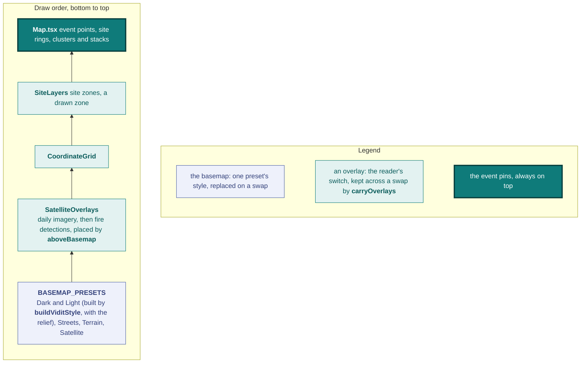

Every map on the site is the same [`<Map>`](../frontend/src/components/map/Map.tsx): the full-screen canvas, the pin of an event page and of a form's Location block, a profile's coverage map and a collection's coverage map. A set with no mappable point renders no map card, since an empty world map says less than no map and both surfaces carry a list.

**Basemap.** The Vidit dark and light styles in [`components/map/styles/`](../frontend/src/components/map/styles) are forks of the OpenFreeMap styles; the folder's `LICENSE` carries the upstream licence. The **Auto** preset follows the theme. The basemap control also offers Dark, Light, Streets, Terrain and Satellite; the Satellite preset names its year, so a reader does not take it for current imagery. Each preset declares its brightness, and the selected-point halo follows that brightness, not the theme.

- **Fewer labels at low zoom.** At the default Sparse density, a view of a continent or the globe labels countries and national capitals only, so event points stay readable.
- **One name per label.** A label shows its Latin name, or its local name when it has no Latin one.
- **Settings.** On Dark and Light the panel adjusts labels and layers. The browser stores only the settings you change, so a setting you never changed follows its default. Military areas, airports and fire detections take hues no accent palette and no site zone uses, so a highlighted area never reads as an event point (`MAP_LAYER_COLORS` in [`lib/palette.ts`](../frontend/src/lib/palette.ts)).
- **Overlays.** The coordinate grid and the NASA GIBS daily imagery and fire detections are switches, off by default. The daily layers show the day before, in UTC, since the current day's pass can still be incomplete.
- **Source help.** Each preset, setting and overlay carries a `?` that says what it shows and links its data providers (see [Field help](#field-help-)). [`engineering.md`](engineering.md#map-data-sources) lists the sources.
- **Unreachable basemap.** When a basemap's tile server does not answer, a warning line in the middle of the map says so and suggests another basemap. The map stays usable under it.
- **Style swaps keep the overlays.** A swap runs through MapLibre's style diff and carries the overlay sources and layers above the incoming basemap, so a reader's switches survive a preset change.

**Points.**

- **Pin hover preview.** A single pin shows a compact [`<Item>`](#items) preview after a short hover intent. A coarse pointer arms no preview, so a tap goes straight to the panel. Ordinary clusters get no preview and zoom on click.
- **Co-located events.** Events that share one coordinate form a cluster that can never expand. Past the clustering ceiling the group draws as one counted badge, so a stack of 3 never reads as a single pin. Hovering it, or a tap on touch, fans the events out on a ring; each dot behaves like a pin.
- **Cluster crossfade.** Clusters and points crossfade only while a zoom is in flight. At rest every layer holds full opacity.
- **Go to coordinates.** On `/map`, a control beside the basemap control centres the map on a pasted latitude and longitude or a Google Maps URL. A pair it cannot read stays in the field with the reason, in the words of the backend's `validate_coordinates`.

**Sites layer.** [`SiteLayers`](../frontend/src/components/map/SiteLayers.tsx) draws the [sites](#sites) under the event pins, so an event always draws above a zone. The filter panel's **Show** line turns it on, and the map reads the zones valid at the end of the event date window. Below zoom 10 each site joins the event clusters as a point:

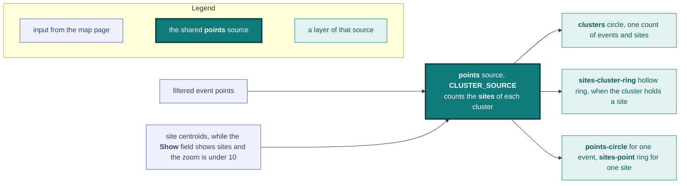

- A cluster that holds a site draws a hollow accent ring around its circle. The ring marks that the cluster holds a site, not how many.
- From zoom 10 the zones alone stand for the sites, and the clusters count events only.
- A zone takes the event point colour as a faint fill under a solid outline, so the pins and labels inside it stay readable.
- The latest link effect does not tint the map: the warning amber and the danger red sit too close to the orange and rose palettes to read. The preview and the side panel show it as a pill.
- A click on a site opens the map's side panel with the same blocks an event fills (Sources, Location, Details), so the page holds one panel slot.
- A site page's own map draws the zone in a hue apart from the accent, so the zone stands apart from the linked events. There the latest effect does colour the zone.
- The contour editor refuses a ring the API would refuse (crossing edges, or an area over the [API cap](api.md#sites)) before it closes, and says why under the map.

## Components

### Primitives by job

Each job has exactly one primitive. Use it everywhere and change it in that one place; a second primitive for the same job is a review blocker. Lint fails on the raw elements and imports that would bypass a primitive (see [Gates](#gates)).

| Job | Primitive | Details |
|---|---|---|
| Show an item | [`<Item>`](../frontend/src/components/ui/Item.tsx), `compact`, `list` or `card` | [Items](#items) |
| Search an item or an account | [`<ItemSearch>`](../frontend/src/components/ui/ItemSearch.tsx) | [Build on shared primitives](#build-on-shared-primitives) |
| Pick from a vocabulary, one value or several | [`<OptionSearch>`](../frontend/src/components/ui/OptionSearch.tsx), `single` for one value | [Build on shared primitives](#build-on-shared-primitives) |
| Pick a view or a mode | [`<SegmentedControl>`](../frontend/src/components/ui/SegmentedControl.tsx), [`<ChoiceRow>`](../frontend/src/components/ui/ChoiceRow.tsx) for a preference | [Build on shared primitives](#build-on-shared-primitives) |
| Enter a date, a time or an instant | [`<DateTimeInput>`](../frontend/src/components/ui/DateTimeInput.tsx) | [Build on shared primitives](#build-on-shared-primitives) |
| Pick a date range in a filter | [`<TimelineScrubber>`](../frontend/src/components/filters/TimelineScrubber.tsx), its dates on `<DateTimeInput>` | [Filter panel](#filter-panel) |
| Toggle a setting | [`<ToggleRow>`](../frontend/src/components/ui/ToggleRow.tsx) on [`<Switch>`](../frontend/src/components/ui/Switch.tsx) | [Build on shared primitives](#build-on-shared-primitives) |
| Remove (minor, at once) | [`<RemoveButton>`](../frontend/src/components/ui/RemoveButton.tsx), `<Pill onRemove>` for a pill: the cross, `ACTION_ICONS.remove` | [Destructive actions](#destructive-actions) |
| Delete or revoke (important) | [`<ConfirmButton>`](../frontend/src/components/ui/ConfirmButton.tsx): the trash, `ACTION_ICONS.delete` | [Destructive actions](#destructive-actions) |
| Confirm a destructive action | `<ConfirmButton>` in place; [`<ConfirmDialog>`](../frontend/src/components/ui/ConfirmDialog.tsx) when it needs input | [Destructive actions](#destructive-actions) |
| Open a menu of actions | [`<ActionMenu>`](../frontend/src/components/ui/ActionMenu.tsx) | [Build on shared primitives](#build-on-shared-primitives) |
| Open a popover | [`<Popover>`](../frontend/src/components/ui/Popover.tsx), `PopoverPanel` for a caller that owns its trigger | [Build on shared primitives](#build-on-shared-primitives) |
| Page actions | [`<PageShell>`](../frontend/src/components/ui/PageShell.tsx) `stickyActions`, top right | [Page chrome](#page-chrome) |
| Filter a list | [`<FilterPanel>`](../frontend/src/components/filters/FilterPanel.tsx) in `FilterCard` or `FilterSheetBar` | [Filter panel](#filter-panel) |
| Show more of a list | [`<LoadMoreRow>`](../frontend/src/components/ui/LoadMoreRow.tsx) | [Build on shared primitives](#build-on-shared-primitives) |
| Show a loading state | [`<PageLoading>`](../frontend/src/components/ui/PageShell.tsx): centred on the page, `line` in the flow, `compact` in a dense panel | [Page chrome](#page-chrome) |
| Show an error | [`<ErrorNotice>`](../frontend/src/components/ui/ErrorNotice.tsx), `<FieldError>` under a field | [Errors](#errors) |
| Show an empty state | [`<EmptyState>`](../frontend/src/components/ui/EmptyState.tsx) | [Build on shared primitives](#build-on-shared-primitives) |
| Upload a file | [`<FileManager>`](../frontend/src/components/ui/FileManager.tsx) | [Build on shared primitives](#build-on-shared-primitives) |
| Show a pill or a tag | [`<Pill>`](../frontend/src/components/ui/Pill.tsx) | [Build on shared primitives](#build-on-shared-primitives) |
| Collapse a section | [`<SectionEyebrow>`](../frontend/src/components/ui/SectionEyebrow.tsx) `toggle` | [Build on shared primitives](#build-on-shared-primitives) |

#### Gates

`npm run lint` ([`eslint.config.mjs`](../frontend/eslint.config.mjs)) fails on:

- a cross, a trash or a look-alike imported from `lucide-react` outside `Button.tsx`. The close glyph `X` is allowed in the four files where it closes or marks a state and removes nothing.
- a native `<select>`, `<textarea>` or date, time or instant `<input>` outside `Input.tsx`;
- `confirm()`;
- an import of a retired primitive: `AccountPicker`, `OptionPicker`, `ChipBucket`, `Disclosure`.

The `hygiene` job fails when a `components/ui/` primitive or style constant has no `/palette` entry in its tier, or has a single consumer.

### Build on shared primitives

Every UI element is a reusable primitive. Compose from them; never hand-roll a one-off. If none fits a new need, add the missing piece to [`components/ui/`](../frontend/src/components/ui) (or as a new `FORM_*` or `styles.ts` constant) and consume it from there, never inlined in a page. Growing the vocabulary with a new shared component is a maintainer decision (see [`AGENTS.md`](../AGENTS.md) → *Conventions*). Reusing or extending an existing one is the default.

**Token or component?** A piece is a *component* when it owns shape or behaviour (`<Input>`, `<Pill>`, `<Button>`, `<Card>`). It stays a *class constant* when it is a single-element paint composed into someone else's markup (`FORM_LABEL`, `ACCENT_SURFACE`, `TAPPABLE_HOVER`). A constant that starts growing variants has crossed the line, so promote it. Primitives join classes with [`cn`](../frontend/src/lib/cn.ts) (tailwind-merge), so a caller's `className` wins conflicts predictably. `<Button>` and `<Pill>` stay one size by design.

Decisions the primitives do not state on their own:

- **Labels.** A field's `?` sits beside its `<label>`, never inside it, so the field's accessible name is the label's words alone. An event field's name and `?` live in one table (`EVENT_FIELDS` in [`lib/events.ts`](../frontend/src/lib/events.ts), `SOURCE_FIELDS` in [`lib/sources.ts`](../frontend/src/lib/sources.ts)), whose key order is the display order, so a field reads under one name on the page and in the form.
- **Usernames.** A Vidit username prints bare, with no `@`, everywhere: bylines, cards, titles, share text and share cards. An `@` marks an external account only (a linked X or GitHub account, an X post author).
- **Tooltips.** A touch never opens a [`<Tooltip>`](../frontend/src/components/ui/Tooltip.tsx), so a tap leaves no bubble standing. The exception is a control whose label is the only place a fact shows (an approval stamp, a count badge): there the first tap shows the label and the second acts.
- **Missing conditions.** A control that still lacks something carries a red [`<CountBadge>`](../frontend/src/components/ui/CountBadge.tsx) beside it, never inside it, so a tap on the control still acts.
- **Floating elements.** Every popover, menu and typeahead list is placed by [`useAnchoredPosition`](../frontend/src/hooks/useAnchoredPosition.ts) in a portal, so an `overflow` ancestor never clips it.
- **Long lists.** A list that has more ends on **Show more** ([`<LoadMoreRow>`](../frontend/src/components/ui/LoadMoreRow.tsx)), which grows it in place, or on **See all**, which links a preview to its whole list.
- **Steps.** [`<NumberedSteps>`](../frontend/src/components/ui/NumberedSteps.tsx) is reference copy: every step looks the same. [`<ProgressSteps>`](../frontend/src/components/ui/ProgressSteps.tsx) is a live operation. It draws a progress bar only from a real ratio, and a step without one takes a spinner, never a fake animation.

#### Media

- [`<VideoPlayer>`](../frontend/src/components/ui/VideoPlayer.tsx) is the one player. Its media-chrome controls are web components, so they stay independent of React and clear of Tailwind specificity.
- Download goes through [`<MediaDownloadButton>`](../frontend/src/components/ui/MediaDownloadButton.tsx) everywhere. Media is served from a separate origin, where a plain `<a download>` navigates instead of saving.
- The backend picks the picture of every listed event (`backend/app/services/thumbnails.py`). The frontend renders what the payload carries and never re-derives it.
- [`<GraphicContentGate>`](../frontend/src/components/ui/GraphicContentGate.tsx) covers flagged media. Each source carries its own flag, so on a detail surface each [source block](#source-blocks) gates its own file. A card-sized slot reads the event's flag, true when any source is flagged.

#### Items

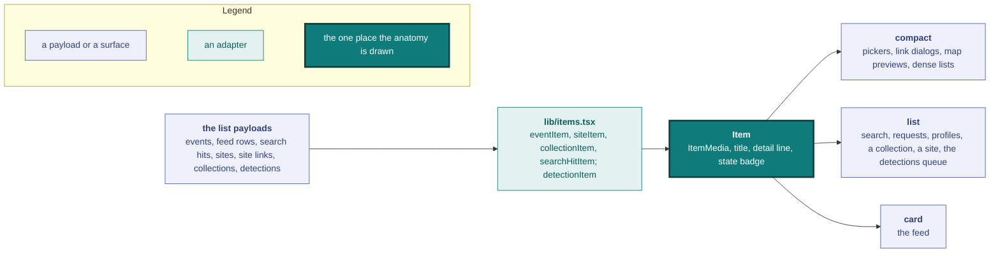

[`<Item>`](../frontend/src/components/ui/Item.tsx) is the one presentation of an event, a request, a site, a collection, an analyst and an organization in a list: the media slot (the kind's icon when there is no picture, never an empty box), the title, the detail line and the state badge.

It has three shapes: `compact`, a bare dense row for pickers, dialogs, form fields and map previews; `list`, a bordered row for a page's list; `card`, media on top, for the feed.

Each payload has one adapter in [`lib/items.tsx`](../frontend/src/lib/items.tsx). A surface overrides a slot only with what the payload alone does not say.

The whole item is one click: a stretched link, or a stretched button when the list picks a position on its own surface.

#### Controls

- A control carries colour while it acts and neutral grey when it cannot. An inert link becomes a disabled button. See [Buttons](#buttons).
- Every icon control is the ghost icon button, with its name as a tooltip. A control that navigates is [`<IconLink>`](../frontend/src/components/ui/IconLink.tsx), so a button never nests inside an anchor. An icon action that stands as its own item on a field's line is the outlined icon button.
- [`<Switch>`](../frontend/src/components/ui/Switch.tsx) is the one boolean toggle.
- [`<SegmentedControl>`](../frontend/src/components/ui/SegmentedControl.tsx) picks a view or a mode, never a vocabulary value. A vocabulary field is an `<OptionSearch>`. `<Select>` picks a position in a list the form itself holds.
- [`<ConfirmDialog>`](../frontend/src/components/ui/ConfirmDialog.tsx) is a step that carries input, or a final choice that destroys nothing. A destructive action confirms in place through `<ConfirmButton>` (see [Destructive actions](#destructive-actions)). It keeps the dialog only when it needs input or comes from a menu, which closes on the pick. **Cancel** takes the initial focus, so Enter on open sends nothing.

#### Outbound links

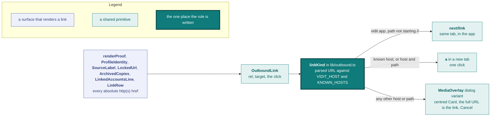

[`<OutboundLink>`](../frontend/src/components/ui/OutboundLink.tsx) renders every link whose `href` is an absolute http(s) URL. A raw external `<a>` anywhere else is a review blocker.

- A link to an unknown host opens a warning dialog whose only way on is the full URL, so the reader reads the address to leave.
- When you add to `KNOWN_HOSTS` in [`lib/outbound.ts`](../frontend/src/lib/outbound.ts), add the narrowest host that fits: a bare host covers its subdomains, an entry with a path covers that exact path only. Never add a host that serves an open redirector.
- Links in text an analyst wrote carry `ugc`.

#### Source blocks

An event's evidence is its list of [sources](data-model.md#sources). A reading surface renders one [`<SourceBlock>`](../frontend/src/components/sources/SourceBlock.tsx) per source, and a form renders one [`<SourceEditor>`](../frontend/src/components/sources/SourceEditor.tsx) per source. Every reading surface, a [site page](#sites) included, uses that block.

- A block's rows follow the order of the editor's fields. A row with no value drops out.
- The event page and every form lay the sources out in one [`<SourcesRow>`](../frontend/src/components/sources/SourcesRow.tsx) (see [Event layout](#event-layout)).
- A publish attempt checks the source floor (`sourceFloor` in [`lib/sources.ts`](../frontend/src/lib/sources.ts)) and shows the first editor with a gap.

Archived copies sit beside each link:

- On a reading surface, [`<ArchivedCopies>`](../frontend/src/components/sources/ArchivedCopies.tsx) shows one read-only mark per link: accent and opening the copy where one exists, grey and inert where none does, for every reader. The mark is an archive icon, never a service logo.
- Nothing on a reading surface writes. The analyst archives from the form: each link row there carries an archive box that pastes a snapshot or shows the stored copy.

### Page chrome

Every main-app page uses [`<PageShell>`](../frontend/src/components/ui/PageShell.tsx), except `/`, `/map`, the `(auth)/*` group and `app/error.tsx`.

- **One column.** Every page shares one container, so the title starts at the same x everywhere. The side padding drops a step below `sm`, because the desktop gutter leaves a card on a 375px screen too narrow for a title beside a thumbnail. The top padding steps up there instead, to clear the menu chip (see [Phone chrome](#phone-chrome)).
- **Back arrow.** Set `back` only on a drill-in page reached from content (event or request detail, edit, profile, the detections queue). Sidebar destinations never set it, except a `/submit` path, which returns to the chooser. A route that only redirects calls `skipBackRecord`, so the back walk never reruns its redirect.
- **Actions.** Page actions are buttons in the top-right sticky action bar (`stickyActions`). Every control that acts on the page's subject sits there or in `actions`, so a reader finds them in one place. A panel one opens is a popover, so nothing under the header moves.

The public guides (`/guide`, `/methodology`, `/import`) are server components of `PageShell` plus `Card`, for SEO.

#### Getting started page

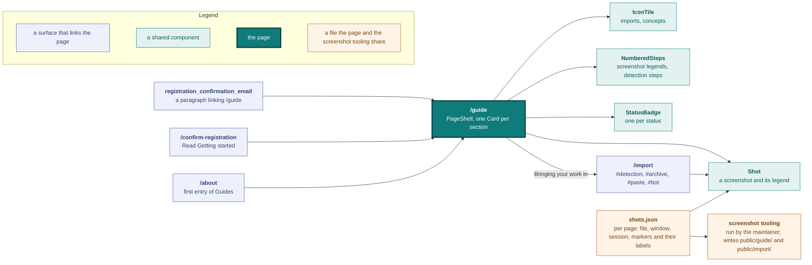

[`/guide`](../frontend/src/app/guide/page.tsx) shows rather than tells: each section is a title, at most one sentence, annotated screenshots, and at most one row of tiles for what no screenshot shows.

- **Anchors are a contract.** Other pages and messages link to each section id. Keep every id when you edit a heading.
- **Grounded in the product.** The page names only controls that exist, under their product labels. A PR that changes a surface the page shows updates its tile or its markers in [`shots.json`](../frontend/src/app/_shots/shots.json), and the maintainer regenerates the screenshot.

#### Import and methodology guides

A fact lives in one guide, and the others link to it:

| Fact | Owner |
|---|---|
| The statuses and the path from detection to geolocation | `/guide#statuses` |
| What makes a detection, what it carries, the parsing rules | `/import` |
| Each way in: archive, pasted post, @ViditBot | `/import#archive`, `#paste`, `#bot` |
| What a proof is and how to build one | `/methodology` |

The `/methodology` proof example has its step numbers baked into the image. Reordering the first four steps means re-baking it.

#### Right rail

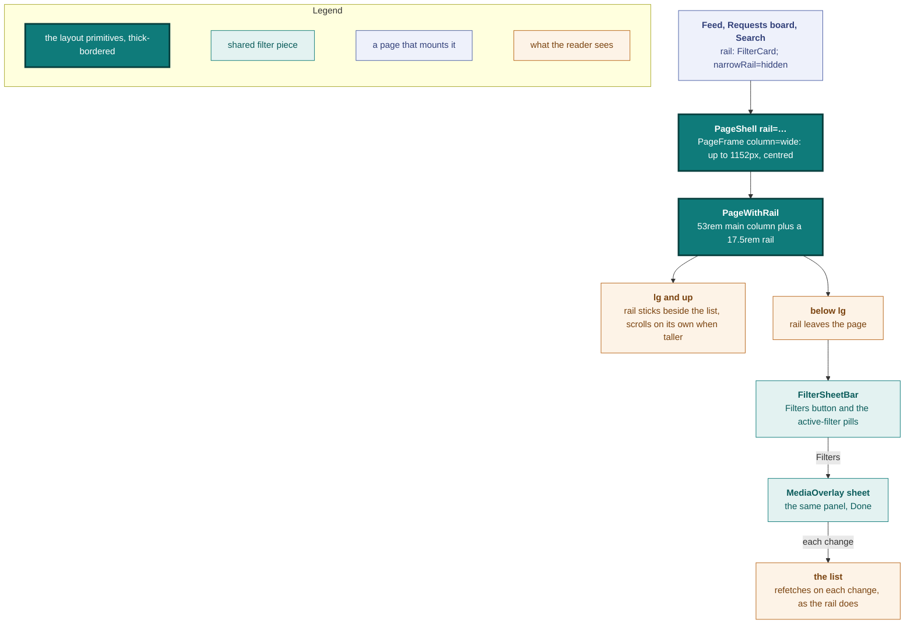

Use `PageShell`'s `rail` for a side panel that stays in view while the main column scrolls. The event forms put their actions in [`EventShell`](#event-layout)'s sticky actions instead.

#### Filter panel

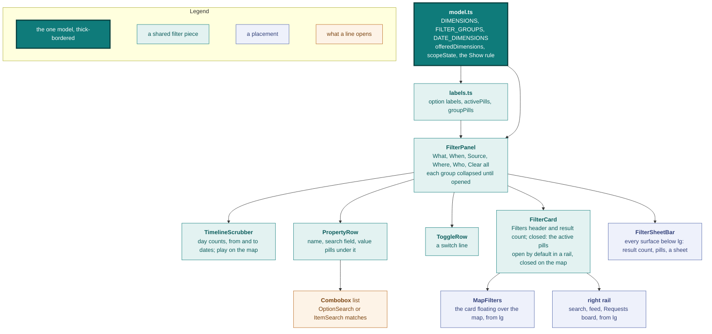

Every filter lives inside the filter panel. One model ([`model.ts`](../frontend/src/components/filters/model.ts)) drives it on every surface, in one order, so a dimension reads the same everywhere. A surface leaves out only the dimensions its data cannot serve.

- No active filter is out of sight: a collapsed group or a closed card shows its active filters as pills.
- No line, chip or pill carries a count, and the panel prints no helper line.
- Search, the feed and the Requests board keep the filters in the page URL, so a shared link and **Back** land on the same view. The map keeps them in memory until reload.
- The Show rule: with nothing selected, a surface shows everything; once you select options, it shows only what they name.

#### Phone chrome

| Width | Nav | Back control |
|---|---|---|
| Below `sm` | The rail is off-canvas, opened as a drawer from a menu chip in the top-left corner. Pages take no left inset and clear the chip with top padding. | In the chip |
| `sm` to `lg` | Fixed 56px rail | A row above the title |
| `lg` up | The same rail | In the gutter left of the column |

The chip costs only its corner, so each page clears it with its own padding rather than every route giving up a row to a bar. The map's overlays sit beside it.

**The display cutout is part of the box.** The page paints edge to edge, and every surface that owns the screen size uses `dvh`.

- A surface that floats a set distance from an edge takes the inset as a margin: the menu chip, the map's filter overlay, the map's detail panel from `sm` up.
- A surface that fills an edge takes it as padding, so its box still reaches the edge: the nav drawer, the map's bottom sheet, the media overlay.
- The rail takes no inset from `sm` up and paints under the cutout band: a notched phone in landscape is past `sm`, and the inset would leave the glyphs 12px.

Below `sm`, a date field's picker mark stands down and a tap on the field opens the engine's own picker.

#### One event, four surfaces, two writes

An event is read on four surfaces and written by two endpoints.

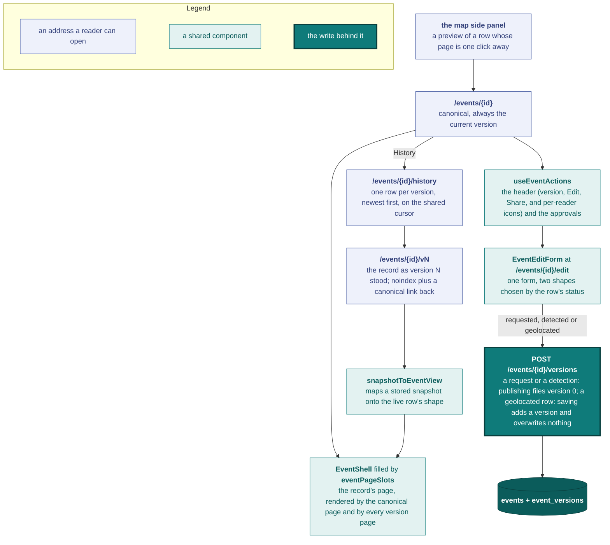

#### Event layout

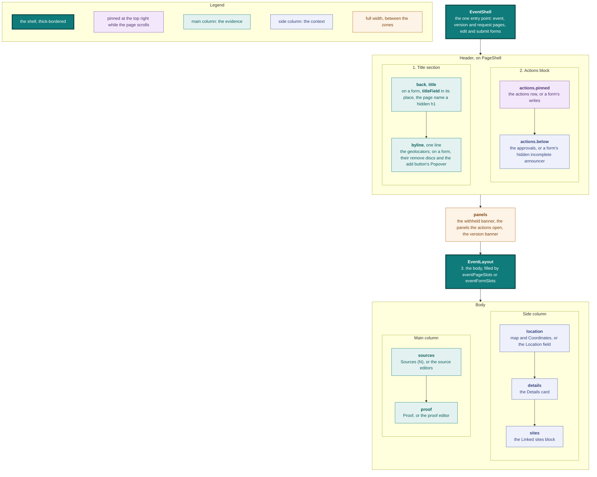

[`EventShell`](../frontend/src/components/event/EventShell.tsx) is the only place that lays out an event. Every surface fills the slots of its three zones, so a block sits in the same spot on every surface. To move a block, change `EventShell` or its body grid, [`EventLayout`](../frontend/src/components/event/EventLayout.tsx), never a page.

- The main column holds the evidence and the side column the context. The map panel keeps its own one-column body.
- On a form, the **Title** field takes the title's place at its size, so the page and the forms share one top.
- Only the row of buttons is pinned, so a write stays one click from any field.
- The Details card has no Author row: the byline credits every geolocator.
- The pinned row precedes the title in the tab order, so the writes are a form's first stop.

#### Event actions and approvals

The top right is where you act on an event, and the rest of the page is what you read. [`useEventActions`](../frontend/src/components/event/useEventActions.tsx) is the one place that picks the controls for the surface, the row and the reader, in the order and for the audience the diagram shows.

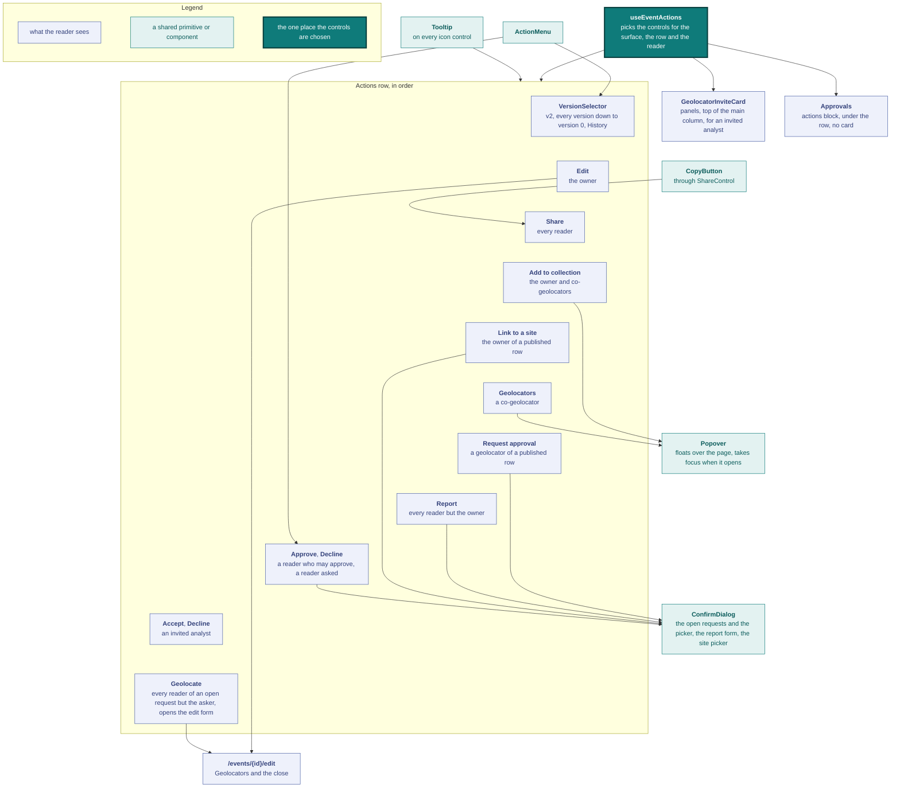

- **Version selector.** Every reader of a published record gets it, a retracted one included, because a corrected record is auditable only when anyone can walk the corrections. It shows on a single-version event too, so the version on screen is always named.
- **Edit.** The owner's close and geolocators live on the edit page, not in the actions row.
- **Approvals.** They sit under the row with no card and scroll while the row stays pinned. An approval is final and covers one version, so **Approve** asks for confirmation. Outdated approvals are read on each version's page.

Nothing in the actions row closes a row. The map side panel and the forms have no actions row: the panel previews a row whose page is one click away, and a form acts through its own write.

**One verb closes every shape.** The verb is *Close*, and only the noun changes with the row. Closing is terminal. The reason stays public, because a reader finds it on the closed page in place of the claim. A retracted geolocation keeps its page and its version selector, so a reader can walk what it claimed.

#### The owner edit form

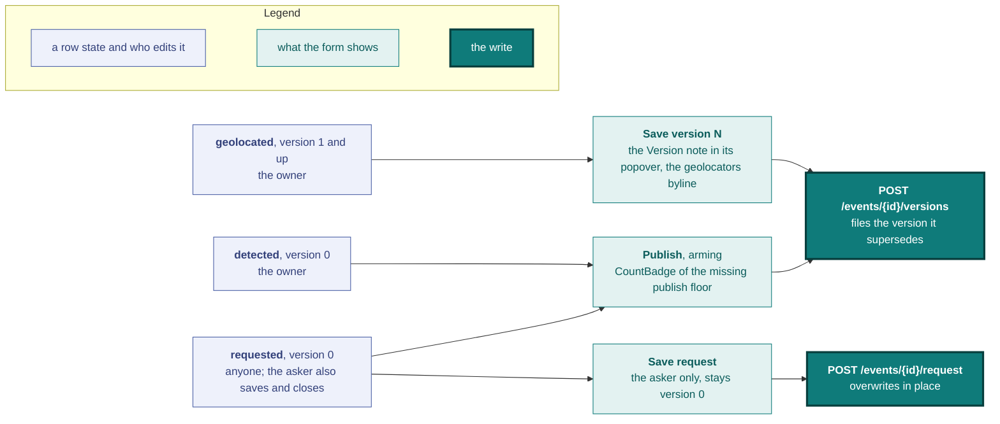

[`EventEditForm`](../frontend/src/components/geolocations/edit/EventEditForm.tsx) takes its shape from the row's status, so `/events/{id}/edit` is one address for the publish and every correction. A write posts the version the form loaded, so a row that moved meanwhile answers a conflict.

- A request is anyone's to publish. A detection is its owner's.
- **Save version N** names the version it creates, so you see what you are about to add.
- On a published row a byline change applies on click and makes no version. On a request or a detection, the picks are invited with the publish.

#### The version history and one version

`/events/{id}` always shows the current version, `/events/{id}/history` lists every version, and `/events/{id}/vN` shows version N.

- The history page names the event as plain text, because the `Current` row already opens it.
- Each row is one click and its byline is plain text, so the mouse and the keyboard reach one target. A row is whole or absent, never a version with no editor.
- A version page is the canonical page minus its actions, fed a snapshot, so it cannot drift into a layout of its own.
- [`EventVersionBanner`](../frontend/src/components/event/EventVersionBanner.tsx) opens it with the callout split every warning surface takes: the card is the caution, and the clickable affordance stays the accent.

### Feed

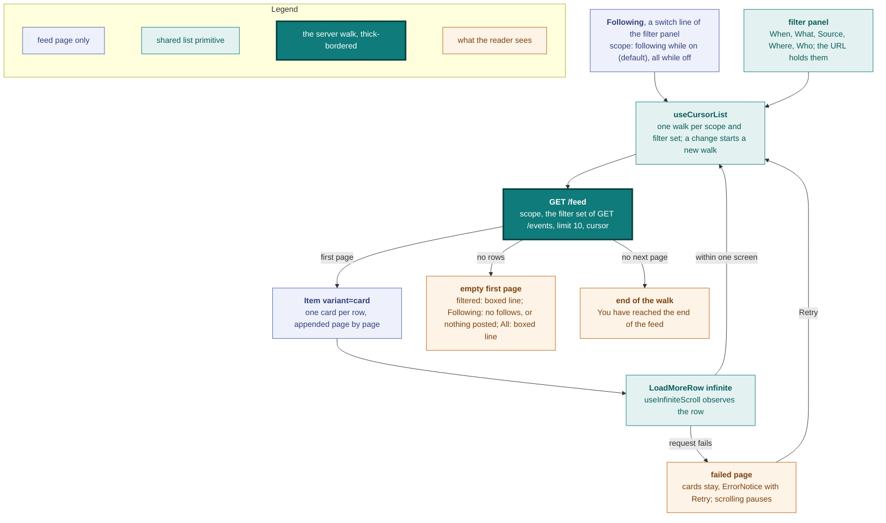

`/feed` is a signed-in page, linked from the rail between Requests and Search. [`GET /feed`](api.md#get-feed) decides which rows it lists and in what order. `/timeline` redirects permanently to `/feed`.

**The [filter panel](#filter-panel) holds the scope.** Its **Following** switch line, under **Who**, is on by default and sends `scope=following`; off, it sends `scope=all`. A change starts a new walk, so the list and its empty state describe the scope on screen. Like every filter, Following shows as a pill on the phone bar while it is on, and **Clear all** turns it off.

**The panel narrows the walk.** The feed offers every dimension of the panel: the two timelines, Show, Conflict, Tags, Source kind, Level, Media, Location guess, Following, Author, Approved only and Approved by. A change starts a new walk with `scope` and the filter set `GET /events` takes. The timelines count the rows of the same walk per day ([`GET /feed/dates`](api.md#get-feeddates)).

**Show** offers **Requested**, **Detected** and **Geolocated**. With nothing selected the feed lists all three, and the page sends no `status`. Each selected status goes out as its `status` value. The filters live in the page URL in the `GET /events` vocabulary, with `scope=all` while Following is off (`FEED_PAGE` in [`lib/feed.ts`](../frontend/src/lib/feed.ts)), so a shared link and **Back** land on the same view; each change replaces the current history entry. A filtered view that matches nothing reads *Nothing in the feed matches the filters.* in the `boxed` empty state, instead of the follow prompts below.

**A card names its kind.** Each row is the card [`<Item>`](#items), which only the feed renders: the media on top, then the title with its [`<StatusBadge>`](../frontend/src/components/event/StatusBadge.tsx), then the detail line. The detail line reads *Event* or *Request*, the event date when it is known, the credit line, then when the row entered the feed (`feed_at`): *Published 3 Oct 2026* on a geolocation, *Requested 3 Oct 2026* on a request or *Detected 3 Oct 2026* on a detection. An open request's owner is its requester, and a detection's owner is the analyst whose post was imported.

A geolocation or a detection opens `/events/{id}` and a request opens `/requests/{id}`.

**An empty first page names its cause.** An empty **Following** view with no other filter reads the viewer's `following_count` from [`GET /users/{username}`](api.md#get-usersusername) to tell two cases apart:

| Case | Empty state | Actions |
|---|---|---|
| The viewer follows nobody | `invite`, *You follow no analysts yet* | **Show all activity**, **Explore the map** |
| The analysts followed have posted nothing | `plain`, *Nothing from analysts you follow yet* | **Show all activity** |

**Show all activity** turns Following off. An empty view with Following off is a `boxed` line. A first page that fails shows its `ErrorNotice` alone.

**The list walks the shared cursor and scrolls without a click.** A page is 10 rows. [`useCursorList`](../frontend/src/hooks/useCursorList.ts) holds the walk, and the foot is [`<LoadMoreRow infinite>`](../frontend/src/components/ui/LoadMoreRow.tsx), the foot every cursor list shares. Its `useInfiniteScroll` (inside `LoadMoreRow.tsx`) calls `loadMore` when the row comes within one screen of the viewport, from the render that mounts the row. While the next page loads, the button is disabled and shows a spinner with *Loading…*.

**A failed page keeps the cards.** An [`<ErrorNotice>`](#errors) with its **Retry** takes the row's place, and scrolling stops loading until the click, since the row is still in view.

**The end of the walk is marked.** Once no next page exists, the foot reads *You have reached the end of the feed* in the `plain` empty state.

### Public profile

[`/profile/{username}`](../frontend/src/app/profile/[username]/page.tsx) is an analyst's portfolio, the page they pin as their link, so it reads as evidence rather than as an account: identity and contact in the header, then the work, widest reading first. The page mounts no [right rail](#right-rail) and takes the `wide` column (`PageShell column="wide"`), so every block spans up to 1152px. Edit mode keeps the same column, so the header does not move.

| Block | Component | Data source | Shown |
|---|---|---|---|
| Identity | `ProfileTitle`, `ProfileIdentity` ([`ProfileHeader.tsx`](../frontend/src/components/profile/ProfileHeader.tsx)), `LinkedAccountsLine` ([`LinkedAccounts.tsx`](../frontend/src/components/profile/LinkedAccounts.tsx)) | `GET /users/{username}` | Always |
| Organization logos | `ProfileOrganizations`, inside `ProfileIdentity` | [`GET /users/{username}/organizations`](api.md#get-usersusernameorganizations) | When the analyst belongs to one |
| Detections queue | `DetectionsEntry` | `useDetectionsCount` | Owner only, while the queue holds something |
| Coverage | `ProfileMap` | `GET /events/points?author=…` | When the analyst has located events |
| Insights | `ProfileInsights` | `GET /users/{username}/stats` | When the profile has events |
| Collections | `CollectionsSection` | [`GET /users/{username}/collections`](api.md#get-usersusernamecollections) | Owner always; visitor when the list is not empty |
| Recent submissions | `RecentSubmissions` | `GET /users/{username}/events` | Always |

#### Identity

- The handle is the H1, with the avatar beside it (`ProfileTitle`), the grammar the event page uses. Edit mode drops the title's avatar, so the picture picker shows it once. PageShell's `subtitle` slot carries `ProfileIdentity`: the bio, then the metadata line. One `space-y-1` spaces the block, so an empty bio leaves no gap. Edit mode drops the block.
- The profile never prints the account's email, even to its owner: the email is private account information, so it reads on the settings page, in the Account card beside the username.
- The bio has no card, so the evidence starts one glance below the handle. Empty renders nothing. Every http(s) URL in the bio links through `<OutboundLink>` (see [Outbound links](#outbound-links)) and breaks through `[overflow-wrap:anywhere]`; trailing sentence punctuation stays text. A long bio wraps rather than clamps, since `BIO_MAX_LEN` caps it at 500 characters. Authored line breaks collapse here and keep their shape in the edit field.
- The metadata line reads `N followers · N following · Member since <date>` as secondary text. It carries no work figures; those live in Insights. Each segment holds together, so the row wraps between segments at 375 px. Zero values print.
- The analyst's organizations close the metadata line as one more segment: their logos in an [`<AvatarStack>`](../frontend/src/components/ui/AvatarStack.tsx), each a rounded square (`variant="organization"`), every membership shown. Each logo is a link to `/organizations/{slug}` named "Member of <organization>" or "Org manager of <organization>", which its `<Tooltip>` shows on hover or keyboard focus; a click follows the link. On a touch screen the first tap shows the label and the second follows the link. The row wraps with the line on a phone. An analyst in no organization, or a failed read, shows no segment, so the coverage map is the first block under the header.
- The `actions` cluster carries the linked accounts, then Edit profile, **New collection** and **Sign out** on your own profile, or Follow on someone else's. **Follow** and **Following** switch on the click, and the followers count in the metadata line moves with them. A failed request puts both back and prints its error in an `<ErrorNotice>` under the button.

#### Linked accounts

- `LinkedAccountsLine` is a row of ghost icon buttons, one per platform the profile carries (X, Discord, website, GitHub), each the brand mark alone. Marks rather than printed handles keep the weight on the handle that titles the page.
- The owner's controls end that row, each in the same square: **Edit profile**, a `Pencil`; then `OwnProfileActions`, **New collection**, a `FolderPlus` link to `/collections/new`; **Sign out**, a `LogOut` button that arms on a first click and signs out on the second ([`useConfirmAction`](../frontend/src/hooks/useConfirmAction.ts)). Armed, it takes `ARMED_RING` and its name and tooltip read *Confirm sign out*; it disarms after 3 s, on Escape, or on an outside click. Signing out re-renders the anonymous profile, with no redirect. The row's `gap-1.5` is the event page's action-cluster spacing, the cluster's `gap-2` separates the row from the button beside it, and the row wraps inside the cluster.
- The account is in each mark's `title` and accessible name (`X / Twitter: @analyst_example`), printed through `displayLinkValue` ([`lib/users.ts`](../frontend/src/lib/users.ts)): an X or GitHub value reads `@handle` whether stored as a profile URL or a bare handle, and a website drops its scheme and trailing slash.
- Each platform's `action` decides what its mark does, never how it looks. `link` opens the profile in a new tab through `<OutboundLink>`, so a website on an unknown host asks first. `copy` runs the mark over `useCopyToClipboard`; Discord takes it because the platform publishes no profile URL for a username. The mark flips to a check for the flash while its name holds still.
- `resolveLinkHref` links an X or GitHub value only when it names an account under the platform's own rules, and a website only when it parses as an http(s) URL. `PATCH /users/me` applies the same rules (see [`api.md`](api.md#patch-usersme)). A stored value the strict parse refuses renders nothing.
- A profile with no reachable account renders no marks, which leaves Edit profile or Follow alone.

#### Work blocks

- **Detections queue** (`DetectionsEntry`): one line, *N detections to review*, linking to `/profile/{username}/detections`. The rail's identity row names the same count the same way. It sits above the work because it is pending work.
- **Coverage** (`ProfileMap`): the shared `<Map>` with an explicit world `bbox` (`WORLD_BOUNDS` through `toBboxParam`; the endpoint requires one), the camera fitted to the returned points. It maps `geolocated` and `detected` in the map's two point shades. The heading carries no count: the Insights `Geolocated` and `Detected` tiles hold the figures once.
- **Insights** (`ProfileInsights`): see [Insights](#insights).
- **Collections** (`CollectionsSection`): the analyst's collections as list [`<Item>`](#items) rows, the turn from readings of the whole body of work to the work itself (see [Collections](#collections)).
  - The endpoint narrows by viewer. On an empty list a visitor sees no section, and the owner keeps the heading and a first-run state that says the list is empty once and carries the action that fills it.
  - The section holds four rows. Past four, **See all** opens the shelf in `/search` through `profileSearchHref`, carrying `type=collection`, which lists the collections that analyst owns.
  - The owner's **New collection** is in the header's action cluster (see [Linked accounts](#linked-accounts)). The first-run state carries it too, as its call to action. Both link to `/collections/new`.
- **Recent submissions** (`RecentSubmissions`): the five newest rows from an endpoint that serves published work only, so the block is what the analyst vouched for. It counts the same set as the `Geolocated` tile.
  - The heading copy and **See all** key off the returned rows: an analyst with detections alone gets "No geolocations yet.", and **See all** carries `status=geolocated` into `/search`.
  - Every visitor sees the same rows, the owner included. When the block is empty, a visitor gets the heading and "No geolocations yet.", and the owner gets the heading and an empty state that links to the submit form, so the block says it is empty once.
  - It reads last because it is the block that grows.

#### Insights

`ProfileInsights` is the page's only home for work figures: a `<StatGrid>` of four tiles (`Geolocated`, `Detected`, `Top conflict`, `Top source kind`), then the source-origin bar and the month grid. From `lg` up the bar and the grid share a row, half the card each, so the square month cells stay small on the wide column. Below `lg` the bar sits above the grid. It sits under the map because it interprets it: the map says where, the card says what kind, how much, and when.

- **Every tile links into `/search`** through `profileSearchHref` ([`lib/search.ts`](../frontend/src/lib/search.ts)), the one builder for the profile's search links, every **See all** link included. The status pair carries `status=geolocated` and `status=detected`, the leaders carry `conflict=` and `source_kind=`, and `author` is an exact username match, so a tile lands on the rows it summed. A tile takes `TAPPABLE_HOVER` plus a `focus-visible` ring.
- A leader with no value prints `None` and carries no link. The two counts stay linked at zero.
- A leader tile names who leads, and the search behind it says by how much. There is no `Media` tile; `media_count` is served and the share card prints it.
- **One population.** Every field counts visible `geolocated` and `detected` events. A `requested` or `closed` row counts in no figure: an open ask is not documented work, and a closed row is work the analyst discarded.
- No block carries a helper line under its heading. A heading's `?` holds the definition, and the screen never restates a count it already shows.
- **Source origin** ([`<SourceHostBar>`](../frontend/src/components/ui/SourceHostBar.tsx)) is one stacked bar over the host of each event's first source URL, ranked, with a legend naming every slice. It says what kind of work the analyst does rather than how much.
  - Hosts are bare (`t.me`, not *Telegram*), the vocabulary `<SourceLabel>` uses, so the long tail is named rather than printed as "Unknown". The server folds the host to lower case, strips a leading `www.`, and counts a platform's aliases under one host, so `twitter.com` links count as `x.com` (see [`api.md`](api.md#get-usersusernamestats)).
  - Five hosts name themselves, the ceiling the endpoint applies to the leader rankings. The rest is one *Other* slice, and events with no readable source are a *No source* slice, so the bar accounts for every event the tiles count.
  - The heading carries the source URL `<FieldHelp>`, which separates where a source was posted (the platform) from its kind (the lens or the document).
- **The month grid** ([`<ActivityHeatmap>`](../frontend/src/components/ui/ActivityHeatmap.tsx)) counts `occurred_date`: when the documented events happened.
  - The heading is *Event dates*, the field's name on the submit and edit forms. Its `occurred_date` `<FieldHelp>` says the grid counts when the event happened, not when it was posted or imported.
  - One row per calendar year, twelve month cells, intensity off the busiest month, and a *Less / More* legend. Months rather than days, since tens of events a year leave a daily grid blank.
  - The server derives the span from the analyst's earliest and latest event date, not from today, so an imported multi-year archive reads whole. The grid shows the 10 most recent years, the rows the card holds at 375 px, and the year labels name them. Every month in the span renders, so a quiet stretch reads as empty. Both ends are clamped to today, so one mistyped year cannot move the window centuries out.
  - Hovering or tapping a month names it and its count in one readout line under the grid; there is no per-cell tooltip. The cells are paint, not controls: no focus stop, no focus ring. A lit cell carries the accent step its count earns, and an empty one carries `CHART_NEUTRAL`.
  - No dated event renders a sentence. A single month keeps the grid, since the empty cells say which month it was.

#### Edit mode

While the owner edits, the page renders only the header fields, `BioField`, and `LinkedAccountsFields`, contiguous and in reading order under the header. **Cancel** and **Save** leave the `actions` cluster for the page's sticky actions (`ProfileEditActions`), pinned at the top right while the fields scroll, with the save error under them. `BioField` and `LinkedAccountsFields` are each a `Card` headed by a [`<SectionHeading>`](../frontend/src/components/ui/SectionHeading.tsx). Each linked account is an [`<Input icon>`](../frontend/src/components/ui/Input.tsx) carrying the platform's mark, under a `FORM_LABEL` that names the platform. A value the server refuses reads in a `<FieldError>` under its own field (`useProfileEdit` passes the four platforms as `useMutation`'s `fields`) and turns the field red. Both fields are edit-mode only, since reading the bio and the links happens in the header. The organization page's edit mode is the same. The metadata line, the linked-accounts marks, and the read-only sections drop out.

### Organization page

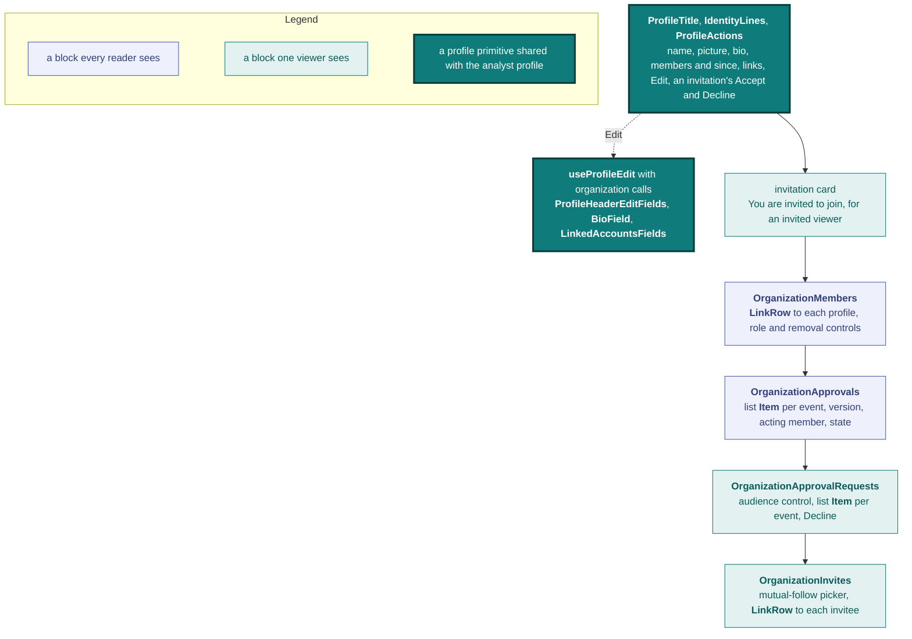

[`/organizations/{slug}`](../frontend/src/app/organizations/[slug]/page.tsx) is an organization's public page. It reads like the [public profile](#public-profile), so the header reuses the profile's primitives rather than a second set. Like the profile, it mounts no rail and takes the `wide` column (`PageShell column="wide"`), in edit mode too. A list of people (members, invites) is a stack of [`<LinkRow variant="arrow">`](#build-on-shared-primitives) blocks: a leading 28px `<Avatar>`, the name in neutral text, a muted `meta` line, and an orange arrow at the right edge. A row's controls sit in its `action` slot, so a click on them never follows the row. A list of events (approvals, approval requests) is a stack of list [`<Item>`](#items)s. The page shows each viewer the controls their own membership grants: a site admin who is not a member reads it as a visitor and runs organization operations from the admin panel.

- **Header.** `ProfileTitle` takes the organization's name and picture. `IdentityLines` carries the bio and the metadata line (`N members · @handle on X · Since <date>`), the same block `ProfileIdentity` renders for an analyst. `ProfileActions` carries `LinkedAccountsLine` and, for an org manager, Edit. For an invited viewer it ends on **Accept** and **Decline** (`InviteAnswerButtons`), a filled and a ghost button.
- **Edit mode.** `useProfileEdit` takes the organization's three writes through `calls`, so the picture picker, the bio field and the linked-account fields are the profile's own.
- **Invitation.** An invited viewer answers with **Accept** and **Decline** in the header's actions, and reads a card at the top of the page that names the organization. The `organization_invite` notification links here.
- **Members.** `OrganizationMembers` lists one row per member, linked to their profile: the avatar, the username, a meta line with a `<Pill>` for the role (accent for an org manager, neutral for a member) and the join date, and the controls the viewer holds. A manager flips the role and removes; every member leaves from their own row. Removing and leaving are a [`<ConfirmButton>`](../frontend/src/components/ui/ConfirmButton.tsx) each, which confirms in place; the manager's **Remove** is named *Remove <member>*. The server's `last_manager` refusal shows as the row's `ErrorNotice`.
- **Approvals.** `OrganizationApprovals` lists the approvals placed in the organization's name, newest first, with **Show more** past a page. Each item links to the event. Its detail line holds the approval date, the acting member and the version, and its badge is the event page's state pill (`ApprovalState`).
- **Approval requests.** `OrganizationApprovalRequests` shows to members. For an org manager, its first row is **Accept approval requests from**, the Settings row's `<ChoiceRow>` with the organization's labels (**People our org managers follow**, **Everyone**, **Nobody**), saved on change. Under it, the open requests addressed to the organization, oldest first. Each item links to the event, and its detail line holds the request date, the requester and the version. Every member gets **Decline** on each, in the item's `actions`; approving happens on the event page, as the organization.
- **Search.** [`/search`](../frontend/src/app/search/page.tsx) finds an organization by name, slug or bio. Its row leads with the square logo and reads *Organization · N members* (see [Search](#search)).
- **Invites.** `OrganizationInvites` shows to org managers. An org manager picks from the analysts the server accepts in an `<ItemSearch>`, with one line saying the list holds mutual follows only. Each pending invite is a row linked to the invitee's profile, with the invite date and who sent it, and withdraws with one ghost button in the row.
- **Deletion.** Only a site admin deletes an organization, from the admin panel's Organizations list (`OrganizationsPanel`), where each organization is a `<LinkRow variant="arrow">` to its page with its member count and, when it has no org manager, a danger pill and the field to name one under the row. **Delete**, in the row, opens a `<ConfirmDialog>` that says what goes with the organization and holds a field for its slug; **Delete organization** stays disabled until the typed slug matches.

### Collections

A collection is one analyst's named set of their own `geolocated` and `detected` events, shown on their public profile. Its two written fields, the title and the description, are both required. The items order themselves by event date, so there is no caption and no manual order.

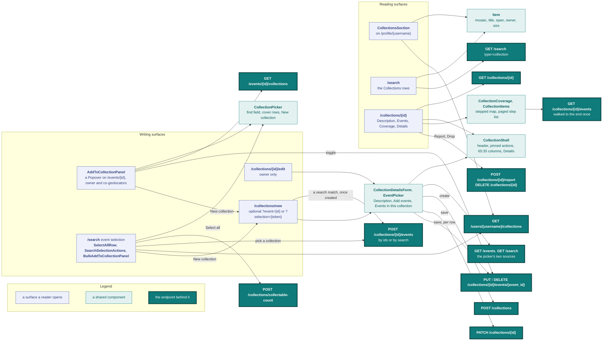

#### The collection page

[`/collections/{id}`](../frontend/src/app/collections/[id]/page.tsx) is public and titles itself with the collection, the way the event page is the event.

**One shell for the page and the forms.** [`<CollectionShell>`](../frontend/src/components/collections/CollectionShell.tsx) lays out the collection page and both [collection forms](#writing-a-collection), the way [`EventShell`](#event-layout) lays out an event. A page only fills its slots:

| Slot | Collection page | Create and edit forms |
|---|---|---|
| `title` | The collection's title | **New collection** or **Edit collection**, a hidden `h1` and the browser tab's title |
| `titleField` | None | The **Title** field (`TitleField`, with the `collection_title` `?`) |
| byline | The owner and a neutral `Collection` [`<Pill>`](../frontend/src/components/ui/Pill.tsx) | The same, for the analyst who writes it |
| `actions` | Share on X, Report for every reader but the owner, then the owner's Edit and Drop | **Cancel**, the submit and the `ErrorNotice` |
| `below` | None | `IncompleteFormAnnouncer`, visually hidden |
| `panels` | The withheld banner, the report form and its receipt, the drop error | None |
| `main` | **Description**, then **Events** | **Description**, then the picker's **Add events** and **Events in this collection** |
| `side` | **Coverage**, then **Details** | **Coverage** of the held events, then **Details** |

- The frame is `wide`, and the actions are `stickyActions`, pinned top right while the page scrolls.
- The body is `PageColumns` on the 65:35 split, with `stickySide`: from `lg` up the side column stays in view under the actions while the main column scrolls. Below `lg` the side column follows the main column, the event page's order.
- Each section sits under its [`<SectionEyebrow>`](../frontend/src/components/ui/SectionEyebrow.tsx). The header carries no picture: the mosaic belongs to the collection's [item](#items) and to the [share card](#share-cards).
- **Details** is a [`<DetailCard>`](../frontend/src/components/ui/DetailRow.tsx) (`CollectionDetails`): the count through `eventCountLabel`, the span the item dates cover (`collectionSpanLabel`, omitted without a date), the derived tags as `DetailPills`, and the creation date. A form passes the count and span of what it holds and no tags, since the server derives them from the events and their sources.
- On a form, `CollectionShell` renders the `<form>` as `display: contents` around the columns. The **Title** field and the submit sit outside it and join it through its `id`.

**Description** prints the owner's text whole, at reading size, in a `<Card dense>`, through [`renderProof`](../frontend/src/lib/proof.tsx), so its marks and lists are painted.

**Coverage steps through the collection**: [`<CollectionCoverage>`](../frontend/src/components/collections/CollectionCoverage.tsx) is the event page's Location module ([`EventLocation`](../frontend/src/components/event/EventLocation.tsx)) over the whole set, standing on one item at a time.

- The map is the shared [`<Map>`](../frontend/src/components/map/Map.tsx) over the items' pins, `embedded` and framed on the whole set (`fitBounds`). On every step it flies to the current item (`flyTo`, which skips the first frame so the opening frame survives the mount, and holds the camera on an item with no coordinate) and dims the steps behind the reader (`dimmedIds`, `DIMMED_OPACITY`). A click on a pin steps to its item.
- No line joins the pins: a line claims a route between events that were only curated into one set.
- Under the map, the rows say which item the reader stands on: its **Coordinates**, when it has them, its title as **Event**, linking to the event's page, then `N of M` beside **Previous** and **Next**, disabled at either end. The page reads no event: the reader opens it.
- A collection whose items carry no coordinate renders no Coverage section.
- The step rides `?step=` ([`collectionStepHref`](../frontend/src/lib/collections.ts)), 1-based, defaulting to 1, and clamped into the sequence by `readerStep`, so a shared link opens where its sender stood, or on the nearest real step. It moves with `router.replace` and `scroll: false`, so Back leaves the page rather than walking the steps.
- `ArrowLeft` / `ArrowRight` step too, read on the window, and skipped while an input, textarea, select or contenteditable has the caret or a modifier is held. The keys count from the last press rather than from the URL, so a held key walks the collection. Nothing plays on its own. The row under the map says so from `sm` up.

**Events is the step list.** [`<CollectionItems>`](../frontend/src/components/collections/CollectionItems.tsx) shows the rows 20 at a time behind the shared **Show more** row ([`<LoadMoreRow>`](../frontend/src/components/ui/LoadMoreRow.tsx)), slicing the sequence already read. A step past the rows shown, from a shared link, a pin or the arrow keys, opens the pages down to it.

- Each row is a list [`<Item>`](#items) without the analyst, since the header names the owner. A click anywhere on a row moves the step there, and the current row wears the accent border (`onSelect` and `selected`). The event's own page is reached from the Coverage section's **Event** row.
- The rows are the same for the owner and a visitor and carry no control: an event joins from its own page or from the edit page's picker, which the sentence under the eyebrow states.
- The section header's one link is **Your geolocations**, the owner's catalogue in search through `profileSearchHref` ([`lib/search.ts`](../frontend/src/lib/search.ts)), with no status filter, since an unconfirmed detection is still the owner's to shelve.
- An empty collection shows the boxed [`<EmptyState>`](../frontend/src/components/ui/EmptyState.tsx) and no Coverage section.

**One read serves the pins and the rows.** `fetchCollectionSequence` walks `GET /collections/{id}/events` to the end of its cursor once, under the `READER_MAX_ITEMS` ceiling (past it the page holds the earliest 500 items and marks no cut). `N of M` counts that sequence. There is no collection-scoped points endpoint.

**The actions are a row of icon buttons.** Share on X and Report lead, and the owner's Edit and Drop follow, so the destructive control sits at the edge. It wraps into right-aligned lines, `flex-wrap justify-end`.

- **Share on X** is the ghost [`<ShareOnX>`](../frontend/src/components/share/ShareOnX.tsx) icon button, prefilled with the title, `by {owner}`, the meta line's segments, and the collection's URL. It has no confirm, since a collection has no `detected` state.
- **Report** is the red `dangerGhost` flag, for every reader but the owner, signed out included: [`useReportContent`](../frontend/src/components/report/useReportContent.tsx), the event page's dialog, with the same five buckets and 2000-character cap. The dialog names its subject (*Report this collection*), so it never reads as a report on the current item.
- **Edit** is the `ghost` pencil, owner only, `buttonClasses` on a `<Link>`.
- **Drop** is a red trash, owner only, a [`<ConfirmButton icon>`](../frontend/src/components/ui/ConfirmButton.tsx) named *Drop this collection* that confirms in place. On success the owner lands on their profile. This is the only place a collection is dropped; the edit page carries no drop.

#### The item and the meta line

- A collection in a list is an [`<Item>`](#items): its mosaic, its title, the span its items cover as the date (`collectionSpanLabel`), its owner, and its event count as the badge. The span prints only where items carry dates, and a single day prints once.
- The meta line of the share texts and the page's header states the count, zero included, then the span ([`collectionMetaSegments`](../frontend/src/lib/collections.ts)), and the page's Details card the same count and span.
- `CollectionIcon` ([`lib/collections.ts`](../frontend/src/lib/collections.ts)) is the one glyph for the type: the `Collection` pill, the **Collections** chip and rows of `/search`, the profile section's first-run state, and the shelving control on an event page.
- The item's picture is the mosaic of `ItemMedia`, made of the collection's own items. The server sends up to four tiles in reading order (see [`api.md`](api.md#get-collectionsid)). One tile fills the 16:9 slot, two split it down the middle, three put the earliest item tall on the left with the next two stacked beside it, and four fill a 2x2, all with 2px gaps. The compact variant shows the first tile alone. A collection with nothing to show shows the collection icon on the neutral tile. Nothing is uploaded or stored.
- Each tile reads `kind`, so a video tile shows its first frame. A tile also reads `role`: a tile from a proof image reads the original, since proof uploads carry no `_hero` or `_thumb` derivative.

#### Writing a collection

Opening one is [`/collections/new`](../frontend/src/app/collections/new/page.tsx) and changing one is [`/collections/{id}/edit`](../frontend/src/app/collections/[id]/edit/page.tsx), the shape `/events/{id}/edit` takes, so a reload keeps the write and a link reaches it.

- Both sit behind `useRequireAuth` and render [`<CollectionDetailsForm>`](../frontend/src/components/collections/CollectionDetailsForm.tsx), which fills [`CollectionShell`](#the-collection-page), the collection page's columns: the **Title** field in the title's place, **Cancel** and the submit pinned top right, **Description** and the picker's two cards in the main column, and **Coverage** and **Details** in the side column. Only the verb on the button differs.
- **Coverage** maps what the save holds, framed on the whole set, through the same Location module as the page, with no rows under it. Until a held event carries coordinates it says that the map shows the events you add. **Details** counts what the save holds and states the span once every held row has loaded.
- The **Title** field and **Description** each carry the shared `used / cap` [`<CharCounter>`](../frontend/src/components/ui/CharCounter.tsx) against `COLLECTION_TITLE_MAX_LEN` and `COLLECTION_DESCRIPTION_MAX_LEN`, the description's beside its eyebrow. The submit is never disabled: a [`<CountBadge>`](#build-on-shared-primitives) counts the blank or over-long fields, and a click on an incomplete form writes nothing. It outlines each in red (`FORM_INVALID_FIELD`, `FORM_INVALID_LABEL`) until it is filled, and `IncompleteFormAnnouncer` reads the list to a screen reader. An over-long value turns red as it is typed, with its counter. The form sets `noValidate`. Both fields ride every write and are the only writable fields.
- The description field is [`<RichTextEditor>`](../frontend/src/components/editor/RichTextEditor.tsx) under `allowImages={false}`: bold, italic, headings, lists, and links, no images, since nothing on this form uploads and the server drops the node. It wears the field box, the `focus-within` accent border, and `FORM_INVALID_FIELD` on refusal, under its eyebrow, which turns red with it. The create page's hint sits under it. The counter measures `htmlText` ([`lib/proof.tsx`](../frontend/src/lib/proof.tsx)), the projection the server caps, so markup costs nothing (see [Rich text](#rich-text)).
- `/collections/new` has two entry points: the profile section (beside its heading and in its first-run state) and the add-to-collection panel, which passes `?event={id}`. With the parameter the page opens holding that event, the create carries it ([`POST /collections`](api.md#post-collections)), and the page returns to the event. Without it the page opens the collection it created. Cancel and Back return to where the reader came from.
- From the search page's bulk **Add to collection**, `/collections/new?selection={token}` opens holding a search selection. The panel parks the selection in `sessionStorage` under a fresh token (`newCollectionFromSelectionHref` in [`lib/collections.ts`](../frontend/src/lib/collections.ts)): explicit ids with their rows, or the search match, plus the geolocation count and the search URL to return to. No id list rides the URL. What the page does depends on what the selection holds:
  - **Checked rows** (explicit ids) are always loaded search hits, so the handoff carries them as picker rows (`pickableFromHit`), at about a kilobyte a row, and the page reads no event. They seed *Events in this collection* as held rows, removable like any pick. Details and the submit follow the held count: *N events* and **Create and add**. The held rows ride the create, so removing a row removes it from what the create sends, and an event that changed since the search shows as the create's refusal in its `ErrorNotice`.
  - **A search match** (Select all) fills *Events in this collection* a page at a time: the first 20 of the caller's matching events from [`POST /collections/collectable-events`](api.md#post-collectionscollectable-events), the set the bulk add shelves, newest first, through `useCursorList` with the match as its body. A `<LoadMoreRow>` under the list loads the next 20, until every match shows. The card's count, Details and **Create and add** follow the match's size less the events taken off. Removing a matched card takes it off the card and adds it to `exclude_event_ids`; the picks the reader adds still ride the create. The match is added once the collection exists, through [`POST /collections/{id}/events`](api.md#post-collectionsidevents), which applies the 500 cap and the ownership rule; if that add fails, the page says the collection exists, and a second submit retries only the add.

  A successful create drops the handoff. A token that is missing, malformed or older than 30 minutes opens the plain form, and Cancel returns to the search.
- `/collections/{id}/edit` is owner only. A non-owner gets the backend's 403 stated before the form, with a link to the collection. The save writes the difference: the details through `PATCH`, then one `PUT` per added row and one `DELETE` per removed row, in that order, stopping at the first refusal and naming the act that failed. Saving returns to the collection.

[`<EventPicker>`](../frontend/src/components/collections/EventPicker.tsx) renders the two event cards on both write pages, the same on each, each its own `Card` under a `<SectionHeading>`: **Add events** first, the way in, then **Events in this collection**, what the save holds.

- **Add events** is an [`<ItemSearch>`](../frontend/src/components/ui/ItemSearch.tsx) that opens on focus and lists at most `PICKER_ROW_LIMIT` rows, each a static compact [`<Item>`](#items). A row already held leaves the list, and the list stays open after a pick. With the field empty it lists the analyst's catalogue newest first through [`GET /events`](api.md#get-events) (`view=located`, `author=`, scoped to `COLLECTABLE_STATUSES`, `limit=`), whose cursor tells it more exists. A typed query goes to [`GET /search`](api.md#get-search) (`type=event`, `author=`), which returns the pre-cap match count.
  - The list's status row says what it is not showing and that search reaches it, or why it is empty. A search adds that it answers from the located group, which requires coordinates, so an event with none is reachable only with the field cleared.
  - Enter takes the highlighted row and never submits the form.
- **Events in this collection** is the pending set: the rows the edit page opened with, the `?event=` row, a search selection, and everything added since. Its line states the count through `eventCountLabel`, and its rows take the collection page's order (event date, earliest first, undated last). The rows are a vertical list. Each row is a compact [`<Item>`](#items) linking to the event, with a [`<RemoveButton>`](../frontend/src/components/ui/RemoveButton.tsx) as its action. A pick scrolls its new row into view (`scrollIntoView`, `block: "nearest"`), since the list orders by date rather than by when a row joined. An empty card is the plain [`<EmptyState>`](../frontend/src/components/ui/EmptyState.tsx) pointing at the card above. Nothing writes until the page's submit.
  - Both sources ask only for collectable statuses, so the card never offers a row the add verb refuses.

#### Search, shelving, and moderation

**Search.** `/search` finds a collection by its title and description (see [Search](#search)). The row is the collection's list [`<Item>`](#items). A **Collections** pick offers the Tags and Author lines only, since every other filter leaves the collections out of the list (see [`api.md`](api.md#get-search)); a step from events to collections keeps the tags and the analyst.

**Approval filters.** The map, the search page while its pick lists events, and the feed offer two lines under the panel's **Who** heading. **Approved only** is a switch line that sends [`approved`](api.md#get-events). **Approved by** is an `<ItemSearch>` over the `user` and `organization` groups of `GET /search` (`suggestApprovers` in [`lib/search.ts`](../frontend/src/lib/search.ts)). An analyst sends `approved_by` and an organization sends `approved_by_org`, and Enter on a typed handle picks it as an analyst. Each value has a removable pill (*Approved only*, **Approved by:** *name*). `eventFilterFields` writes the keys into every request and the page URL, and `readEventFilterParams` reads them back. The Requests board leaves both lines out, because a request carries no approval.

**One collection picker.** Both **Add to collection** popovers, the event page's and the search page's bulk add, render [`<CollectionPicker>`](../frontend/src/components/collections/CollectionPicker.tsx), so they share one look:

- From six collections up, a **Find a collection** `<ItemSearch>` lists the collections whose title holds the typed text. A pick runs the row's own action (the event page's switch on, the bulk add's **Add**), and a collection the action already applies to leaves the list. *No collection matches.* answers a title nothing holds.
- Each row is a static compact [`<Item>`](#items) of the collection: its first cover tile, its title, its span and its event count.
- The list scrolls past `18rem`, since the popover is fixed to the viewport.
- With no collection, *No collections yet.* says what **New collection** does with what is being added.
- The footer is a ghost **New collection** button, led by the one `FolderPlus` mark of its action.

Each surface supplies the item's action, because the two writes differ: one event has a membership bit to turn on and off, a selection only adds.

**Shelving.** [`<AddToCollectionPanel>`](../frontend/src/components/collections/AddToCollectionPanel.tsx) opens in a `<Popover>` from the event page's **Add to collection** button, for the owner and every co-geolocator of a `geolocated` or `detected` row; on a request or a closed row the control is absent. It reads [`GET /events/{id}/collections`](api.md#get-eventsidcollections), which carries each collection's cover.

- Each collection's action is a [`<Switch>`](../frontend/src/components/ui/Switch.tsx) named by its title.
- **New collection** links to `/collections/new?event={id}`.
- The toggle is optimistic: the bit and the count flip on the click and roll back on a refusal, which the panel's `ErrorNotice` explains. Both membership writes are idempotent.

**Bulk shelving from search.** On `/search`, a signed-in analyst picks many of their own events and puts them on one collection in one write. The selection lives in `useSearchSelection` ([`SearchSelection.tsx`](../frontend/src/components/collections/SearchSelection.tsx)); the page passes it the committed query and filters and the loaded hits.

- An event row gets a native checkbox, painted with the accent through `accent-color` (`accent-orange-400`, the step `TEXT_LINK` uses), in a column left of the card, when the hit credits the reader and its status is in `COLLECTABLE_STATUSES`: the rule of the event page's **Add to collection**. Other rows keep an empty column, so the rows stay aligned, and with no selectable row there is no column. The checkbox's label takes `ICON_TAP_STEP`, so a phone tap lands on it.
- The list's head row holds `SelectAllRow`, in the checkbox column. Its tri-state checkbox is empty while nothing is selected, indeterminate while some events are, and checked once every match is. Empty, a click selects every match; otherwise a click clears. Its line reads **Select all**, **N selected**, or, past the bulk add's cap (`BULK_ADD_MAX_EVENTS`, 500) with nothing held, *Narrow to 500 or fewer to select all*, and the box is then disabled.
- The cap and the label read M, the size of [`POST /collections/collectable-count`](api.md#post-collectionscollectable-count) for the committed search, fetched as soon as a loaded row is selectable. **Select all** sends the search, not ids ([`POST /collections/{id}/events`](api.md#post-collectionsidevents) with `match`), so the server resolves every matching event, loaded or not. Unpicking one row afterwards falls back to the loaded selectable rows minus that one.
- **Add to collection** is the page's `stickyActions`, at the top right of the header. The page mounts it while a loaded row is selectable and passes `stickyActionsIdle` while nothing is selected, so the header keeps the button's room and no row moves when the first box is checked.
- A new committed query or filter set clears the selection.
- **Add to collection** opens a `PopoverPanel` under the button holding [`<BulkAddToCollectionPanel>`](../frontend/src/components/collections/BulkAddToCollectionPanel.tsx). It carries no heading of its own: the head row already counts the selection (*N selected*), and the panel's `label` names the dialog. Each collection from `GET /users/{username}/collections` takes **Add** as its action in the shared picker. After the write the row reads *Added N* in an accent `<Pill>` with a check in place of **Add**, since the panel offers no undo; its count grows by what was added, and a line under the list says what the write did (*44 added, 3 already in this collection*) with a link to the collection. A refusal shows in the `ErrorNotice` and leaves the row actionable. The selection stays, so the same set can go on a second collection.
- The footer, **New collection**, opens `/collections/new` carrying the selection (see [Writing a collection](#writing-a-collection)).

**Moderation.** [`POST /collections/{id}/report`](api.md#post-collectionsidreport) writes to the event reports' table, and [`<ReportsPanel>`](../frontend/src/components/admin/ReportsPanel.tsx) lists collection reports beside event reports. A collection row prints the title as the link and the owner's `<AuthorByline>` beside it, since an admin recognises a collection by name rather than id. Its verdicts are `Hide the collection`, which confirms in a `<ConfirmDialog>` like the event takedown, and `Dismiss`. It offers no `Mark graphic`, since a collection carries no media of its own.

### Sites

A site is a named area analysts monitor through dated satellite imagery (see [`api.md`](api.md#sites)). Its pages read like the event pages and its forms like the event forms, on the same shell and the same source and version components: a site's source is a row of `sources`, so the pages show it in the source block and the forms edit it in the source editor, and a site has versions, so its pages carry the event page's version selector, history and version view.

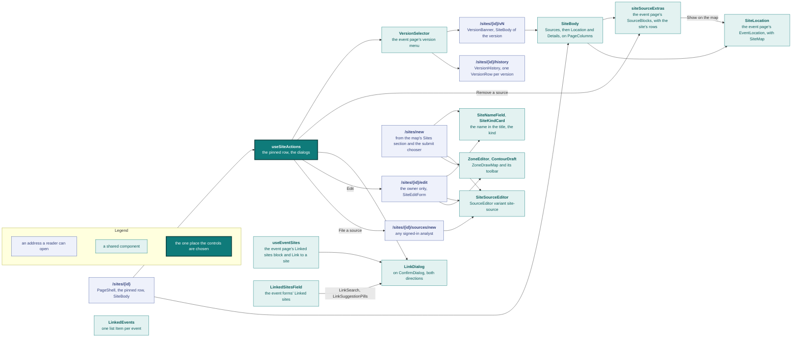

**The site page.** [`/sites/{id}`](../frontend/src/app/sites/[id]/page.tsx) renders `PageShell` like `EventShell` does: back, the name as the title and the pinned actions, with no byline. The owner, the kind and the last source read in the Details block. No line ever says the site is active or current.

- **Actions.** [`useSiteActions`](../frontend/src/components/sites/useSiteActions.tsx) assembles the pinned row in the event page's order: the event page's [`VersionSelector`](../frontend/src/components/event/VersionSelector.tsx) on the live version for every reader, **Edit** for the owner, whose tooltip says it saves a new version, **Share** for every reader, **File a source** and **Link one of my events** for a signed-in analyst, **Withhold the site** or **Restore the site** for an admin, then the report flag last, for every reader but the owner. An owner control never renders for another reader. **Withhold the site** (`EyeOff`) and a source's **Remove** (a trash) confirm in place through `<ConfirmButton>`, and **Restore the site** acts at once; a refusal of any of them prints in the panels. A withheld site, which only an admin reads, opens on an amber line that says so.
- **Body.** [`SiteBody`](../frontend/src/components/sites/SiteBody.tsx) lays out `PageColumns`, which scrolls both columns with the page, as on the event page. The side column holds the event page's Location and Details blocks, each under its `EventSection` eyebrow with the site's `?` (`site_location`, `site_details`). Below `lg` it follows the main column, the event page's order, and a pick in the main column scrolls the map into view.
- **Main column.** The Sources section, then the Linked events section. Both list newest first by date on the ground (`sortSources`, `sortLinkedEvents` in [`lib/sites.ts`](../frontend/src/lib/sites.ts)).
- **Sources.** The event page's [`<SourceBlocks>`](#source-blocks) under the event page's **Sources (N)** eyebrow and `?`: the same sideways row, its range and arrows, a lone source at full width, and the same rows per source (the file, the title, the level, the kind, the links with their archive marks, the capture time). [`siteSourceExtras`](../frontend/src/components/sites/SiteSourceBlock.tsx) adds the site's rows after them: the provider with its credit, the note, who filed it and when, and the contour drawn on it. It also names each block by its capture day (*Source of 13 Sept 2016*), which `SourceHeader` shows at the top of the card with the map control: an icon button that shows that day's zone on the map, or an accent *On the map* pill on the source on show, whose card takes the accent border. The analyst who filed a source gets a red trash **Remove** beside it, off while the source carries a contour, its name saying so.
- **Location.** [`SiteLocation`](../frontend/src/components/sites/SiteLocation.tsx) fills the event page's [`EventLocation`](../frontend/src/components/event/EventLocation.tsx) with the site map: the zone on the picked source's day (`contourOn`, the zone rule of `services/sites.zones_at`), the contour before it dashed and the linked events. Its rows read **Coordinates**, the current zone's centroid with the event page's open and copy controls, **Zone on**, the date on show, and **Contour**, the area and the source of the contour valid then. Its footer lines explain the dashed, dotted and dimmed marks the map draws. The page opens on the latest source. On a date before the first contour the Contour row says none is drawn and the first contour shows dashed.
- **Details.** [`SiteDetails`](../frontend/src/components/sites/SiteFacts.tsx) is the event page's Details card: **Owner**, **Kind**, **Last source** (the date and the provider), **Latest effect** (the effect pill and the event date, when a linked event has one), **Created**, then **Withheld** on a withheld site, which only an admin reads.
- **Linked events.** [`LinkedEvents`](../frontend/src/components/sites/SiteEventLists.tsx) heads the section with a **Linked events (N)** `<SectionEyebrow>` and the `site_linked_events` `?`, and renders nothing while no event is linked. Each event is a list [`<Item>`](#items): *Inside the zone* or the distance outside it is its place, and the effect pill is its badge, since every linked event is geolocated. The item opens the event and carries no control: the event's author changes the effect or unlinks it in the event's edit form.

**Versions.** A site's version pages reuse the event's pieces, which take a `VersionedRecord` (`siteVersioned` in [`lib/sites.ts`](../frontend/src/lib/sites.ts)) in place of an event. Both kinds' pages read their record and rows through `useFiledVersion` and `useVersionHistory` ([`hooks/useVersionPage.tsx`](../frontend/src/hooks/useVersionPage.tsx)).

- [`/sites/{id}/history`](../frontend/src/app/sites/[id]/history/page.tsx) lists every version newest first in [`VersionHistory`](../frontend/src/components/event/VersionHistory.tsx), one [`VersionRow`](../frontend/src/components/event/VersionRow.tsx) each: *v1* reads **Created**, a later version names what its write changed (**Name**, **Kind**, **Sources**, **Contour**, from `siteChangedFields`), with who made it and when. The live row carries the *Current* pill and opens the site page.
- [`/sites/{id}/vN`](../frontend/src/app/sites/[id]/[version]/page.tsx) opens on the amber [`VersionBanner`](../frontend/src/components/event/VersionBanner.tsx), *Version 2 of 4, edited by* the analyst *on* the date, with the link to the current version, then `SiteBody` fed the version: its name, its sources, removed ones included, and their contours. The version selector is its one pinned action. Links have no history, so the version shows no Linked events section. The live number forwards to `/sites/{id}`.

**The link dialog.** [`LinkDialog`](../frontend/src/components/sites/LinkDialog.tsx) serves both directions on `<ConfirmDialog>`: the event page's **Link to a site** picks a site, the site page's **Link one of my events** picks one of the reader's published events. On the event page the sites near the event show as `<Pill>` chips with their distance (`LinkSuggestionPills`) under *Sites within 10 km of the event*, the first four, then one **Show more** ([`<LoadMoreRow>`](../frontend/src/components/ui/LoadMoreRow.tsx)), and nothing when no site is near. The 10 km is the suggestions' default radius (`SITE_MARGIN_KM`, the mirror of the API's `margin_m` default). Any other pick comes from an `<ItemSearch>` name search (`LinkSearch`), whose rows sit under their own *Search results* heading, since a site found by name may lie past the radius; the pick shows as a compact `<Item>` with a `<RemoveButton>`. The effect (`EffectControl`), an `<OptionSearch>` in its `single` mode over **Damage**, **Destruction**, **Activity** and **Other**, starts unpicked, so **Link** waits for the analyst to say what the event shows. On the site page, when the event has satellite sources, [`SatelliteSourcesOffer`](../frontend/src/components/sites/SatelliteSourcesOffer.tsx) adds one described `<ToggleRow>` per source, off at first, which files that source on the site after the link (`siteSourceFromEventSource`, sharing the stored file through `media_id`). A source without a file or a capture time, or flagged graphic, reads why and refuses.

**The event page's Linked sites block.** [`useEventSites`](../frontend/src/components/sites/useEventSites.tsx) lists the event's links in a `DetailCard` under the **Linked sites** eyebrow: one compact [`<Item>`](#items) per site, linking to the site page, with its effect pill as the badge and no control. It renders nothing while the event has no link. **Link to a site** is in the event page's [actions row](#event-actions-and-approvals), for the owner of a `geolocated` row only.

**The event forms' Linked sites.** The submit form and the edit form of a geolocation or a detection link and unlink the event's sites in [`LinkedSitesField`](../frontend/src/components/sites/LinkedSitesField.tsx), last in the side column under the **Linked sites** eyebrow. An open request's edit form leaves the field out, since a request links to no site. Each linked site is a compact [`<Item>`](#items) that opens the site in a new tab, with a `<RemoveButton>`, over its `EffectControl`, named *Effect at* and the site's name. Under them, once the form's coordinates parse, the sites near that point show as `LinkSuggestionPills` from [`GET /sites/suggestions`](api.md#get-sitessuggestions), then the `LinkSearch` name search. A picked site starts with no effect, and the geolocation write counts *Effect at a linked site* as missing and turns the eyebrow red until each site has one. The edit form of a published row starts on the live links. The form's write runs `saveSiteLinks` ([`lib/sites.ts`](../frontend/src/lib/sites.ts)), which writes the difference through [`POST /events/{id}/site-links`](api.md#post-eventsidsite-links) and [`DELETE /events/{id}/site-links/{site_id}`](api.md#delete-eventsidsite-linkssite_id) (see [The owner edit form](#the-owner-edit-form) for when).

**The forms.** The three forms pin their write in `SiteWriteActions` ([`SiteSourceEditor.tsx`](../frontend/src/components/sites/SiteSourceEditor.tsx)): the event forms' `PublishActions` with one primary button, its `<CountBadge>` of what the write still lacks, and the error banner, then the hidden `IncompleteFormAnnouncer`. A write attempt turns the missing fields red in place. The new-site page and the edit page take the site page's body on `EventShell`, like the event forms, and type the name in the page title: [`SiteNameField`](../frontend/src/components/sites/SiteFormFields.tsx) is the event forms' `TitleField` with the label *Name* and the `site_name` `?`. Their Details section is `SiteKindCard`, the kind `<OptionSearch>` in its `single` mode. They hold no linked events: an event's author links it from the event's forms or with the site page's **Link one of my events**.

- [`/sites/new`](../frontend/src/app/sites/new/page.tsx): the main column holds the **Sources (1)** section, the site page's `SourcesRow` with one `SiteSourceEditor` named *Source 1*. The side column holds the Location section, with `ZoneEditor` and the overlap warning under it, then the Details section. Once the ring closes, [`POST /sites/overlaps`](api.md#post-sitesoverlaps) runs after the drawing rests, and each overlapping site shows in an amber callout with its link and both shares. The warning never blocks the creation. **Create the site** sends one [`POST /sites`](api.md#post-sites).
- [`/sites/{id}/edit`](../frontend/src/app/sites/[id]/edit/page.tsx), for the owner, renders [`SiteEditForm`](../frontend/src/components/sites/SiteEditForm.tsx). The Sources section lists the live sources as the site page shows them, and **Add a source** in its header opens one `SiteSourceEditor` named *Source N*, numbered after the site's sources like an event form's next source, with a red cross that discards it. Each source card, the new source included, carries the site page's map control (`ShowOnMap`): it picks the source the Location section draws on, and the source on show reads *On the map*. Adding a source picks it. The owner's own sources carry the red cross **Remove**, off while the source carries a contour; a removed source stays in the row, dimmed, with a *Removed on save* pill and a ghost control that keeps it. The Location section opens `ContourDraft` on the picked source: the `ZoneEditor` on that source's contour, or empty with the current zone dashed: **Start over** leaves the source without a contour, and **Back to the current contour** restores it. A warning says when the source predates the current contour. The write is the event edit's: [`PublishActions`](../frontend/src/components/geolocations/PublishActions.tsx) with **Save version N**, whose count lists a missing name, a missing part of the new source, a contour the editor refuses and a site left without a contour. Its first click asks for the optional **Version note** in the same [`VersionNotePanel`](../frontend/src/components/event/VersionNotePanel.tsx) popover, whose save sends one [`POST /sites/{id}/versions`](api.md#post-sitesidversions) and returns to the site page. An edit that changes nothing opens no panel: the banner reads *Nothing changed since version N*, the server's sentence. The site's history shows the note under its version.
- [`/sites/{id}/sources/new`](../frontend/src/app/sites/[id]/sources/new/page.tsx), for any signed-in analyst, holds `SiteSourceEditor`, named *Source N* like the edit page's: `<SourceEditor variant="site-source">`, whose capture time is required, sits under the title and has its own `site_source_captured` `?`, whose links run the imagery provider check, and whose **Capture details** is replaced by the note and its `<CharCounter>`. The side column shows the current zone. **File the source** returns to the site page, which lists the new source, as the event submit form opens the new event.

**Moderation.** Anyone reports a site through the report flag (`useReportContent("site", …)`). [`<ReportsPanel>`](../frontend/src/components/admin/ReportsPanel.tsx) lists a site report with the site's name as its link and its owner's byline, and offers **Hide the site** and **Dismiss**. An admin restores a withheld site from its page.

**Withheld items.** An event, a collection or a site an admin withheld (`hidden_at`) reads only for an admin. Its page opens on a [`<WithheldBanner>`](../frontend/src/components/ui/WithheldBanner.tsx) in the panels: an amber line with the takedown time that says only admins read the item until it is restored. The event's panels come from `useEventActions`, the collection's from its page, and the site's from `useSiteActions`.

**Admin console.** The moderation panels name every item so a moderator acts on the right one:

- [`<ReportsPanel>`](../frontend/src/components/admin/ReportsPanel.tsx) prints an event report's title as its link and the author's `<AuthorByline>` beside it, as it does for a collection or a site.
- [`<EventActionsPanel>`](../frontend/src/components/admin/EventActionsPanel.tsx) lists each search hit as a static compact [`<Item>`](#items) whose date reads *Undated*, or *Requested* and the request date, where the event date is missing. The picked event's chip keeps the date and the author.
- [`<UserActionsCard>`](../frontend/src/components/admin/UserActionsCard.tsx) marks a soft-deleted account with a red *Soft-deleted* pill and the time, and its menu offers **Restore** and **Hard delete** only. The onboarding table marks the account's row the same way.
- An action leaves an [`ActionReceipt`](../frontend/src/components/admin/ActionReceipt.tsx) whose badge names the action taken (*Hidden*, *Restored*, *Marked graphic*, *Hard delete*). An account action's receipt (`UserOutcomeReceipt`) sums up what changed, such as the events and storage objects a hard delete erased.

### Requests board

[`/requests`](../frontend/src/app/requests/page.tsx) lists open requests from [`GET /events`](api.md#get-events) with `view=requested&status=requested`, cursor-paged behind a **Show more** button. The board is public by link, but the rail lists it only for a signed-in reader. **Post request** is the board's action, top right of the title, and opens the submit form; the sort sits alone under the title. On a request page, a signed-out reader sees **Geolocate** last in the actions row, which opens the sign-in page and returns to the submit form.

- The status is fixed to `requested`, so the board mounts the [filter panel](#filter-panel) in the [right rail](#right-rail) without the Show line. It leaves out Approved only and Approved by too, since a request carries no approval.
- The panel offers the two timelines, Conflict, Tags, Source kind, Level, Media, Location guess and Author. The timelines count the open requests per day, the set search lists for that status ([`GET /search/dates`](api.md#get-searchdates)). Under **Where**, **With a guess** keeps the requests that carry a guessed point, **No guess** keeps the blind ones, and picking both or neither drops the filter. The line sends [`has_coords`](api.md#get-events).
- A `<SegmentedControl>` orders the list **Newest** (the default) or **Oldest**. It sends [`sort`](api.md#get-events), so every page of the cursor walk keeps that order.
- Each request is a list [`<Item>`](#items) whose detail line ends with how long the request has been open, in whole days from `requested_at`: *Open today*, *Open 1 day*, *Open 12 days*. A row with no `requested_at` shows no age.
- The filters live in the page URL in the `GET /events` vocabulary, so a shared link and **Back** land on the same view. The sort lives in page state and resets on reload.

### Search

[`/search`](../frontend/src/app/search/page.tsx) finds events, sites, collections, analysts and organizations. With no kind picked, it lists the top hits of each kind under the kind's name, from [`GET /search/sections`](api.md#get-searchsections). With one kind picked, it lists every hit of that kind in rank order, from [`GET /search`](api.md#get-search). It takes the standard page shell: the search field in the title's place (`PageShell titleField`, the `Search` title kept as the visually hidden `h1`), the results in the main column and the filter panel in the [right rail](#right-rail).

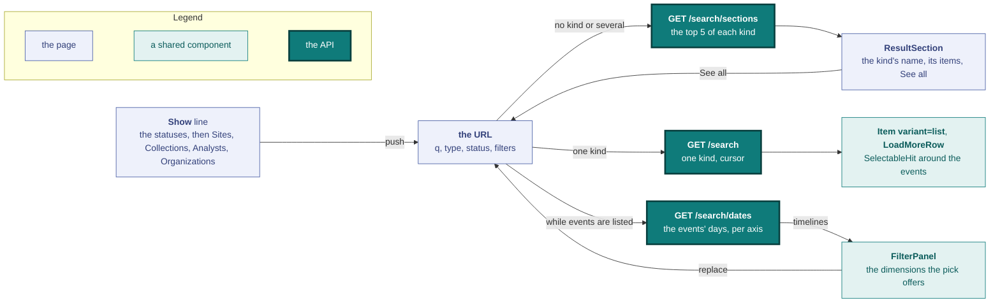

**The URL holds the view.** The query, the Show pick and the filters live in the URL in the vocabulary of `GET /search` (`searchPageParams` in [`lib/search.ts`](../frontend/src/lib/search.ts)), so a shared link opens the same view and a profile link such as `/search?type=collection&author=ana` opens with **Collections** selected. The page writes the URL 300 ms after the last keystroke or change, through `usePageUrl` (see [Filter panel](#filter-panel)). A new Show pick adds a history entry, so **Back** returns to the previous kind; a new query or filter replaces the current entry. When the URL moves (**Back**, **Forward** or **See all**), the page takes the view it names at once.

**The Show line.** The panel's **Show** line offers **Requested**, **Detected**, **Geolocated**, then **Sites**, **Collections**, **Analysts** and **Organizations** (`SHOW_KINDS` in [`model.ts`](../frontend/src/components/filters/model.ts), named by the plural of `ITEM_KINDS`). The line follows the [Show rule](#filter-panel): with nothing selected the page lists every kind, and once something is selected it lists only what the selection names. A status names the events in that status. `searchTypes` turns the pick into the `type` and `status` values the API reads. A link whose `type=event` names no status selects every status, and the page writes a pick of every status that way.

**The dimensions follow the pick.** While the pick lists events, the panel offers every dimension but Following, the timelines included, which count the events the query and the filters match ([`GET /search/dates`](api.md#get-searchdates)). Once it lists no event, the panel offers only Show and the lines the picked kinds answer (`KIND_DIMENSIONS`, the mirror of the API's rule): **Tags** and **Author** for collections, **Author** for sites, none for analysts and organizations. A pick that drops the events also drops the values of the lines it no longer offers, so no hidden filter keeps narrowing the list.

**Sections.** A pick of no kind, or of several, lists one section per kind that has a hit, in a fixed order: Events, Sites, Collections, Analysts, Organizations. A request is an event and sits in the Events section with its *Requested* badge. Each section is a `SectionEyebrow` with the kind's name, then the kind's top 5 hits as list [`<Item>`](#items) rows through `searchHitItem` ([`lib/items.tsx`](../frontend/src/lib/items.tsx)). A section whose kind holds more ends its heading row on **See all**, which opens the page on that kind alone: the events keep the statuses the pick names, or take every status, and another kind keeps the filters it answers. A kind with no hit has no section, and no section prints a count.

**The list of one kind.** A pick of one kind lists every hit of that kind in rank order, and ends on a `<LoadMoreRow>` that follows the response's `cursor` with the query, kind and filters of the page that minted it. On the events, each row the reader may shelve takes a checkbox (`SelectableHit`), with **Select all** (`SelectAllRow`) over the list and **Add to collection** in the page's actions.

In both views, each title marks the words the query matched, and an analyst's or an organization's detail line ends with the bio excerpt when the bio matched. An event opens the event page or the request page, and every other hit opens its own page.

**Typing.** The page searches 300 ms after the last keystroke, and a response that lands after a newer request started is dropped. The results on screen stay until the next ones land, so typing never blanks the page.

**States.** The search field takes the focus when the page opens. An empty field with no filter shows the search icon alone. A search that finds nothing says *No matches.* on one line and, when the API offers one, *Did you mean* with the respelling as a link that searches it at once.

**The coordinate row.** Under the search field, a query that reads as a coordinate pair shows one arrow `LinkRow` that opens the map there. An analyst or an organization the query names exactly (`exactProfile` in [`lib/search.ts`](../frontend/src/lib/search.ts)) shows once, first in its section or its list.

**Phone.** Below `lg` the rail leaves the page and the panel's phone bar sits above the results, as on the feed and the Requests board.

### Share cards

A pasted link is how most readers meet the platform, so the four pages an analyst shares generate their own preview image. Every card is a [`next/og`](https://nextjs.org/docs/app/api-reference/file-conventions/metadata/opengraph-image) (Satori) composition on one frame, [`_og/card.tsx`](../frontend/src/app/_og/card.tsx): a 1200×630 canvas, the bundled Montserrat 700 cut, the accent-`V` wordmark, the `vidit.app` footer, and the hex palette. Satori accepts no class names, which is why the cards compose that frame instead of the `components/ui/` primitives (see *Sanctioned one-offs*). The palette in `card.tsx` restates the same neutral / orange scale the classes resolve to, and is the one place a card reads colour from.

| Card | Content |
|---|---|
| Site default, [`app/opengraph-image.tsx`](../frontend/src/app/opengraph-image.tsx) | Headline ("An open archive of conflict geolocations") and subhead, the same sentence as the landing hero paragraph. Inherited by every route that generates none of its own. |
| Profile, [`profile/[username]/opengraph-image.tsx`](../frontend/src/app/profile/[username]/opengraph-image.tsx) | Avatar (or the handle monogram), handle, bio, and four counts under the page's own labels: geolocated, detected, followers, media. `ogProfileCounts` in [`lib/og.ts`](../frontend/src/lib/og.ts) reads geolocated and detected off the Insights payload, co-geolocated events included, and followers off the header's; the link description lists the same three. A failed stats read keeps geolocated on `geolocations_count`, the same figure, and drops detected and media. Top conflicts sit in the footer. |
| Organization, [`organizations/[slug]/opengraph-image.tsx`](../frontend/src/app/organizations/[slug]/opengraph-image.tsx) | The profile card's layout ([`_og/portfolio.tsx`](../frontend/src/app/_og/portfolio.tsx), shared by both) with an `Organization` badge: picture or name monogram, name, bio, the member count, and the X handle in the footer. |
| Event, [`events/[id]/opengraph-image.tsx`](../frontend/src/app/events/[id]/opengraph-image.tsx) | Title, coordinates, the analyst's handle and the event date, the lifecycle badge, and the locator panel. |
| Collection, [`collections/[id]/opengraph-image.tsx`](../frontend/src/app/collections/[id]/opengraph-image.tsx) | Title, the meta line's count and span, the owner's handle, a `Collection` badge, and the mosaic panel. |

The **locator panel** ([`_og/MiniMap.tsx`](../frontend/src/app/_og/MiniMap.tsx)) is a plate-carrée graticule with the event's point marked on it, drawn from positioned rectangles: no tiles, no basemap request, no static-map service, and no mapping library on the server. What a reader can use at card size is the hemisphere and the rough region, and the real `<Map>` is one click away on the page. The projection is [`lib/og.ts`](../frontend/src/lib/og.ts)'s `projectEquirectangular`, which clamps rather than escapes the frame.

Under the graticule sits a **world outline**, one inline SVG path of Natural Earth 110m land ([`_og/landmass.ts`](../frontend/src/app/_og/landmass.ts), public domain, Antarctica and small islands dropped, aggressively simplified to a few kB), which is what makes a marker read as a place rather than as a point on a grid. It is committed path data in the projection's own 360×180 frame, so it needs no reprojection to line up with the marker and the card still loads nothing at request time. Regenerate it with [`scripts/build-og-landmass.mjs`](../frontend/scripts/build-og-landmass.mjs); the source dataset is not committed.

The event card takes its lifecycle word and emphasis from `EVENT_STATUS_META` in [`StatusBadge.tsx`](../frontend/src/components/event/StatusBadge.tsx), the same map the page's badge renders from, so a row cannot be called one thing on the page and another in the image of the page.

The **mosaic panel** on the collection card is the picture the profile card wears, at card scale. `ogMosaicBoxes` in [`lib/og.ts`](../frontend/src/lib/og.ts) places each tile in the arrangement and gap of the [`<Item>`](#items) mosaic, as absolute boxes since Satori lays out flex and not grid, and clamps a longer cover to four boxes. A tile's picture is read at the derivative its own size wants through [`displayUrlsFor`](../frontend/src/lib/mediaUrls.ts), the wide `_hero` for a lone tile and the 400px `_thumb` for one sharing the panel, and all of them are fetched at once. A tile off a proof image is fetched at its original, since that upload writes no derivative. A clip carries no poster derivative, so its tile draws the panel colour under a play triangle instead of a frame the server does not have; a picture whose fetch was refused draws the same tile without the triangle. A collection with nothing showable draws the panel under `no media`.

Each dynamic card reads the same anonymous public payloads its page renders from (`GET /users/{username}` plus `GET /users/{username}/stats`, `GET /organizations/{slug}`, `GET /events/{id}`, or `GET /collections/{id}`), issued together rather than chained, so a card can only ever show what a signed-out visitor already sees and an unfurl costs one round of requests. Soft-deleted rows 404 upstream.

An upstream read answers one of three ways, and the difference is visible because a crawler caches what it is served:

| Read | Card | Tags |
|---|---|---|
| Answered | The data card | Title, description, `og:*`, `twitter:*` from the payload |
| Permanent miss (`404`, or the `422` a path parameter that names no row draws) | The branded *No analyst here* / *No organization here* / *No event here* / *No collection here* card | The matching not-found title and description, in the same tag shape as a hit |
| Failed (`429`, `5xx`, timeout, undecodable body) | The site-default composition | None: the page inherits the site-wide metadata |

The failed path says nothing about the link because nothing is known about it, and its image response carries `Cache-Control: no-store` so the CDN and any crawler that honours it ask again rather than keep a card built from a bad second. A crawler that caches on its own policy regardless cannot be reached from here, which is the other half of why that path emits no not-found copy: whatever it keeps, it keeps a neutral preview.

Card reads carry a 15 min revalidate. That window is also the rate-limit headroom: every card request egresses from the deployment's shared IP against the per-IP limit on `/users/{username}`, `/organizations/{slug}`, `/events/{id}` and `/collections/{id}`, so a link going wide is one cached read per window rather than one backend round trip per unfurl. A link wide enough to still trip the limit degrades to the site-default card, never to a broken image.

All four pages are client components, so their `generateMetadata` lives on the segment layout (the profile and the organization build theirs through `portfolioMetadata` in [`_og/metadata.ts`](../frontend/src/app/_og/metadata.ts)): title, description, the `og:*` set, and `twitter:card: summary_large_image`, which is what makes X and Discord render the image full-width instead of as a square thumbnail. `twitter-image.tsx` re-exports the Open Graph composition so the two stay byte-identical.

The renderer publishes what it fetches as a public image, so every picture a card draws goes through one guarded read, `ogImageDataUri` in [`_og/data.ts`](../frontend/src/app/_og/data.ts) (guards also in [`lib/og.ts`](../frontend/src/lib/og.ts)), which inlines the body as a data URI rather than handing Satori a remote ``. The read accepts only an https dotted hostname, refuses address literals and local suffixes, and refuses a host whose DNS answer holds any private, loopback, link-local, or multicast address, judged in the connector so the socket uses the address the guard checked. It follows no redirect, holds a 3 s budget and an 8 MB ceiling, and accepts PNG, JPEG, GIF, WebP, and AVIF. The rasteriser behind `next/og` draws only PNG and JPEG and leaves a blank for anything else, so the read inlines a PNG or JPEG of 2 MB or less as fetched and re-encodes every other picture through `sharp` as a PNG at most 1200 px on its long edge (the first frame of an animated GIF). A refused read falls back to the drawing without a picture (the handle monogram, a blank mosaic tile) and logs one `og image skipped:` warning naming the reason and the picture's host and path. `users.avatar_url` and cover tile URLs are server-minted, never typed by an analyst, so the guard is defense in depth. The API's own origin skips the host guards: it serves the local storage backend's pictures in development (`http://localhost:8000/local-storage/...`), and the card trusts it as it trusts the payload reads.

### Email

Every email shares one layout, [`services/email_layout.py`](../backend/app/services/email_layout.py), the second surface after the share cards that renders outside the app. Mail clients read no class names from the site and strip most CSS, so the layout carries its own inline styles: a table-based single column 600px wide, a system font stack, and the hex values below. The mechanism and the queue are in [`engineering.md`](engineering.md#email).

| Part | Light (default) | Dark (`prefers-color-scheme: dark`) |
|---|---|---|
| Page | `#f4f2ef`, the light theme's warm canvas | `#0a0a0a`, `neutral-950` |
| Card | `#ffffff` | `#171717`, `neutral-900` |
| Text | `#232323`, the light theme's `neutral-100` | `#f5f5f5` |
| Inline link | `#c2410c`, `orange-700` | `#fb923c`, `orange-400` |
| Action button | `#c2410c` fill, white label | unchanged |

- **Light by default.** A client that ignores the dark media query, such as Gmail, gets the light layout and applies its own dark inversion to it. Apple Mail applies the dark values.
- **The header** is the accent `V` mark, a PNG served by the frontend at `/icon/android-192` with a transparent background, beside the word Vidit in text. The word carries the brand when a client blocks images.
- **The action button** is a solid `orange-700` fill, the one place the accent fills a control. A mail client cannot render the tinted-on-dark recipe reliably, and `orange-700` keeps a white label above the 4.5:1 contrast ratio. Under the button, the same URL is printed as a link for a client that drops the button.
- **The footer** links to Settings and the legal notice.
- **The completion digest** gives the count of detections to review and points at **Start reviewing** on the detections queue, which opens the one-by-one review pass.
- **A notification email** names the switch that sent it and links to Settings, and its `List-Unsubscribe` header turns that kind off by email.
- **The registration confirmation email** links the [Getting started page](#getting-started-page) in its last paragraph, under the confirm action's explanation.

### Buttons

There is one primitive: [`<Button>`](../frontend/src/components/ui/Button.tsx), shape and colour in a single unit at one size (no size scale). It has five variants on two axes: tone (accent or danger) and emphasis (filled, outline, text):

- `primary`: accent, filled. The one main action of a view.
- `secondary`: accent, outline. A secondary action (edit, search, pagination).
- `ghost`: accent, text only. The quiet tier: cancel, dismiss, dense row actions, and (with `icon`) icon-only buttons.
- `danger`: red, outline. A destructive action (delete), quiet on purpose.
- `dangerGhost`: red, text only. A red control at ghost weight, so it sits in an icon row without outweighing its accent neighbours (the report flag).

**Destructive actions** take one of two controls; see [Destructive actions](#destructive-actions).

Every clickable is accent, and red is only for destructive or alerting actions. There is no grey button: grey lives in `<Pill>` neutral, and in the disabled state, which drops the variant's tone for grey text on a neutral border rather than fading it, so a button that refuses the click reads like every other inert control. The one loud filled red is `DANGER_CONFIRM`, which `<ConfirmButton>` puts on its armed second click, so the strongest red shows once, at the point of no return. A confirm that is not destructive takes `ARMED_RING` the same way (the share row's detection link, the detection form's Submit): a ring and a neutral plate over the button's own variant, so an armed control reads as changed without moving. `fullWidth` stretches it (auth submits). `icon` makes a square icon-only button. A `<Link>` that should look like a button takes `buttonClasses(variant)`.

**Action icons.** A button with a text label leads it with the icon of the action it names, at every width, and one action always takes the same icon (see [Action icons](#action-icons)).

**Tap size.** Both shapes stand taller on a phone (`min-h-9` on the text shape, `size-9` on the icon square), dropping to the desktop 28px / 32px from `sm` up. Only the tappable height moves. The type scale and the horizontal padding are the same at every width. The `?` grows its own target the same way; see *Field help* below.

#### Destructive actions

A destructive action takes one of two variants, each one shared primitive. The weight of the action picks the variant, never the surface.

| Variant | Primitive | Looks like | Confirms |
|---|---|---|---|
| Minor or easily undone | [`<RemoveButton>`](../frontend/src/components/ui/RemoveButton.tsx), or a labelled `<Button>` | a red cross (`remove`, lucide `X`), or the label and its action icon | No: the click acts |
| Important or hard to undo | [`<ConfirmButton>`](../frontend/src/components/ui/ConfirmButton.tsx) | a red icon (a trash, `delete`, for a removal, a revocation or a deletion), or the labelled `danger` button with its action icon | In place: the first click arms it, filled red and named *Confirm …*; a second click within 3 seconds acts; Escape, a click or focus elsewhere, or the timeout disarms it |

A removal, a revocation or a deletion draws one of these two icons and no other: the cross for a minor one, the trash for an important one. Both come from `ACTION_ICONS`, and the `no-restricted-imports` rule in [`eslint.config.mjs`](../frontend/eslint.config.mjs) fails any other file that imports a cross, a trash or a look-alike (`Ban`, `CircleX`, `Eraser`) from `lucide-react`. The rule lists the files whose cross closes or marks a state and removes nothing.

An important action never confirms in a modal dialog. A [`<ConfirmDialog>`](../frontend/src/components/ui/ConfirmDialog.tsx) stays only where the step needs input, or where an `<ActionMenu>` that closes on the pick leaves no control to arm. A refusal prints in an `<ErrorNotice>` next to the control.

Every destructive action in the app:

| Surface | Action | Variant | Control |
|---|---|---|---|
| Notifications | Dismiss a notification | Minor | `RemoveButton` cross |
| Event edit form, published byline | Remove a co-geolocator | Important | `ConfirmButton` trash on the picture |
| Event edit form, published byline | Withdraw a pending invitation | Minor | `RemoveButton` cross on the picture |
| Event and submit forms, draft byline | Take back a draft co-geolocator pick | Minor | `RemoveButton` cross on the picture |
| Event and submit forms | Remove a source editor | Important | `ConfirmButton` trash |
| Event and submit forms | Remove a link row, a file | Minor | `RemoveButton` cross |
| Event edit form | Close an event | Important | `RemoveButton confirms` trash that opens `CloseEventDialog`, which needs a reason |
| Event page, Geolocators panel | Leave the credit | Important | `ConfirmButton` **Leave** |
| Event page | Decline a geolocator invitation, decline approval requests | Minor | **Decline** button with the cross |
| Event page and version page | Delete an approval (site admin) | Important | `ConfirmButton` trash on the stamp |
| Site page | Remove a source | Important | `ConfirmButton` trash |
| Site page | Withhold the site (site admin) | Important | `ConfirmButton` `EyeOff` |
| Site edit form | Mark a source for removal, discard the new source | Minor | `RemoveButton` cross; **Keep** restores a marked source |
| Collection page | Drop the collection | Important | `ConfirmButton` trash |
| Collection forms | Remove an event from the collection | Minor | `RemoveButton` cross |
| Add to collection panel | Take the event out of a collection | Minor | the collection's toggle |
| Organization page | Leave the organization | Important | `ConfirmButton` **Leave** |
| Organization page | Remove a member | Important | `ConfirmButton` **Remove** |
| Organization page | Withdraw a pending invite | Minor | **Withdraw** button with the cross |
| Organization page | Decline an approval request | Minor | **Decline** button with the cross |
| Profile | Unfollow | Minor | **Following** toggle |
| Settings | Revoke an invite code | Important | `ConfirmButton` trash |
| Admin, Manage an event | Hide, soft delete, hard delete | Important | `ConfirmButton` **Hide**, **Soft delete**, **Hard delete** |
| Admin, Reports | Hide the reported item | Important | `ConfirmButton` **Hide the …** |
| Admin, Reports | Dismiss a report | Minor | **Dismiss** button |
| Admin, Analysts | Clear the linked X handle | Minor | **Clear link** button with the cross |
| Admin, Analysts | Purge detections, soft delete, hard delete | Important | `ConfirmDialog` from a trash item of the card's `ActionMenu` |
| Admin, Onboarding | Revoke, delete an invite code | Important | `ConfirmDialog` from a trash item of the row's `ActionMenu` |
| Admin, Organizations | Delete an organization | Important | `ConfirmDialog` with the typed slug |

#### Action icons

`ACTION_ICONS` in [`Button.tsx`](../frontend/src/components/ui/Button.tsx) holds one lucide icon per action, and no two actions share an icon. A text `<Button>` names its action with `action`, and the icon leads the label. A `<Link>` styled by `buttonClasses` puts `<ActionIcon action>` before its text. [`ConfirmDialog`](../frontend/src/components/ui/ConfirmDialog.tsx) takes `confirmAction` for its confirm button, and [`ActionMenu`](../frontend/src/components/ui/ActionMenu.tsx) takes `action` for a text trigger (**Approve** with several identities). `Button.test.tsx` fails on a text button or button-styled link that names no action. The [palette](../frontend/src/app/palette/actions.tsx) shows every action with a label.

| Action (`action`) | Labels | Icon (lucide) |
|---|---|---|
| Accept (`accept`) | Accept (an invitation), Done (filters), Close (a contour) | `Check` |
| Show all activity (`activity`) | Show all activity | `Activity` |
| Add (`add`) | Add a source, Add a link, Create organization | `Plus` |
| Approve (`approve`) | Approve, Approve as *organization* | `Stamp` |
| Archived copy (`archive`) | An archived copy's link (*Wayback Machine*, *archive.today*) | `Archive` |
| Ask for approval (`askApproval`) | Ask for approval, Ask *account* | `ClipboardCheck` |
| Cancel (`cancel`) | Cancel | `CornerUpLeft` |
| Add to collection (`collect`) | Add to collection | `Layers` |
| Continue (`continue`) | Continue | `ArrowRight` |
| Copy (`copy`) | An invite code's copy (admin) | `Copy` |
| Delete (`delete`) | Delete, Delete organization, Delete approval, Revoke, Soft delete, Hard delete, Purge detected, Remove, Close this geolocation, Close this request, Close this detection | `Trash2` |
| Dismiss (`dismiss`) | Dismiss (a report) | `ShieldCheck` |
| Draw (`draw`) | Draw a contour on this source | `PenTool` |
| File a source (`fileSource`) | File the source | `ImagePlus` |
| Filters (`filter`) | Filters | `SlidersHorizontal` |
| Follow (`follow`) | Follow | `UserPlus` |
| Following (`following`) | Following | `UserCheck` |
| Geolocate (`geolocate`) | Geolocate, Publish, Publish geolocation | `MapPin` |
| Go to coordinates (`go`) | Go | `LocateFixed` |
| Graphic (`graphic`) | Mark graphic, Unmark graphic | `TriangleAlert` |
| Guide (`guide`) | Read Getting started | `BookOpen` |
| Hide (`hide`) | Hide, Hide the event, Hide the collection, Hide the site, Withhold | `EyeOff` |
| Import (`import`) | Import archive, Import your X archive, Choose a different file, Create the detection | `Upload` |
| Invite (`invite`) | Invite | `MailPlus` |
| Leave (`leave`) | Leave | `LogOut` |
| Show less (`less`) | Manage, while open | `ChevronUp` |
| Link (`link`) | Link, Confirm link | `Link2` |
| Map (`map`) | Explore the map, Back to map | `Globe` |
| Mint (`mint`) | Mint code, Mint invite code | `Ticket` |
| Show more (`more`) | Show more, Manage, while closed | `ChevronDown` |
| New collection (`newCollection`) | New collection, Create collection, Create and add | `FolderPlus` |
| New site (`newSite`) | Create the site | `MapPinPlus` |
| Next (`next`) | Next | `ChevronRight` |
| Password (`password`) | Set new password, Update password | `KeyRound` |
| Previous (`previous`) | Previous | `ChevronLeft` |
| Remove (`remove`) | Clear (filters), Start over (a contour), Remove corner, Decline, Withdraw (an invitation), Clear link | `X` |
| Report (`report`) | Send report | `Flag` |
| Request (`request`) | Post request, Publish request, Save request | `Megaphone` |
| Retry (`retry`) | Retry, Reload | `RotateCw` |
| Revert (`revert`) | Back to the current contour | `RotateCcw` |
| Review detections (`review`) | Start reviewing, Open the detections queue, Review your detections, Review the detection | `Bot` |
| Role (`role`) | Name org manager, Make org manager, Make member | `UserCog` |
| Save (`save`) | Save, Save version *N*, Save collection | `Save` |
| Search (`search`) | Your geolocations | `Search` |
| See all (`seeAll`) | See all | `ChevronsRight` |
| Send (`send`) | Send reset link, Send a fresh link, Resend confirmation link | `Send` |
| Show (`show`) | Restore, I am 18 or older, show it, the graphic content cover | `Eye` |
| Sign in (`signIn`) | Sign in | `LogIn` |
| Site (`site`) | Open the site page | `MapPinned` |
| Skip (`skip`) | Skip | `SkipForward` |
| Undo (`undo`) | Undo | `Undo2` |
| Unsubscribe (`unsubscribe`) | Turn off | `BellOff` |
| Use a proof image (`useProof`) | Use a proof image | `ImageUp` |

### Forms

**One submit page, content-gated.** [`/submit`](../frontend/src/app/submit/page.tsx) is a single form: you fill in what you have, and two actions publish from the content, "Publish geolocation" (born `geolocated`) or "Publish request" (born `requested`). Each is gated on a live requirements tick-list that escalates from the request floor to the full geolocation floor. `/submit` opens on a chooser, [`SubmitChooser`](../frontend/src/components/geolocations/SubmitChooser.tsx): six [`<IconTile>`](../frontend/src/components/ui/IconTile.tsx) links, each with a `preview` of its result drawn from the product's status badges, a title, one line on when to pick it, and its `needs`. The page takes `PageShell`'s `wide` column, so from `lg` up the tiles fill it as a 3x2 grid of equal tiles. From `sm` up they take two columns, and below `sm` each tile is a row with the preview as a thumbnail.

| Tile | When to pick it | Needs | Opens |
|---|---|---|---|
| **Geolocation** | You found where it happened. | Source, Coordinates, Proof image, Conflict | The form (`single`) |
| **Request** | You have the footage, not the place. | Source | The form (`single`) |
| **From an X post** | You already posted it on X. | Post link, Linked X account | `xpost` |
| **Bulk import** | Your past posts, all at once. | X archive, Linked X account | `bulk` |
| **Site** | You watch a place change over time. | Name, Dated capture, Contour | [`/sites/new`](#sites) |
| **Collection** | You want to share a set of events. | Title, Description | [`/collections/new`](#collections) |

Geolocation and Request open the same form, since its publish actions unlock from the content. A path tile opens its path in place of the chooser and names it in the `mode` query (`single`, `xpost` or `bulk`, built by `submitHref` in [`lib/routes.ts`](../frontend/src/lib/routes.ts)), so a reload keeps the path and the browser's Back returns to the chooser. Each path writes from the page's pinned actions: the two publishes on the form, **Create the detection** on **From an X post** (off until a URL is pasted, *Reading…* while the post is read; Enter in the field submits too), **Import archive** on **Bulk import** (off until a file is picked, *Importing…* while it runs). The result of an import, with its next step, reads in the page body. A pasted post whose every detection already exists reads *Already imported*, with a link to the existing row where its state reads: **Review the detection** while it is a detection, **Open the request** for a request, and **Open the event** once it is published or closed. A row that no longer opens leaves the line without a link. **Bulk import** stages only a zip: a picked or dropped file of another kind is refused at once with one `FieldError` under the drop zone, and nothing starts. On a path the page header carries the `PageShell` back arrow, which returns to the chooser: a step back through the history when the chooser opened the path, and a navigation to `/submit` otherwise (`onBack`). The draft lives in the page, above the form, so it survives a trip through the chooser: the fields reseed from it when the path opens again. It also survives a reload: [`useStoredDraft`](../frontend/src/hooks/useStoredDraft.ts) stores every field, the co-geolocator picks included, in the browser's IndexedDB under the signed-in analyst ([`lib/drafts.ts`](../frontend/src/lib/drafts.ts)), 250 ms after each change. IndexedDB keeps a proof image and a picked file as files, which `localStorage` cannot. The page opens on the stored draft, and the form renders once it is read, since the proof editor reads its seed once. A source file that was still uploading or importing when the page reloaded, or whose staged upload expired, prints why under its slot and asks for a new pick. A publish drops the stored draft. A browser without IndexedDB opens the form empty and stores nothing. `?import=1`, the target of the onboarding card and the `/import` guide, opens **Bulk import**. A link that asks for the form opens it directly (`?mode=single`): **Post request** on the Requests board, the empty profile's first-submission link, and the guide's submit tile. `/requests/new` redirects to the form. A request is answered from its own [edit form](#the-owner-edit-form), not from here.

**Submit actions.** The submit form renders the edit form's shell, `EventFormShell`, and its writes are the page's sticky actions, in the *Actions* landmark at the top right of the header, pinned while the fields scroll. It is the edit form's [`PublishActions`](../frontend/src/components/geolocations/PublishActions.tsx): **Publish geolocation** (primary) and **Publish request** on one right-aligned line, which wraps **Publish request** under the first on a 320px phone, then the `?` (`action_submit`) from `sm` up, then the `ErrorNotice`, `role="alert"`. Each button carries a [`<CountBadge>`](#build-on-shared-primitives) of the conditions it still misses, and dims while short: **Publish request** counts the request floor, and **Publish geolocation** counts the request floor plus the proof, the coordinates and the conflict. The list shows on hover, on keyboard focus, or on a tap on the count. Both publish: the first click arms the button in place (*Confirm*, `ARMED_RING`, its sentence in a live region), and the second writes. Each button leads with its action's icon at every width. The hidden `IncompleteFormAnnouncer` sits in `actions.below`. The import entries render the chooser's `PageShell` instead, without the form, and pin their own submit button.

**One write flow.** The submit form and the edit form write through the same controller, so the two forms check, word and post a write the same way.

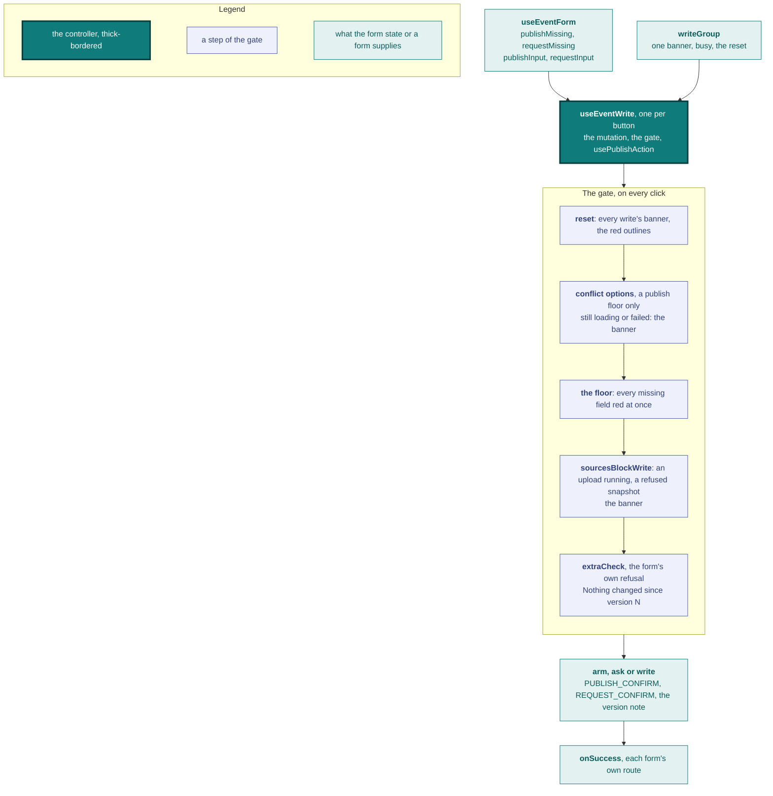

- **The form state.** [`useEventForm`](../frontend/src/components/geolocations/EventFormFields.tsx) computes both floors live: `requestMissing`, and `publishMissing`, which is the request floor followed by the rest in page order (title, the sources' file, URL and kind, the proof or its image, the coordinates, the conflict). It also builds both bodies: `publishInput` posts the subject point as required, and `requestInput` posts it as an optional guess, both halves or neither. A form adds only what its endpoint takes on top, `version_no` and the version note.
- **The controller.** [`useEventWrite`](../frontend/src/components/geolocations/useEventWrite.ts) is one write per button: its mutation, its gate and its arming (`usePublishAction`). `writeGroup` reads a form's writes together: the one `ErrorNotice`, whether any write runs, and the reset each click starts with.
- **The gate.** Every click runs it in the order of the diagram. The conflict options come before the floor, because before they load a missing conflict cannot be told from one still loading. The floor comes before the sources' hold, because a running upload clears itself and must not hide a field you have to fill. The form's own refusal comes last: the edit form refuses a version that changes nothing. A refusal other than a missing field prints in the banner.
- **The wording.** [`PublishActions`](../frontend/src/components/geolocations/PublishActions.tsx) exports what both forms show: the armed sentence of each publish (`PUBLISH_CONFIRM`, `REQUEST_CONFIRM`), the busy labels (`PUBLISHING_LABEL`, `SAVING_LABEL`), and the two button presets, `publishGeolocationButton` (primary, map pin) and `requestWriteButton` (secondary, megaphone). `WRITE_FALLBACK` holds one fallback sentence per write kind. Where a write lands on success stays with each form.

Section placement follows [Event layout](#event-layout): Title, **Sources** and **Proof** in the main column; **Location** and **Details** (event date and time, the provenance link of an imported row, conflict and tags) in the side column. Each section reads like the event page's: its [`<SectionEyebrow>`](../frontend/src/components/ui/SectionEyebrow.tsx), with the section `?`, sits on the page above the section's card. **Proof** carries the *Methodology guide* link beside its eyebrow, and a publish attempt that flags the proof turns the eyebrow red and outlines the card. **Sources** has no card of its own: each source editor is a card. Fields use the [`<Input>`](../frontend/src/components/ui/Input.tsx) primitive. **Sources** is the row of source editors that [Source blocks](#source-blocks) describes, reused by submit, request, detection review and the published-row edit so they can't drift; each editor's file slot sits on the generic [`FileManager`](../frontend/src/components/ui/FileManager.tsx). **From an X post** is [`ImportPostPanel`](../frontend/src/components/geolocations/ImportPostPanel.tsx): a URL field and one action. The post becomes detections server-side, and the panel opens the first one in the detections queue; a run with something to say (warnings, a refusal, a post already imported) stays on the panel and says it, with the review one click away. **Bulk import** is [`ImportArchivePanel`](../frontend/src/components/geolocations/ImportArchivePanel.tsx), whose export walkthrough is a `boxed` [`NumberedSteps`](../frontend/src/components/ui/NumberedSteps.tsx).

**Coordinates travel as a pair.** Every pair (the subject point and each source's capture position) is the shared [`CoordinateInputs`](../frontend/src/components/geolocations/CoordinateInputs.tsx). A paste that reads as a pair fills both fields whichever one received it: a decimal `lat, lng` (comma or space separated, degree signs tolerated), or a Google Maps URL (`@lat,lng`, `q=`, `query=`) when the paste is itself a URL. Anything else pastes as ordinary text, prose quoting `@48.5,37.8` included. [`<CoordinateActions>`](../frontend/src/components/event/CoordinateActions.tsx) follows the two fields on their line, so a coordinate can be checked against satellite imagery and carried away while it is being typed. It is two outlined icon buttons everywhere it appears, each its own box. The map link (new tab) is named *View on Maps* by its `aria-label` and its tooltip, and the copy composes the same primitive over `useCopyToClipboard`. While the pair is empty, half-typed, malformed or out of bounds both controls stay in place, disabled and grey, rather than disappearing, so the line holds one width and a grey control says the point is not usable yet; the map link becomes a disabled button there, since there is nothing to navigate to, and its name and tooltip give the reason (*No map link. Latitude must be between -90 and 90.*). A typed value that is not a number in decimal degrees, or falls out of bounds, turns its own field red at once with the same reason in a `<FieldError>` under the line. A blank half of the subject pair waits for the publish, which flags the missing coordinates; the reasons have one home, `pairProblem` in [`lib/coordinates.ts`](../frontend/src/lib/coordinates.ts), whose bound sentences are the API's. The event detail page's coordinates row renders the same component, right-aligned on the coordinates line, so the two surfaces can't drift; the pair and its actions hold one line there, and on a narrow phone row the **Coordinates** label wraps first, then the line drops under it. On a form, the **Location** block ([`LocationPicker`](../frontend/src/components/geolocations/fields/LocationPicker.tsx)) is the event page's Location module, `EventLocation`, with the pair under the map, where every form that picks a location puts its field (`field`): it labels the pair **Coordinates**, with the same `?` as the page's row, and the map over it is the page's own `<PointMap>` with its pin. A click on the map moves the pin there and writes the point into the fields at 6 decimals, and the pin drags, writing at each step. A pair typed or pasted in the fields moves the pin and centres the map on it at zoom 14 at least, while a click or a drag leaves the camera where the reader holds it. While the pair is empty or refused the map shows no pin. The form's pin is no stored event, so a hover opens no card (`pinPreview`). The parser, the bounds, the rendering (6 decimals, 4 in a compact row) and the map-link builder have one home, [`lib/coordinates.ts`](../frontend/src/lib/coordinates.ts).

**A locked URL is the link.** One field arrives filled and stays that way: the provenance URL (`detected_from_url`) on an imported detection. A request's sources are not locked: the analyst who publishes it corrects them like any other field. The locked field carries [`LockedHint`](../frontend/src/components/geolocations/fields/LockedHint.tsx) beside its label, saying why it cannot be retyped, and renders its value through [`LockedUrl`](../frontend/src/components/geolocations/fields/LockedUrl.tsx): an anchor wearing `LOCKED_FIELD`, the box recipe the locked `<Input>` wears, so it reads as the field it is. A stored URL is a link everywhere on the platform, a locked field included. The anchor carries the full URL rather than a host, and truncates rather than wraps so a long permalink keeps the field one line high. `LOCKED_FIELD` lives on [`Input`](../frontend/src/components/ui/Input.tsx) and the locked `<Input>` and `LockedUrl` both wear it, minus `cursor-not-allowed`, which states "you cannot act on this" and is true of the input alone. The label becomes a `<span>` in link mode, because an anchor is not a labelable control. A locked field with no value yet keeps the read-only input: there is no link to render.

**The detections queue is a list, and the work happens in review mode.** `/profile/{username}/detections` is a dense list, one list [`<Item>`](#items) per detection through [`detectionItem`](../frontend/src/components/detections/detectionItem.tsx): the event's anatomy, *No event date* when it has none, the source host and the entry after the analyst, and one state badge. The page header holds the title and **Start reviewing**, with no line under them. A detection with no source link shows no host, since its badge already reads *Incomplete*. The badge describes the evidence, not completeness (`batchCompletionBlockers` in [`lib/events.ts`](../frontend/src/lib/events.ts), which mirrors the server floor in `services/events/batch._publish_detection`; `detection_ready_predicate` is that same floor in SQL, which is what the filter below pages on, and the three are held to one table of detection shapes by their tests). It reads **Ready to review** when the machine found everything it could and the detection is waiting on the judgment a review supplies, the conflict and the source kind, so it takes `<Pill>`'s outline `secondary` tone rather than the filled accent: a detection that still needs two picks must not read as a finished one. Otherwise it reads *Incomplete*, the word of the filter and of the API's `readiness`, followed by the missing piece (*Incomplete: Source file*), or by their count (*Incomplete: 2 pieces*) once several names would outgrow a dense row. The queue names that state *Incomplete* everywhere, and the queue itself is the analyst's detections *to review*: the profile entry, the rail and the completion digest count them in those words. A [`<SegmentedControl>`](../frontend/src/components/ui/SegmentedControl.tsx) narrows the queue to ready or incomplete detections. It is a query, not a view filter: picking an option refetches with [`readiness`](api.md#get-eventsdetections), so the server cuts the page out of the filtered set and the row count, the page count and the empty line all describe that set. A page-local filter answers about the ten rows on screen while the reader takes it as an answer about the queue, which on an import of several hundred detections ordered newest first is how "0 of 10 on this page" gets read as "none of my work carries any evidence". Beside the bar, `ready_total` and `incomplete_total` state the whole queue's split under every option and on every page, so the one number an analyst wants after an import needs no paging to find. Its labels are one word each, so a `<FieldHelp>` `?` beside the bar says what Ready and Incomplete select, once for the page, and that is where both badges' meaning lives: the rows themselves carry a label and nothing to hover, and the pieces a detection is missing are named in place by the form. A queue with no detection left reads one line, *Nothing left to review.*, in the `boxed` [`<EmptyState>`](../frontend/src/components/ui/EmptyState.tsx): the page is reached that way only after the last submit, since nothing links to it while the queue is empty, and the header's back control returns to the profile. There are no inline controls: the item's link is stretched over the row, so a click, a middle click or **Open in new tab** anywhere on it opens the edit form, which is where a detection missing evidence gets its manual pass. The click opens a review pass starting at that detection, since reaching a detection through the queue is working the queue. [`<LoadMoreRow>`](../frontend/src/components/ui/LoadMoreRow.tsx) sits at the foot: each page the server cuts appends under the rows already loaded, a line above it counts them against the filtered set, and a failed page retries in place. A failed first read prints in an `<ErrorNotice>` with its **Retry**.

**Reviewing is the same form on the same route, one detection at a time.** A queue row and a detection under review open one surface, [`EventEditForm`](../frontend/src/components/geolocations/edit/EventEditForm.tsx) at `/events/{id}/edit`, with the same sections in the same order and every field editable in both cases, the proof editor included. A review pass is that URL carrying `?queue=1`: one address per detection, so a reload keeps its place, the address bar says which detection is open, and the browser's Back steps back one detection. Every entry from the queue page sets the flag, a row click included, so a pass starts wherever the reader entered it; the bare URL stays reachable by hand for a single detection. *Start reviewing* points at `/profile/{username}/detections/review`, which reads the queue and hands over to the first detection's URL, replacing itself in history so Back from that detection lands on the queue list.

With the flag set on a detection the reader owns, the page reads the owner's queue, places the detection in it, and adds the pass's own chrome to the sticky actions: the position (*Detection n of m*) and **Skip**. **Publish** and the close sit in the sticky actions, as on every edit, and the position and **Skip** head them. Publishing runs the single-row [`POST /events/{id}/versions`](api.md#post-eventsidversions) behind the form's confirm and then opens the next detection instead of returning to the queue; closing, behind its own required-reason dialog, hands over the same way; **Skip** hands over without writing. Past the last detection the pass ends on the queue list. The position is read off the live queue, so a detection just published or closed is out of both the count and the walk, and a detection the queue no longer holds carries no position at all: the page is a plain edit again.

**Required by default.** No field carries a `required` or an `optional` marker: per-field markers make the form a legend to decode, and two guides say the same thing better. The count on each publish button names every unmet requirement of its publish path, and a clicked action outlines the missing fields in place. On submit, every missing field and its label turn red in place at once, not the first miss alone (`FORM_INVALID_FIELD`, `FORM_INVALID_LABEL`). No box on the page repeats the list. [`IncompleteFormAnnouncer`](../frontend/src/components/ui/IncompleteFormAnnouncer.tsx) reads it to a screen reader in one sentence on each attempt, from a visually hidden polite live region. The forms set `noValidate`, so the red outlines and the announcer, not native one-bubble-at-a-time validation, own the feedback. It is shared across geolocation, request, and detection submit, each computing its own required set (detection is a superset of create; request is a subset). One content rule: a geolocation's proof must contain an image (`proofHasImage`), the source-to-satellite cross-reference. Every publish sits behind a confirm, a detection's **Publish**, a request's, **Publish geolocation** and **Publish request** alike: a publish makes the event public, and a `detected` row is machine output nobody has vouched for, so a detection's publish applies the whole form and publishes it as `geolocated` in one step, after which every change to it is a version on a public record. The confirm **arms the button in place** rather than replacing it with a confirm pair: the label reads *Confirm*, the button takes `ARMED_RING`, and the second click writes. Nothing is inserted and nothing moves, so the second click lands where the first one did, and the button keeps focus, so Enter twice submits. It disarms on its own after a few seconds, on Escape, and on any click or focus landing elsewhere ([`useConfirmAction`](../frontend/src/hooks/useConfirmAction.ts) owns all of it). What the second click costs is in the `?` beside the button, and the armed state announces itself in a sibling live region, the shape every copy control uses, so no control renames itself mid-gesture.

The account forms follow the same rule: sign-in, registration, the password reset, the single-email forms (forgot password and resend confirmation), Settings → Change password and the invite-code form. Each sets `noValidate`, computes its blanks with `blankFields`, flags them through `useIncompleteForm` (its key type names the form's own fields), outlines each blank field with `FORM_INVALID_FIELD`, turns its [`FieldLabel`](../frontend/src/components/ui/FieldLabel.tsx) red through `invalid`, and announces them through an `IncompleteFormAnnouncer`. The server's and the password rule's messages still show in the `ErrorNotice` once every field is filled. An auth card passes `FORM_LABEL_COMPACT` to its `FieldLabel`s and a Settings card keeps the default size, because a card holds one family of labels and the auth card is the denser surface.

### Rich text

An event's proof and a collection's description are one format: HTML that the server sanitizes on every write. One editor writes it, one renderer reads it, and the server is the only place its rules are enforced.

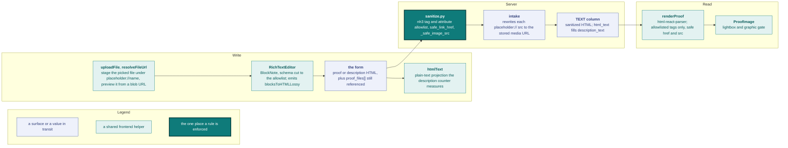

#### The editor

[`<RichTextEditor>`](../frontend/src/components/editor/RichTextEditor.tsx) wraps [BlockNote](https://www.blocknotejs.org) with a schema cut to what the server stores:

- Blocks: paragraph, heading (levels 2 and 3), bulleted and numbered list items, quote, code block, divider, and image. `allowImages={false}` removes the image block for a collection's description.
- Styles: bold, italic, strikethrough, and inline code. Underline is not offered, because the server drops `<u>`.
- Links: BlockNote's link control accepts only what `isSafeLinkHref` accepts, an absolute http(s) URL. The link popover is a form of its own. The editor stops its submit at the editor's root, so pressing Enter in the popover adds the link and never submits the form that hosts the editor.

The formatting toolbar drops the alignment, nesting, and replace-file buttons, since the stored HTML carries no alignment or nesting and the replace panel offers an embed tab. The file panel offers upload only, so every image comes from the analyst's own file. The theme reads the neutral scale and accent as CSS variables, so the editor follows the reader's theme and accent. The text size is `FIELD_TEXT`, the size every other field uses. `bare` makes the editor the section's card itself, an event form's **Proof**: `ProofSection`'s card and `p-4` padding, and no inline padding of BlockNote's own, so the text starts where the event page's proof text starts; BlockNote's side menu floats into the card's padding.

The editor reads `initialContent` once, through `tryParseHTMLToBlocks`. Re-key the parent to seed it again. Each change emits `blocksToHTMLLossy` to `onChange`. BlockNote writes U+FFFC into an empty block, and the editor strips it before emitting.

#### Images

An image uploads at publish, not when it is picked:

1. BlockNote's `uploadFile` hook names the file with `safeProofFilename` and stores the block's URL as `placeholder://<filename>`.
2. `resolveFileUrl` previews that URL from a `blob:` URL while the analyst writes. A placeholder with no staged file loads a blank pixel, so no `placeholder://` src reaches an `img`. The editor empties its staging as it unmounts and revokes the blob URLs on the next task, once its images are gone. A development double mount mounts the editor again before that task, so the staging stays for it.
3. Each change reports, through `onProofFilesChange`, the staged files whose placeholder is still an `` in the emitted HTML (`referencedProofFiles`).
4. The form posts those files as `proof_files[]` beside the HTML. The server matches each file to its placeholder by filename and rewrites the `src` to the stored media URL.

A GIF goes in as its frames, the way the server stores it. `uploadFile` counts the frames from the GIF's blocks (`gifFrameCount` in [`lib/proofImages.ts`](../frontend/src/lib/proofImages.ts)) and refuses a GIF the server refuses: one it cannot read, or one past `MAX_GIF_FRAMES` (6) frames. A refused GIF leaves no image, and a `FieldError` under the editor says why: *This GIF holds 7 frames, and a GIF may hold at most 6. Insert a GIF of 6 frames or fewer.* The next pick clears it. A GIF within the cap splits into one PNG per frame, as the GIF displays it (`splitGif`, through the browser's `ImageDecoder`), named `scan-1.png`, `scan-2.png` and on. The first frame fills the image block that picked the GIF, and each further frame follows it as an image block of its own. While the split runs, the picking block shows the [`<GifSplit>`](#build-on-shared-primitives) tile in place of BlockNote's upload text, and once the frames land, the first frame's block shows its line. Each frame stages and posts like a picked image, so it counts once toward the [proof-image ceiling](api.md#proof-image-ceiling). A browser without `ImageDecoder` stages the GIF whole, and the server splits it at publish.

#### Storage

The server stores the body in a `TEXT` column and sanitizes every write with nh3 in [`sanitize.py`](../backend/app/services/sanitize.py) on the [rich text rules](api.md#rich-text).

#### The read view

[`renderProof`](../frontend/src/lib/proof.tsx) parses the stored HTML with html-react-parser and renders only allowlisted tags, each with its class from `TAG_CLASSES`. Any other tag renders its children only. Every attribute is dropped except:

- A link whose `href` passes `isSafeLinkHref` renders through `<OutboundLink ugc>` with `TEXT_LINK` (see [Outbound links](#outbound-links)). Any other link renders as its text.
- An image whose `src` passes `isSafeImageSrc` becomes [`<ProofImage>`](../frontend/src/components/event/ProofImage.tsx), which opens the shared lightbox. `gateImages` passes the event's `is_graphic` to it, so a proof image takes the same age confirmation as source media. A paragraph that holds an image renders as a `div`.

`isSafeLinkHref` and `isSafeImageSrc` mirror the server's predicates, so a body that bypasses the sanitizer still renders no unsafe URL.

#### Plain text

`htmlText` in [`lib/proof.tsx`](../frontend/src/lib/proof.tsx) mirrors the server's `html_text`: it concatenates the text with entities decoded, starts a new line at every block boundary and every `<br>`, trims each line, and drops blank lines. The collection description counter measures it, and the server caps the same projection and stores it as `description_text`. `proofHasImage` reads the same parse for the geolocation floor: a proof needs at least one ``.

### Errors

Every failure a reader meets is read once, in one module, and shown by one primitive.

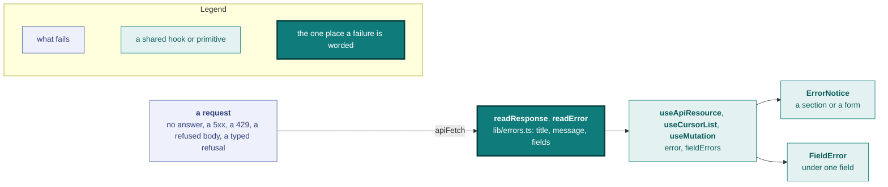

**The wording.** [`apiFetch`](../frontend/src/lib/api.ts) turns every failure into an `ApiError` that carries a `ReadableError` from [`lib/errors.ts`](../frontend/src/lib/errors.ts): a `title` for a fault the reader did not cause, a `message`, and `fields`, the refusals of a refused body keyed by field name. A message the backend wrote for people shows as written, so a refusal is worded where it is raised. The table words the rest, and the browser's and Pydantic's own words never reach the screen.

| Failure | Title | Message |
|---|---|---|
| No answer (offline, refused, CORS) | Vidit does not respond | Check your connection, then retry. |
| 5xx without a typed message | Vidit hit a problem | Retry in a moment. |
| 429 `rate_limited` | | Too many attempts. Try again in N minutes. (from `Retry-After`) |
| 429 `read_quota_exceeded` | | You reached the hourly reading limit. Try again in N minutes. |
| 404 or 403 without a message | | Not found. It may have been deleted. / You cannot do this. |
| 422 refused body | | The first field's refusal, after its name: *X handle: 15 characters at most: letters, digits and _.* |

A refused body reads each item by its Pydantic `type`: `missing` reads *Required.*, `string_too_long` reads *280 characters at most.*, a `value_error` reads the validator's own message, and an unknown type reads *This value is not accepted.* A validator's message in a backend schema is therefore a sentence for the reader, without the field's name.

**The display.** [`<ErrorNotice>`](../frontend/src/components/ui/ErrorNotice.tsx) is a neutral card with a red mark, `role="alert"`. An error with a `title` reads its title, then its message under it, and takes a **Retry** (`secondary`) when the caller passes `onRetry`: a failed read of a page (`<PageError>`), a section, a list's next page (`<LoadMoreRow>`), the map's points, the map's side panel, a search. Any other error, a form's refusal included, is one line with no Retry, since the same request meets the same refusal. The message can be a node with a link, and `onDismiss` adds a cross that closes the notice: the session-ended notice at the foot of the viewport, with its *Sign in again* link. [`<FieldError>`](../frontend/src/components/ui/ErrorNotice.tsx) is the red line under a field, with a small mark; the field names it through `aria-describedby`, and `alert` announces it when it appears after a submit or an upload. `useMutation`'s `fields` option lists the fields a form shows in place: their refusals arrive in `fieldErrors` and leave the form's `ErrorNotice` empty.

### Field help (`?`)

[`FieldHelp`](../frontend/src/components/ui/FieldHelp.tsx) puts a `?` next to a field label, section heading, detail row, filter bar, or icon group: a one-line explanation on hover or focus, pinned on click (touch can't hover), dismissed by outside-click or Escape (a real `role="tooltip"`). It is the app's **one** explanation affordance: an explanation never rides on a native `title` attribute, whose bubble is the browser's chrome rather than Vidit's and appears on no other surface here (`title` stays for the bare name of an icon-only control). It is **neutral grey, not accent** (meta help), the one sanctioned exception to the rule that clickable implies accent. Each `?` is `<FieldHelp concept="…" />`. The concept registry [`lib/fieldHelp.ts`](../frontend/src/lib/fieldHelp.ts) pairs each concept's `text` and `label` once (wording mirrors [`data-model.md`](data-model.md)), so the same concept explains a field on the submit form, the detail page or map panel, and the filter panel without drift. The registry is the only source: a `?` takes a concept key and nothing else, so no instance can word a concept its own way. The `?` is the single source of section *help*: what a concept means is written once, in the registry, and never restated under a heading. A block still states what it counts in a line under its heading where the heading alone leaves the population unstated (the Insights card and its two charts), which is a statement about that block's data rather than a definition of a concept. A concept whose data comes from outside Vidit (a basemap, a map layer or an overlay) also carries `sources` in the registry: the bubble lists them under the sentence, each an [`<OutboundLink>`](#outbound-links) to the provider's page, opening in a new tab. The pointer crosses from the `?` into the bubble without closing it, and a tap pins it on a phone, so the links stay reachable. While the bubble is open, the `?` names it through `aria-controls`, so a `<PopoverPanel>` around the `?` counts a press on a link as inside the panel and stays open. Readers can hide every `?` through Settings → Display, leaving only labels and fields. The switch is saved to the account like the [theme](#theme).

**Tap size.** The glyph is 13px, too small to hit with a thumb, so on a phone, padding plus a matching negative margin grows the anchor to 29 by 25px while the `?` and the label beside it stay where they are. The vertical bleed stops at 6px, the label-to-input gap the form fields use, so a tap aimed at the input below the label reaches the input. The tooltip is positioned off that anchor, so it hangs a few pixels lower and further left on a phone than on desktop, where the glyph keeps its bare box.

### Sanctioned one-offs

Decided once, so review doesn't re-litigate them:

- **`ProofSection`** composes `<Card className="p-4">`, one density step tighter than the default `p-5`, because proof is a reading surface. On a form it frames the proof editor (`RichTextEditor bare`, which draws no frame of its own), with the field's focus border and, when a publish flags the proof, the red outline.
- **Admin dev tooling** ([`admin/ActionReceipt.tsx`](../frontend/src/components/admin/ActionReceipt.tsx)) is a deliberately lighter register than `<Card as="section">`, admin-local on purpose: admin-only surfaces don't earn `ui/` primitives.
- **The Satori surfaces** ([`app/_og/`](../frontend/src/app/_og) and the generated [`icon.tsx`](../frontend/src/app/icon.tsx) / [`apple-icon.tsx`](../frontend/src/app/apple-icon.tsx)) render to a PNG on the server, never to a DOM, and Satori supports neither class names nor most of the CSS the primitives rely on. The share cards all compose the one frame in `_og/card.tsx` (see *Share cards*), which is the boundary: one frame for the cards, not one layout per route. The icons draw a single letter at three sizes and share only the font read, which is not a frame's worth of chrome.

## What we avoid

- Heavy glow, neon, pulse effects
- Gradients
- Glass / blur
- Decorative icons
- Long or showy animations
- Too many distinct colours; one accent hue only
- Information overload on the default view
