# Design principles and decisions

Every surface composes the same primitives, and two reader preferences repaint all of them at once. This page is that vocabulary: the principles the interface follows, the palette and layout it draws from, and the components a page is allowed to use.

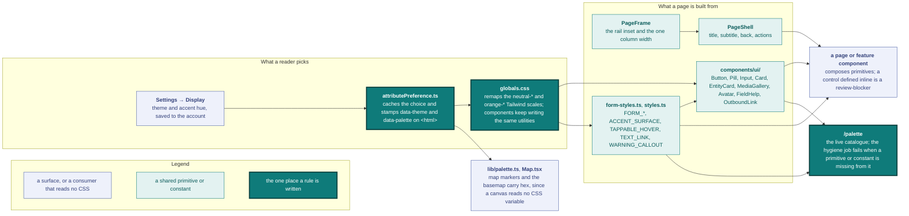

Each region of the diagram has a section below. What a reader picks is [Theme](#theme) and the [accent](#accent). What a page is built from is [Components](#components), whose class constants are named in the [accent recipe](#accent-recipe) and whose frame is [Page chrome](#page-chrome). `/palette` is the gate on that vocabulary, and the exceptions decided once are [Sanctioned one-offs](#sanctioned-one-offs).

## Philosophy

The interface is spare by default and reveals complexity on demand. It stays legible to first-time visitors, and advanced filters and tools appear only when needed. The design avoids a cluttered dashboard look and a dark-ops aesthetic.

1. **Progressive disclosure**: the default view is a map and points. Filters, detail, and tools appear on demand.
2. **Clarity over aesthetics**: every visual element serves a function.
3. **Neutral and professional**: the tone is sober, with no military-tech or hacker-dashboard tropes.
4. **Controlled density**: the reader moves from map, to points, to detail panel, to full proof, and picks the depth.

## Theme

The interface is dark by default, with light available on demand. It uses a uniform background, opaque panels, and one warm accent for contrast. Dark reads better for long, data-dense sessions and stays the default. Light is a second option for readers who want it.

Theme and accent share one mechanism, [`attributePreference.ts`](../frontend/src/lib/attributePreference.ts): it caches the choice in `localStorage`, stamps a data attribute on `<html>`, and [`globals.css`](../frontend/src/app/globals.css) remaps a Tailwind scale under that attribute, so every utility repaints with no per-component change. Two consumers read no CSS variable and carry hex instead: [`Map.tsx`](../frontend/src/components/map/Map.tsx) swaps the basemap on [`useTheme`](../frontend/src/hooks/useTheme.ts) while the reader's basemap preset is Auto (see [Map](#map)), and map markers read [`lib/palette.ts`](../frontend/src/lib/palette.ts).

Both preferences, and the help tooltip switch, are saved to the account through [`PATCH /users/me/preferences`](api.md#patch-usersmepreferences), so they follow a signed-in analyst across devices. [`lib/preferences.ts`](../frontend/src/lib/preferences.ts) holds the two directions. A change in Settings applies locally at once and writes through to the server. After sign-in, and on each load with a session, each preference is reconciled on its own. A value the account has saved wins and rewrites `localStorage`. Where the account has saved none, the value this browser saved for the same account is written to the account instead, so a choice made before the account stored it is kept. The cache records which account it belongs to: signing out clears it, and a sync for another account clears it before applying that account's values, so one analyst's choices never reach another account on a shared browser. A cache that carries no account, written before the cache recorded one, is adopted by the first account that syncs. `localStorage` stays the first-paint cache: the inline script in the root layout reads it before React runs, so a device that has never seen the account paints the defaults until the preferences load.

The theme is independent of the accent hue. Its key is `vidit:theme`, and light applies as `data-theme="light"`; dark is the default and carries no attribute. Light remaps the `neutral-*` scale to a curated soft ramp, plus the semantic `red` / `amber` scales, mirrored so their pale text stops go dark on the light tint. The block also sets `color-scheme`, so native widgets (scrollbars, date and select popups) track the theme. The accent is not theme-adjusted, except that accent text (links, the success banner) reads a touch lighter in light mode. On the Auto basemap preset, the map swaps the Vidit dark style for the Vidit light style.

## Colour palette

### Foundation

The dark roles below are the default. The light theme re-points the same `neutral-*` scale to a curated soft ramp (`globals.css`): a soft warm grey canvas (`neutral-950`) with warm off-white cards (`neutral-900`) floating on it, and dark grey text (`neutral-100` = `#232323`, not black). This keeps a large light surface easy on the eyes instead of a flat, near-white glare. The light surfaces carry a faint warmth (`R > G > B`), while the text greys stay neutral. This mirrors how the dark scale avoids pure black and pure white.

| Role | Color | Tailwind | Usage |
|------|-------|----------|-------|
| Background | `#0a0a0a` | `neutral-950` | Global background, behind the map |
| Surface | `#171717` | `neutral-900` | Panels, cards, modals |
| Surface elevated | `#262626` | `neutral-800` | Inputs, interactive elements, hover |
| Border | `#404040` | `neutral-700` | Separators, field outlines |
| Text primary | `#f5f5f5` | `neutral-100` | Titles, primary content |
| Text secondary | `#a3a3a3` | `neutral-400` | Labels, metadata |
| Text muted | `#737373` | `neutral-500` | Placeholders, disabled elements |

### Accent

There is one accent hue. It's selectable, and orange by default. Settings → Display also offers blue, emerald, violet, and rose. Its key is `vidit:palette`, and `data-palette` remaps the `orange-*` scale to the chosen hue (see [Theme](#theme)). Components keep writing `orange-*` utilities and the [`styles.ts`](../frontend/src/components/ui/styles.ts) constants, so everything below holds for whichever hue is active.

The accent is **tinted-on-dark**, never a flat `bg-orange-500` fill for buttons or selected states:

| Token | Where it shows up |
|------|-------|
| `orange-400` | Text of every interactive element: inline links, button labels, tappable-card hover, status pills. |
| `orange-500` | The hue itself, only at fractional opacity on backgrounds / borders (`bg-orange-500/10`, `/15`, `/20`), and full strength on map points + state dots. |

### Map points

| Role | Color | Usage |
|------|-------|-------|
| Point default | accent `500` (default `#f97316`) | Submitted points; follows the selected accent |
| Point detected | accent `300` (default `#fdba74`) | Machine-detected points; same hue a shade lighter, distinct from submitted by lightness |
| Point selected | accent `500` + white border | Active, clicked point |

### Semantic

| Role | Color | Tailwind | Usage |
|------|-------|----------|-------|
| Danger | `#ef4444` | `red-500` | Error marks and field refusals (`<ErrorNotice>`, `<FieldError>`), deletions |
| Success / info | accent `500` | `orange-500` | Confirmations + info notices (`FORM_SUCCESS_BANNER`). Accent, not green: a confirmation next to red destructive actions shouldn't read as celebratory. |
| Warning | `#f59e0b` | `amber-500` | Non-blocking caution (`WARNING_CALLOUT`): duplicate probe, tweet-import notice. Colour only; layout at the call site. |

## Accent recipe

Every accent treatment is a named constant from [`styles.ts`](../frontend/src/components/ui/styles.ts) or a primitive. Use it; don't hand-roll the class string. The rule:

> If something carries the accent and isn't clickable, it's a bug. If something is clickable and isn't accent, it's a bug.

Carve-outs: navigation chrome stays neutral grey, destructive actions go red, and the `?` help is neutral (meta, not content). Charts carry one more, and it is the only inert accent on the site: a mark whose accent step encodes a magnitude takes `ACCENT_RAMP` whether or not a reader can act on it, and so does its legend, which is drawn with the same cells as the data it explains. `<SourceHostBar>`'s ranked segments and `<ActivityHeatmap>`'s lit months are both inert ranked marks, so both take the ramp. What stands outside the ranking takes the neutral chart paints instead: an empty month, the unnamed tail, a slice naming no source. External links open in a new tab (`target="_blank" rel="noopener noreferrer"`) with the same accent styling.

There are five buckets:

1. **Inline link** (`TEXT_LINK`): clickable accent text in copy or rows (bylines, source URLs, retry, empty-state CTAs), using `text-orange-400 hover:underline`. An action that only reads like a link (Cancel, dismiss) is a `<Button variant="ghost">`.
2. **Tappable card or row** (`TAPPABLE_HOVER`): the whole card or row is one click target (`EntityCard`, search rows, the About page's link rows). It's neutral at rest. On hover, the border turns accent and the title picks up `group-hover:text-orange-400` (put `group` on the row).
3. **Buttons** (`<Button>`): every action, shape, and colour in one unit at one size. A `<Link>` that must look like a button takes `buttonClasses(variant)`. See the full vocabulary under [Buttons](#buttons).
4. **Pills, chips, and badges** (`<Pill>`): the whole badge family uses one `tone`: `accent` (open, detected, selected), `neutral` (default, tag, closed, inactive), `danger` (error), or `secondary` (an accent outline with no fill, a softer marked state). It's a `<span>` by default; pass `onClick` and it becomes an interactive chip, with the caller driving the tone off its active state. Domain wrappers (`StatusBadge` for the one unified event lifecycle, the invite `StatusChip`) map an enum to tone, icon, and label. A bare tag is `<Pill tone="neutral">` inline, with no wrapper.
5. **Active nav or row surface** (`ACCENT_SURFACE`): the bare accent paint (background and text, no border) for a selected nav row or option (sidebar rows, a `SegmentedControl`'s active option, the accent icon circles on the import panel and detections entry). `<Pill>`'s accent tone composes this paint plus a border, so a pill and an active nav item can't drift apart.

Constants: the pill tones live on `<Pill>` as `PILL_TONE`. [`styles.ts`](../frontend/src/components/ui/styles.ts) exports these paints:

- `ACCENT_SURFACE`, `TAPPABLE_HOVER`, `TEXT_LINK` and `WARNING_CALLOUT` are the colour-only paints above.
- `ACCENT_RAMP` is the five-step accent intensity ramp of the charts. `CHART_TAIL` paints a bucket of real work under no printed name, and `CHART_NEUTRAL` paints absence.
- `META_LINE` is a card's muted meta line: small grey text with its glyphs inline.
- `FLOATING_CONTROL` is the plate behind an icon control that floats over media. `HOVER_REVEAL` hides a control until the pointer or focus reaches its frame, and keeps it visible on touch.
- `ARMED_RING` is the armed half of a two-click confirm.
- `TOOLTIP_SURFACE` is the bubble of an anchored popover.

[`form-styles.ts`](../frontend/src/components/ui/form-styles.ts) exports the form paints: `FORM_LABEL`, `FORM_LABEL_COMPACT` (the denser auth-card label), `FORM_INVALID_FIELD` and `FORM_INVALID_LABEL` (the red state of a field and its label), `FORM_ERROR_BANNER` (the red notice paint of the session-ended notice and of an X post import that wrote nothing; an error shows in `<ErrorNotice>`), `FORM_SUCCESS_BANNER` and `LIST_TILE` (one bordered item of an admin list). If a class string for an accent element runs longer than about 3 Tailwind tokens, look for a constant in these two files first.

## Layout

```
┌────┬─────────────────────────────────────────────┐
│    │  Filters │                    │   Detail    │
│rail│  panel   │        MAP         │   panel     │
│    │  (left)  │   (full screen)    │  on click   │
└────┴─────────────────────────────────────────────┘
```

- **Sidebar rail:** left nav (logo, working surfaces, identity block), a fixed column from `sm` up, which every page clears through `PageFrame`'s `sm:pl-14`. Submit, Requests and Feed show only to a signed-in reader; a signed-out reader gets Map, Search, About and Sign in. Below `sm` it is a drawer behind a floating menu chip and takes no inset at all; see [Phone chrome](#phone-chrome). The GitHub, X and Discord icons beside the logo, which show once the rail is expanded and in the drawer, take the accent (`text-orange-400`, the shade of `TEXT_LINK`) at rest. Hover and keyboard focus lift them to `text-orange-300` on a `neutral-800` plate.
- **Map:** full-screen background on `/map`.
- **Left panel:** filters, opaque, floating over the map.
- **Right panel:** event detail, appears on click, dismissible. When the selected event fails to load, the panel shows the error message and a Retry control, never a previously selected event.

**Panels:** `neutral-900` opaque (no glass / blur), `border-neutral-700`, `rounded-lg`, `p-4`, floating above the map. Width 288px (filters), ~380px (detail). Both take a different shape below `sm`; see [Phone chrome](#phone-chrome).

## Typography

- **Font:** Montserrat, loaded through `next/font/google` in [`layout.tsx`](../frontend/src/app/layout.tsx) and set as `--font-sans` in `globals.css`, with `system-ui` as the fallback
- **Sizes:** page titles `text-xl` (20px, the `h1` of `PageShell`); other titles `text-lg` (18px) max; body `text-sm` (14px); labels / meta `text-xs` (12px); micro (counters, badges) `text-[11px]`
- **Weights:** `font-medium` for titles, `font-normal` for everything else

## Map

The map draws one basemap at the bottom and the app's overlays above it, in a fixed order. A basemap swap replaces the bottom group only.

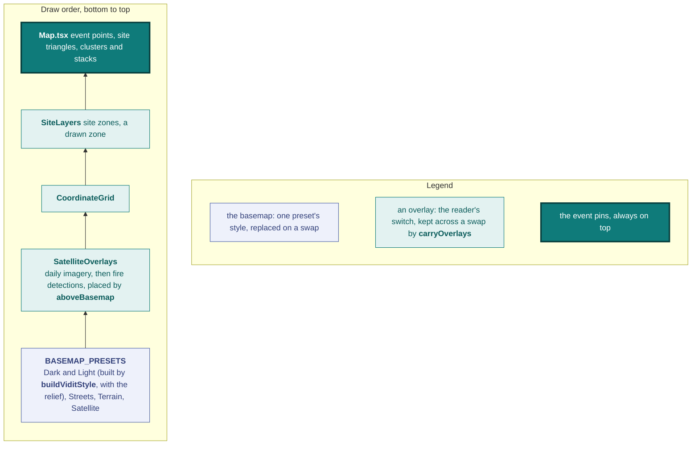

- **Style:** the Vidit dark and light styles in [`components/map/styles/`](../frontend/src/components/map/styles), forked from the OpenFreeMap dark and Positron styles, on OpenFreeMap's OpenMapTiles vector tiles, read from OpenFreeMap or from the instance's [self-hosted map files](engineering.md#self-hosted-map-files). The folder's `LICENSE` carries the upstream licence. The light theme swaps in the light style (see [Theme](#theme)).
- **Fewer labels at low zoom.** [`basemap.ts`](../frontend/src/components/map/basemap.ts) builds the drawn style from the fork, so event points stay readable. At the default Sparse density, below zoom 5 (`LOW_ZOOM`), where the reader sees a continent or the globe, the map labels countries and national capitals only, and draws no road and no other label. Cities label from zoom 5, regions and towns from 7, villages from 10, and smaller places and minor roads from 12. Region borders (admin levels 3 to 6) stay hidden at every zoom, and country borders stay drawn.
- **One name per label.** By default a label shows its Latin name (`name:latin`), or its local name when it has no Latin one.
- **Label font.** Basemap labels and the cluster counts use Montserrat, the app font, with Noto Sans for the scripts Montserrat lacks. The glyphs are served from the frontend; see [`engineering.md`](engineering.md#frontend).
- **Basemap presets.** A map control beside the zoom buttons ([`<BasemapControl>`](../frontend/src/components/map/BasemapControl.tsx), a [`<MapControlButton>`](../frontend/src/components/ui/MapControlButton.tsx) with lucide `Map`) opens a wide `<PopoverPanel>` above it that picks the basemap: **Auto** (the default, the Vidit style of the theme), **Dark** and **Light** (the Vidit styles), **Streets** (the OpenFreeMap Liberty style, forked as `vidit-streets.json`), **Terrain** (OpenTopoMap raster tiles, drawn up to zoom 17) and **Satellite** (the Sentinel-2 cloudless mosaic of 2016 by EOX, raster tiles drawn up to zoom 14, a dark basemap). The presets sit in two `<SegmentedControl>` rows, since six options overflow the panel: the Vidit styles (Auto, Dark, Light), then the third-party ones (Streets, Terrain, Satellite 2016). The Satellite button names its year, so a reader does not take it for current imagery. Every setting is a label and its control, with no line under it, and the panel stops short of the filter overlay at the top left and scrolls when the settings do not fit. Each preset carries its own attribution and declares its brightness in [`basemap.ts`](../frontend/src/components/map/basemap.ts). The selected-point halo and the canvas tint follow that brightness, not the theme: on a light basemap the halo is near-black and a faint `sepia` on the canvas (`globals.css`, under `data-basemap="light"`) warms the map toward the warm light surfaces. The choice is kept in this browser's `localStorage` under `vidit:basemap`, in [`basemapSettings.ts`](../frontend/src/components/map/basemapSettings.ts), and a browser that refuses storage keeps it for the session.
- **Basemap settings.** On the Dark and Light presets, the same panel adjusts the drawn style under two headings, **Labels** (language and density) and **Layers** (the switches), and the browser keeps each setting with the preset. It stores only the settings you change (`saveBasemapSettings` in [`basemapSettings.ts`](../frontend/src/components/map/basemapSettings.ts)), so a setting you never changed follows its default:

  | Setting | Choices | Default |
  |---|---|---|
  | Label language | Latin (`name:latin`), Local (`name`), Both (Latin over local) | Latin |
  | Label density | Sparse (the low-zoom rules above), Normal (the upstream style's labels and roads) | Sparse |
  | Region borders | On, off | Off |
  | Roads | On, off: roads, railways and their names | On |
  | Buildings | On, off: building footprints, which the tiles carry from zoom 13 | On |
  | Military areas and airports | On, off: a tinted fill and an outline on military land use and airport grounds, and coloured runways and taxiways, from zoom 10 | Off |
  | Relief | On, off: hills and mountains shaded from elevation data | Off |
  | Dashed disputed borders | On, off: off draws a disputed country border solid, like a settled one | On |

  Region borders draw dashed on both styles from the zoom the tiles carry them: the dark style draws admin level 4, the light style admin levels 3 to 6, in a mid grey that reads on the light land fill.

  The builder adds the military and airport layers itself (`militaryAirportLayers` in `basemap.ts`), above the style's own aeroway layers and under its roads: OpenMapTiles `landuse` class `military`, and `aeroway` class `aerodrome` (fill and outline), `runway` and `taxiway` (lines). Their colours are `MAP_LAYER_COLORS` in [`lib/palette.ts`](../frontend/src/lib/palette.ts): Tailwind lime for military areas and cyan for airports, the `400` stops on the dark style and the `700` stops on the light one. No accent palette and no site zone uses those hues, so a highlighted area never reads as an event point or a damaged site.

  The builder also adds the relief (`reliefLayer` in `basemap.ts`): a MapLibre `hillshade` layer on the Terrain Tiles elevation source (see [`engineering.md`](engineering.md#map-data-sources)), above the style's water and land fills (`water`, `landcover`, `landuse` and `park`) and under everything else, so roads, borders, labels and every overlay draw over it. Its shadow, highlight and accent colours are the `relief*` entries of `MAP_LAYER_COLORS`: translucent neutrals, darker on the dark style and warm grey on the light one, so the land fills show through. The source stays in the style while the switch is off, and MapLibre requests no elevation tile for a hidden layer. The relief also shades the sea floor, since the elevation data carries bathymetry. Streets and Terrain take no relief: Terrain's raster tiles carry their own hill shading, and Streets draws its published style, which shades relief from Natural Earth below zoom 7.

  A disputed border is a country border (`admin_level` 2) that the OpenMapTiles `boundary` layer marks `disputed=1`. Each style draws it in its own `boundary_disputed` layer (`vidit:role` `disputed-border`), and its country border layers leave it out, so a settled border stays solid. The dark style keeps the maritime borders it draws for countries, and the light style leaves maritime borders out, as the upstream styles do. A local name in a script MapLibre cannot draw (`is-supported-script`) shows its Latin form. On Streets and Terrain the panel shows a line saying the settings adjust on Dark and Light, in place of the settings.
- **Coordinate grid.** The panel's **Overlays** heading shows on every preset and holds the **Coordinate grid** switch, off by default and kept with the other settings. [`<CoordinateGrid>`](../frontend/src/components/map/CoordinateGrid.tsx) draws a latitude and longitude graticule from a GeoJSON source of its own. `graticule` in [`graticule.ts`](../frontend/src/components/map/graticule.ts) builds it in the browser each time the map comes to rest, over the visible bounds and as much again on each side. The interval steps with the zoom (`gridStep`, from 30° on the globe down to 0.001°), so lines stand about 100 px apart, and a view that would hold more than 120 lines takes a coarser step. Each line carries a vertex at every crossing, so it follows the curve of the globe, and a label such as `45°N` or `0.5°W` placed along it in Montserrat Regular. The grid draws under the event pins (`useUnderEventPins`) and above the basemap, in the neutral colours of `MAP_LAYER_COLORS` for the preset's brightness.
- **Daily satellite imagery and fire detections.** The **Overlays** heading also holds two switches, both off by default, that draw NASA GIBS data of the day before, in UTC (`gibsDate` in [`gibs.ts`](../frontend/src/components/map/gibs.ts)), since GIBS can still miss part of the current day's pass. The date is read once, when the map mounts. [`<SatelliteOverlays>`](../frontend/src/components/map/SatelliteOverlays.tsx) draws both, directly above the basemap and under the coordinate grid, the sites and the event pins:
  - **Daily satellite imagery** is the VIIRS (Suomi NPP) corrected reflectance in true colour: one global mosaic a day at about 250 m, so clouds hide what lies under them. GIBS serves it to zoom 9, and MapLibre enlarges that level beyond. The layer draws at 55% opacity, so the basemap's labels and borders stay readable through it.
  - **Fire detections** are the VIIRS 375 m thermal anomalies of the day: one point per 375 m pixel that read hotter than its surroundings, from fires, flares, volcanoes and other heat sources. Each point is a small circle in the `fire` colour of `MAP_LAYER_COLORS`: Tailwind yellow, the `400` stop on a dark basemap and the `600` stop on a light one, a hue no accent palette, site zone or highlight uses. The circles grow from 1.5 px at zoom 2 to 6 px at zoom 14, under the larger event pins.
  - **Loading.** While either overlay is still loading, the filter panel's pulsing `<Dot>` shows directly above the basemap control's button, so it reads with the panel closed, and a `role="status"` line tells a screen reader *Loading satellite overlays* (`busy` on `<MapPopoverControl>`). The imagery loads while the map still lacks a tile in view of its source, so the dot comes back after a move until the new tiles arrive. The fire detections load until the day's file has arrived and their source has taken it. `useSourceLoading` in `SatelliteOverlays.tsx` reads the map's `dataloading`, `data`, `moveend` and `idle` events. A failed tile or file ends the load like a loaded one: the dot stops and the overlay stays empty where its data failed, with no error shown.
- **Unreachable basemap.** When a basemap's tile server does not answer, [`<BasemapFailureNotice>`](../frontend/src/components/map/BasemapFailureNotice.tsx) shows a `WARNING_CALLOUT` line on an opaque plate in the middle of the map: *The basemap provider does not respond. Try another basemap, or reload later.* It reads the map's `error`, `sourcedata`, `idle` and `styledata` events, so it covers every preset, a lost network connection and one provider down alike. A basemap source counts as unreachable when some of its tiles failed and none loaded between two moments the map came to rest. A tile that loads later, or a swap to another basemap, removes the line. The overlays (`isOverlaySource`) do not count, and a missing tile (HTTP 404) raises no error. The line takes no pointer event, so the map stays usable under it, and it sits in a `role="status"` region.
- **Source help.** Each preset, label setting, layer and overlay in the basemap panel carries a [`<FieldHelp>`](../frontend/src/components/ui/FieldHelp.tsx) `?`: one line on what it shows, then links to the providers of its data or tiles (see [Field help](#field-help-)). The presets share one `?` beside the **Basemap** heading, which explains the preset on show, since a `?` cannot sit inside a segment. The label settings carry theirs after the label (`<ChoiceRow concept>`), and the switches after theirs (`<ToggleRow concept>`). The coordinate grid carries none: it draws from no outside source, and its label says what it shows. The sentences are the `basemap_*` and `map_*` concepts of [`lib/fieldHelp.ts`](../frontend/src/lib/fieldHelp.ts), and each provider's page is listed once, in `MAP_SOURCES` in [`mapSources.ts`](../frontend/src/components/map/mapSources.ts). [`engineering.md`](engineering.md#map-data-sources) lists which source each layer draws from.
- **Go to coordinates.** On `/map`, a second map control beside the basemap control ([`<GoToCoordinatesControl>`](../frontend/src/components/map/GoToCoordinatesControl.tsx), a `<MapControlButton>` with lucide `LocateFixed`) opens a `<PopoverPanel>` above it with the go-to-coordinates field ([`<GoToCoordinates>`](../frontend/src/components/map/GoToCoordinates.tsx)). Both controls are a [`<MapPopoverControl>`](../frontend/src/components/map/MapPopoverControl.tsx): the button, and the panel it opens and closes.
  - The field takes a latitude and a longitude in decimal degrees, separated by a comma or a space (`48.015883, 37.802411`), or a Google Maps URL. These are the forms a coordinate paste takes; `readCoordinates` in [`lib/coordinates.ts`](../frontend/src/lib/coordinates.ts) reads both.
  - **Go**, or Enter in the field, centres the map on the point (`goToPoint`) and closes the panel. The map lands at zoom 14, or keeps the reader's zoom when it is closer.
  - Text that does not read as a pair stays in the field, outlined red, with the reason under it: the expected form, or the bound it breaks, in the words of the backend's `validate_coordinates`. When the latitude is out of bounds and the two values would fit swapped, the reason adds that the latitude comes first.
  - The site forms carry the same field above the contour editor's map (see the contour editor under **Sites layer**).
- **Style swaps.** The map mounts on a blank style, and `BasemapStyle` in `Map.tsx` applies the chosen one. A later swap, a preset or a setting change, goes through MapLibre's style diff, so a setting applies at runtime as `setLayoutProperty`, `setPaintProperty`, `setFilter` and `setLayerZoomRange` calls. The diff runs with a `transformStyle` (`carryOverlays`) that keeps the overlay sources and their layers above the incoming basemap, and points every style, a third-party one included, at the Montserrat glyphs. An overlay source (`isOverlaySource` in `basemap.ts`) is any GeoJSON source (the event points, sites, a drawn zone, the coordinate grid, the fire detections), which no basemap ships, or the daily imagery's tile source, named there. A basemap's own sources, the relief's elevation source included, leave with it.
- **Renderer:** MapLibre GL JS (vector tiles) with globe projection. The zoom floor is 1.8 (`MIN_ZOOM` in [`Map.tsx`](../frontend/src/components/map/Map.tsx)), the lowest level that keeps the globe fully visible without shrinking it away.
- **One map stack.** Every map on the site is the same [`<Map>`](../frontend/src/components/map/Map.tsx): the full-screen canvas, the single pin of an event page and of an event form's Location block ([`<PointMap>`](../frontend/src/components/map/PointMap.tsx), see [Forms](#forms)), the coverage map a profile opens its work with ([`<ProfileMap>`](../frontend/src/components/profile/ProfileMap.tsx)), and the coverage map a collection page steps through (see [Collections](#collections)). A set with no mappable point renders no card at all, since an empty world map says less than no map and both surfaces carry a list that says the rest. A page whose view comes from its own content passes `fitBounds` (a `MapBounds`, from `pointsBounds` in [`bounds.ts`](../frontend/src/components/map/bounds.ts)) instead of `center` / `zoom`. MapLibre solves the camera against the real container, capped at zoom 9, so a lone point lands on a regional read rather than a street-level one. A resize keeps the camera, so the map solves it again on each resize until the reader pans, zooms or the map flies: a container that settles after the first fit keeps the whole box in frame. `pointsBounds` encloses longitude on the shorter arc (the complement of the widest empty gap), so work on either side of the antimeridian frames tight instead of as a world view. A box across the seam comes back unwrapped, with `east` past 180. `MapBounds` is the one bounds shape, for framing and requests alike. The `?bbox=` wire format has one home, [`lib/viewport.ts`](../frontend/src/lib/viewport.ts): its `toBboxParam` rounds outward and widens an unwrapped crossing box to the full longitude range, which is what `parse_bbox` accepts. Every map lays its zoom buttons and its attribution in one row along its bottom-left edge (`globals.css`), so the attribution never sits over the content of a small embedded map. A small map (`embedded`, stamped `data-embedded`) sets the attribution in 10px on one line, every credit kept: beside the buttons when the line fits there, as in the 1440px side column, else on its own line under them along the bottom edge, as on a 375px phone.
- Map labels (cities, regions) are a discreet light grey.
- Point geometry: default radius 6px, selected 7px with a 2px border, white on a dark basemap and near-black on a light one. Opacity is 1.0 for points and 0.85 for clusters. The cursor is a pointer on hover.
- **Pin hover preview.** Hovering any single unclustered pin (or a ring dot, described below) shows one shared preview card after a 150 ms hover-intent delay (`PinPreviewCard` in [`Map.tsx`](../frontend/src/components/map/Map.tsx)): title, `StatusBadge`, the fixed `MediaThumb` slot (the picked card thumbnail, or its "no media" box), date, and `AuthorByline`. It renders on [`MapPreviewCard`](../frontend/src/components/map/MapPreviewCard.tsx), the map's one preview card on `Card`, which a site's preview uses too. The event detail is fetched only once the hover intent elapses (`GET /events/{id}`, with a bounded in-memory cache that also holds in-flight requests; stale responses are ignored, and a failed fetch shows a terse fallback). The card clamps against the map edges after measuring, and flips to the left of the pin when the right side lacks room, so it always renders fully visible. Ordinary clusters get no preview. A coarse pointer arms no preview at all, so a tap goes straight to the panel; see [Phone chrome](#phone-chrome).
- **Co-located events: counted badge and hover fan-out.** Events sharing one coordinate form a cluster that can never expand. `groupStacks` ([`stack.ts`](../frontend/src/components/map/stack.ts)) groups points client-side on a roughly 1 m epsilon grid with neighbor-cell merging, so a stack straddling a grid line reads as one. Past the clustering ceiling, the group renders as **one counted badge** with the colour, radius, opacity, and count text of a small cluster, so a stack of 3 never reads as a single pin. Cluster counts below the ceiling stay true.
  - Hovering the badge, or an unexpandable cluster (leaves within `STACK_EPSILON` via `getClusterLeaves`), replaces it with `SpiderRing`: 12px DOM dots on an 18px ring around the shared center, the ring growing past about 7 events and capped at 24 dots. A larger stack fans out its first 23 events and fills the last slot with a "+N" marker; the badge count stays the true total.
  - The dots travel out from the center, and back before the badge reappears. Dot colours keep the point semantics (detected shade, selected halo); the badge carries the halo when it holds the selected event.
  - Hovering a dot shows the pin preview, and clicking it opens the event like a normal pin.
  - The ring collapses when the pointer leaves it (with a grace margin), on wheel, or when the map moves. On touch, a tap opens the ring and a tap off it closes it, and the dots carry a wider hit box (see [Phone chrome](#phone-chrome)).
  - Ordinary clusters keep zoom-on-click.
- **Cluster to points crossfade.** The map sets `fadeDuration: 0`, so count labels and their circles swap on the same frame; basemap place labels pop in instead of fading. Count labels skip symbol placement (`text-allow-overlap` + `text-ignore-placement`), so a count is never culled apart from its circle. Around the clustering ceiling, a zoom-interpolated opacity crossfade runs in paint expressions, with stops derived from `CLUSTER_MAX_ZOOM`: clusters and counts thin approaching one zoom past the ceiling, and points and stack badges rise just past it. The crossfade applies **only while a zoom is in flight**; at rest every layer holds full opacity, and a cluster click that resolves past the ceiling lands its pins at full opacity.
- **Sites layer.** A map draws sites through `<Map>`'s `children`, the slot for extra sources and layers. [`SiteLayers`](../frontend/src/components/map/SiteLayers.tsx) keeps them under the event pins through `useUnderEventPins`, so an event always draws above a zone.
  - On `/map` the **Sites** chip turns the layer on. It follows the Requested, Detected and Geolocated chips in the filter panel's **Show** field (see [Filter panel](#filter-panel)) and, like them, starts off. While it is on, a line under the chips names the date the zones are read at, with the layer's `?`: the end of the event date window, or today when the window has no end. Moving the window refetches the zones valid on that date (`GET /sites?as_of`), so a site whose contour changed shows the contour valid at the window's end. The panel creates no site: a site starts from Submit.
  - The layer counts as one active filter. While it is on, the **Filters** button counts it, a **Sites** pill follows the status pills, and the collapsed row's summary names it. Removing the pill or **Clear all** turns the layer off.
  - Below zoom 10 (`ZONE_MIN_ZOOM`) each site is one triangle at its centroid, the shape that tells a site from a round event pin. From zoom 10 the map draws every zone. The map prints no site name: the preview and the side panel carry it. Every site draws the same way for every viewer.
  - Below zoom 10 the sites cluster with the event points, in one source:

    ```mermaid
    flowchart LR
      classDef spec fill:#eef1fb,stroke:#4a5fa5,color:#33417a
      classDef shared fill:#e3f2f1,stroke:#0f7b7a,color:#0b5c5b
      classDef core fill:#0f7b7a,stroke:#083f3e,stroke-width:3px,color:#ffffff

      subgraph legend [Legend]
        direction LR
        l1["`input from the map page`"]:::spec
        l2["`the shared **points** source`"]:::core
        l3["`a layer of that source`"]:::shared
        l1 ~~~ l2 ~~~ l3
      end

      events["`filtered event points`"]:::spec
      sites["`site centroids, while the **Sites** chip is on and the zoom is under 10`"]:::spec
      source["`**points** source, **CLUSTER_SOURCE**
      counts **events** and **sites** per cluster`"]:::core
      circle["`**clusters** circle, event count`"]:::shared
      triangle["`**sites-cluster** triangle, site count, right of the circle`"]:::shared
      single["`**points-circle** for one event, **sites-point** for one site`"]:::shared
      events --> source
      sites --> source
      source --> circle
      source --> triangle
      source --> single
    ```

  - `CLUSTER_SOURCE` in [`layers.ts`](../frontend/src/components/map/layers.ts) sets the clustering radius and the maximum zoom, and its `clusterProperties` count the events and the sites of each cluster apart. A cluster draws its circle with the event count. When it holds sites, a triangle with the site count sits right of the circle, its bounding box centred on the circle's centre line, 1 px from the circle at their closest (`BESIDE_GAP_PX` and `besideOffsetPx` in [`triangle.ts`](../frontend/src/components/map/triangle.ts)). The circle's antialiasing makes the drawn gap 1.3 to 2 px. A cluster of sites only draws the triangle, and a cluster of events only draws the circle.
  - A click on the circle or on the triangle zooms to the cluster's expansion zoom. A cluster that holds a site never opens the hover ring: past the clustering ceiling the site is a zone.
  - The event filters narrow the points before they reach the source, so they never drop a site. While the **Sites** chip is off, no site reaches the source or the counts. From zoom 10 the map leaves the sites out of the source (`zonesShown` in `Map.tsx`), so the clusters count events only and the zones stand for the sites.
  - A zone, a triangle and a cluster triangle take the event point colour: the accent palette's `base` (`paletteMapColors` in [`lib/palette.ts`](../frontend/src/lib/palette.ts)), and the darker ramp stops for a large count, like an event cluster. The triangle is one signed distance field image (`triangleSdf`), so `icon-color` paints it in any palette.
  - A triangle is as tall as the circle it pairs with is wide (`triangleHeight`): a single site pairs with an event point, 6 px in radius or 7 px when selected, and a cluster triangle with the event cluster circle for the same count.
  - The site count sits on the triangle's incentre, a third of its height above the base. A triangle too small to hold the longest count of its range with a 1.5 px margin grows to the next circle tier's triangle (`siteTriangleHeight` in `layers.ts`, `heightToHold` in `triangle.ts`): a cluster of 2 to 9 sites keeps the triangle of its circle, and a count of two digits or more takes a larger one.
  - The latest link effect does not tint the map: the warning amber and the danger red sit too close to the orange and rose palettes to read. The preview and the side panel show it as a `<Pill>` (`LinkEffectPill`), in the warning or danger tone for damage and destruction and neutral for the others.
  - A zone draws like the military and airport highlights, a fill at 12% opacity (22% when selected) under a solid outline of 2 px (3 px when selected), so the pins and labels inside it stay readable.
  - On `/map` a site takes the pointer like an event pin: a zone, a triangle or a cluster turns the cursor to a pointer, and an event pin over a site takes the hover and the click. A mouse resting on a site shows its preview after the pins' 150 ms hover intent, on the pins' `MapPreviewCard`: the name, the kind, the latest effect and the last source (`SitePreview` in [`SitePanel.tsx`](../frontend/src/components/map/SitePanel.tsx)), read from the list the layer already holds, so the preview fetches nothing. A coarse pointer arms no preview, and a tap opens the panel. A site, like a pin, is not a keyboard stop on the canvas.
  - A click on a site opens the map's side panel ([`MapSidePanel`](../frontend/src/components/map/MapSidePanel.tsx)), the one the event pins open, in the same place and with the same blocks. The event fills it with `eventPanelContent` ([`EventDetailBody.tsx`](../frontend/src/components/event/EventDetailBody.tsx)) and the site with `sitePanelContent` ([`SitePanel.tsx`](../frontend/src/components/map/SitePanel.tsx)); `MapPanelBody` lays out the blocks for both.
    - The title is the record's name, the permalink to its page, and the byline under it names who documents it: the credited geolocators of an event, the owner of a site.
    - **Sources** holds the event's sources, or the site's latest source by the site page's order (`latestSource`, newest capture first), in the compact source block with its thumbnail.
    - **Location** holds the Coordinates row: the event's point, or the centre of the site's current zone.
    - **Details** holds the event's rows, or the site's kind, last source, latest effect and its counts of sources and linked events. An event's proof follows.
    - The page holds one panel slot, so a site closes the event panel and a pin closes the site panel.
  - A site page's own map ([`SiteMap.tsx`](../frontend/src/components/map/SiteMap.tsx)) frames every contour and linked event (`fitMaxZoom` 15). It draws the zone of the date on show solid and the contour before it dashed, in Tailwind fuchsia, the `400` stop on a dark basemap and the `700` stop on a light one (`SITE_MAP_COLORS` in [`lib/palette.ts`](../frontend/src/lib/palette.ts)), so the zone stands apart from the linked events in the accent. The effect of the latest linked event changes the zone colour, read at the same date as the zone: damage takes the warning amber, destruction the danger red (`zoneEmphasis` in [`lib/sites.ts`](../frontend/src/lib/sites.ts)). A linked event outside the contour it was measured against gets a dotted line to that contour's nearest edge, labelled with its distance. Events measured against another contour than the one on show are dimmed through `dimmedIds`, and so are their lines.
  - The contour editor ([`ZoneDrawMap.tsx`](../frontend/src/components/map/ZoneDrawMap.tsx)) adds a corner per click and closes the ring on a click on the first corner. A closed ring edits in place: a corner drags, a click picks it, and the dot in the middle of each edge drags out a new corner. The contour being redrawn shows dashed under the drawing. The editor draws no other site, so nothing on its map shares the drawing's accent. Its frame, [`ZoneEditor`](../frontend/src/components/sites/ZoneEditor.tsx), holds the go-to-coordinates field between the hint line and the map, and **Go** centres the map through `<Map>`'s `goTo` target, a new object per **Go**, so the same pair typed twice centres the map twice. The **File a source** page's zone map takes the same field above it (`SiteLocation` with `goToField`, through `SiteMap`'s `goTo`). The **Contour** row under the map reads the area, thousands grouped (`formatAreaKm2`: *230,643.89 km² · 4 corners*). While the analyst draws, a ring the API would refuse turns the frame red and a `<FieldError>` under the row says why (`drawRefusal`): two edges cross, or the corners enclose more than `MAX_ZONE_AREA_KM2` (1,000 km², the [API cap](api.md#sites)), checked before the ring closes. A refused ring is no zone, so the forms count it as missing.

## Components

### Build on shared primitives

Every UI element is a reusable primitive. Compose from them; never hand-roll a one-off. If none fits a new need, add the missing piece to [`components/ui/`](../frontend/src/components/ui) (or as a new `FORM_*` / `styles.ts` constant) and consume it from there, never inlined in a page. Growing the vocabulary with a new shared component is a maintainer decision (see [`AGENTS.md`](../AGENTS.md) → *Conventions*). Reusing or extending an existing one is the default.

**Token or component?** A piece is a *component* when it owns shape or behaviour (`<Input>`, `<Pill>`, `<Button>`, `<Card>`). It stays a raw *class constant* when it is a single-element paint composed into someone else's markup (`FORM_LABEL`, `ACCENT_SURFACE`, `TAPPABLE_HOVER`). A constant that starts growing variants has crossed the line, so promote it. Primitives join classes with [`cn`](../frontend/src/lib/cn.ts) (tailwind-merge), so a caller's `className` wins conflicts predictably. `<Button>` and `<Pill>` stay one size by design; the button's only variation is the taller tap shape it takes on a phone (see [Buttons](#buttons)).

The vocabulary:

- **Labels.** `FORM_LABEL` is the uppercase label above a control (`LABEL_TEXT` is the same without `block`). A label's `?` sits beside the `<label>`, never inside it, so a field's accessible name is the label's words alone. [`<FieldLabel>`](../frontend/src/components/ui/FieldLabel.tsx) is that label row: the words (a `<label>` with `htmlFor`, else a `span`), the `?`, then a `trailing` node such as a `<CharCounter>`, red with `invalid`. An event field's name and `?` live in one table, `EVENT_FIELDS` in [`lib/events.ts`](../frontend/src/lib/events.ts) and `SOURCE_FIELDS` in [`lib/sources.ts`](../frontend/src/lib/sources.ts), whose key order is the display order: the page spreads an entry into `<DetailRow>` and the form into `<FieldLabel>`, so a field reads under one name on both. [`<SectionHeading>`](../frontend/src/components/ui/SectionHeading.tsx) heads a form section inside its card (the collection picker's two cards, a profile's bio): the title alone. [`<SectionEyebrow>`](../frontend/src/components/ui/SectionEyebrow.tsx) is the uppercase eyebrow over a page, panel, or card section, and over each section of an event form, where `invalid` turns it red.
- **Copy.** The clipboard write and the flash timer are one hook, [`useCopyToClipboard`](../frontend/src/hooks/useCopyToClipboard.ts), and the confirmation is one primitive, [`<CopyButton>`](../frontend/src/components/ui/CopyButton.tsx): an icon button whose mark turns into a check at once and fades back after 1.5 s (no fade under `prefers-reduced-motion`). The accessible name holds still, since a name that changes on click is re-announced as a new control. For those 1.5 s the button's tooltip reads the confirmation (*Link copied*, *Coordinates copied*) and shows on its own, a tap included, and a sibling live region says it to screen readers. Copy coordinates ([`<CoordinateActions>`](../frontend/src/components/event/CoordinateActions.tsx)), a profile's copied handle and Share where the browser has no share sheet all wear it. `variant="secondary"` boxes the button, for a copy that stands beside a field (Copy coordinates). The admin invite row's text button keeps the hook alone.
- **Small assemblies.**
  - [`<Avatar>`](../frontend/src/components/ui/Avatar.tsx) is the profile-picture circle: the profile header, the user search hits, `<AuthorByline>`'s avatar variant, and the sidebar identity row, which renders it in the rail's 18px glyph box. `size` is the only dimension a caller sets, and the fallback is the handle's initial or a neutral user icon. An `avatar_url` addresses a server-minted object on the media host, uploaded through the profile header's picker (the shared `<FileManager>` in single-file image mode). A failed load falls back to the same circle and a new picture retries, because replacing a picture deletes the old object and a CDN edge can answer for a key before a new one propagates. `iconClassName` colours the icon fallback (the sidebar passes `text-current`, so the glyph follows the row's hover and active state). `decorative` hides the picture from assistive technology where the host names itself, so neither the alt text nor the initial displaces or repeats the name beside it. `shape="square"` rounds the corners instead of the circle, for an organization shown beside analysts.
  - [`<AvatarStack>`](../frontend/src/components/ui/AvatarStack.tsx) is a row of 28px `<Avatar>` pictures: the approval stamps under the event page's actions (see [Event actions and approvals](#event-actions-and-approvals)) and the organization logos in a profile header. `size="sm"` is the 20px picture of a page byline, with a 16px remove disc: `<AuthorByline coAuthorsAs="avatars">` draws the event page's co-geolocators with it and an event form's byline manages them with it, so the two bylines keep one height and one layout. `size="xs"` is the 16px picture of a card's byline. `trailing` follows the last picture on its line, out of the list's items (the approvals' `?`). An item's `variant` picks the circle (`analyst`) or the rounded square (`organization`). Each picture is a link to the item's `href`, named by its `label`, which a `<Tooltip tapToShow>` shows on hover or keyboard focus. On a touch screen the first tap on a picture shows the label and the second tap follows the link. By default the pictures overlap, and a ring in the page colour separates them; set apart, a picture takes the focus ring alone. `spacing="gap"` sets them apart and wraps them onto further lines. `checked` puts a 14px check badge on each picture's bottom-right corner: a disc in the reader's accent (`bg-orange-500`, which the accent setting re-points) with a dark check, ringed in the page colour so it reads on any picture. An item's `remove` puts a 20px remove disc on the picture's top-right corner, a `<RemoveButton>` (a trash when `remove.confirms`, the click opening a confirmation, else a cross) that `HOVER_REVEAL` shows on hover or keyboard focus and pins visible on a touch screen. A 36px disc would cover the 28px picture, so on a touch screen the disc keeps its size and its hit area becomes a 36px square up and right of it, starting 6px into the disc so the picture's centre stays its link. Each such picture then takes 16px more room above and 24px more on its right, which keeps the square clear of the line above and of the next picture. At most `max` show (5 by default); the rest fold into a `+N` bubble, a button when `onOverflow` is set.
  - [`<ActionMenu>`](../frontend/src/components/ui/ActionMenu.tsx) is the one menu of links and actions: a ghost trigger named by `label` (icon-only, or `text` printed before the icon, as the version selector's *v2*) that opens a `role="menu"` list painted with `TOOLTIP_SURFACE` and named by `menuLabel`. Each item is a link (`href`) or an action (`onSelect`, which closes the menu and gives focus back to the trigger before it runs), with an optional icon; `current` marks the link to the page on screen (`aria-current`), which takes focus when the menu opens, and `iconOnly` prints the icon alone, with the label as its accessible name and a `<Tooltip>`. A click, Enter or ArrowDown opens it and ArrowUp opens on the last item; the arrows, Home and End move between items; Space or Enter follows one; Escape closes and returns focus to the trigger; Tab or an outside click closes. The list is `14rem` wide, aligns to the trigger's right edge, shifts sideways to stay 8px inside the viewport, and scrolls past `20rem`. It renders in a portal fixed to the viewport and follows the trigger on scroll, so a box that scrolls sideways (the admin invite table) never clips it. `matchTriggerWidth`, off by default, makes the list exactly as wide as the trigger, for a compact picker. The event page's version selector is its consumer and sets it. The admin user card and the admin invite rows hold actions, and each destructive action opens a `<ConfirmDialog>`.
  - [`<Combobox>`](../frontend/src/components/ui/Combobox.tsx) is the keyboard and the list of every typeahead: a `role="combobox"` `<Input>` over a `role="listbox"` list painted with `TOOLTIP_SURFACE`, with `aria-activedescendant` on the highlighted row. The caller owns the query, the open state, the filtered options and how a row renders, and a `status` string shows as a muted row under the options. `pillOption` shows a row inside a neutral `<Pill>`, the chip a pick becomes. ArrowUp and ArrowDown move and wrap, Enter takes the highlighted row or hands the typed text to `onSubmitText` when no row is up, and Escape, Tab or an outside click closes. The list spans the field's width and scrolls past `15rem`. It renders in a portal fixed to the viewport, so a card or a scrolling rail never clips it, and it opens above the field when the room below is shorter than `15rem` and the room above is larger. While open it measures the field on every frame, so it follows the field when the page shifts around it without a scroll (an image above loading), and its edges stay 8px inside the viewport even while the field is partly out of it. `<AccountPicker>`, `<ConflictChips>`, `<TagChips>`, the admin event field and the collection picker's **Add events** field build on it.
  - [`<AccountPicker>`](../frontend/src/components/ui/AccountPicker.tsx) is the one way to pick an analyst or an organization, on `<Combobox>`. Each row shows the picture (a circle for an analyst, a rounded square for an organization), the name and, for an organization, its slug in muted text. The caller owns the data: `options` filters a local list by name and handle, and `search` runs the caller's request 250ms after typing stops, once the query holds `minQueryLength` characters. A `note` that `search` returns shows as a muted row, as do loading, a failed search and `emptyText`. With `selected`, the pick shows as an accent `<Pill>` chip that `onClear` removes; without it, the field empties after each pick. The approval request, the search Author filter, the co-geolocator invite, the organization invite, the admin org manager fields and the admin analyst search are its consumers.
  - [`<TagChips>`](../frontend/src/components/ui/TagPicker.tsx) picks tags from the one catalogue that serves events and sources. The picked tags show as accent `<Pill>` chips, and a click on a chip removes the tag. Under them, a `<Combobox>` suggests the other tags whose name holds the typed text, ignoring case. When no tag bears the exact typed name (case-sensitive, like the backend uniqueness rule), the list ends with *Create "name"*, which creates the tag through [`POST /tags`](api.md#post-tags) and picks it. A name that already exists on the server prints *That tag already exists.* under the field and keeps the typed text. The list stays open after a pick, so you can pick several tags in a row. Each tag in the list shows as a neutral `<Pill>`, and the *Create "name"* row stays plain text. On a form, one line of suggested tags follows the search: up to 8 neutral `<Pill>` chips with a plus, from [`GET /tags/suggested`](api.md#get-tagssuggested), the picked ones left out. A click on a suggestion picks it. The line never wraps and clips the chips that do not fit, so it never widens its card or the page: it clips the chips' screen reader text with them, and its unwrapped width does not count toward the width of the column around it. The filter panel shows no suggestions. The field's accessible name is *Tags* in the event's Details card and names the source in a source editor (*Source 1 tags*). On a form it spans its card; in the filter panel it stays at `max-w-xs`. With `filter`, the field is the Tags section of the [filter panel](#right-rail): it suggests the tags of the panel's catalogue, picks by name, the value the URL carries, and has no *Create "name"* row.
  - [`<ConflictChips>`](../frontend/src/components/ui/TagPicker.tsx), the conflict field of `<TagPicker>`, picks the event's conflicts from the conflicts referential, which the form fetches whole and filters in the browser. The picked conflicts show as accent `<Pill>` chips, and a click on a chip removes the conflict. Under them, a `<Combobox>` named *Conflict* lists nothing at rest. On focus or typing, it lists the ongoing conflicts whose name holds the typed text, ignoring case, each as a neutral `<Pill>`, ordered by tier then name (`sortConflicts` in [`lib/conflicts.ts`](../frontend/src/lib/conflicts.ts)). *Other* is pinned last and always offered, so a conflict outside the referential has a pick. The *Include ended conflicts* switch adds the ended conflicts. It sits on the label row, above the field, out of the way of a list that opens below the field. A picked ended conflict stays on show when the switch is off. The list stays open after a pick. When the publish floor misses the conflict, the label turns red and the field takes the `invalid` outline of every field (`FORM_INVALID_FIELD`). On a form the field spans its card like every other field; only the filter panel keeps it at `max-w-xs`. With `filter`, the field is the Conflict section of the filter panel: it lists every conflict in use (`GET /conflicts?used=true`), ended ones included, picks by name, and has no label row and no switch, since the section header carries the title and the `?`.
  - [`<LinkRow>`](../frontend/src/components/ui/LinkRow.tsx) is the icon, label and value row of the About page's links and the Notifications page. With an `href` it is one link; `external` leaves the app through `<OutboundLink>` with a trailing glyph. The opt-in `leading` node replaces the icon: each notification row leads with the 28px `<Avatar>` of who is behind it (`notificationAvatar` in [`lib/notifications.ts`](../frontend/src/lib/notifications.ts)), the organization's square logo on the rows where the organization acts (its approval landed, or it declined a request), the actor's circle otherwise, and the kind's icon when the row has no actor (a system kind or an erased account). The opt-in `variant="arrow"`, which the Notifications page uses, keeps the value in the neutral text colour, wraps it instead of truncating it, and ends the block with an orange `ArrowRight`, the in-app navigation glyph. Its link is stretched over the block, so the whole block is the click target, and hover or keyboard focus lights the border and the arrow. Its `action` node sits inside the block, left of the arrow, above the stretched link, so a click on it never follows the row. When the value and the action do not fit on one line, the action and the arrow wrap to a second line, right-aligned. `label` is optional, and the arrow variant takes a `meta` node, a muted `META_LINE` under the value for the date, the version, who, or a role or state pill. `meta` renders inside the link, so it holds text and pills, never a link. The organization page's lists and the admin Organizations panel use the arrow variant with `meta`. `onClick` runs before an in-app `href` navigates. The search page's shortcut is one arrow row under its search field: a query that reads as a coordinate pair (`parsePastedCoordinates`) shows the pair and *Open on the map*, and its `onClick` puts the point in the map state at `GO_TO_ZOOM` before the row opens `/map`. Otherwise, on **All**, a query that names an analyst or an organization exactly (`exactProfile` in [`lib/search.ts`](../frontend/src/lib/search.ts)) shows their picture, name and *Analyst* or *Organization · N members*, and leads to their page. The About page rows keep the default variant: their orange value and trailing `ExternalLink` glyph mark where they leave the app.
  - [`<Tooltip>`](../frontend/src/components/ui/Tooltip.tsx) shows an icon-only control's label in a `TOOLTIP_SURFACE` bubble while a mouse rests on it or the keyboard focuses it. A touch never opens it, so a tap leaves no bubble standing. It reuses `usePinnedPopover`'s placement and dismissal. `tapToShow` is the one exception, for a control whose label is the only place a fact shows (an approval stamp, a count badge): a touch's first tap pins the bubble instead of acting, and a second tap on the same control acts. An outside tap, a scroll or Escape closes the pinned bubble. `underParent` hangs the bubble under the wrapper's parent rather than under the control, so a count badge's list drops under its button instead of over it. `<Button icon>` renders through it, so every icon button gets it with no call-site change; an icon link wraps itself in `<Tooltip label>`, a `display: contents` span.
  - [`<MapControlButton>`](../frontend/src/components/ui/MapControlButton.tsx) is a 29px square icon button drawn like the MapLibre controls beside it, for a control the app adds to the map: the basemap control (see [Map](#map)). `active` paints the accent while what it opens is open.
  - [`<CountBadge>`](../frontend/src/components/ui/CountBadge.tsx) puts a red count on a control's top-right corner, of what the control still lacks: the missing conditions of a publish button, or the fields a collection's submit still refuses. The count is a `danger` `<Pill>` on a button beside the control, never inside it, so a tap on the control still acts. The badge's accessible name lists what is missing (*2 missing: Title, Conflict*), and a `<Tooltip tapToShow underParent>` shows that list under the control on hover, on keyboard focus, or on a tap on a touch screen, where the badge's hit area grows to about 36px. The control's `aria-describedby` reads the same list. A count of 0 shows no badge.
  - [`<AuthorByline>`](../frontend/src/components/ui/AuthorByline.tsx) is "by user". `avatar` leads with the author's picture instead of the "by " prefix, on the detail pages and the map side-panel header. `coAuthors` credits more analysts after the lead, each as its picture and linked name, side by side with a small gap and no separator on screen; with more than one name every name shows its picture. A screen reader hears "ana, bo and cy" through visually hidden separators. `coAuthorsAs="avatars"` keeps the lead as picture and name and shows each co-author as a picture alone, linked, named by its handle and showing it in a `<Tooltip>`: the feed and list cards and the event page header. Everywhere else a person is a picture and a name. An event's credit line is its owner and then every other geolocator (`creditProps` in [`geolocatorCredit.ts`](../frontend/src/lib/geolocatorCredit.ts)). `link={false}` drops the profile anchor for a slot that is already one click, such as a version-history row under its stretched link. The detail body's Author and Requested by rows both render through it.
- **Usernames.** A Vidit username prints bare, with no `@`: bylines, cards, admin panels, the search author filter, page titles, metadata, share text, and share cards. An `@` marks an external account only: a linked X or GitHub account (`displayLinkValue`), an X post author, the bot's replies on X, and `@viditbot`.
  - [`<Dot>`](../frontend/src/components/ui/Dot.tsx) is the accent "new content awaits" dot: sidebar nav badges (through `notify`), the rail's identity row when detections are pending, the profile's detections entry, the map filter panel's in-flight pulse, and the same pulse above the basemap control while a satellite overlay loads. Position, ring, size and colour come through `className`.
  - [`<EmptyState>`](../frontend/src/components/ui/EmptyState.tsx) owns the empty-state grammar (`boxed` / `plain` / `invite`).
  - **Show more** is one control with one label wherever a list has more, a secondary button, in two shapes from [`LoadMoreRow.tsx`](../frontend/src/components/ui/LoadMoreRow.tsx). [`<ShowMoreLink href>`](../frontend/src/components/ui/LoadMoreRow.tsx) is the shape for a preview whose whole list lives on another page: the profile's geolocations, open requests and collections, each opening its list in search.
  - [`<LoadMoreRow>`](../frontend/src/components/ui/LoadMoreRow.tsx) is the shape that grows a list in place, the foot of every [`useCursorList`](../frontend/src/hooks/useCursorList.ts) list: **Show more**, a spinner while the page loads, a failed page's [`<ErrorNotice>`](#errors), with **Retry** when the fault is not the reader's, and nothing once the walk ends. `infinite` loads the next page as the row nears the viewport (the feed). A failed first page leaves no rows and no row, so the list shows that error itself. The Requests board, the feed, the version history, the notifications page, an organization's Approvals card, the admin invite codes, the admin reports queue, the search page's Geolocations group and the create page's matched geolocations end on it. The create page's walk posts the search match as `useCursorList`'s `body`, and a `null` path is no walk, so a page whose list comes and goes keeps one hook. The Geolocations group follows the `geolocations_cursor` of [`GET /search`](api.md#get-search), which travels in the grouped response rather than a `Link` header, so the page drives the row without `useCursorList`. The reports queue is offset-paged, so it passes `useCursorList` a `next` reader that turns the payload's `page`, `per_page` and `total` into the next page number.
  - [`<ChipBucket>`](../frontend/src/components/ui/ChipBucket.tsx) is one filter family as a multi-select row of `<Pill>` chips. A selected option is accent, and a click toggles it. Any option in a bucket matches; combining buckets is the caller's rule (AND on the server). On the map the Status field reads **Show** and ends with the **Sites** chip, which toggles the sites layer, outside the bucket's match. Use it for a small fixed set: the shared filter panel's Status, Source kind, Level, Media, Location guess and Approved only, and the feed's Kind. An open catalogue (conflicts, tags) takes a search field instead (`<ConflictChips>`, `<TagChips>`).
  - [`<ActiveFilterPills>`](../frontend/src/components/ui/ActiveFilterPills.tsx) is the one rendering of the applied filters: a removable accent `<Pill>` per filter, with **Clear all** after them once two or more are on. The map's filter overlay, [`<FilterRail>`](../frontend/src/components/filters/FilterRail.tsx) and [`<FilterBar>`](../frontend/src/components/filters/FilterBar.tsx) render it.
  - [`<StatTile>`](../frontend/src/components/ui/StatTile.tsx) is a labelled metric tile (icon, uppercase label, value), and `StatGrid` lays a row of them out in two columns, four from `sm` up. With an `href` the tile is one link into the view the figure was read from, with `TAPPABLE_HOVER` and an accent value. The profile insights use it.
  - [`<IconTile>`](../frontend/src/components/ui/IconTile.tsx) is an icon, a title and an optional one-line note in a bordered tile: the choosers on `/import` and `/submit`, and the concept rows on `/guide`. With an `href` the whole tile is one link with `TAPPABLE_HOVER` and an accent title on hover; without it the tile is inert. The icon is a node, so a brand mark such as `XGlyph` fits. `needs` adds a **Needs** row of neutral `<Pill>`s at the tile's foot: what you need in hand to follow the tile. `preview` puts a drawing of the result over the title from `sm` up; below `sm` the tile becomes a row, the same drawing scaled to a 112x56 thumbnail beside the text. The preview is decorative and hidden from assistive tech. In a grid with `auto-rows-fr` the previewed tiles share one height and their **Needs** rows line up. The file also exports the tile's box and title classes, `TILE` and `TILE_TITLE`, for the plain example panels on `/import`.
  - [`<TileNotice>`](../frontend/src/components/ui/TileNotice.tsx) is the one muted line a media box says when it has nothing to show: an empty media set, or *File unavailable* (`FILE_UNAVAILABLE`) for a file that does not load, in the player and in a form's file slot.
  - [`BrandGlyphs`](../frontend/src/components/ui/BrandGlyphs.tsx) holds `XGlyph` and `GitHubGlyph`, the inline SVG brand marks that lucide does not ship. They paint `currentColor`.
  - [`usePinnedPopover`](../frontend/src/hooks/usePinnedPopover.ts) is the anchored-popover machinery (pin, hover, outside-click / Escape dismiss, portal plus viewport clamp), used by `FieldHelp` and `<Tooltip>`. Both bubbles paint with `TOOLTIP_SURFACE`.
- **Instruction lists.** [`<NumberedSteps>`](../frontend/src/components/ui/NumberedSteps.tsx) is the static "1, 2, 3…" list (numbered disc, title, body): `plain` on the public guides and under each `/guide` screenshot as its legend (the file also exports the plain disc as `STEP_NUMBER`, the marker on the `/import` annotated post), `boxed` with a per-step icon for the archive export steps on `/submit`. Every step looks the same because it is reference copy, not state. For a check mark or a spinner, use `<ProgressSteps>`.
- **Live progress.** [`<ProgressSteps>`](../frontend/src/components/ui/ProgressSteps.tsx) is the vertical stepper for a live multi-step operation (the archive import): check for done, highlighted disc for the active step, muted for pending. A determinate bar renders only when a real 0..1 `progress` ratio exists. A step in flight without one takes a discreet `spinner` next to its label, never a fake animation. `keepDetail` pins a step's detail line after completion (a privacy guarantee, a final count). `failed` turns the active step into the red failure marker. The message itself stays in the form's `<ErrorNotice>`.

#### Media

- [`<MediaGallery>`](../frontend/src/components/ui/MediaGallery.tsx) is the detail-surface block: `hero` tiles on the page, a lone tile at full width and two or more in a 2-up grid, and stacked `thumbnail` tiles in the panel.
- [`<VideoPlayer>`](../frontend/src/components/ui/VideoPlayer.tsx) is the one player, mounted by the gallery's video tiles and by the shared viewer. The landing page's demo clip is a one-off: it stays idle until a visitor clicks play, then hands playback to the browser's own controls.
- The player engine is [media-chrome](https://media-chrome.mux.dev): web-component controls around a native `<video>`, skinned through CSS variables on the controller (neutral-100 glyphs, flat controls on a translucent dark bar). This keeps the chrome independent of the React version and out of specificity conflicts with Tailwind.
- The bar holds play, scrub, time, mute, volume, download, and one big-view control. It hides after two undisturbed seconds of playback and returns on pointer move, hover, or focus.
- Big view is per context: a gallery tile carries an expand control that opens the shared viewer, and the viewer carries fullscreen. One such icon shows at a time.
- The viewer, [`<MediaLightbox>`](../frontend/src/components/ui/MediaLightbox.tsx), portals to `document.body` and layers above every floating surface (map panels, sidebar, banner), so a tile expanded inside the map's detail panel covers the viewport.
- The player fills its container and letterboxes, so a portrait clip keeps its shape over the tile's backdrop.
- A clip posters its first frame through the `#t=0.1` media fragment, since stored clips carry no poster derivative. [`posterFrameUrl`](../frontend/src/lib/mediaUrls.ts) owns this for every caller.
- Download is [`<MediaDownloadButton>`](../frontend/src/components/ui/MediaDownloadButton.tsx) everywhere. It fetches the object as a blob and saves it under its `original_filename`, because media is served from a separate origin, where a plain `<a download>` navigates to the file instead of saving it. An image tile's download floats under `HOVER_REVEAL` (invisible at rest, shown on hover or focus, permanent on a coarse pointer), the same cluster a proof image carries.
- `MediaThumb` is the card-sized media slot. It lives in [`<EntityCard>`](../frontend/src/components/ui/EntityCard.tsx) and is exported to the map's pin preview, the detections queue row, and each tile of a collection's mosaic, so its marked "no media" box is the site's one placeholder. A mosaic tile reads the slot's `size`: the 400 px derivative where it shares the mosaic, the 1280 px one where it fills it alone.
- Every card or preview thumbnail (events list, profile, feed, search hits, map pin hover, detections queue) is the backend-picked media: the file of the first source that has one, in source order, or else the first proof image, never a proof video. The pick lives in `backend/app/services/thumbnails.py`. The frontend renders what the payload carries and never re-derives it.
- [`<GraphicContentGate>`](../frontend/src/components/ui/GraphicContentGate.tsx) covers flagged media. A source carries its own flag (`is_graphic`, set by the analyst who writes the source, admin-overridable), so on the detail surfaces each [source block](#source-blocks) gates its own file and the others show. A card-sized slot and the proof body's images read the event's derived `is_graphic`, true when any source is flagged. The media renders blurred and inert behind an interstitial naming what is underneath. Confirming once, kept in `sessionStorage` for the browser session, reveals every gated instance on the page. `full` wraps `MediaGallery` on the detail surfaces, with the sentence and a confirm button. `compact` fills a card-sized slot (`MediaThumb`, the map pin preview, a proof body's inline images) with one labelled control.

#### Cards

[`<EntityCard>`](../frontend/src/components/ui/EntityCard.tsx) is the one catalogue card, `compact` (thumbnail beside the text) or `feed` (thumbnail under it).

- The whole card is a stretched link to `detailHref`. Anything interactive inside it is lifted above that link (`relative z-20`) and takes its own click.
- `onSelect` swaps that link for a stretched button, for a list whose rows pick a position on their own surface (a collection page's step list). In this mode the title renders as plain text and `detailHref` renders nowhere on the row. `selected` marks the row the surface stands on with the accent border.
- The byline shows on every catalogue surface, where a card stands beside other analysts' work, and credits every geolocator of the event (`coAuthors`): the owner as a picture and a name, each co-geolocator as a picture alone with its handle in a tooltip (`<AuthorByline coAuthorsAs="avatars">`). It is omitted on a surface that is one analyst's set and names them in its header (a collection's items).
- `age` adds how long an entity has been open to the compact row's meta line, after the date. The Requests board fills it from `requested_at` (see [Requests board](#requests-board)).
- `place` adds where the entity lies against the area its surface reads to the compact row's meta line, and `actions` sets controls beside the badge, above the stretched link. A site page's linked events fill both (see [Sites](#sites)).
- On a phone the compact row narrows the thumbnail to `w-20` and drops the status badge under the text, so the title keeps its width.
- `uniformHeight` keeps every row of a catalogue list the same height whatever slots it fills (1-line or 2-line title, tags or none), from `sm` up. A list whose rows all share one short shape turns it off (a collection's items), and so do the search page's Geolocations and Requests groups, where each result fits its content. Off, the row stands on its media column, and text shorter than that column centres against it.
- The thumbnail slot is `self-start`, so a tall card keeps the 16:9 ratio and leaves empty space under the thumbnail at every width. This is intended.

#### Controls

- A control carries colour while it acts and neutral grey when it cannot. For the disabled button, see [Buttons](#buttons).
- Every icon control on the site is the ghost icon button: one 32px square with one hover plate, on a page-header cluster, the profile header row, the archive mark beside a source link, and a field's trailing adornment. An action is `<Button icon variant="ghost">`. A control that navigates puts the same shape on a `<Link>` or an `<a>` through `buttonClasses("ghost", { icon: true })`, so a button never nests inside an anchor.
- An icon action that stands beside a field as its own item on the field's line is the outlined icon button, `<Button icon variant="secondary">`, so each action reads as its own box. The coordinate actions take it after the pair's two fields, and on every coordinates line, so the form and the reading surfaces show one look.
- A control with nothing to act on is that button `disabled`, which paints it grey and drops it from the tab order. An inert link becomes a disabled button.
- `aria-label` is the whole name, and every icon-only control shows it as a [`<Tooltip>`](../frontend/src/components/ui/Tooltip.tsx): `<Button icon>` does so on its own, and an icon link wraps itself in one. A `title` on an icon button becomes the tooltip text instead, for a longer hint such as *Edit (saves a new version)*, and the native `title` attribute is dropped so no second tooltip appears.
- [`<Switch>`](../frontend/src/components/ui/Switch.tsx) is the one boolean toggle (`md` settings rows, `sm` map filter rows; `as="span"` when a whole-row parent owns the click).
- [`<SegmentedControl>`](../frontend/src/components/ui/SegmentedControl.tsx) is the exclusive-choice bar (submit type, admin delete mode, the detections queue filter, the Requests board sort, the feed scope, the search result type; `tone="danger"` for a destructive active option). It stretches below `sm`, where each option starts from its label's width (see [Phone chrome](#phone-chrome)). A bar whose one-word labels need a sentence takes a `<FieldHelp>` beside it.
- `<Input icon>` overlays a leading icon (the search box). `<Input trailing>` overlays the field's own actions at the other edge, centred on the field's height and taking the pointer: the picker of a date field, the Wayback Machine door of a snapshot field.
  - Each trailing control is the ghost icon button, set a hair apart so two hover plates read as two controls.
  - The field is one height across its three variants, so the square sits inside any of them with a 3px gutter.
  - The field's text padding grows by `TRAILING_ROOM`, so a long value never runs under the marks. `FieldAdornment` and that constant are exported for `<LockedUrl>`, which renders as an anchor and clears the same marks by the same amount.
- [`<DateTimeInput>`](../frontend/src/components/ui/DateTimeInput.tsx) is the date / time / instant field. It sets `.picker-glyph`, which hides the engine's picker button (Webkit and Chromium only), puts a ghost icon button in the trailing slot (`Calendar` for a day, `Clock` for a time of day), and opens the native picker through `showPicker()`, falling back to focusing the field. It owns `has-value`, the class that mutes an empty field's `dd/mm/yyyy` placeholder. A date field too narrow for an adornment (the search filters, the map scrubber) stays a bare `<Input type="date">` with the native button.
- [`<Select>`](../frontend/src/components/ui/Input.tsx) is the pick-one-from-a-short-list field. It runs `<Input>`'s shape recipe under a custom caret, so a select and a text field on one row stay alike.
- [`<LinkListInput>`](../frontend/src/components/ui/LinkListInput.tsx) is the ordered list of links (each source editor's links): one row per link, and an add button that disables at its `max`. A row is the URL `<Input>`, the caller's `columns`, then the remove control, so the control ends the row it removes. A row is the caller's own value, read and written through `urlOf` and `withUrl`, so what else a row carries moves with it through every add and removal. Each column names its header and its grid track. `expansion` is a line across the row while the row is toggled open; the list owns which rows are open, and every row starts closed. The list is its own container (`@container`). From `@xl` (36rem) its rows share one grid under a header line, so a column keeps one width down the list. Narrower, each row is a small card: the URL with the remove control at the top right, the columns wrapping under it, where a fixed track is the cell's minimum width, capped at the card's width.
- [`<Disclosure>`](../frontend/src/components/ui/Disclosure.tsx) is a ghost toggle, a chevron and a label, that shows or hides a block of secondary fields under it (a source editor's **Capture details**). The parent owns `open`, so it picks the first state. The block stays mounted while closed, so its fields keep their values.
- [`<MergeAction>`](../frontend/src/components/ui/MergeAction.tsx) folds one item of a list into another. **Merge** opens a `<Select>` of the item to keep and a confirming **Merge** beside **Cancel**, so a stray click merges nothing. The caller does the merge.
- [`<ConfirmDialog>`](../frontend/src/components/ui/ConfirmDialog.tsx) is the confirmation step before a final action: `MediaOverlay`'s dialog variant around a `<Card>` with an accent border, as the outbound link dialog. It holds a title, a body that says what the action does and what cannot be undone, then **Cancel** and the primary confirm. `tone="danger"` paints the border red and makes the confirm the `danger` button, for an action that deletes, removes or closes something: closing an event, deleting an event, an analyst, an invite code, an organization or an approval, purging detections, revoking an invite code, removing a co-geolocator, withdrawing an invitation, and hiding a reported item whose owner deleted it, which erases it. Approving, requesting approval, reporting and a reversible hide keep the accent. **Cancel** takes the initial focus, so Enter on open sends nothing. **Cancel**, Escape and a click on the backdrop close it. The caller owns the request: `busy` holds both buttons while it runs, `error` prints its refusal inside the dialog, and `confirmDisabled` holds the confirm button while an input the dialog carries is incomplete (the target of **Request approval**, the typed slug of an organization delete). Every destructive admin action confirms in it: hiding or deleting an event, hiding a reported item, soft or hard deleting an analyst, purging their detections, revoking or deleting an invite code, and deleting an organization. The report form is one: its body holds the reason and the details, and **Send report** confirms.

#### Outbound links

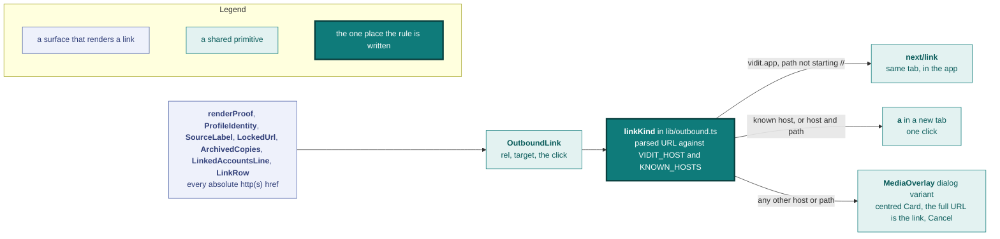

[`<OutboundLink>`](../frontend/src/components/ui/OutboundLink.tsx) renders every link whose `href` is an absolute http(s) URL. A raw external `<a>` anywhere else is a review blocker.

- `linkKind` in [`lib/outbound.ts`](../frontend/src/lib/outbound.ts) reads the parsed hostname and compares whole labels: a host matches an entry when it equals the entry or is one of its subdomains. A substring never matches, so `x.com.evil.example` is an unknown host.
- A link to `vidit.app` or a subdomain routes in the app through `next/link`, in the same tab. A path that starts with `//` after parsing (`https://vidit.app//evil.example` or `https://vidit.app/\evil.example`) is an unknown link instead, because `next/link` reads that path as another host. `linkTarget` resolves it to that host, so the dialog names `evil.example` and its URL leads there.
- A link to a known host opens in a new tab in one click. `KNOWN_HOSTS` holds the snapshot hosts (`SNAPSHOT_HOSTS` in [`lib/snapshots.ts`](../frontend/src/lib/snapshots.ts)), the platforms analysts cite (`x.com`, `twitter.com`, `t.me`, `youtube.com`, `youtu.be`, `github.com`, `discord.gg`), and the links the app makes by design (`www.google.com/maps` for the map check, the hosting providers on the legal page, and each map source page in `MAP_SOURCES`, by host and exact path, which a basemap setting's `?` links to and the leave dialog would close the basemap panel over).
- A bare host entry covers its subdomains, so add the narrowest host that fits. An entry with a path covers that exact host and path only. `www.google.com/maps` matches `https://www.google.com/maps?q=48.85,2.35` and not `https://www.google.com/url?q=...`, which redirects anywhere. Never add a host that serves an open redirector.
- A link to any other host opens a warning dialog on click, middle click, or modifier click. The dialog is `MediaOverlay` with `variant="dialog"` from [`MediaLightbox.tsx`](../frontend/src/components/ui/MediaLightbox.tsx): it centres in the viewport over the page, dimmed and blurred in the theme's canvas colour (`neutral-950`).
- The dialog surface is a `<Card>` with an accent border (`orange-500`), so it follows the light or dark theme and the chosen accent.
- The dialog names the host and shows the full URL as a `TEXT_LINK`. The URL is the only way on: it opens in a new tab, so the reader reads the address to leave. There is no confirm button.
- **Cancel** is the one button and takes the initial focus. Tab stays inside the dialog. **Cancel**, Escape, or a click on the backdrop closes it, and focus returns to the link that opened it.
- Every rendered anchor carries `rel="noopener noreferrer"`. `ugc` adds `nofollow ugc` for text an analyst wrote: proof bodies, collection descriptions, and bios.
- A value that is not an http(s) URL renders as its text.
- Paint stays with the caller through `className`, so a source host, an icon button, and a link row keep their look.
- A `mailto:` link is not a web host and stays a plain `<a>` in the same tab.

#### Source blocks

An event's evidence is its list of [sources](data-model.md#sources), up to 10, none of them the main one. A reading surface renders one block per source and a form renders one editor per source. The block, the editor and the section that lists the editors live in [`components/sources/`](../frontend/src/components/sources), each with a `/palette` entry: [`<SourceBlock>`](../frontend/src/components/sources/SourceBlock.tsx), [`<SourceEditor>`](../frontend/src/components/sources/SourceEditor.tsx) and [`<SourcesField>`](../frontend/src/components/sources/SourcesField.tsx). [`EventDetailBody.tsx`](../frontend/src/components/event/EventDetailBody.tsx) renders the blocks, through `eventPageSlots` on the pages and `eventPanelContent` in the map side panel, so the full page, the map side panel and a version page render a source the same way. The site side panel renders the site's latest source through the same block. The source state, its payload and its floor have one home, [`lib/sources.ts`](../frontend/src/lib/sources.ts).

**On a reading surface**, the blocks follow the order the API serves (`direct`, then `indirect`, then `context`, then by capture time). Each block reads like the event's **Details** card: a [`<DetailCard>`](../frontend/src/components/ui/DetailRow.tsx) region named *Source N*, with the file in its lead slot and one `<DetailRow>` per field under it. It shows, in this order:

- The file in [`<MediaGallery>`](../frontend/src/components/ui/MediaGallery.tsx), behind its own [`<GraphicContentGate>`](../frontend/src/components/ui/GraphicContentGate.tsx) when that source is flagged. A direct or indirect source without a file shows the gallery's empty box, reading *No file*. A context source without a file shows no file area: the card starts with its rows.
- **Title**: the source's title.
- **Level**: a `<Pill>`, with the label the frontend owns for `direct`, `indirect` and `context`.
- **Kind**: the kind's label, followed by the file's kind after a middle dot when the source has a file (`sourceKindLabel`): *Drone · video*, *Smartphone · photo*, *Article*. A kind of `unknown` is dropped, since it tells the reader nothing: the row shows the file's kind alone, or drops out without a file.
- **Links (N)**, where N counts the links: the value is right-aligned like every other row, one item per link. Each item holds the link through [`<SourceLabel>`](../frontend/src/components/ui/SourceLabel.tsx), named by its host without a leading `www.` like the **Detected from** row (`safeHostname` in [`lib/format.ts`](../frontend/src/lib/format.ts)), with the full URL in the `href` and the `title`, followed by its archived-copy mark on the same line.
- **Posted**: when the file went up at its link, in UTC, or *Unknown*. The row is apart from **Captured**, so an unknown post time never reads as an unknown capture. Links posted at the same time read as one value; otherwise the row holds one line per link, its host, a middle dot and its post time. A post time of exactly 00:00:00 UTC shows the date alone (`formatInstantOrDate`): the API stores a date-only `posted_at` at midnight and records no separate "time known" flag, so midnight reads as an unknown time. The editor's link list names the same field *Posted (UTC)*.
- **Captured**: the capture date and time, in UTC.
- **Capture position**: the pair on one line through the `compact` `CoordinateValue`, the variant of the event's **Coordinates** row. The pair reads at 4 decimals in small monospace text, followed by the `small` [`<CoordinateActions>`](../frontend/src/components/event/CoordinateActions.tsx). The line never wraps: the row sets `wrapLabel`, so in a narrow card the label wraps instead. The copy still carries 6 decimals.
- **Tags**: the source's tags as `<DetailPills>`.

The rows read in the order of the editor's fields, the key order of `SOURCE_FIELDS`, which names both. A row with no value drops out. The map panel keeps its density: the same file and rows, bare (`compact`), in a `LIST_TILE`.

An event with no source yet reads *No source yet* under the eyebrow.

A [site page](#sites) renders its sources with the same `<SourceBlocks>`, under the same **Sources (N)** eyebrow and `?`. Its `extras` give each block its name, its rows after the source's own and its `actions`. A block with `actions` heads its card with `SourceHeader`, the name and the controls of a source editor's header.

`eventPageSlots` (the event page, a version page, a request page) lays the blocks out in [`<SourcesRow>`](../frontend/src/components/sources/SourcesRow.tsx), at the top of the main column (see [Event layout](#event-layout)). The map panel stacks them under **Sources**. `<SourcesRow>` is the one sources row of the page and of every form: a row [`<HorizontalScroller>`](../frontend/src/components/ui/HorizontalScroller.tsx) in a region named *Sources*, whose header holds the **Sources (N)** `<SectionEyebrow>` with its `?`, the range and the arrows from two sources, and the caller's `actions`. Its `invalid` turns the eyebrow red and its `note` prints the reason in the header row.

With one source, the block takes the full width of the row, and the header holds the eyebrow alone:

- Its `<DetailCard>` sets `leadBeside`. Once the card is 42rem wide, the file sits on the left and the rows on the right, in a 3:2 split. In a narrower column the file stays on top of the rows.
- The file's `<MediaGallery>` sets `grow`, so the tile takes a 16:9 box at the full width of its slot instead of the fixed height. A video tile then takes the clip's own aspect ratio once `<VideoPlayer>` reads its metadata (`onAspectRatio`): the frame is centered, at most 28rem tall and at least 20rem wide, so a portrait clip plays in a portrait frame and the player bar keeps its controls at full size. The graphic gate and the player controls stay as they are.

With two or more sources, the blocks share the row. The scroller works as follows:

- The row scrolls sideways with native overflow scrolling, one snap point per item, by trackpad, touch or the arrow keys once the row has focus.
- Every item has the same width and the row's height, so a short block stretches to match its neighbour.
- Two items fit side by side once the row is 32rem wide. Below that, one item fits and the next peeks to show that the row scrolls. A lone item takes the full width of the row.
- With more than one item, the header shows the range in view (*1 to 2 of 5*) and the ghost icon buttons **Previous source** and **Next source**. An item counts as in view once half of it shows.
- Each button scrolls by one item, without smoothing under `prefers-reduced-motion`, and turns disabled at its end of the row. The left and right arrow keys on either button step the same way.
- With one item, the header holds the eyebrow alone.
- `actions` adds controls to the header after the buttons, at any item count. With one item, the header holds the heading and the actions alone.
- A ref's `show(index)` scrolls an item into view, so the caller can show an item it added or flagged.

[`<ArchivedCopies>`](../frontend/src/components/ui/ArchivedCopies.tsx) is that archived-copy mark, one per link:

- One link holds one copy, from whichever service produced it, so the mark is one ghost icon button carrying lucide's `Archive` box, for every state and provider, never a service logo.
- The provider lives in the accessible name of a stored copy (`Wayback Machine copy of source 1, t.me`), read off the link's `archived.provider`. `linkDescription` builds the rest of the name: the source's position, the link's position when the source holds more than one, and the host.
- The mark is accent where a copy exists and opens it. It is grey and inert where none does, for every reader including the event's owner. A missing copy is shown, not hidden.
- Nothing on a reading surface writes. Recording a copy is an edit, so the analyst archives from the form, and on a published event the save files a version naming the change.

**In a form**, the **Sources** section lays the source editors out in the event page's `<SourcesRow>`, each editor a `<Card>` region named *Source N*, with a visible *Source N* heading. The section has no card of its own: the row's header holds **Add a source** in its `actions`, so each editor is the only card. It starts with one editor, or one per stored source. The section works as follows:

- A lone editor takes the full width of the section and reads like the event page's lone source block: once the card is 42rem wide, the file sits on the left and the title, the level and the kind on the right, 3:2, with the links and **Capture details** under both at the card's width, so a link keeps its one-row layout; narrower, everything stacks. From two editors, they sit side by side with the row's sizing and peek. Every editor stays mounted, so one scrolled out of view keeps its input, its running upload and its red outlines.
- **Add a source** sits in the section header after the arrows. It appends an editor and scrolls it into view, and disables at the 10-source cap (`MAX_SOURCES_PER_EVENT`).
- While the list holds more than one editor, each editor carries a remove control at the top right of its header: a red `dangerGhost` trash icon button named *Remove source N*, with its name as a tooltip. The first click arms it in place (`useConfirmAction`): it turns filled red and takes the name *Confirm removing source N*. A second click within 3 seconds removes the editor; a click or focus elsewhere disarms it. Removing an editor shows the next one, or the previous one when it was the last.
- A publish attempt that flags a source field shows the first editor with a gap: a missing link or kind, else the first direct or indirect source when no source carries a file.
- To move a link to another source, paste it into that source's links, then remove it from this one.

An editor reads in the order of the event page's source block. It holds:

- The file slot, `MediaManager` on the generic [`FileManager`](../frontend/src/components/ui/FileManager.tsx). It is a single-file `grid`, so its one tile, or its drop zone, takes the full width of the editor at 16:9, and a stored or staged image loads its `_hero` derivative. A picked file uploads at once, on its own request ([`POST /uploads`](api.md#post-uploads)): the slot previews the local file with *Uploading <name>…* under it, then the staged copy from the returned `storage_url`. The form keeps the upload's id and posts it as the source's `upload_id`; a stored file posts back as `media_id`. A GIF stages one PNG per frame: the first fills the slot that picked it, and each further frame opens a source after it with the same level and kind. When the frames would pass the form's source cap, the slot prints the frame count and the room left instead. A refused upload prints its reason under the slot and the slot takes another pick. Removing the file is a slot action. On a form that edits a stored event, while no direct or indirect source has a file, the empty slot of a direct or indirect editor holds **Use a proof image** under it: a ghost `Button` with the `ImageUp` mark, named *Use a proof image as the file of source N*. It stages a copy of the first stored proof image the proof body still shows through [`POST /uploads/from-proof`](api.md#post-uploadsfrom-proof), and the slot takes it as a picked file, with *Copying proof image 1 of N…* under it while it runs and a refusal printed like a refused upload. The proof keeps the image. When the proof holds several stored images, a `<Select>` under the slot names each (*Proof image 2 of 3*), and picking another one copies it in place of the first. A form write waits for every running upload, with *Wait for the source files to finish uploading.*
- An optional **Title**, named *Source N title* for assistive tech so it reads apart from the event's **Title** field. A `<CharCounter>` on its label row reads it against `SOURCE_TITLE_MAX_LEN`, where it stops.
- The **Level**, a full-width `<SegmentedControl>` over **Direct**, **Indirect** and **Context**, on its own line, so its labels read in full in an editor half the row wide.
- The **Kind** under it, a `<Select>` over the generated kind values with the labels the frontend owns. Every source needs a kind, with or without a file, so the select starts on *Pick a kind* and is marked required on every form.
- The links: one row per URL through [`<LinkListInput>`](../frontend/src/components/ui/LinkListInput.tsx), capped at 10 (`MAX_LINKS_PER_SOURCE`), under **Add a link** (named *Add a link to source N*). A row holds, in order, the URL, its post time (UTC), its archive box and its remove control, under the headers *Links (N)*, where N counts the typed URLs (with the `source_links` help, red when a publish attempt flags a missing URL), *Posted (UTC)* and *Archive* on a wide list. The remove control is a red `dangerGhost` cross. On a narrow list a *Links* label with the same help sits above the cards, and each row is a small card: the URL with the remove control at its top right, then the post time and the archive box, side by side where both fit. At 320px the post time needs the card's whole width to show its value, so the archive box drops under it. While the source has no file, a row whose URL a chaser reads (`isImportableLink`) holds an *Import* cell after the archive box: a ghost icon button with the `Download` mark and an *Import file from link* tooltip, in a column that shows once one link qualifies. The button stages the post's file through [`POST /uploads/from-link`](api.md#post-uploadsfrom-link), and the slot takes it as a picked file, with *Importing the file from <host>…* under it while it runs and a refusal printed like a refused upload. When the post holds several files, a `<Select>` under the slot names each (*File 2 of 3 (video)*), and picking another one imports it in place of the first. A source needs at least one URL. Each URL and each archived copy stops at `SOURCE_URL_MAX_LEN` characters.
- On a **Satellite** or **Aircraft** source, [`<SourceImageryCheck>`](../frontend/src/components/sources/SourceImageryCheck.tsx) under the links. Once typing pauses, it runs [`POST /sources/check`](api.md#post-sourcescheck) on the kind, the capture date and the links, then names each provider a link opens in medium text, with its one-line reopening help and its expected credit in muted small text under it. The [imagery providers](imagery.md) list holds both, so the form mirrors nothing. A provider no reader can reopen has no credit, and its help names the provider to use instead. The form shows no warning: the `source_links` and `captured_at` help say what lets a reader reopen the image. A failed check shows nothing, since the check is advice and never holds the write.
- **Capture details**, a [`<Disclosure>`](../frontend/src/components/ui/Disclosure.tsx). It starts closed, or open when one of its fields holds a value. It holds:
  - **Captured**, the capture date and time in UTC ([`<DateTimeInput>`](../frontend/src/components/ui/DateTimeInput.tsx)), and the **Capture position** ([`CoordinateInputs`](../frontend/src/components/geolocations/CoordinateInputs.tsx)), both optional. The capture position hides while the kind is **Article**, **Official statement** or **Other**, and such a source posts none. A capture pair that is half-typed, malformed or out of bounds outlines both fields in red, with a line under them that names what is wrong and says the position is not saved, and the write leaves it out (`capturePositionInvalid`).
  - The source's tags (`<TagChips>`, from [`TagPicker.tsx`](../frontend/src/components/ui/TagPicker.tsx), the search field over the one tag catalogue the event's Details card reads).
  - **Graphic content** ([`<Switch>`](../frontend/src/components/ui/Switch.tsx)), with the `graphic_content` `?` saying what the flag does and who removes it. A flag the stored source already carries shows on and locked, since only an admin clears it.

A form checks the source floor before its write, from `sourceFloor` in [`lib/sources.ts`](../frontend/src/lib/sources.ts): a direct or indirect source with a file (the section heading turns red, and a red line beside it in the header row says so, so no editor moves down), a URL on every source (the **Links** header of the link list turns red), and a kind on every source (the editor's **Kind** label and select turn red). A refused write maps each source error code to one sentence (`sourceWriteError`).

On a form, the archive box sits in the row of the link it archives:

- `<ArchiveBox>` is that box, the row's *Archive* column. On a form it is never grey. A link with no copy shows an icon-only ghost button with the `ArchiveRestore` mark and an *Archive* tooltip, which opens the paste line under the row. A link with a copy, the stored one or a pasted snapshot on an allowed host, shows the copy itself: the `Archive` mark and the service's name, opening the copy, with `ArchiveRestore` beside it so a wrong paste can be replaced. On a wide link list the box is `9rem` wide in every state, so a copy appearing never narrows the URL and *Posted* fields; a long service name truncates and its tooltip shows it whole.
- `<ArchiveSnapshotField>` is the line it opens, across the row: one field, with no label, no optional marker, and no sentence. The placeholder states the contract (paste a snapshot from `web.archive.org`, `archive.today` or `ghostarchive.org`), and the check reads the full host list, `SNAPSHOT_HOSTS`, from [`lib/snapshots.ts`](../frontend/src/lib/snapshots.ts). Its own trailing mark opens the Wayback Machine prefilled with the URL currently typed in the row, so archiving a corrected URL is a re-click. It is the one form mark that goes grey: a link that does not parse has no page to open.
- Under the field there is at most one line: a red refusal for a value that cannot be a snapshot, or an amber `WARNING_CALLOUT` naming both URLs when the paste reads as an archived copy of a different link. The amber line blocks nothing.
- Every link of every source gets the pair, and the pair stays aligned with its link across an add or a removal. The form posts back each link's stored copy as its `snapshot_url`, since a link posted without one loses its copy.
- Every glyph looks alike, so the accessible name carries the state and the target: the source's position and the link's host, with the link's position when the source holds more than one, and a literal for a hostless URL.
- The box carries no `?` of its own. The link concept's `<FieldHelp>` describes the archive box once per section, so a source with ten links shows one explanation.

### Page chrome

Every main-app page uses [`<PageShell>`](../frontend/src/components/ui/PageShell.tsx), which owns the `title` / `titleField` / `subtitle` / `back` / `actions` / `stickyActions` / `controls` / `headerSide` slots and the `column` width:

| Element | Style | Notes |
|---|---|---|
| Column | `px-4 sm:px-6 lg:pl-[max(4.5rem,calc(50%-var(--container-6xl)/2-1.75rem))]`, then `max-w-[53rem]` (reading) or `max-w-6xl` (with a rail or a side column), then `pt-10 max-sm:pt-16 pb-16`, then `relative space-y-6` | One container across the app, so the title starts at the same x on every page. [`<PageFrame>`](../frontend/src/components/ui/PageFrame.tsx) owns the offset (`sm:pl-14`) and the container through its `column` prop. From `lg` up, the left padding centres a `max-w-6xl` column on the screen, with the sidebar counted as part of the left margin: on a 1512px screen the content starts 180px from the left edge and ends 180px from the right edge. The percentage resolves against the box inside the sidebar, not `100vw`, so a classic scrollbar does not push the column off centre. The padding never drops below 4.5rem, the gutter left of the title for the back arrow; where the screen has no room to spare, the column starts at that gutter and the free space falls on the right. A page with a rail takes `wide`, up to `max-w-6xl` (1152px) of content, which holds a 53rem main column beside the [right rail](#right-rail). A page without a rail takes `reading`, 53rem of content, the line length a centred `max-w-4xl` column leaves inside its padding. It starts at the same left edge as `wide`, so the free space falls on its right. `PageShell` picks the column from its `rail` and `headerSide` props: either one takes `wide`. Its `column` prop overrides the pick: the `/submit` chooser sets `wide`, so its grid of tiles fills the column. [`EventShell`](#event-layout) always sets `headerSide`, so every event surface, a form included, takes `wide`. The side padding drops a step below `sm`, where the desktop gutter leaves the cards too narrow to hold a title beside a thumbnail on a 375px screen. The top padding steps up there instead, to clear the menu chip the rail leaves in the corner; see [Phone chrome](#phone-chrome). The public landing keeps `PageFrame`'s `center` column, the same width centred. |
| H1 (`title`) | `text-xl font-medium text-neutral-100` | Consistent on every page. |
| Title field (`titleField`) | In the H1's place; the H1 takes `sr-only` | A form whose first field is the title shows that field where the H1 reads, and the H1 stays the page's heading for assistive tech. [`EventShell`](#event-layout) sets it on the event forms. |
| Subtitle | `text-sm text-neutral-400` | Tight under the H1 (8 px gap). |
| Back arrow (`back`) | Track `max-sm:hidden mb-1 lg:absolute lg:inset-y-0 lg:right-full lg:mr-3 lg:mb-0 lg:pointer-events-none`, then `lg:sticky lg:top-10 lg:pt-1.5`, then the button `flex -ml-2 lg:ml-0 lg:pointer-events-auto` | Lives in the gutter from `lg` up, so the title's x-coordinate is the same whether back is present or not. The gutter is the column's left padding, at least 4.5rem from `lg` up. There the button sits in a track that spans the page's height, so it sticks at the top of the viewport while the page scrolls: `top-10` equals the frame's `pt-10`, so the arrow never moves, and `pt-1.5` levels it with the title. The track lets clicks through, so only the button itself takes them. Between `sm` and `lg` the button is a row of its own above the title, since a gutter-parked one lands under the fixed sidebar, where taps reach the nav rather than the button. Below `sm` the header carries no back control at all: the same button is portaled into the menu chip instead (see [Phone chrome](#phone-chrome)). `-ml-2` takes back 8 of the 9px the 36px square insets its 18px glyph by, so the arrow reads as aligned with the heading. **When to set it:** `back` marks a drill-in page reached from content (event / request detail, edit, profile, the detections queue), where "back" means "return to where I clicked this". Sidebar destinations (map, submit, requests, search, about, settings) never set it: they are entered from the rail, so there is no "where I came from" to promise. One exception: a `/submit` path sets it with `onBack`, which replaces the walk below and returns to the chooser, a step back through the history when the chooser opened the path and `/submit` otherwise. **What it walks:** [`smartBack`](../frontend/src/lib/navigation.ts) pops an app-kept stack of visited paths rather than calling `history.back()`, which would walk off the origin. A route that only redirects keeps itself out of that stack (`skipBackRecord`, called before the redirect), since walking back onto one runs its redirect again and lands where the walk started, which reads as an arrow that does nothing. |
| Actions (`actions`) | Right of the title, wrapping under it below a `14rem` title basis | The page-level action cluster. Every control that acts on the thing the page is about goes here, so a reader finds them in one place. On a profile that is the glyph row (the linked accounts, then Edit profile, New collection and Sign out on your own), and Follow on someone else's profile. On the Requests board it is **Post request**. Edit mode moves the save pair to the sticky actions. The event surfaces leave it empty: their controls are sticky actions instead (`stickyActions`). A panel a cluster control opens (the add-to-collection picker, the Geolocators list) is a [`<Popover>`](../frontend/src/components/ui/Popover.tsx) that floats over the page, so nothing under the header moves. Flex line-breaking measures the title's base size, so the cluster takes its own line rather than squeezing a heading into a one-word column. A preference, not a minimum (`min-w-0`): a hard floor outgrows the frame on the narrowest phones and scrolls the page sideways. The cluster is capped at the header width (`max-w-full`) and wraps inside itself, so a row of several buttons breaks into right-aligned lines on a phone. The subtitle breaks anywhere, since a bio can hold a bare URL, one unbreakable token. |
| Sticky actions (`stickyActions`) | A zero-height `sticky top-10 max-sm:top-16 z-30` track before the header, the cluster hanging from it at the right, as wide as its actions on one line, up to the column's width | The page's actions, top right of the header, pinned at the top right of the column while the page scrolls, in an `aside` named *Actions* that `PageShell` renders, so no caller spells the landmark. [`EventShell`](#event-layout) sets it, on the event, version and request pages and the event forms. [`CollectionShell`](#collections) sets it on the collection page and the collection forms. The profile and organization edit modes set it for their save pair, the search page for **Add to collection**, and the X post and archive entries of `/submit` for their submit button (**Create the detection**, **Import archive**), which sits outside the form and submits it through its `form` attribute. The header keeps the cluster's room, and the cluster takes a surface once pinned; see [Event layout](#event-layout). `stickyActionsIdle` keeps that room while hiding the cluster (invisible, inert, no surface), for actions that come and go with a page state, so the header never moves when they return. |
| Header in the column (`headerInColumn`) | The header and `controls` head the main column of a [right rail](#right-rail) page, beside the rail rather than above both | Off by default. The About page sets it, so the rail's first block sits top right, level with the title. The header scrolls with the main column while the rail sticks. The title keeps its x and the back arrow keeps its gutter, since the main column starts where the header did. Below `lg` the header comes first and a stacked rail follows it, so the actions sit under the title. |
| Controls (`controls`) | `flex flex-wrap items-center justify-between gap-2`, one `space-y-6` step under the header | The view controls: the `<SegmentedControl>` that picks what the page lists or how (the search result type, the Requests sort), left-aligned under the title. A control that acts rather than picks a view goes in `actions` instead. The row sits above a [right rail](#right-rail), so the rail starts level with the list. |
| Header side (`headerSide`) | [`PageColumns`](../frontend/src/components/ui/PageShell.tsx): `grid items-start gap-6 lg:grid-cols-[minmax(0,65fr)_minmax(0,35fr)]` | Lays the page out as a main column and a side column, 65:35 from `lg` up. The header heads the main column and `headerSide` heads the side column, level with the title, under the sticky actions. The children lay out their own `PageColumns` under the header, on the same split, so the columns line up. Below `lg` each side column follows its main column. [`EventShell`](#event-layout) sets it on every event surface to what reads under the pinned row (`actions.below`), `null` when that is empty, and [`CollectionShell`](#collections) sets it on every collection surface. `PageColumns`' `stickySide` pins the side column from `lg` up, under the sticky actions (`lg:top-24`), while the main column scrolls: the collection surfaces set it, since their main column runs to hundreds of rows. |

Pre-data states use `<PageLoading>` / `<PageError>` (one centered shell). Opt-outs: `/` (landing), `/map` (full-screen map), the `(auth)/*` group, and `app/error.tsx`.

The public guides use the same shell, signed in or out: `/guide` ("Getting started", the page a new analyst reads first; see [Getting started page](#getting-started-page)), `/methodology` ("Building a proof"; see [Import and methodology guides](#import-and-methodology-guides)), and `/import` ("Import your work from X": the conditions once, an annotated post for what a detection carries, a screenshot of the Submit mode selector, then one section per entry). Each is a server component of `PageShell` plus `Card`, for SEO, linked from the About page's Guides section. `/bot` and `/archive` are `redirect()` stubs into `/import#bot` and `/import#archive`, and both stay in `PUBLIC_PREFIXES` so a signed-out reader is forwarded rather than sent to the login page. The bot's X bio points at `/bot` (see [The bot](ingestion.md#the-bot)).

[`<LegalLinks>`](../frontend/src/components/ui/LegalLinks.tsx) puts the legal notice and the privacy policy on one muted line: the landing page ends on it and the `(auth)/*` layout puts it under every card.

The `(auth)/*` group composes [`<AuthCard>`](../frontend/src/components/auth/AuthCard.tsx) (a `max-w-sm` centered card). The two single-email pages (`/forgot-password`, `/resend-confirmation`) also share [`<SingleEmailFlow>`](../frontend/src/components/auth/SingleEmailFlow.tsx), whose sent-state copy stays anti-enumeration ("if X is registered…", never confirming the address exists).

`/unsubscribe/notifications` is an `<AuthCard>` too: it turns off the email of one notification kind only on a click of its button, so a mail scanner that opens the link changes nothing. Opened without its token, it reads *Incomplete link*, the title `/reset-password` shows without its token, and links to Settings.

`/confirm-registration` consumes the token, signs you in, and then stays on its success card rather than redirecting. The card offers the two next steps as full-width links with `buttonClasses`: **Import your X archive** (primary, `/submit?import=1`) and **Read Getting started** (secondary, `/guide`).

#### Getting started page

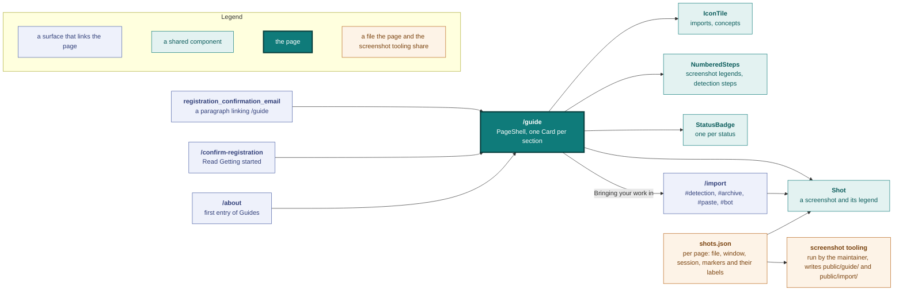

[`/guide`](../frontend/src/app/guide/page.tsx) is a server component of `PageShell` plus `Card`, like the other guides. The page shows rather than tells: each section is a title, at most one sentence, annotated screenshots, and at most one row of `IconTile`s for what no screenshot shows. Each section is a `Card` whose `h2` carries the anchor:

| Anchor | Heading | What it shows |
|---|---|---|
| `#layout` | The layout | A screenshot of the signed-in rail on the map, and one of the phone drawer |
| `#reading-a-geolocation` | Reading a geolocation | A screenshot of an event page: byline, the source blocks with their files, links and archived copies, coordinates, details, proof, versions, share and report, approvals |
| `#statuses` | The statuses | The four `StatusBadge`s with one line each, and the steps from detection to geolocation |
| `#bringing-your-work-in` | Bringing your work in | Tiles to the archive, a pasted post and @ViditBot on `/import`, and to the submit form |
| `#working-with-others` | Working with others | A screenshot of the approvals on another analyst's geolocation, one of the Feed, and tiles for requesting an approval, co-geolocators and organizations |
| `#settings` | Your settings | A screenshot of the Notifications card (who can request your approval, the email switch per kind), and tiles for the profile, the X handle and display |

- **Anchors are contract.** Other pages and messages link to a section by its id, so keep every id when you edit a heading. Each heading takes `max-sm:scroll-mt-16`, so a jump on a phone lands below the menu chip.
- **One marker list.** [`shots.json`](../frontend/src/app/_shots/shots.json) groups the screenshots by page, `guide` and `import`, and names each one's file, route, window, session and markers. The layout, Approvals, Feed, Notifications and Submit shots are signed in. A marker is a target element and its legend line. The screenshot tooling is not part of this repository. It draws a numbered orange disc beside each target and writes the WebP to `frontend/public/<page>/`. [`Shot`](../frontend/src/app/_shots/Shot.tsx) renders one screenshot on either page and numbers the same labels with `NumberedSteps` under the image. Change a marker in the JSON, and the maintainer regenerates the screenshots.
- **Grounded in the product.** The page names only controls that exist, under the labels the product prints. A change to a surface the page shows updates its tile or its markers in the same PR, and the maintainer regenerates its screenshot.

#### Import and methodology guides

The three guides chain: `/guide` links `/import` and `/methodology`, and neither of those restates what another guide owns. A fact lives in one guide, and the others link to it:

| Fact | Owner | Linked from |
|---|---|---|
| The four statuses and the path from detection to geolocation: on the map and in your queue, you review, only you publish, rejecting closes it | `/guide#statuses` | `/import`, one sentence after the annotated post |
| What makes a detection: your own post from your linked X handle, carrying a coordinate | `/import#detection` | `/guide#bringing-your-work-in` |
| What a detection carries, and the parsing rules (coordinate formats, a quote outranks links, links that never count, the 120-character title, several candidates leave the source empty) | `/import` | No other guide |
| Each way in: the archive, a pasted post, @ViditBot | `/import#archive`, `#paste`, `#bot` | `/guide` tiles, as navigation |
| What a proof is and how to build one | `/methodology` | `/guide#reading-a-geolocation` |

- **The annotated post.** [`/import`](../frontend/src/app/import/page.tsx) shows what a detection carries as a `MockPost` of a typical geolocation post, a quote of the source post with its footage, and numbers its parts with the `STEP_NUMBER` disc that [`NumberedSteps`](../frontend/src/components/ui/NumberedSteps.tsx) exports: 1 coordinates, 2 the source, 3 the source media, 4 the title line, 5 the proof text. A `NumberedSteps` legend beside it gives one line per number, and a short list under it holds the rules a reader needs when a detection looks wrong.
- **The entry chooser.** Under "Three ways in", `/import` shows the `submit-modes` screenshot of the `/submit` chooser: 1 the chooser, 2 Geolocation, 3 From an X post, 4 Bulk import. A line under the legend says that @ViditBot needs no form. The `IconTile` row under it links each entry's section, which the screenshot does not.
- **The proof example.** [`/methodology`](../frontend/src/app/methodology/page.tsx) opens on one real proof image from a public geolocation, stored as `frontend/public/methodology/proof-example.webp` and captioned with the analyst and a link to the event page. Numbered discs are baked into the image, and each number marks the step of the same number in the list under it, so a reorder of the first four steps re-bakes the image.

#### Right rail

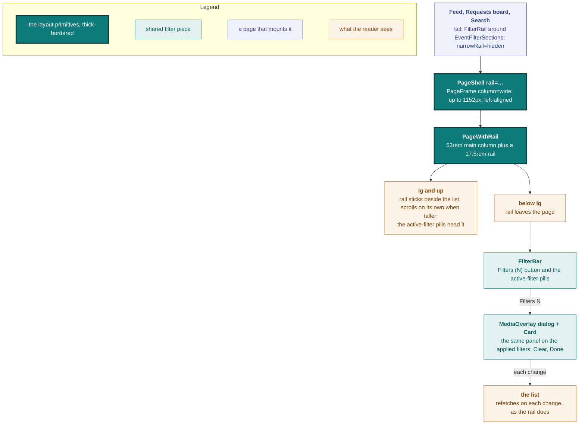

[`<PageWithRail>`](../frontend/src/components/ui/PageWithRail.tsx) lays a page out as a main column and a right rail. Use it for any page whose side panel stays in view while its main column scrolls. Pass the panel as `<PageShell>`'s `rail` (with `railLabel` and `narrowRail`): `PageShell` composes `PageWithRail` and widens its column to `wide`, so the main column keeps the 53rem reading width beside the rail once the screen holds both. A page whose rail comes and goes passes `null` while it is gone, which keeps the column one width and keeps its element mounted.

- **From `lg` up** the rail is a `17.5rem` (280px) column right of the main column. It sticks while the main column scrolls, at its resting top, so it never moves: `PageShell` sets `--rail-top` to the frame's `pt-10` (2.5rem), plus the header's measured height and the 1.5rem gap under it when the header sits above the rail. Once the rail is taller than the viewport it scrolls on its own, so its foot stays reachable.
- **Below `lg`** the `narrow` prop picks the shape. `stacked` (the default) puts the rail above the main column. `below` puts it under the main column, for a rail that acts on what the column holds; the rail also comes after the column in the tab order at every width. `hidden` takes the rail off the page, for a page that offers its own narrow entry to it.
- **Without a `rail`** (`null`) the page takes the `reading` column, so a page can drop the rail on a view it does not apply to.
- **With `headerInColumn`** `PageShell` passes its header to `PageWithRail` as `header`, which heads the main column (`lg:grid-rows-[auto_1fr]`, the rail spanning both rows). The rail's top is then level with the title.

The event forms place their actions in [`EventShell`](#event-layout)'s sticky actions instead of a rail. The feed, the [Requests board](#requests-board) and search mount the shared filter panel ([`EventFilterSections`](../frontend/src/components/filters/EventFilterSections.tsx)) in the rail with `narrowRail="hidden"`. The [About page](../frontend/src/app/about/page.tsx) mounts its links in the rail with `headerInColumn` and `narrowRail="below"`: three dense `Card`s (Guides, Stay in touch, Legal) of `LinkRow`s, while the main column keeps the prose (Commitments, Funding, Privacy, Behind Vidit), so the rail's links stay in view while the prose scrolls. The map keeps its floating overlay panel. The active-filter pills follow the rail, as the map's overlay stacks them over its sections:

- From `lg` up, [`<FilterRail>`](../frontend/src/components/filters/FilterRail.tsx) wraps the panel in the rail and puts the removable pills at its head. It leaves the author pill out when the panel offers the Author section (its `sections` prop, as the panel takes it), since that section already names the analyst in its summary and its picker.
- Below `lg`, where the rail is gone, [`<FilterBar>`](../frontend/src/components/filters/FilterBar.tsx) sits above the list: the pills, author included, and a **Filters** button that reads **Filters (N)** while N filters are active. From `lg` up the row hides.

The **Filters** button opens the same panel full screen in `MediaOverlay`'s dialog variant around a `<Card>`. The panel there applies each change at once, as the rail and the map's panel do, so the list behind the dialog refetches on every pick:

- **Clear** empties the filters. It is disabled while no filter is active.
- **Done**, Escape or a tap on the backdrop closes the dialog. While a search field's list is open, Escape closes the list only.

The pills act on the applied filters at every width. Every applied value has its pill, and counts once in **Filters (N)**. A pill is a key/value [`<Pill>`](../frontend/src/components/ui/Pill.tsx): the key is the filter's name, as its field label reads (`FILTER_NAMES`), and the value reads as its chip does, for example **Show:** *Sites*, **Approvals:** *Approved only*, **Author:** *ana* or **Event date:** *Until 1 Jan 2025*. A date window reads *From 1 Jan 2024*, *Until 1 Jan 2025* or *1 Jan 2024 to 1 Jan 2025* (`rangeSummary`). The pill row hides from `lg` up while no filter is active, since the button is off the page there.

#### Filter panel

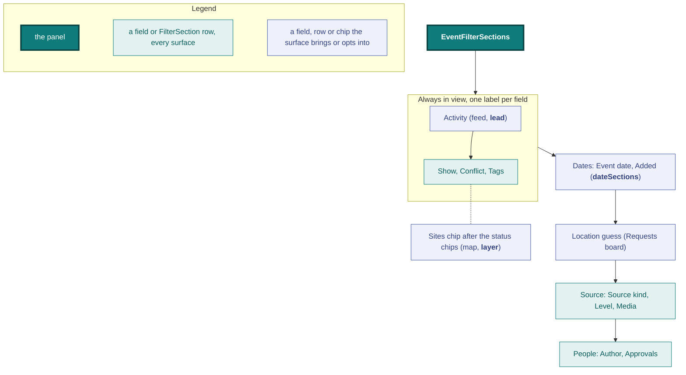

[`EventFilterSections`](../frontend/src/components/filters/EventFilterSections.tsx) is the one filter panel of the map overlay, search, the [Requests board](#requests-board) and the feed. It lays its filters out in one `CARD_FRAME`, in a fixed order and with no group heading.

The panel opens on fields that stay in view, each under its `<FieldLabel>` with its `?`:

1. The surface's own fields, passed as `lead`: **Activity** on the feed. The other surfaces have none.
2. **Show**, the event statuses to list: Requested, Detected and Geolocated. On the map the field ends with the **Sites** chip, passed as `layer` (see [Map](#map)). The filter carries one name on every surface, `show` in the code. The URL parameter, `GET /search` and `GET /events` name it `status`, and `GET /feed` names it `kind`.
3. **Conflict** and **Tags**, the two search fields.

Collapsible rows follow:

1. The **Dates** row of the surface's `dateSections`.
2. **Location guess**, on the board alone.
3. The **Source** row (Source kind, Level, Media).
4. The **People** row (Author, Approvals).

Each row is a [`<FilterSection>`](../frontend/src/components/ui/FilterSection.tsx). Filters that share a row show as fields, each under a `<FieldLabel>` with its `?`. A row left with one filter on a surface shows that filter as its own row, with its own title and `?`: the Collections scope of search shows **Author**, and the feed shows **Approvals**. The map shows Show, Conflict and Tags, then three rows, for its eleven filters and the Sites chip.

A pick in the **Conflict** field closes its list, so the list never covers the **Tags** field under it. A click on the field opens the list again. A pick in **Tags** keeps the list open for the next tag.

A collapsed row sums up its active values, joined by commas, or reads **Any**. Every row opens collapsed, except a row that holds an active value, which opens expanded so the applied filters stay visible. Each header still toggles its row. The panel keeps the open state per row, so a re-render or a scope change on search never resets it.

#### Phone chrome

The nav chrome takes three shapes, and the page offset follows it:

| Width | Nav | Page offset | Back control |
|---|---|---|---|
| Below `sm` (640px) | The rail is off-canvas. A floating menu chip in the top-left corner opens it as a drawer. | No left inset. `PageShell` takes `max-sm:pt-16`, so the title clears the chip. | Portaled into the chip, beside the open control. |
| `sm` to `lg` | Fixed 56px rail, collapsed to glyphs or expanded to labels. | `sm:pl-14`, from `PageFrame`. | A row of its own above the title. |
| `lg` up | The same rail. | `sm:pl-14`. | Parked in the gutter left of the column. |

**The chip is the rail's chrome while the rail is off-canvas** ([`Sidebar.tsx`](../frontend/src/components/Sidebar.tsx)): an opaque `neutral-900` box on a `neutral-800` border, 8px in from the top and left edges, holding a 44px open control (lucide's `Menu`) and, beside it, a slot for the page's back control. It costs the corner it occupies and nothing more, which is why each page clears it with its own top padding rather than every route surrendering a row to a bar. `PageShell` portals its back control into that slot below `sm` through [`phoneBackSlot.ts`](../frontend/src/lib/phoneBackSlot.ts), so a page carrying one shows the arrow beside the open control and every other page shows the open control alone. The brand mark stays in the drawer, where it doubles as the Home entry.

**The drawer is the rail's expanded state**, slid over the page: 192px wide, glyphs plus labels, the identity block at the foot, and the beta pill inline under it. A `black/50` scrim covers the page behind it, and the body stops scrolling while it is open. It closes five ways: a tap on any link inside it (the entry already active included, which changes no route), a route change, Escape, a tap on the scrim, and the foot control, which reads *Close* below `sm` and *Collapse* from `sm` up: one row at every width, but two buttons, since closing the drawer and folding the rail act on different state.

**The beta pill has one live copy at any width** ([`BetaBanner.tsx`](../frontend/src/components/BetaBanner.tsx)). The floating corner pill paints over a phone's content, so it hides below `sm` and the drawer renders the same component inline at its foot.

**The map page lays its overlays out around the chip.** The filter bar starts right of the chip's open control (`left-16`), and the overlay stretches to 72px above the viewport bottom, clear of the map's bottom-left row (zoom, locate, basemap and an attribution that wraps to three lines at 320px), laying its bar, its active-filter strip and its section stack out as a column: the stack takes the height the other two leave and scrolls the rest, so the tag and author sections stay reachable. The stretched box passes pointers through, so the map keeps every tap outside the blocks themselves. The detail panel becomes a bottom sheet: full width on the bottom edge, capped at `60dvh`, scrolling its own content, under a grab bar above its close control. The bar is decorative, and marks the sheet as the scrolling surface; the close control dismisses it. The map's bottom-left control group keeps the map's own corner below `sm`, since the 60px offset in [`globals.css`](../frontend/src/app/globals.css) clears a rail that is not there; an open sheet covers that group, and closing it hands the group back.

**A finger gets slop on the canvas** ([`Map.tsx`](../frontend/src/components/map/Map.tsx), [`stack.ts`](../frontend/src/components/map/stack.ts)). On a coarse pointer, a tap that hits bare canvas is re-tested over a 12px box on each side and takes the feature whose projected centre sits nearest, then does what that feature's own layer would have done: a cluster zooms, a stack badge fans out, a pin selects. A ring dot keeps its 12px paint and grows a 32px hit box around it. A tap arms no hover preview, since the compatibility `mousemove` a tap fires would open the card over the pin the finger just selected. A mouse keeps exact hit testing and its preview. The pointer read has one home, `isCoarsePointer` ([`pointer.ts`](../frontend/src/lib/pointer.ts)), on the same media feature the `pointer-coarse:` variant carries in CSS.

**A [`<SegmentedControl>`](../frontend/src/components/ui/SegmentedControl.tsx) always stretches below `sm`**, its options sharing the track and their labels staying on one line. An intrinsic-width track with three labelled options runs past a 375px column, and the browser's answer there, wrapping each label, reads broken. Each option starts from its label's width and the spare room is shared out, so the longest label keeps its words: equal thirds at 320px cut *People I follow* in the settings to *People I f…*.

**A form field renders at 16px on a phone** ([`Input.tsx`](../frontend/src/components/ui/Input.tsx)). `FIELD_TEXT` is the one field type size, 16px below `sm` and 14px from `sm` up, and the three `<Input>` variants, `<Select>`, `<Textarea>` and the locked box all run it. Mobile Safari zooms the page in when you focus an editable element rendering under 16px, and it does not zoom back out when you leave the field, so a smaller field leaves you scrolled sideways on the form you were filling in. The map scrubber's date fields, the one field that sets a denser size of its own, carry it as `sm:text-[11px]`, so they keep the dense desktop size and take the floor on a phone. The field's height follows its type size, 38px from `sm` up and 42px below it.

**A field's trailing actions are cleared by one figure at each size**, `TRAILING_ROOM` in the same file. The widest adornment holds two ghost icon buttons and the icon button steps from 32px to 36px on a phone, so the text padding that clears it is `pr-18` from `sm` up and `pr-20` below. [`<LockedUrl>`](../frontend/src/components/geolocations/fields/LockedUrl.tsx) reads that constant too, so its value stops where an adorned field's does. A mark that stands down on a phone takes `sm:pr-10`, one icon button's room from `sm` up and none below, which the field asks for with `trailingFromSm`: `<Input>` then hides the slot below `sm` and leaves the field its full width there, so the two halves of the decision stay together. [`<DateTimeInput>`](../frontend/src/components/ui/DateTimeInput.tsx) takes that form for every date, time and instant field: at 320px the instant in a link's post time field needs the whole field, so the picker mark is a desktop affordance, and below `sm` a tap on the field opens the engine's own picker. The narrow-viewport suite measures the room the instant field leaves against the width the engine paints its value in.

**The coordinate pair holds one line at every width** ([`CoordinateInputs.tsx`](../frontend/src/components/geolocations/CoordinateInputs.tsx)). The line is a three-column grid: Latitude and Longitude share the room in two shrinking columns, and the map and copy actions take only their own width after them. The pair has no visible labels: each field is named for assistive technology (`aria-label`, *Latitude* and *Longitude*) and shows an example value as its placeholder, and a refused pair turns both fields red (`FORM_INVALID_FIELD`). The fields run half the usual side padding and tight tracking, so a 6-decimal value shows whole from 375px up and in the forms' side column at 1024px. At 320px the 16px field text and the 36px tap squares leave room for about 6 characters, and the rest scrolls inside the field. The narrow-viewport suite measures the line in the Location card and in a source editor at both phone widths and at 1024px.

**An embedded map hands the one-finger swipe back to the page** ([`Map.tsx`](../frontend/src/components/map/Map.tsx)). The `embedded` prop sets MapLibre's `cooperativeGestures` on the event page's location box and on the profile map, which drops the canvas to `touch-action: pan-x pan-y`: a swipe that starts on the map scrolls the article, panning takes two fingers, and zooming takes Command or Ctrl with the wheel, announced on the blocked gesture. On desktop, a bare wheel over either map scrolls the page, and MapLibre paints its own overlay saying to hold Command or Ctrl. `/map` leaves the prop unset, since there the map is the page.

**The page frames on `dvh` and paints under the cutout.** [`app/layout.tsx`](../frontend/src/app/layout.tsx) exports `viewport` with `viewportFit: "cover"`, so the document reaches the physical edges of the screen.

- Every surface that owns the screen size takes it on `dvh` rather than `vh`: the document body, both page frames (`<PageFrame>` and `<PageCenter>`), the map page, the media lightbox, and the global error boundary. `vh` is the tallest the viewport gets, so with mobile Safari's URL bar showing, a `vh` frame pushes centred blocks low and puts the last row behind the bottom chrome.
- Edge chrome takes the insets back through the `safe-*` utilities in [`globals.css`](../frontend/src/app/globals.css). A surface that floats a set distance from an edge takes the inset as a margin: the menu chip, the map's filter overlay, and the map's detail panel from `sm` up. A surface that fills an edge takes it as padding, so its box still reaches the edge: the nav drawer, the map's bottom sheet, and the media overlay, whose backdrop covers the cutout band so a tap there closes the viewer.
- The nav element takes that padding only while it is the drawer (`max-sm:`). From `sm` up it is the 56px rail, which takes no inset and paints under the cutout band, since a notched phone in landscape is past `sm` and the inset would leave 12px for the glyphs.
- The page column takes its horizontal insets in `<PageFrame>` and `<PageCenter>` ([`PageFrame.tsx`](../frontend/src/components/ui/PageFrame.tsx)), which keeps every route's content out from under the cutout in landscape.
- `env()` reads 0 where the device reports no inset, so both forms are inert on a desktop.

**The media lightbox scrolls instead of overflowing** ([`MediaLightbox.tsx`](../frontend/src/components/ui/MediaLightbox.tsx)). The frame is `80dvh` inside an `overflow-y-auto` overlay, so a video's control bar stays on screen with the iOS URL bar visible. The content sits at the top of the overlay with auto vertical margins, which centre it while it fits and collapse to 0 when it does not, so nothing lands above scroll origin. The content is sized by what it holds rather than clamped to the overlay's height, so a tall frame scrolls.

**An interactive chip and a filter-section header are tap targets.** `TAP_STEP` ([`Button.tsx`](../frontend/src/components/ui/Button.tsx)) is the one phone floor, 36px below `sm` and the exact desktop shape from `sm` up. It raises the tappable height only, so a control keeps its own type scale and its own horizontal padding. [`<Pill>`](../frontend/src/components/ui/Pill.tsx) takes it whenever it carries an `onClick`, which is every conflict, source kind, level, tag and status chip, every removable active filter, the `<AccountPicker>` chip and every `<TagPicker>` conflict and tag chip; a static pill is a label and keeps its resting height. [`<FilterSection>`](../frontend/src/components/ui/FilterSection.tsx) makes its whole header row the target the way [`<ToggleRow>`](../frontend/src/components/ui/ToggleRow.tsx) makes its row the switch: each of the two toggles carries the step and the row's vertical padding, and the summary and chevron one grows into every pixel right of the title, so the `?` is the only part of the header that is not a toggle. Put the step on the row instead and it sizes the row while each button keeps its own 16px line box, which is a 36px strip holding two 16px targets. The quiet text control of the same surfaces, `Clear all`, takes the step as well. A square control smaller than the icon button takes the same floor through `ICON_TAP_STEP`, the width and the height together: the settings accent swatch, a `<FileManager>` tile's remove control, the map scrubber's play and reset controls, and the sidebar's three community links, each naming its own desktop square beside it.

**A boolean preference is a [`<ToggleRow>`](../frontend/src/components/ui/ToggleRow.tsx).** Its accessible name is its label alone (`aria-label`), and its description is its accessible description. An empty button laid over the whole row carries `role="switch"` and the click, and `<Switch>` renders as its visual span, so a tap anywhere on the row toggles rather than having to land on the 20x36px track, and the row takes `TAP_STEP`. The span takes no pointer event (`pointer-events-none`), so a click on the track or its knob reaches the button under it. `concept` puts a [`FieldHelp`](#field-help-) `?` after the label in the `setting` shape, and `leading` puts a small picture before the text, as on `<ActionRow>`. The `?` stacks above the row's button rather than inside it, so a tap on it opens its help and never toggles. `variant` picks the shape, and defaults from `description`: `filter` is the filter toggle, a micro uppercase label on a divided list; `setting` is a settings preference, the label at reading size over a line saying what the preference does when there is one. The basemap panel uses `setting` rows without a description. The accessible name is the label alone (`aria-labelledby` on it), so a screen reader announces the switch by what it switches, and the description is its accessible description. `disabled` reads the state but refuses the toggle and dims the row; give it a `description` that says when the switch applies.

**Settings shows labels only.** Each card heading, setting and switch on the settings page carries its explanation behind its `?`, and no line under it. The concepts are in [`lib/fieldHelp.ts`](../frontend/src/lib/fieldHelp.ts): `display_settings`, `help_tooltips`, `light_mode`, `accent_color`, `notification_settings`, `approval_request_audience`, `x_handle`, `invite_analysts`, and one `notification_<kind>` per notification kind, built from the kind's `setting` sentence in `NOTIFICATION_KIND_COPY`. Once a setting reaches the account, the card heading shows **Saved** with a check at its right edge for 1.5 s (`useFlash`, the timer `useCopyToClipboard` also runs on), in `META_LINE`, inside a `role="status"` region so a screen reader hears it. A failed save shows the card's `ErrorNotice` instead.

**Settings → Notifications is a list of [`<ToggleRow>`](../frontend/src/components/ui/ToggleRow.tsx)s.** Each row is one notification kind with one **Email** switch, its label and `?` on the left. The switch applies to the account, whatever the device. The in-app notifications list shows every kind and has no switch. The approval-request audience sits outside the list.

**A pick-one preference is a [`<ChoiceRow>`](../frontend/src/components/ui/ChoiceRow.tsx).** It is the `<ToggleRow>` shape for a setting with a few named choices: the label at reading size, over a line saying what the setting does when there is one, and a `<SegmentedControl>` named by the label. `concept` puts a `?` after the label. Settings and the organization page both render **Accept approval requests from** through it. Below `sm` the bar drops under the text and takes the full column.

**One action on a named thing is an [`<ActionRow>`](../frontend/src/components/ui/ActionRow.tsx).** It is the sibling of `<ToggleRow>` and `<ChoiceRow>`: an optional small picture (`leading`), the label at reading size over a muted line, and the action's verb at the right edge. The whole row is the button, with the accent wash on hover and keyboard focus. The verb shows on hover and keyboard focus through `HOVER_REVEAL`, and always on a touch screen, which has no hover. `done` takes the verb's place once the row has acted, and the row then stops acting; until then `aria-label` names the action and its target. `disabled` refuses the action while another write runs. The three rows share one text block, `PreferenceText` ([`ToggleRow.tsx`](../frontend/src/components/ui/ToggleRow.tsx)). The search page's bulk **Add to collection** lists the owner's collections through it, in the [collection picker](#collections) the event page's switches share.

**A colour preference is a [`<SwatchPicker>`](../frontend/src/components/ui/SwatchPicker.tsx).** It is an ARIA radiogroup of round swatches. The selected swatch is the one tab stop, the arrow keys move focus and selection together and wrap at the ends, and Home and End jump to the ends. The selected swatch wears a light ring and the focused one an accent ring. Settings → Display uses it for the accent colour.

**A pill never outgrows the box it sits in.** `<Pill>` holds its width against its neighbours (`shrink-0`), which is what keeps a badge from being squeezed on a crowded row, so a pill carrying one long word would hold its full width and run past its container. `max-w-full` bounds the box and `wrap-anywhere` breaks the word inside it, so a long tag name on the request card's content column takes a second line rather than scrolling the page sideways. Use `wrap-anywhere` (`overflow-wrap: anywhere`) and not `break-words`: a pill is an `inline-flex` box, sized by its content's min-content width, and a `break-word` opportunity is excluded from that measurement, so the box would stay as wide as the unbroken word. The same token breaks the account email on the settings page and the page subtitle in `<PageShell>`.

**A detail row gives way rather than squeezing** ([`DetailRow.tsx`](../frontend/src/components/ui/DetailRow.tsx)). Label and value share one line at every width, and `*:min-w-0` lifts the automatic flex floor off both halves, so a value carrying `truncate` cuts itself to the room the row leaves and a value that wraps on its own (a close reason, a tag list) takes the lines it needs beside the label. The label never shrinks, so it stays on one line at every width. The row does not wrap: wrapping drops a truncating value onto a line of its own before `truncate` engages, which is a different row from the one the desktop map panel is laid out as. `gap-x-4` is the only gutter between the two halves, so a value adds no margin of its own. [`<SourceLabel>`](../frontend/src/components/ui/SourceLabel.tsx) truncates against that rule rather than against a width ceiling of its own, which is why it takes no width prop. A `wrapLabel` row is the one exception to the fixed label: its value holds one line at its full width (`shrink-0`), so the label wraps instead when the row runs short (a source's **Capture position**, the event's **Coordinates**).

#### One event, four surfaces, two writes

An event is read on four surfaces and written by two endpoints.

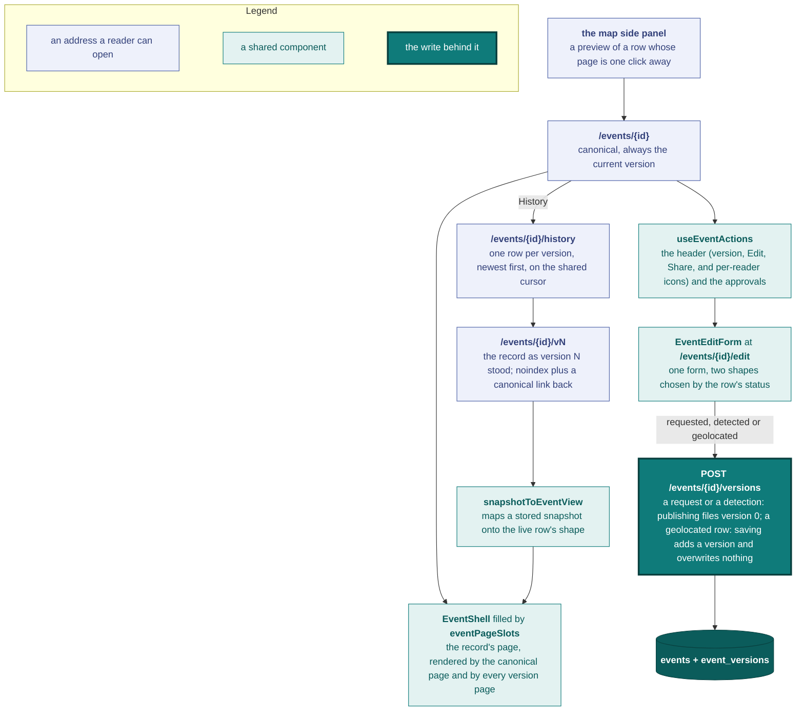

The history list's `Current` row opens the canonical page rather than a version address, since that is where the record as it stands is read.

#### Event layout

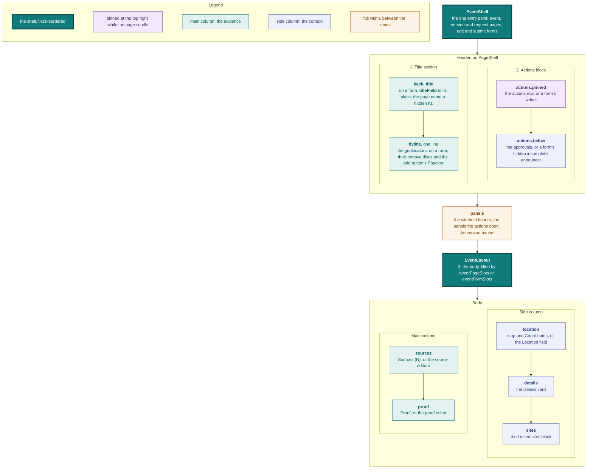

[`<EventShell>`](../frontend/src/components/event/EventShell.tsx) is the one shell of an event, and the only place that lays one out. The event page and the request page render it through [`EventReadPage`](../frontend/src/components/event/EventReadPage.tsx) (the row, its actions for the surface and `EventByline`, the byline built from the row), a version page directly, and the [owner edit form](#the-owner-edit-form) and the [submit form](#forms) through `EventFormShell`; each fills the slots of its three zones, so a block sits in the same spot on every surface. The zones are the title section, the actions block and the body. To move a block, change `EventShell` or its body grid, [`EventLayout`](../frontend/src/components/event/EventLayout.tsx); a page only fills slots. The shell builds on `PageShell`: the title section is its header, with `titleField` in the title's place; the actions block's pinned row is `stickyActions`, and what reads under it is `headerSide`. The body is a `PageColumns`, 65:35 from `lg` up (`PAGE_COLUMNS_SPLIT` in [`PageShell.tsx`](../frontend/src/components/ui/PageShell.tsx)), the split the header's columns take. The main column holds the evidence and the side column holds the context. The map panel keeps its own one-column body. The `/palette` entry for `<EventShell>` renders the three zones with every slot a labelled empty box, for each of the three fillings.

Each surface fills the slots this way:

| Slot | Event, version and request pages | Edit form | Submit form |
|---|---|---|---|
| Back | Back through the history | Back through the history, the row's page as the fallback | Back to the chooser (`onBack`) |
| `title` | The event title | **Edit geolocation**, **Publish detection**, **Edit request** or **Geolocate request**, a hidden `h1` and the browser tab's title | **Submit**, a hidden `h1` and the browser tab's title |
| `titleField` | None | The **Title** field | The **Title** field |
| `byline` | The author and the geolocators; on version 0, who opened the request or the detection | The geolocators, the pending invitations and **Invite a geolocator** on a published row; you, your picks and **Invite a geolocator** on a request or a detection | You, your picks and **Invite a geolocator** |
| `actions.pinned` | The actions row, **Geolocate** last in it on a request, the version selector on a version page | The writes and the close ([`PublishActions`](../frontend/src/components/geolocations/PublishActions.tsx)), the `ErrorNotice` | The two publish buttons ([`PublishActions`](../frontend/src/components/geolocations/PublishActions.tsx)), the `ErrorNotice` |
| `actions.below` | The approvals, a version's approvals | `IncompleteFormAnnouncer`, visually hidden | `IncompleteFormAnnouncer`, visually hidden |
| `panels` | The withheld banner, the geolocator invitation's card, the report form, a dialog, and the receipt a sent report leaves; the version banner | None | None |
| `sources`, `proof` | The source blocks, the proof | The source editors, the proof editor | The source editors, the proof editor |
| `location` | The map and its **Coordinates** row, none on a request | The **Location** field: its **Coordinates** label and `?`, the pair, then the page's map | The **Location** field, then the duplicate probe |
| `details` | The Details card | The **Details** fields | The **Details** fields |
| `sites` | The Linked sites block on the event page, none on a version or request page | The **Linked sites** field, none on a request | The **Linked sites** field |

- **Title section.** The title section heads the main column: back, the title, then the byline. The three pages share one top: on a form the **Title** field (`titleField`) takes the event title's place, in the title's size, weight and line height. The field takes the title's type (`PAGE_TITLE_TEXT` in [`PageShell.tsx`](../frontend/src/components/ui/PageShell.tsx)), and the typed text starts where the title's text starts: the box bleeds left by its border and padding (13px) and up and down by 5px, so the header keeps the title's height. The field is a one-row textarea that grows a row per wrapped line (`field-sizing: content`), so a long title wraps on a phone like the event title. Enter adds no line: on the edit form it saves, as Enter in a field does. The field stops at `EVENT_TITLE_MAX_LEN` characters. Its label is visually hidden, and a `<CharCounter>` then its `?` follow it. The form's page name stays the page's `h1`, visually hidden, and names the browser tab (*Submit on Vidit*). On a form the byline manages the geolocators in place, on one line, and nothing opens in the page (see [The owner edit form](#the-owner-edit-form)). Both bylines draw the co-geolocators as one `<AvatarStack size="sm">` after the lead at one gap (`BYLINE_GAP` in [`AuthorByline.tsx`](../frontend/src/components/ui/AuthorByline.tsx)), and the add button stays within the line, so the byline has the same height and the same picture positions on the page and on a form.
- **Actions block.** The actions block heads the side column, level with the title. Its pinned row, `actions.pinned`, holds the buttons, in an `aside` named *Actions* that `PageShell` renders around every `stickyActions`, and only the buttons, their counts and a form's `ErrorNotice`, so the pinned cluster stays one line. What reads under it, `actions.below`, scrolls with the page (see [Event actions and approvals](#event-actions-and-approvals)).
- **Pinned row.** From `lg` up the cluster ends on the side column's right edge and takes the width its actions need on one line, reaching left past the side column when they need more. When the page scrolls, the title scrolls away and the cluster stays pinned at the top right of the column, so a write stays one click away from any field.
- **Between the zones.** `panels` take the full width between the title section and the body. A redacted version renders its banner and an `<EmptyState>` there and no `body`.
- **Main column.** The sources row, then the proof. One source takes the whole row (see [Source blocks](#source-blocks)).
- **Eyebrows.** `EventLayout` heads every section with its `<SectionEyebrow>` through `EventSection`, from one table, `EVENT_SECTIONS` (the title and the `?` concept of the sources, the proof, the location, the details and the linked sites). The map panel reads its compact `h3` titles from the same table. A slot passes `{ content, invalid, aside }`: the card under the eyebrow, whether a publish flagged the section (the eyebrow turns red), and a node beside the eyebrow (the form's **Methodology guide** link beside **Proof**). The sources row heads itself (`<SourcesRow>`).
- **Cards.** Every card of the body takes the reading density, `<Card dense>` (`p-4`), on the page and on a form, so a field sits where its row reads.
- **Side column.** `location`, then `details`, then `sites`: on the event page the Linked sites block of [`useEventSites`](../frontend/src/components/sites/useEventSites.tsx), which renders nothing when the event has no link, and on a form the Linked sites field (see [Sites](#sites)). On a form, Details is one card in the event page's order: the event date and time, the locked provenance link of an imported row, then the conflict and the tags. A form's Location and Details eyebrows turn red with the fields a publish flags in them, like the Sources and Proof eyebrows.
- **Form.** `EventLayout` renders a form's `<form>` as `display: contents` around the columns, so it adds no box. The title section and the actions block sit outside it: the **Title** field and the writes join it through its `id` (the `form` attribute). The version note is asked for in a panel on **Save version N**, which hands it to the write.
- **Details.** The Details card carries no Author row: the byline in the header credits the author and every geolocator.
- **Level tops.** On every surface the sources and the first block of the side column start at one height: the Location module, or the Details card when the event has no location. The sources row's header is always as tall as the scroller's 32px buttons (`min-h-8`), so `EventLayout` sets `<SectionEyebrow besideScroller>` on the side column's first eyebrow, which takes a row of the same height.
- **Narrow side column.** The event date and time share one line at every width, the side column and a 320px phone included: two shrinking columns, each field taking half the room. The coordinate pair keeps one line in the side column too (see [`CoordinateInputs`](../frontend/src/components/geolocations/CoordinateInputs.tsx)).
- **Below `lg`.** One column, in DOM order: the pinned row, the title section, `actions.below`, `panels`, the sources, the proof, the location, the details, then the sites. The pinned row takes the title row's right end when both fit, and the line above the title when they do not.

`PageShell` pins the actions with a sticky track, a spacer and a sentinel:

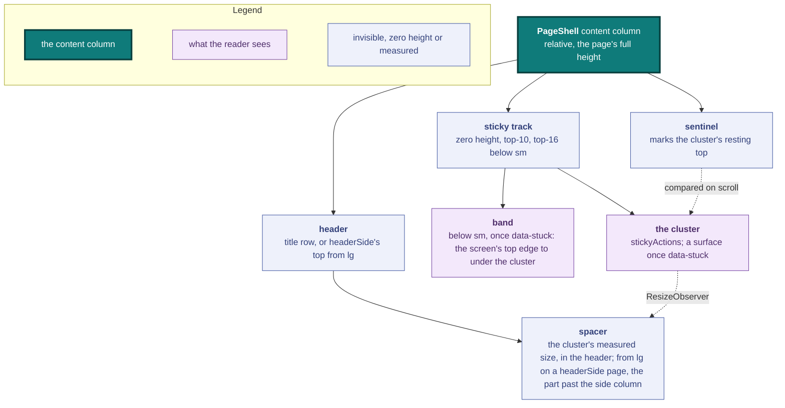

- **Track.** The cluster hangs from a zero-height `sticky` track placed before the header, so it stays pinned until the end of the page. Its `top` is the frame's top padding (`top-10`, `top-16` below `sm`), so it never moves before it pins, and it clears the menu chip on a phone. The track lets clicks through and sits inside the content column, never over the sidebar or the corner **Beta** badge.
- **Room.** The cluster floats over the header, so the header keeps its room: a spacer of the cluster's measured size (a `ResizeObserver`) at the title row's right end, or from `lg` up on a `headerSide` page at the top of the side column. There the title row keeps a second spacer, as wide as the part of the cluster that reaches past the side column, so a long row of actions never covers the title. The title row wraps upwards (`flex-wrap-reverse`), so on a phone the spacer takes the line above the title, where the cluster rests.
- **Surface.** At rest the cluster has no surface. Once it leaves its resting top (a zero-height sentinel marks it), it takes the page background, a border and a shadow (`data-stuck`), so the content scrolling under it stays out of the way. The surface overhangs by 8px, so the controls keep their edges. Below `sm` the surface is a band instead: the full screen width, from the top edge to 8px under the cluster, so the menu chip and the cluster sit on one surface and the content scrolls under both rather than showing between them.
- **Order.** The cluster comes after the back arrow and before the title in the DOM, which is also the tab order: the writes are the first stop on a form.

#### Event actions and approvals

The top right of the page is where you act on an event; the rest of the page is what you read. The event page puts its actions block there: a row of controls (the actions row), pinned, then the approvals of a published event under it. The request page pins the same row there, with **Geolocate** last in it. The title and the byline head the main column and carry no controls. [`useEventActions`](../frontend/src/components/event/useEventActions.tsx) assembles the controls and returns three values: the actions block for `EventShell`'s `actions` (`pinned`, the row; `below`, the approvals), the panels the row's toggles open and the invitation card, and the event page's Linked sites block. A page renders those nodes instead of building controls of its own.

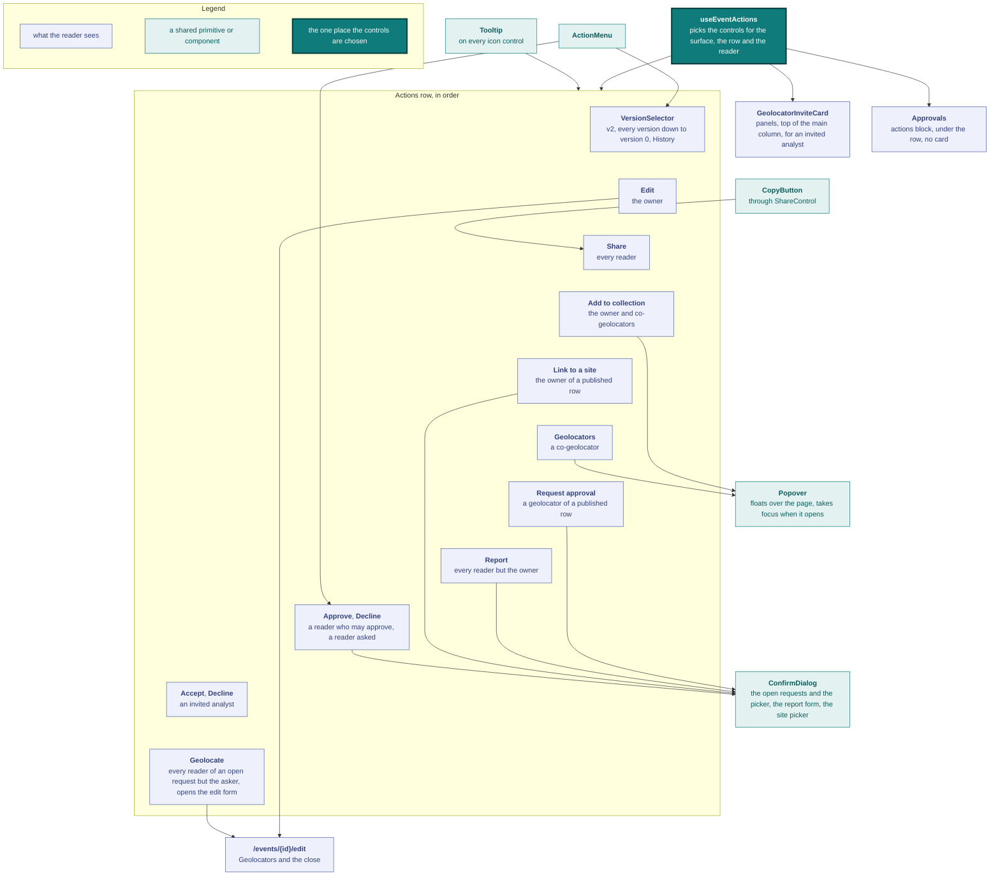

The actions row holds these controls, left to right, each shown only to the reader it names. The pinned block reads in the *Actions* landmark `PageShell` renders, the forms' writes and a version page's selector included. The version selector's trigger is as tall as the 32px icon buttons beside it. It sits top right, level with the title, and ends on the side column's right edge from `lg` up. It stays pinned there while the page scrolls (see [Event layout](#event-layout)). On a phone it takes the line above the title, right-aligned, when the title row cannot hold both.

| Control | Who sees it | What it does |
|---|---|---|
| Version selector | Every reader of a published record, retraction included, on the event page and on a version page | A compact *v2* button with a chevron, an [`<ActionMenu>`](../frontend/src/components/ui/ActionMenu.tsx). It opens a list of the event's versions newest first, each named like the button (*v2*, *v1*), then **History**. Version 0, the request or the detection the event was published from, is named *Request* or *Detection*, on the button and in the list. The live version opens `/events/{id}`, an older one `/events/{id}/vN`, and **History** opens `/events/{id}/history`. The version on screen takes the active-row paint and focus when the menu opens. A list of *vN* entries is as wide as the button (`matchTriggerWidth`), and its **History** shows as its icon alone, named *History* with a tooltip, since the word and the icon do not fit a *vN* button's width; a list with a version 0 entry takes the menu's own width and names **History** in full. It shows on a single-version event too, so the version on screen is always named. |
| Edit | The owner of a row that is not closed; on the request page, the asker | An icon link (lucide `SquarePen`) named *Edit* to `/events/{id}/edit`. Its tooltip reads *Edit (saves a new version)* on a published row, which an edit corrects by adding a version. The owner closes the row and manages its geolocators there (see [The owner edit form](#the-owner-edit-form)). |
| Share | Every reader | One click shares. See **Share** below. |
| Add to collection | The owner and every co-geolocator of a row a collection may hold | A [`<Popover>`](../frontend/src/components/ui/Popover.tsx) (lucide `Layers`) whose panel holds the collection picker, anchored under the button (see [Collections](#collections)). |
| Link to a site | The owner of a published row, on the event page | An icon button (lucide `Link2`) that opens the site picker, a [`LinkDialog`](../frontend/src/components/sites/LinkDialog.tsx) (see [Sites](#sites)). |
| Geolocators | A co-geolocator of a published row | A [`<Popover>`](../frontend/src/components/ui/Popover.tsx) (lucide `Users`) whose panel holds the Geolocators list, where they leave. |
| Request approval | A geolocator of a published row (the owner or a co-geolocator), on the event page | An icon button (lucide `ClipboardCheck`) that opens a dialog to ask an analyst or an organization to approve the live version. See **Approval requests** below. |
| Report | Every reader but the owner, signed out included | The red flag ([`useReportContent`](../frontend/src/components/report/useReportContent.tsx)) that opens the report form, a [`<ConfirmDialog>`](../frontend/src/components/ui/ConfirmDialog.tsx) holding the reason `<Select>` and the details `<Textarea>`, each label with its `?` (`report_reason`, `report_details`). Once a report lands, the receipt takes the flag's place at the top of the main column. Reporting your own event says nothing an edit or a close could not. |
| Approve | A reader who may approve the live version, on the event page | The filled button of the row, after Report, then the `approval` `?` while no stamp shows. With several identities to approve as, one **Approve** opens a menu of them. See **Approve** below. |
| Decline | A reader someone asked for approval, on the event page | A ghost button after **Approve** that declines every request addressed to the reader. See **Approval requests** below. |
| Accept, Decline | An analyst the owner invited to share the credit, on the event page | A filled **Accept** and a ghost **Decline** that answer the invitation. See **Shared credit** below. |
| Geolocate | Every reader of an open request but the asker, on the request page | The one filled button of the row, last, then its `?`. See **Geolocate** below. |

[`VersionSelector`](../frontend/src/components/event/VersionSelector.tsx) lists the versions of a `VersionedRecord` ([`lib/versions.ts`](../frontend/src/lib/versions.ts)): for an event, the live version number and the event's `version_zero` (`eventVersioned`), so it reads nothing. A site's pages use it too (`siteVersioned`). It is not an owner control: the other controls act on the record, and this one reads it. Every reader gets it, because a corrected record is auditable only when anyone can walk the corrections. The map panel and the forms show one version by construction and carry none.

**Geolocate.** The request page renders its actions like the event page, with no card around them. Every reader but the asker gets one row of Share, Report, then **Geolocate**, the one filled button, which opens the [edit form](#the-owner-edit-form) on the request, titled *Geolocate request*, with a `?` saying what publishing does. The asker gets Edit and Share: Edit opens the same form, titled *Edit request*, where the asker saves the request or publishes it, so the row names that page once, by what it does for the asker. The row wraps and right-aligns, so on a narrow phone **Geolocate** takes a line of its own under the icons. On a phone the `?` keeps its tap area inside the row's right edge. A closed request keeps its row and has no **Geolocate**.

A popover's button wears the active-row paint while its panel is open. The panel floats over the page, fixed to the viewport, so opening it moves nothing. It takes focus when it opens, so a keyboard or screen reader user lands in it. Escape closes it and returns focus to the button; an outside click closes it. The report receipt is the one node the actions row adds to the page: it takes the top of the main column once a report lands. Nothing in the actions row closes or destroys a row.

**Share.** [`ShareControl`](../frontend/src/components/share/ShareControl.tsx) shares in one click, with no menu. Where the browser has the Web Share API (`navigator.share`), **Share** opens the device's share sheet with the event's address and title. Elsewhere it copies the address, and the confirmation is [`<CopyButton>`](../frontend/src/components/ui/CopyButton.tsx)'s, the app's one copy confirmation: the share mark turns into a check and fades back after 1.5 s, and the button's tooltip reads *Link copied* for that time, while a live region says it to screen readers. [`EventShare`](../frontend/src/components/event/EventShare.tsx) passes the event's address and title. A `detected` row is still editable by its owner, so its share takes a confirming second click, with *Detected and may still change. Click again to share.* beside the button. The collection page keeps its own Share on X button (see [Collections](#collections)).

**Shared credit.** The Geolocators panel (`GeolocatorsPanel` in [`useEventActions.tsx`](../frontend/src/components/event/useEventActions.tsx)) lists the event's geolocators, owner first. A co-geolocator opens the list from the event page's actions row, with a **Leave** button on their own row. **Leave** is red and arms in place ([`useConfirmAction`](../frontend/src/hooks/useConfirmAction.ts)): the first click turns the button into its confirm (*Confirm leave*) with `DANGER_CONFIRM`, and the second writes. The owner manages the geolocators from the edit page's byline instead (see [The owner edit form](#the-owner-edit-form)). An analyst the owner invited answers with **Accept** and **Decline** at the end of the actions row (`InviteAnswerButtons`), and reads what the invitation offers in a **Geolocator invitation** card at the top of the main column, in the page's panels ([`GeolocatorInviteCard`](../frontend/src/components/event/GeolocatorCredit.tsx)); the invitation's notification links to the event page. Every byline of the event credits every geolocator.

**Approvals.** A published event's approvals of its live version sit in the actions block, under the actions row's resting place, on the page background with no card. They scroll with the page; the row stays pinned. A geolocator asks for approval from **Request approval** in the actions row, and a reader who may approve does it from **Approve** in the same row. Outdated approvals are read on each version's page, which the version selector opens.

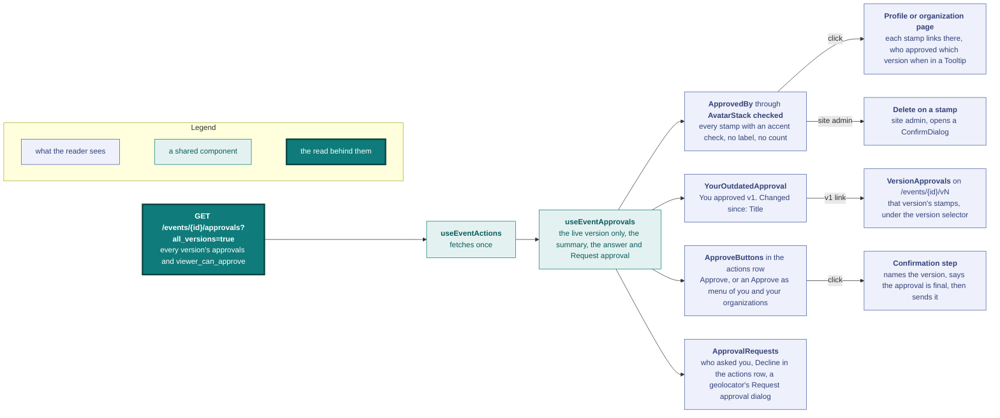

- **Layout.** [`useEventApprovals`](../frontend/src/components/event/EventApprovals.tsx) returns three nodes over one read of the approval requests: the summary, and for the actions row the answer (**Approve** and **Decline**) and **Request approval**. The summary, a `<section>` named *Approvals*, is in `actions.below` of `useEventActions`: it reads in the actions block, under the room the actions row keeps, on the page background with no card and no border. From `lg` up it aligns to the side column's right edge, under the right-aligned row. On a phone it follows the title. It renders nothing when the live version has no approval, nobody asked the reader, and the reader holds no outdated approval.
- **Stamps.** [`ApprovedBy`](../frontend/src/components/event/Approvals.tsx) shows the stamps with no label and no count: the page never prints how many approvals an event holds. [`ApprovalStamps`](../frontend/src/components/event/Approvals.tsx) renders the live version's approvals (those that existed at closing, on a closed event) as an [`<AvatarStack checked>`](../frontend/src/components/ui/AvatarStack.tsx) named *Approved by* for screen readers: every stamp, 28px pictures set apart (`spacing="gap"`), oldest first, wrapping onto further lines, with no **+N** bubble. Each picture carries an accent check badge on its bottom-right corner. An analyst's approval shows the reviewer's picture in a circle, or the `<Avatar>` initial without one. An organization's approval shows the organization's picture in a rounded square. Each stamp is a link to the reviewer's profile or the organization's page. Its name, which a [`<Tooltip>`](../frontend/src/components/ui/Tooltip.tsx) shows on hover, on keyboard focus or on a first tap on a touch screen, says who approved which version when: *maya approved v2 on 15 Oct 2026*, or *Open Source Watch (maya) approved v2 on 15 Oct 2026* for an organization, without the member once that account is erased. A `?` ends the row on the last stamp's line (the `approval` concept), and from `lg` up every line of stamps aligns right: an approval means an analyst or an organization checked the geolocation and agrees with it, it covers one version, and it is final. While the live version has no approval, the `?` follows **Approve** in the actions row instead, and shows only with it.
- **Your outdated approval.** A reader whose own approval covers an earlier version reads one line under the stamps: *You approved v1. Changed since: Title, Proof.* ([`YourOutdatedApproval`](../frontend/src/components/event/Approvals.tsx), the version history's own `changedFields` through `changesSince`). The version links to its page.
- **Approve.** A filled **Approve** shows in the actions row, after **Report**, only to a reader who may approve: the API's `viewer_can_approve` is true, so a former geolocator never sees a button the API refuses, and `canApprove` finds no approval of the live version by the reader, or by an organization they are a member of (`approveOptions` in [`lib/approvals.ts`](../frontend/src/lib/approvals.ts)). The reader may approve as themselves and as each organization they are a member of, whatever their role, that has not approved the version ([`useMemberOrganizations`](../frontend/src/hooks/useMemberOrganizations.ts)). With one such identity, [`ApproveButtons`](../frontend/src/components/event/Approvals.tsx) is one button with a leading `Stamp` icon, **Approve** or **Approve as <organization>**. With several, it is one **Approve** with a chevron, a primary [`<ActionMenu>`](../frontend/src/components/ui/ActionMenu.tsx) named *Approve as…*, whose list (*Approve as*) names the reader first, then each organization, each with the `Stamp` icon. An approval is final, so a click opens a confirmation step, a [`<ConfirmDialog>`](../frontend/src/components/ui/ConfirmDialog.tsx), before anything is sent. The step names the version, names the organization when there is one, and says that the approval is final. The approval is sent only when the reader confirms, and **Cancel** sends nothing. A refusal prints the error on a line of its own under the actions row, and a `version_mismatch` refusal adds a **Reload** button, since the live version moved on since the page loaded. The new stamp is the confirmation: no banner follows an approval, and no reader can withdraw one.
- **Admin deletion.** For a site admin (`useAdmin`), each stamp carries a delete control on its top-right corner: the `remove` disc of `<AvatarStack>`, revealed on hover or keyboard focus, named *Delete approval by <signer>*. It opens a [`<ConfirmDialog>`](../frontend/src/components/ui/ConfirmDialog.tsx) that names the version and the signer, says the deletion cannot be undone and says the reviewer can approve again. Confirming calls [`DELETE /admin/approvals/{approval_id}`](api.md#delete-adminapprovalsapproval_id) and refetches the list, and **Cancel** sends nothing. An `approval_not_found` refusal prints *This approval no longer exists* inside the dialog, which stays open. No other reader sees the control.
- **Approval requests.** [`ApprovalRequests.tsx`](../frontend/src/components/event/ApprovalRequests.tsx) serves the requests. A geolocator of a published event, the one reader who can send a request (`canRequestApproval`), gets **Request approval** in the actions row (`RequestApprovalAction`). It opens a [`<ConfirmDialog>`](../frontend/src/components/ui/ConfirmDialog.tsx) titled *Request approval* that holds the open requests under **Open requests** (who is asked, by whom and since when, or *No open requests.*), then an `<AccountPicker>` to pick whom to ask. **Cancel** takes the initial focus, and the list opens when the field takes focus. The list holds the analysts and organizations the server suggests; an exact username or slug the server leaves out shows the reason as the list's muted row, and a send error prints inside the dialog and clears once the query changes. The confirm button reads *Ask for approval* and stays disabled until a target is picked (`confirmDisabled`), then reads *Ask <name>*. Sending a request closes the dialog and rereads the open requests. An analyst asked, or any member of an organization asked, reads who asked under the stamps, with no heading of its own ([`IncomingRequests`](../frontend/src/components/event/ApprovalRequests.tsx)): one line holds the requesters' pictures and names side by side, each linked to the profile, then *asked for your approval*. A request to an organization reads *maya asked Open Source Watch for approval*, with the organization's logo and a link to its page. A ghost **Decline** follows **Approve** in the actions row and declines every request addressed to the reader; its tooltip says the requester is notified. An approval refetches the requests, since it resolves the reader's own.
- **Filed versions.** A filed version's page (`/events/{id}/vN`) pins the version selector in its actions block, then reads that version's approvals under it in the same compact form ([`VersionApprovals`](../frontend/src/components/event/Approvals.tsx)): the checked stamps and the `?`, read-only, with a site admin's delete control on each stamp (see **Admin deletion**). The page shows nothing there when the version held none.

A notification carries no action. Each notification row links to the screen where you act: an approval request or a re-approval request to the event page, whose actions row holds **Approve** and **Decline**; a co-geolocator invitation to the event page, whose actions row holds **Accept** and **Decline**; an organization invite to the organization page, whose header actions hold **Accept** and **Decline**. An answered request's row adds *Approved* or *Declined* to its label. Each row is a `<LinkRow variant="arrow">`: its delete control is a [`<RemoveButton>`](../frontend/src/components/ui/RemoveButton.tsx) inside the block, left of the arrow, a red cross since the removal is instant, named *Delete notification*, that deletes the row ([`DELETE /notifications/{id}`](api.md#delete-notificationsid)), and reloads the list and the sidebar dot. At 375px the sentence wraps and the trash and the arrow keep their place at the right edge.

**One verb closes every shape.** The verb is *Close*, and only the noun changes with the row: *Close this request*, *Close this detection*, *Close this geolocation* ([`CloseEventDialog`](../frontend/src/components/event/CloseEventDialog.tsx) holds that copy, and the edit page's menu item, the dialog's title and its confirm button all read it). One write ends all three, so one word names it on every surface. What the close means still differs by row, and the record says so: the closed page carries the reason, and the state it left is *withdrawn*, *rejected* or *retracted*. The close lives in the pinned row of the owner's edit page, a red trash button beside the save, not in the event page's actions row. A closed row has no edit page and no close: closing is terminal and the owner has no un-close. The dialog asks for a reason, and the reason's `?` says it stays public, because that reason is what a reader finds on the closed page in place of the claim.

A retracted geolocation keeps its page. It reads as a `Closed` badge with the reason and the closing day beside it, over the record it took back: the coordinates, the evidence, the credits and the version history are all still there, and the version selector stays in the actions row, since walking what the record used to claim is exactly what a reader does after a retraction. The map's side panel and the forms carry no actions row at all. The panel previews a row whose own page is one click away on the title, so acting on the record belongs there rather than in a preview of it; a form's primary action is its own Publish or Save, in the sticky actions over the fields it applies, and sharing or reporting a row one is in the middle of rewriting acts on a record that is not the one on screen. A review pass adds its own controls to the detection form's sticky actions instead (the queue position and Skip).

A published event names its version in the actions row's version selector, not beside the byline (see [Event actions and approvals](#event-actions-and-approvals)).

#### The owner edit form

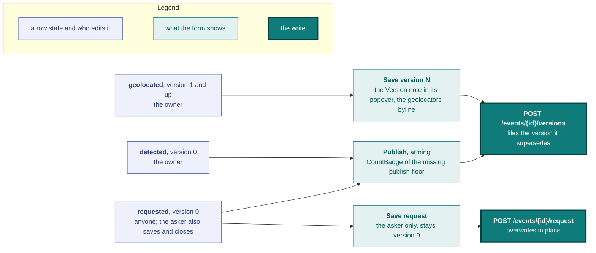

The locked provenance field (`detected_from_url`) carries the label the detail page gives the same link, from one helper (`provenanceLabel` in [`lib/events.ts`](../frontend/src/lib/events.ts)): *Requested from* on a row the bot opened as a request (`requested_by` set, which survives fulfilment), *Detected from* otherwise. Every shape of the form reads it.

[`<EventEditForm>`](../frontend/src/components/geolocations/edit/EventEditForm.tsx) is one form in two shapes, selected by the row's state rather than by a prop, so `/events/{id}/edit` is one address for the publish and for every correction. Both write through [`POST /events/{id}/versions`](api.md#post-eventsidversions) and post the version the form was loaded at, so a row that moved meanwhile answers a conflict instead of being overwritten.

On a `requested` or `detected` row, version 0, it is the publish form: every field editable, and a **Publish** that counts the publish requirements still missing, the count dropping as the form fills, and that arms in place, because publishing makes the row public as version 1. A detection is **Publish detection** and its owner's alone. A request is anyone's to publish: an analyst answering it reads **Geolocate request**, and the asker reads **Edit request** with a **Save request** beside **Publish**, which overwrites the open request in place at version 0 on the request floor alone. A published request opens its event page.

On a `geolocated` row it is **Edit geolocation**: the same field bricks and the same editable fields, every source included, and a **Save version N** whose first click asks for an optional **Version note** in a popover and whose confirm writes, because a version adds a version and overwrites nothing. The button names the number it would produce, so the reader sees what they are about to create rather than what is on screen. A save that would move no versioned field is refused in the form, without a request: the banner reads *Nothing changed since version N*, which is the sentence the server's own refusal maps to. Some inputs hold less than their column does, a link's post time and a source's capture time (minutes) and the event time (no seconds), so a field still holding what the row seeded it with is treated as untouched and goes back at the row's precision rather than as its own truncation. Otherwise every edit of a typo would quietly take the seconds off a published record, and no save would ever count as unchanged.

**The owner's management lives on the edit page.** The event page's actions row carries only **Edit** for the owner; what the owner does to the record beyond correcting it sits on the edit page: the close, a red trash button in the pinned row, and the geolocators in the title section's byline.

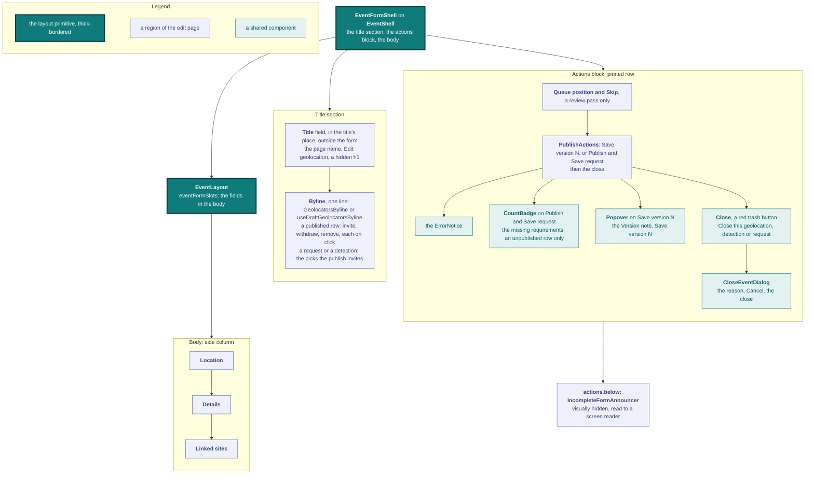

- **The form.** [`EventFormShell`](../frontend/src/components/geolocations/EventFormFields.tsx) renders an event form on [`EventShell`](#event-layout), the submit form's too: `eventFormSlots` places the event fields in its zones (the **Title** field in the title's place in the title section, the other fields in the body), the writes pin in the actions block with the hidden `IncompleteFormAnnouncer` under them, and the body's `<form>` is `noValidate`. A form passes its title, byline, writes, `formId` and `onSubmit`, and wires none of these. The page's `<form>` holds the body fields and nothing else. The **Title** field and the submit button in the pinned row sit outside the form and join it through its `id` (the `form` attribute), so Enter in a field or in the **Title** field still saves.
- **Pinned row.** [`PublishActions`](../frontend/src/components/geolocations/PublishActions.tsx), the submit form's too: in the *Actions* landmark: a review pass's position and **Skip**, then one right-aligned line: the write, **Save version N**, or the arming **Publish** (it reads *Confirm* with `ARMED_RING`, in the room its label keeps, so arming never widens the line, and its armed sentence reaches screen readers through a live region) with, for the asker of a request, **Save request**, then the `?` of a publish (`action_publish`), then the close for the owner. On a request or a detection, **Publish** and **Save request** each carry a [`<CountBadge>`](#build-on-shared-primitives) of the requirements still missing, the publish floor and the request floor, and dim while short; the list shows on hover, on keyboard focus, or on a tap on the count. Each button leads with its action's icon at every width (see [Action icons](#action-icons)). Under the line, the `ErrorNotice`, `role="alert"`. The hidden `IncompleteFormAnnouncer` sits in `actions.below`.
- **Close.** For the owner, a red `<RemoveButton confirms>`, a trash since it asks first, ends the line, named and tooltipped **Close this geolocation**, **Close this detection** or **Close this request**. It opens [`CloseEventDialog`](../frontend/src/components/event/CloseEventDialog.tsx), a `ConfirmDialog` that says what closing does, then asks for the reason. A close lands on the event page, the next detection of a review pass, the detections queue, or the request page for a request.
- **Version note.** On a published row, the first click on **Save version N** runs the checks, then opens a [`<Popover>`](../frontend/src/components/ui/Popover.tsx) panel anchored to the button: the optional **Version note** field with its `?` (`version_note`) and a `<CharCounter>` against `VERSION_NOTE_MAX_LEN`, then **Save version N**, which writes. Enter in the note writes too; Escape or an outside click closes the panel and writes nothing. The page body holds no note, so nothing pushes **Location** down.
- **Geolocators.** The title section's byline is one line and manages the geolocators in place, so nothing in the page moves: the owner, each co-geolocator as an [`<AvatarStack>`](../frontend/src/components/ui/AvatarStack.tsx) picture, each pending invitee as a faded (`muted`) picture whose tooltip reads *cy, invitation pending*, then **Invite a geolocator** (lucide `UserPlus`). That button is a [`<Popover>`](../frontend/src/components/ui/Popover.tsx): a small panel anchored under it, floating over the page, that holds only an `<AccountPicker>` (the author typeahead, or an exact username committed with Enter) and one line on what an invitation does. The field takes focus when it opens; Escape and an outside click close it. Each picture carries its remove disc. A pick of yourself, of an analyst already credited or invited, or past `MAX_EVENT_GEOLOCATORS` (you and the pending invitations included) is refused in the popover before any request.
- **Published row.** [`GeolocatorsByline`](../frontend/src/components/event/useGeolocatorsByline.tsx) applies each change on click through its own endpoint, and no change makes a version. A pick sends the invitation and closes the popover; a refusal prints in the popover, which stays open. The remove disc of a co-geolocator opens a [`<ConfirmDialog>`](../frontend/src/components/ui/ConfirmDialog.tsx) (*Remove bo?*), and the one of a pending invitee another (*Withdraw the invitation of cy?*); the write runs only on the confirm, and its refusal prints in the dialog. A change rereads the row.
- **Request or detection, and the submit form.** On a request or a detection, and on the [submit form](#forms), the byline is yours, since you own the event once it is published ([`useDraftGeolocatorsByline`](../frontend/src/components/event/useGeolocatorsByline.tsx)). Nothing is sent from it: a pick joins the byline as a faded picture (*dee, invited when you publish*), a refused pick prints in the popover, and the remove disc takes a pick back at once. **Publish** and **Publish geolocation** post the picks with the publish ([`geolocator_invites`](api.md#invitations-on-the-publish)), so a refused invitation publishes nothing and prints in the `ErrorNotice`. **Publish request** and **Save request** post none, and the popover's line says so.
- **Linked sites.** The last block of the side column, [`LinkedSitesField`](../frontend/src/components/sites/LinkedSitesField.tsx), links the event to sites (see [Sites](#sites)). Its writes follow the form's geolocation write: **Publish** and **Publish geolocation** write the links once the event is published, and on a published row the save writes them before the version. A change to the links alone saves with **Save** and files no version. Only a published event links to a site, so an open request's form has no Linked sites block, and on the submit form **Publish request** refuses while the block holds a site.
- **Phone.** The pinned row takes the line above the **Title** field and stays pinned under the menu chip while the fields scroll. The title section follows: the **Title** field, then the byline. The side column follows the main column: Location, Details, then Linked sites on a geolocation or a detection.

#### The version history and one version

Three addresses read one record. `/events/{id}` is the canonical page and always shows the current version. `/events/{id}/history` lists every version. `/events/{id}/vN` shows the record as version N stood.

The page titles itself *Version history* and names the event under it as plain text: the `Current` row already opens the event, and a second way there in the header is one control the reader has to tell apart from the other.

**The list is one row per version, newest first.** A row states which version it is, what its edit changed, and who made that edit when: a neutral `v3` [`<Pill>`](../frontend/src/components/ui/Pill.tsx), or `Detection` or `Request` for version 0, an accent `Current` beside it on the live version, the changed fields as a short line (*Title, Coordinates, Proof*), then the editor's byline, the date and their note. The whole row is one click, the model every catalogue row uses: a past version opens its own address, and the current version opens `/events/{id}`, because that is where the record as it stands is read. The byline is [`<AuthorByline link={false}>`](../frontend/src/components/ui/AuthorByline.tsx), the handle as plain text: an anchor under the stretched link is a target the mouse reaches by z-order and the keyboard reaches as its own stop, so the two would disagree about what the row does. The profile stays one tap away from the version the row opens. A version an admin redacted carries a danger `Redacted` pill and keeps its number, its byline and its link.

**A row is credited to the edit that produced it.** The API files that credit on the version the edit superseded, so version *n* takes its content from version row *n* and its byline, date and note from row *n - 1* ([`versionSteps`](../frontend/src/lib/versions.ts), which `eventVersions` and `siteVersions` read). Version 0 is the request or the detection the event was published from: it reads *Requested* or *Detected* and carries the asker, or the owner of a detection, and the date the row was opened. Version 1 was published rather than edited, so it reads *Published*; it takes its byline and date from row 0 when there is one, and otherwise carries the record's own author and publication date. The changed fields are computed on the client from the two adjacent versions, since the API serves what each version held rather than what an edit did, and they print under the names the event page already uses for the same values. Two versions that cannot be compared, a redacted one on either side, print nothing rather than an empty edit.

What version 0 was lives in one table, `VERSION_ZERO_META` in [`lib/events.ts`](../frontend/src/lib/events.ts): its name (*Request* or *Detection*), the status it reads with, the verb of its banner (*asked* or *imported*) and the field that credits it (`requested_by` or `owner`). The version selector, the history row, the banner and the version page read it, and the history row's *Requested* or *Detected* is that status's badge label.

**The list walks the shared cursor**, with [`<LoadMoreRow>`](../frontend/src/components/ui/LoadMoreRow.tsx) at the foot like every other cursor list. The page is 50 versions, half the shared row cap, so a history that reaches the 100-version ceiling still pages and the control is one the product exercises rather than one it only declares. A version's credit sits on the version below it, so the oldest row of an unfinished walk is credit for the row above it rather than a row of its own: it is held back until the next page completes it. A row is whole or absent, never a version number with no editor beside it.

**A version page is the canonical page minus its actions.** Both render [`EventShell`](#event-layout) filled by `eventPageSlots` and `eventLocation`, fed either the live row or a snapshot mapped onto the same shape (`snapshotToEventView`), so a version cannot drift into a layout of its own. Sharing, reporting and editing act on the record, so the header carries only the version selector, with this version marked. An amber [`<EventVersionBanner>`](../frontend/src/components/event/EventVersionBanner.tsx) opens the page (*Version 2 of 4, edited by ana on 18 Mar 2026*; on version 0, *The detection this event was published from, imported by ana*) with an orange link to the current version, the callout split every warning surface takes: the card is the caution, the clickable affordance stays the accent. A redacted version renders the banner and an `<EmptyState>` saying so in the shell's panels, and no body.

**`/events/{id}` stays canonical.** A version page carries `robots: noindex` and a canonical link to `/events/{id}`, and asking for the current version's own number forwards there rather than serving the record at two addresses. The route is a `[version]` segment beside the static `edit` and `history` ones, so a version keeps a one-segment address; a segment that is not `v` followed by a version number is a 404, as is a number past the current version and `v0` on an event with no version 0. Version 0 reads with the status it had, *Requested* or *Detected*, and its page carries no approvals, since nothing approves an unpublished row. Its byline credits who opened it, the asker of a request or the owner of a detection, as its history row does, not the event's credit today.

### Feed

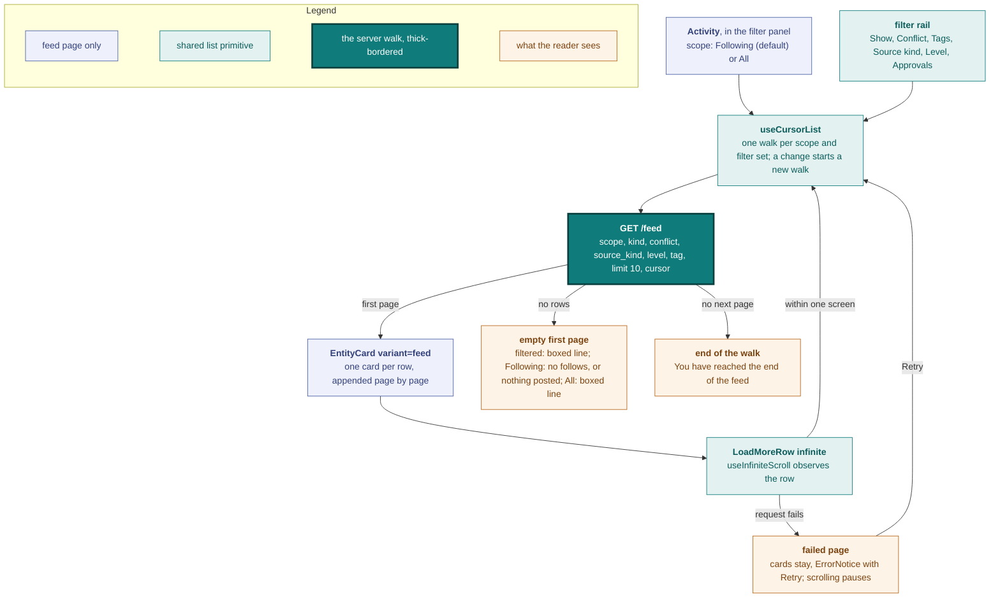

`/feed` is a signed-in page, linked from the rail between Requests and Search. [`GET /feed`](api.md#get-feed) decides which rows it lists and in what order. `/timeline` redirects permanently to `/feed`.

**The [filter panel](#filter-panel) picks the scope.** Its first field, **Activity**, is a [`<SegmentedControl>`](../frontend/src/components/ui/SegmentedControl.tsx) of **Following** (default) and **All**. Picking an option starts a new walk with `scope`, so the list and its empty state describe the scope on screen. The scope is not a filter: it has no pill and no place in **Filters (N)**.

**The [filter rail](#right-rail) narrows the walk.** The panel offers Show, Conflict, Tags, Source kind, Level and Approvals, the filters `GET /feed` serves. A change starts a new walk with `kind`, `conflict`, `source_kind`, `level`, `tag` and the approval keys.

**Show** is the same field as on the other surfaces, the chips **Requested**, **Detected** and **Geolocated**. With no chip selected the feed lists all three, and the page sends no `kind`. Each selected chip goes out as its `kind` value (`request`, `detected`, `geolocation`), and has a removable pill, as every other filter does. The filters live in page state and reset on reload. A filtered view that matches nothing reads *Nothing in the feed matches the filters.* in the `boxed` empty state, instead of the follow prompts below.

**A card names its kind.** Each row is the `feed` [`<EntityCard>`](../frontend/src/components/ui/EntityCard.tsx), which only the feed renders. Read top to bottom, it holds:

1. The title, with the [`<StatusBadge>`](../frontend/src/components/event/StatusBadge.tsx) beside it, so *Geolocated*, *Requested* or *Detected* says what the row is.
2. The byline, which credits the row's owner as a picture and a name, then each co-geolocator as a picture. An open request's owner is its requester, and a detection's owner is the analyst whose post was imported.
3. The dates, each named: *Event 25 Aug 2009* when the event date is known, then *Published 3 Oct 2026* on a geolocation, *Requested 3 Oct 2026* on a request or *Detected 3 Oct 2026* on a detection (`feed_at`). The coordinates follow when the row has them.
4. The media.
5. The tag row from [`cardTags`](../frontend/src/lib/cardTags.ts). A conflict is a key/value [`<Pill>`](../frontend/src/components/ui/Pill.tsx) (`label`), for example *Conflict: Russo-Ukrainian war*. Free tags follow as plain pills. A card carries no source, so it names no source kind: the kind reads on the event page's [source blocks](#source-blocks).

A geolocation or a detection opens `/events/{id}` and a request opens `/requests/{id}`.

**An empty first page names its cause.** An unfiltered empty **Following** view reads the viewer's `following_count` from [`GET /users/{username}`](api.md#get-usersusername) to tell two cases apart:

| Case | Empty state | Actions |
|---|---|---|
| The viewer follows nobody | `invite`, *You follow no analysts yet* | **Show all activity**, **Explore the map** |
| The analysts followed have posted nothing | `plain`, *Nothing from analysts you follow yet* | **Show all activity** |

**Show all activity** switches the scope to **All**. An empty **All** view is a `boxed` line. A first page that fails shows its `ErrorNotice` alone.

**The list walks the shared cursor and scrolls without a click.** A page is 10 rows. [`useCursorList`](../frontend/src/hooks/useCursorList.ts) holds the walk, and the foot is [`<LoadMoreRow infinite>`](../frontend/src/components/ui/LoadMoreRow.tsx), the foot every cursor list shares. Its [`useInfiniteScroll`](../frontend/src/hooks/useInfiniteScroll.ts) calls `loadMore` when the row comes within one screen of the viewport, from the render that mounts the row. While the next page loads, the button is disabled and shows a spinner with *Loading…*.

**A failed page keeps the cards.** An [`<ErrorNotice>`](#errors) with its **Retry** takes the row's place, and scrolling stops loading until the click, since the row is still in view.

**The end of the walk is marked.** Once no next page exists, the foot reads *You have reached the end of the feed* in the `plain` empty state.

### Public profile

[`/profile/{username}`](../frontend/src/app/profile/[username]/page.tsx) is an analyst's portfolio, the page they pin as their link, so it reads as evidence rather than as an account: identity and contact in the header, then the work, widest reading first.

| Block | Component | Data source | Shown |
|---|---|---|---|
| Identity | `ProfileTitle`, `ProfileIdentity` ([`ProfileHeader.tsx`](../frontend/src/components/profile/ProfileHeader.tsx)), `LinkedAccountsLine` ([`LinkedAccounts.tsx`](../frontend/src/components/profile/LinkedAccounts.tsx)) | `GET /users/{username}` | Always |
| Organization logos | `ProfileOrganizations`, inside `ProfileIdentity` | [`GET /users/{username}/organizations`](api.md#get-usersusernameorganizations) | When the analyst belongs to one |
| Detections queue | `DetectionsEntry` | `useDetectionsCount` | Owner only, while the queue holds something |
| Coverage | `ProfileMap` | `GET /events/points?author=…` | When the analyst has located events |
| Insights | `ProfileInsights` | `GET /users/{username}/stats` | When the profile has events |
| Collections | `CollectionsSection` | [`GET /users/{username}/collections`](api.md#get-usersusernamecollections) | Owner always; visitor when the list is not empty |
| Recent submissions | `RecentSubmissions` | `GET /users/{username}/events` | Always |

#### Identity

- The handle is the H1, with the avatar beside it (`ProfileTitle`), the grammar the event page uses. Edit mode drops the title's avatar, so the picture picker shows it once. PageShell's `subtitle` slot carries `ProfileIdentity`: the bio, then the metadata line. One `space-y-1` spaces the block, so an empty bio leaves no gap. Edit mode drops the block.
- The profile never prints the account's email, even to its owner: the email is private account information, so it reads on the settings page, in the Account card beside the username.
- The bio has no card, so the evidence starts one glance below the handle. Empty renders nothing. Every http(s) URL in the bio links through `<OutboundLink>` (see [Outbound links](#outbound-links)) and breaks through `[overflow-wrap:anywhere]`; trailing sentence punctuation stays text. A long bio wraps rather than clamps, since `BIO_MAX_LEN` caps it at 500 characters. Authored line breaks collapse here and keep their shape in the edit field.
- The metadata line reads `N followers · N following · Member since <date>` as secondary text. It carries no work figures; those live in Insights. Each segment holds together, so the row wraps between segments at 375 px. Zero values print.
- The analyst's organizations close the metadata line as one more segment: their logos in an [`<AvatarStack>`](../frontend/src/components/ui/AvatarStack.tsx), each a rounded square (`variant="organization"`), every membership shown. Each logo is a link to `/organizations/{slug}` named "Member of <organization>" or "Org manager of <organization>", which its `<Tooltip>` shows on hover or keyboard focus; a click follows the link. On a touch screen the first tap shows the label and the second follows the link. The row wraps with the line on a phone. An analyst in no organization, or a failed read, shows no segment, so the coverage map is the first block under the header.
- The `actions` cluster carries the linked accounts, then Edit profile, **New collection** and **Sign out** on your own profile, or Follow on someone else's. **Follow** and **Following** switch on the click, and the followers count in the metadata line moves with them. A failed request puts both back and prints its error in an `<ErrorNotice>` under the button.

#### Linked accounts

- `LinkedAccountsLine` is a row of ghost icon buttons, one per platform the profile carries (X, Discord, website, GitHub), each the brand mark alone. Marks rather than printed handles keep the weight on the handle that titles the page.
- The owner's controls end that row, each in the same square: **Edit profile**, a `Pencil`; then `OwnProfileActions`, **New collection**, a `FolderPlus` link to `/collections/new`; **Sign out**, a `LogOut` button that arms on a first click and signs out on the second ([`useConfirmAction`](../frontend/src/hooks/useConfirmAction.ts)). Armed, it takes `ARMED_RING` and its name and tooltip read *Confirm sign out*; it disarms after 3 s, on Escape, or on an outside click. Signing out re-renders the anonymous profile, with no redirect. The row's `gap-1.5` is the event page's action-cluster spacing, the cluster's `gap-2` separates the row from the button beside it, and the row wraps inside the cluster.
- The account is in each mark's `title` and accessible name (`X / Twitter: @analyst_example`), printed through `displayLinkValue` ([`lib/users.ts`](../frontend/src/lib/users.ts)): an X or GitHub value reads `@handle` whether stored as a profile URL or a bare handle, and a website drops its scheme and trailing slash.
- Each platform's `action` decides what its mark does, never how it looks. `link` opens the profile in a new tab through `<OutboundLink>`, so a website on an unknown host asks first. `copy` runs the mark over `useCopyToClipboard`; Discord takes it because the platform publishes no profile URL for a username. The mark flips to a check for the flash while its name holds still.
- `resolveLinkHref` links an X or GitHub value only when it names an account under the platform's own rules, and a website only when it parses as an http(s) URL. `PATCH /users/me` applies the same rules (see [`api.md`](api.md#patch-usersme)). A stored value the strict parse refuses renders nothing.
- A profile with no reachable account renders no marks, which leaves Edit profile or Follow alone.

#### Work blocks

- **Detections queue** (`DetectionsEntry`): the count of `detected` geolocations awaiting your submission, linking to `/profile/{username}/detections`. It sits above the work because it is pending work.
- **Coverage** (`ProfileMap`): the shared `<Map>` with an explicit world `bbox` (`WORLD_BOUNDS` through `toBboxParam`; the endpoint requires one), the camera fitted to the returned points. It maps `geolocated` and `detected` in the map's two point shades. The heading carries no count: the Insights `Geolocated` and `Detected` tiles hold the figures once.
- **Insights** (`ProfileInsights`): see [Insights](#insights).
- **Collections** (`CollectionsSection`): a grid of mosaic cards, the turn from readings of the whole body of work to the work itself (see [Collections](#collections)).
  - Each card carries the mosaic, the title, the description's plain-text projection clamped to two lines, and the collection page's meta line, and the whole card is one click. No type mark sits beside the title, so the title keeps its two lines of width.
  - The endpoint narrows by viewer. On an empty list a visitor sees no section, and the owner keeps the heading and a first-run state that says the list is empty once and carries the action that fills it.
  - The grid holds four cards. Past four, `Show more` opens the shelf in `/search` through `profileSearchHref`, carrying `type=collection`, the one scope the `author` filter narrows instead of emptying.
  - The owner's **New collection** is in the header's action cluster (see [Linked accounts](#linked-accounts)). The first-run state carries it too, as its call to action. Both link to `/collections/new`.
- **Recent submissions** (`RecentSubmissions`): the five newest rows from an endpoint that serves published work only, so the block is what the analyst vouched for. It counts the same set as the `Geolocated` tile.
  - The heading copy and `Show more` key off the returned rows: an analyst with detections alone gets "No geolocations yet.", and `Show more` carries `status=geolocated` into `/search`.
  - Every visitor sees the same rows, the owner included. When the block is empty, a visitor gets the heading and "No geolocations yet.", and the owner gets the heading and an empty state that links to the submit form, so the block says it is empty once.
  - It reads last because it is the block that grows.

#### Insights

`ProfileInsights` is the page's only home for work figures: a `<StatGrid>` of four tiles (`Geolocated`, `Detected`, `Top conflict`, `Top source kind`), then the source-origin bar and the month grid. It sits under the map because it interprets it: the map says where, the card says what kind, how much, and when.

- **Every tile links into `/search`** through `profileSearchHref` ([`lib/search.ts`](../frontend/src/lib/search.ts)), the one builder for the profile's search links, both `Show more` links included. The status pair carries `status=geolocated` and `status=detected`, the leaders carry `conflict=` and `source_kind=`, and `author` is an exact username match, so a tile lands on the rows it summed. A tile takes `TAPPABLE_HOVER` plus a `focus-visible` ring.
- A leader with no value prints `None` and carries no link. The two counts stay linked at zero.
- A leader tile names who leads, and the search behind it says by how much. There is no `Media` tile; `media_count` is served and the share card prints it.
- **One population.** Every field counts visible `geolocated` and `detected` events. A `requested` or `closed` row counts in no figure: an open ask is not documented work, and a closed row is work the analyst discarded.
- No block carries a helper line under its heading. A heading's `?` holds the definition, and the screen never restates a count it already shows.
- **Source origin** ([`<SourceHostBar>`](../frontend/src/components/ui/SourceHostBar.tsx)) is one stacked bar over the host of each event's first source URL, ranked, with a legend naming every slice. It says what kind of work the analyst does rather than how much.
  - Hosts are bare (`t.me`, not *Telegram*), the vocabulary `<SourceLabel>` uses, so the long tail is named rather than printed as "Unknown". The server folds the host to lower case, strips a leading `www.`, and counts a platform's aliases under one host, so `twitter.com` links count as `x.com` (see [`api.md`](api.md#get-usersusernamestats)).
  - Five hosts name themselves, the ceiling the endpoint applies to the leader rankings. The rest is one *Other* slice, and events with no readable source are a *No source* slice, so the bar accounts for every event the tiles count.
  - The heading carries the source URL `<FieldHelp>`, which separates where a source was posted (the platform) from its kind (the lens or the document).
- **The month grid** ([`<ActivityHeatmap>`](../frontend/src/components/ui/ActivityHeatmap.tsx)) counts `occurred_date`: when the documented events happened.
  - The heading is *Event dates*, the field's name on the submit and edit forms. Its `occurred_date` `<FieldHelp>` says the grid counts when the event happened, not when it was posted or imported.
  - One row per calendar year, twelve month cells, intensity off the busiest month, and a *Less / More* legend. Months rather than days, since tens of events a year leave a daily grid blank.
  - The server derives the span from the analyst's earliest and latest event date, not from today, so an imported multi-year archive reads whole. The grid shows the 10 most recent years, the rows the card holds at 375 px, and the year labels name them. Every month in the span renders, so a quiet stretch reads as empty. Both ends are clamped to today, so one mistyped year cannot move the window centuries out.
  - Hovering or tapping a month names it and its count in one readout line under the grid; there is no per-cell tooltip. The cells are paint, not controls: no focus stop, no focus ring. A lit cell carries the accent step its count earns, and an empty one carries `CHART_NEUTRAL`.
  - No dated event renders a sentence. A single month keeps the grid, since the empty cells say which month it was.

#### Edit mode

While the owner edits, the page renders only the header fields, `BioField`, and `LinkedAccountsFields`, contiguous and in reading order under the header. **Cancel** and **Save** leave the `actions` cluster for the page's sticky actions (`ProfileEditActions`), pinned at the top right while the fields scroll, with the save error under them. `BioField` and `LinkedAccountsFields` are each a `Card` headed by a [`<SectionHeading>`](../frontend/src/components/ui/SectionHeading.tsx). Each linked account is an [`<Input icon>`](../frontend/src/components/ui/Input.tsx) carrying the platform's mark, under a `FORM_LABEL` that names the platform. A value the server refuses reads in a `<FieldError>` under its own field (`useProfileEdit` passes the four platforms as `useMutation`'s `fields`) and turns the field red. Both fields are edit-mode only, since reading the bio and the links happens in the header. The organization page's edit mode is the same. The metadata line, the linked-accounts marks, and the read-only sections drop out.

### Organization page

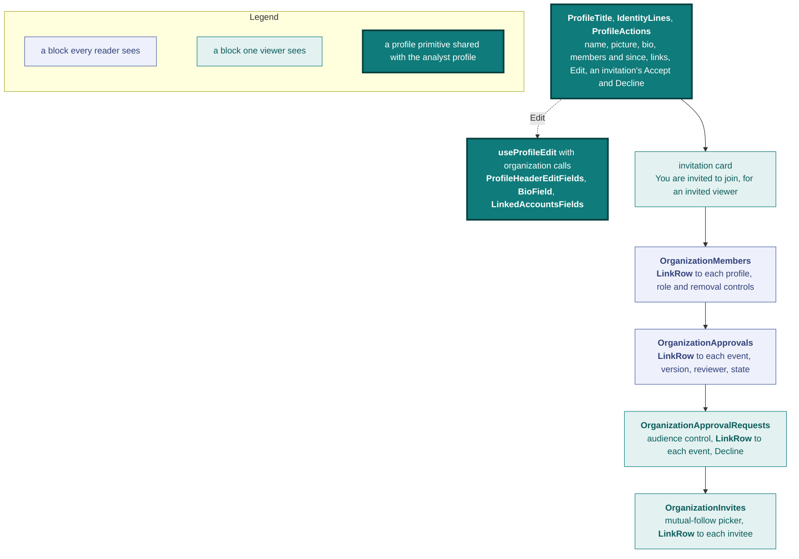

[`/organizations/{slug}`](../frontend/src/app/organizations/[slug]/page.tsx) is an organization's public page. It reads like the [public profile](#public-profile), so the header reuses the profile's primitives rather than a second set. Every list on the page is a stack of [`<LinkRow variant="arrow">`](#build-on-shared-primitives) blocks: a leading 28px `<Avatar>`, the title in neutral text, a muted `meta` line, and an orange arrow at the right edge. A row's controls sit in its `action` slot, so a click on them never follows the row. The page shows each viewer the controls their own membership grants: a site admin who is not a member reads it as a visitor and runs organization operations from the admin panel.

- **Header.** `ProfileTitle` takes the organization's name and picture. `IdentityLines` carries the bio and the metadata line (`N members · @handle on X · Since <date>`), the same block `ProfileIdentity` renders for an analyst. `ProfileActions` carries `LinkedAccountsLine` and, for an org manager, Edit. For an invited viewer it ends on **Accept** and **Decline** (`InviteAnswerButtons`), a filled and a ghost button.
- **Edit mode.** `useProfileEdit` takes the organization's three writes through `calls`, so the picture picker, the bio field and the linked-account fields are the profile's own.
- **Invitation.** An invited viewer answers with **Accept** and **Decline** in the header's actions, and reads a card at the top of the page that names the organization and points there. The page has no rail. The `organization_invite` notification links here.
- **Members.** `OrganizationMembers` lists one row per member, linked to their profile: the avatar, the username, a meta line with a `<Pill>` for the role (accent for an org manager, neutral for a member) and the join date, and the controls the viewer holds. A manager flips the role and removes; every member leaves from their own row. Removing and leaving take the two-click `DANGER_CONFIRM`. The server's `last_manager` refusal shows as the row's `ErrorNotice`.
- **Approvals.** `OrganizationApprovals` lists the approvals placed in the organization's name, newest first, with **Show more** past a page: each row links to the event and leads with the acting member's avatar. Its meta line holds the version, the acting member and the date, and the event page's state pill (`ApprovalState`).
- **Approval requests.** `OrganizationApprovalRequests` shows to members. For an org manager, its first row is **Accept approval requests from**, the Settings row's `<ChoiceRow>` with the organization's labels (**People our org managers follow**, **Everyone**, **Nobody**), saved on change. Under it, the open requests addressed to the organization, oldest first: each row links to the event, leads with the requester's avatar, and says the version and who asked when. Every member gets **Decline** on each; approving happens on the event page, as the organization.
- **Search.** [`/search`](../frontend/src/app/search/page.tsx) finds an organization by name, slug or bio, with no navigation entry of its own. The **Organizations** option of the result type control carries the `Building2` glyph, and the group follows **Analysts**. Each hit is the analyst hit's row, `ProfileResult`: the picture, the highlighted name, a meta line tagged with `Building2` (`Organization · N members`), and the bio excerpt when the bio matched. The row links to the organization page. The page shows no filter rail on this scope, since every filter is an event predicate.
- **Invites.** `OrganizationInvites` shows to org managers. An org manager picks from the analysts the server accepts in an `<AccountPicker>`, with one line saying the list holds mutual follows only. Each pending invite is a row linked to the invitee's profile, with the invite date and who sent it, and withdraws with one ghost button in the row.
- **Deletion.** Only a site admin deletes an organization, from the admin panel's Organizations list (`OrganizationsPanel`), where each organization is a `<LinkRow variant="arrow">` to its page with its member count and, when it has no org manager, a danger pill and the field to name one under the row. **Delete**, in the row, opens a `<ConfirmDialog>` that says what goes with the organization and holds a field for its slug; **Delete organization** stays disabled until the typed slug matches.

### Collections

A collection is one analyst's named set of their own `geolocated` and `detected` events, shown on their public profile. Its two written fields, the title and the description, are both required. The items order themselves by event date, so there is no caption and no manual order.

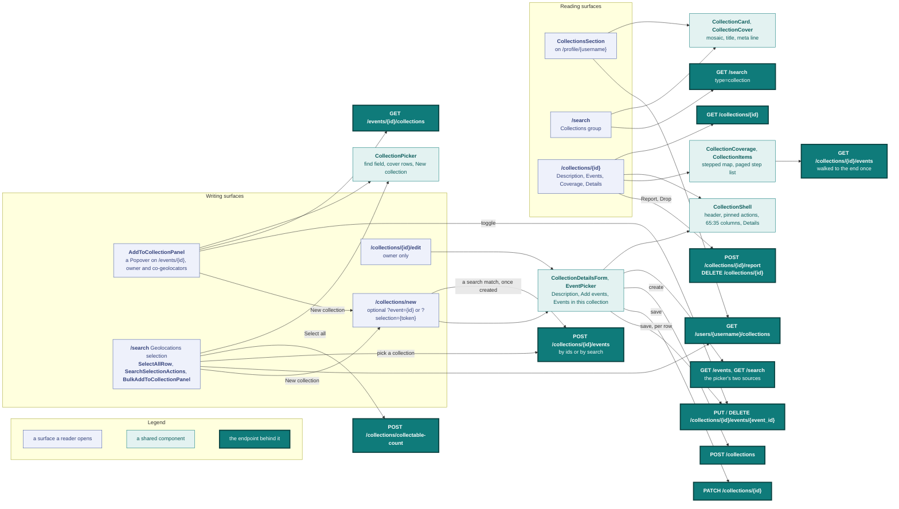

#### The collection page

[`/collections/{id}`](../frontend/src/app/collections/[id]/page.tsx) is public and titles itself with the collection, the way the event page is the event.

**One shell for the page and the forms.** [`<CollectionShell>`](../frontend/src/components/collections/CollectionShell.tsx) lays out the collection page and both [collection forms](#writing-a-collection), the way [`EventShell`](#event-layout) lays out an event. A page only fills its slots:

| Slot | Collection page | Create and edit forms |
|---|---|---|
| `title` | The collection's title | **New collection** or **Edit collection**, a hidden `h1` and the browser tab's title |
| `titleField` | None | The **Title** field (`TitleField`, with the `collection_title` `?`) |
| byline | The owner and a neutral `Collection` [`<Pill>`](../frontend/src/components/ui/Pill.tsx) | The same, for the analyst who writes it |
| `actions` | Share on X, Report for every reader but the owner, then the owner's Edit and Drop | **Cancel**, the submit and the `ErrorNotice` |
| `below` | None | `IncompleteFormAnnouncer`, visually hidden |
| `panels` | The withheld banner, the report form and its receipt, the drop error | None |
| `main` | **Description**, then **Events** | **Description**, then the picker's **Add events** and **Events in this collection** |
| `side` | **Coverage**, then **Details** | **Coverage** of the held events, then **Details** |

- The frame is `wide`, and the actions are `stickyActions`, pinned top right while the page scrolls.
- The body is `PageColumns` on the 65:35 split, with `stickySide`: from `lg` up the side column stays in view under the actions while the main column scrolls. Below `lg` the side column follows the main column, the event page's order.
- Each section sits under its [`<SectionEyebrow>`](../frontend/src/components/ui/SectionEyebrow.tsx). The header carries no picture: the mosaic belongs to the card and to the [share card](#share-cards).
- **Details** is a [`<DetailCard>`](../frontend/src/components/ui/DetailRow.tsx) (`CollectionDetails`): the count through `eventCountLabel`, the span the item dates cover (`collectionSpanLabel`, omitted without a date), the derived tags as `DetailPills`, and the creation date. A form passes the count and span of what it holds and no tags, since the server derives them from the events and their sources.
- On a form, `CollectionShell` renders the `<form>` as `display: contents` around the columns. The **Title** field and the submit sit outside it and join it through its `id`.

**Description** prints the owner's text whole, at reading size, in a `<Card dense>`, through [`renderProof`](../frontend/src/lib/proof.tsx), so its marks and lists are painted.

**Coverage steps through the collection**: [`<CollectionCoverage>`](../frontend/src/components/collections/CollectionCoverage.tsx) is the event page's Location module ([`EventLocation`](../frontend/src/components/event/EventLocation.tsx)) over the whole set, standing on one item at a time.

- The map is the shared [`<Map>`](../frontend/src/components/map/Map.tsx) over the items' pins, `embedded` and framed on the whole set (`fitBounds`). On every step it flies to the current item (`flyTo`, which skips the first frame so the opening frame survives the mount, and holds the camera on an item with no coordinate) and dims the steps behind the reader (`dimmedIds`, `DIMMED_OPACITY`). A click on a pin steps to its item.
- No line joins the pins: a line claims a route between events that were only curated into one set.
- Under the map, the rows say which item the reader stands on: its **Coordinates**, when it has them, its title as **Event**, linking to the event's page, then `N of M` beside **Previous** and **Next**, disabled at either end. The page reads no event: the reader opens it.
- A collection whose items carry no coordinate renders no Coverage section.
- The step rides `?step=` ([`collectionStepHref`](../frontend/src/lib/collections.ts)), 1-based, defaulting to 1, and clamped into the sequence by `readerStep`, so a shared link opens where its sender stood, or on the nearest real step. It moves with `router.replace` and `scroll: false`, so Back leaves the page rather than walking the steps.
- `ArrowLeft` / `ArrowRight` step too, read on the window, and skipped while an input, textarea, select or contenteditable has the caret or a modifier is held. The keys count from the last press rather than from the URL, so a held key walks the collection. Nothing plays on its own. The row under the map says so from `sm` up.

**Events is the step list.** [`<CollectionItems>`](../frontend/src/components/collections/CollectionItems.tsx) shows the rows 20 at a time behind the shared **Show more** row ([`<LoadMoreRow>`](../frontend/src/components/ui/LoadMoreRow.tsx)), slicing the sequence already read. A step past the rows shown, from a shared link, a pin or the arrow keys, opens the pages down to it.

- A click anywhere on a row moves the step there, and the current row wears the accent border (`<EntityCard>`'s `onSelect` + `selected`, see [Cards](#cards)). The event's own page is reached from the Coverage section's **Event** row.
- The rows are the same for the owner and a visitor and carry no control: an event joins from its own page or from the edit page's picker, which the sentence under the eyebrow states.
- The section header's one link is **Your geolocations**, the owner's catalogue in search through `profileSearchHref` ([`lib/search.ts`](../frontend/src/lib/search.ts)), with no status filter, since an unconfirmed detection is still the owner's to shelve.
- An empty collection shows the boxed [`<EmptyState>`](../frontend/src/components/ui/EmptyState.tsx) and no Coverage section.

**One read serves the pins and the rows.** `fetchCollectionSequence` walks `GET /collections/{id}/events` to the end of its cursor once, under the `READER_MAX_ITEMS` ceiling (past it the page holds the earliest 500 items and marks no cut). `N of M` counts that sequence. There is no collection-scoped points endpoint.

**The actions are a row of icon buttons.** Share on X and Report lead, and the owner's Edit and Drop follow, so the destructive control sits at the edge. It wraps into right-aligned lines, `flex-wrap justify-end`.

- **Share on X** is the ghost [`<ShareOnX>`](../frontend/src/components/share/ShareOnX.tsx) icon button, prefilled with the title, `by {owner}`, the meta line's segments, and the collection's URL. It has no confirm, since a collection has no `detected` state.
- **Report** is the red `dangerGhost` flag, for every reader but the owner, signed out included: [`useReportContent`](../frontend/src/components/report/useReportContent.tsx), the event page's dialog, with the same five buckets and 2000-character cap. The dialog names its subject (*Report this collection*), so it never reads as a report on the current item.
- **Edit** is the `ghost` pencil, owner only, `buttonClasses` on a `<Link>`.
- **Drop** is the red `danger` trash, owner only, behind [`useConfirmAction`](../frontend/src/hooks/useConfirmAction.ts) with `DANGER_CONFIRM` on the armed second click; the label says which click it is. On success the owner lands on their profile. This is the only place a collection is dropped; the edit page carries no drop.

#### The card and the meta line

- The meta line states the count, zero included, then the span the items cover ([`collectionMetaSegments`](../frontend/src/lib/collections.ts)); the share texts print the same segments, and the page's Details card the same count and span. The span prints only where items carry dates, and a single day prints once (`collectionSpanLabel`). Under it, the card prints the collection's derived tags in the neutral `<Pill>` row an event card uses (`CollectionTags` in [`CollectionCard.tsx`](../frontend/src/components/collections/CollectionCard.tsx)), uncapped.
- `CollectionIcon` ([`lib/collections.ts`](../frontend/src/lib/collections.ts)) is the one glyph for the type: the `Collection` pill, the **Collections** option of the result type control on `/search`, the profile section's first-run state, and the shelving control on an event page.
- The card's picture is [`<CollectionCover>`](../frontend/src/components/collections/CollectionCover.tsx), made of the collection's own items. The server sends up to four tiles in reading order (see [`api.md`](api.md#get-collectionsid)). One tile fills the 16:9 slot, two split it down the middle, three put the earliest item tall on the left with the next two stacked beside it, and four fill a 2x2, all with 2px gaps in the card border's neutral. A collection with nothing to show falls back to the "no media" box. Nothing is uploaded or stored.
- Each tile goes through the catalogue card's media slot and reads `kind`, so a video tile plays as a clip. A tile also reads `role`: a tile from a proof image reads the original, since proof uploads carry no `_hero` or `_thumb` derivative.

#### Writing a collection

Opening one is [`/collections/new`](../frontend/src/app/collections/new/page.tsx) and changing one is [`/collections/{id}/edit`](../frontend/src/app/collections/[id]/edit/page.tsx), the shape `/events/{id}/edit` takes, so a reload keeps the write and a link reaches it.

- Both sit behind `useRequireAuth` and render [`<CollectionDetailsForm>`](../frontend/src/components/collections/CollectionDetailsForm.tsx), which fills [`CollectionShell`](#the-collection-page), the collection page's columns: the **Title** field in the title's place, **Cancel** and the submit pinned top right, **Description** and the picker's two cards in the main column, and **Coverage** and **Details** in the side column. Only the verb on the button differs.
- **Coverage** maps what the save holds, framed on the whole set, through the same Location module as the page, with no rows under it. Until a held event carries coordinates it says that the map shows the events you add. **Details** counts what the save holds and states the span once every held row has loaded.
- The **Title** field and **Description** each carry the shared `used / cap` [`<CharCounter>`](../frontend/src/components/ui/CharCounter.tsx) against `COLLECTION_TITLE_MAX_LEN` and `COLLECTION_DESCRIPTION_MAX_LEN`, the description's beside its eyebrow. The submit is never disabled: a [`<CountBadge>`](#build-on-shared-primitives) counts the blank or over-long fields, and a click on an incomplete form writes nothing. It outlines each in red (`FORM_INVALID_FIELD`, `FORM_INVALID_LABEL`) until it is filled, and `IncompleteFormAnnouncer` reads the list to a screen reader. An over-long value turns red as it is typed, with its counter. The form sets `noValidate`. Both fields ride every write and are the only writable fields.
- The description field is [`<ProofEditor>`](../frontend/src/components/editor/ProofEditor.tsx) under `allowImages={false}`: bold, italic, headings, lists, and links, no images, since nothing on this form uploads and the server drops the node. It wears the field box, the `focus-within` accent border, and `FORM_INVALID_FIELD` on refusal, under its eyebrow, which turns red with it. The create page's hint sits under it. The counter measures `htmlText` ([`lib/proof.tsx`](../frontend/src/lib/proof.tsx)), the projection the server caps, so markup costs nothing (see [Rich text](#rich-text)).
- `/collections/new` has two entry points: the profile section (beside its heading and in its first-run state) and the add-to-collection panel, which passes `?event={id}`. With the parameter the page opens holding that event, the create carries it ([`POST /collections`](api.md#post-collections)), and the page returns to the event. Without it the page opens the collection it created. Cancel and Back return to where the reader came from.
- From the search page's bulk **Add to collection**, `/collections/new?selection={token}` opens holding a search selection. The panel parks the selection in `sessionStorage` under a fresh token (`newCollectionFromSelectionHref` in [`lib/collections.ts`](../frontend/src/lib/collections.ts)): explicit ids with their rows, or the search match, plus the geolocation count and the search URL to return to. No id list rides the URL. What the page does depends on what the selection holds:
  - **Checked rows** (explicit ids) are always loaded search hits, so the handoff carries them as picker rows (`pickableFromHit`), at about a kilobyte a row, and the page reads no event. They seed *Events in this collection* as held rows, removable like any pick. Details and the submit follow the held count: *N events* and **Create and add**. The held rows ride the create, so removing a row removes it from what the create sends, and an event that changed since the search shows as the create's refusal in its `ErrorNotice`.
  - **A search match** (Select all) fills *Events in this collection* a page at a time: the first 20 of the caller's matching events from [`POST /collections/collectable-events`](api.md#post-collectionscollectable-events), the set the bulk add shelves, newest first, through `useCursorList` with the match as its body. A `<LoadMoreRow>` under the list loads the next 20, until every match shows. The card's count, Details and **Create and add** follow the match's size less the events taken off. Removing a matched card takes it off the card and adds it to `exclude_event_ids`; the picks the reader adds still ride the create. The match is added once the collection exists, through [`POST /collections/{id}/events`](api.md#post-collectionsidevents), which applies the 500 cap and the ownership rule; if that add fails, the page says the collection exists, and a second submit retries only the add.

  A successful create drops the handoff. A token that is missing, malformed or older than 30 minutes opens the plain form, and Cancel returns to the search.
- `/collections/{id}/edit` is owner only. A non-owner gets the backend's 403 stated before the form, with a link to the collection. The save writes the difference: the details through `PATCH`, then one `PUT` per added row and one `DELETE` per removed row, in that order, stopping at the first refusal and naming the act that failed. Saving returns to the collection.

[`<EventPicker>`](../frontend/src/components/collections/EventPicker.tsx) renders the two event cards on both write pages, the same on each, each its own `Card` under a `<SectionHeading>`: **Add events** first, the way in, then **Events in this collection**, what the save holds.

- **Add events** is a [`<Combobox>`](../frontend/src/components/ui/Combobox.tsx) that opens on focus and lists at most `PICKER_ROW_LIMIT` rows, each the title, the event date and the lifecycle badge. A row already held leaves the list, and the list stays open after a pick. With the field empty it lists the analyst's catalogue newest first through [`GET /events`](api.md#get-events) (`view=located`, `author=`, scoped to `COLLECTABLE_STATUSES`, `limit=`), whose cursor tells it more exists. A typed query goes to [`GET /search`](api.md#get-search) (`type=event`, `author=`), which returns the pre-cap match count.
  - The list's status row says what it is not showing and that search reaches it, or why it is empty. A search adds that it answers from the located group, which requires coordinates, so an event with none is reachable only with the field cleared.
  - The query is debounced at 300ms. Enter takes the highlighted row and never submits the form.
- **Events in this collection** is the pending set: the rows the edit page opened with, the `?event=` row, a search selection, and everything added since. Its line states the count through `eventCountLabel`, and its rows take the collection page's order (event date, earliest first, undated last). The rows are a vertical list. Each row is the compact [`<EntityCard>`](../frontend/src/components/ui/EntityCard.tsx) through `<CollectionItemCard>`: a small thumbnail, the title linking to the event, and one muted line with the event date, the coordinates and the lifecycle badge, without the tag row. A [`<RemoveButton>`](../frontend/src/components/ui/RemoveButton.tsx) sits at the row's right edge. A pick scrolls its new row into view (`scrollIntoView`, `block: "nearest"`), since the list orders by date rather than by when a row joined. An empty card is the plain [`<EmptyState>`](../frontend/src/components/ui/EmptyState.tsx) pointing at the card above. Nothing writes until the page's submit.
  - Both sources ask only for collectable statuses, so the card never offers a row the add verb refuses.

#### Search, shelving, and moderation

**Search.** `/search` carries a `Collections` result group and a **Collections** option in the result type control, between Events and Analysts. Each hit is `<CollectionCard showOwner>`, whose meta line leads with `by user` through `<AuthorByline link={false}>`. On this scope the filter panel shows the Tags and Author sections only: every other filter is an event predicate, and the backend empties the group on it, while `tag` and `author` narrow the group (see [`api.md`](api.md#get-search)). They are the event scope's own sections, so a step from Events to Collections keeps the tags and the analyst. The panel takes its sections per scope through the `sections` prop of [`EventFilterSections.tsx`](../frontend/src/components/filters/EventFilterSections.tsx), which also drops Status and Approvals on the legacy request scope. The [filter panel](#filter-panel) gives each row's open state. Above the results, a head row prints the total on the right. A result group wears its header (*Geolocations · 6*) only while several groups show; a lone group drops it, its size being that total, and keeps its name as the section's accessible name.

**Approvals filter.** The map, the search page's event scopes and the feed offer an **Approvals** filter, in the panel's **People** row. **Approved only** is a one-chip `ChipBucket` that sends [`approved`](api.md#get-events). **Approved by** is an `<AccountPicker>` over the `user` and `organization` groups of `GET /search` (`suggestApprovers` in [`lib/search.ts`](../frontend/src/lib/search.ts)). An analyst sends `approved_by` and an organization sends `approved_by_org`, and Enter on a typed handle picks it as an analyst. Each value has a removable pill (**Approved**, **Approved by** *name*) and counts once in **Filters (N)**. `appendApprovalFilters` writes the keys into every request and the search page's URL, and `approvalFiltersFromParams` reads them back. The Requests board leaves the section out, because a request carries no approval.

**One collection picker.** Both **Add to collection** popovers, the event page's and the search page's bulk add, render [`<CollectionPicker>`](../frontend/src/components/collections/CollectionPicker.tsx), so they share one look:

- From six collections up, a **Find a collection** field narrows the list by title in the browser; *No collection matches.* answers a title nothing holds.
- Each row leads with the collection's first cover tile as a 40px square (`PickerCover`, a `<CollectionCover>`), or the collection icon (lucide `Layers`) in the same square when the collection is empty, then the title at reading size over the item count (`eventCountLabel`), since a title runs to 255 characters. The rows share `PICKER_ROW` padding.
- The list scrolls past `18rem`, since the popover is fixed to the viewport.
- With no collection, *No collections yet.* says what **New collection** does with what is being added.
- The footer is a ghost **New collection** button.

Each surface supplies the row's control, because the two writes differ: one event has a membership bit to turn on and off, a selection only adds.

**Shelving.** [`<AddToCollectionPanel>`](../frontend/src/components/collections/AddToCollectionPanel.tsx) opens in a `<Popover>` from the event page's **Add to collection** button, for the owner and every co-geolocator of a `geolocated` or `detected` row; on a request or a closed row the control is absent. It reads [`GET /events/{id}/collections`](api.md#get-eventsidcollections), which carries each collection's cover.

- Each collection is a [`<ToggleRow>`](../frontend/src/components/ui/ToggleRow.tsx) in its described shape, led by its cover tile (`leading`).
- **New collection** links to `/collections/new?event={id}`.
- The toggle is optimistic: the bit and the count flip on the click and roll back on a refusal, which the panel's `ErrorNotice` explains. Both membership writes are idempotent.

**Bulk shelving from search.** On `/search`, a signed-in analyst picks many of their own geolocations and puts them on one collection in one write. The selection lives in `useSearchSelection` ([`SearchSelection.tsx`](../frontend/src/components/collections/SearchSelection.tsx)); the page passes it the committed query and filters and the loaded hits.

- A Geolocations hit gets a native checkbox, painted with the accent through `accent-color` (`accent-orange-400`, the step `TEXT_LINK` uses), in a column left of the card, when the hit credits the reader and its status is in `COLLECTABLE_STATUSES`: the rule of the event page's **Add to collection**. Other rows keep an empty column, so the cards stay aligned, and with no selectable row there is no column. The checkbox's label takes `ICON_TAP_STEP`, so a phone tap lands on it.
- The list's head row holds `SelectAllRow` on the left, in the checkbox column, and the result count on the right. Its tri-state checkbox is empty while nothing is selected, indeterminate while some events are, and checked once every match is. Empty, a click selects every match; otherwise a click clears. Its line reads **Select all**, **N selected**, or, past the bulk add's cap (`BULK_ADD_MAX_EVENTS`, 500) with nothing held, *Narrow to 500 or fewer to select all*, and the box is then disabled. While several groups show, the row moves under the Geolocations header, next to the rows it selects.
- The cap and the label read M, the size of [`POST /collections/collectable-count`](api.md#post-collectionscollectable-count) for the committed search, fetched as soon as a loaded row is selectable. **Select all** sends the search, not ids ([`POST /collections/{id}/events`](api.md#post-collectionsidevents) with `match`), so the server resolves every matching event, loaded or not. Unpicking one row afterwards falls back to the loaded selectable rows minus that one.
- **Add to collection** is the page's `stickyActions`, at the top right of the header. The page mounts it while a loaded row is selectable and passes `stickyActionsIdle` while nothing is selected, so the header keeps the button's room and no row moves when the first box is checked.
- A new committed query or filter set clears the selection.
- **Add to collection** opens a `PopoverPanel` under the button holding [`<BulkAddToCollectionPanel>`](../frontend/src/components/collections/BulkAddToCollectionPanel.tsx). It carries no heading of its own: the head row already counts the selection (*N selected*), and the panel's `label` names the dialog. Each collection from `GET /users/{username}/collections` is an [`<ActionRow>`](../frontend/src/components/ui/ActionRow.tsx) in the shared picker. The read serves no update time, so the line holds the count alone. The whole row adds, and **+ Add** shows at its right on hover. After the write the row reads *Added N* in an accent `<Pill>` with a check and stops acting, since the panel offers no undo; its count grows by what was added, and a line under the list says what the write did (*44 added, 3 already in this collection*) with a link to the collection. A refusal shows in the `ErrorNotice` and leaves the row actionable. The selection stays, so the same set can go on a second collection.
- The footer, **New collection**, opens `/collections/new` carrying the selection (see [Writing a collection](#writing-a-collection)).

**Moderation.** [`POST /collections/{id}/report`](api.md#post-collectionsidreport) writes to the event reports' table, and [`<ReportsPanel>`](../frontend/src/components/admin/ReportsPanel.tsx) lists collection reports beside event reports. A collection row prints the title as the link and the owner's `<AuthorByline>` beside it, since an admin recognises a collection by name rather than id. Its verdicts are `Hide the collection`, which confirms in a `<ConfirmDialog>` like the event takedown, and `Dismiss`. It offers no `Mark graphic`, since a collection carries no media of its own.

### Sites

A site is a named area analysts monitor through dated satellite imagery (see [`api.md`](api.md#sites)). Its pages read like the event pages and its forms like the event forms, on the same shell and the same source and version components: a site's source is a row of `sources`, so the pages show it in the source block and the forms edit it in the source editor, and a site has versions, so its pages carry the event page's version selector, history and version view.

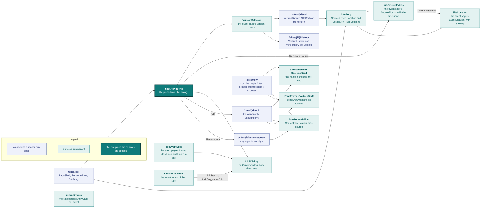

**The site page.** [`/sites/{id}`](../frontend/src/app/sites/[id]/page.tsx) renders `PageShell` like `EventShell` does: back, the name as the title and the pinned actions, with no byline. The owner, the kind and the last source read in the Details block. No line ever says the site is active or current.

- **Actions.** [`useSiteActions`](../frontend/src/components/sites/useSiteActions.tsx) assembles the pinned row in the event page's order: the event page's [`VersionSelector`](../frontend/src/components/event/VersionSelector.tsx) on the live version for every reader, **Edit** for the owner, whose tooltip says it saves a new version, **Share** for every reader, **File a source** and **Link one of my events** for a signed-in analyst, **Withhold the site** or **Restore the site** for an admin, then the report flag last, for every reader but the owner. An owner control never renders for another reader. A source removal and the moderation each confirm in a `<ConfirmDialog>`. A withheld site, which only an admin reads, opens on an amber line that says so.
- **Body.** [`SiteBody`](../frontend/src/components/sites/SiteBody.tsx) lays out `PageColumns`, which scrolls both columns with the page, as on the event page. The side column holds the event page's Location and Details blocks, each under its `EventSection` eyebrow with the site's `?` (`site_location`, `site_details`). Below `lg` it follows the main column, the event page's order, and a pick in the main column scrolls the map into view.
- **Main column.** The Sources section, then the Linked events section. Both list newest first by date on the ground (`sortSources`, `sortLinkedEvents` in [`lib/sites.ts`](../frontend/src/lib/sites.ts)).
- **Sources.** The event page's [`<SourceBlocks>`](#source-blocks) under the event page's **Sources (N)** eyebrow and `?`: the same sideways row, its range and arrows, a lone source at full width, and the same rows per source (the file, the title, the level, the kind, the links with their archive marks, the capture time). [`siteSourceExtras`](../frontend/src/components/sites/SiteSourceBlock.tsx) adds the site's rows after them: the provider with its credit, the note, who filed it and when, and the contour drawn on it. It also names each block by its capture day (*Source of 13 Sept 2016*), which `SourceHeader` shows at the top of the card with the map control: an icon button that shows that day's zone on the map, or an accent *On the map* pill on the source on show, whose card takes the accent border. The analyst who filed a source gets a red trash **Remove** beside it, off while the source carries a contour, its name saying so.
- **Location.** [`SiteLocation`](../frontend/src/components/sites/SiteLocation.tsx) fills the event page's [`EventLocation`](../frontend/src/components/event/EventLocation.tsx) with the site map: the zone on the picked source's day (`contourOn`, the zone rule of `services/sites.zones_at`), the contour before it dashed and the linked events. Its rows read **Coordinates**, the current zone's centroid with the event page's open and copy controls, **Zone on**, the date on show, and **Contour**, the area and the source of the contour valid then. Its footer lines explain the dashed, dotted and dimmed marks the map draws. The page opens on the latest source. On a date before the first contour the Contour row says none is drawn and the first contour shows dashed.
- **Details.** [`SiteDetails`](../frontend/src/components/sites/SiteFacts.tsx) is the event page's Details card: **Owner**, **Kind**, **Last source** (the date and the provider), **Latest effect** (the effect pill and the event date, when a linked event has one), **Created**, then **Withheld** on a withheld site, which only an admin reads.
- **Linked events.** [`LinkedEvents`](../frontend/src/components/sites/SiteEventLists.tsx) heads the section with a **Linked events (N)** `<SectionEyebrow>` and the `site_linked_events` `?`, and renders nothing while no event is linked. Each event is the compact [`<EntityCard>`](#cards), the catalogue's row: the thumbnail, the title, the author's byline, the event date, *Inside the zone* or the distance outside it (`place`), and the effect pill as the badge. The card opens the event and carries no control: the event's author changes the effect or unlinks it in the event's edit form.

**Versions.** A site's version pages reuse the event's pieces, which take a `VersionedRecord` (`siteVersioned` in [`lib/sites.ts`](../frontend/src/lib/sites.ts)) in place of an event.

- [`/sites/{id}/history`](../frontend/src/app/sites/[id]/history/page.tsx) lists every version newest first in [`VersionHistory`](../frontend/src/components/event/VersionHistory.tsx), one [`VersionRow`](../frontend/src/components/event/VersionRow.tsx) each: *v1* reads **Created**, a later version names what its write changed (**Name**, **Kind**, **Sources**, **Contour**, from `siteChangedFields`), with who made it and when. The live row carries the *Current* pill and opens the site page.
- [`/sites/{id}/vN`](../frontend/src/app/sites/[id]/[version]/page.tsx) opens on the amber [`VersionBanner`](../frontend/src/components/event/VersionBanner.tsx), *Version 2 of 4, edited by* the analyst *on* the date, with the link to the current version, then `SiteBody` fed the version: its name, its sources, removed ones included, and their contours. The version selector is its one pinned action. Links have no history, so the version shows no Linked events section. The live number forwards to `/sites/{id}`.

**The link dialog.** [`LinkDialog`](../frontend/src/components/sites/LinkDialog.tsx) serves both directions on `<ConfirmDialog>`: the event page's **Link to a site** picks a site, the site page's **Link one of my events** picks one of the reader's published events. On the event page the sites near the event show as `<Pill>` chips with their distance (`LinkSuggestionPills`) under *Sites within 10 km of the event*, the first four, then one **Show more** ([`<LoadMoreRow>`](../frontend/src/components/ui/LoadMoreRow.tsx)), and nothing when no site is near. The 10 km is the suggestions' default radius (`SITE_MARGIN_KM`, the mirror of the API's `margin_m` default). Any other pick comes from a `<Combobox>` name search (`LinkSearch`), whose rows sit under their own *Search results* heading, since a site found by name may lie past the radius; the pick shows as an accent chip a click removes. The effect (`EffectControl`), a full-width `<SegmentedControl>` over **Damage**, **Destruction**, **Activity** and **Other**, starts unpicked, so **Link** waits for the analyst to say what the event shows. On the site page, when the event has satellite sources, [`SatelliteSourcesOffer`](../frontend/src/components/sites/SatelliteSourcesOffer.tsx) adds one described `<ToggleRow>` per source, off at first, which files that source on the site after the link (`siteSourceFromEventSource`, sharing the stored file through `media_id`). A source without a file or a capture time, or flagged graphic, reads why and refuses.

**The event page's Linked sites block.** [`useEventSites`](../frontend/src/components/sites/useEventSites.tsx) lists the event's links in a `DetailCard` under the **Linked sites** eyebrow: one row per site, its name linked to the site page and its effect pill, with no control. It renders nothing while the event has no link. **Link to a site** is in the event page's [actions row](#event-actions-and-approvals), for the owner of a `geolocated` row only.

**The event forms' Linked sites.** The submit form and the edit form of a geolocation or a detection link and unlink the event's sites in [`LinkedSitesField`](../frontend/src/components/sites/LinkedSitesField.tsx), last in the side column under the **Linked sites** eyebrow. An open request's edit form leaves the field out, since a request links to no site. Each linked site is an accent `<Pill>` chip that a click removes, over its `EffectControl`, whose options keep their labels' width from `sm` up so they fit the side column. Under them, once the form's coordinates parse, the sites near that point show as `LinkSuggestionPills` from [`GET /sites/suggestions`](api.md#get-sitessuggestions), then the `LinkSearch` name search. A picked site starts with no effect, and the geolocation write counts *Effect at a linked site* as missing and turns the eyebrow red until each site has one. The edit form of a published row starts on the live links. The form's write runs `saveSiteLinks` ([`lib/sites.ts`](../frontend/src/lib/sites.ts)), which writes the difference through [`POST /events/{id}/site-links`](api.md#post-eventsidsite-links) and [`DELETE /events/{id}/site-links/{site_id}`](api.md#delete-eventsidsite-linkssite_id) (see [The owner edit form](#the-owner-edit-form) for when).

**The forms.** The three forms pin their write in `SiteWriteActions` ([`SiteSourceEditor.tsx`](../frontend/src/components/sites/SiteSourceEditor.tsx)): one primary button with a `<CountBadge>` of what the write still lacks, the hidden `IncompleteFormAnnouncer`, and the `ErrorNotice`. A write attempt turns the missing fields red in place. The new-site page and the edit page take the site page's body on `EventShell`, like the event forms, and type the name in the page title: [`SiteNameField`](../frontend/src/components/sites/SiteFormFields.tsx) is the event forms' `TitleField` with the label *Name* and the `site_name` `?`. Their Details section is `SiteKindCard`, the kind `<Select>`. They hold no linked events: an event's author links it from the event's forms or with the site page's **Link one of my events**.

- [`/sites/new`](../frontend/src/app/sites/new/page.tsx): the main column holds the **Sources (1)** section, the site page's `SourcesRow` with one `SiteSourceEditor` named *Source 1*. The side column holds the Location section, with `ZoneEditor` and the overlap warning under it, then the Details section. Once the ring closes, [`POST /sites/overlaps`](api.md#post-sitesoverlaps) runs after the drawing rests, and each overlapping site shows in an amber callout with its link and both shares. The warning never blocks the creation. **Create the site** sends one [`POST /sites`](api.md#post-sites).
- [`/sites/{id}/edit`](../frontend/src/app/sites/[id]/edit/page.tsx), for the owner, renders [`SiteEditForm`](../frontend/src/components/sites/SiteEditForm.tsx). The Sources section lists the live sources as the site page shows them, and **Add a source** in its header opens one `SiteSourceEditor` named *Source N*, numbered after the site's sources like an event form's next source, with a red cross that discards it. Each source card, the new source included, carries the site page's map control (`ShowOnMap`): it picks the source the Location section draws on, and the source on show reads *On the map*. Adding a source picks it. The owner's own sources carry the red cross **Remove**, off while the source carries a contour; a removed source stays in the row, dimmed, with a *Removed on save* pill and a ghost control that keeps it. The Location section opens `ContourDraft` on the picked source: the `ZoneEditor` on that source's contour, or empty with the current zone dashed: **Start over** leaves the source without a contour, and **Back to the current contour** restores it. A warning says when the source predates the current contour. The write is the event edit's: [`PublishActions`](../frontend/src/components/geolocations/PublishActions.tsx) with **Save version N**, whose count lists a missing name, a missing part of the new source, a contour the editor refuses and a site left without a contour. Its first click asks for the optional **Version note** in the same [`VersionNotePanel`](../frontend/src/components/event/VersionNotePanel.tsx) popover, whose save sends one [`POST /sites/{id}/versions`](api.md#post-sitesidversions) and returns to the site page. An edit that changes nothing opens no panel: the banner reads *Nothing changed since version N*, the server's sentence. The site's history shows the note under its version.
- [`/sites/{id}/sources/new`](../frontend/src/app/sites/[id]/sources/new/page.tsx), for any signed-in analyst, holds `SiteSourceEditor`, named *Source N* like the edit page's: `<SourceEditor variant="site-source">`, whose capture time is required, sits under the title and has its own `site_source_captured` `?`, whose links run the imagery provider check, and whose **Capture details** is replaced by the note and its `<CharCounter>`. The side column shows the current zone. **File the source** returns to the site page, which lists the new source, as the event submit form opens the new event.

**Moderation.** Anyone reports a site through the report flag (`useReportContent("site", …)`). [`<ReportsPanel>`](../frontend/src/components/admin/ReportsPanel.tsx) lists a site report with the site's name as its link and its owner's byline, and offers **Hide the site** and **Dismiss**. An admin restores a withheld site from its page.

**Withheld items.** An event, a collection or a site an admin withheld (`hidden_at`) reads only for an admin. Its page opens on a [`<WithheldBanner>`](../frontend/src/components/ui/WithheldBanner.tsx) in the panels: an amber line with the takedown time that says only admins read the item until it is restored. The event's panels come from `useEventActions`, the collection's from its page, and the site's from `useSiteActions`.

**Admin console.** The moderation panels name every item so a moderator acts on the right one:

- [`<ReportsPanel>`](../frontend/src/components/admin/ReportsPanel.tsx) prints an event report's title as its link and the author's `<AuthorByline>` beside it, as it does for a collection or a site.
- [`<EventActionsPanel>`](../frontend/src/components/admin/EventActionsPanel.tsx) lists each search hit on two lines, the title, then its date (or *Undated*, or *Requested* and the request date) and author. The picked event's chip keeps that second line.
- [`<UserActionsCard>`](../frontend/src/components/admin/UserActionsCard.tsx) marks a soft-deleted account with a red *Soft-deleted* pill and the time, and its menu offers **Restore** and **Hard delete** only. The onboarding table marks the account's row the same way.
- An action leaves an [`ActionReceipt`](../frontend/src/components/admin/ActionReceipt.tsx) whose badge names the action taken (*Hidden*, *Restored*, *Marked graphic*, *Hard delete*). An account action's receipt (`UserOutcomeReceipt`) sums up what changed, such as the events and storage objects a hard delete erased.

### Requests board

[`/requests`](../frontend/src/app/requests/page.tsx) lists open requests from [`GET /events`](api.md#get-events) with `view=requested&status=requested`, cursor-paged behind a **Show more** button. The board is public by link, but the rail lists it only for a signed-in reader. **Post request** is the board's action, top right of the title, and opens the submit form; the sort sits alone under the title. On a request page, a signed-out reader sees **Geolocate** last in the actions row, which opens the sign-in page and returns to the submit form.

- The status is fixed to `requested`. The board mounts the shared filter panel ([`EventFilterSections`](../frontend/src/components/filters/EventFilterSections.tsx)) in the [filter rail](#right-rail) without its Status section, because a `closed` chip would read as "done" on a work queue. The media filter is also left out, because `GET /events` takes no `media` filter.
- The panel offers Conflict, Source kind, Level, Location guess, Tags and Author. Location guess is offered on the board alone, as a row of its own in the Event group. **With a guess** keeps requests that carry a guessed point, **No guess** keeps the blind ones, and picking both or neither drops the filter. The section sends [`has_coords`](api.md#get-events).
- A `<SegmentedControl>` orders the list **Newest** (the default) or **Oldest**. It sends [`sort`](api.md#get-events), so every page of the cursor walk keeps that order.
- Each card shows how long the request has been open, in whole days from `requested_at`, through `<EntityCard>`'s `age` slot: *Open today*, *Open 1 day*, *Open 12 days*. A row with no `requested_at` shows no age.
- Filters and sort live in page state and reset on reload.

### Share cards

A pasted link is how most readers meet the platform, so the four pages an analyst shares generate their own preview image. Every card is a [`next/og`](https://nextjs.org/docs/app/api-reference/file-conventions/metadata/opengraph-image) (Satori) composition on one frame, [`_og/card.tsx`](../frontend/src/app/_og/card.tsx): a 1200×630 canvas, the bundled Montserrat 700 cut, the accent-`V` wordmark, the `vidit.app` footer, and the hex palette. Satori accepts no class names, which is why the cards compose that frame instead of the `components/ui/` primitives (see *Sanctioned one-offs*). The palette in `card.tsx` restates the same neutral / orange scale the classes resolve to, and is the one place a card reads colour from.

| Card | Content |
|---|---|
| Site default, [`app/opengraph-image.tsx`](../frontend/src/app/opengraph-image.tsx) | Headline and subhead. Inherited by every route that generates none of its own. |
| Profile, [`profile/[username]/opengraph-image.tsx`](../frontend/src/app/profile/[username]/opengraph-image.tsx) | Avatar (or the handle monogram), handle, bio, and four counts under the page's own labels: geolocated, detected, followers, media. `ogProfileCounts` in [`lib/og.ts`](../frontend/src/lib/og.ts) reads geolocated and detected off the Insights payload, co-geolocated events included, and followers off the header's; the link description lists the same three. A failed stats read keeps geolocated on `geolocations_count`, the same figure, and drops detected and media. Top conflicts sit in the footer. |
| Organization, [`organizations/[slug]/opengraph-image.tsx`](../frontend/src/app/organizations/[slug]/opengraph-image.tsx) | The profile card's layout ([`_og/portfolio.tsx`](../frontend/src/app/_og/portfolio.tsx), shared by both) with an `Organization` badge: picture or name monogram, name, bio, the member count, and the X handle in the footer. |
| Event, [`events/[id]/opengraph-image.tsx`](../frontend/src/app/events/[id]/opengraph-image.tsx) | Title, coordinates, the analyst's handle and the event date, the lifecycle badge, and the locator panel. |
| Collection, [`collections/[id]/opengraph-image.tsx`](../frontend/src/app/collections/[id]/opengraph-image.tsx) | Title, the meta line's count and span, the owner's handle, a `Collection` badge, and the mosaic panel. |

The **locator panel** ([`_og/MiniMap.tsx`](../frontend/src/app/_og/MiniMap.tsx)) is a plate-carrée graticule with the event's point marked on it, drawn from positioned rectangles: no tiles, no basemap request, no static-map service, and no mapping library on the server. What a reader can use at card size is the hemisphere and the rough region, and the real `<Map>` is one click away on the page. The projection is [`lib/og.ts`](../frontend/src/lib/og.ts)'s `projectEquirectangular`, which clamps rather than escapes the frame.

Under the graticule sits a **world outline**, one inline SVG path of Natural Earth 110m land ([`_og/landmass.ts`](../frontend/src/app/_og/landmass.ts), public domain, Antarctica and small islands dropped, aggressively simplified to a few kB), which is what makes a marker read as a place rather than as a point on a grid. It is committed path data in the projection's own 360×180 frame, so it needs no reprojection to line up with the marker and the card still loads nothing at request time. Regenerate it with [`scripts/build-og-landmass.mjs`](../frontend/scripts/build-og-landmass.mjs); the source dataset is not committed.

The event card takes its lifecycle word and emphasis from `EVENT_STATUS_META` in [`StatusBadge.tsx`](../frontend/src/components/event/StatusBadge.tsx), the same map the page's badge renders from, so a row cannot be called one thing on the page and another in the image of the page.

The **mosaic panel** on the collection card is the picture the profile card wears, at card scale. `ogMosaicBoxes` in [`lib/og.ts`](../frontend/src/lib/og.ts) places each tile in [`<CollectionCover>`](../frontend/src/components/collections/CollectionCover.tsx)'s arrangement and gap, as absolute boxes since Satori lays out flex and not grid, and clamps a longer cover to four boxes. A tile's picture is read at the derivative its own size wants through [`displayUrlsFor`](../frontend/src/lib/mediaUrls.ts), the wide `_hero` for a lone tile and the 400px `_thumb` for one sharing the panel, and all of them are fetched at once. A tile off a proof image is fetched at its original, since that upload writes no derivative. A clip carries no poster derivative, so its tile draws the panel colour under a play triangle instead of a frame the server does not have; a picture whose fetch was refused draws the same tile without the triangle. A collection with nothing showable draws the panel under `no media`, the site's own placeholder wording.

Each dynamic card reads the same anonymous public payloads its page renders from (`GET /users/{username}` plus `GET /users/{username}/stats`, `GET /organizations/{slug}`, `GET /events/{id}`, or `GET /collections/{id}`), issued together rather than chained, so a card can only ever show what a signed-out visitor already sees and an unfurl costs one round of requests. Soft-deleted rows 404 upstream.

An upstream read answers one of three ways, and the difference is visible because a crawler caches what it is served:

| Read | Card | Tags |
|---|---|---|
| Answered | The data card | Title, description, `og:*`, `twitter:*` from the payload |
| Permanent miss (`404`, or the `422` a path parameter that names no row draws) | The branded *No analyst here* / *No organization here* / *No event here* / *No collection here* card | The matching not-found title and description, in the same tag shape as a hit |
| Failed (`429`, `5xx`, timeout, undecodable body) | The site-default composition | None: the page inherits the site-wide metadata |

The failed path says nothing about the link because nothing is known about it, and its image response carries `Cache-Control: no-store` so the CDN and any crawler that honours it ask again rather than keep a card built from a bad second. A crawler that caches on its own policy regardless cannot be reached from here, which is the other half of why that path emits no not-found copy: whatever it keeps, it keeps a neutral preview.

Card reads carry a 15 min revalidate. That window is also the rate-limit headroom: every card request egresses from the deployment's shared IP against the per-IP limit on `/users/{username}`, `/organizations/{slug}`, `/events/{id}` and `/collections/{id}`, so a link going wide is one cached read per window rather than one backend round trip per unfurl. A link wide enough to still trip the limit degrades to the site-default card, never to a broken image.

All four pages are client components, so their `generateMetadata` lives on the segment layout (the profile and the organization build theirs through `portfolioMetadata` in [`_og/metadata.ts`](../frontend/src/app/_og/metadata.ts)): title, description, the `og:*` set, and `twitter:card: summary_large_image`, which is what makes X and Discord render the image full-width instead of as a square thumbnail. `twitter-image.tsx` re-exports the Open Graph composition so the two stay byte-identical.

The renderer publishes what it fetches as a public image, so every picture a card draws goes through one guarded read, `ogImageDataUri` in [`_og/data.ts`](../frontend/src/app/_og/data.ts) (guards also in [`lib/og.ts`](../frontend/src/lib/og.ts)), which inlines the body as a data URI rather than handing Satori a remote ``. The read accepts only an https dotted hostname, refuses address literals and local suffixes, and refuses a host whose DNS answer holds any private, loopback, link-local, or multicast address, judged in the connector so the socket uses the address the guard checked. It follows no redirect, holds a 3 s budget and an 8 MB ceiling, and accepts PNG, JPEG, GIF, WebP, and AVIF. The rasteriser behind `next/og` draws only PNG and JPEG and leaves a blank for anything else, so the read inlines a PNG or JPEG of 2 MB or less as fetched and re-encodes every other picture through `sharp` as a PNG at most 1200 px on its long edge (the first frame of an animated GIF). A refused read falls back to the drawing without a picture (the handle monogram, a blank mosaic tile) and logs one `og image skipped:` warning naming the reason and the picture's host and path. `users.avatar_url` and cover tile URLs are server-minted, never typed by an analyst, so the guard is defense in depth. The API's own origin skips the host guards: it serves the local storage backend's pictures in development (`http://localhost:8000/local-storage/...`), and the card trusts it as it trusts the payload reads.

### Email

Every email shares one layout, [`services/email_layout.py`](../backend/app/services/email_layout.py), the second surface after the share cards that renders outside the app. Mail clients read no class names from the site and strip most CSS, so the layout carries its own inline styles: a table-based single column 600px wide, a system font stack, and the hex values below. The mechanism and the queue are in [`engineering.md`](engineering.md#email).

| Part | Light (default) | Dark (`prefers-color-scheme: dark`) |
|---|---|---|
| Page | `#f4f2ef`, the light theme's warm canvas | `#0a0a0a`, `neutral-950` |
| Card | `#ffffff` | `#171717`, `neutral-900` |
| Text | `#232323`, the light theme's `neutral-100` | `#f5f5f5` |
| Inline link | `#c2410c`, `orange-700` | `#fb923c`, `orange-400` |
| Action button | `#c2410c` fill, white label | unchanged |

- **Light by default.** A client that ignores the dark media query, such as Gmail, gets the light layout and applies its own dark inversion to it. Apple Mail applies the dark values.
- **The header** is the accent `V` mark, a PNG served by the frontend at `/icon/android-192` with a transparent background, beside the word Vidit in text. The word carries the brand when a client blocks images.
- **The action button** is a solid `orange-700` fill, the one place the accent fills a control. A mail client cannot render the tinted-on-dark recipe reliably, and `orange-700` keeps a white label above the 4.5:1 contrast ratio. Under the button, the same URL is printed as a link for a client that drops the button.
- **The footer** links to Settings and the legal notice.
- **The completion digest** gives the count of detections awaiting completion and points at **Start reviewing** on the detections queue, which opens the one-by-one review pass.
- **A notification email** names the switch that sent it and links to Settings, and its `List-Unsubscribe` header turns that kind off by email.
- **The registration confirmation email** links the [Getting started page](#getting-started-page) in its last paragraph, under the confirm action's explanation.

### Buttons

There is one primitive: [`<Button>`](../frontend/src/components/ui/Button.tsx), shape and colour in a single unit at one size (no size scale). It has five variants on two axes: tone (accent or danger) and emphasis (filled, outline, text):

- `primary`: accent, filled. The one main action of a view.
- `secondary`: accent, outline. A secondary action (edit, search, pagination).
- `ghost`: accent, text only. The quiet tier: cancel, dismiss, dense row actions, and (with `icon`) icon-only buttons.
- `danger`: red, outline. A destructive action (delete), quiet on purpose.
- `dangerGhost`: red, text only. A red control at ghost weight, so it sits in an icon row without outweighing its accent neighbours (the report flag).

**Remove.** [`<RemoveButton>`](../frontend/src/components/ui/RemoveButton.tsx) is the one remove control: a red `dangerGhost` icon button named by what it removes, the name showing as its tooltip. Its icon says what a click does. A removal that asks for a confirmation first, a second click or a dialog, shows a trash (`Trash2`, `confirms`); an instant removal shows a cross (`X`). A source editor's remove and the edit form's close show the trash; a link row's remove, a file slot's remove and a draft co-geolocator pick show the cross.

Every clickable is accent, and red is only for destructive or alerting actions. There is no grey button: grey lives in `<Pill>` neutral, and in the disabled state, which drops the variant's tone for grey text on a neutral border rather than fading it, so a button that refuses the click reads like every other inert control. The one loud filled red is `DANGER_CONFIRM`, applied through `className` to the armed second click of a destructive two-click confirm, so the strongest red shows once, at the point of no return. A confirm that is not destructive takes `ARMED_RING` the same way (the share row's detection link, the detection form's Submit): a ring and a neutral plate over the button's own variant, so an armed control reads as changed without moving. `fullWidth` stretches it (auth submits). `icon` makes a square icon-only button. A `<Link>` that should look like a button takes `buttonClasses(variant)`.

**Action icons.** A button with a text label leads it with the icon of the action it names, at every width, and one action always takes the same icon (see [Action icons](#action-icons)).

**Tap size.** Both shapes stand taller on a phone (`min-h-9` on the text shape, `size-9` on the icon square), dropping to the desktop 28px / 32px from `sm` up. Only the tappable height moves. The type scale and the horizontal padding are the same at every width. The `?` grows its own target the same way; see *Field help* below.

#### Action icons

`ACTION_ICONS` in [`Button.tsx`](../frontend/src/components/ui/Button.tsx) holds one lucide icon per action, and no two actions share an icon. A text `<Button>` names its action with `action`, and the icon leads the label. A `<Link>` styled by `buttonClasses` puts `<ActionIcon action>` before its text. [`ConfirmDialog`](../frontend/src/components/ui/ConfirmDialog.tsx) takes `confirmAction` for its confirm button, and [`ActionMenu`](../frontend/src/components/ui/ActionMenu.tsx) takes `action` for a text trigger (**Approve** with several identities). `Button.test.tsx` fails on a text button or button-styled link that names no action. A [`Disclosure`](../frontend/src/components/ui/Disclosure.tsx) keeps its chevron, which turns with its state. The [palette](../frontend/src/app/palette/page.tsx) shows every action with a label.

| Action (`action`) | Labels | Icon (lucide) |
|---|---|---|
| Accept (`accept`) | Accept (an invitation), Done (filters), Close (a contour's outline) | `Check` |
| Show all activity (`activity`) | Show all activity | `Activity` |
| Add (`add`) | Add a source, Add a link, Create organization | `Plus` |
| Approve (`approve`) | Approve, Approve as *organization* | `Stamp` |
| Archived copy (`archive`) | An archived copy's link (*Wayback Machine*, *archive.today*) | `Archive` |
| Ask for approval (`askApproval`) | Ask for approval, Ask *account* | `ClipboardCheck` |
| Cancel (`cancel`) | Cancel | `X` |
| Clear (`clear`) | Clear (filters), Start over (a contour) | `Eraser` |
| Add to collection (`collect`) | Add to collection | `Layers` |
| Continue (`continue`) | Continue | `ArrowRight` |
| Copy (`copy`) | An invite code's copy (admin) | `Copy` |
| Decline (`decline`) | Decline | `CircleX` |
| Delete (`delete`) | Delete, Delete organization, Delete approval, Soft delete, Hard delete, Purge detected, Remove, Close this geolocation, Close this request, Close this detection | `Trash2` |
| Dismiss (`dismiss`) | Dismiss (a report) | `ShieldCheck` |
| Draw (`draw`) | Draw a contour on this source | `PenTool` |
| File a source (`fileSource`) | File the source | `ImagePlus` |
| Filters (`filter`) | Filters | `SlidersHorizontal` |
| Follow (`follow`) | Follow | `UserPlus` |
| Following (`following`) | Following | `UserCheck` |
| Geolocate (`geolocate`) | Geolocate, Publish, Publish geolocation | `MapPin` |
| Go to coordinates (`go`) | Go | `LocateFixed` |
| Graphic (`graphic`) | Mark graphic, Unmark graphic | `TriangleAlert` |
| Guide (`guide`) | Read Getting started | `BookOpen` |
| Hide (`hide`) | Hide, Hide the event, Hide the collection, Hide the site, Withhold | `EyeOff` |
| Import (`import`) | Import archive, Import your X archive, Choose a different file, Create the detection | `Upload` |
| Invite (`invite`) | Invite | `MailPlus` |
| Leave (`leave`) | Leave | `LogOut` |
| Show less (`less`) | Manage, while open | `ChevronUp` |
| Link (`link`) | Link, Confirm link | `Link2` |
| Map (`map`) | Explore the map, Back to map | `Globe` |
| Mint (`mint`) | Mint code, Mint invite code | `Ticket` |
| Show more (`more`) | Show more, Manage, while closed | `ChevronDown` |
| New collection (`newCollection`) | New collection, Create collection, Create and add | `FolderPlus` |
| New site (`newSite`) | Create the site | `MapPinPlus` |
| Next (`next`) | Next | `ChevronRight` |
| Password (`password`) | Set new password, Update password | `KeyRound` |
| Previous (`previous`) | Previous | `ChevronLeft` |
| Remove a corner (`removePoint`) | Remove corner | `Minus` |
| Report (`report`) | Send report | `Flag` |
| Request (`request`) | Post request, Publish request, Save request | `Megaphone` |
| Retry (`retry`) | Retry, Reload | `RotateCw` |
| Revert (`revert`) | Back to the current contour | `RotateCcw` |
| Review detections (`review`) | Start reviewing, Open the detections queue, Review your detections, Review the detection | `Bot` |
| Revoke (`revoke`) | Revoke | `Ban` |
| Role (`role`) | Name org manager, Make org manager, Make member | `UserCog` |
| Save (`save`) | Save, Save version *N*, Save collection | `Save` |
| Search (`search`) | Your geolocations | `Search` |
| Send (`send`) | Send reset link, Send a fresh link, Resend confirmation link | `Send` |
| Show (`show`) | Restore, I am 18 or older, show it, the graphic content cover | `Eye` |
| Sign in (`signIn`) | Sign in | `LogIn` |
| Site (`site`) | Open the site page | `MapPinned` |
| Skip (`skip`) | Skip | `SkipForward` |
| Undo (`undo`) | Undo | `Undo2` |
| Unlink (`unlink`) | Clear link | `Unlink` |
| Unsubscribe (`unsubscribe`) | Turn off | `BellOff` |
| Use a proof image (`useProof`) | Use a proof image | `ImageUp` |
| Withdraw (`withdraw`) | Withdraw (an invitation) | `MailX` |

### Forms

**One submit page, content-gated.** [`/submit`](../frontend/src/app/submit/page.tsx) is a single form: you fill in what you have, and two actions publish from the content, "Publish geolocation" (born `geolocated`) or "Publish request" (born `requested`). Each is gated on a live requirements tick-list that escalates from the request floor to the full geolocation floor. `/submit` opens on a chooser, [`SubmitChooser`](../frontend/src/components/geolocations/SubmitChooser.tsx): six [`<IconTile>`](../frontend/src/components/ui/IconTile.tsx) links, each with a `preview` of its result drawn from the product's status badges, a title, one line on when to pick it, and its `needs`. The page takes `PageShell`'s `wide` column, so from `lg` up the tiles fill it as a 3x2 grid of equal tiles. From `sm` up they take two columns, and below `sm` each tile is a row with the preview as a thumbnail.

| Tile | When to pick it | Needs | Opens |
|---|---|---|---|
| **Geolocation** | You found where it happened. | Source, Coordinates, Proof image, Conflict | The form (`single`) |
| **Request** | You have the footage, not the place. | Source | The form (`single`) |
| **From an X post** | You already posted it on X. | Post link, Linked X account | `xpost` |
| **Bulk import** | Your past posts, all at once. | X archive, Linked X account | `bulk` |
| **Site** | You watch a place change over time. | Name, Dated capture, Outline | [`/sites/new`](#sites) |
| **Collection** | You want to share a set of events. | Title, Description | [`/collections/new`](#collections) |

Geolocation and Request open the same form, since its publish actions unlock from the content. A path tile opens its path in place of the chooser and names it in the `mode` query (`single`, `xpost` or `bulk`, built by `submitHref` in [`lib/routes.ts`](../frontend/src/lib/routes.ts)), so a reload keeps the path and the browser's Back returns to the chooser. Each path writes from the page's pinned actions: the two publishes on the form, **Create the detection** on **From an X post** (off until a URL is pasted, *Reading…* while the post is read; Enter in the field submits too), **Import archive** on **Bulk import** (off until a file is picked, *Importing…* while it runs). The result of an import, with its next step, reads in the page body. On a path the page header carries the `PageShell` back arrow, which returns to the chooser: a step back through the history when the chooser opened the path, and a navigation to `/submit` otherwise (`onBack`). The draft lives in the page, above the form, so it survives a trip through the chooser: the fields reseed from it when the path opens again. `?import=1`, the target of the onboarding card and the `/import` guide, opens **Bulk import**. A link that asks for the form opens it directly (`?mode=single`): **Post request** on the Requests board, the empty profile's first-submission link, and the guide's submit tile. `/requests/new` redirects to the form, and `/geolocations/new` redirects to `/submit` with its query. A request is answered from its own [edit form](#the-owner-edit-form), not from here.

**Submit actions.** The submit form renders the edit form's shell, `EventFormShell`, and its writes are the page's sticky actions, in the *Actions* landmark at the top right of the header, pinned while the fields scroll. It is the edit form's [`PublishActions`](../frontend/src/components/geolocations/PublishActions.tsx): **Publish geolocation** (primary) and **Publish request** on one right-aligned line, which wraps **Publish request** under the first on a 320px phone, then the `?` (`action_submit`) from `sm` up, then the `ErrorNotice`, `role="alert"`. Each button carries a [`<CountBadge>`](#build-on-shared-primitives) of the conditions it still misses, and dims while short: **Publish request** counts the request floor, and **Publish geolocation** counts the request floor plus the proof, the coordinates and the conflict. The list shows on hover, on keyboard focus, or on a tap on the count. Both publish: the first click arms the button in place (*Confirm*, `ARMED_RING`, its sentence in a live region), and the second writes. Each button leads with its action's icon at every width. The hidden `IncompleteFormAnnouncer` sits in `actions.below`. The import entries render the chooser's `PageShell` instead, without the form, and pin their own submit button.

**One write flow.** The submit form and the edit form write through the same controller, so the two forms check, word and post a write the same way.

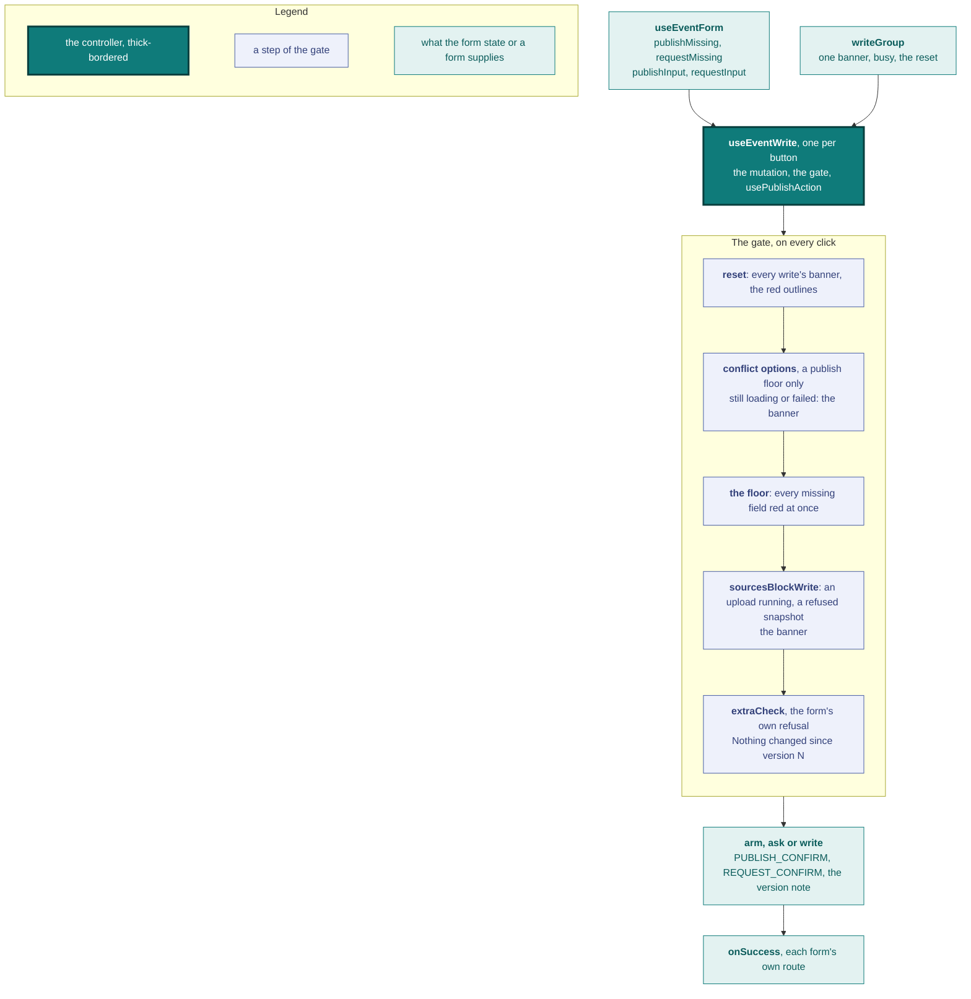

- **The form state.** [`useEventForm`](../frontend/src/components/geolocations/EventFormFields.tsx) computes both floors live: `requestMissing`, and `publishMissing`, which is the request floor followed by the rest in page order (title, the sources' file, URL and kind, the proof or its image, the coordinates, the conflict). It also builds both bodies: `publishInput` posts the subject point as required, and `requestInput` posts it as an optional guess, both halves or neither. A form adds only what its endpoint takes on top, `version_no` and the version note.
- **The controller.** [`useEventWrite`](../frontend/src/components/geolocations/useEventWrite.ts) is one write per button: its mutation, its gate and its arming (`usePublishAction`). `writeGroup` reads a form's writes together: the one `ErrorNotice`, whether any write runs, and the reset each click starts with.
- **The gate.** Every click runs it in the order of the diagram. The conflict options come before the floor, because before they load a missing conflict cannot be told from one still loading. The floor comes before the sources' hold, because a running upload clears itself and must not hide a field you have to fill. The form's own refusal comes last: the edit form refuses a version that changes nothing. A refusal other than a missing field prints in the banner.
- **The wording.** [`PublishActions`](../frontend/src/components/geolocations/PublishActions.tsx) exports what both forms show: the armed sentence of each publish (`PUBLISH_CONFIRM`, `REQUEST_CONFIRM`), the busy labels (`PUBLISHING_LABEL`, `SAVING_LABEL`), and the two button presets, `publishGeolocationButton` (primary, map pin) and `requestWriteButton` (secondary, megaphone). `WRITE_FALLBACK` holds one fallback sentence per write kind. Where a write lands on success stays with each form.

Section placement follows [Event layout](#event-layout): Title, **Sources** and **Proof** in the main column; **Location** and **Details** (event date and time, the provenance link of an imported row, conflict and tags) in the side column. Each section reads like the event page's: its [`<SectionEyebrow>`](../frontend/src/components/ui/SectionEyebrow.tsx), with the section `?`, sits on the page above the section's card. **Proof** carries the *Methodology guide* link beside its eyebrow, and a publish attempt that flags the proof turns the eyebrow red and outlines the card. **Sources** has no card of its own: each source editor is a card. Fields use the [`<Input>`](../frontend/src/components/ui/Input.tsx) primitive. **Sources** is the row of source editors that [Source blocks](#source-blocks) describes, reused by submit, request, detection review and the published-row edit so they can't drift; each editor's file slot sits on the generic [`FileManager`](../frontend/src/components/ui/FileManager.tsx). **From an X post** is [`ImportPostPanel`](../frontend/src/components/geolocations/ImportPostPanel.tsx): a URL field and one action. The post becomes detections server-side, and the panel opens the first one in the detections queue; a run with something to say (warnings, a refusal, a post already imported) stays on the panel and says it, with the review one click away. **Bulk import** is [`ImportArchivePanel`](../frontend/src/components/geolocations/ImportArchivePanel.tsx), whose export walkthrough is a `boxed` [`NumberedSteps`](../frontend/src/components/ui/NumberedSteps.tsx).

**Coordinates travel as a pair.** Every pair (the subject point and each source's capture position) is the shared [`CoordinateInputs`](../frontend/src/components/geolocations/CoordinateInputs.tsx). A paste that reads as a pair fills both fields whichever one received it: a decimal `lat, lng` (comma or space separated, degree signs tolerated), or a Google Maps URL (`@lat,lng`, `q=`, `query=`) when the paste is itself a URL. Anything else pastes as ordinary text, prose quoting `@48.5,37.8` included. [`<CoordinateActions>`](../frontend/src/components/event/CoordinateActions.tsx) follows the two fields on their line, so a coordinate can be checked against satellite imagery and carried away while it is being typed. It is two outlined icon buttons everywhere it appears, each its own box. The map link (new tab) is named *View on Maps* by its `aria-label` and its tooltip, and the copy composes the same primitive over `useCopyToClipboard`. While the pair is empty, half-typed, malformed or out of bounds both controls stay in place, disabled and grey, rather than disappearing, so the line holds one width and a grey control says the point is not usable yet; the map link becomes a disabled button there, since there is nothing to navigate to, and its name and tooltip give the reason (*No map link. Latitude must be between -90 and 90.*). A typed value that is not a number in decimal degrees, or falls out of bounds, turns its own field red at once with the same reason in a `<FieldError>` under the line. A blank half of the subject pair waits for the publish, which flags the missing coordinates; the reasons have one home, `pairProblem` in [`lib/coordinates.ts`](../frontend/src/lib/coordinates.ts), whose bound sentences are the API's. The event detail page's coordinates row renders the same component, right-aligned on the coordinates line, so the two surfaces can't drift; the pair and its actions hold one line there, and on a narrow phone row the **Coordinates** label wraps first, then the line drops under it. On a form, the **Location** block ([`LocationPicker`](../frontend/src/components/geolocations/fields/LocationPicker.tsx)) is the event page's Location module, `EventLocation`, with the pair above the map: it labels the pair **Coordinates**, with the same `?` as the page's row, and the map under it is the page's own `<PointMap>` with its pin. A click on the map moves the pin there and writes the point into the fields at 6 decimals, and the pin drags, writing at each step. A pair typed or pasted in the fields moves the pin and centres the map on it at zoom 14 at least, while a click or a drag leaves the camera where the reader holds it. While the pair is empty or refused the map shows no pin. The form's pin is no stored event, so a hover opens no card (`pinPreview`). The parser, the bounds, the rendering (6 decimals, 4 in a compact row) and the map-link builder have one home, [`lib/coordinates.ts`](../frontend/src/lib/coordinates.ts).

**A locked URL is the link.** One field arrives filled and stays that way: the provenance URL (`detected_from_url`) on an imported detection. A request's sources are not locked: the analyst who publishes it corrects them like any other field. The locked field carries [`LockedHint`](../frontend/src/components/geolocations/fields/LockedHint.tsx) beside its label, saying why it cannot be retyped, and renders its value through [`LockedUrl`](../frontend/src/components/geolocations/fields/LockedUrl.tsx): an anchor wearing `LOCKED_FIELD`, the box recipe the locked `<Input>` wears, so it reads as the field it is. A stored URL is a link everywhere on the platform, a locked field included. The anchor carries the full URL rather than a host, and truncates rather than wraps so a long permalink keeps the field one line high. `LOCKED_FIELD` lives on [`Input`](../frontend/src/components/ui/Input.tsx) and the locked `<Input>` and `LockedUrl` both wear it, minus `cursor-not-allowed`, which states "you cannot act on this" and is true of the input alone. The label becomes a `<span>` in link mode, because an anchor is not a labelable control. A locked field with no value yet keeps the read-only input: there is no link to render.

**The detections queue is a list, and the work happens in review mode.** `/profile/{username}/detections` is a dense list, one [`DetectionQueueRow`](../frontend/src/components/detections/DetectionQueueRow.tsx) per detection: a thumbnail, the title, the event date, the source host, and one state badge. The badge describes the evidence, not completeness (`batchCompletionBlockers` in [`lib/events.ts`](../frontend/src/lib/events.ts), which mirrors the server floor in `services/events/batch._publish_detection`; `detection_ready_predicate` is that same floor in SQL, which is what the filter below pages on, and the three are held to one table of detection shapes by their tests). It reads **Ready to review** when the machine found everything it could and the detection is waiting on the judgment a review supplies, the conflict and the source kind, so it takes `<Pill>`'s outline `secondary` tone rather than the filled accent: a detection that still needs two picks must not read as a finished one. Otherwise it names the missing piece, or counts them (*Missing: 2 pieces*) once several names would outgrow a dense row. A [`<SegmentedControl>`](../frontend/src/components/ui/SegmentedControl.tsx) narrows the queue to ready or incomplete detections. It is a query, not a view filter: picking an option refetches with [`readiness`](api.md#get-eventsdetections), so the server cuts the page out of the filtered set and the row count, the page count and the empty line all describe that set. A page-local filter answers about the ten rows on screen while the reader takes it as an answer about the queue, which on an import of several hundred detections ordered newest first is how "0 of 10 on this page" gets read as "none of my work carries any evidence". Beside the bar, `ready_total` and `incomplete_total` state the whole queue's split under every option and on every page, so the one number an analyst wants after an import needs no paging to find. Its labels are one word each, so a `<FieldHelp>` `?` beside the bar says what Ready and Incomplete select, once for the page, and that is where both badges' meaning lives: the rows themselves carry a label and nothing to hover, and the pieces a detection is missing are named in place by the form. A queue with no detection left reads one line, *Nothing left to review.*, in the `boxed` [`<EmptyState>`](../frontend/src/components/ui/EmptyState.tsx): the page is reached that way only after the last submit, since nothing links to it while the queue is empty, and the header's back control returns to the profile. There are no inline controls: the whole row is one click, to the edit form, which is where a detection missing evidence gets its manual pass. The click opens a review pass starting at that detection, since reaching a detection through the queue is working the queue. [`<LoadMoreRow>`](../frontend/src/components/ui/LoadMoreRow.tsx) sits at the foot: each page the server cuts appends under the rows already loaded, a line above it counts them against the filtered set, and a failed page retries in place. A failed first read prints in an `<ErrorNotice>` with its **Retry**.

**Reviewing is the same form on the same route, one detection at a time.** A queue row and a detection under review open one surface, [`EventEditForm`](../frontend/src/components/geolocations/edit/EventEditForm.tsx) at `/events/{id}/edit`, with the same sections in the same order and every field editable in both cases, the proof editor included. A review pass is that URL carrying `?queue=1`: one address per detection, so a reload keeps its place, the address bar says which detection is open, and the browser's Back steps back one detection. Every entry from the queue page sets the flag, a row click included, so a pass starts wherever the reader entered it; the bare URL stays reachable by hand for a single detection. *Start reviewing* points at `/profile/{username}/detections/review`, which reads the queue and hands over to the first detection's URL, replacing itself in history so Back from that detection lands on the queue list.

With the flag set on a detection the reader owns, the page reads the owner's queue, places the detection in it, and adds the pass's own chrome to the sticky actions: the position (*Detection n of m*) and **Skip**. **Publish** and the close sit in the sticky actions, as on every edit, and the position and **Skip** head them. Publishing runs the single-row [`POST /events/{id}/versions`](api.md#post-eventsidversions) behind the form's confirm and then opens the next detection instead of returning to the queue; closing, behind its own required-reason dialog, hands over the same way; **Skip** hands over without writing. Past the last detection the pass ends on the queue list. The position is read off the live queue, so a detection just published or closed is out of both the count and the walk, and a detection the queue no longer holds carries no position at all: the page is a plain edit again.

**Required by default.** No field carries a `required` or an `optional` marker: per-field markers make the form a legend to decode, and two guides say the same thing better. The count on each publish button names every unmet requirement of its publish path, and a clicked action outlines the missing fields in place. On submit, every missing field and its label turn red in place at once, not the first miss alone (`FORM_INVALID_FIELD`, `FORM_INVALID_LABEL`). No box on the page repeats the list. [`IncompleteFormAnnouncer`](../frontend/src/components/ui/IncompleteFormAnnouncer.tsx) reads it to a screen reader in one sentence on each attempt, from a visually hidden polite live region. The forms set `noValidate`, so the red outlines and the announcer, not native one-bubble-at-a-time validation, own the feedback. It is shared across geolocation, request, and detection submit, each computing its own required set (detection is a superset of create; request is a subset). One content rule: a geolocation's proof must contain an image (`proofHasImage`), the source-to-satellite cross-reference. Every publish sits behind a confirm, a detection's **Publish**, a request's, **Publish geolocation** and **Publish request** alike: a publish makes the event public, and a `detected` row is machine output nobody has vouched for, so a detection's publish applies the whole form and publishes it as `geolocated` in one step, after which every change to it is a version on a public record. The confirm **arms the button in place** rather than replacing it with a confirm pair: the label reads *Confirm*, the button takes `ARMED_RING`, and the second click writes. Nothing is inserted and nothing moves, so the second click lands where the first one did, and the button keeps focus, so Enter twice submits. It disarms on its own after a few seconds, on Escape, and on any click or focus landing elsewhere ([`useConfirmAction`](../frontend/src/hooks/useConfirmAction.ts) owns all of it). What the second click costs is in the `?` beside the button, and the armed state announces itself in a sibling live region, the shape every copy control uses, so no control renames itself mid-gesture.

The account forms follow the same rule: sign-in, registration, the password reset, the single-email forms (forgot password and resend confirmation), Settings → Change password and the invite-code form. Each sets `noValidate`, computes its blanks with `blankFields`, flags them through `useIncompleteForm` (its key type names the form's own fields), outlines each blank field and label with `FORM_INVALID_FIELD` and `FORM_INVALID_LABEL`, and announces them through an `IncompleteFormAnnouncer`. The server's and the password rule's messages still show in the `ErrorNotice` once every field is filled. An auth card labels its fields with `FORM_LABEL_COMPACT` and a Settings card with `FORM_LABEL`, because a card holds one family of labels and the auth card is the denser surface.

### Rich text

An event's proof and a collection's description are one format: HTML that the server sanitizes on every write. One editor writes it, one renderer reads it, and the server is the only place its rules are enforced.

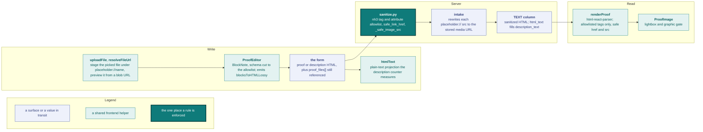

#### The editor

[`<ProofEditor>`](../frontend/src/components/editor/ProofEditor.tsx) wraps [BlockNote](https://www.blocknotejs.org) with a schema cut to what the server stores:

- Blocks: paragraph, heading (levels 2 and 3), bulleted and numbered list items, quote, code block, divider, and image. `allowImages={false}` removes the image block for a collection's description.
- Styles: bold, italic, strikethrough, and inline code. Underline is not offered, because the server drops `<u>`.
- Links: BlockNote's link control accepts only what `isSafeLinkHref` accepts, an absolute http(s) URL.

The formatting toolbar drops the alignment, nesting, and replace-file buttons, since the stored HTML carries no alignment or nesting and the replace panel offers an embed tab. The file panel offers upload only, so every image comes from the analyst's own file. The theme reads the neutral scale and accent as CSS variables, so the editor follows the reader's theme and accent. The text size is `FIELD_TEXT`, the size every other field uses. `bare` makes the editor the section's card itself, an event form's **Proof**: `ProofSection`'s card and `p-4` padding, and no inline padding of BlockNote's own, so the text starts where the event page's proof text starts; BlockNote's side menu floats into the card's padding.

The editor reads `initialContent` once, through `tryParseHTMLToBlocks`. Re-key the parent to seed it again. Each change emits `blocksToHTMLLossy` to `onChange`. BlockNote writes U+FFFC into an empty block, and the editor strips it before emitting.

#### Images

An image uploads at publish, not when it is picked:

1. BlockNote's `uploadFile` hook names the file with `safeProofFilename` and stores the block's URL as `placeholder://<filename>`.
2. `resolveFileUrl` previews that URL from a `blob:` URL while the analyst writes. A placeholder with no staged file loads a blank pixel, so no `placeholder://` src reaches an `img`. The editor empties its staging as it unmounts and revokes the blob URLs on the next task, once its images are gone.
3. Each change reports, through `onProofFilesChange`, the staged files whose placeholder is still an `` in the emitted HTML (`referencedProofFiles`).
4. The form posts those files as `proof_files[]` beside the HTML. The server matches each file to its placeholder by filename and rewrites the `src` to the stored media URL.

#### Storage

The server stores the body in a `TEXT` column and sanitizes every write with nh3 in [`sanitize.py`](../backend/app/services/sanitize.py) on the [rich text rules](api.md#rich-text).

#### The read view

[`renderProof`](../frontend/src/lib/proof.tsx) parses the stored HTML with html-react-parser and renders only allowlisted tags, each with its class from `TAG_CLASSES`. Any other tag renders its children only. Every attribute is dropped except:

- A link whose `href` passes `isSafeLinkHref` renders through `<OutboundLink ugc>` with `TEXT_LINK` (see [Outbound links](#outbound-links)). Any other link renders as its text.
- An image whose `src` passes `isSafeImageSrc` becomes [`<ProofImage>`](../frontend/src/components/event/ProofImage.tsx), which opens the shared lightbox. `gateImages` passes the event's `is_graphic` to it, so a proof image takes the same age confirmation as source media. A paragraph that holds an image renders as a `div`.

`isSafeLinkHref` and `isSafeImageSrc` mirror the server's predicates, so a body that bypasses the sanitizer still renders no unsafe URL.

#### Plain text

`htmlText` in [`lib/proof.tsx`](../frontend/src/lib/proof.tsx) mirrors the server's `html_text`: it concatenates the text with entities decoded, starts a new line at every block boundary and every `<br>`, trims each line, and drops blank lines. The collection description counter measures it, and the server caps the same projection and stores it as `description_text`. `proofHasImage` reads the same parse for the geolocation floor: a proof needs at least one ``.

### Errors

Every failure a reader meets is read once, in one module, and shown by one primitive.

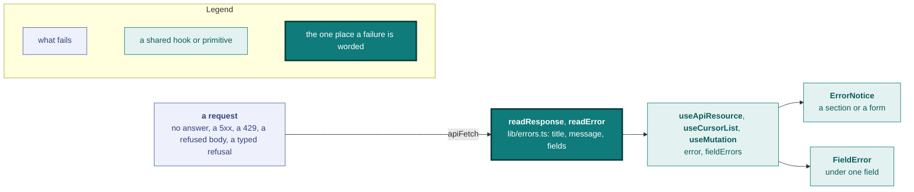

**The wording.** [`apiFetch`](../frontend/src/lib/api.ts) turns every failure into an `ApiError` that carries a `ReadableError` from [`lib/errors.ts`](../frontend/src/lib/errors.ts): a `title` for a fault the reader did not cause, a `message`, and `fields`, the refusals of a refused body keyed by field name. A message the backend wrote for people shows as written, so a refusal is worded where it is raised. The table words the rest, and the browser's and Pydantic's own words never reach the screen.

| Failure | Title | Message |
|---|---|---|
| No answer (offline, refused, CORS) | Vidit does not respond | Check your connection, then retry. |
| 5xx without a typed message | Vidit hit a problem | Retry in a moment. |
| 429 `rate_limited` | | Too many attempts. Try again in N minutes. (from `Retry-After`) |
| 429 `read_quota_exceeded` | | You reached the hourly reading limit. Try again in N minutes. |
| 404 or 403 without a message | | Not found. It may have been deleted. / You cannot do this. |
| 422 refused body | | The first field's refusal, after its name: *X handle: 15 characters at most: letters, digits and _.* |

A refused body reads each item by its Pydantic `type`: `missing` reads *Required.*, `string_too_long` reads *280 characters at most.*, a `value_error` reads the validator's own message, and an unknown type reads *This value is not accepted.* A validator's message in a backend schema is therefore a sentence for the reader, without the field's name.

**The display.** [`<ErrorNotice>`](../frontend/src/components/ui/ErrorNotice.tsx) is a neutral card with a red mark, `role="alert"`. An error with a `title` reads its title, then its message under it, and takes a **Retry** (`secondary`) when the caller passes `onRetry`: a failed read of a page (`<PageError>`), a section, a list's next page (`<LoadMoreRow>`), the map's points, the map's side panel, a search. Any other error, a form's refusal included, is one line with no Retry, since the same request meets the same refusal. [`<FieldError>`](../frontend/src/components/ui/ErrorNotice.tsx) is the red line under a field, with a small mark; the field names it through `aria-describedby`, and `alert` announces it when it appears after a submit or an upload. `useMutation`'s `fields` option lists the fields a form shows in place: their refusals arrive in `fieldErrors` and leave the form's `ErrorNotice` empty.

### Field help (`?`)

[`FieldHelp`](../frontend/src/components/ui/FieldHelp.tsx) puts a `?` next to a field label, section heading, detail row, filter bar, or icon group: a one-line explanation on hover or focus, pinned on click (touch can't hover), dismissed by outside-click or Escape (a real `role="tooltip"`). It is the app's **one** explanation affordance: an explanation never rides on a native `title` attribute, whose bubble is the browser's chrome rather than Vidit's and appears on no other surface here (`title` stays for the bare name of an icon-only control). It is **neutral grey, not accent** (meta help), the one sanctioned exception to the rule that clickable implies accent. Each `?` is `<FieldHelp concept="…" />`. The concept registry [`lib/fieldHelp.ts`](../frontend/src/lib/fieldHelp.ts) pairs each concept's `text` and `label` once (wording mirrors [`data-model.md`](data-model.md)), so the same concept explains a field on the submit form, the detail page or map panel, and the filter panel without drift. The registry is the only source: a `?` takes a concept key and nothing else, so no instance can word a concept its own way. The `?` is the single source of section *help*: what a concept means is written once, in the registry, and never restated under a heading. A block still states what it counts in a line under its heading where the heading alone leaves the population unstated (the Insights card and its two charts), which is a statement about that block's data rather than a definition of a concept. A concept whose data comes from outside Vidit (a basemap, a map layer or an overlay) also carries `sources` in the registry: the bubble lists them under the sentence, each an [`<OutboundLink>`](#outbound-links) to the provider's page, opening in a new tab. The pointer crosses from the `?` into the bubble without closing it, and a tap pins it on a phone, so the links stay reachable. While the bubble is open, the `?` names it through `aria-controls`, so a `<PopoverPanel>` around the `?` counts a press on a link as inside the panel and stays open. Readers can hide every `?` through Settings → Display, leaving only labels and fields. The switch is saved to the account like the [theme](#theme).

**Tap size.** The glyph is 13px, too small to hit with a thumb, so on a phone, padding plus a matching negative margin grows the anchor to 29 by 25px while the `?` and the label beside it stay where they are. The vertical bleed stops at 6px, the label-to-input gap the form fields use, so a tap aimed at the input below the label reaches the input. The tooltip is positioned off that anchor, so it hangs a few pixels lower and further left on a phone than on desktop, where the glyph keeps its bare box.

### Sanctioned one-offs

Decided once, so review doesn't re-litigate them:

- **Search's `ProfileResult`**, the analyst and organization hit row, re-declares `EntityCard`'s shell: folding it in would leak avatar / no-thumbnail conditionals into `EntityCard` for one consumer. Commented at the call site.
- **`ProofSection`** composes `<Card className="p-4">`, one density step tighter than the default `p-5`, because proof is a reading surface. On a form it frames the proof editor (`ProofEditor bare`, which draws no frame of its own), with the field's focus border and, when a publish flags the proof, the red outline.
- **Admin dev tooling** ([`admin/ActionReceipt.tsx`](../frontend/src/components/admin/ActionReceipt.tsx)) is a deliberately lighter register than `<Card as="section">`, admin-local on purpose: admin-only surfaces don't earn `ui/` primitives.
- **The Satori surfaces** ([`app/_og/`](../frontend/src/app/_og) and the generated [`icon.tsx`](../frontend/src/app/icon.tsx) / [`apple-icon.tsx`](../frontend/src/app/apple-icon.tsx)) render to a PNG on the server, never to a DOM, and Satori supports neither class names nor most of the CSS the primitives rely on. The share cards all compose the one frame in `_og/card.tsx` (see *Share cards*), which is the boundary: one frame for the cards, not one layout per route. The icons draw a single letter at three sizes and share only the font read, which is not a frame's worth of chrome.

## What we avoid

- Heavy glow, neon, pulse effects
- Gradients
- Glass / blur
- Decorative icons
- Long or showy animations
- Too many distinct colours; one accent hue only
- Information overload on the default view
