# Design principles and decisions

Every surface composes the same primitives, and two reader preferences repaint all of them at once. This page holds the decisions the code does not state: the principles, the palette, the layout, one primitive per job, and per surface the choices a contributor must keep. The props, sizes and demos of each primitive live in its file under [`components/ui/`](../frontend/src/components/ui) and in its `/palette` entry.

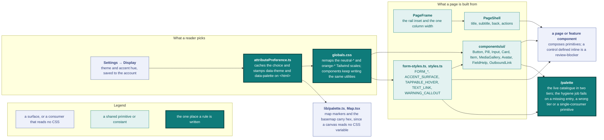

Each region of the diagram has a section below. What a reader picks is [Theme](#theme) and the [accent](#accent). What a page is built from is [Components](#components), whose class constants are named in the [accent recipe](#accent-recipe) and whose frame is [Page chrome](#page-chrome). [`/palette`](../frontend/src/app/palette/page.tsx) is the live catalogue, one file per category, in two tiers: Low level holds what two or more other shared components reuse, and High level holds what surfaces assemble. A component, constant or variant that one other component uses and no surface does lives in that component. The exceptions decided once are [Sanctioned one-offs](#sanctioned-one-offs).

## Philosophy

The interface is spare by default and reveals complexity on demand. It stays legible to first-time visitors, and advanced filters and tools appear only when needed. The design avoids a cluttered dashboard look and a dark-ops aesthetic.

1. **Progressive disclosure**: the default view is a map and points. Filters, detail, and tools appear on demand.
2. **Clarity over aesthetics**: every visual element serves a function.
3. **Neutral and professional**: the tone is sober, with no military-tech or hacker-dashboard tropes.
4. **Controlled density**: the reader moves from map, to points, to detail panel, to full proof, and picks the depth.

## Theme

The interface is dark by default, with light available on demand. It uses a uniform background, opaque panels, and one warm accent for contrast. Dark reads better for long, data-dense sessions, so it stays the default.

Theme and accent share one mechanism, [`attributePreference.ts`](../frontend/src/lib/attributePreference.ts): it caches the choice in `localStorage`, stamps a data attribute on `<html>`, and [`globals.css`](../frontend/src/app/globals.css) remaps a Tailwind scale under that attribute. Every utility repaints with no per-component change. Two consumers read no CSS variable and carry hex instead: the basemap and the map markers (see [Map](#map)).

Both preferences, and the help tooltip switch, are saved to the account ([`PATCH /users/me/preferences`](api.md#patch-usersmepreferences)), so they follow a signed-in analyst across devices. A value the account has saved wins over the browser's. The browser cache records which account wrote it, so one analyst's choices never reach another account on a shared browser.

Light applies as `data-theme="light"`; dark carries no attribute. Light remaps the `neutral-*` scale and the semantic `red` and `amber` scales, and sets `color-scheme`, so native widgets track the theme. The accent is not theme-adjusted.

## Colour palette

### Foundation

The dark roles below are the default. The light theme re-points the same `neutral-*` scale to a soft ramp: a warm grey canvas with warm off-white cards on it, and dark grey text (`neutral-100` = `#232323`, not black). Like the dark scale, it avoids pure black and pure white, so a large light surface does not glare.

| Role | Color | Tailwind | Usage |
|------|-------|----------|-------|
| Background | `#0a0a0a` | `neutral-950` | Global background, behind the map |
| Surface | `#171717` | `neutral-900` | Panels, cards, modals |
| Surface elevated | `#262626` | `neutral-800` | Inputs, interactive elements, hover |
| Border | `#404040` | `neutral-700` | Separators, field outlines |
| Text primary | `#f5f5f5` | `neutral-100` | Titles, primary content |
| Text secondary | `#a3a3a3` | `neutral-400` | Labels, metadata |
| Text muted | `#737373` | `neutral-500` | Placeholders, disabled elements |

### Accent

There is one accent hue. It is orange by default, and Settings → Display also offers blue, emerald, violet, and rose. `data-palette` remaps the `orange-*` scale to the chosen hue, so components keep writing `orange-*` utilities and the [`styles.ts`](../frontend/src/components/ui/styles.ts) constants, and everything below holds for whichever hue is active.

The accent is **tinted-on-dark**, never a flat `bg-orange-500` fill for buttons or selected states:

| Token | Where it shows up |
|------|-------|
| `orange-400` | Text of every interactive element: inline links, button labels, tappable-card hover, status pills. |
| `orange-500` | The hue itself, only at fractional opacity on backgrounds and borders (`bg-orange-500/10`, `/15`, `/20`), and full strength on map points and state dots. |

### Map points

| Role | Color | Usage |
|------|-------|-------|
| Point default | accent `500` | Submitted points |
| Point detected | accent `300` | Machine-detected points: the same hue, told apart by lightness |
| Point selected | accent `500` and a halo | The clicked point |

### Semantic

| Role | Tailwind | Usage |
|------|----------|-------|
| Danger | `red-500` | Errors, field refusals, deletions |
| Success and info | `orange-500` | Confirmations and info notices (`FORM_SUCCESS_BANNER`). Accent, not green: a confirmation next to red destructive actions does not read as celebratory. |
| Warning | `amber-500` | Non-blocking caution (`WARNING_CALLOUT`). Colour only; the call site owns the layout. |

## Accent recipe

Every accent treatment is a named constant from [`styles.ts`](../frontend/src/components/ui/styles.ts) or [`form-styles.ts`](../frontend/src/components/ui/form-styles.ts), or a primitive. Use it; don't hand-roll the class string. If a class string for an accent element runs past about three Tailwind tokens, look for a constant there first. The rule:

> If something carries the accent and isn't clickable, it's a bug. If something is clickable and isn't accent, it's a bug.

Carve-outs: navigation chrome stays neutral grey, destructive actions go red, and the `?` help is neutral (meta, not content). Charts carry the only inert accent: a mark whose accent step encodes a magnitude takes `ACCENT_RAMP`, and so does its legend. What stands outside the ranking (an empty month, an unnamed tail) takes the neutral chart paint. External links open in a new tab with the same accent styling.

There are five buckets:

1. **Inline link** (`TEXT_LINK`): clickable accent text in copy or rows. An action that only reads like a link (Cancel, dismiss) is a ghost `<Button>`.
2. **Tappable card or row** (`TAPPABLE_HOVER`): the whole card or row is one click target. It is neutral at rest; on hover the border turns accent and the title takes the accent.
3. **Buttons** (`<Button>`): every action. A `<Link>` that must look like a button takes `buttonClasses(variant)`. See [Buttons](#buttons).
4. **Pills, chips, and badges** (`<Pill>`): the whole badge family, by `tone`. Domain wrappers such as `StatusBadge` map an enum to tone, icon and label. A bare tag is a neutral `<Pill>` with no wrapper.
5. **Active nav or row surface** (`ACCENT_SURFACE`): the accent paint of a selected nav row or option. The accent `<Pill>` composes the same paint plus a border, so a pill and an active nav item cannot drift apart.

## Layout

```
┌────┬─────────────────────────────────────────────┐
│    │  Filters │                    │   Detail    │
│rail│  panel   │        MAP         │   panel     │
│    │  (left)  │   (full screen)    │  on click   │
└────┴─────────────────────────────────────────────┘
```

- **Sidebar rail:** the left nav (logo, working surfaces, identity block). Submit, Requests and Feed show only to a signed-in reader. Below `sm` it is a drawer; see [Phone chrome](#phone-chrome).
- **Map:** full-screen background on `/map`.
- **Left panel:** the filters, floating over the map.
- **Right panel:** the event detail, on click, dismissible. When the selected event fails to load, the panel shows the error and a Retry control, never a previously selected event.

Panels are opaque `neutral-900` (no glass, no blur) with a `neutral-700` border, floating above the map.

## Typography

- **Font:** Montserrat, set as `--font-sans` in `globals.css`, with `system-ui` as the fallback.
- **Sizes:** page titles `text-xl` (the `h1` of `PageShell`); other titles `text-lg` at most; body `text-sm`; labels and meta `text-xs`; micro (counters, badges) `text-[11px]`.
- **Weights:** `font-medium` for titles, `font-normal` for everything else.

## Map

The map draws one basemap at the bottom and the app's overlays above it, in a fixed order. A basemap swap replaces the bottom group only.

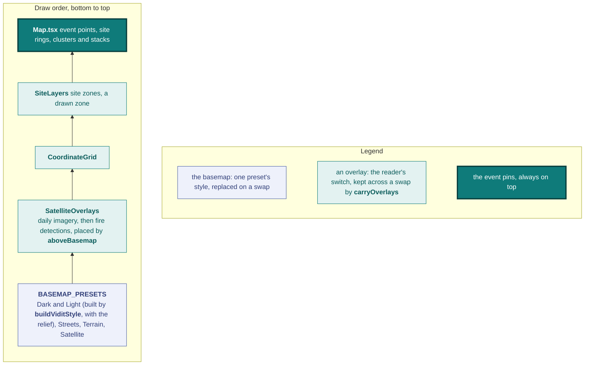

Every map on the site is the same [`<Map>`](../frontend/src/components/map/Map.tsx): the full-screen canvas, the pin of an event page and of a form's Location block, a profile's coverage map and a collection's coverage map. A set with no mappable point renders no map card, since an empty world map says less than no map and both surfaces carry a list.

**Basemap.** The Vidit dark and light styles in [`components/map/styles/`](../frontend/src/components/map/styles) are forks of the OpenFreeMap styles; the folder's `LICENSE` carries the upstream licence. The **Auto** preset follows the theme. The basemap control also offers Dark, Light, Streets, Terrain and Satellite; the Satellite preset names its year, so a reader does not take it for current imagery. Each preset declares its brightness, and the selected-point halo follows that brightness, not the theme.

- **Fewer labels at low zoom.** At the default Sparse density, a view of a continent or the globe labels countries and national capitals only, so event points stay readable.
- **One name per label.** A label shows its Latin name, or its local name when it has no Latin one.
- **Settings.** On Dark and Light the panel adjusts labels and layers. The browser stores only the settings you change, so a setting you never changed follows its default. Military areas, airports and fire detections take hues no accent palette and no site zone uses, so a highlighted area never reads as an event point (`MAP_LAYER_COLORS` in [`lib/palette.ts`](../frontend/src/lib/palette.ts)).
- **Overlays.** The coordinate grid and the NASA GIBS daily imagery and fire detections are switches, off by default. The daily layers show the day before, in UTC, since the current day's pass can still be incomplete.
- **Source help.** Each preset, setting and overlay carries a `?` that says what it shows and links its data providers (see [Field help](#field-help-)). [`engineering.md`](engineering.md#map-data-sources) lists the sources.
- **Unreachable basemap.** When a basemap's tile server does not answer, a warning line in the middle of the map says so and suggests another basemap. The map stays usable under it.
- **Style swaps keep the overlays.** A swap runs through MapLibre's style diff and carries the overlay sources and layers above the incoming basemap, so a reader's switches survive a preset change.

**Points.**

- **Pin hover preview.** A single pin shows a compact [`<Item>`](#items) preview after a short hover intent. A coarse pointer arms no preview, so a tap goes straight to the panel. Ordinary clusters get no preview and zoom on click.
- **Co-located events.** Events that share one coordinate form a cluster that can never expand. Past the clustering ceiling the group draws as one counted badge, so a stack of 3 never reads as a single pin. Hovering it, or a tap on touch, fans the events out on a ring; each dot behaves like a pin.
- **Cluster crossfade.** Clusters and points crossfade only while a zoom is in flight. At rest every layer holds full opacity.
- **Go to coordinates.** On `/map`, a control beside the basemap control centres the map on a pasted latitude and longitude or a Google Maps URL. A pair it cannot read stays in the field with the reason, in the words of the backend's `validate_coordinates`.

**Sites layer.** [`SiteLayers`](../frontend/src/components/map/SiteLayers.tsx) draws the [sites](#sites) under the event pins, so an event always draws above a zone. The filter panel's **Show** line turns it on, and the map reads the zones valid at the end of the event date window. Below zoom 10 each site joins the event clusters as a point:

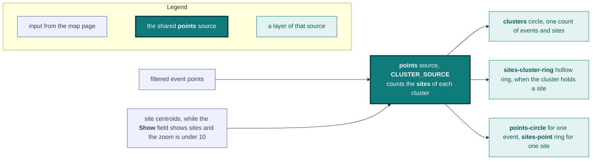

- A cluster that holds a site draws a hollow accent ring around its circle. The ring marks that the cluster holds a site, not how many.
- From zoom 10 the zones alone stand for the sites, and the clusters count events only.
- A zone takes the event point colour as a faint fill under a solid outline, so the pins and labels inside it stay readable.
- The latest link effect does not tint the map: the warning amber and the danger red sit too close to the orange and rose palettes to read. The preview and the side panel show it as a pill.
- A click on a site opens the map's side panel with the same blocks an event fills (Sources, Location, Details), so the page holds one panel slot.
- A site page's own map draws the zone in a hue apart from the accent, so the zone stands apart from the linked events. There the latest effect does colour the zone.
- The contour editor refuses a ring the API would refuse (crossing edges, or an area over the [API cap](api.md#sites)) before it closes, and says why under the map.

## Components

### Primitives by job

Each job has exactly one primitive. Use it everywhere and change it in that one place; a second primitive for the same job is a review blocker. Lint fails on the raw elements and imports that would bypass a primitive (see [Gates](#gates)).

| Job | Primitive | Details |
|---|---|---|
| Show an item | [`<Item>`](../frontend/src/components/ui/Item.tsx), `compact`, `list` or `card` | [Items](#items) |
| Search an item or an account | [`<ItemSearch>`](../frontend/src/components/ui/ItemSearch.tsx) | [Build on shared primitives](#build-on-shared-primitives) |
| Pick from a vocabulary, one value or several | [`<OptionSearch>`](../frontend/src/components/ui/OptionSearch.tsx), `single` for one value | [Build on shared primitives](#build-on-shared-primitives) |
| Pick a view or a mode | [`<SegmentedControl>`](../frontend/src/components/ui/SegmentedControl.tsx), [`<ChoiceRow>`](../frontend/src/components/ui/ChoiceRow.tsx) for a preference | [Build on shared primitives](#build-on-shared-primitives) |
| Enter a date, a time or an instant | [`<DateTimeInput>`](../frontend/src/components/ui/DateTimeInput.tsx) | [Build on shared primitives](#build-on-shared-primitives) |
| Pick a date range in a filter | [`<TimelineScrubber>`](../frontend/src/components/filters/TimelineScrubber.tsx), its dates on `<DateTimeInput>` | [Filter panel](#filter-panel) |
| Toggle a setting | [`<ToggleRow>`](../frontend/src/components/ui/ToggleRow.tsx) on [`<Switch>`](../frontend/src/components/ui/Switch.tsx) | [Build on shared primitives](#build-on-shared-primitives) |
| Remove (minor, at once) | [`<RemoveButton>`](../frontend/src/components/ui/RemoveButton.tsx), `<Pill onRemove>` for a pill: the cross, `ACTION_ICONS.remove` | [Destructive actions](#destructive-actions) |
| Delete or revoke (important) | [`<ConfirmButton>`](../frontend/src/components/ui/ConfirmButton.tsx): the trash, `ACTION_ICONS.delete` | [Destructive actions](#destructive-actions) |
| Confirm a destructive action | `<ConfirmButton>` in place; [`<ConfirmDialog>`](../frontend/src/components/ui/ConfirmDialog.tsx) when it needs input | [Destructive actions](#destructive-actions) |
| Open a menu of actions | [`<ActionMenu>`](../frontend/src/components/ui/ActionMenu.tsx) | [Build on shared primitives](#build-on-shared-primitives) |
| Open a popover | [`<Popover>`](../frontend/src/components/ui/Popover.tsx), `PopoverPanel` for a caller that owns its trigger | [Build on shared primitives](#build-on-shared-primitives) |
| Page actions | [`<PageShell>`](../frontend/src/components/ui/PageShell.tsx) `stickyActions`, top right | [Page chrome](#page-chrome) |
| Filter a list | [`<FilterPanel>`](../frontend/src/components/filters/FilterPanel.tsx) in `FilterCard` or `FilterSheetBar` | [Filter panel](#filter-panel) |
| Show more of a list | [`<LoadMoreRow>`](../frontend/src/components/ui/LoadMoreRow.tsx) | [Build on shared primitives](#build-on-shared-primitives) |
| Show a loading state | [`<PageLoading>`](../frontend/src/components/ui/PageShell.tsx): centred on the page, `line` in the flow, `compact` in a dense panel | [Page chrome](#page-chrome) |
| Show an error | [`<ErrorNotice>`](../frontend/src/components/ui/ErrorNotice.tsx), `<FieldError>` under a field | [Errors](#errors) |
| Show an empty state | [`<EmptyState>`](../frontend/src/components/ui/EmptyState.tsx) | [Build on shared primitives](#build-on-shared-primitives) |
| Upload a file | [`<FileManager>`](../frontend/src/components/ui/FileManager.tsx) | [Build on shared primitives](#build-on-shared-primitives) |
| Show a pill or a tag | [`<Pill>`](../frontend/src/components/ui/Pill.tsx) | [Build on shared primitives](#build-on-shared-primitives) |
| Collapse a section | [`<SectionEyebrow>`](../frontend/src/components/ui/SectionEyebrow.tsx) `toggle` | [Build on shared primitives](#build-on-shared-primitives) |

#### Gates

`npm run lint` ([`eslint.config.mjs`](../frontend/eslint.config.mjs)) fails on:

- a cross, a trash or a look-alike imported from `lucide-react` outside `Button.tsx`. The close glyph `X` is allowed in the four files where it closes or marks a state and removes nothing.
- a native `<select>`, `<textarea>` or date, time or instant `<input>` outside `Input.tsx`;
- `confirm()`;
- an import of a retired primitive: `AccountPicker`, `OptionPicker`, `ChipBucket`, `Disclosure`.

The `hygiene` job fails when a `components/ui/` primitive or style constant has no `/palette` entry in its tier, or has a single consumer.

### Build on shared primitives

Every UI element is a reusable primitive. Compose from them; never hand-roll a one-off. If none fits a new need, add the missing piece to [`components/ui/`](../frontend/src/components/ui) (or as a new `FORM_*` or `styles.ts` constant) and consume it from there, never inlined in a page. Growing the vocabulary with a new shared component is a maintainer decision (see [`AGENTS.md`](../AGENTS.md) → *Conventions*). Reusing or extending an existing one is the default.

**Token or component?** A piece is a *component* when it owns shape or behaviour (`<Input>`, `<Pill>`, `<Button>`, `<Card>`). It stays a *class constant* when it is a single-element paint composed into someone else's markup (`FORM_LABEL`, `ACCENT_SURFACE`, `TAPPABLE_HOVER`). A constant that starts growing variants has crossed the line, so promote it. Primitives join classes with [`cn`](../frontend/src/lib/cn.ts) (tailwind-merge), so a caller's `className` wins conflicts predictably. `<Button>` and `<Pill>` stay one size by design.

Decisions the primitives do not state on their own:

- **Labels.** A field's `?` sits beside its `<label>`, never inside it, so the field's accessible name is the label's words alone. An event field's name and `?` live in one table (`EVENT_FIELDS` in [`lib/events.ts`](../frontend/src/lib/events.ts), `SOURCE_FIELDS` in [`lib/sources.ts`](../frontend/src/lib/sources.ts)), whose key order is the display order, so a field reads under one name on the page and in the form.
- **Usernames.** A Vidit username prints bare, with no `@`, everywhere: bylines, cards, titles, share text and share cards. An `@` marks an external account only (a linked X or GitHub account, an X post author).
- **Tooltips.** A touch never opens a [`<Tooltip>`](../frontend/src/components/ui/Tooltip.tsx), so a tap leaves no bubble standing. The exception is a control whose label is the only place a fact shows (an approval stamp, a count badge): there the first tap shows the label and the second acts.
- **Missing conditions.** A control that still lacks something carries a red [`<CountBadge>`](../frontend/src/components/ui/CountBadge.tsx) beside it, never inside it, so a tap on the control still acts.
- **Floating elements.** Every popover, menu and typeahead list is placed by [`useAnchoredPosition`](../frontend/src/hooks/useAnchoredPosition.ts) in a portal, so an `overflow` ancestor never clips it.
- **Long lists.** A list that has more ends on **Show more** ([`<LoadMoreRow>`](../frontend/src/components/ui/LoadMoreRow.tsx)), which grows it in place, or on **See all**, which links a preview to its whole list.
- **Steps.** [`<NumberedSteps>`](../frontend/src/components/ui/NumberedSteps.tsx) is reference copy: every step looks the same. [`<ProgressSteps>`](../frontend/src/components/ui/ProgressSteps.tsx) is a live operation. It draws a progress bar only from a real ratio, and a step without one takes a spinner, never a fake animation.

#### Media

- [`<VideoPlayer>`](../frontend/src/components/ui/VideoPlayer.tsx) is the one player. Its media-chrome controls are web components, so they stay independent of React and clear of Tailwind specificity.
- Download goes through [`<MediaDownloadButton>`](../frontend/src/components/ui/MediaDownloadButton.tsx) everywhere. Media is served from a separate origin, where a plain `<a download>` navigates instead of saving.
- The backend picks the picture of every listed event (`backend/app/services/thumbnails.py`). The frontend renders what the payload carries and never re-derives it.
- [`<GraphicContentGate>`](../frontend/src/components/ui/GraphicContentGate.tsx) covers flagged media. Each source carries its own flag, so on a detail surface each [source block](#source-blocks) gates its own file. A card-sized slot reads the event's flag, true when any source is flagged.

#### Items

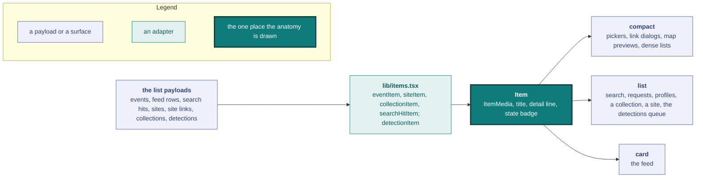

[`<Item>`](../frontend/src/components/ui/Item.tsx) is the one presentation of an event, a request, a site, a collection, an analyst and an organization in a list: the media slot (the kind's icon when there is no picture, never an empty box), the title, the detail line and the state badge.

It has three shapes: `compact`, a bare dense row for pickers, dialogs, form fields and map previews; `list`, a bordered row for a page's list; `card`, media on top, for the feed.

Each payload has one adapter in [`lib/items.tsx`](../frontend/src/lib/items.tsx). A surface overrides a slot only with what the payload alone does not say.

The whole item is one click: a stretched link, or a stretched button when the list picks a position on its own surface.

#### Controls

- A control carries colour while it acts and neutral grey when it cannot. An inert link becomes a disabled button. See [Buttons](#buttons).
- Every icon control is the ghost icon button, with its name as a tooltip. A control that navigates is [`<IconLink>`](../frontend/src/components/ui/IconLink.tsx), so a button never nests inside an anchor. An icon action that stands as its own item on a field's line is the outlined icon button.
- [`<Switch>`](../frontend/src/components/ui/Switch.tsx) is the one boolean toggle.
- [`<SegmentedControl>`](../frontend/src/components/ui/SegmentedControl.tsx) picks a view or a mode, never a vocabulary value. A vocabulary field is an `<OptionSearch>`. `<Select>` picks a position in a list the form itself holds.
- [`<ConfirmDialog>`](../frontend/src/components/ui/ConfirmDialog.tsx) is a step that carries input, or a final choice that destroys nothing. A destructive action confirms in place through `<ConfirmButton>` (see [Destructive actions](#destructive-actions)). It keeps the dialog only when it needs input or comes from a menu, which closes on the pick. **Cancel** takes the initial focus, so Enter on open sends nothing.

#### Outbound links

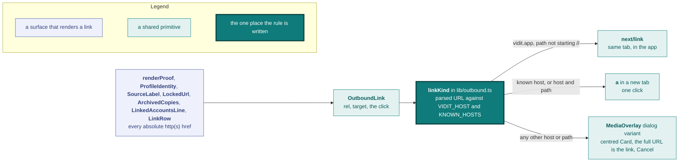

[`<OutboundLink>`](../frontend/src/components/ui/OutboundLink.tsx) renders every link whose `href` is an absolute http(s) URL. A raw external `<a>` anywhere else is a review blocker.

- A link to an unknown host opens a warning dialog whose only way on is the full URL, so the reader reads the address to leave.
- When you add to `KNOWN_HOSTS` in [`lib/outbound.ts`](../frontend/src/lib/outbound.ts), add the narrowest host that fits: a bare host covers its subdomains, an entry with a path covers that exact path only. Never add a host that serves an open redirector.
- Links in text an analyst wrote carry `ugc`.

#### Source blocks

An event's evidence is its list of [sources](data-model.md#sources). A reading surface renders one [`<SourceBlock>`](../frontend/src/components/sources/SourceBlock.tsx) per source, and a form renders one [`<SourceEditor>`](../frontend/src/components/sources/SourceEditor.tsx) per source. Every reading surface, a [site page](#sites) included, uses that block.

- A block's rows follow the order of the editor's fields. A row with no value drops out.
- The event page and every form lay the sources out in one [`<SourcesRow>`](../frontend/src/components/sources/SourcesRow.tsx) (see [Event layout](#event-layout)).
- A publish attempt checks the source floor (`sourceFloor` in [`lib/sources.ts`](../frontend/src/lib/sources.ts)) and shows the first editor with a gap.

Archived copies sit beside each link:

- On a reading surface, [`<ArchivedCopies>`](../frontend/src/components/sources/ArchivedCopies.tsx) shows one read-only mark per link: accent and opening the copy where one exists, grey and inert where none does, for every reader. The mark is an archive icon, never a service logo.
- Nothing on a reading surface writes. The analyst archives from the form: each link row there carries an archive box that pastes a snapshot or shows the stored copy.

### Page chrome

Every main-app page uses [`<PageShell>`](../frontend/src/components/ui/PageShell.tsx), except `/`, `/map`, the `(auth)/*` group and `app/error.tsx`.

- **One column.** Every page shares one container, so the title starts at the same x everywhere. The side padding drops a step below `sm`, because the desktop gutter leaves a card on a 375px screen too narrow for a title beside a thumbnail. The top padding steps up there instead, to clear the menu chip (see [Phone chrome](#phone-chrome)).
- **Back arrow.** Set `back` only on a drill-in page reached from content (event or request detail, edit, profile, the detections queue). Sidebar destinations never set it, except a `/submit` path, which returns to the chooser. A route that only redirects calls `skipBackRecord`, so the back walk never reruns its redirect.
- **Actions.** Page actions are buttons in the top-right sticky action bar (`stickyActions`). Every control that acts on the page's subject sits there or in `actions`, so a reader finds them in one place. A panel one opens is a popover, so nothing under the header moves.

The public guides (`/guide`, `/methodology`, `/import`) are server components of `PageShell` plus `Card`, for SEO.

#### Getting started page

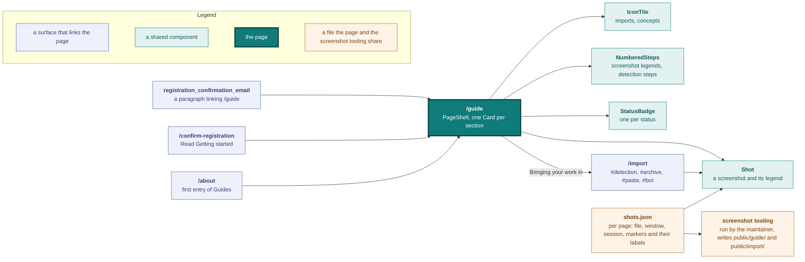

[`/guide`](../frontend/src/app/guide/page.tsx) shows rather than tells: each section is a title, at most one sentence, annotated screenshots, and at most one row of tiles for what no screenshot shows.

- **Anchors are a contract.** Other pages and messages link to each section id. Keep every id when you edit a heading.
- **Grounded in the product.** The page names only controls that exist, under their product labels. A PR that changes a surface the page shows updates its tile or its markers in [`shots.json`](../frontend/src/app/_shots/shots.json), and the maintainer regenerates the screenshot.

#### Import and methodology guides

A fact lives in one guide, and the others link to it:

| Fact | Owner |
|---|---|
| The statuses and the path from detection to geolocation | `/guide#statuses` |
| What makes a detection, what it carries, the parsing rules | `/import` |
| Each way in: archive, pasted post, @ViditBot | `/import#archive`, `#paste`, `#bot` |
| What a proof is and how to build one | `/methodology` |

The `/methodology` proof example has its step numbers baked into the image. Reordering the first four steps means re-baking it.

#### Right rail

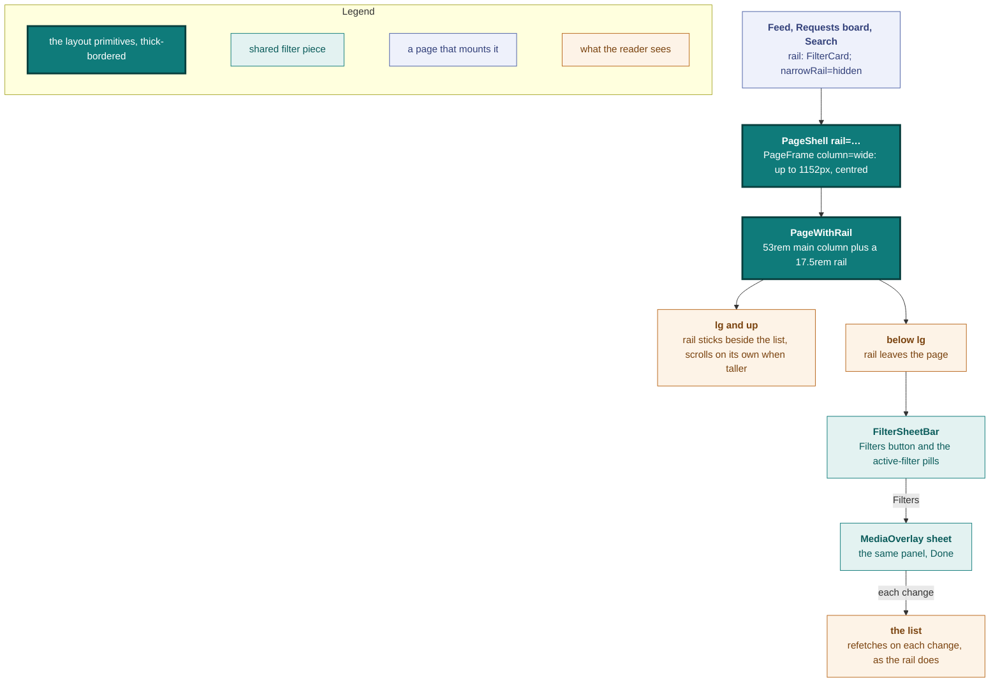

Use `PageShell`'s `rail` for a side panel that stays in view while the main column scrolls. The event forms put their actions in [`EventShell`](#event-layout)'s sticky actions instead.

#### Filter panel

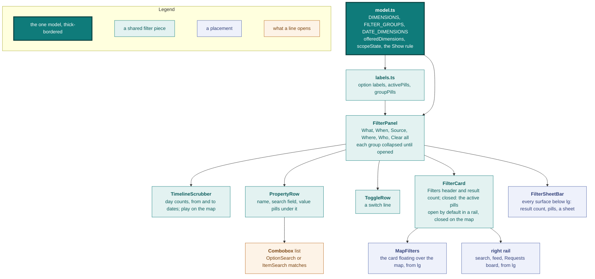

Every filter lives inside the filter panel. One model ([`model.ts`](../frontend/src/components/filters/model.ts)) drives it on every surface, in one order, so a dimension reads the same everywhere. A surface leaves out only the dimensions its data cannot serve.

- No active filter is out of sight: a collapsed group or a closed card shows its active filters as pills.
- No line, chip or pill carries a count, and the panel prints no helper line.
- Search, the feed and the Requests board keep the filters in the page URL, so a shared link and **Back** land on the same view. The map keeps them in memory until reload.
- The Show rule: with nothing selected, a surface shows everything; once you select options, it shows only what they name.

#### Phone chrome

| Width | Nav | Back control |
|---|---|---|
| Below `sm` | The rail is off-canvas, opened as a drawer from a menu chip in the top-left corner. Pages take no left inset and clear the chip with top padding. | In the chip |
| `sm` to `lg` | Fixed 56px rail | A row above the title |
| `lg` up | The same rail | In the gutter left of the column |

The chip costs only its corner, so each page clears it with its own padding rather than every route giving up a row to a bar. The map's overlays sit beside it.

**The display cutout is part of the box.** The page paints edge to edge, and every surface that owns the screen size uses `dvh`.

- A surface that floats a set distance from an edge takes the inset as a margin: the menu chip, the map's filter overlay, the map's detail panel from `sm` up.
- A surface that fills an edge takes it as padding, so its box still reaches the edge: the nav drawer, the map's bottom sheet, the media overlay.
- The rail takes no inset from `sm` up and paints under the cutout band: a notched phone in landscape is past `sm`, and the inset would leave the glyphs 12px.

Below `sm`, a date field's picker mark stands down and a tap on the field opens the engine's own picker.

#### One event, four surfaces, two writes

An event is read on four surfaces and written by two endpoints.

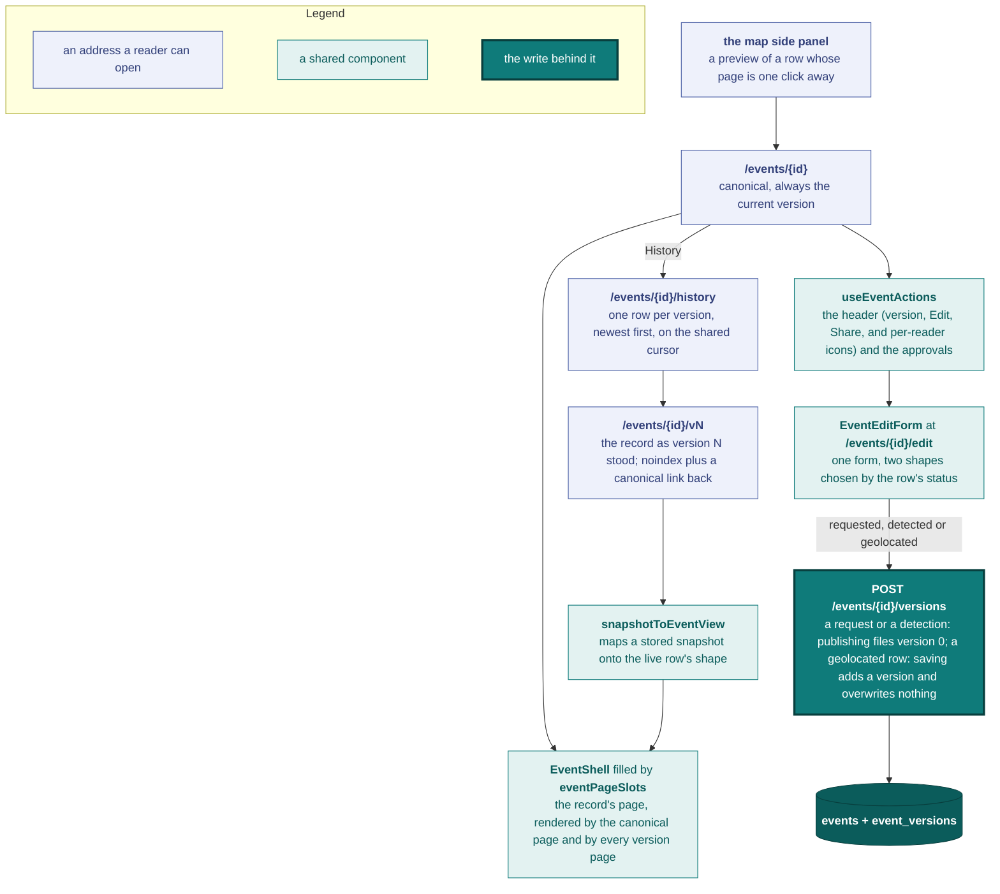

#### Event layout

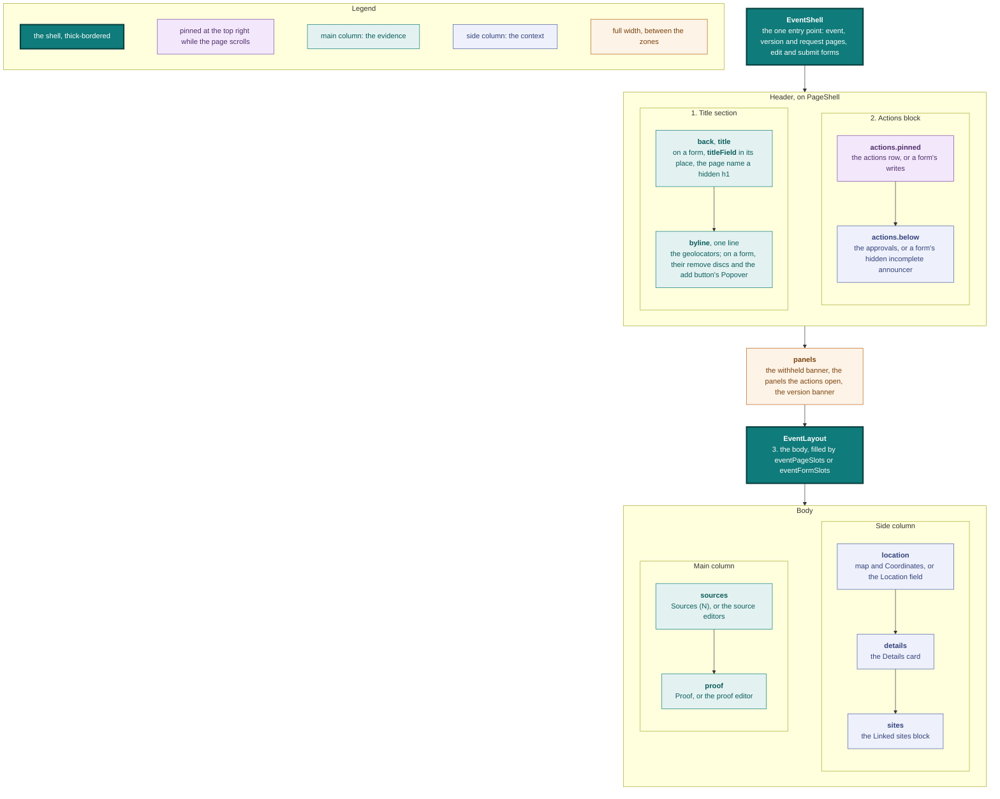

[`EventShell`](../frontend/src/components/event/EventShell.tsx) is the only place that lays out an event. Every surface fills the slots of its three zones, so a block sits in the same spot on every surface. To move a block, change `EventShell` or its body grid, [`EventLayout`](../frontend/src/components/event/EventLayout.tsx), never a page.

- The main column holds the evidence and the side column the context. The map panel keeps its own one-column body.
- On a form, the **Title** field takes the title's place at its size, so the page and the forms share one top.
- Only the row of buttons is pinned, so a write stays one click from any field.
- The Details card has no Author row: the byline credits every geolocator.
- The pinned row precedes the title in the tab order, so the writes are a form's first stop.

#### Event actions and approvals

The top right is where you act on an event, and the rest of the page is what you read. [`useEventActions`](../frontend/src/components/event/useEventActions.tsx) is the one place that picks the controls for the surface, the row and the reader, in the order and for the audience the diagram shows.

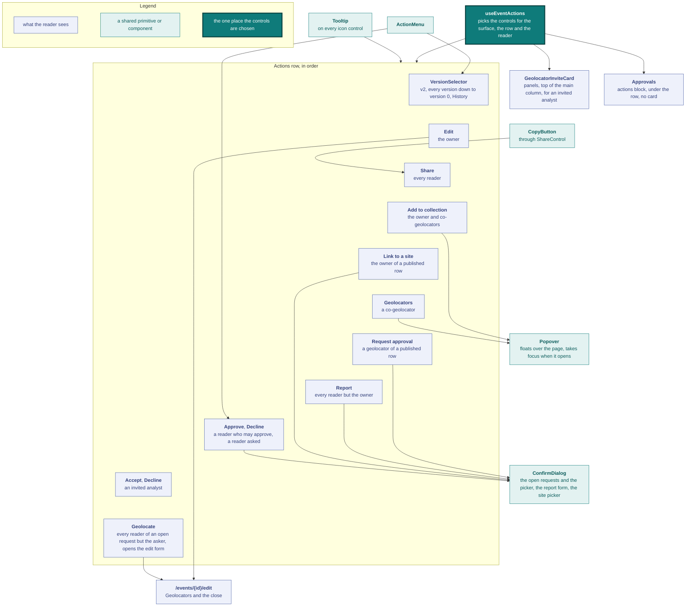

- **Version selector.** Every reader of a published record gets it, a retracted one included, because a corrected record is auditable only when anyone can walk the corrections. It shows on a single-version event too, so the version on screen is always named.
- **Edit.** The owner's close and geolocators live on the edit page, not in the actions row.
- **Approvals.** They sit under the row with no card and scroll while the row stays pinned. An approval is final and covers one version, so **Approve** asks for confirmation. Outdated approvals are read on each version's page.

Nothing in the actions row closes a row. The map side panel and the forms have no actions row: the panel previews a row whose page is one click away, and a form acts through its own write.

**One verb closes every shape.** The verb is *Close*, and only the noun changes with the row. Closing is terminal. The reason stays public, because a reader finds it on the closed page in place of the claim. A retracted geolocation keeps its page and its version selector, so a reader can walk what it claimed.

#### The owner edit form

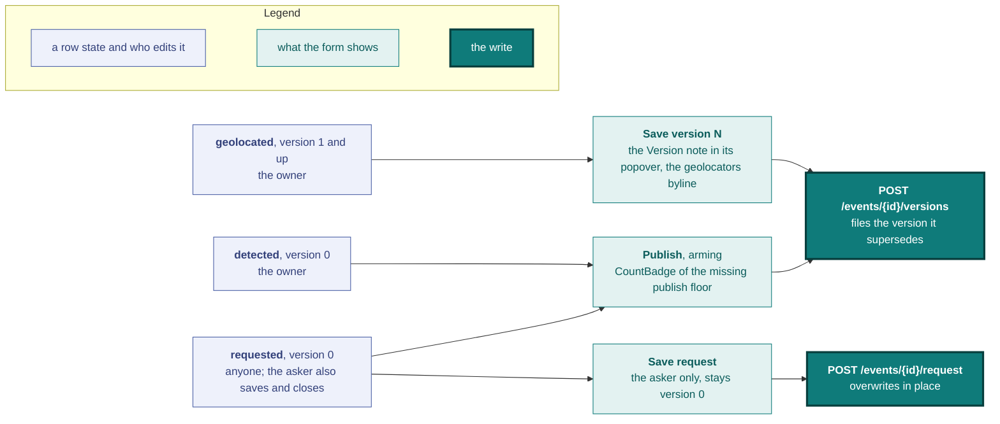

[`EventEditForm`](../frontend/src/components/geolocations/edit/EventEditForm.tsx) takes its shape from the row's status, so `/events/{id}/edit` is one address for the publish and every correction. A write posts the version the form loaded, so a row that moved meanwhile answers a conflict.

- A request is anyone's to publish. A detection is its owner's.
- **Save version N** names the version it creates, so you see what you are about to add.
- On a published row a byline change applies on click and makes no version. On a request or a detection, the picks are invited with the publish.

#### The version history and one version

`/events/{id}` always shows the current version, `/events/{id}/history` lists every version, and `/events/{id}/vN` shows version N.

- The history page names the event as plain text, because the `Current` row already opens it.
- Each row is one click and its byline is plain text, so the mouse and the keyboard reach one target. A row is whole or absent, never a version with no editor.
- A version page is the canonical page minus its actions, fed a snapshot, so it cannot drift into a layout of its own.
- [`EventVersionBanner`](../frontend/src/components/event/EventVersionBanner.tsx) opens it with the callout split every warning surface takes: the card is the caution, and the clickable affordance stays the accent.

### Feed

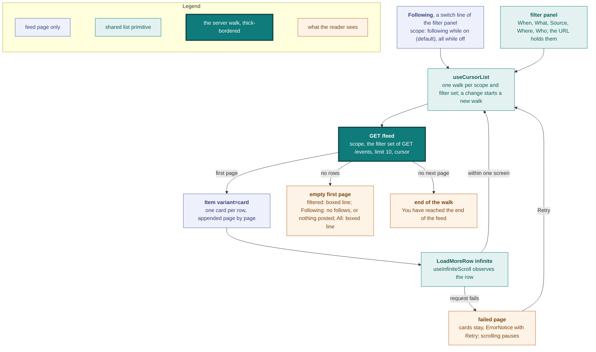

`/feed` is a signed-in page; [`GET /feed`](api.md#get-feed) picks and orders its rows. The **Following** switch in the [filter panel](#filter-panel) holds the scope, so the list and its empty state describe the scope on screen. An empty Following view tells apart following nobody from followed analysts posting nothing.

### Public profile

[`/profile/{username}`](../frontend/src/app/profile/[username]/page.tsx) is the analyst's portfolio, the link they pin, so it reads as evidence rather than as an account: identity in the header, then the work, widest reading first (coverage, insights, collections, recent submissions). It mounts no [right rail](#right-rail), and edit mode keeps the column, so the header does not move.

#### Identity

The handle is the H1 beside the avatar, the event page's grammar. The metadata line carries no work figures. The profile never prints the account's email, even to its owner.

#### Linked accounts

Each platform shows its brand mark alone, so the weight stays on the handle that titles the page. A value that does not parse as an account renders nothing.

#### Work blocks

The detections queue, owner only, sits above the work because it is pending work. Recent submissions lists published work only and reads last because it grows.

#### Insights

Insights is the only home for work figures, under the map because it interprets it. Every figure counts visible `geolocated` and `detected` events: an open request is not documented work, and a closed row is work the analyst discarded. The activity grid counts months, since a daily grid stays blank.

#### Edit mode

Edit mode renders only the header fields, bio and linked accounts, with **Save** pinned top right. The organization page's edit mode is the same.

### Organization page

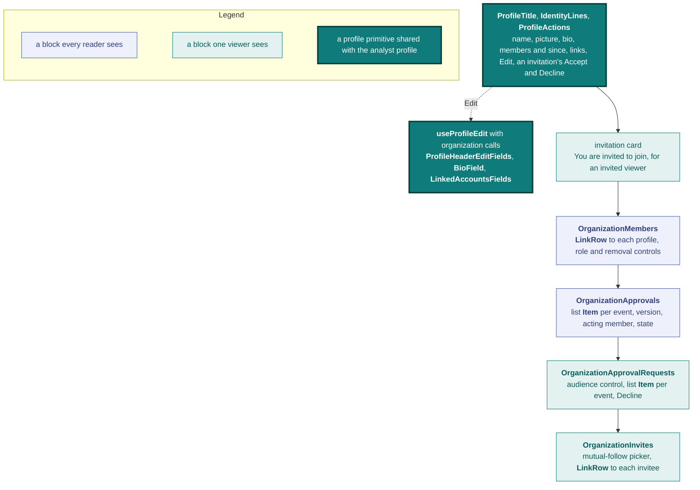

[`/organizations/{slug}`](../frontend/src/app/organizations/[slug]/page.tsx) reuses the [public profile](#public-profile)'s primitives. Each viewer sees the controls their membership grants; a site admin who is not a member reads it as a visitor and deletes organizations from the admin panel.

### Collections

A collection is one analyst's named set of their own `geolocated` and `detected` events. Items order by event date, so there is no manual order.

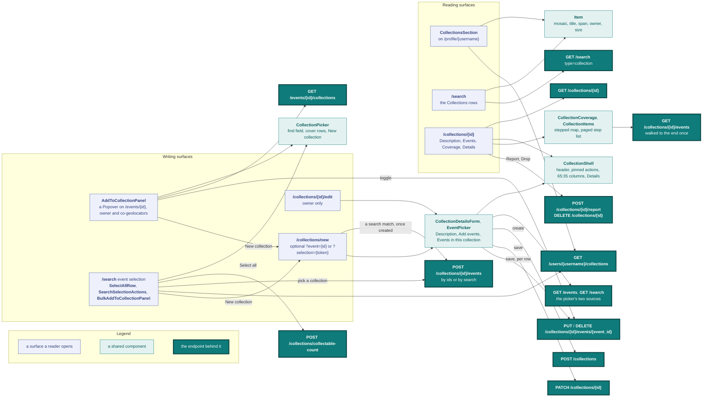

#### The collection page

[`<CollectionShell>`](../frontend/src/components/collections/CollectionShell.tsx) lays out the page and both forms, as [`EventShell`](#event-layout) does for an event:

| Zone | Page | Forms |
|---|---|---|
| Title | Collection title | **Title** field |
| Actions | Share, Report, owner's Edit and Drop | **Cancel**, submit |
| Main | Description, Events | Description, picker |
| Side | Coverage, Details | Same, for the save |

Coverage steps through items; no line joins the pins, since the events share no route. The step lives in the URL, so a shared link opens where the sender stood.

#### The item and the meta line

A list row shows the mosaic, title, date span, owner and count. The mosaic comes from the items; nothing is uploaded.

#### Writing a collection

Create and edit are pages, so a reload keeps the write. The submit is never disabled; a click on an incomplete form outlines what is missing.

#### Search, shelving, and moderation

Both **Add to collection** popovers share `CollectionPicker`; each supplies the row action, since one event toggles and a selection only adds.

### Sites

A site is an area monitored through dated satellite imagery (see [`api.md`](api.md#sites)). Its pages and forms reuse the event shell, source and version components.

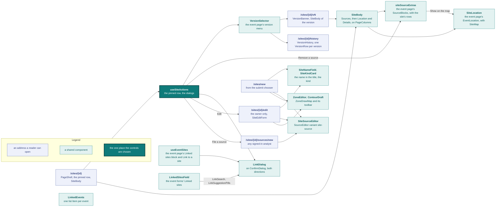

Only the owner edits; any signed-in analyst files a source. A linked event's effect starts unpicked, so **Link** waits for the analyst's choice.

### Requests board

[`/requests`](../frontend/src/app/requests/page.tsx) lists open requests, public by link but in the rail only when signed in. The status is fixed, so the [filter panel](#filter-panel) has no Show or approval lines.

### Search

[`/search`](../frontend/src/app/search/page.tsx) takes the standard page shell, with the search field in the title's place and the filter panel in the [right rail](#right-rail).

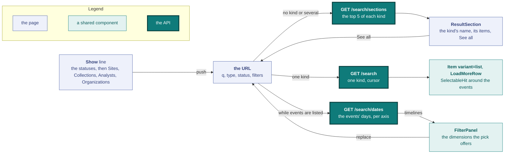

The URL holds the view, so a shared link opens the same view. A pick with no kind, or several, lists one section per kind with a hit, in a fixed order: Events, Sites, Collections, Analysts, Organizations. No section prints a count. A pick that drops the events also drops the filters it no longer offers, so no hidden filter narrows the list. An analyst or organization the query names exactly shows first.

### Share cards

A pasted link is how most readers meet the platform, so the profile, organization, event and collection pages generate their own preview image. Every card composes one frame (see [Sanctioned one-offs](#sanctioned-one-offs)). The event card's locator makes no map request: at card size a reader uses only the region.

A crawler caches what it is served. A missing row gets the not-found card. A failed read (`429`, `5xx`, timeout) gets the uncached site-default card and no tags, since nothing is known about the link. Card reads are cached for 15 minutes, which is also the rate-limit headroom: every card request leaves from the deployment's shared IP against the per-IP limit on the public reads. A link wide enough to trip the limit gets the site-default card, never a broken image.

### Email

Every email shares one layout, [`email_layout.py`](../backend/app/services/email_layout.py), with inline styles, since mail clients strip most CSS ([`engineering.md`](engineering.md#email)). It is light by default, so a client that ignores the dark query applies its own inversion. The word Vidit is text beside the mark, so the brand survives blocked images. The action button is a solid `orange-700` fill, the one place the accent fills a control, since mail clients cannot render the tinted recipe.

### Buttons

[`<Button>`](../frontend/src/components/ui/Button.tsx) is the one button primitive. Every clickable is accent; red is for destructive or alerting actions; grey means inert. The filled red shows once, on the armed second click of a confirm.

**Destructive actions** take one of two controls; see [Destructive actions](#destructive-actions).

**Action icons.** A text button leads with the icon of its action; see [Action icons](#action-icons).

**Tap size.** Buttons stand taller on a phone; type and padding stay.

#### Destructive actions

The weight of the action picks the control, never the surface:

- A minor removal takes `ACTION_ICONS.remove`, a red cross that acts at once (`<RemoveButton>`, `<Pill onRemove>`, or a labelled button).
- An important deletion or revocation takes `ACTION_ICONS.delete`, a red trash behind [`<ConfirmButton>`](../frontend/src/components/ui/ConfirmButton.tsx)'s in-place confirm.

No other icon marks a removal, and [`eslint.config.mjs`](../frontend/eslint.config.mjs) enforces it. An important action never confirms in a modal: `<ConfirmDialog>` stays only where the step needs input, or where a closing `<ActionMenu>` leaves no control to arm.

#### Action icons

`ACTION_ICONS` holds one icon per action, and `Button.test.tsx` fails on a text button or button-styled link that names none. An action covers every label that names it; these labels take an action whose name differs:

| Action | Labels |
|---|---|
| `accept` | Done (filters), Close (a contour) |
| `delete` | Revoke, Purge detected, Remove, Close this geolocation, request or detection |
| `geolocate` | Publish, Publish geolocation |
| `hide` | Withhold |
| `import` | Choose a different file, Create the detection |
| `less`, `more` | Manage, open and closed |
| `remove` | Clear, Start over, Decline, Withdraw, Clear link |
| `review` | Start reviewing, Open the detections queue |
| `search` | Your geolocations |
| `show` | Restore, the graphic content cover, Open the request, Open the event |
| `unsubscribe` | Turn off |

### Forms

[`/submit`](../frontend/src/app/submit/page.tsx) opens on a chooser. Geolocation and Request open one form, whose two publish buttons unlock from its content and count what they still miss. A pasted post already imported reads *Already imported*, linked to the row where its state reads (the review, the request or the event). The draft survives the chooser and a reload. The submit and edit forms write through one controller:

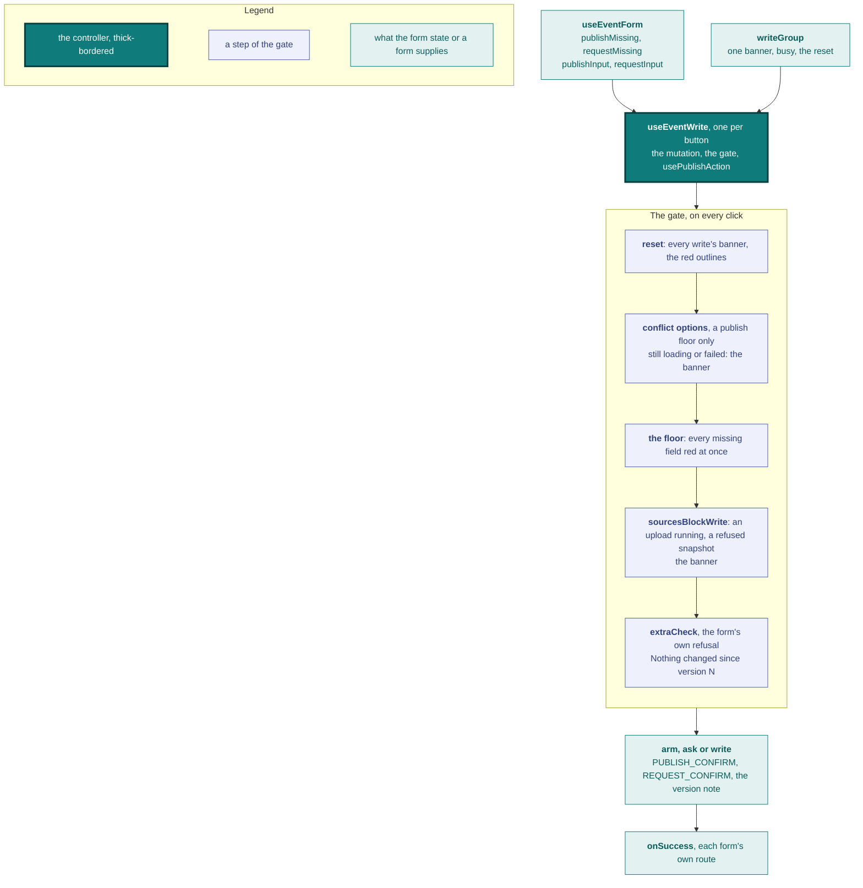

**Required by default.** No field carries a required marker: the button's count names what is missing, and a click turns every missing field red at once. Every publish arms in place before it writes, because a publish makes the event public. The account forms follow the same rule.

The detections queue filters on the server, since a filter over the rows on screen reads as one about the queue. A review pass is the edit form with the queue flag, one URL per detection, so a reload keeps the place.

### Rich text

An event's proof and a collection's description are one format: sanitized HTML, enforced only by the server.

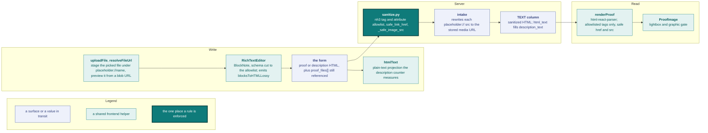

#### The editor

[`<RichTextEditor>`](../frontend/src/components/editor/RichTextEditor.tsx) cuts BlockNote's schema to what the server stores.

#### Images

An image uploads at publish under a placeholder; the server matches each file to its placeholder by filename.

#### Storage

The server sanitizes every write on the [rich text rules](api.md#rich-text).

#### The read view

[`renderProof`](../frontend/src/lib/proof.tsx) renders only allowlisted tags and safe URLs, as the server does.

#### Plain text

`htmlText` mirrors the server's plain-text projection, which the description counter measures.

### Errors

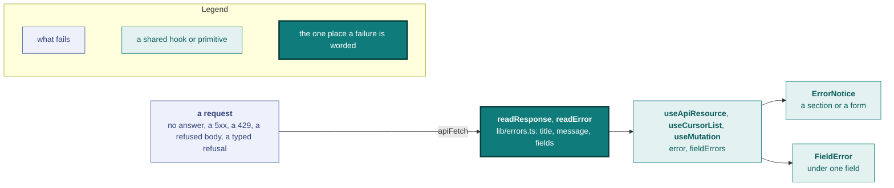

A backend message written for people shows as written; [`lib/errors.ts`](../frontend/src/lib/errors.ts) words the rest. Errors render in `<ErrorNotice>`, or `<FieldError>` under a field. A refusal gets no Retry, since the same request meets the same refusal.

### Field help (`?`)

[`FieldHelp`](../frontend/src/components/ui/FieldHelp.tsx) is the one explanation affordance; a native `title` only names an icon-only control. It is grey, the one exception to clickable-means-accent. It takes a registry key, so a concept is worded once. Settings → Display can hide it.

### Sanctioned one-offs

Decided once, so review doesn't re-litigate them:

- **`ProofSection`** composes `<Card className="p-4">`, one density step tighter than the default `p-5`, because proof is a reading surface. On a form it frames the proof editor (`RichTextEditor bare`, which draws no frame of its own), with the field's focus border and, when a publish flags the proof, the red outline.
- **Admin dev tooling** ([`admin/ActionReceipt.tsx`](../frontend/src/components/admin/ActionReceipt.tsx)) is a deliberately lighter register than `<Card as="section">`, admin-local on purpose: admin-only surfaces don't earn `ui/` primitives.
- **The Satori surfaces** ([`app/_og/`](../frontend/src/app/_og) and the generated [`icon.tsx`](../frontend/src/app/icon.tsx) / [`apple-icon.tsx`](../frontend/src/app/apple-icon.tsx)) render to a PNG on the server, never to a DOM, and Satori supports neither class names nor most of the CSS the primitives rely on. The share cards all compose the one frame in `_og/card.tsx` (see *Share cards*), which is the boundary: one frame for the cards, not one layout per route. The icons draw a single letter at three sizes and share only the font read, which is not a frame's worth of chrome.

## What we avoid

- Heavy glow, neon, pulse effects
- Gradients
- Glass / blur
- Decorative icons
- Long or showy animations
- Too many distinct colours; one accent hue only
- Information overload on the default view
