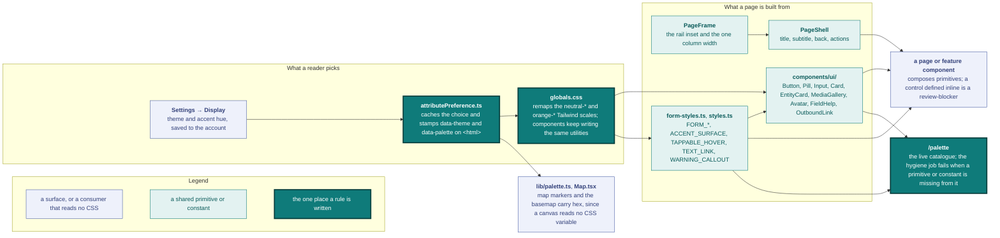
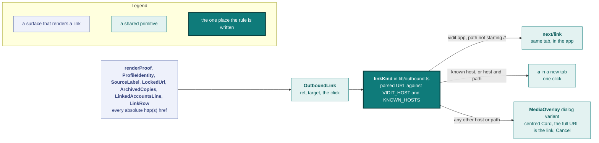
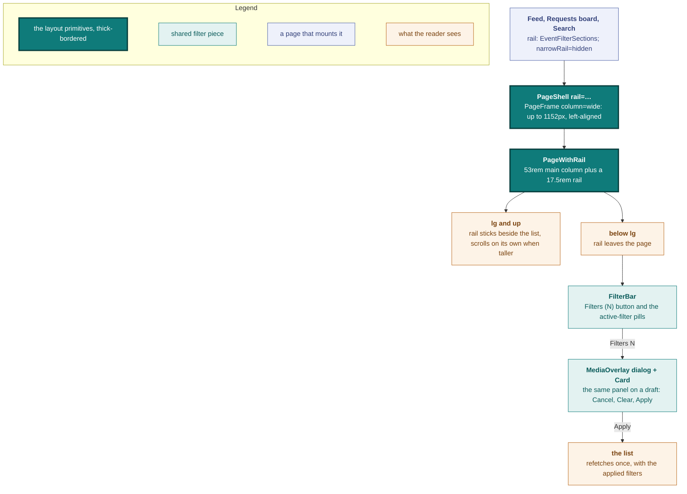
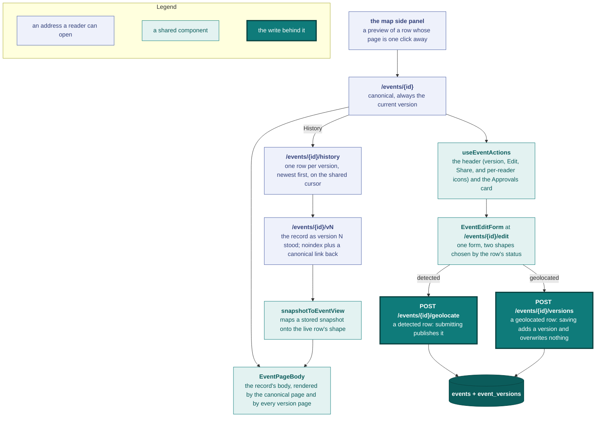
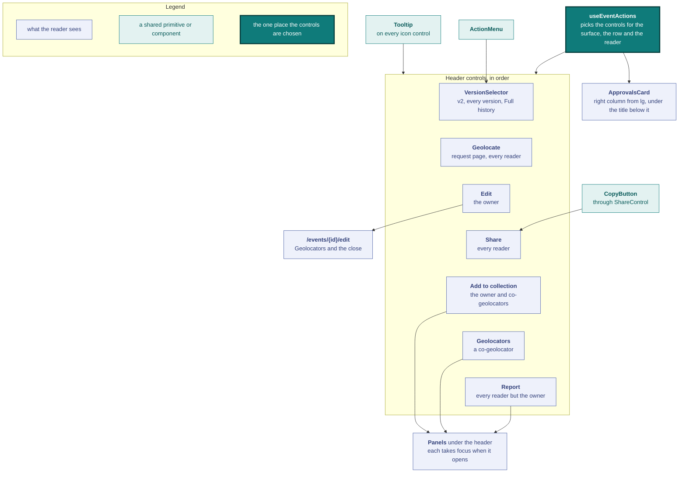
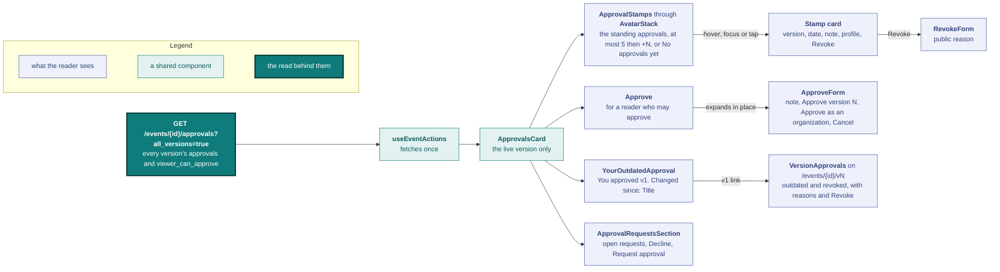
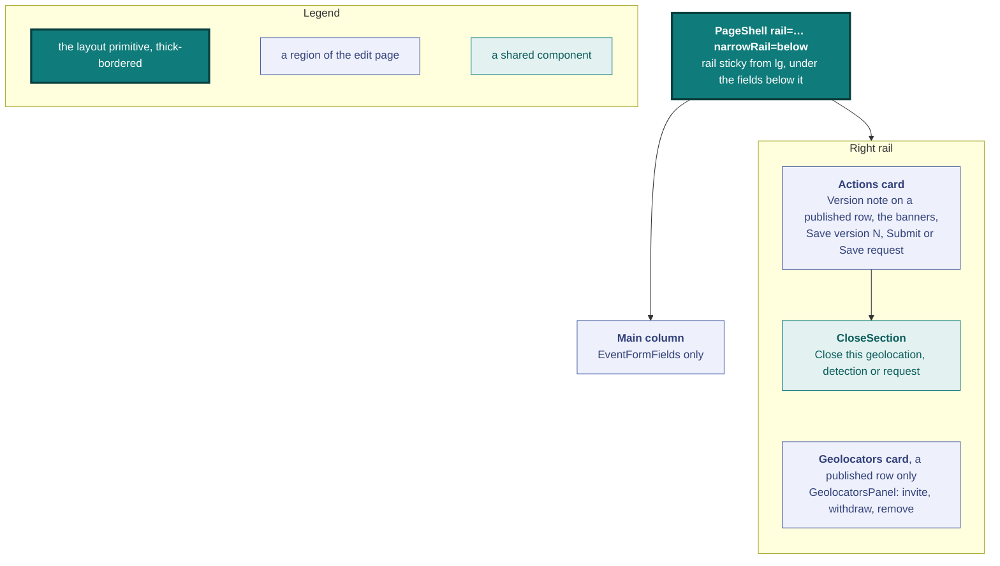
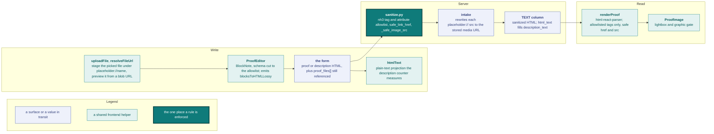

# Design principles and decisions

Every surface composes the same primitives, and two reader preferences repaint all of them at once. This page is that vocabulary: the principles the interface follows, the palette and layout it draws from, and the components a page is allowed to use.



Each region of the diagram has a section below. What a reader picks is [Theme](#theme) and the [accent](#accent). What a page is built from is [Components](#components), whose class constants are named in the [accent recipe](#accent-recipe) and whose frame is [Page chrome](#page-chrome). `/palette` is the gate on that vocabulary, and the exceptions decided once are [Sanctioned one-offs](#sanctioned-one-offs).

## Philosophy

The interface is spare by default and reveals complexity on demand. It stays legible to first-time visitors, and advanced filters and tools appear only when needed. The design avoids a cluttered dashboard look and a dark-ops aesthetic.

1. **Progressive disclosure**: the default view is a map and points. Filters, detail, and tools appear on demand.
2. **Clarity over aesthetics**: every visual element serves a function.
3. **Neutral and professional**: the tone is sober, with no military-tech or hacker-dashboard tropes.
4. **Controlled density**: the reader moves from map, to points, to detail panel, to full proof, and picks the depth.

## Theme

The interface is dark by default, with light available on demand. It uses a uniform background, opaque panels, and one warm accent for contrast. Dark reads better for long, data-dense sessions and stays the default. Light is a second option for readers who want it.

Theme and accent share one mechanism, [`attributePreference.ts`](../frontend/src/lib/attributePreference.ts): it caches the choice in `localStorage`, stamps a data attribute on `<html>`, and [`globals.css`](../frontend/src/app/globals.css) remaps a Tailwind scale under that attribute, so every utility repaints with no per-component change. Two consumers read no CSS variable and carry hex instead: [`Map.tsx`](../frontend/src/components/map/Map.tsx) swaps the basemap on [`useTheme`](../frontend/src/hooks/useTheme.ts), and map markers read [`lib/palette.ts`](../frontend/src/lib/palette.ts).

Both preferences, and the help tooltip switch, are saved to the account through [`PATCH /users/me/preferences`](api.md#patch-usersmepreferences), so they follow a signed-in analyst across devices. [`lib/preferences.ts`](../frontend/src/lib/preferences.ts) holds the two directions. A change in Settings applies locally at once and writes through to the server. After sign-in, and on each load with a session, each preference is reconciled on its own. A value the account has saved wins and rewrites `localStorage`. Where the account has saved none, the value this browser saved for the same account is written to the account instead, so a choice made before the account stored it is kept. The cache records which account it belongs to: signing out clears it, and a sync for another account clears it before applying that account's values, so one analyst's choices never reach another account on a shared browser. A cache that carries no account, written before the cache recorded one, is adopted by the first account that syncs. `localStorage` stays the first-paint cache: the inline script in the root layout reads it before React runs, so a device that has never seen the account paints the defaults until the preferences load.

The theme is independent of the accent hue. Its key is `vidit:theme`, and light applies as `data-theme="light"`; dark is the default and carries no attribute. Light remaps the `neutral-*` scale to a curated soft ramp, plus the semantic `red` / `amber` scales, mirrored so their pale text stops go dark on the light tint. The block also sets `color-scheme`, so native widgets (scrollbars, date and select popups) track the theme. The accent is not theme-adjusted, except that accent text (links, the success banner) reads a touch lighter in light mode. The basemap swaps CARTO Dark Matter for its light counterpart, Positron.

## Colour palette

### Foundation

The dark roles below are the default. The light theme re-points the same `neutral-*` scale to a curated soft ramp (`globals.css`): a soft warm grey canvas (`neutral-950`) with warm off-white cards (`neutral-900`) floating on it, and dark grey text (`neutral-100` = `#232323`, not black). This keeps a large light surface easy on the eyes instead of a flat, near-white glare. The light surfaces carry a faint warmth (`R > G > B`), while the text greys stay neutral. This mirrors how the dark scale avoids pure black and pure white.

| Role | Color | Tailwind | Usage |
|------|-------|----------|-------|
| Background | `#0a0a0a` | `neutral-950` | Global background, behind the map |
| Surface | `#171717` | `neutral-900` | Panels, cards, modals |
| Surface elevated | `#262626` | `neutral-800` | Inputs, interactive elements, hover |
| Border | `#333333` | `neutral-700` | Separators, field outlines |
| Text primary | `#f5f5f5` | `neutral-100` | Titles, primary content |
| Text secondary | `#a3a3a3` | `neutral-400` | Labels, metadata |
| Text muted | `#737373` | `neutral-500` | Placeholders, disabled elements |

### Accent

There is one accent hue. It's selectable, and orange by default. Settings → Display also offers blue, emerald, violet, and rose. Its key is `vidit:palette`, and `data-palette` remaps the `orange-*` scale to the chosen hue (see [Theme](#theme)). Components keep writing `orange-*` utilities and the [`styles.ts`](../frontend/src/components/ui/styles.ts) constants, so everything below holds for whichever hue is active.

The accent is **tinted-on-dark**, never a flat `bg-orange-500` fill for buttons or selected states:

| Token | Where it shows up |
|------|-------|
| `orange-400` | Text of every interactive element: inline links, button labels, tappable-card hover, status pills. |
| `orange-500` | The hue itself, only at fractional opacity on backgrounds / borders (`bg-orange-500/10`, `/15`, `/20`), and full strength on map points + state dots. |

### Map points

| Role | Color | Usage |
|------|-------|-------|
| Point default | accent `500` (default `#f97316`) | Submitted points; follows the selected accent |
| Point detected | accent `300` (default `#fdba74`) | Machine-detected points; same hue a shade lighter, distinct from submitted by lightness |
| Point selected | accent `500` + white border | Active, clicked point |

### Semantic

| Role | Color | Tailwind | Usage |
|------|-------|----------|-------|
| Danger | `#ef4444` | `red-500` | Errors, deletions (`FORM_ERROR_BANNER`) |
| Success / info | accent `500` | `orange-500` | Confirmations + info notices (`FORM_SUCCESS_BANNER`). Accent, not green: a confirmation next to red destructive actions shouldn't read as celebratory. |
| Warning | `#f59e0b` | `amber-500` | Non-blocking caution (`WARNING_CALLOUT`): duplicate probe, curated-tags load failure, tweet-import notice. Colour only; layout at the call site. |

## Accent recipe

Every accent treatment is a named constant from [`styles.ts`](../frontend/src/components/ui/styles.ts) or a primitive. Use it; don't hand-roll the class string. The rule:

> If something carries the accent and isn't clickable, it's a bug. If something is clickable and isn't accent, it's a bug.

Carve-outs: navigation chrome stays neutral grey, destructive actions go red, and the `?` help is neutral (meta, not content). Charts carry one more, and it is the only inert accent on the site: a mark whose accent step encodes a magnitude takes `ACCENT_RAMP` whether or not a reader can act on it, and so does its legend, which is drawn with the same cells as the data it explains. `<SourceHostBar>`'s ranked segments and `<ActivityHeatmap>`'s lit months are both inert ranked marks, so both take the ramp. What stands outside the ranking takes the neutral chart paints instead: an empty month, the unnamed tail, a slice naming no source. External links open in a new tab (`target="_blank" rel="noopener noreferrer"`) with the same accent styling.

There are five buckets:

1. **Inline link** (`TEXT_LINK`): clickable accent text in copy or rows (bylines, source URLs, retry, empty-state CTAs), using `text-orange-400 hover:underline`. An action that only reads like a link (Cancel, dismiss) is a `<Button variant="ghost">`.
2. **Tappable card or row** (`TAPPABLE_HOVER`): the whole card or row is one click target (`EntityCard`, search rows, the About page's link rows). It's neutral at rest. On hover, the border turns accent and the title picks up `group-hover:text-orange-400` (put `group` on the row).
3. **Buttons** (`<Button>`): every action, shape, and colour in one unit at one size. A `<Link>` that must look like a button takes `buttonClasses(variant)`. See the full vocabulary under [Buttons](#buttons).
4. **Pills, chips, and badges** (`<Pill>`): the whole badge family uses one `tone`: `accent` (open, detected, selected), `neutral` (default, tag, closed, inactive), `danger` (revoked, error), or `strong` (a completed end-state, neutral white, not green, because completion isn't a win). It's a `<span>` by default; pass `onClick` and it becomes an interactive chip, with the caller driving the tone off its active state. Domain wrappers (`StatusBadge` for the one unified event lifecycle, the invite `StatusChip`) map an enum to tone, icon, and label. A bare tag is `<Pill tone="neutral">` inline, with no wrapper.
5. **Active nav or row surface** (`ACCENT_SURFACE`): the bare accent paint (background and text, no border) for a selected nav row or option (sidebar rows, a `SegmentedControl`'s active option, the accent icon circles on the import panel and detections entry). `<Pill>`'s accent tone composes this paint plus a border, so a pill and an active nav item can't drift apart.

Constants: the pill tones live on `<Pill>` as `PILL_TONE`; these colour-only paints export from [`styles.ts`](../frontend/src/components/ui/styles.ts): `ACCENT_SURFACE`, `TAPPABLE_HOVER`, `TEXT_LINK`, `WARNING_CALLOUT`. If a class string for an accent element runs longer than about 3 Tailwind tokens, a constant probably already fits.

## Layout

```
┌────┬─────────────────────────────────────────────┐
│    │  Filters │                    │   Detail    │
│rail│  panel   │        MAP         │   panel     │
│    │  (left)  │   (full screen)    │  on click   │
└────┴─────────────────────────────────────────────┘
```

- **Sidebar rail:** left nav (logo, working surfaces, identity block), a fixed column from `sm` up, which every page clears through `PageFrame`'s `sm:pl-14`. Below `sm` it is a drawer behind a floating menu chip and takes no inset at all; see [Phone chrome](#phone-chrome).
- **Map:** full-screen background on `/map`.
- **Left panel:** filters, opaque, floating over the map.
- **Right panel:** event detail, appears on click, dismissible. When the selected event fails to load, the panel shows the error message and a Retry control, never a previously selected event.

**Panels:** `neutral-900` opaque (no glass / blur), `border-neutral-700`, `rounded-lg`, `p-4`, floating above the map. Width ~240px (filters), ~380px (detail). Both take a different shape below `sm`; see [Phone chrome](#phone-chrome).

## Typography

- **Font:** system stack, `-apple-system, BlinkMacSystemFont, 'Segoe UI', sans-serif`
- **Sizes:** titles `text-lg` (18px) max; body `text-sm` (14px); labels / meta `text-xs` (12px); micro (counters, badges) `text-[11px]`
- **Weights:** `font-medium` for titles, `font-normal` for everything else

## Map

- **Style:** CARTO Dark Matter (with labels), `https://basemaps.cartocdn.com/gl/dark-matter-gl-style/style.json`. The light theme swaps in its matched counterpart, Positron, `.../gl/positron-gl-style/style.json` (see [Theme](#theme)), with a faint `sepia` on the canvas (`globals.css`) that warms Positron's cool grey to match the warm light surfaces.
- **Renderer:** MapLibre GL JS (vector tiles) with globe projection. The zoom floor is 1.8 (`MIN_ZOOM` in [`Map.tsx`](../frontend/src/components/map/Map.tsx)), the lowest level that keeps the globe fully visible without shrinking it away.
- **One map stack.** Every map on the site is the same [`<Map>`](../frontend/src/components/map/Map.tsx): the full-screen canvas, the single pin on an event page, the coverage map a profile opens its work with ([`<ProfileMap>`](../frontend/src/components/profile/ProfileMap.tsx)), and the same map stepped beside the detail panel on a collection page (see [Collections](#collections)). A set with no mappable point renders no card at all, since an empty world map says less than no map and both surfaces carry a list that says the rest. A page whose view comes from its own content passes `fitBounds` (a `MapBounds`, from `pointsBounds` in [`bounds.ts`](../frontend/src/components/map/bounds.ts)) instead of `center` / `zoom`. MapLibre solves the camera against the real container, capped at zoom 9, so a lone point lands on a regional read rather than a street-level one. `pointsBounds` encloses longitude on the shorter arc (the complement of the widest empty gap), so work on either side of the antimeridian frames tight instead of as a world view. A box across the seam comes back unwrapped, with `east` past 180. `MapBounds` is the one bounds shape, for framing and requests alike. The `?bbox=` wire format has one home, [`lib/viewport.ts`](../frontend/src/lib/viewport.ts): its `toBboxParam` rounds outward and widens an unwrapped crossing box to the full longitude range, which is what `parse_bbox` accepts.
- Map labels (cities, regions) are a discreet light grey.
- Point geometry: default radius 6px, selected 7px with a 2px white border. Opacity is 1.0 for points and 0.85 for clusters. The cursor is a pointer on hover.
- **Pin hover preview.** Hovering any single unclustered pin (or a ring dot, described below) shows one shared preview card after a 150 ms hover-intent delay (`PinPreviewCard` in [`Map.tsx`](../frontend/src/components/map/Map.tsx)): title, `StatusBadge`, the fixed `MediaThumb` slot (the picked card thumbnail, or its "no media" box), date, and `AuthorByline`, composed on `Card`. The event detail is fetched only once the hover intent elapses (`GET /events/{id}`, with a bounded in-memory cache that also holds in-flight requests; stale responses are ignored, and a failed fetch shows a terse fallback). The card clamps against the map edges after measuring, and flips to the left of the pin when the right side lacks room, so it always renders fully visible. Ordinary clusters get no preview. A coarse pointer arms no preview at all, so a tap goes straight to the panel; see [Phone chrome](#phone-chrome).
- **Co-located events: counted badge and hover fan-out.** Events sharing one coordinate form a cluster that can never expand. `groupStacks` ([`stack.ts`](../frontend/src/components/map/stack.ts)) groups points client-side on a roughly 1 m epsilon grid with neighbor-cell merging, so a stack straddling a grid line reads as one. Past the clustering ceiling, the group renders as **one counted badge** with the colour, radius, opacity, and count text of a small cluster, so a stack of 3 never reads as a single pin. Cluster counts below the ceiling stay true.
  - Hovering the badge, or an unexpandable cluster (leaves within `STACK_EPSILON` via `getClusterLeaves`), replaces it with `SpiderRing`: 12px DOM dots on an 18px ring around the shared center, the ring growing past about 7 events and capped at 24 dots. A larger stack fans out its first 23 events and fills the last slot with a "+N" marker; the badge count stays the true total.
  - The dots travel out from the center, and back before the badge reappears. Dot colours keep the point semantics (detected shade, selected halo); the badge carries the halo when it holds the selected event.
  - Hovering a dot shows the pin preview, and clicking it opens the event like a normal pin.
  - The ring collapses when the pointer leaves it (with a grace margin), on wheel, or when the map moves. On touch, a tap opens the ring and a tap off it closes it, and the dots carry a wider hit box (see [Phone chrome](#phone-chrome)).
  - Ordinary clusters keep zoom-on-click.
- **Cluster to points crossfade.** The map sets `fadeDuration: 0`, so count labels and their circles swap on the same frame; basemap place labels pop in instead of fading. Count labels skip symbol placement (`text-allow-overlap` + `text-ignore-placement`), so a count is never culled apart from its circle. Around the clustering ceiling, a zoom-interpolated opacity crossfade runs in paint expressions, with stops derived from `CLUSTER_MAX_ZOOM`: clusters and counts thin approaching one zoom past the ceiling, and points and stack badges rise just past it. The crossfade applies **only while a zoom is in flight**; at rest every layer holds full opacity, and a cluster click that resolves past the ceiling lands its pins at full opacity.

## Components

### Build on shared primitives

Every UI element is a reusable primitive. Compose from them; never hand-roll a one-off. If none fits a new need, add the missing piece to [`components/ui/`](../frontend/src/components/ui) (or as a new `FORM_*` / `styles.ts` constant) and consume it from there, never inlined in a page. Growing the vocabulary with a new shared component is a maintainer decision (see [`AGENTS.md`](../AGENTS.md) → *Conventions*). Reusing or extending an existing one is the default.

**Token or component?** A piece is a *component* when it owns shape or behaviour (`<Input>`, `<Pill>`, `<Button>`, `<Card>`). It stays a raw *class constant* when it is a single-element paint composed into someone else's markup (`FORM_LABEL`, `ACCENT_SURFACE`, `TAPPABLE_HOVER`). A constant that starts growing variants has crossed the line, so promote it. Primitives join classes with [`cn`](../frontend/src/lib/cn.ts) (tailwind-merge), so a caller's `className` wins conflicts predictably. `<Button>` and `<Pill>` stay one size by design; the button's only variation is the taller tap shape it takes on a phone (see [Buttons](#buttons)).

The vocabulary:

- **Labels.** `FORM_LABEL` is the uppercase label above a control (`LABEL_TEXT` is the same without `block`). [`<SectionHeading>`](../frontend/src/components/ui/SectionHeading.tsx) heads a form section (title plus `?`). [`<SectionEyebrow>`](../frontend/src/components/ui/SectionEyebrow.tsx) is the uppercase eyebrow over a page, panel, or card section.
- **Copy.** The clipboard write and the flash timer are one hook, [`useCopyToClipboard`](../frontend/src/hooks/useCopyToClipboard.ts), and the confirmation is one primitive, [`<CopyButton>`](../frontend/src/components/ui/CopyButton.tsx): an icon button whose mark turns into a check at once and fades back after 1.5 s (no fade under `prefers-reduced-motion`). The accessible name holds still, since a name that changes on click is re-announced as a new control, and the confirmation reaches screen readers through a sibling live region with no visible text. Copy coordinates ([`<CoordinateActions>`](../frontend/src/components/event/CoordinateActions.tsx)), a profile's copied handle and Share where the browser has no share sheet all wear it. The admin invite row's text button keeps the hook alone.
- **Small assemblies.**
  - [`<Avatar>`](../frontend/src/components/ui/Avatar.tsx) is the profile-picture circle: the profile header, the feed card's author circle (through `<EntityCard>`), the user search hits, `<AuthorByline>`'s avatar variant, and the sidebar identity row, which renders it in the rail's 18px glyph box. `size` is the only dimension a caller sets, and the fallback is the handle's initial or a neutral user icon. An `avatar_url` addresses a server-minted object on the media host, uploaded through the profile header's picker (the shared `<FileManager>` in single-file image mode). A failed load falls back to the same circle and a new picture retries, because replacing a picture deletes the old object and a CDN edge can answer for a key before a new one propagates. `iconClassName` colours the icon fallback (the sidebar passes `text-current`, so the glyph follows the row's hover and active state). `decorative` drops the alt text where the host names itself, so the image does not displace the enclosing link's accessible name. `shape="square"` rounds the corners instead of the circle, for an organization shown beside analysts.
  - [`<AvatarStack>`](../frontend/src/components/ui/AvatarStack.tsx) is an overlapping row of 28px `<Avatar>` pictures: the approval stamps in the event page's Approvals card (see [Event header and Approvals card](#event-header-and-approvals-card)). An item's `variant` picks the circle (`analyst`) or the rounded square (`organization`), and its `label` is the picture's accessible name. A ring in the page colour separates overlapping pictures. Each picture is a button that opens the item's `renderCard`: hover or focus opens it, and a click or a tap pins it and moves focus to its first link. The card holds while focus is inside it. Escape, or Tab past either end of the card, closes it and returns focus to the row. At most `max` show (5 by default); the rest fold into a `+N` bubble, a button when `onOverflow` is set.
  - [`<ActionMenu>`](../frontend/src/components/ui/ActionMenu.tsx) is the one menu of links: a ghost trigger named by `label` (icon-only, or `text` printed before the icon, as the version selector's *v2*) that opens a `role="menu"` list painted with `TOOLTIP_SURFACE` and named by `menuLabel`. Each item is a link with an optional icon and an optional muted `meta` word; `current` marks the link to the page on screen (`aria-current`), which takes focus when the menu opens. A click, Enter or ArrowDown opens it and ArrowUp opens on the last item; the arrows, Home and End move between items; Space or Enter follows one; Escape closes and returns focus to the trigger; Tab or an outside click closes. The list aligns to the trigger's right edge, shifts sideways to stay 8px inside the viewport, and scrolls past `20rem`. The event header's version selector is its consumer.
  - [`<AccountPicker>`](../frontend/src/components/ui/AccountPicker.tsx) is the one way to pick an analyst or an organization: a `role="combobox"` field over a `role="listbox"` list painted with `TOOLTIP_SURFACE`. Each row shows the picture (a circle for an analyst, a rounded square for an organization), the name and, for an organization, its slug in muted text. The caller owns the data: `options` filters a local list by name and handle, and `search` runs the caller's request 250ms after typing stops, once the query holds `minQueryLength` characters. A `note` that `search` returns shows as a muted row, as do loading, a failed search and `emptyText`. ArrowUp and ArrowDown move and wrap, Enter takes the highlighted row or hands the typed text to `onSubmitText` when no row is up, and Escape, Tab or an outside click closes. With `selected`, the pick shows as an accent `<Pill>` chip that `onClear` removes; without it, the field empties after each pick. The list spans the field's width and scrolls past `15rem`. The approval request, the search Author filter, the co-geolocator invite, the organization invite and the admin org manager fields are its consumers.
  - [`<Tooltip>`](../frontend/src/components/ui/Tooltip.tsx) shows an icon-only control's label in a `TOOLTIP_SURFACE` bubble while a mouse rests on it or the keyboard focuses it. A touch never opens it, so a tap leaves no bubble standing. It reuses `usePinnedPopover`'s placement and dismissal and never pins. `<Button icon>` renders through it, so every icon button gets it with no call-site change; an icon link wraps itself in `<Tooltip label>`, a `display: contents` span.
  - [`<AuthorByline>`](../frontend/src/components/ui/AuthorByline.tsx) is "by user". `avatar` leads with the author's picture instead of the "by " prefix, on the detail pages and the map side-panel header. `coAuthors` credits more analysts after the lead, "by ana, bo and cy", each with the same picture and link: an event's credit line is its owner and then every other geolocator (`creditProps` in [`geolocatorCredit.ts`](../frontend/src/lib/geolocatorCredit.ts)). `link={false}` drops the profile anchor for a slot that is already one click, such as a version-history row under its stretched link. The detail body's Author and Requested by rows both render through it.
- **Usernames.** A Vidit username prints bare, with no `@`: bylines, cards, admin panels, the search author filter, page titles, metadata, share text, and share cards. An `@` marks an external account only: a linked X or GitHub account (`displayLinkValue`), an X post author, the bot's replies on X, and `@viditbot`.
  - [`<Dot>`](../frontend/src/components/ui/Dot.tsx) is the accent "new content awaits" dot: sidebar nav badges (through `notify`), the rail's identity row when detections are pending, the profile's detections entry, and the map filter panel's in-flight pulse. Position, ring, and size come through `className`.
  - [`<EmptyState>`](../frontend/src/components/ui/EmptyState.tsx) owns the empty-state grammar (`boxed` / `plain` / `invite`).
  - [`<LoadMoreRow>`](../frontend/src/components/ui/LoadMoreRow.tsx) is the foot of every [`useCursorList`](../frontend/src/hooks/useCursorList.ts) list: **Load more**, a spinner while the page loads, a failed page's message above **Try again**, and nothing once the walk ends. `infinite` loads the next page as the row nears the viewport (the feed). A failed first page leaves no rows and no row, so the list shows that error itself.
  - [`usePinnedPopover`](../frontend/src/hooks/usePinnedPopover.ts) is the anchored-popover machinery (pin, hover, outside-click / Escape dismiss, portal plus viewport clamp), used by `FieldHelp` and by `<AvatarStack>`'s card. Both bubbles paint with `TOOLTIP_SURFACE`.
- **Instruction lists.** [`<NumberedSteps>`](../frontend/src/components/ui/NumberedSteps.tsx) is the static "1, 2, 3…" list (numbered disc, title, body): `plain` on the public guides, `boxed` with a per-step icon for the archive export walkthrough on `/submit`. Every step looks the same because it is reference copy, not state. For a check mark or a spinner, use `<ProgressSteps>`.
- **Live progress.** [`<ProgressSteps>`](../frontend/src/components/ui/ProgressSteps.tsx) is the vertical stepper for a live multi-step operation (the archive import): check for done, highlighted disc for the active step, muted for pending. A determinate bar renders only when a real 0..1 `progress` ratio exists. A step in flight without one takes a discreet `spinner` next to its label, never a fake animation. `keepDetail` pins a step's detail line after completion (a privacy guarantee, a final count). `failed` turns the active step into the red failure marker. The message itself stays in the form's `FORM_ERROR_BANNER`.

#### Media

- [`<MediaGallery>`](../frontend/src/components/ui/MediaGallery.tsx) is the detail-surface block: a 2-up `hero` grid on the page, stacked `thumbnail` tiles in the panel.
- [`<VideoPlayer>`](../frontend/src/components/ui/VideoPlayer.tsx) is the one player, mounted by the gallery's video tiles and by the shared viewer. The landing page's demo clip is a one-off: it stays idle until a visitor clicks play, then hands playback to the browser's own controls.
- The player engine is [media-chrome](https://media-chrome.mux.dev): web-component controls around a native `<video>`, skinned through CSS variables on the controller (neutral-100 glyphs, flat controls on a translucent dark bar). This keeps the chrome independent of the React version and out of specificity conflicts with Tailwind.
- The bar holds play, scrub, time, mute, volume, download, and one big-view control. It hides after two undisturbed seconds of playback and returns on pointer move, hover, or focus.
- Big view is per context: a gallery tile carries an expand control that opens the shared viewer, and the viewer carries fullscreen. One such icon shows at a time.
- The viewer, [`<MediaLightbox>`](../frontend/src/components/ui/MediaLightbox.tsx), portals to `document.body` and layers above every floating surface (map panels, sidebar, banner), so a tile expanded inside the map's detail panel covers the viewport.
- The player fills its container and letterboxes, so a portrait clip keeps its shape over the tile's backdrop.
- A clip posters its first frame through the `#t=0.1` media fragment, since stored clips carry no poster derivative. [`posterFrameUrl`](../frontend/src/lib/mediaUrls.ts) owns this for every caller.
- Download is [`<MediaDownloadButton>`](../frontend/src/components/ui/MediaDownloadButton.tsx) everywhere. It fetches the object as a blob and saves it under its `original_filename`, because media is served from a separate origin, where a plain `<a download>` navigates to the file instead of saving it. An image tile's download floats under `HOVER_REVEAL` (invisible at rest, shown on hover or focus, permanent on a coarse pointer), the same cluster a proof image carries.
- `MediaThumb` is the card-sized media slot. It lives in [`<EntityCard>`](../frontend/src/components/ui/EntityCard.tsx) and is exported to the map's pin preview, the detections queue row, and each tile of a collection's mosaic, so its marked "no media" box is the site's one placeholder. A mosaic tile reads the slot's `size`: the 400 px derivative where it shares the mosaic, the 1280 px one where it fills it alone.
- Every card or preview thumbnail (events list, profile, feed, search hits, map pin hover, detections queue) is the backend-picked media: the `source` attachment, or else the first `proof` image, never a proof video. The pick lives in `backend/app/services/thumbnails.py`. The frontend renders what the payload carries and never re-derives it.
- [`<GraphicContentGate>`](../frontend/src/components/ui/GraphicContentGate.tsx) covers media on a flagged event (`is_graphic`, author-set at submit and edit, admin-overridable). The media renders blurred and inert behind an interstitial naming what is underneath. Confirming once, kept in `sessionStorage` for the browser session, reveals every gated instance on the page. `full` wraps `MediaGallery` on the detail surfaces, with the sentence and a confirm button. `compact` fills a card-sized slot (`MediaThumb`, the map pin preview, a proof body's inline images) with one labelled control.

#### Cards

[`<EntityCard>`](../frontend/src/components/ui/EntityCard.tsx) is the one catalogue card, `compact` (thumbnail beside the text) or `feed` (thumbnail under it).

- The whole card is a stretched link to `detailHref`. Anything interactive inside it is lifted above that link (`relative z-20`) and takes its own click.
- `onSelect` swaps that link for a stretched button, for a list whose rows pick a position on their own surface (a collection page's step list). In this mode the title renders as plain text and `detailHref` renders nowhere on the row. `selected` marks the row the surface stands on with the accent border.
- The byline shows on every catalogue surface, where a card stands beside other analysts' work, and credits every geolocator of the event (`coAuthors`). It is omitted on a surface that is one analyst's set and names them in its header (a collection's items).
- `action` is a control that acts on the row rather than opening it: the owner's cross that takes an item off a collection, and the **Add** button on the collection picker. It exists on the compact row only, which the type enforces, since the feed card floats its badge over the corner. It renders at the bottom of the badge's column, lifted above the stretched link, in the corner furthest from the title.
- `age` adds how long an entity has been open to the compact row's meta line, after the date. The Requests board fills it from `requested_at` (see [Requests board](#requests-board)).
- On a phone the compact row narrows the thumbnail to `w-20` and drops the status badge under the text, so the title keeps its width.
- `uniformHeight` keeps every row of a catalogue list the same height whatever slots it fills (1-line or 2-line title, tags or none), from `sm` up. A list whose rows all share one short shape turns it off (a collection's items). Off, the row stands on its media column, and text shorter than that column centres against it.
- The thumbnail slot is `self-start`, so a tall card keeps the 16:9 ratio and leaves empty space under the thumbnail at every width. This is intended.

#### Controls

- A control carries colour while it acts and neutral grey when it cannot. For the disabled button, see [Buttons](#buttons).
- Every icon control on the site is the ghost icon button: one 32px square with one hover plate, on a page-header cluster, the profile header row, the coordinates line, the archive mark beside a source link, and a field's trailing adornment. An action is `<Button icon variant="ghost">`. A control that navigates puts the same shape on a `<Link>` or an `<a>` through `buttonClasses("ghost", { icon: true })`, so a button never nests inside an anchor.
- A control with nothing to act on is that button `disabled`, which paints it grey and drops it from the tab order. An inert link becomes a disabled button.
- `aria-label` is the whole name, and every icon-only control shows it as a [`<Tooltip>`](../frontend/src/components/ui/Tooltip.tsx): `<Button icon>` does so on its own, and an icon link wraps itself in one. A `title` on an icon button becomes the tooltip text instead, for a longer hint such as *Edit (saves a new version)*, and the native `title` attribute is dropped so no second tooltip appears.
- [`<Switch>`](../frontend/src/components/ui/Switch.tsx) is the one boolean toggle (`md` settings rows, `sm` map filter rows; `as="span"` when a whole-row parent owns the click).
- [`<SegmentedControl>`](../frontend/src/components/ui/SegmentedControl.tsx) is the exclusive-choice bar (submit type, admin delete mode, the detections queue filter, the Requests board sort, the feed scope; `tone="danger"` for a destructive active option). It stretches below `sm` (see [Phone chrome](#phone-chrome)). A bar whose one-word labels need a sentence takes a `<FieldHelp>` beside it.
- `<Input icon>` overlays a leading icon (the search box). `<Input trailing>` overlays the field's own actions at the other edge, centred on the field's height and taking the pointer: the map and copy marks of a longitude field, the picker of a date field, the archive mark of a URL field.
  - Each trailing control is the ghost icon button, set a hair apart so two hover plates read as two controls.
  - The field is one height across its three variants, so the square sits inside any of them with a 3px gutter.
  - The field's text padding grows by `TRAILING_ROOM`, so a long value never runs under the marks. `FieldAdornment` and that constant are exported for `<LockedUrl>`, which renders as an anchor and clears the same marks by the same amount.
- [`<DateTimeInput>`](../frontend/src/components/ui/DateTimeInput.tsx) is the date / time / instant field. It sets `.picker-glyph`, which hides the engine's picker button (Webkit and Chromium only), puts a ghost icon button in the trailing slot (`Calendar` for a day, `Clock` for a time of day), and opens the native picker through `showPicker()`, falling back to focusing the field. It owns `has-value`, the class that mutes an empty field's `dd/mm/yyyy` placeholder. A date field too narrow for an adornment (the search filters, the map scrubber) stays a bare `<Input type="date">` with the native button.
- [`<Select>`](../frontend/src/components/ui/Input.tsx) is the pick-one-from-a-short-list field. It runs `<Input>`'s shape recipe under a custom caret, so a select and a text field on one row stay alike.
- [`<LinkListInput>`](../frontend/src/components/ui/LinkListInput.tsx) is the ordered list of URL fields (the submit and edit forms' Secondary sources): one `<Input>` per row with a per-row remove, and an add button that disables at its `max`. An optional per-row `companion` adds a second value, a mark inside the row's URL field (`trailing`), and a line under that field (`render`), all three kept index-aligned through every add and removal. The list owns which rows are expanded, and a row seeded with a companion value opens showing it.

#### Outbound links



[`<OutboundLink>`](../frontend/src/components/ui/OutboundLink.tsx) renders every link whose `href` is an absolute http(s) URL. A raw external `<a>` anywhere else is a review blocker.

- `linkKind` in [`lib/outbound.ts`](../frontend/src/lib/outbound.ts) reads the parsed hostname and compares whole labels: a host matches an entry when it equals the entry or is one of its subdomains. A substring never matches, so `x.com.evil.example` is an unknown host.
- A link to `vidit.app` or a subdomain routes in the app through `next/link`, in the same tab. A path that starts with `//` after parsing (`https://vidit.app//evil.example` or `https://vidit.app/\evil.example`) is an unknown link instead, because `next/link` reads that path as another host. `linkTarget` resolves it to that host, so the dialog names `evil.example` and its URL leads there.
- A link to a known host opens in a new tab in one click. `KNOWN_HOSTS` holds the snapshot hosts (`SNAPSHOT_HOSTS` in [`lib/snapshots.ts`](../frontend/src/lib/snapshots.ts)), the platforms analysts cite (`x.com`, `twitter.com`, `t.me`, `youtube.com`, `youtu.be`, `github.com`, `discord.gg`), and the links the app makes by design (`www.google.com/maps` for the map check, and the hosting providers on the legal page).
- A bare host entry covers its subdomains, so add the narrowest host that fits. An entry with a path covers that exact host and path only. `www.google.com/maps` matches `https://www.google.com/maps?q=48.85,2.35` and not `https://www.google.com/url?q=...`, which redirects anywhere. Never add a host that serves an open redirector.
- A link to any other host opens a warning dialog on click, middle click, or modifier click. The dialog is `MediaOverlay` with `variant="dialog"` from [`MediaLightbox.tsx`](../frontend/src/components/ui/MediaLightbox.tsx): it centres in the viewport over the page, dimmed and blurred in the theme's canvas colour (`neutral-950`).
- The dialog surface is a `<Card>` with an accent border (`orange-500`), so it follows the light or dark theme and the chosen accent.
- The dialog names the host and shows the full URL as a `TEXT_LINK`. The URL is the only way on: it opens in a new tab, so the reader reads the address to leave. There is no confirm button.
- **Cancel** is the one button and takes the initial focus. Tab stays inside the dialog. **Cancel**, Escape, or a click on the backdrop closes it, and focus returns to the link that opened it.
- Every rendered anchor carries `rel="noopener noreferrer"`. `ugc` adds `nofollow ugc` for text an analyst wrote: proof bodies, collection descriptions, and bios.
- A value that is not an http(s) URL renders as its text.
- Paint stays with the caller through `className`, so a source host, an icon button, and a link row keep their look.
- A `mailto:` link is not a web host and stays a plain `<a>` in the same tab.

#### Source links

- [`<SourceLabel>`](../frontend/src/components/ui/SourceLabel.tsx) renders a stored source URL as its host, with italic fallbacks for a null URL and a value the parser gives no host for.
- [`<ArchivedCopies>`](../frontend/src/components/ui/ArchivedCopies.tsx) is the archived-copy mark beside it on the event detail surfaces (the full page and the map side panel), one component for the primary source, the provenance link, and every secondary mirror.
  - One link holds one copy, from whichever service produced it, so the mark is one ghost icon button carrying lucide's `Archive` box, for every state and provider, never a service logo.
  - The provider lives in the accessible name of a stored copy (`Wayback Machine copy of the source`, `archive.today copy of the source`, `Ghostarchive copy of the source`).
  - The mark is accent where a copy exists and opens it. It is grey and inert where none does, for every reader including the event's owner. A missing copy is shown, not hidden.
  - Nothing on a reading surface writes. Recording a copy is an edit, so the owner archives from the form and files a version naming the change.

On a form, the mark rides the field holding the link, not a block under it:

- `<ArchiveAdornment>` is the mark inside that field (`<Input trailing>`, or `<LockedUrl trailing>` where the value is frozen). On a form it is never grey. A link with no copy carries the `ArchiveRestore` mark, which opens the paste line under the field. A link with a copy carries the `Archive` mark, which opens the stored copy, with `ArchiveRestore` beside it so a wrong paste can be replaced.
- `<ArchiveSnapshotField>` is the line it opens: one field, with no label, no optional marker, and no sentence. The placeholder states the contract (paste a snapshot from `web.archive.org`, `archive.today` or `ghostarchive.org`), and the check reads the full host list, `SNAPSHOT_HOSTS`, from [`lib/snapshots.ts`](../frontend/src/lib/snapshots.ts). Its own trailing mark opens the Wayback Machine prefilled with the URL currently typed above, so archiving a corrected URL is a re-click. It is the one form mark that goes grey: a link that does not parse has no page to open.
- Under the field there is at most one line: a red refusal for a value that cannot be a snapshot, or an amber `WARNING_CALLOUT` naming both URLs when the paste reads as an archived copy of a different link. The amber line blocks nothing.
- Every link the form declares gets the pair: the source URL, every Secondary sources row (through `<LinkListInput>`'s `companion`, which keeps each paste aligned with its link across an add or a removal), and the locked provenance field on the published-row edit.
- Every glyph looks alike, so the accessible name carries the state and the target: `PRIMARY_SOURCE_DESCRIPTION` for the source, `DETECTED_FROM_DESCRIPTION` for the provenance link, and `mirrorDescription(host, index, total)` for a mirror, which leads with the position when the list holds more than one and falls back to a literal for a hostless URL.
- The mark carries no `?` of its own. The `source_url`, `secondary_source_urls`, and `detected_from` concepts each describe the archive mark on their own row, so a list of ten mirrors shows one explanation.

### Page chrome

Every main-app page uses [`<PageShell>`](../frontend/src/components/ui/PageShell.tsx), which owns the `title` / `subtitle` / `back` / `actions` / `controls` slots:

| Element | Style | Notes |
|---|---|---|
| Column | `px-4 sm:px-6 lg:pl-18`, then `max-w-[53rem]` (reading) or `max-w-6xl` (with a rail), then `pt-10 max-sm:pt-16 pb-16 space-y-6` | One container across the app, left-aligned right after the sidebar, so the title starts at the same x on every page. [`<PageFrame>`](../frontend/src/components/ui/PageFrame.tsx) owns the offset (`sm:pl-14`) and the container through its `column` prop. A page without a rail takes `reading`, 53rem of content, the line length a centred `max-w-4xl` column leaves inside its padding; the free space falls on the right. A page with a rail takes `wide`, up to `max-w-6xl` (1152px) of content, which holds a 53rem main column beside the [right rail](#right-rail). `PageShell` picks the column from its `rail` prop. `lg:pl-18` keeps a gutter left of the title for the back arrow. The side padding drops a step below `sm`, where the desktop gutter leaves the cards too narrow to hold a title beside a thumbnail on a 375px screen. The top padding steps up there instead, to clear the menu chip the rail leaves in the corner; see [Phone chrome](#phone-chrome). The public landing keeps `PageFrame`'s `center` column, the same width centred. |
| H1 (`title`) | `text-xl font-medium text-neutral-100` | Consistent on every page. |
| Subtitle | `text-sm text-neutral-400` | Tight under the H1 (8 px gap). |
| Back arrow (`back`) | `max-sm:hidden flex -ml-2 mb-1 lg:inline-flex lg:absolute lg:right-full lg:top-1.5 lg:mr-3 lg:mb-0 lg:ml-0` | Lives in the gutter from `lg` up, so the title's x-coordinate is the same whether back is present or not. The gutter is the column's `lg:pl-18`; between `sm` and `lg` the button is a row of its own above the title, since a gutter-parked one lands under the fixed sidebar, where taps reach the nav rather than the button. Below `sm` the header carries no back control at all: the same button is portaled into the menu chip instead (see [Phone chrome](#phone-chrome)). `-ml-2` takes back 8 of the 9px the 36px square insets its 18px glyph by, so the arrow reads as aligned with the heading. **When to set it:** `back` marks a drill-in page reached from content (event / request detail, edit, profile, the detections queue), where "back" means "return to where I clicked this". Sidebar destinations (map, submit, requests, search, about, settings) never set it: they are entered from the rail, so there is no "where I came from" to promise. **What it walks:** [`smartBack`](../frontend/src/lib/navigation.ts) pops an app-kept stack of visited paths rather than calling `history.back()`, which would walk off the origin. A route that only redirects keeps itself out of that stack (`skipBackRecord`, called before the redirect), since walking back onto one runs its redirect again and lands where the walk started, which reads as an arrow that does nothing. |
| Actions (`actions`) | Right of the title, wrapping under it below a `14rem` title basis | The page-level action cluster. Every control that acts on the thing the page is about goes here, so a reader finds them in one place. On a profile that is the glyph row (the linked accounts, then Edit profile on your own), and Follow on someone else's profile or the save pair while editing. On an event surface it is the [event header](#event-header-and-approvals-card): the version selector, Edit for the owner, Share, and the controls a reader's standing gives them. The map's side panel mirrors the position, right-aligned beside its title. A panel a cluster control opens (the report form, the close form) renders under the header; two open panels stack as separate cards rather than sharing a slot. Flex line-breaking measures the title's base size, so the cluster takes its own line rather than squeezing a heading into a one-word column. A preference, not a minimum (`min-w-0`): a hard floor outgrows the frame on the narrowest phones and scrolls the page sideways. The cluster is capped at the header width (`max-w-full`) and wraps inside itself, so a row of several buttons breaks into right-aligned lines on a phone. The subtitle breaks anywhere, since a bio can hold a bare URL, one unbreakable token. |
| Controls (`controls`) | `flex flex-wrap items-center justify-between gap-2`, one `space-y-6` step under the header | The view controls: the `<SegmentedControl>` that picks what the page lists or how (the feed scope, the Requests sort, the submit mode), left-aligned under the title. A companion control in the same node takes the row's right end (the board's **Post request**). The row sits above a [right rail](#right-rail), so the rail starts level with the list. |

Pre-data states use `<PageLoading>` / `<PageError>` (one centered shell). Opt-outs: `/` (landing), `/map` (full-screen map), the `(auth)/*` group, and `app/error.tsx`.

The public guides use the same shell, signed in or out: `/guide` ("How Vidit works", the whole loop from reading the map to publishing), `/methodology` ("Building a proof"), and `/import` ("Import your work from X": the conditions once, what a detection carries, then one section per entry). Each is a server component of `PageShell` plus `Card`, for SEO, linked from the About page's Guides section. `/bot` and `/archive` are `redirect()` stubs into `/import#bot` and `/import#archive`, and both stay in `PUBLIC_PREFIXES` so a signed-out reader is forwarded rather than sent to the login page. The bot's X bio points at `/bot` (see [The bot](ingestion.md#the-bot)).

The `(auth)/*` group composes [`<AuthCard>`](../frontend/src/components/auth/AuthCard.tsx) (a `max-w-sm` centered card). The two single-email pages (`/forgot-password`, `/resend-confirmation`) also share [`<SingleEmailFlow>`](../frontend/src/components/auth/SingleEmailFlow.tsx), whose sent-state copy stays anti-enumeration ("if X is registered…", never confirming the address exists).

The registration form asks for consent to product update emails with a [`<ToggleRow>`](../frontend/src/components/ui/ToggleRow.tsx) in its described shape, directly under the email field and off by default, so a consent is never presumed. A switch, not a checkbox: the app has one boolean control, and the row reads the same here as the matching row in Settings → Notifications. `/unsubscribe` is an `<AuthCard>` too: it withdraws the consent only on a click of its button, so a mail scanner that opens the link withdraws nothing.

#### Right rail



[`<PageWithRail>`](../frontend/src/components/ui/PageWithRail.tsx) lays a page out as a main column and a right rail. Use it for any page whose side panel stays in view while its main column scrolls. Pass the panel as `<PageShell>`'s `rail` (with `railLabel` and `narrowRail`): `PageShell` composes `PageWithRail` and widens its column to `wide`, so the main column keeps the 53rem reading width beside the rail once the screen holds both. A page whose rail comes and goes passes `null` while it is gone, which keeps the column one width and keeps its element mounted.

- **From `lg` up** the rail is a `17.5rem` (280px) column right of the main column. It sticks to the top of the viewport while the main column scrolls. Once the rail is taller than the viewport it scrolls on its own, so its foot stays reachable.
- **Below `lg`** the `narrow` prop picks the shape. `stacked` (the default) puts the rail above the main column. `below` puts it under the main column, for a rail that acts on what the column holds; the rail also comes after the column in the tab order at every width. `hidden` takes the rail off the page, for a page that offers its own narrow entry to it.
- **Without a `rail`** (`null`) the page takes the `reading` column, so a page can drop the rail on a view it does not apply to.

The [owner edit form](#the-owner-edit-form) mounts its actions and geolocators in the rail with `narrowRail="below"`, so on a phone **Save** follows the fields instead of preceding them. The feed, the [Requests board](#requests-board) and search mount the shared filter panel ([`EventFilterSections`](../frontend/src/components/filters/EventFilterSections.tsx)) in the rail with `narrowRail="hidden"`. The map keeps its floating overlay panel. Above each list sits [`<FilterBar>`](../frontend/src/components/filters/FilterBar.tsx): the removable active-filter pills, and below `lg` a **Filters** button that reads **Filters (N)** while N filters are active. The button opens the same panel full screen in `MediaOverlay`'s dialog variant around a `<Card>`. The panel there edits a draft, so the list refetches once:

- **Apply** applies the draft and closes the dialog.
- **Clear** empties the draft. Apply then clears the list's filters.
- **Cancel**, Escape or a tap on the backdrop closes the dialog and drops the draft.

The pills act on the applied filters at every width. The pill row hides from `lg` up while no filter is active, since the button is off the page there.

#### Phone chrome

The nav chrome takes three shapes, and the page offset follows it:

| Width | Nav | Page offset | Back control |
|---|---|---|---|
| Below `sm` (640px) | The rail is off-canvas. A floating menu chip in the top-left corner opens it as a drawer. | No left inset. `PageShell` takes `max-sm:pt-16`, so the title clears the chip. | Portaled into the chip, beside the open control. |
| `sm` to `lg` | Fixed 56px rail, collapsed to glyphs or expanded to labels. | `sm:pl-14`, from `PageFrame`. | A row of its own above the title. |
| `lg` up | The same rail. | `sm:pl-14`. | Parked in the gutter left of the column. |

**The chip is the rail's chrome while the rail is off-canvas** ([`Sidebar.tsx`](../frontend/src/components/Sidebar.tsx)): an opaque `neutral-900` box on a `neutral-800` border, 8px in from the top and left edges, holding a 44px open control (lucide's `Menu`) and, beside it, a slot for the page's back control. It costs the corner it occupies and nothing more, which is why each page clears it with its own top padding rather than every route surrendering a row to a bar. `PageShell` portals its back control into that slot below `sm` through [`phoneBackSlot.ts`](../frontend/src/lib/phoneBackSlot.ts), so a page carrying one shows the arrow beside the open control and every other page shows the open control alone. The brand mark stays in the drawer, where it doubles as the Home entry.

**The drawer is the rail's expanded state**, slid over the page: 192px wide, glyphs plus labels, the identity block at the foot, and the beta pill inline under it. A `black/50` scrim covers the page behind it, and the body stops scrolling while it is open. It closes five ways: a tap on any link inside it (the entry already active included, which changes no route), a route change, Escape, a tap on the scrim, and the foot control, which reads *Close* below `sm` and *Collapse* from `sm` up: one row at every width, but two buttons, since closing the drawer and folding the rail act on different state.

**The beta pill has one live copy at any width** ([`BetaBanner.tsx`](../frontend/src/components/BetaBanner.tsx)). The floating corner pill paints over a phone's content, so it hides below `sm` and the drawer renders the same component inline at its foot.

**The map page lays its overlays out around the chip.** The filter bar starts right of the chip's open control (`left-16`), and the overlay stretches to 16px above the viewport bottom, laying its bar, its active-filter strip and its section stack out as a column: the stack takes the height the other two leave and scrolls the rest, so the tag and author sections stay reachable. The stretched box passes pointers through, so the map keeps every tap outside the blocks themselves. The detail panel becomes a bottom sheet: full width on the bottom edge, capped at `60dvh`, scrolling its own content, under a grab bar above its close control. The bar is decorative, and marks the sheet as the scrolling surface; the close control dismisses it. The map's bottom-left control group keeps the map's own corner below `sm`, since the 60px offset in [`globals.css`](../frontend/src/app/globals.css) clears a rail that is not there; an open sheet covers that group, and closing it hands the group back.

**A finger gets slop on the canvas** ([`Map.tsx`](../frontend/src/components/map/Map.tsx), [`stack.ts`](../frontend/src/components/map/stack.ts)). On a coarse pointer, a tap that hits bare canvas is re-tested over a 12px box on each side and takes the feature whose projected centre sits nearest, then does what that feature's own layer would have done: a cluster zooms, a stack badge fans out, a pin selects. A ring dot keeps its 12px paint and grows a 32px hit box around it. A tap arms no hover preview, since the compatibility `mousemove` a tap fires would open the card over the pin the finger just selected. A mouse keeps exact hit testing and its preview. The pointer read has one home, `isCoarsePointer` ([`pointer.ts`](../frontend/src/lib/pointer.ts)), on the same media feature the `pointer-coarse:` variant carries in CSS.

**A [`<SegmentedControl>`](../frontend/src/components/ui/SegmentedControl.tsx) always stretches below `sm`**, its options sharing the track and their labels staying on one line. An intrinsic-width track with three labelled options runs past a 375px column, and the browser's answer there, wrapping each label, reads broken.

**A form field renders at 16px on a phone** ([`Input.tsx`](../frontend/src/components/ui/Input.tsx)). `FIELD_TEXT` is the one field type size, 16px below `sm` and 14px from `sm` up, and the three `<Input>` variants, `<Select>`, `<Textarea>` and the locked box all run it. Mobile Safari zooms the page in when you focus an editable element rendering under 16px, and it does not zoom back out when you leave the field, so a smaller field leaves you scrolled sideways on the form you were filling in. The three fields that set a denser size of their own, the author filter, the search date range and the map scrubber, carry it as `sm:text-[11px]`, so they keep the dense desktop size and take the floor on a phone. The field's height follows its type size, 38px from `sm` up and 42px below it.

**A field's trailing actions are cleared by one figure at each size**, `TRAILING_ROOM` in the same file. The widest adornment holds two ghost icon buttons and the icon button steps from 32px to 36px on a phone, so the text padding that clears it is `pr-18` from `sm` up and `pr-20` below. [`<LockedUrl>`](../frontend/src/components/geolocations/new/LockedUrl.tsx) and every URL field wearing an `ArchiveAdornment` read that constant, so a value stops in the same place on every field wearing that mark. A mark that stands down on a phone takes `sm:pr-10`, one icon button's room from `sm` up and none below, which the field asks for with `trailingFromSm`: `<Input>` then hides the slot below `sm` and leaves the field its full width there, so the two halves of the decision stay together. [`<DateTimeInput>`](../frontend/src/components/ui/DateTimeInput.tsx) takes that form for every date, time and instant field: at 320px the instant in the required `Source posted (UTC)` field needs the whole field, so the picker mark is a desktop affordance, and below `sm` a tap on the field opens the engine's own picker. The narrow-viewport suite measures the room the instant field leaves against the width the engine paints its value in.

**The coordinate pair stacks below `sm`** ([`CoordinateInputs.tsx`](../frontend/src/components/geolocations/CoordinateInputs.tsx)). The longitude field carries the pair's map and copy controls as its trailing adornment, which takes 80px of the field on a phone. In two columns inside the form card that leaves about 4px of typing room for a 9-character value at 320px, so you cannot read the longitude you are typing. One column below `sm` gives each field the card's full width; two columns return from `sm` up, where a column is wide enough to carry the mark and the value together.

**An embedded map hands the one-finger swipe back to the page** ([`Map.tsx`](../frontend/src/components/map/Map.tsx)). The `embedded` prop sets MapLibre's `cooperativeGestures` on the event page's location box and on the profile map, which drops the canvas to `touch-action: pan-x pan-y`: a swipe that starts on the map scrolls the article, panning takes two fingers, and zooming takes Command or Ctrl with the wheel, announced on the blocked gesture. On desktop, a bare wheel over either map scrolls the page, and MapLibre paints its own overlay saying to hold Command or Ctrl. `/map` leaves the prop unset, since there the map is the page.

**The page frames on `dvh` and paints under the cutout.** [`app/layout.tsx`](../frontend/src/app/layout.tsx) exports `viewport` with `viewportFit: "cover"`, so the document reaches the physical edges of the screen.

- Every surface that owns the screen size takes it on `dvh` rather than `vh`: the document body, both page frames (`<PageFrame>` and `<PageCenter>`), the map page, the media lightbox, and the global error boundary. `vh` is the tallest the viewport gets, so with mobile Safari's URL bar showing, a `vh` frame pushes centred blocks low and puts the last row behind the bottom chrome.
- Edge chrome takes the insets back through the `safe-*` utilities in [`globals.css`](../frontend/src/app/globals.css). A surface that floats a set distance from an edge takes the inset as a margin: the menu chip, the map's filter overlay, and the map's detail panel from `sm` up. A surface that fills an edge takes it as padding, so its box still reaches the edge: the nav drawer, the map's bottom sheet, and the media overlay, whose backdrop covers the cutout band so a tap there closes the viewer.
- The nav element takes that padding only while it is the drawer (`max-sm:`). From `sm` up it is the 56px rail, which takes no inset and paints under the cutout band, since a notched phone in landscape is past `sm` and the inset would leave 12px for the glyphs.
- The page column takes its horizontal insets in `<PageFrame>` and `<PageCenter>` ([`PageFrame.tsx`](../frontend/src/components/ui/PageFrame.tsx)), which keeps every route's content out from under the cutout in landscape.
- `env()` reads 0 where the device reports no inset, so both forms are inert on a desktop.

**The media lightbox scrolls instead of overflowing** ([`MediaLightbox.tsx`](../frontend/src/components/ui/MediaLightbox.tsx)). The frame is `80dvh` inside an `overflow-y-auto` overlay, so a video's control bar stays on screen with the iOS URL bar visible. The content sits at the top of the overlay with auto vertical margins, which centre it while it fits and collapse to 0 when it does not, so nothing lands above scroll origin. The content is sized by what it holds rather than clamped to the overlay's height, so a tall frame scrolls.

**An interactive chip and a filter-section header are tap targets.** `TAP_STEP` ([`Button.tsx`](../frontend/src/components/ui/Button.tsx)) is the one phone floor, 36px below `sm` and the exact desktop shape from `sm` up. It raises the tappable height only, so a control keeps its own type scale and its own horizontal padding. [`<Pill>`](../frontend/src/components/ui/Pill.tsx) takes it whenever it carries an `onClick`, which is every conflict, capture-source, tag and status chip, every removable active filter, the search scope chips, the `<AccountPicker>` chip and every `<TagPicker>` chip; a static pill is a label and keeps its resting height. [`<FilterSection>`](../frontend/src/components/ui/FilterSection.tsx) makes its whole header row the target the way [`<ToggleRow>`](../frontend/src/components/ui/ToggleRow.tsx) makes its row the switch: each of the two toggles carries the step and the row's vertical padding, and the summary and chevron one grows into every pixel right of the title, so the `?` is the only part of the header that is not a toggle. Put the step on the row instead and it sizes the row while each button keeps its own 16px line box, which is a 36px strip holding two 16px targets. The quiet text controls of the same surfaces, `Clear all` and `Show all N`, take the step as well. A square control smaller than the icon button takes the same floor through `ICON_TAP_STEP`, the width and the height together: the settings accent swatch, a `<FileManager>` tile's remove control, the map scrubber's play and reset controls, and the sidebar's three community links, each naming its own desktop square beside it.

**A boolean preference is a [`<ToggleRow>`](../frontend/src/components/ui/ToggleRow.tsx).** The whole row carries `role="switch"` and the click and `<Switch>` renders as its visual span, so a tap anywhere on the row toggles rather than having to land on the 20x36px track, and the row takes `TAP_STEP`. A `description` picks the shape: without one the row is the filter toggle, a micro uppercase label on a divided list; with one it is a settings preference, the label at reading size over a line saying what the preference does. The accessible name is the label alone (`aria-labelledby` on it), so a screen reader announces the switch by what it switches and reads the description after it.

**Several booleans per row are a [`<ToggleMatrix>`](../frontend/src/components/ui/ToggleMatrix.tsx).** Settings → Notifications uses one: a row per notification kind, an Email and a Push column. The column headers print once at the top. Each row puts its label and description on the left, through the `PreferenceText` block a described `<ToggleRow>` also renders, and one switch per column on the right. Each switch is its own `ICON_TAP_STEP` button with `<Switch>` as its visual span, so a tap lands on one cell and never on the whole row. Its accessible name is "<row label>, <column label>", and the row description is its accessible description. A column is 48px wide and holds a one-word header, so two switches stay on the row at 320px. A cell in a row's `disabled` map keeps its state, leaves the tab order, and is described by its reason. The matrix prints each distinct reason once under the rows, so a closed column reads one sentence, not one per row. The kind switches apply to every device of the account, so Settings closes the Push column only when no device can receive push: the server has no push key, or the account has no push device. A browser without the Push API still changes them for the account's other devices. The push device section then leaves that reason out of its state line. The device control, the approval-request audience and the major release emails switch stay outside the matrix.

**A pill never outgrows the box it sits in.** `<Pill>` holds its width against its neighbours (`shrink-0`), which is what keeps a badge from being squeezed on a crowded row, so a pill carrying one long word would hold its full width and run past its container. `max-w-full` bounds the box and `wrap-anywhere` breaks the word inside it, so a long tag name on the request card's content column takes a second line rather than scrolling the page sideways. Use `wrap-anywhere` (`overflow-wrap: anywhere`) and not `break-words`: a pill is an `inline-flex` box, sized by its content's min-content width, and a `break-word` opportunity is excluded from that measurement, so the box would stay as wide as the unbroken word. The same token breaks the account email on the settings page and the page subtitle in `<PageShell>`.

**A detail row gives way rather than squeezing** ([`DetailRow.tsx`](../frontend/src/components/ui/DetailRow.tsx)). Label and value share one line at every width, and `*:min-w-0` lifts the automatic flex floor off both halves, so a value carrying `truncate` cuts itself to the room the row leaves and a value that wraps on its own (a close reason, a tag list) takes the lines it needs beside the label. The label never shrinks, so it stays on one line at every width. The row does not wrap: wrapping drops a truncating value onto a line of its own before `truncate` engages, which is a different row from the one the desktop map panel is laid out as. `gap-x-4` is the only gutter between the two halves, so a value adds no margin of its own. [`<SourceLabel>`](../frontend/src/components/ui/SourceLabel.tsx) truncates against that rule rather than against a width ceiling of its own, which is why it takes no width prop.

#### One event, four surfaces, two writes

An event is read on four surfaces and written by two endpoints.



The history list's `Current` row opens the canonical page rather than a version address, since that is where the record as it stands is read.

#### Event header and Approvals card

An event's detail page carries its controls in the header, and a published event's page carries an Approvals card beside the record. [`useEventActions`](../frontend/src/components/event/useEventActions.tsx) assembles them and returns three nodes: the header controls, the panels the header's toggles open, and the Approvals card. A surface renders those nodes instead of building controls of its own.



The header holds these controls, left to right, each shown only to the reader it names:

| Control | Who sees it | What it does |
|---|---|---|
| Version selector | Every reader of a published record, retraction included, on the event page and on a version page | A compact *v2* button with a chevron, an [`<ActionMenu>`](../frontend/src/components/ui/ActionMenu.tsx). It opens the event's versions newest first, the live one marked *Current*, then **Full history**. The live version opens `/events/{id}`, an older one `/events/{id}/vN`, and **Full history** opens `/events/{id}/history`. The version on screen is marked and takes focus when the menu opens. It shows on a single-version event too, so the version on screen is always named. |
| Geolocate | Every reader of an open request, on the request page | The one filled button: it opens the submit form on the request. |
| Edit | The owner of a row that is not closed | An icon link (lucide `SquarePen`) named *Edit* to `/events/{id}/edit`. Its tooltip reads *Edit (saves a new version)* on a published row, which an edit corrects by adding a version. The owner closes the row and manages its geolocators there (see [The owner edit form](#the-owner-edit-form)). |
| Share | Every reader | One click shares. See **Share** below. |
| Add to collection | The owner and every co-geolocator of a row a collection may hold | An icon toggle that opens the collection picker under the header (see [Collections](#collections)). |
| Geolocators | A co-geolocator of a published row | An icon toggle that opens the Geolocators panel under the header, where they leave. |
| Report | Every reader but the owner, signed out included | The red flag ([`useReportContent`](../frontend/src/components/report/useReportContent.tsx)) that opens the report form under the header. Reporting your own event says nothing an edit or a close could not. |

[`VersionSelector`](../frontend/src/components/event/VersionSelector.tsx) lists the versions from the live version number, so it reads nothing. It is not an owner control: the other controls act on the record, and this one reads it. Every reader gets it, because a corrected record is auditable only when anyone can walk the corrections. The map panel and the forms show one version by construction and carry none.

A toggle wears the active-row paint while its panel is open, and the panel takes focus when it mounts, so a keyboard or screen reader user lands in it. Open panels stack as separate cards. Nothing in the header closes or destroys a row.

**Share.** [`ShareControl`](../frontend/src/components/share/ShareControl.tsx) shares in one click, with no menu. Where the browser has the Web Share API (`navigator.share`), **Share** opens the device's share sheet with the event's address and title. Elsewhere it copies the address, and the confirmation is [`<CopyButton>`](../frontend/src/components/ui/CopyButton.tsx)'s, the app's one copy confirmation: the share mark turns into a check and fades back after 1.5 s, and *Link copied* reaches screen readers through a live region, with no visible text. [`EventShare`](../frontend/src/components/event/EventShare.tsx) passes the event's address and title. A `detected` row is still editable by its owner, so its share takes a confirming second click, with *Detected and may still change. Click again to share.* beside the button. The collection page keeps its own Share on X button (see [Collections](#collections)).

**Shared credit.** The Geolocators panel ([`GeolocatorsPanel`](../frontend/src/components/event/GeolocatorCredit.tsx)) lists the event's geolocators, owner first. The owner invites an analyst picked in an `<AccountPicker>` (the author typeahead, or an exact username committed with Enter), withdraws a pending invitation and removes a co-geolocator there, on the edit page; a co-geolocator opens the same list from the event page's header, with a **Leave** button on their own row. An analyst the owner invited reads a **Geolocator invitation** card under the header instead, with **Accept** and **Decline** ([`InviteAnswerButtons`](../frontend/src/components/event/GeolocatorCredit.tsx)); the notification feed puts the same two buttons under the invitation's row, since the row itself is one link. Every byline of the event credits every geolocator.

**Approvals card.** A published event's approvals of its live version and its approval requests live in one card beside the record. Outdated and revoked approvals are read on each version's page, which the version selector opens.



- **Layout.** From `lg` up the page has two columns: the record (source media, location, details, proof) on the left and the card in an `18rem` column on the right. The card sticks to the top of the viewport while the record scrolls. Once the card is taller than the viewport it scrolls on its own, and the page takes the scroll back at either end of it, so the foot of the card stays reachable. Below `lg` the card sits under the title block, before the media.
- **Stamps.** The card carries no status line and quotes no note: the stamps are the status, and each note is read in its stamp's card. While no approval stands, a muted *No approvals yet* takes their place. [`ApprovalStamps`](../frontend/src/components/event/Approvals.tsx) renders the live version's standing approvals (those that stood at closing, on a closed event) as an [`<AvatarStack>`](../frontend/src/components/ui/AvatarStack.tsx) named *Approved by*: an overlapping row of 28px pictures, oldest first. An analyst's approval is a circle and an organization's is a rounded square. Each stamp is a button named "Approved by maya". Hovering, focusing or tapping it opens a card: the picture, the name, **Version N · date**, the note clamped to four lines, "on behalf of <organization>" for an organization's approval, a **View profile** or **View organization** link, and **Revoke** for whoever may revoke that approval: the reviewer, an org manager of the organization it speaks for, or a site admin. **Revoke** opens [`RevokeForm`](../frontend/src/components/event/Approvals.tsx) in the card, with focus on its reason; the reason is public. A click on a stamp opens its card rather than navigating, and moves focus to the link; Escape, or Tab past either end of the card, closes it and returns focus to the stamps. Past five, the rest fold into a **+N** bubble that shows every stamp.
- **Your outdated approval.** A reader whose own approval stands on an earlier version reads one line above **Approve**: *You approved v1. Changed since: Title, Proof.* ([`YourOutdatedApproval`](../frontend/src/components/event/Approvals.tsx), the version history's own `changedFields` through `changesSince`). The version links to its page.
- **Approve.** A secondary **Approve** button shows only to a reader who may approve: the API's `viewer_can_approve` is true, so a former geolocator never sees a button the API refuses, and `canApprove` finds no earlier review of the live version, as the reader or for an organization they manage (`approveOptions` in [`lib/approvals.ts`](../frontend/src/lib/approvals.ts)). It expands [`ApproveForm`](../frontend/src/components/event/Approvals.tsx) in place, with focus on its note: an optional note, **Approve version N**, one **Approve as <organization>** per organization the reader manages whose approval of the version does not stand, and **Cancel**, which collapses it.
- **Approval requests.** [`ApprovalRequestsSection`](../frontend/src/components/event/ApprovalRequestsSection.tsx) closes the card. A geolocator sees the open requests and a secondary **Request approval**, which expands an `<AccountPicker>` in place with focus on its field. The list holds the analysts and organizations the server suggests; an exact username or slug the server leaves out shows the reason as the list's muted row, and a send error clears once the query changes; **Cancel** collapses it, and sending a request collapses it too. An analyst asked, or an org manager of an organization asked, reads the request with **Decline**, and approves with **Approve** above it. An approval refetches the requests, since it resolves the reader's own.
- **Filed versions.** A filed version's page (`/events/{id}/vN`) ends with an **Approvals** card ([`VersionApprovals`](../frontend/src/components/event/Approvals.tsx)) that lists every approval of that version, outdated and revoked alike, with **Revoke** and no approve control. Each row ([`ApprovalRow`](../frontend/src/components/event/Approvals.tsx)) prints the reviewer, the date, the note and a pill: **Current**, **Outdated** or **Revoked**. An organization's approval signs with the organization's picture and name, linked to its page (`organizationByline` through `<AuthorByline>`), with the acting org manager beside it, or "on behalf of <organization>" once that account is erased. A revoked row prints its public reason and says whether an org manager or a site admin revoked it. The card is absent when the version held none.

Approving happens in the Approvals card only, after reading the event: a re-approval request or an approval request in the notification feed links to the event page and offers no approve control. An open approval request's feed row carries **Decline** beside its link, inside the row ([`ApprovalRequestDecline`](../frontend/src/components/event/ApprovalRequestsSection.tsx)), since declining needs no look at the event.

**One verb closes every shape.** The verb is *Close*, and only the noun changes with the row: *Close this request*, *Close this detection*, *Close this geolocation* ([`CloseEventForm`](../frontend/src/components/event/CloseEventForm.tsx) holds that copy, and the edit page's close button, its reason label and its confirm button all read it). One write ends all three, so one word names it on every surface. What the close means still differs by row, and the record says so: the closed page carries the reason, and the state it left is *withdrawn*, *rejected* or *retracted*. The close lives in the actions card of the owner's edit page, under the save, not in the event page's header. A closed row has no edit page and no close: closing is terminal and the owner has no un-close. The panel asks for a reason and says it stays public, because that reason is what a reader finds on the closed page in place of the claim.

A retracted geolocation keeps its page. It reads as a `Closed` badge with the reason and the closing day beside it, over the record it took back: the coordinates, the evidence, the credits and the version history are all still there, and the version selector stays in the header, since walking what the record used to claim is exactly what a reader does after a retraction. The map's side panel and the forms carry no header controls at all. The panel previews a row whose own page is one click away on the title, so acting on the record belongs there rather than in a preview of it; a form's primary action is its own Submit, in the actions card beside the fields it applies, and sharing or reporting a row one is in the middle of rewriting acts on a record that is not the one on screen. The detection form's header cluster is its own controls instead (the queue position and Skip).

A published event names its version in the header's version selector, not beside the byline (see [Event header and Approvals card](#event-header-and-approvals-card)).

#### The owner edit form

The locked provenance field (`detected_from_url`) carries the label the detail page gives the same link, from one helper (`provenanceLabel` in [`lib/events.ts`](../frontend/src/lib/events.ts)): *Requested from* on a row the bot opened as a request (`requested_by` set, which survives fulfilment), *Detected from* otherwise. The request edit and the published-row edit both read it.

[`<EventEditForm>`](../frontend/src/components/geolocations/edit/EventEditForm.tsx) is one form in two shapes, selected by the row's state rather than by a prop, so `/events/{id}/edit` is one address for both owner edits. On a `detected` row it is **Submit detection**: every field editable, and a Submit that arms in place, because submitting publishes the row. On a `geolocated` row it is **Edit geolocation**: the same field bricks and the same editable fields, the source URL and the source media included, an optional **Version note** above the save, and a **Save version N** that writes on the click that made it, because a version adds a version and overwrites nothing. The button names the number it would produce, so the reader sees what they are about to create rather than what is on screen. A save that would move no versioned field is refused in the form, without a request: the banner reads *Nothing changed since version N*, which is the sentence the server's own refusal maps to. Two inputs hold less than their column does, the source post time (minutes) and the event time (no seconds), so a field still holding what the row seeded it with is treated as untouched and is not posted back as its own truncation: the instant is omitted, which the endpoint reads as *keep*, and the time goes back at the row's precision. Otherwise every edit of a typo would quietly take the seconds off a published record, and no save would ever count as unchanged.

**The owner's management lives on the edit page.** The event page's header carries only **Edit** for the owner; what the owner does to the record beyond correcting it sits in the edit page's right rail, beside the fields.



- **Main column.** The page's form holds the event fields and nothing else. The rail's submit button and the version note join it through the form's `id` (the `form` attribute), so Enter in a field or in the note still saves.
- **Actions card.** The version note on a published row, `IncompleteFormNotice`, the error banner, then the save: **Save version N**, the arming **Submit** on a detection, or **Save request**. The rail sticks from `lg` up, so the save stays in reach on a long form.
- **Close.** Under the save, in the same card, [`CloseSection`](../frontend/src/components/event/CloseEventForm.tsx) states what closing does, then **Close this geolocation**, **Close this detection** or **Close this request** opens the reason form in place. A close lands on the event page, the next detection of a review pass, the detections queue, or the request page for a request.
- **Geolocators.** A published geolocation's rail holds a second card with the Geolocators panel ([`GeolocatorsPanel`](../frontend/src/components/event/GeolocatorCredit.tsx)), outside the form, since the panel holds a form of its own. The owner invites an analyst picked in an `<AccountPicker>`, withdraws a pending invitation and removes a co-geolocator there. Each change applies on click through its own endpoint and never makes a version, which the `?` on the card's title states. A change rereads the row.
- **Phone.** Below `lg` the rail stacks under the fields: the actions card, then the Geolocators card.

### Buttons

There is one primitive: [`<Button>`](../frontend/src/components/ui/Button.tsx), shape and colour in a single unit at one size (no size scale). It has five variants on two axes: tone (accent or danger) and emphasis (filled, outline, text):

- `primary`: accent, filled. The one main action of a view.
- `secondary`: accent, outline. A secondary action (edit, search, pagination).
- `ghost`: accent, text only. The quiet tier: cancel, dismiss, dense row actions, and (with `icon`) icon-only buttons.
- `danger`: red, outline. A destructive action (delete, revoke), quiet on purpose.
- `dangerGhost`: red, text only. A red control at ghost weight, so it sits in an icon row without outweighing its accent neighbours (the report flag).

Every clickable is accent, and red is only for destructive or alerting actions. There is no grey button: grey lives in `<Pill>` neutral, and in the disabled state, which drops the variant's tone for grey text on a neutral border rather than fading it, so a button that refuses the click reads like every other inert control. The one loud filled red is `DANGER_CONFIRM`, applied through `className` to the armed second click of a destructive two-click confirm, so the strongest red shows once, at the point of no return. A confirm that is not destructive takes `ARMED_RING` the same way (the share row's detection link, the detection form's Submit): a ring and a neutral plate over the button's own variant, so an armed control reads as changed without moving. `fullWidth` stretches it (auth submits). `icon` makes a square icon-only button. A `<Link>` that should look like a button takes `buttonClasses(variant)`.

**Tap size.** Both shapes stand taller on a phone (`min-h-9` on the text shape, `size-9` on the icon square), dropping to the desktop 28px / 32px from `sm` up. Only the tappable height moves. The type scale and the horizontal padding are the same at every width. The `?` grows its own target the same way; see *Field help* below.

### Forms

**One submit page, content-gated.** [`/submit`](../frontend/src/app/submit/page.tsx) is a single form: you fill in what you have, and two actions publish from the content, "Publish geolocation" (born `geolocated`) or "Publish request" (born `requested`). Each is gated on a live requirements tick-list that escalates from the request floor to the full geolocation floor. A "Start from" chooser picks the entry path: **Single** (one event by hand), **From an X post** (paste one of your own posts, which becomes a detection), or **Bulk import** (the archive on-ramp). Both import paths swap in for the form. `/requests/new` and `/geolocations/new` redirect here. Fulfilling a request (`?request_id=`) is always a geolocation.

Section order mirrors the detail page: Title → **Source media** → **Location** → Details (event date, source post time, source URL, secondary sources) → Tags → Proof. Request mode drops Location and Proof and makes dates optional. Each section is a `<Card as="section">` headed by [`<SectionHeading>`](../frontend/src/components/ui/SectionHeading.tsx) (which carries the section `?`). Fields use the [`<Input>`](../frontend/src/components/ui/Input.tsx) primitive. **Source media** wraps the shared [`MediaManager`](../frontend/src/components/geolocations/MediaManager.tsx) (on the generic [`FileManager`](../frontend/src/components/ui/FileManager.tsx)), reused by submit and detection-submit so they can't drift. **From an X post** is [`ImportPostPanel`](../frontend/src/components/geolocations/ImportPostPanel.tsx): a URL field and one action. The post becomes detections server-side, and the panel opens the first one in the review queue; a run with something to say (warnings, a refusal, a post already imported) stays on the panel and says it, with the review one click away. **Bulk import** is [`ImportArchivePanel`](../frontend/src/components/geolocations/ImportArchivePanel.tsx), whose export walkthrough is a `boxed` [`NumberedSteps`](../frontend/src/components/ui/NumberedSteps.tsx).

**Coordinates travel as a pair.** Both pairs (the subject point and the camera position) are the shared [`CoordinateInputs`](../frontend/src/components/geolocations/CoordinateInputs.tsx). A paste that reads as a pair fills both fields whichever one received it: a decimal `lat, lng` (comma or space separated, degree signs tolerated), or a Google Maps URL (`@lat,lng`, `q=`, `query=`) when the paste is itself a URL. Anything else pastes as ordinary text, prose quoting `@48.5,37.8` included. [`<CoordinateActions>`](../frontend/src/components/event/CoordinateActions.tsx) rides inside the longitude field as its trailing adornment, so a coordinate can be checked against satellite imagery and carried away while it is being typed without the eye leaving the field. It is two ghost icon buttons everywhere it appears, the shape every control inside a field carries, and the two sit a hair apart so their hover plates read as two controls. The map link (new tab) is named *View on Maps* by its `aria-label` and its tooltip, and the copy composes the same primitive over `useCopyToClipboard`. The pair keeps two columns at every width, since the actions cost no column of their own and no line under the fields. While the pair is half-typed or out of bounds both controls stay in place, disabled and grey, rather than disappearing, so the field holds one width and a grey control says the point is not usable yet; the map link becomes a disabled button there, since there is nothing to navigate to. The event detail page's coordinates row renders the same component, right-aligned on the coordinates line, so the two surfaces can't drift. The parser, the bounds, the 6-decimal rendering and the map-link builder have one home, [`lib/coordinates.ts`](../frontend/src/lib/coordinates.ts).

**A locked URL is the link.** Two fields arrive filled and stay that way: the source URL when you fulfil a request, and the provenance URL (`detected_from_url`) on an imported detection. Each carries [`LockedHint`](../frontend/src/components/geolocations/new/LockedHint.tsx) beside its label, saying why it cannot be retyped, and each renders its value through [`LockedUrl`](../frontend/src/components/geolocations/new/LockedUrl.tsx): an anchor wearing `LOCKED_FIELD`, the box recipe the locked `<Input>` wears, so it reads as the field it is. A stored URL is a link everywhere on the platform, a locked field included. The anchor carries the full URL rather than a host, and truncates rather than wraps so a long permalink keeps the field one line high. `LOCKED_FIELD` lives on [`Input`](../frontend/src/components/ui/Input.tsx) and both wear it, minus `cursor-not-allowed`, which states "you cannot act on this" and is true of the input alone. The label becomes a `<span>` in link mode, because an anchor is not a labelable control. A locked field with no value yet keeps the read-only input: there is no link to render.

**The detections queue is a list, and the work happens in review mode.** `/profile/{username}/detections` is a dense list, one [`DetectionQueueRow`](../frontend/src/components/detections/DetectionQueueRow.tsx) per detection: a thumbnail, the title, the event date, the source host, and one state badge. The badge describes the evidence, not completeness (`batchCompletionBlockers` in [`lib/events.ts`](../frontend/src/lib/events.ts), which mirrors the server floor in `services/events/batch._publish_detection`; `detection_ready_predicate` is that same floor in SQL, which is what the filter below pages on, and the three are held to one table of detection shapes by their tests). It reads **Ready to review** when the machine found everything it could and the detection is waiting on the judgment a review supplies, the conflict and the capture source, so it takes `<Pill>`'s outline `secondary` tone rather than the filled accent: a detection that still needs two picks must not read as a finished one. Otherwise it names the missing piece, or counts them (*Missing: 2 pieces*) once several names would outgrow a dense row. A [`<SegmentedControl>`](../frontend/src/components/ui/SegmentedControl.tsx) narrows the queue to ready or incomplete detections. It is a query, not a view filter: picking an option refetches with [`readiness`](api.md#get-eventsdetections), so the server cuts the page out of the filtered set and the row count, the page count and the empty line all describe that set. A page-local filter answers about the ten rows on screen while the reader takes it as an answer about the queue, which on an import of several hundred detections ordered newest first is how "0 of 10 on this page" gets read as "none of my work carries any evidence". Beside the bar, `ready_total` and `incomplete_total` state the whole queue's split under every option and on every page, so the one number an analyst wants after an import needs no paging to find. Its labels are one word each, so a `<FieldHelp>` `?` beside the bar says what Ready and Incomplete select, once for the page, and that is where both badges' meaning lives: the rows themselves carry a label and nothing to hover, and the pieces a detection is missing are named in place by the form. A queue with no detection left reads one line, *Nothing left to review.*, in the `boxed` [`<EmptyState>`](../frontend/src/components/ui/EmptyState.tsx): the page is reached that way only after the last submit, since nothing links to it while the queue is empty, and the header's back control returns to the profile. There are no inline controls: the whole row is one click, to the edit form, which is where a detection missing evidence gets its manual pass. The click opens a review pass starting at that detection, since reaching a detection through the queue is working the queue. Pagination sits at the foot, as on every list.

**Reviewing is the same form on the same route, one detection at a time.** A queue row and a detection under review open one surface, [`EventEditForm`](../frontend/src/components/geolocations/edit/EventEditForm.tsx) at `/events/{id}/edit`, with the same sections in the same order and every field editable in both cases, the proof editor included. A review pass is that URL carrying `?queue=1`: one address per detection, so a reload keeps its place, the address bar says which detection is open, and the browser's Back steps back one detection. Every entry from the queue page sets the flag, a row click included, so a pass starts wherever the reader entered it; the bare URL stays reachable by hand for a single detection. *Start reviewing* points at `/profile/{username}/detections/review`, which reads the queue and hands over to the first detection's URL, replacing itself in history so Back from that detection lands on the queue list.

With the flag set on a detection the reader owns, the page reads the owner's queue, places the detection in it, and adds the pass's own chrome to the header cluster: the position (*Detection n of m*) and **Skip**. Submit and **Close this detection** sit in the rail's actions card, as on every edit. Submitting runs the single-row [`POST /events/{id}/geolocate`](api.md#post-eventsidgeolocate) transition behind the form's confirm and then opens the next detection instead of returning to the queue; closing, behind its own required-reason panel, hands over the same way; **Skip** hands over without writing. Past the last detection the pass ends on the queue list. The position is read off the live queue, so a detection just published or closed is out of both the count and the walk, and a detection the queue no longer holds carries no position at all: the page is a plain edit again.

**Required by default.** No field carries a `required` or an `optional` marker: per-field markers make the form a legend to decode, and two guides say the same thing better. The readiness tick-list under the actions names every unmet requirement of the publish path you are aiming at, and a clicked action outlines the missing fields in place. On submit, [`IncompleteFormNotice`](../frontend/src/components/ui/IncompleteFormNotice.tsx) lists every unmet field at once (not the first miss) above the action, and outlines each missing field in place (`FORM_INVALID_FIELD`). The forms set `noValidate`, so this notice, not native one-bubble-at-a-time validation, owns the feedback. It is shared across geolocation, request, and detection submit, each computing its own required set (detection is a superset of create; request is a subset). One content rule: a geolocation's proof must contain an image (`proofHasImage`), the source-to-satellite cross-reference. Detection-submit is a single **Submit** behind a confirm: a `detected` row is machine output nobody has vouched for, so submit applies the whole form and publishes it as `geolocated` in one step, after which every change to it is a version on a public record. The confirm **arms the button in place** rather than replacing it with a confirm pair: the label reads *Confirm submit*, the button takes `ARMED_RING`, and the second click writes. Nothing is inserted and nothing moves, so the second click lands where the first one did, and the button keeps focus, so Enter twice submits. It disarms on its own after a few seconds, on Escape, and on any click or focus landing elsewhere ([`useConfirmAction`](../frontend/src/hooks/useConfirmAction.ts) owns all of it). What the second click costs is in the `?` beside the button, and the armed state announces itself in a sibling live region, the shape every copy control uses, so no control renames itself mid-gesture.

### Rich text

An event's proof and a collection's description are one format: HTML that the server sanitizes on every write. One editor writes it, one renderer reads it, and the server is the only place its rules are enforced.



#### The editor

[`<ProofEditor>`](../frontend/src/components/editor/ProofEditor.tsx) wraps [BlockNote](https://www.blocknotejs.org) with a schema cut to what the server stores:

- Blocks: paragraph, heading (levels 2 and 3), bulleted and numbered list items, quote, code block, divider, and image. `allowImages={false}` removes the image block for a collection's description.
- Styles: bold, italic, strikethrough, and inline code. Underline is not offered, because the server drops `<u>`.
- Links: BlockNote's link control accepts only what `isSafeLinkHref` accepts, an absolute http(s) URL.

The formatting toolbar drops the alignment, nesting, and replace-file buttons, since the stored HTML carries no alignment or nesting and the replace panel offers an embed tab. The file panel offers upload only, so every image comes from the analyst's own file. The theme reads the neutral scale and accent as CSS variables, so the editor follows the reader's theme and accent. The text size is `FIELD_TEXT`, the size every other field uses.

The editor reads `initialContent` once, through `tryParseHTMLToBlocks`. Re-key the parent to seed it again. Each change emits `blocksToHTMLLossy` to `onChange`. BlockNote writes U+FFFC into an empty block, and the editor strips it before emitting.

#### Images

An image uploads at publish, not when it is picked:

1. BlockNote's `uploadFile` hook names the file with `safeProofFilename` and stores the block's URL as `placeholder://<filename>`.
2. `resolveFileUrl` previews that URL from a `blob:` URL while the analyst writes.
3. Each change reports, through `onProofFilesChange`, the staged files whose placeholder is still an `` in the emitted HTML (`referencedProofFiles`).
4. The form posts those files as `proof_files[]` beside the HTML. The server matches each file to its placeholder by filename and rewrites the `src` to the stored media URL.

#### Storage

The server stores the body in a `TEXT` column and sanitizes every write with nh3 in [`sanitize.py`](../backend/app/services/sanitize.py) on the [rich text rules](api.md#rich-text).

#### The read view

[`renderProof`](../frontend/src/lib/proof.tsx) parses the stored HTML with html-react-parser and renders only allowlisted tags, each with its class from `TAG_CLASSES`. Any other tag renders its children only. Every attribute is dropped except:

- A link whose `href` passes `isSafeLinkHref` renders through `<OutboundLink ugc>` with `TEXT_LINK` (see [Outbound links](#outbound-links)). Any other link renders as its text.
- An image whose `src` passes `isSafeImageSrc` becomes [`<ProofImage>`](../frontend/src/components/event/ProofImage.tsx), which opens the shared lightbox. `gateImages` passes the event's `is_graphic` to it, so a proof image takes the same age confirmation as source media. A paragraph that holds an image renders as a `div`.

`isSafeLinkHref` and `isSafeImageSrc` mirror the server's predicates, so a body that bypasses the sanitizer still renders no unsafe URL.

#### Plain text

`htmlText` in [`lib/proof.tsx`](../frontend/src/lib/proof.tsx) mirrors the server's `html_text`: it concatenates the text with entities decoded, starts a new line at every block boundary and every `<br>`, trims each line, and drops blank lines. The collection description counter measures it, and the server caps the same projection and stores it as `description_text`. `proofHasImage` reads the same parse for the geolocation floor: a proof needs at least one ``.

### Field help (`?`)

[`FieldHelp`](../frontend/src/components/ui/FieldHelp.tsx) puts a `?` next to a field label, section heading, detail row, filter bar, or icon group: a one-line explanation on hover or focus, pinned on click (touch can't hover), dismissed by outside-click or Escape (a real `role="tooltip"`). It is the app's **one** explanation affordance: an explanation never rides on a native `title` attribute, whose bubble is the browser's chrome rather than Vidit's and appears on no other surface here (`title` stays for the bare name of an icon-only control). It is **neutral grey, not accent** (meta help), the one sanctioned exception to the rule that clickable implies accent. Each `?` is `<FieldHelp concept="…" />`. The concept registry [`lib/fieldHelp.ts`](../frontend/src/lib/fieldHelp.ts) pairs each concept's `text` and `label` once (wording mirrors [`data-model.md`](data-model.md)), so the same concept explains a field on the submit form, the detail page or map panel, and the filter panel without drift. The registry is the only source: a `?` takes a concept key and nothing else, so no instance can word a concept its own way. The `?` is the single source of section *help*: what a concept means is written once, in the registry, and never restated under a heading. A block still states what it counts in a line under its heading where the heading alone leaves the population unstated (the Insights card and its two charts), which is a statement about that block's data rather than a definition of a concept. Readers can hide every `?` through Settings → Display, leaving only labels and fields. The switch is saved to the account like the [theme](#theme).

**Tap size.** The glyph is 13px, too small to hit with a thumb, so on a phone, padding plus a matching negative margin grows the anchor to 29 by 25px while the `?` and the label beside it stay where they are. The vertical bleed stops at 6px, the label-to-input gap the form fields use, so a tap aimed at the input below the label reaches the input. The tooltip is positioned off that anchor, so it hangs a few pixels lower and further left on a phone than on desktop, where the glyph keeps its bare box.

### Sanctioned one-offs

Decided once, so review doesn't re-litigate them:

- **Search's `ProfileResult`**, the analyst and organization hit row, re-declares `EntityCard`'s shell: folding it in would leak avatar / no-thumbnail conditionals into `EntityCard` for one consumer. Commented at the call site.
- **`ProofSection`** composes `<Card className="p-4">`, one density step tighter than the `p-5` form cards, because proof is a reading surface.
- **Admin dev tooling** ([`admin/ActionReceipt.tsx`](../frontend/src/components/admin/ActionReceipt.tsx)) is a deliberately lighter register than `<Card as="section">`, admin-local on purpose: admin-only surfaces don't earn `ui/` primitives.
- **The Satori surfaces** ([`app/_og/`](../frontend/src/app/_og) and the generated [`icon.tsx`](../frontend/src/app/icon.tsx) / [`apple-icon.tsx`](../frontend/src/app/apple-icon.tsx)) render to a PNG on the server, never to a DOM, and Satori supports neither class names nor most of the CSS the primitives rely on. The share cards all compose the one frame in `_og/card.tsx` (see *Share cards*), which is the boundary: one frame for the cards, not one layout per route. The icons draw a single letter at three sizes and share only the font read, which is not a frame's worth of chrome.

## What we avoid

- Heavy glow, neon, pulse effects
- Gradients
- Glass / blur
- Decorative icons
- Long or showy animations
- Too many distinct colours; one accent hue only
- Information overload on the default view
