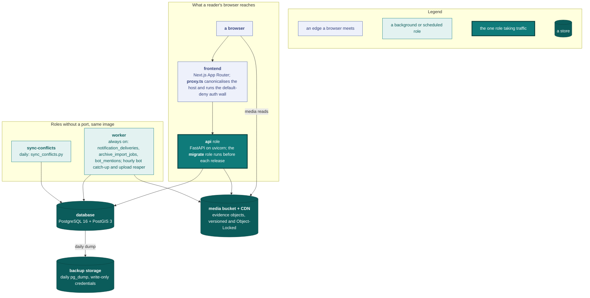
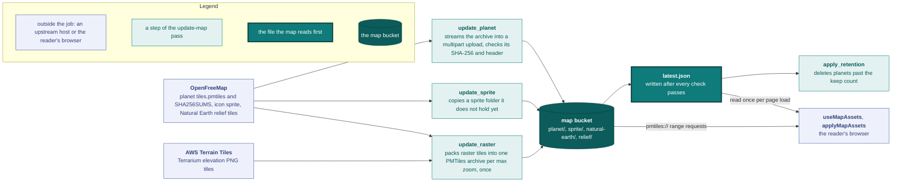
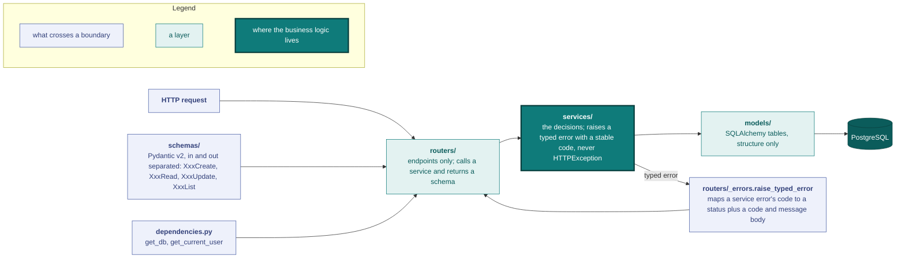
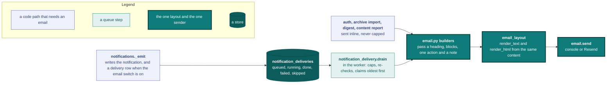
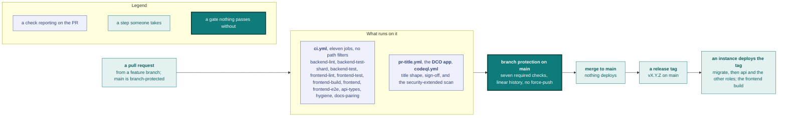
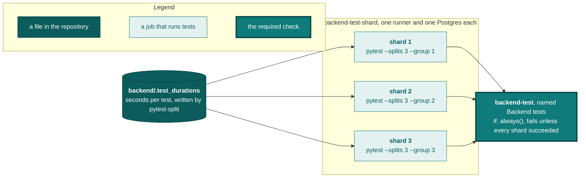

# Engineering

A Vidit instance runs the backend image in five roles, a Next.js frontend, a PostgreSQL database, a media bucket behind a CDN, and off-host storage for database dumps. This page describes that system, the repository it is built from, the conventions its code follows, and how a change reaches an instance.



Each region of the diagram has a section below. What each piece is and why it was picked is [the tech stack](#tech-stack); the code they all run is [the repository layout](#repository-layout-monorepo), [the backend conventions](#backend-conventions) and [the frontend conventions](#frontend-conventions); the roles are [backend roles](#backend-roles), and the two without a port are [scheduler services](#scheduler-services); what an instance runs and configures is [deployment](#deployment), and the backup storage is [`backups.md`](backups.md). The path a change takes to reach an instance is [CI/CD](#cicd). [Local environment](#local-environment) is the same shape on one machine, with a Docker container standing in for the database and `LocalStorage` for the buckets.

---

## Tech stack

### Selection principles

- **Open source first.** Every component must be self-hostable or replaceable.
- **Python backend.** The team's background is in data engineering.

### Backend

| Component | Choice | Target version |
|-----------|--------|----------------|
| API framework | **FastAPI** | ≥ 0.115 |
| ASGI server | **Uvicorn** | ≥ 0.34 |
| ORM | **SQLAlchemy** | ≥ 2.0 |
| Geospatial extension | **GeoAlchemy2** | ≥ 0.15 |
| Migrations | **Alembic** | ≥ 1.14 |
| Authentication | **Cookie session + double-submit CSRF** (JWT payload via PyJWT); bcrypt for passwords | N/A |
| Validation | **Pydantic v2** | ≥ 2.0 |
| Rate limiting | **slowapi** | ≥ 0.1.9 |

### Database

| Component | Choice |
|-----------|--------|
| RDBMS | **PostgreSQL 16**, the `postgis/postgis:16-3.4` image locally; an instance runs the same major version ([`backups.md`](backups.md#automated-backups) explains the `pg_dump` version pin) |
| Geospatial extension | **PostGIS 3** |

PostGIS handles coordinates, bounding boxes, and geographic queries (radius, intersection…).

### Media storage

| Component | Choice |
|-----------|--------|
| Object storage | **S3 API** (a private bucket) |
| CDN | **CloudFront** or another CDN in front of the bucket, named by `CLOUDFRONT_DOMAIN` |
| Python SDK | `boto3` |

S3 provides the evidence-preservation primitives: Object Lock, versioning and replication. The backend talks to storage through a small `Storage` protocol (`S3Storage` for production, `LocalStorage` for development and CI).

Every image is decoded and re-encoded before it is stored: [`evidence_processing.py`](../backend/app/services/evidence_processing.py) strips its metadata, applies its EXIF orientation, and cuts its display derivatives. The decode is bounded in four ways:

- Only the JPEG, PNG and WebP decoders may read the file, whatever its declared `Content-Type`. The image is then re-encoded in the declared type.
- A file declared `image/gif` is read by the GIF decoder alone. Its frame count and canvas size are checked before any frame decodes, and each frame is then stored as a PNG upload (`evidence_processing.split_gif`).
- The pixel limit is checked against the file header before any pixel is decoded. The limits are in [`api.md`](api.md#file-limits).
- The strip works on the decoded image in place. A mode conversion copies it once and frees the source before the encode.
- A process decodes at most `MAX_CONCURRENT_DECODES` images at once. An upload that arrives while every slot is busy waits for one, so a burst of uploads adds latency, not memory.

### Frontend

| Component | Choice |
|-----------|--------|
| Framework | **Next.js 16** (App Router) |
| UI runtime | **React 19** |
| Language | **TypeScript** (`tsconfig` `target: ES2017`; Next's SWC downlevels at build regardless of the type-checker target). Code that needs GeoJSON types imports them from the `geojson` module, not the `GeoJSON.*` global. |
| Interactive map | **MapLibre GL JS** (via `react-map-gl/maplibre`) + **OpenFreeMap** vector tiles (OpenMapTiles schema), read from OpenFreeMap or from a self-hosted PMTiles archive through the **`pmtiles`** protocol |
| Rich editor (proof, collection description) | **BlockNote** (`@blocknote/react` on its Mantine UI); the stored body is sanitized HTML, read back through **html-react-parser**. See [design.md](design.md#rich-text). |
| Styles | **Tailwind CSS 4** (CSS-first config: `@theme` block in [`frontend/src/app/globals.css`](../frontend/src/app/globals.css), no `tailwind.config.ts`) |
| Icons | **lucide-react** |
| Linting | **ESLint 9** (flat config in [`frontend/eslint.config.mjs`](../frontend/eslint.config.mjs), importing `eslint-config-next/core-web-vitals`). `npm run lint` invokes `eslint` directly. |
| Tests | **Vitest + Testing Library** (jsdom, config in [`frontend/vitest.config.mts`](../frontend/vitest.config.mts)). Colocated `*.test.ts(x)` under `src/`; `npm test` runs once, `npm run test:watch` watches. `NEXT_PUBLIC_API_URL` is stubbed in the config so importing `lib/api.ts` doesn't trip its boot guard. Layout is not testable there (jsdom has no layout engine): `npm run test:e2e` runs the Playwright suite that measures it, after `npx playwright install chromium` once. See [Narrow-viewport smoke tests](#narrow-viewport-smoke-tests). |
| API types | **`openapi-typescript`**: [`frontend/src/lib/api-types.ts`](../frontend/src/lib/api-types.ts) is **generated** from the backend OpenAPI spec (`make gen-api-types` dumps `app.openapi()` → `openapi-typescript`). [`types/index.ts`](../frontend/src/types/index.ts) derives its enums (`EventStatus`, `MediaType`, the source kind and level) from it, so a backend schema change that isn't regenerated is a `tsc` failure, not a runtime surprise. The `api-types` CI job regenerates + `git diff --exit-code`, failing on drift. Don't hand-edit `api-types.ts`. |

MapLibre GL JS is open source (BSD-3-Clause). It uses vector tiles and supports client-side clustering. The tiles come from OpenFreeMap, which needs no API key and sets no request cap, or from the instance's own copy of them ([Self-hosted map files](#self-hosted-map-files)). The attribution control credits OpenMapTiles and OpenStreetMap contributors.

The MapLibre web worker is served from `public/`, not from the bundle. MapLibre builds the worker URL at runtime, so the bundler never emits it, and the worker imports `maplibre-gl-shared.mjs` by its unhashed name. [`next.config.mjs`](../frontend/next.config.mjs) runs [`scripts/copy-maplibre-worker.mjs`](../frontend/scripts/copy-maplibre-worker.mjs) on every `next dev`, `next build` and `next start`, which copies both files to `public/maplibre-gl/<version>/`. [`maplibreWorker.ts`](../frontend/src/components/map/maplibreWorker.ts) calls `setWorkerUrl` with that path before the first map is created. The `proxy.ts` matcher skips `/maplibre-gl/`, so a signed-out reader gets the worker and not the login page. The `loads the map worker` test in [`e2e/map.spec.ts`](../frontend/e2e/map.spec.ts) fails when the worker request does not return JavaScript.

The map's label glyphs are served from `public/map-glyphs/`, one folder per fontstack (`Montserrat Regular`, `Montserrat Medium`) of 256 PBF ranges each, 3.3 MB in all. [`scripts/build-map-glyphs.sh`](../frontend/scripts/build-map-glyphs.sh) builds them in Docker with [maplibre/font-maker](https://github.com/maplibre/font-maker), from sources pinned to a commit, so a rerun reproduces the committed files. MapLibre requests one URL per fontstack, and a static host cannot merge fonts at request time, so the script merges each fontstack at build time: Montserrat first, then Noto Sans and the Noto Sans Armenian, Georgian, Ethiopic, Thai and Lao fonts for the scripts Montserrat lacks. Two kinds of text draw no glyph from these files:

- CJK ideographs render from a system font. MapLibre's `localIdeographFontFamily` defaults to `sans-serif`, so the map requests no ideograph range.
- MapLibre cannot shape Indic scripts, and draws right-to-left scripts only with an RTL plugin, which the map does not load. The style shows such a name in its Latin form (`is-supported-script` in [`basemap.ts`](../frontend/src/components/map/basemap.ts)).

The folder also holds the font licences, `OFL-Montserrat.txt` and `OFL-Noto.txt`. The `proxy.ts` matcher skips `/map-glyphs/`, so a signed-out reader gets the glyphs and not the login page.

The basemap icons (place dots, airport and one-way markers, road shields) are served from `public/map-sprites/`: the OpenFreeMap sprite `ofm`, at 1x and 2x, as JSON and PNG. The Vidit and Streets styles name it by path (`/map-sprites/ofm`), and `carryOverlays` in [`basemap.ts`](../frontend/src/components/map/basemap.ts) resolves the path against the page, since MapLibre loads a sprite only from an absolute URL. `manifest.json` records the OpenFreeMap sprite URL the files were downloaded from. An instance with [self-hosted map files](#self-hosted-map-files) reads the current sprite from its bucket instead, so the vendored copy serves an instance without them. The folder holds the icon licences in `LICENSE.md`. The `proxy.ts` matcher skips `/map-sprites/`, so a signed-out reader gets the icons and not the login page.

MapLibre renders only on WebGL2, with alpha, depth and stencil buffers. A browser without that context gets a message in place of the map. Two checks in [`webgl.ts`](../frontend/src/components/map/webgl.ts) produce that message:

- `supportsMaplibreWebGL` requests the same context on mount, so a browser that offers WebGL1 only, or blocks WebGL entirely, never mounts the map.
- `guardedMaplibre` is the `mapLib` that `<Map>` hands to react-map-gl. When MapLibre still fails to create its context, it fires `error` from inside its constructor, before react-map-gl attaches `onError`, and returns a map with no painter that throws on `getBounds()` and `remove()`. The guarded constructor throws `WebGLUnavailableError` instead. react-map-gl passes that error to `onError`, which switches `<Map>` to the message, and never registers a map to remove.

#### Map data sources

Every map source is keyless and loads straight from its host in the reader's browser. An instance can serve the rows marked *self-hostable* from its own bucket instead ([Self-hosted map files](#self-hosted-map-files)). Each source carries its own attribution, and the attribution control lists the credit of every source a visible layer draws. What each layer shows, and where it draws: [`design.md`](design.md#map).

| Layer | Source | Host | Credit in the attribution control |
|---|---|---|---|
| Dark, Light and Streets basemaps (self-hostable) | OpenFreeMap vector tiles (OpenMapTiles schema) | `tiles.openfreemap.org` | OpenFreeMap, OpenMapTiles, OpenStreetMap contributors |
| Streets shaded relief (self-hostable) | Natural Earth shaded relief raster tiles, to zoom 6 | `tiles.openfreemap.org` | none: Natural Earth is in the public domain |
| Terrain basemap | OpenTopoMap raster tiles, to zoom 17 | `tile.opentopomap.org` | OpenStreetMap contributors, SRTM, OpenTopoMap (CC BY-SA) |
| Daily satellite imagery | NASA GIBS, `VIIRS_SNPP_CorrectedReflectance_TrueColor`, Web Mercator JPEG tiles of the day before, to zoom 9 | `gibs.earthdata.nasa.gov` | Imagery: NASA GIBS / EOSDIS |
| Fire detections | NASA GIBS, `VIIRS_SNPP_Thermal_Anomalies_375m_All`, vector tiles of the day before | `gibs.earthdata.nasa.gov` | Imagery: NASA GIBS / EOSDIS |
| Satellite basemap | [Sentinel-2 cloudless 2016](https://s2maps.eu) by EOX, layer `s2cloudless_3857`, JPEG tiles to zoom 14 | `tiles.maps.eox.at` | Sentinel-2 cloudless 2016 by EOX IT Services GmbH (Contains modified Copernicus Sentinel data 2016), CC BY 4.0 |
| Relief (self-hostable) | [Terrain Tiles](https://registry.opendata.aws/terrain-tiles) on AWS Open Data, Terrarium-encoded elevation PNG, to zoom 15 | `s3.amazonaws.com/elevation-tiles-prod` | Terrain Tiles: USGS, NOAA, Copernicus EU-DEM and others, linked to the full list |

Terrain Tiles merges several elevation datasets, and its [attribution list](https://github.com/tilezen/joerd/blob/master/docs/attribution.md) asks each to be credited:

- ArcticDEM terrain data DEM(s) were created from DigitalGlobe, Inc., imagery and funded under National Science Foundation awards 1043681, 1559691, and 1542736.
- Australia terrain data © Commonwealth of Australia (Geoscience Australia) 2017.
- Austria terrain data © offene Daten Österreichs, Digitales Geländemodell (DGM) Österreich.
- Canada terrain data contains information licensed under the Open Government Licence, Canada.
- Europe terrain data produced using Copernicus data and information funded by the European Union, EU-DEM layers.
- Global ETOPO1 terrain data U.S. National Oceanic and Atmospheric Administration.
- Mexico terrain data source: INEGI, Continental relief, 2016.
- New Zealand terrain data Copyright 2011 Crown copyright (c) Land Information New Zealand and the New Zealand Government (All rights reserved).
- Norway terrain data © Kartverket.
- United Kingdom terrain data © Environment Agency copyright and/or database right 2015. All rights reserved.
- United States 3DEP (formerly NED) and global GMTED2010 and SRTM terrain data courtesy of the U.S. Geological Survey.

The attribution control names the three largest contributors and links to that list.

The 2016 Sentinel-2 cloudless mosaic is licensed CC BY 4.0. EOX licenses the 2018 and later mosaics (`s2cloudless-2018` onward) under CC BY-NC-SA 4.0, which excludes commercial use. EOX serves the layer to zoom 21, but its 10 m Sentinel-2 data adds no detail past zoom 14: a zoom 15 tile matches its enlarged zoom 14 parent within JPEG noise. The source stops at 14, and MapLibre enlarges that level beyond.

GIBS lists the fire detections as Web Mercator vector tiles (`GoogleMapsCompatible_Level8`), but answers 404 to every such request. It serves them on its geographic grid (EPSG:4326, matrix set `500m`), which a MapLibre vector source cannot read, since MapLibre tiles only in Web Mercator. Level 0 of that grid holds every detection of the day in two tiles, about 2 MB gzipped together. `loadFireDetections` in [`gibs.ts`](../frontend/src/components/map/gibs.ts) fetches both once per page load and date, since GIBS marks them `no-store`, and decodes them with `@mapbox/vector-tile` and `pbf`, the decoders MapLibre itself depends on. Each feature of the `VIIRS_SNPP_Thermal_Anomalies_375m_All_v2_NRT` layer carries its position as `LATITUDE` and `LONGITUDE` properties, so the decoder places each point there, with no tile projection, and keeps `FRP` (fire radiative power, in MW) and `CONFIDENCE` (`low`, `nominal` or `high`). The other properties are `BRIGHT_TI4`, `BRIGHT_TI5`, `SCAN`, `TRACK`, `ACQ_DATE`, `ACQ_TIME`, `SATELLITE`, `DAYNIGHT`, `VERSION` and `UID`. The points feed a GeoJSON source, which a basemap swap keeps.

#### Self-hosted map files

An instance can serve the vector tiles, the icon sprite, the Streets shaded relief and the relief elevation from an S3-compatible bucket of its own. The `update-map` [backend role](#backend-roles) fills the bucket, and the frontend reads it when `NEXT_PUBLIC_MAP_ASSETS_URL` is set.



The Terrain basemap (OpenTopoMap), the Satellite 2016 basemap (EOX) and the NASA GIBS overlays stay on their hosts: the bucket holds no copy of them.

**The frontend.** With `NEXT_PUBLIC_MAP_ASSETS_URL` set, `useMapAssets` in [`mapAssets.ts`](../frontend/src/components/map/mapAssets.ts) reads `<url>/latest.json` once per page load and registers the `pmtiles://` protocol in MapLibre. The map keeps its blank style until the read ends. `applyMapAssets` in [`basemap.ts`](../frontend/src/components/map/basemap.ts) then points the `openmaptiles`, `ne2_shaded` and `relief-dem` sources and the sprite of the Dark, Light and Streets styles at the files `latest.json` names. Each archive's header sets its source's zoom range, and MapLibre enlarges the last level beyond it. When `latest.json` cannot be read or names no valid key, the map logs one warning and draws from the public hosts. Without the variable, the map reads the public hosts and fetches nothing from a bucket.

**Bucket layout.** Every key sits under `MAP_PREFIX`:

| Key | Content | Written |
|---|---|---|
| `planet/<version>.pmtiles` | The OpenFreeMap planet of that version, about 87 GB: MVT, zooms 0 to 14 | When OpenFreeMap publishes a version, weekly |
| `sprite/<ofm id>/ofm.json`, `ofm.png`, `ofm@2x.json`, `ofm@2x.png` | The OpenFreeMap icon sprite, in the folder OpenFreeMap names by a hash of its content | When OpenFreeMap publishes a sprite |
| `natural-earth/ne2sr-z6.pmtiles` | The Natural Earth shaded relief of the Streets style, PNG, zooms 0 to 6: 5,461 tiles, about 320 MB | Once |
| `relief/terrarium-z<max>.pmtiles` | Terrarium elevation tiles, PNG, zooms 0 to `MAP_RELIEF_MAX_ZOOM` | Once per max zoom |
| `latest.json` | The keys the map reads | Last, after every check passes |

**`latest.json`.** Each key is relative to the prefix:

```json
{
  "planet": {"key": "planet/20261025_080012_pt.pmtiles", "version": "20261025_080012_pt", "area": "planet", "osm_date": "2026-10-19", "sha256": "<hex>", "bytes": 87230232932},
  "sprite": {"key": "sprite/ofm_f384/ofm"},
  "natural_earth": {"key": "natural-earth/ne2sr-z6.pmtiles", "max_zoom": 6},
  "relief": {"key": "relief/terrarium-z8.pmtiles", "max_zoom": 8},
  "attribution": {"planet": "...", "natural_earth": "...", "relief": "..."},
  "updated_at": "2026-10-27T06:00:00+00:00"
}
```

The map credits each source from its own style, so `attribution` is a note for the operator.

**Bucket settings.** Serve the prefix to anonymous readers, from the bucket or through a CDN, and set `NEXT_PUBLIC_MAP_ASSETS_URL` to that public URL plus the prefix, with no trailing slash. MapLibre reads an archive in byte ranges, so allow cross-origin `GET` and `HEAD` from the frontend origin with the `Range` and `If-Match` request headers, and expose `ETag`. A CDN in front of the bucket must pass `Range` through and answer `206`. The job writes every key but `latest.json` once and gives it `Cache-Control: public, max-age=31536000, immutable`. `latest.json` carries `Cache-Control: no-cache`.

**The `update-map` pass.** [`scripts/update_map.py`](../backend/scripts/update_map.py) runs one pass of [`services/map_files.py`](../backend/app/services/map_files.py). Each step skips work already done, so a rerun after a failure resumes where it stopped:

1. **Planet.** Reads `files.txt` from the OpenFreeMap file host and takes the newest version folder of the area that lists `tiles.pmtiles`, `SHA256SUMS` and the `done` marker. `MAP_PLANET_VERSION` pins another complete version. When `latest.json` already names that version and the object exists, the step ends. When the object exists with the SHA-256 that `SHA256SUMS` lists, read from its upload metadata or, in a local folder, from the file itself, the job checks its header and copies nothing. Otherwise the job streams `tiles.pmtiles` into a multipart upload with no local copy, in parts of 64 MiB or `size / 10,000`, whichever is larger. It resumes a dropped download with a range request, up to five times. It hashes the stream and aborts the upload when the SHA-256 differs from `SHA256SUMS`. It then reads the uploaded archive's header and metadata over range requests and deletes the object unless the archive is MVT, spans zooms 0 to 14 and holds the layers the styles draw.
2. **Sprite.** Reads the sprite URL from OpenFreeMap's published dark style and copies the four files when the bucket lacks that folder.
3. **Streets relief and relief.** Builds each PMTiles archive from the upstream tiles when its key is missing, then checks its header. The two datasets do not change upstream.
4. **`latest.json`.** Written when its content changed, after every step above passed.
5. **Retention.** Deletes the planets past the newest `MAP_KEEP_PLANETS`, never the one `latest.json` names or the one it named before.

On any failure, the pass logs one line that starts with `update-map failed`, reports to Sentry when `SENTRY_DSN` is set, and exits `1`, leaving the files `latest.json` names in place. Every request carries the User-Agent `Vidit-update-map/1 (+https://github.com/vidithq/vidit)`. Progress lines (bytes or tiles, and the rate) print every 30 seconds.

**Settings.** The role reads these environment variables:

| Variable | Default | Meaning |
|---|---|---|
| `MAP_BUCKET` | none, required | The bucket, or `file:///<absolute path>` to write the same layout to a local folder. |
| `MAP_PREFIX` | empty | The folder that holds every key. |
| `MAP_ENDPOINT_URL` | empty (AWS S3) | The S3 API endpoint of another store, such as MinIO or Cloudflare R2. |
| `MAP_REGION` | `AWS_REGION` | The bucket's region. |
| `AWS_ACCESS_KEY_ID`, `AWS_SECRET_ACCESS_KEY` | the boto3 credential chain | Credentials with `GetObject`, `PutObject`, `DeleteObject`, `ListBucket` and the multipart actions on the prefix. |
| `MAP_KEEP_PLANETS` | `2` | Planets kept, at least 2. |
| `MAP_RELIEF_MAX_ZOOM` | `8` | The last zoom of the relief archive, 0 to 15. |
| `MAP_SOURCE_URL` | `https://btrfs.openfreemap.com` | The OpenFreeMap file host. |
| `MAP_AREA` | `planet` | The OpenFreeMap area. `monaco` copies a 0.5 MB extract, for a test run. |
| `MAP_PLANET_VERSION` | empty (the newest) | A complete OpenFreeMap version to hold instead of the newest, such as one already downloaded. |

**Relief max zoom.** Zoom 8 holds 87,381 tiles, about 7 GB, at 611 m per pixel at the equator, enough to shade hills and mountains at the regional scale the relief serves. Zoom 9 holds 349,525 tiles, about 30 GB, and each further zoom multiplies the tiles, the size and the time by four. Above the archive's last zoom, MapLibre enlarges the last level, so the shading softens as you zoom in. A new max zoom builds a new archive under a new key and leaves the old one in place: delete it by hand.

**Resources.** The pass holds about two upload parts and one batch of 256 tiles in memory: give it 512 MB. The relief and Streets relief builds keep the tile data in a temporary file until the archive's directory is known, so the first run needs free disk in `TMPDIR` the size of the largest archive, about 7 GB at zoom 8. The planet needs no disk. The time depends on the host's bandwidth: the planet copy moves 87 GB, about 30 minutes at 50 MB/s, and the first relief build makes 87,381 requests of about 100 KB each to AWS `us-east-1`, about 3 minutes at 50 MB/s.

**Run the map from local files.** A local folder with the bucket layout, served by any static HTTP server that answers byte ranges and sends CORS headers, works as the base URL:

1. From `backend/`, fill the folder. Leave `MAP_PREFIX` unset, so the keys sit at the folder's root:

   ```bash
   MAP_BUCKET=file://$HOME/vidit-map-data uv run python scripts/update_map.py
   ```

   This copies the newest planet, 87 GB. To use a planet you already downloaded, place it at `planet/<version>.pmtiles` in the folder and add `MAP_PLANET_VERSION=<version>`: the pass hashes the file against the published `SHA256SUMS` instead of downloading it. For a test folder without the planet, add `MAP_AREA=monaco` and `MAP_RELIEF_MAX_ZOOM=4`; the Streets relief still takes about 320 MB. The pass needs the network for the sprite and the raster tiles. The map needs every key `latest.json` names, so build the folder with the pass rather than by hand.
2. Serve the folder, for example with `npx http-server $HOME/vidit-map-data --cors -p 8080`. The server answers `Range` requests with `206` and allows every origin.
3. In `frontend/.env.local`, set `NEXT_PUBLIC_MAP_ASSETS_URL=http://localhost:8080`, then restart `npm run dev`: Next.js reads `NEXT_PUBLIC_*` variables when it starts.

The Dark, Light and Streets basemaps and the relief then read only the folder. The Terrain and Satellite 2016 basemaps and the NASA overlays still need the network.

**Schedule.** OpenFreeMap publishes a planet each week. Run `update-map` once a week, a day or more after the publication. Configure no restart on failure: a failed pass leaves the current files, and the next scheduled pass retries.

### Hosting

An instance needs these pieces. [Deployment](#deployment) describes how to run them.

| Piece | Requirement |
|-------|-------------|
| Container host | Runs the backend image in each of its [roles](#backend-roles): `api` behind HTTPS, `worker` always on, and `migrate` once per release. |
| Scheduler | Starts the `sync-conflicts` role daily, and the `update-map` role weekly when the instance serves its own map files. |
| Database | **PostgreSQL 16** with **PostGIS 3**, reachable from every role. |
| Map storage (optional) | An S3-compatible bucket, or a prefix of one, that serves the [self-hosted map files](#self-hosted-map-files) to anonymous readers: about 270 GB while a third planet uploads, about 185 GB after retention. |
| Object storage | An S3-compatible bucket for media, with versioning and Object Lock, and a CDN in front of it. A second bucket in another region holds the media replica, and off-host storage holds the database dumps ([`backups.md`](backups.md)). |
| Frontend host | Builds and serves the Next.js app in `frontend/`. |
| DNS | One host for the frontend and one for the API. The API sets cookies the frontend reads, so both sit under one parent domain ([Particularities](#particularities-non-obvious-behavior-found-during-development)). |
| External services | The X API for the bot, Resend for email (`EMAIL_PROVIDER=resend`), Sentry for error tracking (optional), and an uptime monitor on `/health`. |

### Not in the stack

- **Redis or an external cache**: not needed. An in-process TTL+LRU cache serves the points endpoint (see `backend/app/cache.py`).
- **An external task queue (Celery or similar)**: the always-on worker is a plain loop over the delivery and job tables (see [Scheduler services](#scheduler-services)).
- **Multi-region compute**: the roles run in one region. Media is the exception: the media bucket replicates cross-region to a locked replica bucket (see [`backups.md`](backups.md#media-replication)).
- **Monitoring and observability**: an external uptime monitor checks the API health endpoint, and a Sentry SDK runs on both tiers (backend and frontend), opt-in through a DSN environment variable (see [Observability](#observability-whats-wired-and-how-to-turn-it-on)). There is no APM or tracing pipeline.
- **Handle-ownership verification**: the archive import attributes work to an analyst's `@handle` **without proving the uploader controls it**. X's OAuth consent asks for more access than the import needs, and X has no lighter identity integration (no OpenID Connect; OAuth 1.0a is worse). Imports land as detections. There is no ownership proof and no claim or dispute path.

---

## Repository layout (monorepo)

```
vidit/
├── backend/                  # FastAPI (Python), uv
│   ├── app/
│   │   ├── middleware/       # CSRF, request id
│   │   ├── models/           # SQLAlchemy, one table per file
│   │   ├── schemas/          # Pydantic v2 request and response bodies
│   │   ├── routers/          # endpoints; events/ holds per-concern sub-routers
│   │   └── services/         # business logic; tweet_ingest/ is the detection engine
│   ├── alembic/              # migrations
│   ├── scripts/              # scheduler entry points, local-dev and operator helpers
│   └── tests/                # pytest
├── frontend/                 # Next.js 16 (TypeScript), npm
│   ├── src/
│   │   ├── app/              # App Router routes
│   │   ├── components/       # feature folders; ui/ holds the shared primitives
│   │   ├── hooks/
│   │   ├── lib/              # API client, FE mirrors of backend rules
│   │   ├── types/
│   │   └── proxy.ts          # host redirect and auth wall (edge runtime)
│   ├── e2e/                  # Playwright narrow-viewport suite
│   └── scripts/              # build helpers and the palette-coverage check
├── docs/                     # this reference, built by MkDocs
└── .github/workflows/        # see GitHub Actions
```

`make test` runs `pytest -n auto --dist worksteal`: the conftest migrates a template database to alembic head and clones one database per xdist worker. Plain `pytest` stays serial on the development database. Stored files never reach `backend/.local-storage`: each test process writes to its own temporary storage root, emptied before every test and removed when the run ends.

---

## Backend: conventions

### Layered structure

A request crosses the layers in one direction, and each layer knows only the one under it.



| Layer | Role | Rule |
|-------|------|------|
| **routers/** | HTTP endpoints, no business logic | Calls a service, returns a schema. Maps service-raised typed errors to HTTP status + `{code, message}` detail via the shared [`routers/_errors.py`](../backend/app/routers/_errors.py) `raise_typed_error(exc, status_map)`, each router supplying its own `code → status` map ([`routers/auth.py`](../backend/app/routers/auth.py) `_REGISTRATION_ERROR_STATUS`, [`routers/admin.py`](../backend/app/routers/admin.py) `_ADMIN_ERROR_STATUS`). |
| **services/** | Business logic | Accesses the DB through the session, never sees `Request`/`Response`, never raises `HTTPException`; raise a typed error subclass with a stable `code` and let the router translate. |
| **models/** | SQLAlchemy tables | Structure only, no logic |
| **schemas/** | Pydantic validation | Input and output separated (`Create`, `Read`, `Update`, `List`) |
| **dependencies.py** | FastAPI injection | `get_db`, `get_current_user` |

### Request concurrency

The API runs as one uvicorn process with one event loop (the `CMD` in [`backend/Dockerfile`](../backend/Dockerfile)). A blocking call on that loop stalls every in-flight request, `/health` included. Route handlers follow three rules:

- Declare a handler that touches the database as a plain `def`. FastAPI runs it in its threadpool, so a slow query or a lock wait blocks one worker thread and the loop keeps serving.
- Call an `async` service from such a handler through `asyncio.run`, which gives the coroutine an event loop of its own inside the worker thread. The evidence writes in [`routers/events/write.py`](../backend/app/routers/events/write.py) and [`routers/events/item.py`](../backend/app/routers/events/item.py), the avatar upload, and the tweet import work this way. The row lock an evidence write holds across its upload pauses only that private loop.
- Keep `async def` for a handler that awaits the request itself, and run each of its database calls through `run_in_threadpool`, as the X webhook receiver ([`routers/webhooks.py`](../backend/app/routers/webhooks.py)) does: it reads the raw body for its signature check.

[`tests/test_request_concurrency.py`](../backend/tests/test_request_concurrency.py) fails on an `async def` handler that depends on `get_db`, the webhook receiver excepted.

The API process caps every lock wait at `LOCK_TIMEOUT_MS`, 5 seconds. [`main.py`](../backend/app/main.py) calls `bound_lock_waits` from [`database.py`](../backend/app/database.py) at import, and from then on every connection the engine opens sets the Postgres `lock_timeout` in its startup options. A statement that waits longer for a lock fails, and `get_db` answers the request with a `409` carrying the typed envelope `{"code": "lock_timeout", …}`. The cap protects the API's threadpool: a request queued on a lock holds a worker thread for as long as it waits.

The cap applies to the API process only. The import worker and the conflict-sync cron open their sessions from the same engine but never import `main.py`, so their statements wait for the lock: each service runs on its own compute with no shared threadpool, and waiting costs it nothing. Migrations open their own engine in [`alembic/env.py`](../backend/alembic/env.py) and wait too.

### Email

Every email Vidit sends goes through one layout and one sender. Auth and job emails leave inline from the code path that needs them. Notification emails wait in a queue that the always-on worker drains.



**The layout.** A builder in [`services/email.py`](../backend/app/services/email.py) passes structured content to [`services/email_layout.py`](../backend/app/services/email_layout.py), never markup. The layout renders an HTML part and a plain-text part from that content, so both carry the same words and links. Every link is absolute, built on `FRONTEND_URL`. A bare URL becomes a link only in the action, the closing note and the blocks of the registration confirmation email. A URL in the other blocks stays text, since they carry user text such as event titles and report details. The footer of both parts links to Settings and to the legal notice. The brand rules of the HTML part are in [`design.md`](design.md#email).

**The sender.** `EMAIL_PROVIDER=console` prints the headers, the text part and then the HTML part to stdout, so local development needs no provider. `EMAIL_PROVIDER=resend` posts both parts and any headers to Resend. `send` raises `EmailRejectedError` when the provider answers with a refusal, and its parent `EmailSendError` when the outcome is unknown, such as a timeout. Every caller catches the error, so a provider outage never fails the action that sent the email.

**The notification queue.** The transaction that writes a [notification](api.md#notifications) also writes one [`notification_deliveries`](data-model.md#notification_deliveries) row when the recipient's email switch for that kind is on. Email is the only delivery channel besides the in-app list, which shows every notification whatever the switch says. The worker's [`drain`](../backend/app/services/notification_delivery.py) runs at the start of each pass and sends each claimed row to the recipient's account address:

1. It marks a row `failed` after an hour in `running`, and `skipped` after 48 hours in `queued`, so a crash never sends one message twice and a backlog never sends old news.
2. It stops when the notification emails that may have gone out in the trailing 24 hours reach `NOTIFICATION_EMAIL_DAILY_CAP` (default 50). Those are the `done` rows, and the rows claimed in the window and left `running` or failed stale out of it, since the provider may have counted them; a row failed by refusals does not count. It passes over a recipient who reached `NOTIFICATION_EMAIL_DAILY_CAP_PER_USER` (default 10). A row whose notification the recipient deleted keeps counting toward the total cap, with a NULL `notification_id`; the per-user and per-actor counts read through the notification and drop it. Rows over a cap stay queued. Before that, at queue time, the API writes no email row of a kind an analyst sends straight at someone (an invitation, an organization invite, an approval request) once that actor queued `NOTIFICATION_EMAIL_DAILY_CAP_PER_ACTOR` (default 10) such emails in the trailing 24 hours, so one analyst cannot spend the total cap. Fan-out, such as re-approval requests after a new version, is neither capped nor counted.
3. It claims the oldest queued row with `FOR UPDATE SKIP LOCKED`, sets it `running` and commits before the provider call.
4. It re-reads the recipient and skips the row when the switch is now off, the account is soft-deleted or inactive, or the filter would hide the notification.
5. It sets the row `done` on success. A refusal puts the row back in `queued` for another try after 5 minutes, and the third refusal sets it `failed`. An unknown outcome leaves it `running` until it goes stale. When writing the outcome fails after a send or an unknown outcome, the row also stays `running`, never `queued`, so the message is never sent twice.

The caps keep notification email inside the provider's daily quota. The boot check in [`config.py`](../backend/app/config.py) refuses a `NOTIFICATION_EMAIL_DAILY_CAP` at or above `EMAIL_PROVIDER_DAILY_QUOTA` (default 100, the Resend free tier), which leaves the remainder to the auth emails, which are sent inline and never counted. Each notification email links to the item, names the switch that sent it and links to Settings. Its `List-Unsubscribe` and `List-Unsubscribe-Post` headers carry a one-click URL on `API_URL` with a token signed for the recipient and the kind ([`services/unsubscribe_tokens.py`](../backend/app/services/unsubscribe_tokens.py)), which turns that kind off by email. The token carries no expiry, so the link in an old email keeps working, and rotating `JWT_SECRET` voids every link.

### Hand-kept mirrors

Each validation rule has one backend home: the upload MIME allowlist in `services/storage.py` (the EXIF-strip set derives from the image allowlist), coordinate bounds in `services/events.validate_coordinates`, and password length in `schemas/auth.NewPassword` (`PASSWORD_MIN_LENGTH` characters, `PASSWORD_MAX_BYTES` UTF-8 bytes, the bcrypt input limit). Frontend enum types are generated from the OpenAPI spec into `lib/api-types.ts`. So is `SourceCreate`, the entry of the event writes' `sources` JSON form field: no route names it, so `main._FORM_FIELD_MODELS` adds it to the spec's components.

Every other frontend copy of a backend rule or of the issue tracker is hand-kept and listed below. Change both sides in the same PR. Frontend paths are under `frontend/src/`; backend modules are under `backend/app/`. [`backend/tests/test_frontend_mirrors.py`](../backend/tests/test_frontend_mirrors.py) reads the value mirrors (the caps, the evidence levels, the document kinds, the snapshot hosts, the coordinate bounds and the status filter list) out of the frontend files and fails when one differs from its backend value.

| Frontend | Backend source | Drift breaks |
|---|---|---|
| `lib/mediaTypes.ts` | `storage.ALLOWED_IMAGE_TYPES`, `GIF_CONTENT_TYPE`, `ALLOWED_VIDEO_TYPES` | picker accepts a file the API refuses |
| `lib/coordinates.ts` | `events.validate_coordinates` | form accepts coordinates the API refuses |
| `lib/auth.ts` `PASSWORD_MIN_LENGTH`, `PASSWORD_MAX_BYTES` | `schemas/auth.PASSWORD_MIN_LENGTH`, `PASSWORD_MAX_BYTES` | password form accepts a password the API refuses, or refuses one it accepts |
| `lib/auth.ts` CSRF cookie and header names; the cookie name again in `proxy.ts` (edge runtime) | `auth_cookies.CSRF_COOKIE`, `CSRF_HEADER` | every write is refused |
| `lib/proofImages.ts` | `sanitize.PROOF_PLACEHOLDER_PREFIX`, `storage.safe_original_filename` | proof images lose their upload binding |
| `lib/proof.tsx::LOCAL_STORAGE_URL_PREFIX` | `storage.LOCAL_STORAGE_URL_PREFIX` | a development proof image fails the image source check |
| `lib/search.ts::AUTHOR_FILTER_RE` | `event_filters.AUTHOR_FILTER_PATTERN` | author filter parses differently |
| `components/filters/EventFilterSections.tsx` media options, `FILTER_STATUSES` | `event_filters.MEDIA_TYPES`; `STATUSES` minus `closed`, in declared order | filter offers a value the API refuses |
| `components/profile/RecentSubmissions.tsx` link `status=geolocated` | `event_filters.published_events()` | *Show more* expands a different set than the preview |
| `components/collections/CollectionsSection.tsx` link `type=collection` | the filter `search.search_collections` reads, including the `author` exception | *Show more* lands on an empty group |
| `lib/archive.ts` keep-allowlist, root discovery, `MAX_UPLOAD_BYTES` | `tweet_ingest/archive_zip.py` | client trims files the server needs, or uploads an export it refuses |
| `lib/mediaUrls.ts::displayUrlsFor` | `storage.derivative_key` (`_hero`, `_thumb`) | a source image requests a derivative that does not exist (403) |
| `lib/viewport.ts` | `event_filters.parse_bbox` field order and bounds | map bbox is refused or filters the wrong area |
| `lib/pagination.ts` | `pagination.next_link` `Link` header shape | paging stops after page one |
| `lib/sources.ts::MAX_SOURCES_PER_EVENT` (the event form's source list) | `models/source.MAX_SOURCES_PER_EVENT` | form offers a source the API refuses (`too_many_sources`) |
| `lib/sources.ts::MAX_LINKS_PER_SOURCE` (each source editor's link list) | `models/source.MAX_LINKS_PER_SOURCE` | form offers a URL the API refuses (`too_many_source_links`) |
| `lib/sources.ts::SOURCE_TITLE_MAX_LEN`, `SOURCE_URL_MAX_LEN` (the source title, each URL and each archived copy; `components/ui/ArchivedCopies.tsx::isSnapshotUrl` counts a copy in UTF-8 bytes) | `models/source.SOURCE_TITLE_MAX_LENGTH`, `SOURCE_URL_MAX_LENGTH`, `source_archive.SNAPSHOT_URL_MAX_LENGTH` | server refuses typed text (422, or `snapshot_url_too_long`) |
| `lib/sources.ts::isEvidenceLevel` | `models/source.EVIDENCE_LEVELS` | the form, the queue and the source block count a source toward the evidence floor that the server does not, or the reverse |
| `lib/sources.ts::DOCUMENT_SOURCE_KINDS` | `models/source.DOCUMENT_SOURCE_KINDS` (`schemas/source.SourceCreate` drops a document's capture position) | the editor offers a capture position the server drops, or hides one it keeps |
| `lib/sources.ts::isImportableLink` (the source editor's import button) | `tweet_ingest/urls.is_importable_link` (`x_status_id`, `telegram_post_url`, `tiktok_post_id`, `tiktok_short_url`) | the form offers an import the server refuses (`unsupported_link`), or hides one it reads |
| `lib/sources.ts::SOURCE_ERROR_MESSAGES` (each sentence, and the caps it names) | the source codes of `events/errors`, the upload codes of `uploads`, `conflict_required`, `invalid_coordinates` | a refused write prints the server's message, or names the wrong cap |
| `lib/events.ts::batchCompletionBlockers` | `events/batch._publish_detection`, `events.detection_ready_predicate` (coordinates, a `direct` or `indirect` source with a file, no source without a URL, a proof image) | queue labels a row ready that the server refuses |
| `lib/events.ts::missingEventFields`, `missingEventRequestFields` | `events/sources.check_publish_floor`, the required `kind` of `schemas/source.SourceCreate`, `sources._clean_links` (a URL on every source), `events/rules._require_conflict`, `_require_proof_image` | the form calls a submission ready that the server refuses, or blocks one it accepts |
| `lib/events.ts::EventView` | `event_filters.VIEWS` (the router takes `str`, so codegen cannot carry it) | `view` parameter refused |
| `lib/events.ts::DetectionReadiness` | `events/readiness.DETECTION_READINESS` (the router takes `str`, so codegen cannot carry it) | `readiness` parameter refused (422) |
| `lib/events.ts::snapshotToEventView`, `changedFields`, `hasVersionChanges` | `versions.build_snapshot` fields, the source entry of `versions.source_entry`, `versions.COMPARED_FIELDS` (the snapshot is untyped JSON, so neither codegen nor `tsc` catches a renamed key) | version pages silently blank a field or a source |
| `lib/events.ts::EVENT_TITLE_MAX_LEN` (the event title, and `lib/collections.ts::COLLECTION_TITLE_MAX_LEN`), `REPORT_DETAILS_MAX_LEN`, `VERSION_NOTE_MAX_LEN`, `CLOSE_REASON_MAX_LEN` | `models/event.TITLE_MAX_LENGTH`, `schemas/report.DETAILS_MAX_LENGTH`, `schemas/event.VERSION_NOTE_MAX_LENGTH`, `CLOSE_REASON_MAX_LENGTH` | server refuses typed text |
| none: the proof editor shows no counter | `sanitize._MAX_LENGTH` (200,000 characters of HTML), `_MAX_TAGS` | nothing drifts: the caps count markup the editor does not show, so the server's `invalid_proof` answer stands |
| `components/profile/useProfileEdit.ts::BIO_MAX_LEN` | `schemas/user.BIO_MAX_LEN` | server refuses typed text |
| `components/ui/TagPicker.tsx::TAG_NAME_MAX_LEN` | `schemas/tag.py` name `max_length` | server refuses typed text |
| `lib/collections.ts::COLLECTION_DESCRIPTION_MAX_LEN` | `schemas/collection.DESCRIPTION_MAX_LENGTH` | server refuses typed text |
| `lib/proof.tsx::htmlText` | `sanitize.html_text` | description counter disagrees with the server cap |
| `components/map/mapAssets.ts::FIELDS` | `map_files.LATEST_FIELDS`, the keys of `latest.json` | the map falls back to the public hosts, or reads a file the bucket does not hold |
| `lib/proof.tsx::proofImageSrcs`, `proofHasImage` | `sanitize.extract_image_srcs`, `events._require_proof_image` | form calls a proof ready that the server refuses |
| `lib/conflicts.ts::CONFLICT_OTHER_NAME` | the `Other` conflict row the baseline migration seeds (`alembic/versions/g5i7k9m1o3q5_baseline.py`) | the conflict picker stops offering the escape value |
| `lib/collections.ts::COLLECTABLE_STATUSES` | `event_filters.collectable_events` | picker offers rows the add verb refuses (409) |
| `lib/collections.ts::BULK_ADD_MAX_EVENTS` (the search page's Select all) | `schemas/collection.MAX_CREATE_EVENTS` | search offers a Select all the bulk add refuses (`too_many_events`), or hides one it accepts |
| `lib/sites.ts::SITE_NAME_MAX_LEN`, `SITE_SOURCE_NOTE_MAX_LEN`, `siteSourceMissing` | `models/event.TITLE_MAX_LENGTH`, `schemas/site.SITE_SOURCE_NOTE_MAX_LENGTH`, `schemas/site.SiteSourceCreate` (a capture time not in the future, a link) | the site forms accept a value the API refuses |
| `lib/sites.ts::contourOn` | `services/sites.zones_at` (the latest contour whose source was captured on or before the day, the later contour breaking a tie) | the site page shows a zone for a date that the map and the API read differently |
| `lib/sites.ts::siteSourceFromEventSource` | `services/sites._event_file` (a `satellite` source with a file, not flagged graphic) and `schemas/site.SiteSourceCreate` (a capture time) | the link dialog offers to file an event source the API refuses (`source_media_not_found`) |
| `lib/sites.ts::SITE_MARGIN_KM` | the `margin_m` default of `routers/events/sites` | the link dialog names a distance the suggestions do not use |
| `components/sites/useEventSites.tsx` link gate on `geolocated` | `event_filters.site_linkable_events` | the event page offers a link the API refuses (409) |
| `components/collections/EventPicker.tsx::chronological` | `collections.chronological_key` | the picker orders a collection's events differently from its page |
| `lib/og.ts::MOSAIC_MAX_TILES` | `collections.COVER_TILES` | a share card draws more tiles than the server sends |
| `components/event/useEventActions.tsx` and `components/geolocations/edit/EventEditForm.tsx` credit controls on `geolocated` rows only | `geolocator_credit._require_published` | the Geolocators panel or the edit form's byline offers an invitation the API refuses (409) |
| `lib/geolocatorCredit.ts::MAX_EVENT_GEOLOCATORS`, the local refusals of `components/event/useGeolocatorsByline.tsx::inviteRefusal` | `geolocator_credit.MAX_EVENT_GEOLOCATORS` (the owner and pending invitations included) and the `already_geolocator`, `already_invited` and `too_many_geolocators` checks of `_stage_invite` | the byline holds back an invitation the API accepts, or lets through one it refuses (409, and a publish that carries it publishes nothing) |
| `lib/approvals.ts::canApprove` | `approvals.approve` (published only, never a geolocator, one approval per analyst and version, one approval per organization and version) | the event page offers an approval the API refuses (403 or 409); the API's `viewer_can_approve` covers former geolocators, whom the event's credit no longer lists |
| `hooks/useMemberOrganizations.ts` (each organization `canApprove` checks in the reader's name) | `organizations.is_organization_member` (any member approves in the organization's name) | the event page hides **Approve as** from a member the API accepts, or offers one the API refuses |
| `lib/approvalRequests.ts::canRequestApproval` | `approval_requests._require_requester` (published only, a geolocator of the event) | the event page offers **Request approval** where the API refuses a request (403 or 409) |
| `app/page.tsx::ROADMAP` | the [open issues of type Epic](https://github.com/vidithq/vidit/issues?q=is%3Aissue%20state%3Aopen%20type%3AEpic) except Future considerations: title, outcome (the epic's first line) and whether work has started | landing roadmap promises an outcome no epic plans, or leaves out one that an epic plans |
| `lib/palette.ts::DEFAULT_PALETTE`, `lib/theme.ts::DEFAULT_THEME`, `lib/helpPreference.ts` (help shown when unset) | `schemas/preferences.DISPLAY_DEFAULTS` | first paint on a new device differs from the account's default until the preferences load |
| `lib/palette.ts::PALETTES`, `lib/theme.ts::isThemeId` and the `data-palette` / `data-theme` blocks in `app/globals.css` | `schemas/preferences.PaletteId`, `ThemeId` (the id types are generated; the lists and CSS are not) | Settings offers no control for a value the API accepts, or the value repaints nothing |
| the default `orange-*` scale in `app/globals.css`, the `/icon/android-192` route of `app/icon.tsx` | `services/email_layout.py` accent hex and `_LOGO_PATH` | emails wear another accent than the site, or show a broken header image |
| `lib/users.ts::SOCIAL_HOSTS`, `SOCIAL_HANDLE_PATTERN` | `schemas/user.SOCIAL_PROFILE_HOSTS` (the `x` and `github` rows of `sanitize.PLATFORM_HOSTS`), `SOCIAL_HANDLE_PATTERNS` | profile links the wrong host or hides an accepted handle |
| `lib/snapshots.ts::SNAPSHOT_HOSTS` (from `WAYBACK_HOST`, `ARCHIVE_TODAY_HOSTS`, `GHOSTARCHIVE_HOST`), `snapshotProvider` | keys and providers of `source_archive.PROVIDER_HOSTS` | pre-submit check disagrees with the server, and a snapshot host asks before it opens |
| `lib/snapshots.ts` hosts and capture-path patterns | `source_archive._WAYBACK_REPLAY_RE`, `_ARCHIVE_TODAY_CAPTURE_RE`, `PROVIDER_HOSTS` | mis-paste check silently matches nothing |
| `lib/proof.tsx::TAG_CLASSES` (the read view's tag allowlist), `isSafeLinkHref`, `isSafeImageSrc` (`NEXT_PUBLIC_MEDIA_HOST`); `components/editor/ProofEditor.tsx` schema | `sanitize.py` nh3 tag and attribute allowlist, `safe_link_href`, `_safe_image_src` (CDN host pin) | a security fix lands on one side only |
| `types/index.ts::MapPoint` 6-tuple | `routers/events/read.py::list_points` tuple order `[id, lat, lng, occurred_date, added_date, detected]` | every map point mis-decodes |
| expiry copy on `app/(auth)/forgot-password`, `registration-pending` and `resend-confirmation` (15 minutes, 24 hours) | `config.password_reset_token_minutes`, `registration.CONFIRMATION_TOKEN_MINUTES` | page states the wrong expiry |
| `@viditbot` in `app/import/page.tsx` and `components/ui/MockPost.tsx` | `config.x_bot_handle` | guide names the wrong handle |
| the retention periods on `app/privacy/page.tsx` (24 hours, 30 days) | `registration.CONFIRMATION_TOKEN_MINUTES`, `maintenance.PASSWORD_RESET_TOKEN_RETENTION_DAYS` | the privacy page states a period the server does not apply |
| `lib/approvalRequests.ts::APPROVAL_REQUEST_AUDIENCE_DEFAULT` | `models/user_preferences.APPROVAL_REQUEST_AUDIENCE_DEFAULT` | Settings shows an audience the server does not apply while preferences load |
| `lib/notifications.ts::NOTIFICATION_KIND_COPY` labels | the `setting` each notification builder passes in `services/email.py` | an email names a switch Settings does not show |
| `lib/notifications.ts::MAX_READ_IDS` | `schemas/notification.NotificationReadUpdate.ids` (`MAX_PAGE_SIZE`) | marking a long list read is refused with 422 and its rows stay unread |
| `lib/notifications.ts::unsubscribeTokenKind` (the `<user>.<kind>.<signature>` token shape) | `unsubscribe_tokens.sign`, `verify` | the unsubscribe page reads the wrong kind from a valid link, or rejects one the server signed |
| the `code` each page branches on: `archive_*` in `components/geolocations/ImportArchivePanel.tsx`, `nothing_changed` in `components/geolocations/edit/EventEditForm.tsx`, `email_pending_confirmation` in `components/auth/RegisterForm.tsx`, `version_mismatch` in `components/event/Approvals.tsx`, `too_many_uploads` in `lib/sources.ts::uploadError` | the `code` of the matching error classes in `archive_jobs`, `tweet_ingest/archive_zip`, `events/errors`, `uploads`, `registration` and `approvals` | the page prints a generic error, or skips its recovery step, for a refusal it handles |
| the last org manager rule in `components/organizations/OrganizationMembers.tsx` | `organizations._guard_last_manager` | the members list offers Leave or Make member that the server refuses, or hides one it accepts |

### Schema naming convention

Every table, column, constraint and API field follows these rules. The API field carries the database column's name, with no alias.

| Rule | Form | Example |
|---|---|---|
| Foreign key | `<role>_id`, where the role says what the row is to this one | `owner_id`, `requested_by_id`, `used_by_id` |
| Boolean | starts with `is_` or `has_` | `is_graphic`, `is_ongoing` |
| Timestamp | ends with `_at`, stored as `TIMESTAMPTZ` | `created_at`, `hidden_at` |
| Date, time of day | ends with `_date` or `_time` | `occurred_date`, `occurred_time` |
| Counter | ends with `_count` | `attempt_count`, `detection_count` |
| Enum | `VARCHAR` plus a CHECK named `ck_<table>_<column>_valid` | `ck_media_kind_valid` |
| Repeated table name | A column does not repeat its table name | `media.kind`, not `media.media_type` |
| Discriminator | Name it `kind`, never `type` | `media.kind`, `notifications.kind` |
| Post | Write "post", never "tweet" | `event_detections.from_post_id` |
| Source | `source` is reserved for a row of `sources`: an event's evidence or a site's source | `sources`, `source_links`, `source_tags`, `media.source_id`, `site_contours.source_id` |
| X handle | `x_handle`, with a prefix when the table holds another handle | `users.x_handle`, `bot_mentions.author_x_handle` |
| Leading underscore | A column or field name never starts with one | `token_hash` |
| Creation stamp | Every entity table has `created_at`. A join table has none. | `tags.created_at`, `conflicts.created_at` |
| Queue status | Background queues share `queued`, `running`, `done`, `failed`, `skipped`, and use the subset they need | `notification_deliveries.status` |

### Migration house style

- Data backfills run through `op.execute` with plain SQL, never through ORM models (application code drifts ahead of the schema a migration targets).
- Column type changes state the cast explicitly via `postgresql_using`.
- Geometry columns use `geoalchemy2` types, with `spatial_index` stated explicitly (GeoAlchemy2 otherwise creates a GIST index by default).
- Validate a new migration's whole chain on a fresh database before pushing: `docker-compose up -d`, then `uv run alembic upgrade head`. Verify the current head with `uv run alembic heads`, not by filename sort order.

The chain starts at one baseline migration, the only file whose `down_revision` is `None`. It builds the whole schema in a single step: the `postgis` extension, every table, constraint and index, and its seed rows: the `capture_source` tags, which a later migration maps to source kinds and drops, and the `Other` conflict escape value. New migrations stack on top of it as usual.

A squash replaces the chain with a new baseline that **keeps the previous head's revision id**. A database whose `alembic_version` already holds that id therefore needs no stamp, and the `migrate` role runs nothing. Read the deployed revision before merging a squash, and squash only when it matches the head being replaced:

```sql
SELECT version_num FROM alembic_version;
```

A database at an intermediate revision has no path forward, because the revisions between it and the baseline are gone. Rebuild it: drop the database and run `uv run alembic upgrade head`, or restore a dump taken at the baseline revision. This reaches local databases only, since a deployed database is at head.

The pytest template database keys its reuse on the alembic head id, which a squash preserves. Drop `<db>_test_tpl` after a squash so the next run rebuilds the template from the baseline.

---

## Frontend: conventions

Client pages load read-only API data through `useApiResource<T>(path)` ([`frontend/src/hooks/useApiResource.ts`](../frontend/src/hooks/useApiResource.ts)). It issues a GET on mount and on every `path` change, aborts the in-flight request on unmount or path change, and skips the request while `path` is `null` (auth unresolved, route params not ready). Call `refetch()` for retry buttons and post-mutation refreshes. Errors surface as messages for the page to render. Lists the page mutates after seeding (for example, `TagPicker` appending a newly created tag) stay on `useState` plus `apiFetch`. Writes (create, update, delete) run through `useMutation(fn, { onSuccess, onError, fallback })` ([`frontend/src/hooks/useMutation.ts`](../frontend/src/hooks/useMutation.ts)), the shared `loading` / `error` / try-catch wrapper. `errorMessage(err, fallback)` ([`api.ts`](../frontend/src/lib/api.ts)) pulls the message. The anonymous-to-`/login` bounce on a protected page is `useRequireAuth()`, the mirror of `useRedirectIfAuthenticated`.

The auth wall in [`proxy.ts`](../frontend/src/proxy.ts) is default-deny over an explicit public set (`PUBLIC_PREFIXES`). Anonymous read is open on the content routes (map, events, requests, collections, profiles, organizations, search), the guide and legal pages (`/about`, `/guide`, `/import`, `/methodology`, `/legal`, `/privacy`, and the `/archive` and `/bot` redirects), and the auth pages. Write and account surfaces (`/submit`, `/settings`, `/admin`, `/feed`, `/notifications`) require a session. Write sub-routes nested under a public prefix (`/events/[id]/edit`, `/profile/[username]/detections`, `/collections/new`, `/collections/[id]/edit`) are bounced client-side by `useRequireAuth`.

A session the server stops accepting moves the browser to signed out in one place. `apiFetch` reports a 401 from any path but `/auth/login` and `/auth/me` through [`lib/session.ts`](../frontend/src/lib/session.ts). `AuthProvider` then reads `/auth/me` once, however many calls failed together. A 401 there clears the user, and [`SessionEndedNotice`](../frontend/src/components/SessionEndedNotice.tsx) says *Your session ended. Sign in again.* with a sign-in link back to the current page. Any other answer leaves the user in place. A 403 is a refusal to a live session and never signs anyone out.

Keep one short pointer on each side of a hand-kept frontend/backend mirror (the list is in [Hand-kept mirrors](#hand-kept-mirrors)), for example `Mirrors backend storage.derivative_key; change both.` Keep a comment to the fewest lines that hold the fact, usually one to three.

---

## Local environment

### Docker Compose

`docker-compose.yml` runs the stock `postgis/postgis:16-3.4` image, so a dump from a PostgreSQL 16 instance with PostGIS 3 restores into it unchanged ([`backups.md`](backups.md#restoring-from-a-backup) lists the extensions). The container is named `vidit-db` and its data volume is mounted at `/var/lib/postgresql/data`.

The backend (FastAPI via uvicorn) and the frontend (Next.js dev server) run on the host for hot reload.

```
docker-compose up -d        → PostgreSQL on :5432
uv run uvicorn ...          → backend on :8000
npm run dev                 → frontend on :3000
```

### Environment variables

Each service has its own `.env` (not committed):

- `backend/.env`: `DATABASE_URL`, `JWT_SECRET`, `STORAGE_BACKEND` (`local` or `s3`), `S3_BUCKET`, `AWS_REGION`, `CLOUDFRONT_DOMAIN`, `AWS_ACCESS_KEY_ID`, `AWS_SECRET_ACCESS_KEY`, `CORS_ORIGINS`. Full list in `backend/.env.example`.
- `frontend/.env.local`: `NEXT_PUBLIC_API_URL`. Full list in `frontend/.env.local.example`.

Set `REPORT_NOTIFY_EMAIL` in `backend/.env` to receive one email per content report a viewer files. The message names the reason and links to both the admin console and the reported event. Leave it unset to record reports without sending mail. The admin report queue holds every report either way.

### Running multiple frontends against one backend

The local CORS allowlist accepts every `localhost:<port>` (http or https) by default. See [`backend/app/config.py`](../backend/app/config.py) (`cors_origin_regex`). One backend on `:8000` serves any number of concurrent frontends (main checkout, worktrees, alternate ports) without a restart. For a frontend on a non-default port, run:

```
cd frontend
NEXT_PUBLIC_API_URL=http://localhost:8000/api/v1 npx next dev -p 3030
```

The override applies only to the localhost regex. Explicit `CORS_ORIGINS` (production hosts) still apply. The shipped localhost default is a development convenience, and it's dropped automatically when `DATABASE_URL` points at a non-local host ([`config.py`](../backend/app/config.py) `effective_cors_origin_regex`). This matters because, with `allow_credentials=True`, a live `localhost:<port>` origin regex would otherwise let any localhost page in a viewer's browser make credentialed cross-origin reads against the deployed API. Production therefore relies on the `CORS_ORIGINS` allowlist alone, independent of the cookie `SameSite` attribute, and no manual `CORS_ORIGIN_REGEX=` step is required.

---

## CI/CD

Checks gate every merge to `main`, and nothing deploys on merge: an instance deploys a release tag of `main` when its operator chooses to.



The checks are [GitHub Actions](#github-actions), the gate is the branch-protection row under [Observability](#observability-whats-wired-and-how-to-turn-it-on), and the deploy steps are [Deployment](#deployment).

### GitHub Actions

| Workflow | Trigger | Steps |
|----------|---------|-------|
| `ci.yml` | Every push to `main` and every PR (no path filters, so required checks always report even on a docs-only PR) | Eleven jobs. `backend-lint`: `uv sync` → `ruff check` → `ruff format --check` → `mypy app` → `vulture` (dead code). `backend-test-shard` (parallel with `backend-lint`, no gate): three runners, each running one third of the suite with `pytest -n 4 --dist worksteal` against its own PostGIS service container (no separate migrate step: the xdist template build runs the migrations, see [Repository layout](#repository-layout-monorepo)). `backend-test`: reports the `Backend tests` check, green only when every shard passed; see [Backend test shards](#backend-test-shards). Three frontend jobs run in parallel, each after its own `npm ci`: `frontend-lint` runs `eslint` → `tsc --noEmit`, `frontend-test` runs `vitest run`, and `frontend-build` runs `next build` with `frontend/.next/cache` restored from the closest earlier run. `frontend` reports the required check `Frontend lint, type-check, test, build`: it runs after the three, even when one fails, and passes only when all three pass. `frontend-e2e`: `npm ci` alongside `npx playwright install-deps chromium` (the browser's apt packages) → `npx playwright install chromium` (the browser cached on the lock file's Playwright version) → `npm run test:e2e` with `frontend/.next/cache` restored from the closest earlier run, the narrow-viewport smoke suite described below; a red run uploads `frontend/test-results/` as an artifact. `api-types`: regenerates `frontend/src/lib/api-types.ts` from the OpenAPI spec and fails on drift. `hygiene`: `jscpd` (duplication), `knip` (dead frontend code), the palette-coverage check, and a changelog check that fails on any `CHANGELOG.md` line over 300 characters. `docs-pairing` (PR-only): fails when the PR does not touch `docs/`; the exemptions are in [CONTRIBUTING *Doc-sync rule*](../CONTRIBUTING.md#doc-sync-rule). Force-pushes cancel the obsolete in-flight run; pushes to `main` run to completion. |
| `codeql.yml` | Push to `main`, PR to `main`, weekly cron (Monday 06:00 UTC) | CodeQL dataflow analysis on Python + TypeScript/JavaScript with the `security-extended` query suite. Findings post to *Security tab → Code scanning alerts*. The `analyze` job is gated on `!github.event.repository.private`: code scanning is free on public repos but a paid GitHub Advanced Security add-on on private ones, so the job runs on the public repo and skips (rather than fails) anywhere the repository is private, e.g. a private fork. |
| `pr-title.yml` | PR opened / edited / synchronized | Validates the PR title against Conventional Commits. Stays outside `ci.yml` on purpose: it re-runs on title edits, and bundling it would re-run the full test suite on every edit. |
| `deploy-docs.yml` | Push to `main` touching `docs/**`, `mkdocs.yml`, `requirements-docs.txt` or the workflow; `workflow_dispatch` | Builds the MkDocs Material site from `docs/` ([`mkdocs.yml`](../mkdocs.yml)) and deploys it to GitHub Pages at `docs.vidit.app` (the custom domain comes from `docs/CNAME`). |

Dependabot ([`.github/dependabot.yml`](../.github/dependabot.yml)) opens weekly Monday version-update PRs across `pip`, `npm`, and `github-actions`. It groups related updates (`@sentry/*`, `@blocknote/*`, `@typescript-eslint/*`, `@types/*`, `next + @next/* + eslint-config-next`, and a `minor-and-patch` catch-all) so a busy ecosystem doesn't open ten PRs at once. Major bumps stay individual. Security PRs ship one per advisory regardless. Each ecosystem sets a `cooldown` that delays a version-update PR after the release: 7 days for a major, 3 for a minor and 1 for a patch on `pip` and `npm`, and a flat 7 days on `github-actions`, which has no semver keys. The cooldown applies to version updates only, so security updates open immediately.

The [Probot DCO App](https://github.com/apps/dco), installed on the GitHub organization, posts the `DCO` status check. Sign-off rules: [CONTRIBUTING](../CONTRIBUTING.md#contributor-sign-off).

The workflows are hardened because forks make every workflow run reachable to attackers:

- **Every third-party action is SHA-pinned**, with the human-readable version in a trailing comment (the `# vX.Y.Z` form is the one Dependabot's `github-actions` ecosystem reads to know which pin to rewrite on a version-update PR).
- **Every workflow declares a top-level `permissions:` block** scoped to the minimum it needs.
- **No workflow uses `pull_request_target`**, because it's a fork-PR escalation vector. Use `pull_request` instead.

#### Backend test shards

The backend suite runs on three runners at once, and one job reports the result under the required check name.



[pytest-split](https://github.com/jerry-git/pytest-split) assigns each test to one shard with its `least_duration` algorithm, which reads the per-test durations in `backend/.test_durations`. Every shard collects the same suite and keeps a disjoint third of it, so the three shards together run every test once. A test missing from the file counts as the average duration: a new test lands in a shard and runs, and only the balance between shards shifts.

Inside a shard, `--dist worksteal` spreads the tests over four xdist workers and lets an idle worker take queued tests from a busy one. The slowest file, `test_rate_limits.py`, sends enough requests to exhaust each documented limit, so its tests spread over every shard and every worker instead of running on one.

The matrix runs with `fail-fast: false`, so a failing shard does not cancel the others and one run reports every failing test. The `backend-test` job carries the `Backend tests` name that branch protection requires. It runs with `if: always()` and fails when any shard failed or was cancelled.

Refresh the durations file when the shards drift apart by more than a few seconds in CI, for example after adding a slow test file. From `backend/`, with the docker-compose Postgres up:

```bash
uv run pytest -n auto --dist worksteal --store-durations --clean-durations
```

Commit the rewritten `.test_durations`. Run the full suite: `--clean-durations` replaces the file with the tests of this run, which drops deleted tests and would drop any test a partial run skips.

To change the shard count, edit the `group` list in the `backend-test-shard` matrix. The `--splits` value reads the matrix size, so it follows.

#### Narrow-viewport smoke tests

The `frontend-e2e` job tests the phone layouts in a real Chromium, because jsdom (where `vitest` runs) has no layout engine.

The suite lives in [`frontend/e2e/`](../frontend/e2e). [`frontend/playwright.config.ts`](../frontend/playwright.config.ts) runs every spec as two projects: Desktop Chrome at 375x812 and at 320x568, with no touch emulation, mobile user agent or device pixel ratio. A spec that needs a finger, such as the swipe through an event's sources or the tap on an approval stamp, sets `hasTouch` with its own `test.use`, and drives a swipe as raw touch points (`Input.dispatchTouchEvent`): the headless Linux browser on CI reports no touch screen, so a synthesized touch scroll gesture does not scroll there. It covers the golden paths (open a shared event link, browse and filter the map, fill the submit page in both modes, sign in and read settings), the pages that hold the narrowest content columns (the request board, the notifications list, the organization page, a profile, the collection pages and the event edit page), and the shared page chrome. A spec that measures a wide layout, such as the page width or a sticky filter rail, sets its own viewport with `page.setViewportSize` and asserts positions instead.

Each narrow-column spec takes the same three assertions, held in `e2e/support/narrowLayout.ts`:

- `document.documentElement.scrollWidth` equals `document.documentElement.clientWidth`, so the page does not scroll sideways. `clientWidth` excludes a classic scrollbar, which `window.innerWidth` would include.
- The page's primary control is visible, scrolled into view, and wholly inside the viewport (`toBeInViewport({ ratio: 1 })`). The scroll runs once, before the assertion, so a spec waits for any block above the control that renders a loading box and then grows: on the collection page, it waits for the player panel's event heading before it measures the Events header.
- Every visible editable field computes a `font-size` of at least 16px, the size below which a phone zooms on focus. `<input>` types that render no typed text (`hidden`, `checkbox`, `radio`, `file`, `range`, `color`, `submit`, `button`, `reset`, `image`) are excluded.

The suite has no screenshot comparison and no retries. It needs no database and no backend: `e2e/support/mockApi.ts` answers every API call with `page.route`, and `answerWith` swaps one path's fixture for a spec that needs another shape of the row, and `grantSession` sets the CSRF cookie [`proxy.ts`](../frontend/src/proxy.ts) reads. The config builds the app and serves it with `next start`, because a production server renders each page with less CPU than `next dev`, which compiles each route on its first request. `proxy.ts` exempts `localhost` from its host redirect, so that server answers on localhost and does not redirect to the apex. CI runs the suite with two workers, because the server and two browsers already use all four vCPUs of a runner. A failing run keeps its traces under `frontend/test-results/`, which the CI job uploads as an artifact.

To run it locally, from `frontend/`:

```bash
npx playwright install chromium   # once
npm run test:e2e
```

`npm run test:e2e -- --project=chromium-320x568` runs the narrow width alone, and `--ui` opens the runner.

### Backend roles

The backend image runs every backend role. Its entrypoint, [`backend/entrypoint.sh`](../backend/entrypoint.sh), takes the role as its first argument, so a host only chooses which command to run, when, and how many times. Without an argument, the image runs `api`.

| Command | Runs | Lifecycle | Suggested schedule |
|---------|------|-----------|--------------------|
| `api` | The FastAPI server on `$PORT` (default `8000`), with the proxy-header flags in [Particularities](#particularities-non-obvious-behavior-found-during-development). | Always on; serves `/health`. | N/A |
| `migrate` | `alembic upgrade head`, then exits. | One-shot, before each new `api` release takes traffic. A non-zero exit means the schema did not reach the head: do not start the new release. | Once per deploy |
| `worker` | The import worker: notification emails, archive imports, the bot mention queue, the hourly bot catch-up and the hourly reaper of expired staged uploads ([Scheduler services](#scheduler-services)). | Always on; listens on no port. Two workers are safe. | N/A |
| `sync-conflicts` | One pass of the ongoing-conflicts sync ([`conflicts.md`](conflicts.md)), then exits. | Scheduled. A missed run is harmless. | Once a day |
| `update-map` | One pass that refreshes the [self-hosted map files](#self-hosted-map-files), then exits. Needs no database. | Scheduled. A failed or missed run leaves the current files. | Once a week |

Run a role locally against the image:

```bash
docker build -t vidit-backend backend
docker run --rm --env-file backend/.env vidit-backend migrate
```

Start `api` only after `migrate` succeeds. `worker` and `sync-conflicts` wait for the schema to reach the head before their first pass ([Scheduler services](#scheduler-services)), so they can start alongside `migrate`. Any other argument list runs as a plain command, for example `docker run --rm vidit-backend alembic history`. The database backup is not a role: [`backups.md`](backups.md) describes what to dump and how.

### Deployment

The source is [`github.com/vidithq/vidit`](https://github.com/vidithq/vidit): public, AGPL-3.0. The landing roadmap card, the `/about` AGPL paragraph, and the sidebar header (next to the X and Discord shortcuts) link to it. `main` is branch-protected, and every change lands through a PR.

To deploy a release tag to an instance:

1. Take a database snapshot when the tag ships a migration ([`backups.md`](backups.md#manual-snapshot-and-rollback)).
2. Build the backend image from `backend/` at the tag. [`backend/.dockerignore`](../backend/.dockerignore) keeps local `.env` files, virtual environments, local media and caches out of the image.
3. Run the `migrate` role once. When it exits non-zero, stop: the schema did not reach the head.
4. Start `api` with the new image, with `/health` as its healthcheck. Start `worker`, and point the scheduler's `sync-conflicts` entry at the new image. The two roles without a port can start alongside `migrate`, since they wait for the schema head ([Scheduler services](#scheduler-services)).
5. Build the frontend from `frontend/` at the same tag, with its `NEXT_PUBLIC_*` variables set in the build environment, and publish it.

A code rollback is the same procedure with the previous tag and no `migrate` step. Undoing a migration is in [`backups.md`](backups.md#manual-snapshot-and-rollback).

**Frontend build variables.** Next.js compiles every `NEXT_PUBLIC_*` variable into the bundle at build time, so a change takes a new build. The build reads `NEXT_PUBLIC_API_URL` (required: [`lib/api.ts`](../frontend/src/lib/api.ts) refuses to load without it), `NEXT_PUBLIC_DEMO_VIDEO_URL` (the landing demo video), `NEXT_PUBLIC_MAP_ASSETS_URL` (the public URL of the [self-hosted map files](#self-hosted-map-files); unset, the map reads the public hosts), `NEXT_PUBLIC_MEDIA_HOST` (the host `next/image` loads media from and the proof-image host pin, see [Particularities](#particularities-non-obvious-behavior-found-during-development); set it to the CDN host, or to the bucket endpoint when media is served from the bucket without a CDN, since a build without it allows only the local dev media host), and the Sentry variables under [Observability](#observability-whats-wired-and-how-to-turn-it-on). The version badge reads `NEXT_PUBLIC_BUILD_VERSION`, or `git describe --tags` when it is unset ([`next.config.mjs`](../frontend/next.config.mjs)), so build from a checkout with its tags, or set the variable.

**Database.** Give `api`, `worker`, `sync-conflicts` and `migrate` the same `DATABASE_URL`. The backend image carries no `pg_dump` or `pg_restore` client, so database dumps and restores run from a `postgres:16` image ([`backups.md`](backups.md)).

**Media bucket.** These settings live on the bucket, not in the code:

- Turn on versioning and Object Lock with a default retention, and serve the bucket through the CDN. `CLOUDFRONT_DOMAIN` names the CDN host.
- Allow cross-origin `GET` and `HEAD` from the frontend origin, and cross-origin `POST` with the `Content-Type` header and an exposed `ETag`. The archive import posts the zip from the browser straight to the bucket with a presigned POST policy ([`ingestion.md`](ingestion.md#archive-import-worker)). Local development uses `LocalStorage` and the development upload endpoint, so it never reaches the bucket.
- Add the `archive-imports/` lifecycle rule [`backups.md`](backups.md#media-lifecycle) describes. The worker deletes a staged object at terminal states, but an object that was uploaded and never enqueued has no job row to trigger that delete.
- Give the API and the worker credentials with object-level permissions on the prefixes the code writes: `uploads/`, `proof/`, `archive-imports/`, `detected/` and `avatars/`. A feature that adds a prefix extends that policy, or every write to it fails with `AccessDenied`, and adds a replication rule for it ([`backups.md`](backups.md#media-replication)).

Every source image writes **three** sibling objects: the original (after the EXIF strip), `<key>_hero.jpg` (max dimension 1280, JPEG q80) and `<key>_thumb.jpg` (max dimension 400, JPEG q80). A proof image, uploaded or imported, writes **one**: the stripped original, which renders as is. An avatar writes **one**: a single stripped 400 px JPEG under `avatars/<user id>/`. Frontend renderers derive the hero and thumbnail URLs through [`frontend/src/lib/mediaUrls.ts`](../frontend/src/lib/mediaUrls.ts), a mirror of `derivative_key()` in [`backend/app/services/storage.py`](../backend/app/services/storage.py).

**A proxy or CDN in front of the API.** Set `TRUSTED_PROXY_HOPS` to the number of proxies that append to `X-Forwarded-For` ([Particularities](#particularities-non-obvious-behavior-found-during-development)). Do not serve bot challenges on the API host: the frontend server reads the API for share cards and page metadata ([`frontend/src/app/_og/data.ts`](../frontend/src/app/_og/data.ts)), and a challenged read makes every event and profile unfurl as the fallback card.

**Legal pages.** `/legal` and `/privacy` carry their statutory content inline, so they read no environment variables. The *Hosting providers* section of [`legal/page.tsx`](../frontend/src/app/legal/page.tsx) names the providers that host the platform, each with its role, postal address, and site. The platform is a non-professional publisher under LCEN article 6-III-2, so the pages identify the hosts rather than the publisher. Both pages publish `support@vidit.app` for takedown notices, data requests, and other legal mail. When a hosting provider changes, edit the list in the same commit.

### Scheduler services

The `worker` and `sync-conflicts` [roles](#backend-roles) run from the backend image and listen on no port. Give them no HTTP healthcheck and no `migrate` step. Configure the host to restart a role that exits non-zero.

Both take the API's `DATABASE_URL` and `JWT_SECRET`, because [`config.py`](../backend/app/config.py)'s boot check refuses the placeholder secret against a non-local database. Set `SENTRY_DSN` on each, so a failure reaches Sentry instead of staying in the logs.

Only `migrate` changes the schema, and a host can start these roles before it finishes. Each scheduler entry point calls `wait_for_schema_head` in [`schema_gate.py`](../backend/app/schema_gate.py) before its first pass. It compares the database revision with the alembic script head and polls every 5 seconds while the database is behind. After 10 minutes it reports to Sentry and exits non-zero, and the host's restart policy starts it again. A database at a revision the code does not know, as after a code rollback, passes at once.

**`worker`**, always on. It also takes the storage variables (`STORAGE_BACKEND`, `S3_BUCKET`, `AWS_*`) and email variables (`EMAIL_*`, `RESEND_API_KEY`, `FRONTEND_URL`) the API takes, plus the six `X_*` credentials, `X_WEBHOOK_ENABLED` and the two reply caps, `BOT_MAX_REPLIES_PER_HOUR` and `BOT_MAX_REPLIES_PER_AUTHOR_PER_HOUR`, since it runs the bot (see below), the notification email caps, `NOTIFICATION_EMAIL_DAILY_CAP`, `NOTIFICATION_EMAIL_DAILY_CAP_PER_USER` and `NOTIFICATION_EMAIL_DAILY_CAP_PER_ACTOR`, `EMAIL_PROVIDER_DAILY_QUOTA`, and `API_URL`, the base of the one-click unsubscribe URLs, which `config.py` refuses as a localhost URL when `COOKIE_SECURE` is true. What it drains: the [notification queue](#email) first, then the jobs and mentions in [`ingestion.md`](ingestion.md#archive-import-worker). Once when it starts and then every hour, it also deletes the staged uploads past their expiry and their objects ([`uploads`](data-model.md#uploads)), whether or not the bot is configured. If the email queue raises, the worker reports it to Sentry and skips it for that pass, so it never holds back the jobs and mentions.

The bot runs inside the worker, so no separate schedule exists for it. The worker drains the `queued` rows of `bot_mentions` that the webhook inserts. It also runs the hourly catch-up, which pulls the mentions timeline to queue what the webhook missed: once when the worker starts, then every hour. The catch-up needs `X_BOT_BEARER_TOKEN` and `X_BOT_USER_ID` (see `backend/.env.example`), and the worker skips it when either is empty. Replies need the four OAuth 1.0a values; without them, the bot processes mentions but posts nothing. A failed mentions pull is captured to Sentry and does not stop the other queues. Each pull is billed, so a worker that restarts often pays for one extra read per start. A second worker is safe: the queue claim skips rows another worker holds, but each worker runs its own catch-up. What the bot runs: [`ingestion.md`](ingestion.md#the-bot).

**`sync-conflicts`**, daily. Schedule and behaviour: [`conflicts.md`](conflicts.md).

### X webhook operations

[`manage_x_webhook.py`](../backend/scripts/manage_x_webhook.py) reads the same `X_*` environment variables as the bot:

```
uv run python scripts/manage_x_webhook.py register https://<api-host>/api/v1/webhooks/x
uv run python scripts/manage_x_webhook.py subscribe <webhook_id>   # bind the bot account
uv run python scripts/manage_x_webhook.py list                     # webhook ids + valid flag
uv run python scripts/manage_x_webhook.py status <webhook_id>      # subscription check
uv run python scripts/manage_x_webhook.py revalidate <webhook_id>  # re-run the CRC after an outage
uv run python scripts/manage_x_webhook.py delete <webhook_id>
```

Register the webhook **after** you deploy the endpoint: X fires a Challenge-Response Check (CRC) at register time. Once `register` and `subscribe` succeed, set `X_WEBHOOK_ENABLED=true` on the backend roles.

X re-runs the CRC hourly, and the endpoint answers it in-request, using pure HMAC with no database access. A failed check deactivates the webhook silently, and two nets catch that. `manage_x_webhook.py list` shows the webhook's `valid` flag. While `X_WEBHOOK_ENABLED=true`, the catch-up's gap detector catches it live: a mention the catch-up queues fresh logs a warning and captures a Sentry message (`webhook gap: mention <id> arrived via the catch-up`). For a known outage longer than the catch-up covers, X's replay API re-delivers up to 24 hours of events on request, manually, from the developer console or API.

### Observability: what's wired and how to turn it on

| Piece | State | How to turn on |
|---|---|---|
| Backend Sentry | `init_sentry` in [`backend/app/observability.py`](../backend/app/observability.py) boots the SDK for the API ([`main.py`](../backend/app/main.py)) and the two [scheduler services](#scheduler-services), and only when `SENTRY_DSN` is non-empty. The scheduler services send traces at the same `SENTRY_TRACES_SAMPLE_RATE` as the API. Events carry no frame local variables and no request bodies, and `send_default_pii` stays off, so a password or an API credential held in a variable or sent in a request body never reaches an event. The engine sets `hide_parameters`, so database error text carries no bound parameters. | Create a project at sentry.io (Python / FastAPI), copy the DSN, and set `SENTRY_DSN` and `SENTRY_ENVIRONMENT=production` on `api` and on the two [scheduler services](#scheduler-services). Verify: hit a 5xx path, or run `sentry_sdk.capture_message('hello')` from a shell in an `api` container, and confirm it lands. |
| Backend logs and request ids | `configure_logging` in [`backend/app/observability.py`](../backend/app/observability.py) runs at the start of the API and of the two scheduler services. Format and routing: [Backend logs](#backend-logs). | On by default. `LOG_LEVEL` sets the level of the `app.*` loggers: `DEBUG`, `INFO` (the default), `WARNING`, `ERROR`, or `CRITICAL`, in any case. |
| Frontend Sentry | SDK wired in [`frontend/instrumentation-client.ts`](../frontend/instrumentation-client.ts) + [`sentry.server.config.ts`](../frontend/sentry.server.config.ts) + [`sentry.edge.config.ts`](../frontend/sentry.edge.config.ts); booted by [`frontend/instrumentation.ts`](../frontend/instrumentation.ts) which also re-exports `onRequestError = Sentry.captureRequestError` so errors thrown inside nested React Server Components reach Sentry. `Sentry.init(...)` runs only when `NEXT_PUBLIC_SENTRY_DSN` (client) or `SENTRY_DSN` (server / edge) is non-empty. `app/error.tsx` + `app/global-error.tsx` forward caught exceptions via `Sentry.captureException` (React error boundaries are not auto-captured). `next.config.mjs` is wrapped with `withSentryConfig` (with `tunnelRoute: "/monitoring"`, see the ad-blocker note below). | On the frontend host, set `NEXT_PUBLIC_SENTRY_DSN` and `NEXT_PUBLIC_SENTRY_ENVIRONMENT=production` in the build environment, and `SENTRY_DSN` and `SENTRY_ENVIRONMENT=production` in the server runtime. For source-map upload, also set `SENTRY_ORG`, `SENTRY_PROJECT` and `SENTRY_AUTH_TOKEN` in the build environment. Rebuild the frontend. Verification: see [Frontend Sentry verification](#frontend-sentry-verification) below. |
| Vercel Web Analytics + Speed Insights | `<Analytics />` + `<SpeedInsights />` (the `/next` entrypoints of `@vercel/analytics` / `@vercel/speed-insights`) render in [`frontend/src/app/layout.tsx`](../frontend/src/app/layout.tsx). Cookieless aggregate page-view counts and Core Web Vitals; no cross-site tracking, so no consent banner is required. Both components no-op outside a Vercel deployment. | On a Vercel host, enable **Analytics** and **Speed Insights** in the project. The components send nothing until both are on. |
| Uptime monitor | External. Checks `/health` from outside the API's network, so an outage of the host itself alerts. | Add `https://<api-host>/health` as an HTTP monitor on any uptime service, at a 1 to 5 minute interval. The endpoint is unauthenticated and returns `{"status":"ok"}`. |
| Branch protection on `main` | External: configured via the branch-protection API; free on public repos (unenforced on free-plan private ones). | Active rule: PRs only, seven required status checks (five `ci.yml` jobs: *Backend lint & format*, *Backend tests*, *Frontend lint, type-check, test, build*, *API types in sync with OpenAPI*, *Hygiene — duplication & dead code*; plus `pr-title.yml`'s *Conventional commit title* and `DCO`), enforced for admins, linear history required, force-push and branch deletion disallowed. *PR touches docs/*, *Frontend narrow-viewport smoke tests*, and the three jobs that *Frontend lint, type-check, test, build* waits on (*Frontend lint & type-check*, *Frontend unit tests*, *Frontend build*), and the three *Backend test shard* jobs that *Backend tests* waits on, run on every PR without being required contexts. No required-review count, because a sole maintainer cannot approve their own PR. `strict` (require branch up to date) is off, so the weekly Dependabot wave merges without per-PR rebases. |
| Secret scanning + push protection | External: *Settings → Code security*; free on public repos, no config file. | Both enabled. Scanning alerts on provider-pattern tokens/keys anywhere in history and new commits; push protection rejects a push containing one before it lands (bypassable per-push with a logged justification). Alerts surface in *Security tab → Secret scanning*. |

#### Backend logs

Each record prints once as `<timestamp> <level> <logger> [<request id>] <message>`, followed by its traceback if it has one. The lines are plain text, not JSON. Records below `WARNING` print on standard output; `WARNING` and above print on standard error, so a log collector that reads the stream can file them at level error. Other libraries print from `WARNING`, and uvicorn's loggers keep the level uvicorn gives them (`--log-level`). Uvicorn's access and server records use the same format, and `--no-access-log` keeps the access log off. A `--log-config` that gives the root logger handlers replaces this setup.

[`RequestIdMiddleware`](../backend/app/middleware/request_id.py) wraps the whole API, Starlette's error layer included, and gives each request the id its `X-Request-ID` response header carries (contract: *Request id* in [`api.md`](api.md)). Every record the request emits carries the id, including records from a sync route or a worker thread, and a Sentry event the request raises carries it as the `request_id` tag. A record emitted outside a request shows `-`. To follow one request, search the API logs for the value of its `X-Request-ID` header.

### Frontend Sentry verification

In an incognito window with extensions disabled:

- (a) Browse a few pages, then check **sentry.io → your project → Sessions** for ticks within about 1 minute. Session tracking emits an envelope per page load, so no console action is needed.
- (b) To verify an explicit issue, run `setTimeout(() => { throw new Error("manual test") }, 0)` in DevTools. The `setTimeout` matters: a synchronous `throw` from the console is swallowed by the DevTools wrapper and never reaches `window.onerror`. The SDK does not expose `Sentry` on `window`, so running `Sentry.captureMessage(...)` from the console fails with `Sentry is not defined`.

**Ad-blocker tunnel.** uBlock, Brave shields, AdGuard, and most browser tracking-protection lists block direct POSTs to `*.ingest.sentry.io` with `ERR_BLOCKED_BY_CLIENT`. `withSentryConfig` in [`next.config.mjs`](../frontend/next.config.mjs) sets `tunnelRoute: "/monitoring"`, so the browser SDK posts envelopes to the same-origin `/monitoring` route, and the Next.js server forwards them to Sentry. Verification step (b) above therefore works with extensions enabled too. A blocked `/monitoring` request in the network tab means the route was renamed or the wrapper was dropped. The tunnel path also lives in the proxy's public allowlist ([`proxy.ts`](../frontend/src/proxy.ts) `PUBLIC_PREFIXES`), because the anonymous-read auth wall would otherwise redirect error envelopes to `/login`, where the POST fails with a 405.

### Maintenance runbooks

**Mint an invite code from the host** when no admin account exists yet to mint one at `/admin`. Run this in an `api` container, which holds the database settings:

```bash
python <<'EOF'
import os, secrets, string
from datetime import UTC, datetime, timedelta

from app.database import SessionLocal
from app.models.invite_code import InviteCode

alphabet = string.ascii_uppercase + string.digits
code = "".join(secrets.choice(alphabet) for _ in range(12))
db = SessionLocal()
try:
    row = InviteCode(
        code=code,
        expires_at=datetime.now(UTC) + timedelta(days=7),
    )
    db.add(row)
    db.commit()
    print(f"invite code: {code} (expires in 7d, 1 use)")
finally:
    db.close()
EOF
```

**Fill a local database with test data**: `make seed` creates the mock admin and backfills the committed synthetic X archive as machine detections.

### Particularities (non-obvious behavior found during development)

- **`postgres://` → `postgresql://`**: some hosts inject the legacy scheme, but SQLAlchemy 2 only loads under `postgresql://`. [`backend/app/config.py`](../backend/app/config.py)'s `_normalize_postgres_scheme` swaps the prefix.
- **`CORS_ORIGINS` is a comma-separated string**, not pydantic's default JSON list. The `cors_origins_list` property parses it. The deployed frontend origin must be in the list, or browser calls fail at preflight.
- **`COOKIE_DOMAIN` must be the parent domain of the API and frontend hosts**: the `vidit_csrf` cookie is set by the API host but read by JavaScript on the frontend host. With the API on `api.example.org` and the frontend on `example.org`, set `COOKIE_DOMAIN=.example.org`. Without the parent-domain scope, the double-submit CSRF check can't see the token, and **every mutating request fails** with `CSRF token missing or invalid`.
- **The frontend stays up during a backend outage**: the static bundle loads from the frontend host whatever the API's state. When you investigate a report that "the site is broken", check `/health` first.
- **uvicorn needs `--proxy-headers` behind a reverse proxy, AND nothing may read `request.client.host` for security purposes**: without `--proxy-headers --forwarded-allow-ips='*'` (set by the `api` role in [`backend/entrypoint.sh`](../backend/entrypoint.sh)), `request.url.scheme` defaults to `http` and absolute URLs in emails go out broken. With those flags, however, uvicorn populates `request.client.host` from the **left-most** entry of `X-Forwarded-For` (uvicorn's `always_trust=True` branch returns `x_forwarded_for_hosts[0]`). Most proxies *append* to `X-Forwarded-For` rather than overwrite it, so the left-most entry is whatever the client sent: fully attacker-controlled. The one caller that needs a trustworthy client IP, the slowapi rate limiter, takes [`services/audit.py::rate_limit_key`](../backend/app/services/audit.py) as its `key_func`. Its `_client_ip` helper parses XFF itself and picks the **right-most** entry (the one the trusted proxy actually wrote). The audit log stores no IP. Without that, an attacker could rotate `X-Forwarded-For: <random>` to mint a fresh per-IP rate-limit bucket per request, or send `X-Forwarded-For: <victim_ip>` to pin a victim's bucket and lock them out, defeating every per-endpoint rate limit. **Never read `request.client.host` directly for rate-limit, auth, or audit purposes**; reach for `rate_limit_key`. `TRUSTED_PROXY_HOPS` (default `1`, [`config.py`](../backend/app/config.py)) is the number of right-most `X-Forwarded-For` entries written by trusted proxies: `_client_ip` reads the entry at that position from the right. Set it to the number of trusted proxies that append to the header in front of the API.
- **CodeQL false positive on `services/audit.py::log_auth_event`**: the `security-extended` suite raises `py/clear-text-logging-sensitive-data` (high) on the `logger.warning` inside `log_auth_event`, which logs only an action-name constant and a UUID. CodeQL taints the whole login `request` (its body carries the password) and follows it into the `log_auth_event` call. Any PR adding a new `log_auth_event` call site makes CodeQL re-attribute the baseline alert as new, turning the (non-required) code-scanning check red. The PR stays mergeable. Editing the log line does not release the alert, because the taint is on reachability, not the arguments. To resolve it, dismiss the alert: `gh api --method PATCH repos/vidithq/vidit/code-scanning/alerts/<n> -f state=dismissed -f dismissed_reason="false positive" -f dismissed_comment="..."` (the reason takes the space form `"false positive"`; the comment caps at 280 characters).
- **User-influenced strings entering a log line go through [`services/storage.py::scrub_log`](../backend/app/services/storage.py)**: it strips CR/LF so a crafted URL or title cannot forge extra log entries (CodeQL `py/log-injection`). Current callers: the tweet-import router (URL logging on failure) and `storage.sweep_keys` (the caller-supplied `context` phrase, which can embed a detection source URL). Route any new log interpolation of user input through it instead of adding a local scrubber.
- **`LocalStorage` keeps every key inside its root with a `realpath` + `startswith` check** in [`services/storage.py::LocalStorage._resolve`](../backend/app/services/storage.py). CodeQL does not treat `Path.is_relative_to` as a `py/path-injection` guard, so keep the string form when you change the check.
- **Security response headers live in two places, one per origin**: the frontend origin sets `X-Frame-Options: DENY`, `X-Content-Type-Options: nosniff`, `Referrer-Policy: strict-origin-when-cross-origin`, and `Content-Security-Policy: frame-ancestors 'none'` via the `headers()` block in [`frontend/next.config.mjs`](../frontend/next.config.mjs); the frontend sets no resource CSP (script, style or img directives), because Next's inline bootstrap, the MapLibre worker and the BlockNote editor need nonce plumbing for one. The API origin stamps HSTS and a global `X-Content-Type-Options: nosniff` in the `add_hsts_header` middleware ([`backend/app/main.py`](../backend/app/main.py)); the tweet-media proxy additionally pins `nosniff` on its own response and clamps the echoed `Content-Type` to the upload MIME allowlist (`ALLOWED_TYPES`), so a lying upstream cannot serve HTML/SVG from the API origin.
- **A proof-image `src` is host-pinned to the media origin** ([`services/sanitize.py::_safe_image_src`](../backend/app/services/sanitize.py)): with CloudFront set, only that host passes; on S3 without CloudFront, only the bucket endpoint (`{bucket}.s3.{region}.amazonaws.com`) passes; on the local backend, the loopback storage prefix and (dev convenience) any https pass. A bare-S3 deployment must not fall through to "any https", or a persisted `<image src="https://attacker/pixel.gif">` would exfiltrate every viewer's IP and User-Agent, defeating the anti-tracking-pixel guarantee. A self-hoster without CloudFront sets one anyway: the pin is the backstop, not a substitute. The renderer applies the same pin client-side ([`lib/proof.tsx`](../frontend/src/lib/proof.tsx) `isSafeImageSrc`): a build that sets `NEXT_PUBLIC_MEDIA_HOST` renders relative paths and https URLs on that host only, and a build that sets none keeps the dev shape (any https, plus the loopback storage prefix). Set it to the CDN host, or to the bucket endpoint (`{bucket}.s3.{region}.amazonaws.com`) when media is served from the bucket without a CDN, so both sides of the wire refuse the same foreign host.
- **`/favicon.ico` is served by an explicit route handler** ([`frontend/src/app/favicon.ico/route.ts`](../frontend/src/app/favicon.ico/route.ts)): Next's generated-icon convention ([`frontend/src/app/icon.tsx`](../frontend/src/app/icon.tsx)) only emits `<link rel=icon>` tags pointing at `/icon/*?<per-deploy-hash>`; it registers nothing at the fixed `/favicon.ico` path. Google's favicon crawler and most third-party services fetch that fixed path (and Google wants a stable URL, which the hashed ones are not), so without the handler search results show the generic globe. The handler reuses the Satori `Icon` renderer (192px, above Google's 48px floor), keeping one glyph source of truth. `Icon` receives its `id` as a Promise from Next's image route and awaits it; the handler passes a plain string, which the same `await` accepts.
- **The request body-size cap enforces the length-less path too** ([`backend/app/main.py`](../backend/app/main.py) `enforce_request_body_size`, and the webhook's own `_read_body_capped`): a well-formed in-cap `Content-Length` streams straight through (no pre-buffering, no memory regression), but a chunked or header-less body is read with a running total that aborts at the cap, so it cannot buffer unbounded bytes before the per-file check or (on the unauthenticated webhook) before the HMAC verify.

---

## Package management

| Service | Tool | File |
|---------|------|------|
| Backend | **uv** | `pyproject.toml` + `uv.lock` |
| Frontend | **npm** | `package.json` + `package-lock.json` |

**vulture** is the dead-code gate on the backend: unused functions, classes, methods, and fields that ruff's `F401` misses, the analogue of the frontend's **knip**. Its configuration and framework-magic allowlist live in [`backend/pyproject.toml`](../backend/pyproject.toml) `[tool.vulture]` and [`backend/vulture_whitelist.py`](../backend/vulture_whitelist.py). It runs in the `backend-lint` job and through `make hygiene`.

### Dependency security updates

Dependabot opens a security alert per advisory at [github.com/vidithq/vidit/security/dependabot](https://github.com/vidithq/vidit/security/dependabot), for `pip` on [`backend/uv.lock`](../backend/uv.lock) and `npm` on [`frontend/package-lock.json`](../frontend/package-lock.json). The alert's vulnerable range and first patched version decide the fix:

- **Transitive, lockfile-only**: the resolver can reach the patched version without lifting a top-level constraint. Run `uv lock --upgrade` or `npm update <pkg>` / `npm audit fix`; the manifests do not change.
- **Direct, manifest and lock**: the patched version is outside the top-level constraint. Bump the manifest and the lock in the same PR, with a breaking-change pass; the frontend also needs a browser smoke test.
- **Override-pinned**: a transitive `npm` dependency is vulnerable and its direct parent cannot be lifted in the same PR (for example `maplibre-gl` on its own release cadence). Add a targeted entry to [`frontend/package.json`](../frontend/package.json) `overrides` (`pkg@<x.y.z` for the vulnerable range only, `parent>pkg` for one nested path), written as a range (`^x.y.z`), not an exact pin. A universal override force-downgrades safe higher-major lines elsewhere in the tree, and an exact pin makes npm rewrite consumers' peer ranges to that exact version, which breaks `npm ci`.

A batched lockfile refresh that closes several advisories cites each GHSA in its CHANGELOG entry.

### CA trust stores

When browsers distrust a certificate authority, each runtime below keeps trusting it until its own trust store is updated.

| Runtime | Trust store | How a distrust reaches production |
|---------|-------------|-----------------------------------|
| Backend services (`httpx`, `requests`, `boto3`, `sentry-sdk`) | `certifi` bundle pinned in [`backend/uv.lock`](../backend/uv.lock), not the image's Debian store | Run `uv lock --upgrade-package certifi`, then deploy the new image to every backend role. |
| Frontend server code | Root store compiled into Node.js | Move the frontend host to the Node.js patch release that updates the store; the repo has nothing to change. |

These clients do not check revocation, so a revoked intermediate stays trusted until its root leaves the bundle. To check whether the locked bundle still carries a root, run `grep -c "<root label>" "$(uv run python -m certifi)"` from `backend/`.
