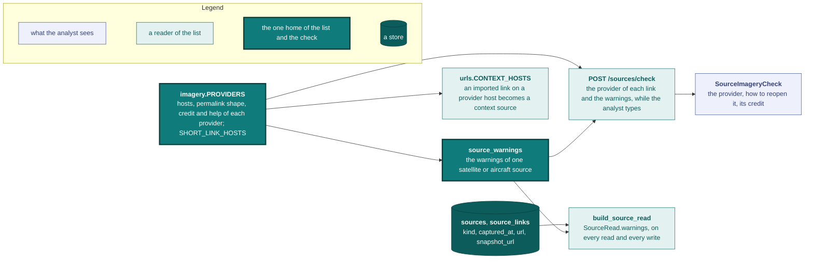

# Imagery sources

A satellite or aircraft image proves something only when a reader can reopen the same image at the same date. A screenshot alone proves nothing: the reopening link is what a reader checks. Vidit checks every source of kind `satellite` or `aircraft` against a list of imagery providers. The API reports what keeps a reader from reopening the image, without refusing the source.

The list, the shape checks and the credits live in [`services/imagery.py`](../backend/app/services/imagery.py). The event form reads them through [`POST /sources/check`](api.md#post-sourcescheck), every [`SourceRead`](api.md#get-eventsid) carries the warnings, and the import's [context hosts](ingestion.md#context-hosts) take their imagery rows from the same list.

## Providers

The first provider whose host matches a link wins. A host matches itself and its subdomains; a path narrows it where the host serves other products.

### Accepted

A permalink reopens the image at its date, and the check reads its shape.

| Provider | Hosts | Permalink the check expects | Credit |
|---|---|---|---|
| Google Earth web, historical imagery | `earth.google.com`, `google.com/earth` | `earth.google.com/web/@…/data=…`, where the `data` segment carries the imagery day | Google and every provider listed in Data attribution |
| Copernicus Browser, Sentinel-2 and Sentinel-1 | `browser.dataspace.copernicus.eu` | `lat`, `lng`, `zoom`, `datasetId`, `layerId`, `fromTime` and `toTime`; `datasetId` is `S2_L2A_CDAS`, `S2_L1C_CDAS` or `S1_CDAS_*`; `visualizationUrl` is not read | Copernicus Sentinel data [year] |
| Esri World Imagery Wayback | `livingatlas.arcgis.com/wayback` | `active` (the release) and `mapCenter` (longitude first) | Esri, Vantor, Earthstar Geographics, and the GIS User Community |
| USGS EarthExplorer: Landsat, declassified CORONA, KH-7, KH-9, aerial photo single frames | `earthexplorer.usgs.gov` | `/scene/metadata/full/{datasetId}/{entityId}/` | [Product] image courtesy of the U.S. Geological Survey |
| NASA Worldview | `worldview.earthdata.nasa.gov` | `t` (the day) and `l` (the layers) | NASA Worldview |

Google Earth Pro has no link: reopen the same date in Google Earth web. Wayback's release date is not the capture date, which the map's popup shows. Worldview's resolution suits fires, smoke and floods, not landmark matching.

### Accepted as Other

Reopenable with a link and a capture date. The check reads no shape.

| Provider | Hosts | Credit |
|---|---|---|
| Umbra Open Data | `umbra.space`, `umbra-open-data-catalog.s3.amazonaws.com`, `registry.opendata.aws/umbra-open-data` | Umbra, CC BY 4.0 |
| Capella Space Open Data | `capellaspace.com`, `registry.opendata.aws/capella_opendata` | Capella Space, CC BY 4.0 |
| ICEYE Open Data | `iceye.com` | ICEYE, CC BY 4.0 |
| Vantor Open Data | `vantor.com`, `registry.opendata.aws/vantor-open-data`, `registry.opendata.aws/maxar-open-data` | Vantor, CC BY-NC 4.0 |
| Apollo Image Hunter | `apollomapping.com` | The satellite operator named in Image Info |

Apollo Image Hunter holds no link to a scene: put the catalog ID in the source title, so a reader finds it with Catalog ID search.

A **third-party publication** of an image (an article, UNOSAT, Copernicus EMS, Soar) is accepted on any host once its link carries an [archived copy](archival.md).

### Aircraft archives

National archives of historical aerial photos. Record each as an `aircraft` source, usually `context`, with the frame or mission id in the title and the shooting date as the capture date. USGS aerial frames go through USGS EarthExplorer above.

| Provider | Hosts | Credit |
|---|---|---|
| IGN Remonter le temps | `remonterletemps.ign.fr` | IGN, Remonter le temps |
| swisstopo | `map.geo.admin.ch`, `swisstopo.admin.ch` | swisstopo |

### Not reopenable

No reader can reopen the same image at the same date. A link here raises `provider_not_reopenable` with the reason and the provider to use instead.

| Provider | Hosts | Why |
|---|---|---|
| Google Maps, Bing Maps, Apple Maps, Yandex Maps | `maps.google.com`, `google.com/maps`, `bing.com/maps`, `maps.apple.com`, `yandex.ru/maps`, `yandex.com/maps`, `yandex.ua/maps` | The basemap shows no capture date |
| Planet, Airbus OneAtlas, SkyFi | `planet.com`, `oneatlas.airbus.com`, `skyfi.com` | A reader needs an account |
| EOSDA LandViewer | `eos.com/landviewer`, `eos.com/products/landviewer` | A reader needs an account, and the terms forbid sharing the source imagery |
| Earth Engine Timelapse | `earthengine.google.com/timelapse`, `timelapse.withgoogle.com` | Yearly composites, not an image of one day |
| NASA FIRMS | `firms.modaps.eosdis.nasa.gov` | Thermal detections, not an image |
| Sentinel Hub EO Browser | `sentinel-hub.com` | Closed on 2026-03-20 |

### Short links

A short link stops working when its service closes, so the source stores the expanded link. The check reads these hosts as short links: `page.link`, `goo.gl`, `g.co`, `bit.ly`, `rebrand.ly`, `tinyurl.com`, `t.co`, `t.ly`, `ow.ly`, `buff.ly`, `is.gd`, `cutt.ly`, `rb.gy`, `shorturl.at`, `arcg.is` and `s.geo.admin.ch`.

## Warnings

`source_warnings` reads a source's kind, its `captured_at` and each link with whether it carries an archived copy. It answers nothing for a kind other than `satellite` and `aircraft`. Each link adds at most one warning: a short link, a provider no reader can reopen, or a permalink of the wrong shape. The source adds `provider_unknown` when a link sits on an unlisted host without an archived copy and no other link reopens the image, then `capture_date_missing` without a capture date. [`api.md`](api.md#imagery-warnings) lists the codes.

A warning never blocks the write or the publication of an event. Vidit encourages the rigour without requiring it. A [site's source](data-model.md#sites) is the exception: a site's sources are only worth what a reader can reopen, so `services/sites` refuses a site source when `can_reopen` finds no link to a reopenable provider and no unlisted link with an archived copy ([`imagery_not_reopenable`](api.md#post-sitesidsources)).

The source model has no credit field, so the form shows each provider's credit as help beside its link instead of warning about a missing credit.
